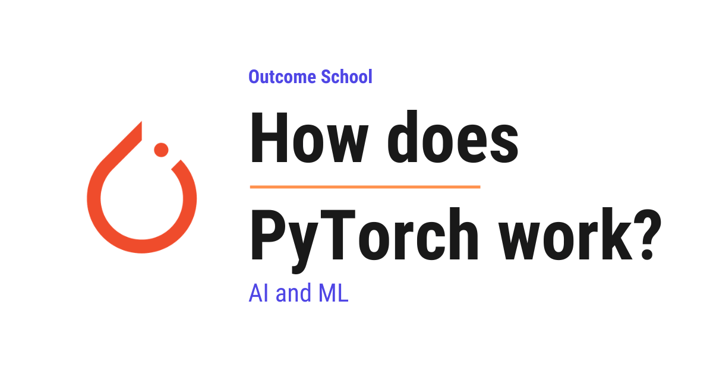

# How does PyTorch work?

> Archived from <https://outcomeschool.com/blog/how-does-pytorch-work> on 2026-11-25.

PyTorch is a free and open-source library that helps us build and train machine learning models. It stores data in tensors, records every math step in a computation graph, and uses autograd to calculate the gradients for training.

In this blog, we will learn about how PyTorch works. We will also see what a tensor is, how the computation graph and autograd work together to train a model, and why PyTorch uses the GPU to become one of the most popular tools in the real world.

We will cover the following:
<ul><li>What is PyTorch?</li><li>What is a Tensor?</li><li>The problem PyTorch solves</li><li>What is a Computation Graph?</li><li>What is Autograd?</li><li>A complete training example</li><li>What is the GPU and why does PyTorch use it?</li><li>Why is PyTorch so popular?</li></ul>
I am <strong>Amit Shekhar</strong>, Founder @ <a target="_blank" rel="noopener noreferrer" href="https://outcomeschool.com">Outcome School</a>, I have taught and mentored many developers, and their efforts landed them high-paying tech jobs, helped many tech companies in solving their unique problems, and created many open-source libraries being used by top companies. I am passionate about sharing knowledge through open-source, blogs, and videos.

I teach <a target="_blank" rel="noopener noreferrer" href="https://outcomeschool.com/program/ai-and-machine-learning">AI and Machine Learning</a> at Outcome School.

Let&#x27;s get started.
<h2 id="what-is-pytorch">What is PyTorch?</h2>
<strong>PyTorch is a free and open-source library that helps us build and train <a target="_blank" rel="noopener noreferrer" href="machine-learning.md">machine learning</a> models.</strong>

In simple words, PyTorch is a toolbox. It gives us ready-made tools so that we do not have to build everything from scratch.

Let&#x27;s say we want to teach a computer to recognize a cat in a photo. We do not want to write thousands of lines of complex math by hand. PyTorch gives us those tools, so we can focus on our idea.

PyTorch was created by the team at Meta (the company behind Facebook). Today, it is one of the most used libraries in the world for building artificial intelligence.

PyTorch is written to be used with Python. Python is a programming language that is easy to read and write. That is one big reason why so many people love PyTorch.

Before we go deeper, we must understand the most important building block of PyTorch. It is called the Tensor.
<h2 id="what-is-a-tensor">What is a Tensor?</h2>
<strong>A Tensor is a container that holds numbers in an organized way.</strong>

In simple words, a Tensor is just a box of numbers arranged in rows and columns.

Let&#x27;s understand this slowly, because everything in PyTorch is built on Tensors.

Consider a single number, like <code>5</code>. That is the simplest form.

Now consider a list of numbers, like <code>[1, 2, 3]</code>. That is a row of numbers.

Now consider a grid of numbers, like a table with rows and columns. That is like a spreadsheet.

A Tensor is the general name for all of these. One number, a row of numbers, a grid of numbers, or even bigger arrangements. They are all Tensors.

Let&#x27;s visualize this as below:

<pre><code class="code-highlight language-text">   Single number        Row of numbers        Grid of numbers
   (one value)           (one line)            (rows and columns)

      +-----+          +---+---+---+          +---+---+---+
      |  5  |          | 1 | 2 | 3 |          | 1 | 2 | 3 |
      +-----+          +---+---+---+          +---+---+---+
                                              | 4 | 5 | 6 |
                                              +---+---+---+
                                              | 7 | 8 | 9 |
                                              +---+---+---+

   &lt;------------------- all of these are Tensors -------------------&gt;
</code></pre>

Here, we can see that a single number, a row of numbers, and a grid of numbers are all Tensors. They are just different sizes of the same idea, which is a container of numbers arranged in an organized way.

So, why do we need Tensors? Because computers understand numbers, not photos or words. A photo is just a grid of numbers, where each number is the brightness of a tiny dot. A piece of text is also turned into numbers. So, to teach a computer anything, we first turn it into numbers, and Tensors hold those numbers.

Let&#x27;s create a Tensor in PyTorch as below:

<pre><code class="code-highlight language-python">import torch

# create a Tensor with three numbers
x = torch.tensor([1.0, 2.0, 3.0])
print(x)
</code></pre>

It will print the following:

<pre><code class="code-highlight">tensor([1., 2., 3.])
</code></pre>

Here, we have imported <code>torch</code>, which is the PyTorch library. Then we used <code>torch.tensor</code> to create a Tensor that holds three numbers. PyTorch confirmed it by printing the Tensor back to us.

This is how we store data in PyTorch. Now, let&#x27;s understand the actual problem that PyTorch is built to solve.
<h2 id="the-problem-pytorch-solves">The problem PyTorch solves</h2>
Before jumping into the solution, we must understand the problem first.

The goal of machine learning is simple to say. We want the computer to learn a pattern from data, and that too without us writing the rule by hand.

Let&#x27;s say we want the computer to learn the rule that converts a temperature in Celsius into Fahrenheit. We humans know the formula. But assume that we do not know it, and we want the computer to discover it from examples.

We give the computer some examples. When the input is 0, the answer is 32. When the input is 100, the answer is 212. We want the computer to figure out the rule on its own.

The computer starts with a random guess for the rule. The guess is wrong in the beginning. So, the computer checks how wrong it is, then slightly fixes the guess. It repeats this many times until the guess becomes very good.

This &quot;check how wrong, then fix a little&quot; loop is the heart of machine learning. But there is a hard part. To fix the guess correctly, the computer must know which direction to adjust each number, and by how much. This requires a lot of careful math called calculus.

Doing this math by hand for millions of numbers is impossible for us.

<strong>Planning your move into AI?</strong>

No matter which tech domain you work in today, with your effort, you can transition to these roles:
<ul><li>AI Engineer</li><li>Forward Deployed Engineer</li><li>AI Agent Engineer</li><li>Harness Engineer</li><li>Voice AI Engineer</li><li>AI Architect</li><li>LLM Engineer</li><li>LLM Inference Engineer</li><li>Gen AI Engineer</li><li>MLOps Engineer</li><li>ML Engineer</li><li>Deep Learning Engineer</li></ul>
Our <a target="_blank" rel="noopener noreferrer" href="https://outcomeschool.com/program/ai-and-machine-learning">AI and Machine Learning Program</a> at Outcome School takes you there.

So, here comes PyTorch to the rescue. PyTorch does this hard math for us, automatically. To do that, PyTorch uses two powerful ideas. The first is the Computation Graph, and the second is Autograd. Let&#x27;s understand both.
<h2 id="what-is-a-computation-graph">What is a Computation Graph?</h2>
<strong>A Computation Graph is a record of every math step that PyTorch performs, kept in the right order.</strong>

In simple words, while we do our calculations, PyTorch quietly writes down each step like a recipe.

Let&#x27;s say we calculate the following. We take a number <code>a</code>, multiply it by <code>b</code>, and then add <code>c</code>. PyTorch does not just give us the final answer. It also remembers that we first multiplied, and then we added.

Why does it remember? Because later, when the computer wants to fix its guess, it needs to walk backward through these steps. To walk backward, it must first know the forward path. The Computation Graph is that path.

Let&#x27;s see this with an example as below:

<pre><code class="code-highlight language-python">import torch

a = torch.tensor(2.0)
b = torch.tensor(3.0)
c = torch.tensor(4.0)

# PyTorch records each step
result = a * b + c
print(result)
</code></pre>

It will print the following:

<pre><code class="code-highlight">tensor(10.0)
</code></pre>

We can picture the graph as below:

<pre><code class="code-highlight language-text">    a (2)  ----+
               |
               v
            [ multiply ]  ----&gt; 6 ----+
               ^                      |
               |                      v
    b (3)  ----+                  [ add ]  ----&gt; result (10)
                                      ^
                                      |
    c (4)  ---------------------------+
</code></pre>

Here, we can see that PyTorch first takes <code>a</code> and <code>b</code> into the multiply step to get <code>6</code>, and then takes that <code>6</code> along with <code>c</code> into the add step to get the final <code>result</code> of <code>10</code>. PyTorch records this whole path so that it can walk back through it later.

Here, we can see that PyTorch gave us the answer <code>10</code>, because 2 multiplied by 3 is 6, and 6 plus 4 is 10. But behind the scenes, PyTorch also built a small graph. It noted that there was a multiply step, and then an add step.

The best part is that PyTorch builds this graph as we write normal code. We do not have to build the graph ourselves. PyTorch builds it line by line while our program runs.

This is how PyTorch keeps track of our calculations. Now, let&#x27;s understand how it uses this graph to do the hard math for us.
<h2 id="what-is-autograd">What is Autograd?</h2>
<strong>Autograd is the part of PyTorch that automatically calculates how to adjust each number to reduce the error.</strong>

The word Autograd can be decomposed like below:
<blockquote>
Autograd = Auto + Gradient
</blockquote>
&quot;Auto&quot; means automatic. A &quot;Gradient&quot; is just a fancy word for direction and amount of change. So, Autograd means &quot;automatic calculation of which direction to change and by how much&quot;.

Let&#x27;s understand the idea of a gradient in simple words. Suppose we are standing on a hill in thick fog, and we want to reach the bottom. We cannot see far. So, we feel the ground under our feet to find which way it slopes downward, then take a small step in that direction. We repeat this until we reach the bottom.

A <a target="_blank" rel="noopener noreferrer" href="math-behind-gradient-descent.md">gradient</a> is exactly that slope. It tells the computer which way is &quot;downhill&quot;, where downhill means &quot;less error&quot;. The computer takes a small step downhill, again and again, until the error is very small.

Autograd calculates this slope for every number in our model, automatically, using the Computation Graph we just learned about.

To turn on this tracking, we tell PyTorch that a Tensor needs gradients. We can write the code as below:

<pre><code class="code-highlight language-python">import torch

# tell PyTorch to track this number for gradients
x = torch.tensor(3.0, requires_grad=True)

# do a simple calculation
y = x * x

# ask PyTorch to calculate the gradient
y.backward()

print(x.grad)
</code></pre>

It will print the following:

<pre><code class="code-highlight">tensor(6.0)
</code></pre>

Here, we have done a few things. First, we created a Tensor <code>x</code> with the value <code>3.0</code> and set <code>requires_grad=True</code>, which tells PyTorch to track it. Then we calculated <code>y</code> as <code>x</code> multiplied by <code>x</code>. After that, we called <code>y.backward()</code>, which tells PyTorch to walk backward through the graph and calculate the slope.

Finally, <code>x.grad</code> gave us the answer <code>6.0</code>. For the calculation <code>x * x</code>, the slope at <code>x = 3</code> is exactly <code>6</code>. PyTorch found this for us automatically. We did not do any calculus by hand.

This is the real magic of PyTorch. We write the forward calculation in plain code, and PyTorch handles all the backward math.

This backward walk through the graph is exactly what backpropagation does. We have a detailed blog on the <a target="_blank" rel="noopener noreferrer" href="math-behind-backpropagation.md">Math Behind Backpropagation</a> that explains it step by step.

<strong>A quick note for you</strong>

No matter which tech domain you work in, get familiar with these topics:
<ul><li>LLM</li><li>RAG</li><li>MCP</li><li>Agent</li><li>Fine-tuning</li><li>Quantization</li></ul>
We put it all together in one video:

<a target="_blank" rel="noopener noreferrer" href="https://www.youtube.com/watch?v=lnfWvX66FUk">AI Engineering Explained: LLM, RAG, MCP, Agent, Fine-Tuning, and Quantization</a>

No need to stop reading - bookmark it and watch later when you get time. Future you will thank you.

Now, let&#x27;s get back to the topic.

Now that we have learned about Tensors, the Computation Graph, and Autograd, it is time to put them together into a real training example.
<h2 id="a-complete-training-example">A complete training example</h2>
Let&#x27;s go back to our temperature problem. We want the computer to learn the rule that turns Celsius into Fahrenheit, only from examples.

The real rule is &quot;multiply by 1.8 and add 32&quot;. But we will pretend we do not know it. We will let PyTorch discover the multiply number and the add number on its own.

Let&#x27;s see the code for the full training loop as below:

<pre><code class="code-highlight language-python">import torch

# our examples: Celsius inputs and the correct Fahrenheit answers
celsius = torch.tensor([0.0, 100.0])
fahrenheit = torch.tensor([32.0, 212.0])

# start with random guesses, and track them for gradients
weight = torch.tensor(0.0, requires_grad=True)
bias = torch.tensor(0.0, requires_grad=True)

learning_rate = 0.0001

# repeat the learning loop many times
for step in range(100000):
    # make a prediction with the current guess
    prediction = weight * celsius + bias

    # measure how wrong we are (the error)
    error = ((prediction - fahrenheit) ** 2).mean()

    # ask PyTorch to calculate the gradients
    error.backward()

    # take a small step downhill, then reset for the next round
    with torch.no_grad():
        weight -= learning_rate * weight.grad
        bias -= learning_rate * bias.grad
        weight.grad.zero_()
        bias.grad.zero_()

print(weight, bias)
</code></pre>

We can picture the learning loop as below:

<pre><code class="code-highlight language-text">        +-------------------------------------------------+
        |                                                 |
        v                                                 |
   make a prediction with the current weight and bias     |
        |                                                 |
        v                                                 |
   measure how wrong the prediction is (the error)        |
        |                                                 |
        v                                                 |
   error.backward() finds the slopes (gradients)          |
        |                                                 |
        v                                                 |
   nudge weight and bias a small step downhill            |
        |                                                 |
        +------------------- repeat ----------------------+
</code></pre>

Here, we can see that the loop keeps going round and round. Each round we predict, measure the error, find the slopes, and take a small step downhill. With every round the error gets smaller, until <code>weight</code> is near <code>1.8</code> and <code>bias</code> is near <code>32</code>.

Here, we have done the complete learning cycle. Let me explain each part slowly.
<ul><li>We created <code>celsius</code> and <code>fahrenheit</code> Tensors. These are our examples, the input and the correct answer.</li><li>We created <code>weight</code> and <code>bias</code> as our guesses, starting at zero, and we set <code>requires_grad=True</code> so PyTorch tracks them.</li><li>The <code>learning_rate</code> is the size of each small step. A small step keeps the learning safe and steady.</li><li>Inside the loop, <code>prediction</code> is the computer&#x27;s current guess for the answer.</li><li>The <code>error</code> measures how far the guess is from the correct answer. A bigger number means a worse guess.</li><li><code>error.backward()</code> tells PyTorch to calculate the gradients, which are the slopes for <code>weight</code> and <code>bias</code>.</li><li>Then we nudge <code>weight</code> and <code>bias</code> a little in the downhill direction, which reduces the error.</li><li>Finally, we reset the gradients with <code>zero_()</code> so the next round starts fresh.</li></ul>
After the loop runs many times, the <code>weight</code> becomes close to <code>1.8</code> and the <code>bias</code> becomes close to <code>32</code>. The computer discovered the rule on its own. We never told it the formula.

<strong>Note:</strong> We run the loop for a large number of times here, around <code>100000</code>. The reason is that our Celsius inputs are not scaled, which means the numbers like <code>0</code> and <code>100</code> are very different in size. When the inputs are not scaled, the learning becomes slow, and the <code>bias</code> in particular takes many rounds to reach <code>32</code>. In real projects, we usually scale the inputs first so that the model learns much faster. For this simple example, we keep it as it is and just run more rounds.

Let&#x27;s also see the idea as a small step-by-step walkthrough for the very first rounds:
<ul><li><strong>Step 1:</strong> weight = 0, bias = 0, so the prediction is very wrong, and the error is huge.</li><li><strong>Step 2:</strong> PyTorch finds the slopes, and we nudge weight and bias a little. The error gets smaller.</li><li><strong>Step 3:</strong> We repeat. The prediction gets closer to the correct answer each time.</li><li><strong>Final step:</strong> weight is near 1.8, bias is near 32, and the error is very small.</li></ul>
This is how a machine learning model learns inside PyTorch. The same loop, with more numbers and more steps, is how huge models are trained too.

If we want to go deep into how models actually learn - Gradient Descent, Loss Functions, and Backpropagation - and even build a Neural Network from scratch, we cover it all in our <a target="_blank" rel="noopener noreferrer" href="https://outcomeschool.com/program/ai-and-machine-learning">AI and Machine Learning Program</a> at Outcome School.

This was all about the training loop. Now, let&#x27;s understand one more thing that makes PyTorch fast.
<h2 id="what-is-the-gpu-and-why-does-pytorch-use-it">What is the GPU and why does PyTorch use it?</h2>
<strong>A GPU is a special chip in the computer that can do a huge number of simple math operations at the same time.</strong>

In simple words, the <a target="_blank" rel="noopener noreferrer" href="how-does-a-gpu-work-for-deep-learning.md">GPU</a> is built for speed when we have a lot of small calculations.

Let&#x27;s use an analogy. Suppose we have to deliver one thousand letters. A CPU is like one very fast person delivering them one after another. A GPU is like one thousand normal people, each delivering one letter at the same time. For this kind of work, the crowd finishes much faster.

Machine learning has millions of small math operations, mostly on Tensors. So, the GPU is perfect for it.

The beautiful thing about PyTorch is that moving our work to the GPU is very simple. We can write the code as below:

<pre><code class="code-highlight language-python"># move the Tensor to the GPU if one is available
device = &quot;cuda&quot; if torch.cuda.is_available() else &quot;cpu&quot;
x = torch.tensor([1.0, 2.0, 3.0]).to(device)
print(x)
</code></pre>

Here, we have checked if a GPU is available. The word <code>cuda</code> is the name PyTorch uses for many GPUs. If a GPU is present, we move the Tensor to it using <code>.to(device)</code>. If not, we stay on the <code>cpu</code>. The rest of our code stays the same.

We have a detailed blog on <a target="_blank" rel="noopener noreferrer" href="how-do-cuda-kernels-work.md">how CUDA Kernels work</a> that explains what actually runs on the GPU behind the scenes.

This is how PyTorch makes our training fast without making our code complicated. It enables us to do complex things very simply. It provides us the power.

Now, we have understood the GPU. Let&#x27;s finish with why PyTorch became so loved.
<h2 id="why-is-pytorch-so-popular">Why is PyTorch so popular?</h2>
We have already seen the main reasons, so let me put them together.
<ul><li>PyTorch builds the Computation Graph as our code runs, line by line. This makes it easy to read, easy to test, and easy to fix when something goes wrong.</li><li>Autograd does all the hard calculus for us, so we focus on our idea, not on the math.</li><li>It works smoothly with Python, which is simple to learn and read.</li><li>It uses the GPU with a single small change in the code, so our training becomes fast.</li><li>It is free, open-source, and supported by a very large community, so help is always available.</li></ul>
These reasons together make PyTorch a favourite for students, researchers, and big companies alike.

If we want to go deep into how models actually learn - Gradient Descent, Loss Functions, and Backpropagation - and even build a Neural Network from scratch, we cover it all in our <a target="_blank" rel="noopener noreferrer" href="https://outcomeschool.com/program/ai-and-machine-learning">AI and Machine Learning Program</a> at Outcome School.

Let&#x27;s quickly map the main pieces to simple roles for better understanding:
<table><thead><tr><th>PyTorch piece</th><th>Simple role</th></tr></thead><tbody><tr><td>Tensor</td><td>The box that holds our numbers</td></tr><tr><td>Computation Graph</td><td>The recipe that records every math step</td></tr><tr><td>Autograd</td><td>The helper that finds the downhill direction</td></tr><tr><td>GPU</td><td>The crowd that does the math fast</td></tr></tbody></table>
Here, we can see the full picture. The Tensor holds the data. The Computation Graph remembers the steps. Autograd uses those steps to find how to improve. The GPU makes it all run fast.

Now, we have understood how PyTorch works. We started with Tensors, learned how PyTorch records our steps in a Computation Graph, saw how Autograd does the hard math automatically, ran a full training loop where the computer learned a rule on its own, and finally saw how the GPU makes everything fast.

<strong>Stay updated:</strong> Subscribe to our <a target="_blank" rel="noopener noreferrer" href="https://outcomeschool.substack.com/subscribe">newsletter</a> to get our latest AI and Machine Learning blogs straight to your inbox.
<h2 id="frequently-asked-questions">Frequently Asked Questions</h2><h3 id="do-we-need-to-build-the-computation-graph-ourselves-in-pytorch">Do we need to build the computation graph ourselves in PyTorch?</h3>
No. PyTorch builds the computation graph as our code runs, line by line. We just write normal code for the forward calculation, and PyTorch quietly records each math step in the right order. This also makes the code easy to read, easy to test, and easy to fix.
<h3 id="do-we-need-a-gpu-to-use-pytorch">Do we need a GPU to use PyTorch?</h3>
No. PyTorch works on the CPU too. A GPU only makes training faster, because it can do a huge number of simple math operations at the same time. We check if a GPU is available, move the Tensor to it with <code>.to(device)</code>, and otherwise stay on the CPU, while the rest of the code stays the same.
<h3 id="what-does-requires_gradtrue-do-in-pytorch">What does requires_grad=True do in PyTorch?</h3>
It tells PyTorch to track a Tensor for gradients. When we later call <code>backward()</code> on a result, PyTorch walks backward through the computation graph and calculates the gradient for every tracked Tensor. We then read that gradient from the Tensor&#x27;s <code>grad</code> value.
<h3 id="why-do-we-reset-the-gradients-in-every-training-round">Why do we reset the gradients in every training round?</h3>
We reset the gradients with <code>zero_()</code> so that the next round starts fresh. In each round, we make a prediction, measure the error, calculate the gradients, and nudge the numbers a small step downhill. Resetting keeps each round working on its own new gradients.
<h3 id="why-can-a-simple-pytorch-training-loop-need-so-many-rounds">Why can a simple PyTorch training loop need so many rounds?</h3>
One reason is that the inputs are not scaled. When input numbers like 0 and 100 are very different in size, learning becomes slow, and some values take many rounds to reach the right answer. In real projects, we usually scale the inputs first so that the model learns much faster.

That&#x27;s it for now.

Thanks

<strong>Amit Shekhar</strong> Founder @ <a target="_blank" rel="noopener noreferrer" href="https://outcomeschool.com">Outcome School</a>

You can connect with me on:
<ul><li><a target="_blank" rel="noopener noreferrer" href="https://x.com/amitiitbhu">X</a></li><li><a target="_blank" rel="noopener noreferrer" href="https://www.linkedin.com/in/amit-shekhar-iitbhu">LinkedIn</a></li><li><a target="_blank" rel="noopener noreferrer" href="https://github.com/amitshekhariitbhu">GitHub</a></li></ul>
Follow Outcome School on:
<ul><li><a target="_blank" rel="noopener noreferrer" href="https://x.com/outcome_school">X</a></li><li><a target="_blank" rel="noopener noreferrer" href="https://youtube.com/@OutcomeSchool">YouTube</a></li><li><a target="_blank" rel="noopener noreferrer" href="https://www.linkedin.com/company/outcomeschool">LinkedIn</a></li><li><a target="_blank" rel="noopener noreferrer" href="https://github.com/OutcomeSchool">GitHub</a></li></ul>
<a target="_blank" rel="noopener noreferrer" href="https://outcomeschool.com/blog"><strong>Read all of our high-quality blogs here.</strong></a>

