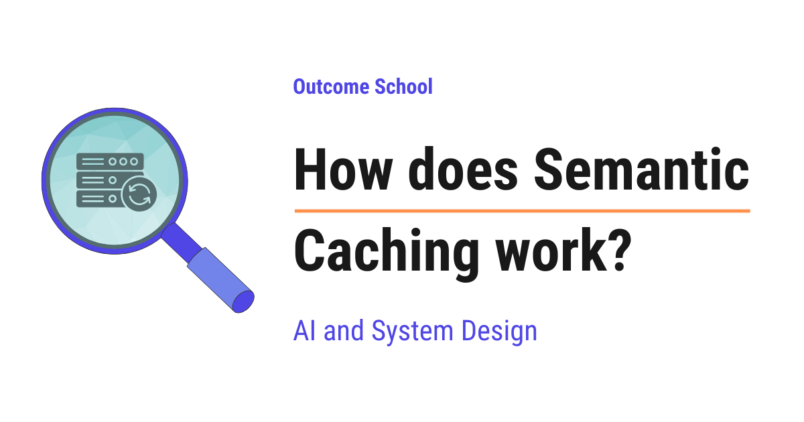

# How does Semantic Caching work?

> Archived from <https://outcomeschool.com/blog/how-does-semantic-caching-work> on 2026-11-25.

Semantic Caching is a cache that matches questions by their meaning instead of their exact words. So, if a new question means the same as an old one, the AI app can reuse the saved answer.

In this blog, we will learn about how Semantic Caching works. We will also see why traditional caching falls short for AI apps, how Semantic Caching uses embeddings and similarity to reuse past answers, and how setting the right threshold makes it work in the real world.

We will cover the following:
<ul><li>What is a cache?</li><li>The problem with traditional caching for AI apps</li><li>What is Semantic Caching?</li><li>What are embeddings?</li><li>What is similarity between embeddings?</li><li>How does Semantic Caching work step by step?</li><li>A numeric walkthrough</li><li>Setting the similarity threshold</li><li>Advantages of Semantic Caching</li><li>Things to keep in mind</li></ul>
I am <strong>Amit Shekhar</strong>, Founder @ <a target="_blank" rel="noopener noreferrer" href="https://outcomeschool.com">Outcome School</a>, I have taught and mentored many developers, and their efforts landed them high-paying tech jobs, helped many tech companies in solving their unique problems, and created many open-source libraries being used by top companies. I am passionate about sharing knowledge through open-source, blogs, and videos.

I teach <a target="_blank" rel="noopener noreferrer" href="https://outcomeschool.com/program/ai-and-machine-learning">AI and Machine Learning</a> at Outcome School.

Let&#x27;s get started.
<h3 id="what-is-a-cache">What is a cache?</h3>
A <strong>cache</strong> is a place where we store the answer to a question, so that the next time the same question comes, we can return the saved answer instantly.

In simple words, a cache is a memory of past answers.

Let&#x27;s say a friend asks us, &quot;What is the capital of France?&quot; We answer, &quot;Paris.&quot; If the same friend asks the same question again, we do not think again. We simply say &quot;Paris&quot; because we remember it.

That memory of past answers is the cache. It saves us time, and it saves us effort.

This is how a cache works in software too. The first time, we do the hard work and compute the answer. After that, we store it. The next time, we return the stored answer directly.
<h3 id="the-problem-with-traditional-caching-for-ai-apps">The problem with traditional caching for AI apps</h3>
Now, let&#x27;s understand why normal caching is not enough for AI apps.

Suppose we are building an app that uses a <strong>Large Language Model</strong> that powers tools like ChatGPT. Every time a user asks a question, our app sends that question to the model, the model thinks, and then it returns an answer.

But, here is the catch. Sending a question to the model costs money, and it also takes time. If a thousand users ask the same thing, we pay a thousand times, and each user waits.

So, we think of caching. We store each question and its answer. The next time the exact same question comes, we return the stored answer.

This is called <strong>exact-match caching</strong>. It matches the question word by word, letter by letter.

Let&#x27;s see the problem with an example. Assume that two users ask these questions:
<ul><li>User 1: &quot;What is the capital of France?&quot;</li><li>User 2: &quot;Tell me the capital city of France.&quot;</li></ul>
For us humans, both questions mean the same thing. The answer is &quot;Paris&quot; in both cases.

But for exact-match caching, these two are completely different. The words are different, the order is different, so the cache thinks they are two separate questions. It will send the second question to the model again, and we pay again.

The issue with this approach is that it only understands letters, not meaning. People ask the same thing in many different ways, so the cache almost never matches.

We needed a solution for that, and Semantic Caching was introduced to solve this problem.
<h3 id="what-is-semantic-caching">What is Semantic Caching?</h3>
<strong>Semantic Caching</strong> is a cache that matches questions by their meaning instead of their exact words.

Let&#x27;s break the term to understand it better.
<blockquote>
Semantic Caching = Semantic + Caching
</blockquote>
The word &quot;semantic&quot; simply means &quot;related to meaning.&quot; So, Semantic Caching is caching based on meaning.

In simple words, if a new question means the same thing as an old question, we return the old answer, even if the words are different.

Going back to our example, &quot;What is the capital of France?&quot; and &quot;Tell me the capital city of France.&quot; mean the same thing. So, Semantic Caching treats them as a match and returns &quot;Paris&quot; without asking the model again.

This is the beauty of Semantic Caching. It understands intent, not just text.

<strong>Planning your move into AI?</strong>

No matter which tech domain you work in today, with your effort, you can transition to these roles:
<ul><li>AI Engineer</li><li>Forward Deployed Engineer</li><li>AI Agent Engineer</li><li>Harness Engineer</li><li>Voice AI Engineer</li><li>AI Architect</li><li>LLM Engineer</li><li>LLM Inference Engineer</li><li>Gen AI Engineer</li><li>MLOps Engineer</li><li>ML Engineer</li><li>Deep Learning Engineer</li></ul>
Our <a target="_blank" rel="noopener noreferrer" href="https://outcomeschool.com/program/ai-and-machine-learning">AI and Machine Learning Program</a> at Outcome School takes you there.

Now, the next big question is: how does a computer understand the meaning of a sentence? A computer only understands numbers. So, here come <a target="_blank" rel="noopener noreferrer" href="what-are-embeddings.md">embeddings</a> into the picture.
<h3 id="what-are-embeddings">What are embeddings?</h3>
An <strong>embedding</strong> is a list of numbers that represents the meaning of a piece of text.

In simple words, an embedding turns a sentence into numbers, in such a way that sentences with similar meaning get similar numbers.

Let&#x27;s understand this with a simple picture in our mind. Imagine a big map. On this map, every sentence becomes a single point. Sentences that mean the same thing land close to each other. Sentences that mean very different things land far apart.

For the sake of understanding, consider this map:
<ul><li>&quot;What is the capital of France?&quot; lands at one point.</li><li>&quot;Tell me the capital city of France.&quot; lands very close to it, because the meaning is almost the same.</li><li>&quot;How do I bake a chocolate cake?&quot; lands very far away, because the meaning is totally different.</li></ul>
So, the embedding is just the address of that point on the map, written as a list of numbers.

Let&#x27;s visualize this map of meaning as below:

<pre><code class="code-highlight language-text">   meaning
      ^
      |
      |   [France capital question]
      |   [France capital city question]   &lt;- close, same meaning
      |
      |
      |
      |                          [bake a chocolate cake]  &lt;- far, different
      |
      +-------------------------------------------------&gt; meaning
</code></pre>

Here, we can see that the two questions about the capital of France land close to each other, because they mean almost the same thing. The question about baking a cake lands far away, because its meaning is completely different. This closeness on the map is exactly what we measure later.

A real embedding has hundreds of numbers. But for the sake of understanding, let&#x27;s pretend each embedding has only two numbers. We can write them like below:

<pre><code class="code-highlight language-python"># Just for understanding, real embeddings have hundreds of numbers
&quot;What is the capital of France?&quot;      -&gt; [0.91, 0.10]
&quot;Tell me the capital city of France.&quot; -&gt; [0.89, 0.12]
&quot;How do I bake a chocolate cake?&quot;     -&gt; [0.05, 0.95]
</code></pre>

Here, we can notice that the first two lists of numbers are very close to each other. The third one is far away. This matches our understanding, because the first two questions mean the same thing, and the third one means something completely different.

This is how a model converts meaning into numbers. We use a special model called an <strong><a target="_blank" rel="noopener noreferrer" href="embedding-model.md">embedding model</a></strong> to create these numbers for any text we give it.

To learn embeddings, Vector Databases, and RAG in depth, we cover all of these in our <a target="_blank" rel="noopener noreferrer" href="https://outcomeschool.com/program/ai-and-machine-learning">AI and Machine Learning Program</a> at Outcome School.
<h3 id="what-is-similarity-between-embeddings">What is similarity between embeddings?</h3>
Now that we have learned about embeddings, it&#x27;s time to learn how we compare two embeddings.

<strong>Similarity</strong> is a number that tells us how close two embeddings are in meaning.

In simple words, we take two lists of numbers and we calculate a single score. A high score means the meanings are close. A low score means the meanings are far apart.

The most common score used here is called <strong><a target="_blank" rel="noopener noreferrer" href="cosine-similarity.md">cosine similarity</a></strong>. We do not need to learn the math today. We just need to remember one thing.
<blockquote>
Higher similarity score means closer meaning.
</blockquote>
For the sake of understanding, the score usually goes from 0 to 1.
<ul><li>A score near 1 means the two sentences mean almost the same thing.</li><li>A score near 0 means the two sentences mean very different things.</li></ul>
So, when a new question comes, we find its embedding, and we compare it with the embeddings of all our saved questions. If any saved question has a high enough similarity score, we treat it as a match.

<strong>A quick note for you</strong>

No matter which tech domain you work in, get familiar with these topics:
<ul><li>LLM</li><li>RAG</li><li>MCP</li><li>Agent</li><li>Fine-tuning</li><li>Quantization</li></ul>
We put it all together in one video:

<a target="_blank" rel="noopener noreferrer" href="https://www.youtube.com/watch?v=lnfWvX66FUk">AI Engineering Explained: LLM, RAG, MCP, Agent, Fine-Tuning, and Quantization</a>

No need to stop reading - bookmark it and watch later when you get time. Future you will thank you.

Now, let&#x27;s get back to the topic.
<h3 id="how-does-semantic-caching-work-step-by-step">How does Semantic Caching work step by step?</h3>
Before we see the full flow, let me map each piece to a simple real-world role for your better understanding.
<table><thead><tr><th>Piece in Semantic Caching</th><th>Real-world role</th></tr></thead><tbody><tr><td>Embedding model</td><td>A translator that turns a sentence into numbers</td></tr><tr><td>Embedding</td><td>The address of a sentence on the map of meaning</td></tr><tr><td>Similarity score</td><td>A judge that tells how close two meanings are</td></tr><tr><td>Threshold</td><td>A rule that decides &quot;close enough or not&quot;</td></tr><tr><td>Cache</td><td>A notebook of past questions and their answers</td></tr></tbody></table>
Now, let&#x27;s put everything together and see the full flow.

<strong>Step 1:</strong> A user sends a question to our app.

<strong>Step 2:</strong> We convert the question into an embedding using the embedding model. Now the question is a list of numbers.

<strong>Step 3:</strong> We compare this embedding with the embeddings of all the questions already stored in our cache. We calculate a similarity score for each.

<strong>Step 4:</strong> We find the saved question with the highest similarity score.

<strong>Step 5:</strong> Now, the decision. If the highest score is above a chosen limit, we call it a <strong>cache hit</strong>. We return the saved answer directly, without calling the model. This is fast and free.

<strong>Step 6:</strong> If no saved question crosses that limit, we call it a <strong>cache miss</strong>. We send the question to the model, get a fresh answer, and then store the new question, its embedding, and its answer in the cache for the future.

This is how Semantic Caching serves answers by meaning.

We can picture the full flow as below:

<pre><code class="code-highlight language-text">        User question
              |
              v
   +----------------------+
   |   Embedding model    |   (turn text into numbers)
   +----------------------+
              |
              v
   +----------------------+
   |  Search the cache    |   (compare with saved embeddings)
   |  for the best score  |
   +----------------------+
              |
              v
       score &gt;= threshold ?
        /              \
      yes               no
       |                 |
       v                 v
  +-----------+   +--------------------+
  | Cache hit |   |    Cache miss      |
  | return    |   | ask the model,     |
  | saved     |   | then store the new |
  | answer    |   | question + answer  |
  +-----------+   +--------------------+
</code></pre>

Here, we can see that every question first becomes numbers through the embedding model. We then search the cache for the closest saved question and its score. If the score crosses the threshold, we take the left path and return the saved answer, which is a cache hit. If it does not, we take the right path, ask the model for a fresh answer, and store it, which is a cache miss.

In a real system, these saved embeddings live in a <a target="_blank" rel="noopener noreferrer" href="how-does-a-vector-database-work.md">vector database</a> that is built to store embeddings and find the closest ones fast using <a target="_blank" rel="noopener noreferrer" href="how-does-approximate-nearest-neighbor-ann-search-work.md">Approximate Nearest Neighbor (ANN) search</a>.

Let&#x27;s see this flow in simple code as below:

<pre><code class="code-highlight language-python">def get_answer(question):
    new_embedding = embed(question)            # Step 2: text to numbers

    best_match, score = search_cache(new_embedding)  # Step 3 and 4

    if score &gt;= 0.85:                          # Step 5: cache hit
        return best_match.answer

    answer = ask_model(question)               # Step 6: cache miss
    store_in_cache(question, new_embedding, answer)
    return answer
</code></pre>

Here, we can see the whole idea in one place. The <code>embed</code> function turns the question into numbers. The <code>search_cache</code> function finds the closest saved question and its similarity <code>score</code>. If the <code>score</code> is high enough, which is <code>0.85</code> in our example, we return the saved answer. If not, we ask the model, and then we save the new result so that the next similar question becomes a cache hit.

Here, the number <code>0.85</code> is the limit we talked about. It is called the <strong>similarity threshold</strong>, and we will understand it in detail next.
<h3 id="a-numeric-walkthrough">A numeric walkthrough</h3>
The best way to learn this is by taking an example. Let&#x27;s walk through it step by step with numbers.

Assume that our cache already has one saved question.
<ul><li>Saved question: &quot;What is the capital of France?&quot;</li><li>Saved answer: &quot;Paris&quot;</li></ul>
Now, a new user sends a question, and we compare it with our saved question.

<strong>Step 1:</strong> New question is &quot;Tell me the capital city of France.&quot; We compute its embedding and compare it with the saved one. The similarity score comes out to be <code>0.93</code>. Our threshold is <code>0.85</code>. Since <code>0.93</code> is greater than <code>0.85</code>, this is a cache hit. We return &quot;Paris&quot; instantly, and we do not call the model.

<strong>Step 2:</strong> New question is &quot;What is the population of France?&quot; We compute its embedding and compare it. The similarity score comes out to be <code>0.40</code>. This is below <code>0.85</code>, so this is a cache miss. We send it to the model, get the fresh answer, and store it in the cache.

<strong>Step 3:</strong> New question is &quot;How do I bake a chocolate cake?&quot; We compute its embedding and compare it. The similarity score comes out to be <code>0.05</code>. This is far below <code>0.85</code>, so this is again a cache miss. We send it to the model and store the new answer.

Here, we can notice the pattern. Same meaning gives a high score and becomes a cache hit. Different meaning gives a low score and becomes a cache miss. This is exactly what we wanted.

<strong>Stay updated:</strong> Subscribe to our <a target="_blank" rel="noopener noreferrer" href="https://outcomeschool.substack.com/subscribe">newsletter</a> to get our latest AI and Machine Learning blogs straight to your inbox.
<h3 id="setting-the-similarity-threshold">Setting the similarity threshold</h3>
The <strong>similarity threshold</strong> is the limit we choose to decide whether a new question is close enough to a saved one.

This single number is very important, so let&#x27;s understand it carefully.

If we set the threshold too high, like <code>0.99</code>, then almost nothing matches. Only an exact copy would pass. We lose most of the benefit of Semantic Caching.

If we set the threshold too low, like <code>0.50</code>, then very different questions start matching. We may return a wrong answer. For example, &quot;capital of France&quot; could wrongly match &quot;capital of Germany&quot; and return the wrong city.

So, the threshold is a balance. A value around <code>0.85</code> to <code>0.95</code> works well for many apps, but the right value depends on our use case. We must test it with real questions from our users and adjust it.
<blockquote>
A high threshold means fewer matches but safer answers. A low threshold means more matches but a higher chance of a wrong answer.
</blockquote>
To learn embeddings, Vector Databases, and RAG in depth, we cover all of these in our <a target="_blank" rel="noopener noreferrer" href="https://outcomeschool.com/program/ai-and-machine-learning">AI and Machine Learning Program</a> at Outcome School.
<h3 id="advantages-of-semantic-caching">Advantages of Semantic Caching</h3>
Now, let&#x27;s quickly look at why Semantic Caching is so useful.

<strong>Advantages:</strong>
<ul><li>It saves money, because we call the expensive model far less often.</li><li>It is much faster, because returning a saved answer takes very less time compared to asking the model.</li><li>It reduces load on the model, so our app can handle many more users.</li><li>It matches questions by meaning, so it works even when users phrase the same thing in different ways.</li></ul>
This is how Semantic Caching makes our AI apps cheaper and faster at the same time.

Semantic Caching is one way to cut the cost of LLM calls. Another is prompt caching, which reuses the model&#x27;s internal work on a repeated prompt prefix. We have a detailed blog on <a target="_blank" rel="noopener noreferrer" href="how-does-prompt-caching-work.md">how Prompt Caching works</a> that explains this step by step.
<h3 id="things-to-keep-in-mind">Things to keep in mind</h3>
Semantic Caching is powerful, but we must use it carefully. Let me share a few important points.

First, it is best for questions whose answers do not change quickly. A question like &quot;What is the capital of France?&quot; is perfect, because the answer stays the same. But a question like &quot;What is the weather right now?&quot; is not a good fit, because the correct answer changes every hour.

Second, we must pick a good threshold. As we learned, a wrong threshold can either kill the benefit or return wrong answers.

Third, we may want to clear or refresh the cache from time to time, so that old answers do not stay forever when the real answer has changed.

Now, we have understood how Semantic Caching works. We started with a simple cache, we saw why exact-match caching fails for AI apps, we learned about embeddings and similarity, and finally we put it all together into a clear step-by-step flow with a numeric walkthrough.
<h2 id="frequently-asked-questions">Frequently Asked Questions</h2><h3 id="what-is-the-difference-between-semantic-caching-and-prompt-caching">What is the difference between semantic caching and prompt caching?</h3>
Semantic caching reuses the saved final answer when a new question means the same as an old one, so the model is not called at all. Prompt caching reuses the model&#x27;s internal work on a repeated prompt prefix. Both help cut the cost of LLM calls.
<h3 id="can-semantic-caching-return-a-wrong-answer">Can semantic caching return a wrong answer?</h3>
Yes, if the similarity threshold is set too low. With a low threshold like 0.50, very different questions start matching. For example, a question about the capital of France could wrongly match a question about the capital of Germany and return the wrong city. We must test the threshold with real user questions.
<h3 id="is-semantic-caching-a-good-fit-for-questions-like-the-current-weather">Is semantic caching a good fit for questions like the current weather?</h3>
No. Semantic caching is best for questions whose answers do not change quickly, like the capital of France. A question about the weather right now is not a good fit, because the correct answer changes every hour. We may also refresh the cache from time to time so old answers do not stay forever.
<h3 id="where-are-the-embeddings-stored-in-a-semantic-cache">Where are the embeddings stored in a semantic cache?</h3>
In a real system, the saved embeddings live in a vector database. A vector database is built to store embeddings and find the closest ones fast using Approximate Nearest Neighbor search. Each entry keeps the question, its embedding, and its answer.

That&#x27;s it for now.

Thanks

<strong>Amit Shekhar</strong> Founder @ <a target="_blank" rel="noopener noreferrer" href="https://outcomeschool.com">Outcome School</a>

You can connect with me on:
<ul><li><a target="_blank" rel="noopener noreferrer" href="https://x.com/amitiitbhu">X</a></li><li><a target="_blank" rel="noopener noreferrer" href="https://www.linkedin.com/in/amit-shekhar-iitbhu">LinkedIn</a></li><li><a target="_blank" rel="noopener noreferrer" href="https://github.com/amitshekhariitbhu">GitHub</a></li></ul>
Follow Outcome School on:
<ul><li><a target="_blank" rel="noopener noreferrer" href="https://x.com/outcome_school">X</a></li><li><a target="_blank" rel="noopener noreferrer" href="https://youtube.com/@OutcomeSchool">YouTube</a></li><li><a target="_blank" rel="noopener noreferrer" href="https://www.linkedin.com/company/outcomeschool">LinkedIn</a></li><li><a target="_blank" rel="noopener noreferrer" href="https://github.com/OutcomeSchool">GitHub</a></li></ul>
<a target="_blank" rel="noopener noreferrer" href="https://outcomeschool.com/blog"><strong>Read all of our high-quality blogs here.</strong></a>

