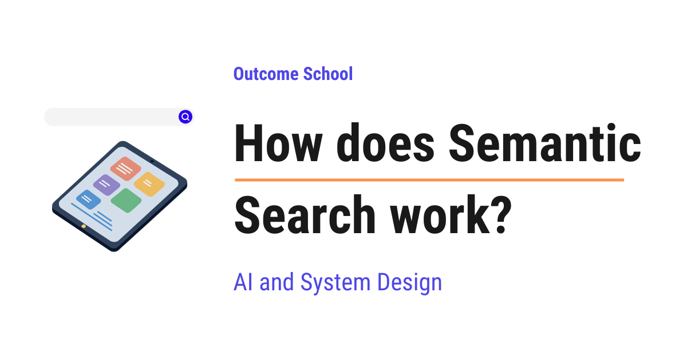

# How does Semantic Search work?

> Archived from <https://outcomeschool.com/blog/how-does-semantic-search-work> on 2026-11-25.

Semantic Search is search based on meaning, not on exact words. It turns the text into embeddings, which are lists of numbers, and returns the items whose meaning is closest to our query.

In this blog, we will learn about how Semantic Search works. We will also see why we need it, how it actually works step by step, and where it is used in real systems like search engines, AI assistants, and <a target="_blank" rel="noopener noreferrer" href="recommendation-system.md">recommendations</a>.

We will cover the following:
<ul><li>What is keyword search?</li><li>Where keyword search fails</li><li>What is Semantic Search?</li><li>What is an embedding?</li><li>How similar meanings sit close together</li><li>How we measure closeness with cosine similarity</li><li>What is a vector database?</li><li>The full Semantic Search flow</li><li>Approximate nearest neighbor for speed at scale</li><li>Semantic Search in the real world</li></ul>
I am <strong>Amit Shekhar</strong>, Founder @ <a target="_blank" rel="noopener noreferrer" href="https://outcomeschool.com">Outcome School</a>, I have taught and mentored many developers, and their efforts landed them high-paying tech jobs, helped many tech companies in solving their unique problems, and created many open-source libraries being used by top companies. I am passionate about sharing knowledge through open-source, blogs, and videos.

I teach <a target="_blank" rel="noopener noreferrer" href="https://outcomeschool.com/program/ai-and-machine-learning">AI and Machine Learning</a> at Outcome School.

Let&#x27;s get started.
<h3 id="what-is-keyword-search">What is keyword search?</h3>
The oldest and simplest way to search is keyword search. Before we understand it, let&#x27;s quickly see what search itself means, because keyword search is just one way to do search.

Search means we have a large collection of things, we ask a question, and the system gives us back the things that match our question.

Let&#x27;s say we have a website with thousands of help articles. A user types &quot;how do I get my money back&quot;. The job of search is to look at all those articles and return the few that actually help with getting money back.

So, in any search system, there are two sides. On one side, we have the large collection of documents. On the other side, we have the user&#x27;s question, which we call the <strong>query</strong>. The query is simply the text the user types in to find something.

Let&#x27;s picture these two sides like below:

<pre><code class="code-highlight">   the collection                       the user
  +----------------+
  |  Document 1    |
  |  Document 2    |              query: &quot;how do I get my money back&quot;
  |  Document 3    |                       |
  |  Document 4    |                       v
  |  ...           |  &lt;------ match ------ search
  +----------------+                       |
                                           v
                              results: the few documents
                              that help with the query
</code></pre>

Here, we can see that on the left we have the big pile of documents, and on the right we have the user with a query. The job of search is to sit in the middle, look at every document, and return only the few that match the query.

Now, the big question is: how does the system decide which documents match the query? The oldest and simplest answer is keyword search.

<strong>Keyword search finds documents by matching the exact words in the query with the exact words in the documents.</strong>

In simple words, a keyword is just a word. Keyword search looks for the same words. If the user types the word &quot;refund&quot;, keyword search looks for documents that contain the word &quot;refund&quot;. If a document has that word, it is a match. If it does not have that word, it is not a match.

Let&#x27;s say we have three short documents like below:

<pre><code class="code-highlight">Document 1:  &quot;How to get a refund for your order&quot;
Document 2:  &quot;Track your shipping and delivery status&quot;
Document 3:  &quot;Reset your account password&quot;
</code></pre>

Now the user searches for the word &quot;refund&quot;.

Here, we can see that only Document 1 contains the word &quot;refund&quot;. So keyword search returns Document 1 and ignores the other two. This works perfectly here, because the user used the same word that the document used.

For a long time, this was how most search worked. It is fast, it is simple, and it is easy to understand. But it has one big weakness. Let&#x27;s see it.
<h3 id="where-keyword-search-fails">Where keyword search fails</h3>
Keyword search only matches words that are spelled the same. It does not understand meaning at all.

Let&#x27;s see the problem with a clear example. Suppose we have a document like below:

<pre><code class="code-highlight">Document:  &quot;How to repair your car at home&quot;
</code></pre>

Here, we can see that the document is about repairing a car at home. Now a user searches with this query like below:

<pre><code class="code-highlight">Query:  &quot;fixing my automobile&quot;
</code></pre>

Here, we can see that the query asks about &quot;fixing my automobile&quot;. As humans, we instantly know these two are about the same thing. &quot;Repair&quot; and &quot;fixing&quot; mean the same thing. &quot;Car&quot; and &quot;automobile&quot; mean the same thing. The document is exactly what the user wants.

But keyword search looks at the actual words, and the words are different. The query has &quot;fixing&quot; and &quot;automobile&quot;. The document has &quot;repair&quot; and &quot;car&quot;. Not a single important word matches.

So keyword search returns nothing useful. The user does not find the article, even though the perfect article exists.

Let&#x27;s compare the important words from the query and the document, pair by pair, like below:

<pre><code class="code-highlight">Query word    Document word    Meaning    Exact word match?
fixing        repair           same       NO
automobile    car              same       NO

Matching words found: 0
Result: keyword search sees NO match
</code></pre>

Here, we can notice that the meaning lines up perfectly, but the exact words do not. Keyword search only sees the words, so it fails.

This is the core weakness. The word &quot;car&quot; and the word &quot;automobile&quot; mean the same thing, but keyword search treats them as two completely unrelated words. Humans search by meaning, but keyword search matches by spelling.

So, here comes Semantic Search to the rescue.
<h3 id="what-is-semantic-search">What is Semantic Search?</h3>
Let&#x27;s decompose the term first.
<blockquote>
Semantic Search = Semantic + Search
</blockquote>
The word &quot;semantic&quot; simply means &quot;related to meaning&quot;. So Semantic Search is search based on meaning.

<strong>Semantic Search finds documents by their meaning, not by their exact words.</strong>

In simple words, Semantic Search understands what the user is asking, and it returns documents that mean the same thing, even if they use completely different words.

Let&#x27;s go back to our last example. The user searches &quot;fixing my automobile&quot;. Semantic Search understands that this means the same as &quot;repair your car&quot;. So it returns the document about repairing a car, even though the words are different.

The problem is solved. The user finds the right article, because Semantic Search matches meaning instead of spelling.

But now a very natural question arises. A computer does not actually &quot;understand&quot; meaning the way we do. It only works with numbers. So how can a computer compare the meaning of two pieces of text?

The answer is a beautiful idea called <a target="_blank" rel="noopener noreferrer" href="what-are-embeddings.md">embeddings</a>. Let&#x27;s learn it.
<h3 id="what-is-an-embedding">What is an embedding?</h3>
This is the most important concept in the whole blog, so let&#x27;s go slowly.

<strong>An embedding is a list of numbers that represents the meaning of a piece of text.</strong>

In simple words, an embedding is a way to turn words into numbers, so that a computer can work with the meaning of the words.

A list of numbers like this is called a <strong>vector</strong>. A vector is just an ordered list of numbers. That is the only thing we need to know about the word &quot;vector&quot; for now. So an embedding is a vector that stands for the meaning of some text.

Let&#x27;s see what an embedding looks like for a word like below:

<pre><code class="code-highlight">&quot;car&quot;  -&gt;  [ 0.91, 0.12, 0.88, 0.05, ... ]
</code></pre>

Here, we can see that the word &quot;car&quot; has been turned into a list of numbers. A real embedding usually has hundreds or even thousands of numbers, but the idea is the same. Each piece of text becomes one list of numbers.

Now, how do we get these numbers? We use a special model called an <strong><a target="_blank" rel="noopener noreferrer" href="embedding-model.md">embedding model</a></strong>. An embedding model is a program that has read a huge amount of text and has learned the meaning of words and sentences. We give it some text, and it gives us back the embedding, which is the list of numbers for that text.

<strong>Planning your move into AI?</strong>

No matter which tech domain you work in today, with your effort, you can transition to these roles:
<ul><li>AI Engineer</li><li>Forward Deployed Engineer</li><li>AI Agent Engineer</li><li>Harness Engineer</li><li>Voice AI Engineer</li><li>AI Architect</li><li>LLM Engineer</li><li>LLM Inference Engineer</li><li>Gen AI Engineer</li><li>MLOps Engineer</li><li>ML Engineer</li><li>Deep Learning Engineer</li></ul>
Our <a target="_blank" rel="noopener noreferrer" href="https://outcomeschool.com/program/ai-and-machine-learning">AI and Machine Learning Program</a> at Outcome School takes you there.

The magic is in how these numbers are chosen. Let&#x27;s understand that next, because this is what makes Semantic Search actually work.
<h3 id="how-similar-meanings-sit-close-together">How similar meanings sit close together</h3>
Here is the key property of embeddings, and the heart of Semantic Search.

<strong>The embedding model is built so that texts with similar meanings get similar numbers, and texts with different meanings get very different numbers.</strong>

In simple words, if two pieces of text mean the same thing, their lists of numbers will be close to each other. If two pieces of text mean very different things, their lists of numbers will be far apart.

The best way to understand this is to picture the numbers as points in space.

Let&#x27;s say, just for the sake of understanding, that each embedding has only two numbers. With two numbers, we can draw each text as a point on a simple grid, like a point on a map. The first number is the position left to right, and the second number is the position bottom to top.

Now let&#x27;s place a few words on this map like below:

<pre><code class="code-highlight">        meaning space (simplified to 2 numbers)

   ^
   |                                    dog .
   |                              cat .
   |
   |        automobile .
   |        car .
   |     vehicle .
   |
   +-----------------------------------------&gt;
</code></pre>

Here, we can see something very important. The words &quot;car&quot;, &quot;automobile&quot;, and &quot;vehicle&quot; are all sitting close together, because they mean almost the same thing. The words &quot;cat&quot; and &quot;dog&quot; are sitting close together too, because they are both animals. But the car group and the animal group are far apart, because a car and a cat have nothing to do with each other.

So the embedding model has placed similar meanings near each other and different meanings far away. This is the whole trick.

Now we can finally answer our earlier question. To compare the meaning of two texts, the computer does not need to understand language like a human. It just needs to check how close their two points are. Close points mean similar meaning. Far points mean different meaning.

So, the next question is: how does the computer measure how close two points are? Let&#x27;s see.
<h3 id="how-we-measure-closeness-with-cosine-similarity">How we measure closeness with cosine similarity</h3>
To measure how close two embeddings are, we use a method called <strong><a target="_blank" rel="noopener noreferrer" href="cosine-similarity.md">cosine similarity</a></strong>.

<strong>Cosine similarity is a number that tells us how similar two embeddings are in meaning.</strong>

In simple words, we give cosine similarity two lists of numbers, and it gives us back one score that says how alike they are.

We do not need any heavy math to understand it. We only need to understand what the score means:
<ul><li>If the score is close to <strong>1</strong>, the two texts point in almost the same direction, which means they have very similar meaning.</li><li>If the score is close to <strong>0</strong>, the two texts are unrelated in meaning.</li><li>If the score is close to <strong>-1</strong>, the two texts point in opposite directions, which means they are very different.</li></ul>
So a higher cosine similarity means more similar meaning. That is all we need to remember.

We can picture each embedding as an arrow pointing in some direction, and cosine similarity simply tells us how much two arrows point the same way, like below:

<pre><code class="code-highlight">  score close to 1            score close to 0            score close to -1
  (same meaning)              (unrelated)                 (opposite)

      A   B                       A                            A
       \ /                        |                            |
        *  same direction         *----- B                     *
                                  (right angle)                |
                                                               B
       almost on top              pointing in totally          pointing in
       of each other              different directions         opposite directions
</code></pre>

Here, we can notice that when two arrows point almost the same way, the score is close to 1, which means similar meaning. When they sit at a right angle, the score is close to 0, which means unrelated. When they point in opposite directions, the score is close to -1, which means very different.

Let&#x27;s see it with our example like below:

<pre><code class="code-highlight">similarity( &quot;car&quot;, &quot;automobile&quot; )  =  0.95   -&gt; very similar, almost the same meaning
similarity( &quot;car&quot;, &quot;vehicle&quot;    )  =  0.88   -&gt; similar, related meaning
similarity( &quot;car&quot;, &quot;banana&quot;     )  =  0.04   -&gt; not related at all
</code></pre>

Here, we can see that &quot;car&quot; and &quot;automobile&quot; get a very high score, so the system knows they mean almost the same thing. The word &quot;banana&quot; gets a tiny score, so the system knows it is unrelated.

This is exactly the power that keyword search did not have. Cosine similarity lets the computer compare meaning using numbers. Now the word &quot;car&quot; and the word &quot;automobile&quot; are no longer unrelated strings. They are two points sitting very close together, with a high similarity score.

<strong>A quick note for you</strong>

No matter which tech domain you work in, get familiar with these topics:
<ul><li>LLM</li><li>RAG</li><li>MCP</li><li>Agent</li><li>Fine-tuning</li><li>Quantization</li></ul>
We put it all together in one video:

<a target="_blank" rel="noopener noreferrer" href="https://www.youtube.com/watch?v=lnfWvX66FUk">AI Engineering Explained: LLM, RAG, MCP, Agent, Fine-Tuning, and Quantization</a>

No need to stop reading - bookmark it and watch later when you get time. Future you will thank you.

Now, let&#x27;s get back to the topic.

Now we have all the pieces. Let&#x27;s put them together to build a real search system.
<h3 id="what-is-a-vector-database">What is a vector database?</h3>
When we have many documents, we cannot turn each one into an embedding every time a user searches. That would be slow and wasteful. So we do it ahead of time and store the results.

<strong>A <a target="_blank" rel="noopener noreferrer" href="how-does-a-vector-database-work.md">vector database</a> is a special storage system that holds embeddings and can quickly find the embeddings that are closest to a given one.</strong>

In simple words, a vector database is a place where we keep all our lists of numbers, and it is very good at one job: finding which stored lists are nearest to a new list we give it.

Here is the important workflow to understand:

<strong>Step 1:</strong> We take every document in our collection and pass it through the embedding model. Each document becomes an embedding, which is its list of numbers.

<strong>Step 2:</strong> We store all these embeddings in the vector database. We do this only once, ahead of time. We can also store the original text next to each embedding, so we can show it to the user later.

So, each document is embedded once and saved. We do not redo this work on every search. This is the same idea as preparing everything in advance so that the actual search is fast.

In a real system, we rarely embed a whole document as one piece. We first cut it into smaller chunks, so that every piece carries one clear meaning. We have a detailed blog on <a target="_blank" rel="noopener noreferrer" href="chunking-strategies-for-rag.md">Chunking Strategies for RAG</a> that explains this in depth.

The flow looks like below:

<pre><code class="code-highlight">PREPARE ONCE (done ahead of time):

  Document 1  --&gt;  embedding model  --&gt;  [numbers]  --&gt;  +-----------------+
  Document 2  --&gt;  embedding model  --&gt;  [numbers]  --&gt;  | vector database |
  Document 3  --&gt;  embedding model  --&gt;  [numbers]  --&gt;  | (all embeddings)|
  ...                                                    +-----------------+
</code></pre>

Here, we can see that every document is turned into an embedding just once and then placed into the vector database. After this one-time step, our collection is ready to be searched. Now, let&#x27;s see what happens when a user actually searches.

To learn Embeddings and Vector Databases in depth, check out our <a target="_blank" rel="noopener noreferrer" href="https://outcomeschool.com/program/ai-and-machine-learning">AI and Machine Learning Program</a> at Outcome School.
<h3 id="the-full-semantic-search-flow">The full Semantic Search flow</h3>
Now we have everything we need to see the complete picture. Let&#x27;s walk through a single search from start to finish.

<strong>Step 1:</strong> The user types a query, for example &quot;fixing my automobile&quot;.

<strong>Step 2:</strong> We pass this query through the same embedding model we used for the documents. This turns the query into its own embedding, which is its list of numbers. It is very important that we use the same embedding model for both the documents and the query, so that they live in the same meaning space and can be compared fairly.

<strong>Step 3:</strong> We hand this query embedding to the vector database and ask a simple question: which stored embeddings are closest to this one? The vector database uses cosine similarity to compare the query embedding against the stored document embeddings.

<strong>Step 4:</strong> The vector database returns the documents whose embeddings have the highest similarity scores. These are the nearest ones in meaning. We call them the <strong>nearest neighbors</strong>, because they are the points sitting nearest to the query point in the meaning space.

<strong>Step 5:</strong> We show these top documents to the user as the search results.

Let&#x27;s see the whole flow in one diagram like below:

<pre><code class="code-highlight">SEARCH (done on every query):

  user query
  &quot;fixing my automobile&quot;
        |
        v
  embedding model  --&gt;  query embedding [numbers]
                              |
                              v
                     +-----------------+
                     | vector database |   find nearest by cosine similarity
                     +-----------------+
                              |
                              v
              top matches (highest similarity):
              1. &quot;How to repair your car at home&quot;   (0.93)
              2. &quot;Car maintenance basics&quot;           (0.81)
              3. &quot;Replacing a flat tyre&quot;            (0.67)
</code></pre>

Here, we can see the full journey. The query is turned into an embedding, the vector database finds the document embeddings nearest to it, and the closest documents are returned. Notice that the top result is the car repair article, even though it does not share a single important word with the query. The meanings matched, so the search succeeded.

This is exactly what keyword search could not do. The problem is solved.

<strong>Note:</strong> We must use the same embedding model for both the documents and the query. If we embed the documents with one model and the query with a different model, their numbers will live in different meaning spaces, and the closeness scores will be meaningless.

In real systems, there is often one more step after this. A second model takes the top matches and re-orders them so that the best documents land at the very top. We have a detailed blog on <a target="_blank" rel="noopener noreferrer" href="how-does-a-reranker-work.md">Reranker</a> that covers this end to end.

<strong>Stay updated:</strong> Subscribe to our <a target="_blank" rel="noopener noreferrer" href="https://outcomeschool.substack.com/subscribe">newsletter</a> to get our latest AI and Machine Learning blogs straight to your inbox.
<h3 id="approximate-nearest-neighbor-for-speed-at-scale">Approximate nearest neighbor for speed at scale</h3>
So far so good. But there is one practical problem we must handle.

To find the nearest neighbors perfectly, the vector database would have to compare the query embedding against every single document embedding it stores. If we have a few hundred documents, that is fine. But real systems often have millions or even billions of documents. Comparing against every one of them on every search would be too slow.

So, here comes <strong><a target="_blank" rel="noopener noreferrer" href="how-does-approximate-nearest-neighbor-ann-search-work.md">approximate nearest neighbor</a></strong> to the rescue. It is often shortened to <strong>ANN</strong>.
<blockquote>
ANN = Approximate Nearest Neighbor
</blockquote>
<strong>Approximate nearest neighbor is a technique that finds the nearest embeddings very quickly, without checking every single one.</strong>

In simple words, instead of comparing the query against all billion documents one by one, the vector database uses a clever structure that lets it jump close to the right area and check only a small number of candidates.

The word &quot;approximate&quot; is the key. It means the result is almost always the true nearest neighbors, but not guaranteed to be perfect every single time. We give up a tiny bit of accuracy, and in return we get a massive boost in speed.

Let&#x27;s compare the two approaches like below:

<pre><code class="code-highlight">Exact search:        compare query against ALL embeddings   -&gt; perfect, but slow at scale
Approximate (ANN):   compare query against a SMALL subset   -&gt; almost perfect, and very fast
</code></pre>

Here, we can see the trade-off clearly. Exact search checks everything and is always correct, but it becomes too slow when there are millions of documents. ANN checks only a small, smart selection and is almost always correct, but it stays fast no matter how large the collection grows.

For real systems, this trade is well worth it. A result that is 99 percent as accurate but returned in a few milliseconds is far better than a perfect result that takes several seconds. This is why almost every large vector database uses approximate nearest neighbor under the hood.

So, now we know how Semantic Search stays fast even with a huge number of documents.

If we want to go deep into designing a RAG System (Chat with Your Documents) and building an AI Tutor from scratch, check out our <a target="_blank" rel="noopener noreferrer" href="https://outcomeschool.com/program/ai-and-machine-learning">AI and Machine Learning Program</a> at Outcome School.
<h3 id="semantic-search-in-the-real-world">Semantic Search in the real world</h3>
Now, let&#x27;s see where Semantic Search is used in real systems.

The first and most obvious place is <strong>search itself</strong>. When we search inside an app, a help center, or a website, Semantic Search lets us find the right result even when we do not use the exact words present in the documents. We can ask in our own natural language, and the system still understands what we mean.

In real products, Semantic Search often runs together with keyword search, and their results are merged into one final list. We have a detailed blog on <a target="_blank" rel="noopener noreferrer" href="how-does-hybrid-search-work.md">Hybrid Search</a> that explains how this works.

The second place is <strong><a target="_blank" rel="noopener noreferrer" href="retrieval-augmented-generation-rag.md">RAG</a></strong>. RAG stands for Retrieval-Augmented Generation. In simple words, it is a system where we first fetch some relevant documents and then send them to a large language model along with the user&#x27;s question, so the model can answer using real information. A large language model, or LLM, is the technology behind tools like ChatGPT and Claude. The &quot;fetch the relevant documents&quot; part of RAG is done with Semantic Search. We embed the user&#x27;s question, find the nearest document embeddings, and feed those documents to the model. This is how AI assistants answer questions about our own private documents accurately.

The fetching part of RAG does not always have to work this way. We have a detailed blog on <a target="_blank" rel="noopener noreferrer" href="vectorless-rag.md">Vectorless RAG</a> that explains how a model can reach the right section by reading the structure of a document step by step.

The third place is <strong>recommendations</strong>. When an app suggests &quot;items similar to this one&quot;, it can embed each item and then find the items whose embeddings are nearest to the one we are looking at. Since nearby embeddings mean similar items, the app recommends things that are genuinely related. This is the same nearest-neighbor idea, just applied to products, songs, or videos instead of search queries.

So, anywhere we need to match things by meaning rather than by exact words, Semantic Search helps us a lot.

This is how Semantic Search works. We turn every document into an embedding and store it in a vector database once, we turn the user&#x27;s query into an embedding using the same model, we use cosine similarity with approximate nearest neighbor to quickly find the closest embeddings, and we return those documents as results, so the user finds the right answer by meaning even when not a single word matches.
<h2 id="frequently-asked-questions">Frequently Asked Questions</h2><h3 id="is-semantic-search-better-than-keyword-search">Is semantic search better than keyword search?</h3>
Semantic search is better when users describe the same thing with different words. It can match &quot;fixing my automobile&quot; with &quot;repair your car&quot;, which keyword search misses. In real products, semantic search often runs together with keyword search, and their results are merged into one final list.
<h3 id="can-we-use-different-embedding-models-for-the-documents-and-the-query">Can we use different embedding models for the documents and the query?</h3>
No. We must use the same embedding model for both the documents and the query. If we use different models, their numbers live in different meaning spaces, and the closeness scores become meaningless. The same model keeps them in one meaning space so they can be compared fairly.
<h3 id="do-we-compute-document-embeddings-on-every-search">Do we compute document embeddings on every search?</h3>
No. We embed every document only once, ahead of time, and store the embeddings in a vector database. On each search, we embed only the user&#x27;s query and compare it with the stored embeddings. This is what keeps the actual search fast.
<h3 id="does-semantic-search-always-return-the-exact-nearest-documents">Does semantic search always return the exact nearest documents?</h3>
Not always, at large scale. Most large vector databases use approximate nearest neighbor search, which checks only a small, smart subset of embeddings. The results are almost always the true nearest neighbors, but not guaranteed every time. We give up a tiny bit of accuracy for a massive boost in speed.
<h3 id="how-is-semantic-search-used-in-rag">How is semantic search used in RAG?</h3>
Semantic search does the retrieval part of RAG. We embed the user&#x27;s question, find the nearest document embeddings, and feed those documents to the large language model along with the question. This is how AI assistants answer questions about our own private documents accurately.

That&#x27;s it for now.

Thanks

<strong>Amit Shekhar</strong> Founder @ <a target="_blank" rel="noopener noreferrer" href="https://outcomeschool.com">Outcome School</a>

You can connect with me on:
<ul><li><a target="_blank" rel="noopener noreferrer" href="https://x.com/amitiitbhu">X</a></li><li><a target="_blank" rel="noopener noreferrer" href="https://www.linkedin.com/in/amit-shekhar-iitbhu">LinkedIn</a></li><li><a target="_blank" rel="noopener noreferrer" href="https://github.com/amitshekhariitbhu">GitHub</a></li></ul>
Follow Outcome School on:
<ul><li><a target="_blank" rel="noopener noreferrer" href="https://x.com/outcome_school">X</a></li><li><a target="_blank" rel="noopener noreferrer" href="https://youtube.com/@OutcomeSchool">YouTube</a></li><li><a target="_blank" rel="noopener noreferrer" href="https://www.linkedin.com/company/outcomeschool">LinkedIn</a></li><li><a target="_blank" rel="noopener noreferrer" href="https://github.com/OutcomeSchool">GitHub</a></li></ul>
<a target="_blank" rel="noopener noreferrer" href="https://outcomeschool.com/blog"><strong>Read all of our high-quality blogs here.</strong></a>

