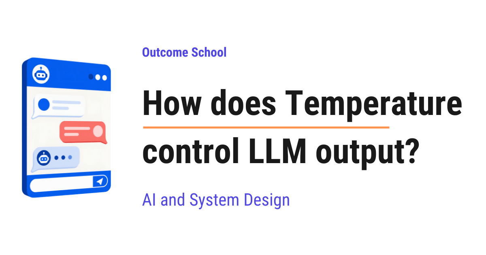

# How does Temperature control LLM output?

> Archived from <https://outcomeschool.com/blog/how-does-temperature-control-llm-output> on 2026-11-25.

Temperature is a single number that controls how an LLM picks the next token. A low Temperature gives us safe and predictable answers, and a high Temperature gives us creative and surprising ones.

In this blog, we will learn about how Temperature controls LLM output, the single number that decides whether an AI model gives us a safe and predictable answer or a creative and surprising one. We will also see how an LLM picks one token at a time, how it gives a score to every possible next token, how those scores become probabilities, how Temperature quietly changes those probabilities before the pick happens, what happens at low, high, and zero Temperature, why it is called Temperature, and when to use which value based on our use case.

We will cover the following:
<ul><li>What is Temperature in LLMs?</li><li>How does an LLM pick the next token?</li><li>From scores to probabilities</li><li>Where does Temperature come into the picture?</li><li>Step-by-step example with numbers</li><li>Low Temperature</li><li>High Temperature</li><li>Temperature = 1 and Temperature = 0</li><li>Why is it called Temperature?</li><li>When to use which Temperature?</li><li>Common mistakes while using Temperature</li></ul>
I am <strong>Amit Shekhar</strong>, Founder @ <a target="_blank" rel="noopener noreferrer" href="https://outcomeschool.com">Outcome School</a>, I have taught and mentored many developers, and their efforts landed them high-paying tech jobs, helped many tech companies in solving their unique problems, and created many open-source libraries being used by top companies. I am passionate about sharing knowledge through open-source, blogs, and videos.

I teach <a target="_blank" rel="noopener noreferrer" href="https://outcomeschool.com/program/ai-and-machine-learning">AI and Machine Learning</a> at Outcome School.

Let&#x27;s get started.
<h2 id="what-is-temperature-in-llms">What is Temperature in LLMs?</h2>
Before jumping into Temperature, we must know what an LLM is.

<strong>LLM</strong> stands for <a target="_blank" rel="noopener noreferrer" href="large-language-model-llm.md">Large Language Model</a>. It is the AI model behind tools like ChatGPT. We give it some text, and it writes the next part of the text for us. That is all an LLM does. It writes text, one small piece at a time.

Now, let&#x27;s understand Temperature.

<strong>Temperature is a number that controls how random or how predictable the output of an LLM is.</strong>

In simple words, Temperature is like a knob. When we turn the knob down, the model plays safe and picks the most expected words. When we turn the knob up, the model takes risks and picks surprising words.
<ul><li>Low Temperature gives us focused and predictable answers.</li><li>High Temperature gives us creative and varied answers.</li></ul>
Usually, the value is between 0 and 2. Many tools keep 1 as the default.

But, to really understand how this knob works, we must first understand how an LLM picks the next word. This is the most important part, so let&#x27;s go slowly. Do not worry, we will see all of this with real numbers.
<h2 id="how-does-an-llm-pick-the-next-token">How does an LLM pick the next token?</h2>
An LLM does not write a full sentence at once. It writes one small piece at a time, and then the next piece, and then the next.

This small piece is called a <strong><a target="_blank" rel="noopener noreferrer" href="tokenization-in-llms.md">token</a></strong>. A token is a word or a part of a word. For the sake of understanding, let&#x27;s assume that one token is one word.

Let&#x27;s say we give the model this text:

&quot;The sky is&quot;

Now, the model has to pick the next token. It does not &quot;think&quot; of the next word like we do. Instead, it looks at every token it knows and gives each one a score. A higher score means that token is a better fit as the next token.

Let&#x27;s say, for the sake of example, the model knows only four tokens: &quot;blue&quot;, &quot;clear&quot;, &quot;falling&quot;, and &quot;banana&quot;. In reality, a model knows more than 100,000 tokens, but four is enough for us to understand.

The model gives a score to each of them, like below:
<table><thead><tr><th>Token</th><th>Score</th></tr></thead><tbody><tr><td>blue</td><td>4.0</td></tr><tr><td>clear</td><td>3.0</td></tr><tr><td>falling</td><td>1.0</td></tr><tr><td>banana</td><td>0.0</td></tr></tbody></table>
Here, &quot;blue&quot; has the highest score because &quot;The sky is blue&quot; is the most common sentence. &quot;banana&quot; has the lowest score because &quot;The sky is banana&quot; makes no sense.

These raw scores are called <a target="_blank" rel="noopener noreferrer" href="logits-in-machine-learning.md"><strong>logits</strong></a>. Do not worry about the name. Just remember, logits are the raw scores that the model gives to every possible next token.

Now, the question is, does the model simply pick the token with the highest score?

The answer is, not always. Let&#x27;s see why.
<h2 id="from-scores-to-probabilities">From scores to probabilities</h2>
The model does not directly pick the highest score. First, it converts these scores into probabilities.

A <strong>probability</strong> is just a chance. If a token has a probability of 0.70, it means there is a 70% chance that this token gets picked.

The model uses a small formula called <a target="_blank" rel="noopener noreferrer" href="activation-functions.md"><strong>softmax</strong></a> to convert scores into probabilities. Softmax does two things:
<ul><li>It turns every score into a positive number.</li><li>It makes all the probabilities add up to 1, which means 100%.</li></ul>
Let&#x27;s not go into the math of softmax. Just remember, a higher score gives a higher probability, and a lower score gives a lower probability.

We have a detailed blog on <a target="_blank" rel="noopener noreferrer" href="math-behind-cross-entropy-loss.md">Cross-Entropy Loss</a> that explains logits and softmax in depth.

After softmax, our four tokens look like below:
<table><thead><tr><th>Token</th><th>Score</th><th>Probability</th></tr></thead><tbody><tr><td>blue</td><td>4.0</td><td>0.70</td></tr><tr><td>clear</td><td>3.0</td><td>0.26</td></tr><tr><td>falling</td><td>1.0</td><td>0.03</td></tr><tr><td>banana</td><td>0.0</td><td>0.01</td></tr></tbody></table>
Here, we can see that &quot;blue&quot; has a 70% chance, &quot;clear&quot; has a 26% chance, &quot;falling&quot; has a 3% chance, and &quot;banana&quot; has a 1% chance. All four add up to 100%.

Now, the model picks one token based on these chances. This is like a lucky draw. Think of a box with 100 slips of paper. 70 slips say &quot;blue&quot;, 26 slips say &quot;clear&quot;, 3 slips say &quot;falling&quot;, and 1 slip says &quot;banana&quot;. The model puts its hand in the box and picks one slip without looking.

Most of the time, it will pick &quot;blue&quot;. Sometimes, it will pick &quot;clear&quot;. And very rarely, it will pick &quot;banana&quot;.

This picking process is called <strong><a target="_blank" rel="noopener noreferrer" href="how-do-top-k-and-top-p-sampling-work.md">sampling</a></strong>.

So, this is how an LLM picks the next token. Score, then probability, then lucky draw.

After picking one token, the model adds it to the text and repeats the whole process for the next token. This goes on till the answer is complete. This way of writing, one token at a time while looking back at everything written so far, is called autoregressive generation, and we have a detailed blog on <a target="_blank" rel="noopener noreferrer" href="autoregressive-models.md">Autoregressive Models</a> that explains it step by step.

Now, here comes the Temperature into the picture.
<h2 id="where-does-temperature-come-into-the-picture">Where does Temperature come into the picture?</h2>
Temperature works on the scores, just before softmax converts them into probabilities.

The idea is very simple. <strong>The model divides every score by the Temperature before converting them into probabilities.</strong>

New Score = Score / Temperature

That&#x27;s it. This one small division is the whole trick.

Let&#x27;s see what this division does:
<ul><li>When Temperature is 1, every score gets divided by 1. Nothing changes.</li><li>When Temperature is less than 1, like 0.5, every score gets divided by 0.5, which means every score gets doubled. The gap between the high and low scores becomes bigger.</li><li>When Temperature is more than 1, like 2, every score gets divided by 2, which means every score gets halved. The gap between the high and low scores becomes smaller.</li></ul>
Now, the next big question is: why does the gap matter?

The answer is, softmax cares about the gap. Softmax looks at how far apart the scores are. If one score is far ahead of the others, it gets almost all the probability. If all the scores are close together, the probability gets shared among them. We have a detailed blog on the <a target="_blank" rel="noopener noreferrer" href="softmax-function.md">Softmax Function</a> that explains how it amplifies the gaps between scores step by step.

Means, Temperature changes the number of slips in our lucky draw box. Low Temperature gives the top token almost all the slips. High Temperature spreads the slips more evenly among all the tokens.

<strong>Planning your move into AI?</strong>

No matter which tech domain you work in today, with your effort, you can transition to these roles:
<ul><li>AI Engineer</li><li>Forward Deployed Engineer</li><li>AI Agent Engineer</li><li>Harness Engineer</li><li>Voice AI Engineer</li><li>AI Architect</li><li>LLM Engineer</li><li>LLM Inference Engineer</li><li>Gen AI Engineer</li><li>MLOps Engineer</li><li>ML Engineer</li><li>Deep Learning Engineer</li></ul>
Our <a target="_blank" rel="noopener noreferrer" href="https://outcomeschool.com/program/ai-and-machine-learning">AI and Machine Learning Program</a> at Outcome School takes you there.

The best way to learn this is by taking an example.
<h2 id="step-by-step-example-with-numbers">Step-by-step example with numbers</h2>
Let&#x27;s take the same four tokens with the same scores and see what happens at different Temperatures.

<strong>Step 1: Temperature = 1</strong>

Every score is divided by 1. So, the scores stay the same.
<table><thead><tr><th>Token</th><th>Score / 1</th><th>Probability</th></tr></thead><tbody><tr><td>blue</td><td>4.0</td><td>0.70</td></tr><tr><td>clear</td><td>3.0</td><td>0.26</td></tr><tr><td>falling</td><td>1.0</td><td>0.03</td></tr><tr><td>banana</td><td>0.0</td><td>0.01</td></tr></tbody></table>
This is the original behavior of the model. Nothing is changed.

<strong>Step 2: Temperature = 0.5</strong>

Every score is divided by 0.5, which doubles it.
<table><thead><tr><th>Token</th><th>Score / 0.5</th><th>Probability</th></tr></thead><tbody><tr><td>blue</td><td>8.0</td><td>0.88</td></tr><tr><td>clear</td><td>6.0</td><td>0.12</td></tr><tr><td>falling</td><td>2.0</td><td>0.00</td></tr><tr><td>banana</td><td>0.0</td><td>0.00</td></tr></tbody></table>
Here, we can notice that &quot;blue&quot; went up from 70% to 88%. And &quot;falling&quot; and &quot;banana&quot; have almost zero chance now. The gap became bigger. The model became more sure about its top choice.

<strong>Step 3: Temperature = 0.1</strong>

Every score is divided by 0.1, which multiplies it by 10.
<table><thead><tr><th>Token</th><th>Score / 0.1</th><th>Probability</th></tr></thead><tbody><tr><td>blue</td><td>40.0</td><td>1.00</td></tr><tr><td>clear</td><td>30.0</td><td>0.00</td></tr><tr><td>falling</td><td>10.0</td><td>0.00</td></tr><tr><td>banana</td><td>0.0</td><td>0.00</td></tr></tbody></table>
Here, &quot;blue&quot; has almost a 100% chance. The model will pick &quot;blue&quot; every single time.

<strong>Step 4: Temperature = 2</strong>

Every score is divided by 2, which halves it.
<table><thead><tr><th>Token</th><th>Score / 2</th><th>Probability</th></tr></thead><tbody><tr><td>blue</td><td>2.0</td><td>0.51</td></tr><tr><td>clear</td><td>1.5</td><td>0.31</td></tr><tr><td>falling</td><td>0.5</td><td>0.11</td></tr><tr><td>banana</td><td>0.0</td><td>0.07</td></tr></tbody></table>
Here, &quot;blue&quot; dropped from 70% to 51%. And &quot;banana&quot; went up from 1% to 7%. The gap became smaller. Now, the weak tokens have a real chance of getting picked.

Let me put all of this in one table for your better understanding:
<table><thead><tr><th>Temperature</th><th>blue</th><th>clear</th><th>falling</th><th>banana</th></tr></thead><tbody><tr><td>0.1</td><td>1.00</td><td>0.00</td><td>0.00</td><td>0.00</td></tr><tr><td>0.5</td><td>0.88</td><td>0.12</td><td>0.00</td><td>0.00</td></tr><tr><td>1</td><td>0.70</td><td>0.26</td><td>0.03</td><td>0.01</td></tr><tr><td>2</td><td>0.51</td><td>0.31</td><td>0.11</td><td>0.07</td></tr></tbody></table>
We found the pattern here. As Temperature goes down, the top token takes everything. As Temperature goes up, the chances spread out and every token gets a fair share.

<strong>Note:</strong> Temperature does not change the order of the tokens. &quot;blue&quot; is always the top choice at every Temperature. Temperature only changes how far ahead &quot;blue&quot; is from the rest.

Let&#x27;s see the code for this, so that we can try it ourselves:

<pre><code class="language-python code-highlight">import math

def softmax_with_temperature(scores, temperature):
    scaled = [score / temperature for score in scores]
    exps = [math.exp(score) for score in scaled]
    total = sum(exps)
    return [round(e / total, 2) for e in exps]

scores = [4.0, 3.0, 1.0, 0.0]  # blue, clear, falling, banana

print(softmax_with_temperature(scores, 1.0))
print(softmax_with_temperature(scores, 0.5))
print(softmax_with_temperature(scores, 2.0))
</code></pre>

Here, we have done the following:
<ul><li>First, we divide every score by the Temperature. This is the Temperature step.</li><li>Then, we apply <code>math.exp</code> on each scaled score. This turns every score into a positive number. This is the first part of softmax.</li><li>After that, we divide each number by the total. This makes them all add up to 1. This is the second part of softmax.</li><li>Finally, we round the result to two decimal places so that it is easy to read.</li></ul>
It will print the following:

<pre><code class="code-highlight">[0.7, 0.26, 0.03, 0.01]
[0.88, 0.12, 0.0, 0.0]
[0.51, 0.31, 0.11, 0.07]
</code></pre>

These are the same numbers we saw in our tables. It works perfectly.

<strong>A quick note for you</strong>

No matter which tech domain you work in, get familiar with these topics:
<ul><li>LLM</li><li>RAG</li><li>MCP</li><li>Agent</li><li>Fine-tuning</li><li>Quantization</li></ul>
We put it all together in one video:

<a target="_blank" rel="noopener noreferrer" href="https://www.youtube.com/watch?v=lnfWvX66FUk">AI Engineering Explained: LLM, RAG, MCP, Agent, Fine-Tuning, and Quantization</a>

No need to stop reading - bookmark it and watch later when you get time. Future you will thank you.

Now, let&#x27;s get back to the topic.

This was all about how Temperature works inside the model. Now, let&#x27;s understand what this means for the actual text we get from the model.
<h2 id="low-temperature">Low Temperature</h2>
A low Temperature is a value close to 0, like 0.1 or 0.2.

At low Temperature, the model almost always picks the top token. So, the output is:
<ul><li>Focused and predictable.</li><li>Same or nearly the same every time we ask.</li><li>Safe and to the point.</li></ul>
Let&#x27;s say we ask the model, &quot;Write one line about the sky.&quot; At low Temperature, we will get &quot;The sky is blue.&quot; almost every time.

<strong>Advantage:</strong> The answers are reliable. We can trust that the model is not going off track.

<strong>Disadvantage:</strong> The answers can become boring and repetitive. If we ask for ten different story ideas, we can get ten very similar ideas.
<h2 id="high-temperature">High Temperature</h2>
A high Temperature is a value above 1, like 1.5 or 2.

At high Temperature, the weak tokens get a real chance. So, the output is:
<ul><li>Creative and surprising.</li><li>Different every time we ask.</li><li>Sometimes strange or wrong.</li></ul>
Let&#x27;s say we ask the same question, &quot;Write one line about the sky.&quot; At high Temperature, we can get &quot;The sky is clear.&quot; or &quot;The sky is falling.&quot; or even &quot;The sky is banana.&quot;

<strong>Advantage:</strong> The answers are varied and creative. This is great for brainstorming and stories.

<strong>Disadvantage:</strong> The model can pick a bad token, and one bad token can spoil the whole answer.

Here, one thing is very important to understand. Remember, the model picks one token at a time, and it uses the tokens already picked to pick the next one. So, if a high Temperature makes the model pick &quot;banana&quot;, now the model has to continue the sentence &quot;The sky is banana&quot;. The model picks every next token based on this strange start, and things go downhill from there. Hence, a very high Temperature often gives us nonsense.

<strong>Stay updated:</strong> Subscribe to our <a target="_blank" rel="noopener noreferrer" href="https://outcomeschool.substack.com/subscribe">newsletter</a> to get our latest AI and Machine Learning blogs straight to your inbox.
<h2 id="temperature--1-and-temperature--0">Temperature = 1 and Temperature = 0</h2>
Two values are special.

<strong>Temperature = 1</strong> means no change. The model uses its original probabilities. This is the natural behavior of the model, exactly as it was trained.

<strong>Temperature = 0</strong> means the model always picks the token with the highest score. No lucky draw at all. This is called <strong><a target="_blank" rel="noopener noreferrer" href="greedy-decoding-vs-beam-search.md">greedy decoding</a></strong>, because the model greedily grabs the best token every time.

Strictly speaking, we cannot divide by 0. So, when we set Temperature to 0, the software behind the model does not actually divide. It simply skips the lucky draw and picks the top token directly.

<strong>Note:</strong> Even at Temperature 0, the output can sometimes differ a little between two runs. This happens because of tiny rounding differences inside the computer chips that run the model, not because of Temperature. So, Temperature 0 gives us &quot;almost always the same&quot;, not &quot;guaranteed the same&quot;.

If we want to go deep into LLM Internals, Logits and Cross-Entropy, and build a Large Language Model (LLM) from scratch, check out our <a target="_blank" rel="noopener noreferrer" href="https://outcomeschool.com/program/ai-and-machine-learning">AI and Machine Learning Program</a> at Outcome School.
<h2 id="why-is-it-called-temperature">Why is it called Temperature?</h2>
The name comes from physics.

Think of water. When water is cold, its tiny particles move very less and stay fixed in their place, like ice. When water is hot, the particles move a lot and jump around freely, like steam.

The same thing happens with our tokens. At low Temperature, the model stays fixed on its top choice, like ice. At high Temperature, the model jumps around between many choices, like steam.

Researchers borrowed this idea from a formula in physics, and the name Temperature stayed with it.
<h2 id="when-to-use-which-temperature">When to use which Temperature?</h2>
Now, we know what Temperature does. So, which value must we use? The answer is, it depends on our use case.

Let me tabulate the common use cases for your better understanding so that you can decide which value to use based on your use case.
<table><thead><tr><th>Use case</th><th>Temperature</th><th>Why</th></tr></thead><tbody><tr><td>Writing code</td><td>0 to 0.2</td><td>Code must be correct, not creative</td></tr><tr><td>Maths and facts</td><td>0 to 0.2</td><td>There is only one right answer</td></tr><tr><td>Summarizing a document</td><td>0.2 to 0.5</td><td>Must stay close to the original</td></tr><tr><td>Customer support chat</td><td>0.3 to 0.7</td><td>Friendly, but still accurate</td></tr><tr><td>General chat</td><td>0.7 to 1</td><td>Natural and human-like</td></tr><tr><td>Story writing and poems</td><td>0.8 to 1.2</td><td>Creative and surprising</td></tr><tr><td>Brainstorming ideas</td><td>1 to 1.5</td><td>We want many different ideas</td></tr></tbody></table>
Here, we can see the pattern. When there is one correct answer, keep the Temperature low. When there are many good answers, keep the Temperature high.

These ranges are just a starting point. The right value depends on our use case, so we must try a few values and see which one works best.

When developers use an LLM inside their own app, they send a request to the model, and this request has a place for Temperature. We can set it like below:

<pre><code class="language-python code-highlight">response = model.generate(
    prompt=&quot;Write one line about the sky.&quot;,
    temperature=0.2
)
</code></pre>

Here, <code>prompt</code> is the text we give to the model, and <code>temperature</code> is our knob. We have passed <code>temperature=0.2</code>, so the model will give a focused and predictable answer. If we change it to <code>temperature=1.2</code>, the same prompt will give a creative and varied answer. Nothing else changes, only this one number.

To master AI Engineering, LLM Fundamentals, and Prompt Engineering end to end, explore our <a target="_blank" rel="noopener noreferrer" href="https://outcomeschool.com/program/ai-and-machine-learning">AI and Machine Learning Program</a> at Outcome School.
<h2 id="common-mistakes-while-using-temperature">Common mistakes while using Temperature</h2>
Most of the time, we do mistakes while using Temperature. Let&#x27;s see the common ones.

<strong>Mistake 1: Thinking that Temperature makes the model smarter.</strong>

Temperature does not add any knowledge to the model. It does not make the model more correct. It only changes how the model picks from what it already knows. If the model does not know the answer, no Temperature can fix that.

We have a detailed blog on <a target="_blank" rel="noopener noreferrer" href="why-do-llms-hallucinate-the-token-level-explanation.md">why LLMs hallucinate</a> that explains this at the token level.

<strong>Mistake 2: Setting a very high Temperature to get creativity.</strong>

Above 1.5 or so, the output quickly turns into nonsense. Creativity comes from a slightly high Temperature, not a very high one.

<strong>Mistake 3: Expecting Temperature 0 to give exactly the same output every time.</strong>

As we learned, tiny rounding differences can still change the output a little. If we need exactly the same output, we must save it and reuse it, not ask the model again.

<strong>Mistake 4: Changing Temperature and Top-p together.</strong>

<strong><a target="_blank" rel="noopener noreferrer" href="how-do-top-k-and-top-p-sampling-work.md">Top-p</a></strong> is another setting that controls randomness. It works by removing the weak tokens from the lucky draw box, so that only the strong tokens remain. Both Temperature and Top-p change the randomness of the output. So, if we change both at the same time, we will not know which one caused the change.

Now, we must have understood how Temperature controls LLM output. It is just one small division before the lucky draw, but that one division decides whether the model gives us a safe answer or a creative one.
<h2 id="frequently-asked-questions">Frequently Asked Questions</h2><h3 id="does-temperature-change-which-token-the-model-ranks-highest">Does Temperature change which token the model ranks highest?</h3>
No. Temperature does not change the order of the tokens. The top token stays the top choice at every Temperature. Temperature only changes how far ahead the top token is from the rest, which changes how likely the weaker tokens are to get picked.
<h3 id="what-is-the-difference-between-temperature-and-top-p">What is the difference between Temperature and Top-p?</h3>
Both control the randomness of the output, but in different ways. Temperature divides every score before softmax, which makes the chances sharper or more spread out. Top-p removes the weak tokens from the pick, so only the strong tokens remain. We should not change both together, or we will not know which one caused the change.
<h3 id="can-a-lower-temperature-make-the-model-more-accurate">Can a lower Temperature make the model more accurate?</h3>
No. Temperature does not add any knowledge to the model or make it more correct. It only changes how the model picks from what it already knows. A low Temperature only makes the answer more focused and predictable.
<h3 id="what-temperature-value-is-the-default">What Temperature value is the default?</h3>
Many tools keep 1 as the default. At Temperature 1, every score is divided by 1, so nothing changes and the model uses its original probabilities, exactly as it was trained. Usually, the value we can set is between 0 and 2.

That&#x27;s it for now.

Thanks

<strong>Amit Shekhar</strong> Founder @ <a target="_blank" rel="noopener noreferrer" href="https://outcomeschool.com">Outcome School</a>

You can connect with me on:
<ul><li><a target="_blank" rel="noopener noreferrer" href="https://x.com/amitiitbhu">X</a></li><li><a target="_blank" rel="noopener noreferrer" href="https://www.linkedin.com/in/amit-shekhar-iitbhu">LinkedIn</a></li><li><a target="_blank" rel="noopener noreferrer" href="https://github.com/amitshekhariitbhu">GitHub</a></li></ul>
Follow Outcome School on:
<ul><li><a target="_blank" rel="noopener noreferrer" href="https://x.com/outcome_school">X</a></li><li><a target="_blank" rel="noopener noreferrer" href="https://youtube.com/@OutcomeSchool">YouTube</a></li><li><a target="_blank" rel="noopener noreferrer" href="https://www.linkedin.com/company/outcomeschool">LinkedIn</a></li><li><a target="_blank" rel="noopener noreferrer" href="http://github.com/OutcomeSchool">GitHub</a></li></ul>
<a target="_blank" rel="noopener noreferrer" href="https://outcomeschool.com/blog"><strong>Read all of our high-quality blogs here.</strong></a>

