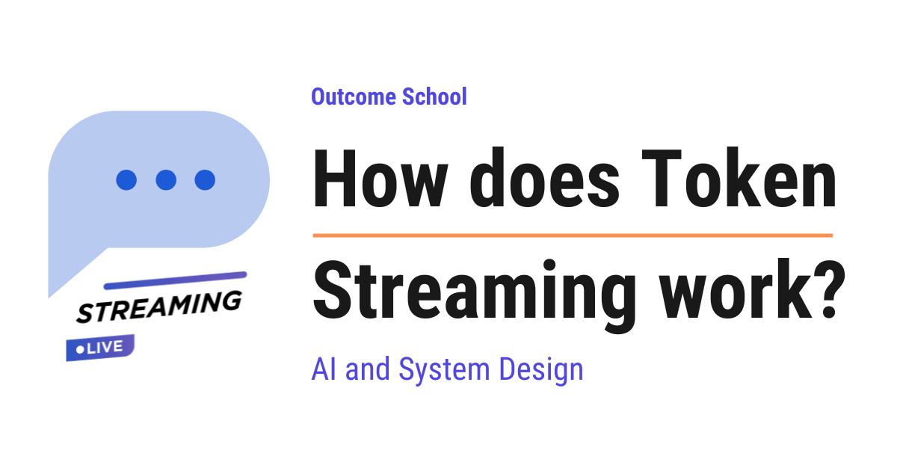

# How does Token Streaming work?

> Archived from <https://outcomeschool.com/blog/how-does-token-streaming-work> on 2026-11-25.

Token Streaming is a technique where the server sends the model&#x27;s reply to us piece by piece, as each piece is produced, instead of waiting for the whole reply to be ready.

In this blog, we will learn about how Token Streaming works. We will also see why we need it, how the server and the browser talk to each other to make it happen, and where it is used in real systems like ChatGPT and Claude.

We will cover the following:
<ul><li>What is token streaming?</li><li>A quick recap of how an LLM generates text</li><li>Why we need streaming at all</li><li>What is SSE?</li><li>How the HTTP connection stays open</li><li>The format of a streamed message</li><li>A full walkthrough from server to screen</li><li>The [DONE] marker that ends the stream</li><li>SSE vs WebSockets</li><li>Token streaming in the real world</li></ul>
I am <strong>Amit Shekhar</strong>, Founder @ <a target="_blank" rel="noopener noreferrer" href="https://outcomeschool.com">Outcome School</a>, I have taught and mentored many developers, and their efforts landed them high-paying tech jobs, helped many tech companies in solving their unique problems, and created many open-source libraries being used by top companies. I am passionate about sharing knowledge through open-source, blogs, and videos.

I teach <a target="_blank" rel="noopener noreferrer" href="https://outcomeschool.com/program/ai-and-machine-learning">AI and Machine Learning</a> at Outcome School.

Let&#x27;s get started.
<h3 id="what-is-token-streaming">What is token streaming?</h3>
Before we talk about how it works, we must first understand what token streaming is.

<strong>Token streaming is a technique where the server sends the model&#x27;s reply to us piece by piece, as each piece is produced, instead of waiting for the whole reply to be ready.</strong>

In simple words, streaming means we start receiving the answer while it is still being written, not after it is fully finished.

Let&#x27;s say we ask ChatGPT a question. We have all seen the words appear on the screen one small chunk at a time, like someone is typing the answer live. That live typing effect is token streaming in action.

So, token streaming is the model handing us the reply gradually, word by word, the moment each word is ready.

Now, to understand why this is even possible, we must understand one thing about how an LLM writes text. Let&#x27;s see that next.
<h3 id="a-quick-recap-of-how-an-llm-generates-text">A quick recap of how an LLM generates text</h3>
To understand streaming, we must understand how a large language model writes its reply.

A large language model, or <strong>LLM</strong>, is the technology behind tools like ChatGPT and Claude. We give it some text, and it gives us back some text.

Here is the key thing to know. The model does not write the whole reply in one shot. It writes the reply one <strong>token</strong> at a time. A token is a small chunk of text, roughly a word or part of a word. For example, a short word like <code>cat</code> is usually one token, while a longer word like <code>running</code> is often split into two tokens.

How text is broken into these tokens is called <a target="_blank" rel="noopener noreferrer" href="tokenization-in-llms.md">tokenization</a>, and we have a blog on <a target="_blank" rel="noopener noreferrer" href="bpe-in-llms.md">Byte Pair Encoding (BPE)</a> that explains how it works.

The model writes the first token, then looks at everything so far and writes the next token, then looks again and writes the next one, and so on. This way of writing, where each new token is produced based on all the tokens that came before it, is called <strong><a target="_blank" rel="noopener noreferrer" href="autoregressive-models.md">autoregressive decoding</a></strong>.

Let&#x27;s decompose it.
<blockquote>
Autoregressive = Auto + Regressive
</blockquote>
In simple words, &quot;auto&quot; means it does this on its own, step by step, and &quot;regressive&quot; means each new step looks back at the steps that came before. So the model keeps looking back at what it has already written to decide the next word.

We can picture it as below:

<pre><code class="code-highlight">Step 1:  The
Step 2:  The cat
Step 3:  The cat sat
Step 4:  The cat sat on
Step 5:  The cat sat on the
Step 6:  The cat sat on the mat
</code></pre>

Here, we can see that the model produces one token at each step, and each step builds on the previous one. The full sentence is ready only at the last step.

This is the foundation we needed. Since the model is already producing the reply one token at a time, we have a choice. We can wait for all the tokens and send the full reply at the end, or we can send each token to the user the moment it is generated. Streaming is the second choice.

Not every model writes one token at a time, though. We have a detailed blog on <a target="_blank" rel="noopener noreferrer" href="how-do-diffusion-language-models-dlms-work.md">Diffusion Language Models (DLMs)</a> that explains how some models generate the whole sentence in parallel instead.

Now, the question is, why do we even want to send tokens one by one? Let&#x27;s see.

To go deep into LLM Fundamentals, LLM Internals, Autoregressive Models, and Tokenization, check out our <a target="_blank" rel="noopener noreferrer" href="https://outcomeschool.com/program/ai-and-machine-learning">AI and Machine Learning Program</a> at Outcome School.
<h3 id="why-we-need-streaming-at-all">Why we need streaming at all</h3>
Let&#x27;s understand the problem with sending the reply only at the end.

Suppose we ask the model to write a long answer of 500 tokens. If we wait for the whole reply, the user stares at a blank screen until all 500 tokens are produced. Producing 500 tokens takes time. So the user waits, sees nothing, and starts to feel that the app is stuck or broken.

This brings us to a very important idea called <strong>time to first token</strong>.

<strong>Time to first token is the time the user waits before seeing the very first piece of the reply on the screen.</strong>

In simple words, it is how long the user stares at nothing before words start showing up.

Without streaming, the time to first token is large, because the first word the user sees is actually the last word the model produces. The user has to wait for the entire answer.

With streaming, the time to first token is tiny. The very first token is sent the instant it is ready. The user starts reading immediately while the rest of the reply is still being written.

The time to first token is set mainly by the prefill phase, where the model reads the whole prompt before producing the first token. We have a detailed blog on <a target="_blank" rel="noopener noreferrer" href="prefill-vs-decode-llm-inference-optimization.md">Prefill vs Decode</a> that explains this end to end.

Let&#x27;s put the two side by side as below:

<pre><code class="code-highlight">WITHOUT streaming:

  user asks  --&gt;  [ model writes all 500 tokens ]  --&gt;  full reply appears at once
                  user sees a blank screen this whole time (long wait)

WITH streaming:

  user asks  --&gt;  token 1 appears  --&gt;  token 2  --&gt;  token 3  --&gt;  ...  --&gt;  done
                  user starts reading almost instantly (short wait)
</code></pre>

Here, we can see that without streaming the user waits through the entire generation before seeing anything, while with streaming the user sees the first word almost immediately and keeps reading as more words arrive.

So, streaming gives us two big wins. The user sees words as they are generated, and the wait before the first word is very short. The app feels alive and fast. That&#x27;s the beauty of streaming.

So, here comes SSE to the rescue. Now, the next big question is: how does the server actually push these tokens to the browser one by one? The answer is a technique called SSE. Let&#x27;s understand it.
<h3 id="what-is-sse">What is SSE?</h3>
Now, it&#x27;s time to learn about SSE, the technique that actually carries the tokens to the user.

<strong>SSE is a simple way for a server to keep sending new data to the browser over a single connection that stays open.</strong>

Let&#x27;s decompose the term.
<blockquote>
SSE = Server-Sent Events
</blockquote>
In simple words, the <strong>server</strong> is the computer that has the answer, the browser is the program in front of the user, and an <strong>event</strong> is just one small piece of data being sent. So &quot;Server-Sent Events&quot; literally means events that the server sends to the browser, on its own, one after another.

Before we go further, let&#x27;s understand one normal idea first. Usually, on the web, the browser asks the server a question and the server gives back one answer, and then the conversation is over. The browser asks, the server replies, done. This is the request-response model.

But for streaming, one single reply at the end is not enough. We want the server to keep sending small pieces over time. SSE is built exactly for this. With SSE, the browser asks once, and then the server is allowed to keep sending piece after piece for as long as it wants, all over that same single connection.

Let&#x27;s put the two models side by side as below:

<pre><code class="code-highlight">NORMAL request-response:

  browser  --- asks once ---&gt;  server
  browser  &lt;-- one reply ----  server
  (connection closed, conversation over)

SSE (Server-Sent Events):

  browser  --- asks once ---&gt;  server
  browser  &lt;-- piece 1 ------  server
  browser  &lt;-- piece 2 ------  server
  browser  &lt;-- piece 3 ------  server
  (connection stays open, server keeps sending)
</code></pre>

Here, we can see that in the normal model the browser asks once and gets back a single reply, and then the connection is closed. In the SSE model the browser still asks only once, but the server keeps sending piece after piece over the same connection that stays open.

So, SSE is the channel through which the tokens flow from the server to the browser, one event at a time.

<strong>Planning your move into AI?</strong>

No matter which tech domain you work in today, with your effort, you can transition to these roles:
<ul><li>AI Engineer</li><li>Forward Deployed Engineer</li><li>AI Agent Engineer</li><li>Harness Engineer</li><li>Voice AI Engineer</li><li>AI Architect</li><li>LLM Engineer</li><li>LLM Inference Engineer</li><li>Gen AI Engineer</li><li>MLOps Engineer</li><li>ML Engineer</li><li>Deep Learning Engineer</li></ul>
Our <a target="_blank" rel="noopener noreferrer" href="https://outcomeschool.com/program/ai-and-machine-learning">AI and Machine Learning Program</a> at Outcome School takes you there.

Now, to make this work, two things must be set up correctly. The connection must stay open, and the data must be sent in a special format. Let&#x27;s understand both, starting with the open connection.
<h3 id="how-the-http-connection-stays-open">How the HTTP connection stays open</h3>
Let&#x27;s understand the connection first.

When the browser talks to a server on the web, it uses <strong>HTTP</strong>. HTTP is simply the set of rules that browsers and servers follow to talk to each other. Every time we open a website, HTTP is being used behind the scenes.

Normally, the flow is short. The browser opens a connection, sends a request, the server sends back the full response, and then the connection is closed. It is like making one phone call, getting one answer, and hanging up.

For streaming, we do not want to hang up after one answer. We want to keep the line open so the server can keep talking. It is like making one phone call and staying on the line while the other person reads out a long message to us, sentence by sentence.

<strong>With SSE, the HTTP connection is opened once and kept open. The server holds the line and keeps pushing new pieces of data through it until the reply is complete.</strong>

So, the browser opens one connection, and that single connection stays alive for the entire reply. The server does not close it after the first token. It sends token 1, keeps the line open, sends token 2, keeps it open, and so on.

How does the server tell the browser &quot;this is going to be a stream, do not expect just one answer&quot;? It does this using something called the <strong>Content-Type</strong>.

The Content-Type is a small label the server attaches to its response to say what kind of data is coming. For example, a normal web page has the Content-Type <code>text/html</code>. A normal data response often has <code>application/json</code>.

For SSE, the server sets the Content-Type to a special value as below:

<pre><code class="code-highlight">Content-Type: text/event-stream
</code></pre>

Here, we can see the value is <code>text/event-stream</code>. The word <code>stream</code> is the important part. This label tells the browser, &quot;Do not wait for one complete answer. Keep this connection open and read the pieces as they arrive.&quot; The browser sees this label and switches into streaming mode.

So, the open connection plus the <code>text/event-stream</code> label together set the stage. Now the server can start pushing data. But the data must be sent in a specific shape so the browser can read it correctly. Let&#x27;s understand that shape next.
<h3 id="the-format-of-a-streamed-message">The format of a streamed message</h3>
Now, let&#x27;s understand how each piece of data is actually written when the server sends it.

SSE uses a very simple text format. Each piece of data is sent as a line that starts with the word <code>data:</code>, followed by the actual content. After each piece, the server sends a blank line to mark the end of that piece.

So the rule is simple.

<strong>Each event is a line starting with <code>data:</code>, and each event is separated from the next one by a blank line.</strong>

Let&#x27;s see what the server sends when the model produces the words &quot;The cat sat&quot;. The raw stream looks like below:

<pre><code class="code-highlight">data: The

data: cat

data: sat
</code></pre>

Here, we can see three events. The first event carries the word <code>The</code>, the second carries <code>cat</code>, and the third carries <code>sat</code>. Notice the blank line after each one. That blank line is how the browser knows where one event ends and the next one begins.

In real systems, the content after <code>data:</code> is usually not a plain word but a small piece of structured data called JSON, which holds the token along with a little extra information. For the sake of understanding, we are keeping it as plain words here so the idea is crystal clear. The important point stays the same. Every token is wrapped in a <code>data:</code> line and followed by a blank line.

So, this simple format is the language the server and browser agree to speak. Every token travels as one <code>data:</code> line.

<strong>A quick note for you</strong>

No matter which tech domain you work in, get familiar with these topics:
<ul><li>LLM</li><li>RAG</li><li>MCP</li><li>Agent</li><li>Fine-tuning</li><li>Quantization</li></ul>
We put it all together in one video:

<a target="_blank" rel="noopener noreferrer" href="https://www.youtube.com/watch?v=lnfWvX66FUk">AI Engineering Explained: LLM, RAG, MCP, Agent, Fine-Tuning, and Quantization</a>

No need to stop reading - bookmark it and watch later when you get time. Future you will thank you.

Now, let&#x27;s get back to the topic.

Now we have all the pieces. We know the connection stays open, we know the Content-Type, and we know the format. Let&#x27;s put it all together in a full walkthrough.
<h3 id="a-full-walkthrough-from-server-to-screen">A full walkthrough from server to screen</h3>
Let&#x27;s walk through the entire journey of a streamed reply, from the moment the user asks to the moment words fill the screen. Suppose the user asks a question and the model is about to reply with &quot;The cat sat&quot;.

<strong>Step 1:</strong> The browser opens one HTTP connection to the server and sends the user&#x27;s question. This connection will stay open for the whole reply.

<strong>Step 2:</strong> The server starts the response and sets the Content-Type to <code>text/event-stream</code>. This tells the browser that a stream is coming and the connection must stay open.

<strong>Step 3:</strong> The model produces its first token, <code>The</code>, using autoregressive decoding, which we learned means producing one token at a time while looking back at what came before. The server does not wait. It immediately wraps this token in a <code>data:</code> line and pushes it through the open connection.

<strong>Step 4:</strong> The browser reads that <code>data:</code> line, takes out the word <code>The</code>, and appends it to the screen. The user sees the first word almost instantly. This is the small time to first token we wanted.

<strong>Step 5:</strong> The model produces the next token, <code>cat</code>. The server pushes it as another <code>data:</code> line. The browser appends <code>cat</code> to the screen, right after <code>The</code>. The user now sees &quot;The cat&quot;.

<strong>Step 6:</strong> The model produces <code>sat</code>. The server pushes it, and the browser appends it. The user now sees &quot;The cat sat&quot;, and the whole thing looks like it is being typed live.

Let&#x27;s see the whole flow in one diagram as below:

<pre><code class="code-highlight">   MODEL                 SERVER                         BROWSER (screen)
   -----                 ------                         ----------------
   token &quot;The&quot;   ---&gt;    data: The      ---[open]---&gt;   The
   token &quot;cat&quot;   ---&gt;    data: cat      ---[open]---&gt;   The cat
   token &quot;sat&quot;   ---&gt;    data: sat      ---[open]---&gt;   The cat sat
                         data: [DONE]   ---[open]---&gt;   (stop, close)
</code></pre>

Here, we can see that each token travels from the model, to the server, through the single open connection, and onto the screen, one at a time. The connection stays open the whole way down, which is why the server can keep pushing without reopening anything. The browser appends each new piece to what is already on the screen, and this constant appending is what creates the live typing effect.

The problem is solved. The user reads the reply as it is being written, instead of waiting for the full answer.

But there is one last thing. The server needs a way to say, &quot;I am finished, there are no more tokens.&quot; Let&#x27;s see how it does that.
<h3 id="the-done-marker-that-ends-the-stream">The [DONE] marker that ends the stream</h3>
Now, here is a small but important question. The connection is open and tokens are flowing. How does the browser know when the reply is complete and it can stop listening?

The answer is a special final message called the <strong>[DONE] marker</strong>.

<strong>After the very last token, the server sends one final event that contains <code>[DONE]</code>. This is a signal that means the stream is over.</strong>

In simple words, <code>[DONE]</code> is the server saying &quot;that was the last piece, you can stop now.&quot;

The end of the stream looks like below:

<pre><code class="code-highlight">data: sat

data: [DONE]
</code></pre>

Here, we can see that after the last real token <code>sat</code>, the server sends one more event with <code>[DONE]</code>. The browser reads this, understands that no more tokens are coming, stops listening, and the connection is closed.

So, the <code>[DONE]</code> marker is the clean ending of the stream. Without it, the browser would not know whether the reply is finished or whether the next token is still on its way.

This is how the full streaming cycle begins, runs, and ends. Now, let&#x27;s compare SSE with another technology people often confuse it with.
<h3 id="sse-vs-websockets">SSE vs WebSockets</h3>
When we talk about a server sending live data, many people immediately think of WebSockets. So let&#x27;s understand the difference, because choosing the right tool matters.

A <strong>WebSocket</strong> is a technology that opens a two-way connection between the browser and the server. Over that connection, both sides can send messages to each other at any time, freely, in both directions.

SSE is different. <strong>SSE is one-way only, from the server to the browser.</strong> The server can keep pushing data to the browser, but the browser cannot send messages back over that same SSE stream.

Now, the natural question is, if WebSockets can do two-way and SSE can only do one-way, why use SSE at all?

The answer is that for token streaming, we do not need two-way traffic during the reply. The browser asks its question once at the start, and after that it only needs to receive tokens. The whole job is the server pushing data to the browser. That is exactly the one-way job SSE is built for.

And SSE is much simpler. Let me tabulate the differences between SSE and WebSockets for your better understanding so that you can decide which one to use based on your use case.
<table><thead><tr><th>Point</th><th>SSE (Server-Sent Events)</th><th>WebSockets</th></tr></thead><tbody><tr><td>Direction</td><td>One-way, server to browser only</td><td>Two-way, both sides can send</td></tr><tr><td>Built on</td><td>Plain HTTP</td><td>A separate set of rules added on top of HTTP</td></tr><tr><td>Setup</td><td>Simple, uses normal HTTP</td><td>More complex</td></tr><tr><td>Best for</td><td>Streaming a reply, live updates</td><td>Chat rooms, games, live collaboration</td></tr><tr><td>Reconnect</td><td>Reconnects automatically</td><td>We handle reconnection ourselves</td></tr></tbody></table>
Here, we can see that SSE runs over plain HTTP, which means it uses the same simple web rules we already use everywhere, with nothing extra to set up. WebSockets need a separate, more complex setup because they support full two-way traffic.

So, for token streaming, where the server simply needs to push tokens to the browser, SSE is the simpler and very natural fit. We use WebSockets when we genuinely need both sides to talk freely at the same time, like in a live chat room or a multiplayer game.

So, now we know when to use which one.

<strong>Stay updated:</strong> Subscribe to our <a target="_blank" rel="noopener noreferrer" href="https://outcomeschool.substack.com/subscribe">newsletter</a> to get our latest AI and Machine Learning blogs straight to your inbox.
<h3 id="token-streaming-in-the-real-world">Token streaming in the real world</h3>
Now, let&#x27;s see where token streaming is used in real systems.

The most familiar example is right in front of us. When we use ChatGPT or Claude and watch the reply appear word by word, like it is being typed live, that is token streaming over SSE. The server is producing tokens one at a time with autoregressive decoding, wrapping each one in a <code>data:</code> line, and pushing it through a single open <code>text/event-stream</code> connection. The browser appends each piece to the screen, and we get that smooth typing effect.

Behind these streamed replies sits a serving engine that has to produce those tokens fast and serve many users at once. We have a detailed blog on <a target="_blank" rel="noopener noreferrer" href="how-does-vllm-work.md">vLLM</a> that explains how high-throughput LLM serving works.

This is not just a nice visual trick. It is a real improvement to the experience. The user sees that the system is working, starts reading right away, and never sits in front of a frozen blank screen. The time to first token is tiny, so the whole app feels fast and responsive.

The same pattern is used far beyond chat windows. Any application built on top of an LLM, such as a coding assistant that writes code as we watch, a writing tool that drafts text live, or a customer support bot that types out its answer, uses this exact streaming approach to feel quick and alive.

So, anywhere a model produces a reply and we want the user to start reading it immediately, token streaming over SSE is the technique that makes it happen.

To learn how to build and serve LLM-powered apps like these - Model Deployment and Serving, AI and ML System Design, and building ChatGPT from scratch - check out our <a target="_blank" rel="noopener noreferrer" href="https://outcomeschool.com/program/ai-and-machine-learning">AI and Machine Learning Program</a> at Outcome School.

This is how token streaming over SSE works. The model produces the reply one token at a time, the server keeps a single HTTP connection open with the Content-Type <code>text/event-stream</code>, it pushes each token the moment it is ready as a <code>data:</code> line followed by a blank line, the browser appends each piece to the screen to create the live typing effect, and a final <code>[DONE]</code> marker tells the browser the reply is complete.
<h2 id="frequently-asked-questions">Frequently Asked Questions</h2><h3 id="does-token-streaming-change-how-the-model-generates-the-reply">Does token streaming change how the model generates the reply?</h3>
No. The model still writes the reply one token at a time using autoregressive decoding. Streaming only changes when each token is sent to the user. Instead of waiting for all the tokens, the server sends each token the moment it is generated, so the time to first token becomes tiny.
<h3 id="is-each-streamed-piece-a-plain-word">Is each streamed piece a plain word?</h3>
Usually not. In real systems, the content after <code>data:</code> is usually a small piece of structured data called JSON. It holds the token along with a little extra information. The rule stays the same, as every token is wrapped in a <code>data:</code> line and followed by a blank line.
<h3 id="what-would-happen-if-the-server-did-not-send-the-done-marker">What would happen if the server did not send the [DONE] marker?</h3>
The browser would not know whether the reply is finished or whether the next token is still on its way. The <code>[DONE]</code> marker is the clean ending of the stream. When the browser reads it, it stops listening, and the connection is closed.
<h3 id="does-sse-reconnect-automatically-if-the-connection-drops">Does SSE reconnect automatically if the connection drops?</h3>
Yes. SSE reconnects automatically, while with WebSockets we have to handle reconnection ourselves. SSE is also built on plain HTTP, so it is simpler to set up.
<h3 id="is-token-streaming-used-only-in-chat-apps">Is token streaming used only in chat apps?</h3>
No. Any application built on top of an LLM can use it. A coding assistant that writes code as we watch, a writing tool that drafts text live, or a customer support bot that types out its answer all use the same streaming approach to feel quick and alive.

That&#x27;s it for now.

Thanks

<strong>Amit Shekhar</strong> Founder @ <a target="_blank" rel="noopener noreferrer" href="https://outcomeschool.com">Outcome School</a>

You can connect with me on:
<ul><li><a target="_blank" rel="noopener noreferrer" href="https://x.com/amitiitbhu">X</a></li><li><a target="_blank" rel="noopener noreferrer" href="https://www.linkedin.com/in/amit-shekhar-iitbhu">LinkedIn</a></li><li><a target="_blank" rel="noopener noreferrer" href="https://github.com/amitshekhariitbhu">GitHub</a></li></ul>
Follow Outcome School on:
<ul><li><a target="_blank" rel="noopener noreferrer" href="https://x.com/outcome_school">X</a></li><li><a target="_blank" rel="noopener noreferrer" href="https://youtube.com/@OutcomeSchool">YouTube</a></li><li><a target="_blank" rel="noopener noreferrer" href="https://www.linkedin.com/company/outcomeschool">LinkedIn</a></li><li><a target="_blank" rel="noopener noreferrer" href="https://github.com/OutcomeSchool">GitHub</a></li></ul>
<a target="_blank" rel="noopener noreferrer" href="https://outcomeschool.com/blog"><strong>Read all of our high-quality blogs here.</strong></a>

