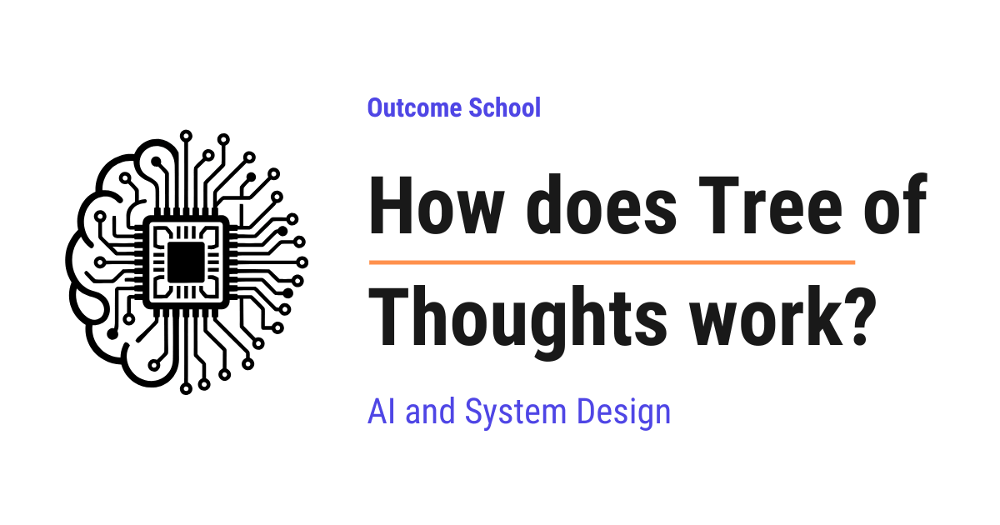

# How does Tree of Thoughts work?

> Archived from <https://outcomeschool.com/blog/how-does-tree-of-thoughts-work> on 2026-11-25.

Tree of Thoughts is a way of making an LLM solve a hard problem by trying many possible next steps, checking which ones look good, and going deeper only on the good ones, just like exploring the branches of a tree.

In this blog, we will learn about how Tree of Thoughts works. We will also see why a normal step-by-step answer fails on hard problems, what a &quot;thought&quot; means here, how the LLM generates and judges many thoughts, how a search algorithm walks through the tree and goes back when a path fails, a full walkthrough on the Game of 24, and where it works well and where it fails.

We will cover the following:
<ul><li>How does an LLM answer?</li><li>What is Chain of Thought?</li><li>The problem with Chain of Thought</li><li>What is Tree of Thoughts?</li><li>What is a thought?</li><li>Step 1: Breaking the problem into thoughts</li><li>Step 2: Generating many thoughts</li><li>Step 3: Judging the thoughts</li><li>Step 4: Searching through the tree</li><li>A complete example: the Game of 24</li><li>A simple code sketch of Tree of Thoughts</li><li>Chain of Thought vs Tree of Thoughts</li><li>Where Tree of Thoughts works well and where it fails</li></ul>
I am <strong>Amit Shekhar</strong>, Founder @ <a target="_blank" rel="noopener noreferrer" href="https://outcomeschool.com">Outcome School</a>, I have taught and mentored many developers, and their efforts landed them high-paying tech jobs, helped many tech companies in solving their unique problems, and created many open-source libraries being used by top companies. I am passionate about sharing knowledge through open-source, blogs, and videos.

I teach <a target="_blank" rel="noopener noreferrer" href="https://outcomeschool.com/program/ai-and-machine-learning">AI and Machine Learning</a> at Outcome School.

Let&#x27;s get started.
<h2 id="how-does-an-llm-answer">How does an LLM answer?</h2>
Before jumping into Tree of Thoughts, we must know how an LLM gives an answer.

An LLM writes text one small piece at a time. The small piece of text that an LLM writes at a time is called a <strong><a target="_blank" rel="noopener noreferrer" href="tokenization-in-llms.md">token</a></strong>. A token is a word or a part of a word. For the sake of understanding, we can think of a token as one word.

An LLM writes its answer from left to right, one token after another. Once it has written a token, it does not go back and change it. It just keeps moving forward.

Let&#x27;s say we ask a friend to solve a puzzle, but with one strict rule: they must speak every step out loud, and they can never say &quot;wait, let me try another way&quot;. If they take one wrong step early, the whole answer goes wrong. This is how a normal LLM answers.
<h2 id="what-is-chain-of-thought">What is Chain of Thought?</h2>
Now, let&#x27;s understand the idea that came before Tree of Thoughts.

<strong>Chain of Thought is a way of asking an LLM to write down its reasoning step by step before giving the final answer.</strong>

Suppose we ask: &quot;A shop has 23 apples. It sells 20 and then buys 6 more. How many apples does it have now?&quot;

Without Chain of Thought, the LLM jumps straight to an answer, and sometimes that answer is wrong.

With Chain of Thought, we add a line like &quot;Let&#x27;s think step by step.&quot; Now, the LLM writes:

<pre><code class="language-text code-highlight">The shop starts with 23 apples.
It sells 20, so 23 - 20 = 3 apples are left.
It buys 6 more, so 3 + 6 = 9 apples.
The answer is 9.
</code></pre>

Here, we can see that the LLM writes small steps one after another, like the links of a chain. Each step builds on the previous one. This trick makes LLMs much better at maths and logic problems.

We have a detailed blog on <a target="_blank" rel="noopener noreferrer" href="how-does-chain-of-thought-prompting-work.md">Chain-of-Thought Prompting</a> that explains this in depth.
<h2 id="the-problem-with-chain-of-thought">The problem with Chain of Thought</h2>
Chain of Thought is still one single chain. The LLM picks one first step, then one second step, then one third step, and never looks back.

<pre><code class="language-text code-highlight">Start
  ↓
Step 1
  ↓
Step 2
  ↓
Step 3
  ↓
Answer
</code></pre>

If Step 1 is a bad choice, every step after it is built on a bad foundation. The LLM has no way to say, &quot;This path is not working, let me go back and try a different Step 1.&quot;

Think about how we humans solve a hard puzzle, like a Sudoku or a maze. We try something. If it leads to a dead end, we go back and try something else. We also compare a few options in our head before picking one. We explore.

Chain of Thought does not explore. It just walks in a straight line.

So, the question is: how can we make an LLM explore many paths, check them, and go back when one path fails?

So, here comes Tree of Thoughts to the rescue.
<h2 id="what-is-tree-of-thoughts">What is Tree of Thoughts?</h2>
<strong>Tree of Thoughts is a method where an LLM builds many possible reasoning paths in the shape of a tree, judges how promising each path is, and uses a search to keep the good paths and drop the bad ones.</strong>

It was introduced in 2023 in a research paper named &quot;Tree of Thoughts: Deliberate Problem Solving with Large Language Models&quot; by Shunyu Yao and others from Princeton University and Google DeepMind.

Here, the thoughts are small steps of reasoning, and they are arranged like the branches of a tree. One starting point splits into many branches, and each branch splits again.

It looks like below:

<pre><code class="language-text code-highlight">                     [Problem]
                         ↓
          +--------------+--------------+
          ↓              ↓              ↓
     [Thought A]    [Thought B]    [Thought C]
          ↓              ↓              ↓
     +----+----+        [B1]         dropped
     ↓         ↓         ↓
    [A1]      [A2]      [B2]
     ↓         ↓
  [Answer]  dropped
</code></pre>

Here, we can notice that the LLM did not commit to one path. It tried three first thoughts. Path C looked hopeless, so it was dropped. Path A2 also failed. Path A1 reached the answer.

Tree of Thoughts is built from four parts:
<ul><li>Breaking the problem into thoughts</li><li>Generating many thoughts</li><li>Judging the thoughts</li><li>Searching through the tree</li></ul>
We will learn about each of them in detail.
<h2 id="what-is-a-thought">What is a thought?</h2>
Before going to the steps, we must understand what a &quot;thought&quot; means here.

<strong>A thought is one meaningful middle step towards solving the problem.</strong>

It is bigger than a single token, but smaller than the whole answer. The size of a thought depends on the problem:
<ul><li>In a maths puzzle, one thought can be one equation, like <code>4 + 9 = 13</code>.</li><li>In a crossword, one thought can be one word filled into the grid.</li><li>In creative writing, one thought can be a short plan of the story.</li></ul>
A <strong>state</strong> is everything we have so far: the original problem plus all the thoughts on the current path. Each box in the tree above is a state.

Now, let&#x27;s move to the four steps.
<h2 id="step-1-breaking-the-problem-into-thoughts">Step 1: Breaking the problem into thoughts</h2>
First, we need to decide how to cut the problem into thought-sized steps.

The size matters a lot. If a thought is too small, like one word, the LLM cannot judge whether it is good or bad. If a thought is too big, like the whole answer, the LLM cannot create many different options for it.

So, we pick a size where the LLM can create a few different options and also judge them. This choice is made by us, the people designing the system, based on our use case.

<strong>Planning your move into AI?</strong>

No matter which tech domain you work in today, with your effort, you can transition to these roles:
<ul><li>AI Engineer</li><li>Forward Deployed Engineer</li><li>AI Agent Engineer</li><li>Harness Engineer</li><li>Voice AI Engineer</li><li>AI Architect</li><li>LLM Engineer</li><li>LLM Inference Engineer</li><li>Gen AI Engineer</li><li>MLOps Engineer</li><li>ML Engineer</li><li>Deep Learning Engineer</li></ul>
Our <a target="_blank" rel="noopener noreferrer" href="https://outcomeschool.com/program/ai-and-machine-learning">AI and Machine Learning Program</a> at Outcome School takes you there.
<h2 id="step-2-generating-many-thoughts">Step 2: Generating many thoughts</h2>
Then, at every state, we ask the LLM to create a few possible next thoughts. This part is called the <strong>thought generator</strong>.

There are two common ways to do it:
<ul><li><strong>Sample:</strong> We ask the LLM the same question a few times, separately. Each time, it gives a slightly different next thought. This works well when there are many open choices, like in creative writing.</li><li><strong>Propose:</strong> We ask the LLM once to list several different next thoughts in one answer. This works well when the choices are small and limited, like in a maths puzzle, because it avoids getting the same thought again and again.</li></ul>
Let&#x27;s say we have a small maths puzzle: we get the numbers 4, 9, 10, 13, and we must combine them to make 24. We will see this puzzle in detail later. For the first step, the LLM can propose:

<pre><code class="language-text code-highlight">4 + 9 = 13  (left: 10, 13, 13)
10 - 4 = 6  (left: 6, 9, 13)
13 - 9 = 4  (left: 4, 4, 10)
</code></pre>

Here, each line is one candidate thought, and each one opens a new branch in the tree.
<h2 id="step-3-judging-the-thoughts">Step 3: Judging the thoughts</h2>
Now, we have many branches. But we cannot follow all of them, because the tree grows very fast. We need to know which branches look promising.

This part is called the <strong>state evaluator</strong>. The same LLM does the judging. We simply ask it to think about each state and give an opinion.

We have a detailed blog on <a target="_blank" rel="noopener noreferrer" href="llm-as-a-judge.md">LLM as a Judge</a> that explains how an LLM can grade the work of an LLM.

There are two common ways:
<ul><li><strong>Value:</strong> We show the LLM one state and ask it to rate it. For example, in the maths puzzle, the LLM labels each state as <strong>sure</strong>, <strong>likely</strong>, or <strong>impossible</strong> to reach the goal. These labels are turned into scores.</li><li><strong>Vote:</strong> We show the LLM all the states together and ask, &quot;Which one is the most promising?&quot;. The LLM votes for one. We repeat the vote a few times and count.</li></ul>
Let&#x27;s say the state is &quot;left: 4, 4, 10&quot;. The LLM can reason like below:

<pre><code class="language-text code-highlight">10 - 4 = 6, 6 * 4 = 24. We can reach 24.
Judgement: sure
</code></pre>

And for a state like &quot;left: 1, 1, 2&quot;, it can reason:

<pre><code class="language-text code-highlight">The biggest we can make is (1 + 1) * 2 = 4. Too small to reach 24.
Judgement: impossible
</code></pre>

This is like a chess player who looks at a board position and says, &quot;This looks winning&quot; or &quot;This looks lost&quot;, without playing the whole game till the end.

To make the judgement more stable, we can ask the LLM the same rating question a few times and add up the scores. A &quot;sure&quot; gets a big score, a &quot;likely&quot; gets a small score, and an &quot;impossible&quot; gets almost zero.

The judgement does not need to be perfect. It just needs to be good enough to guide the search.

<strong>A quick note for you</strong>

No matter which tech domain you work in, get familiar with these topics:
<ul><li>LLM</li><li>RAG</li><li>MCP</li><li>Agent</li><li>Fine-tuning</li><li>Quantization</li></ul>
We put it all together in one video:

<a target="_blank" rel="noopener noreferrer" href="https://www.youtube.com/watch?v=lnfWvX66FUk">AI Engineering Explained: LLM, RAG, MCP, Agent, Fine-Tuning, and Quantization</a>

No need to stop reading - bookmark it and watch later when you get time. Future you will thank you.

Now, let&#x27;s get back to the topic.
<h2 id="step-4-searching-through-the-tree">Step 4: Searching through the tree</h2>
Finally, we need a plan for walking through the tree. This is the <strong>search algorithm</strong>. The paper uses two well-known ones.
<h3 id="breadth-first-search-bfs">Breadth-First Search (BFS)</h3>
<strong>Breadth-First Search goes level by level. At each level, it keeps only the best few states and drops the rest.</strong>

The number of states we keep at each level is called the <strong>breadth limit</strong>, and we write it as <code>b</code>. Let&#x27;s say <code>b = 5</code>.

<pre><code class="language-text code-highlight">Level 1: generate many thoughts, judge, keep best 5
   ↓
Level 2: from those 5, generate many, judge, keep best 5
   ↓
Level 3: from those 5, generate many, judge, keep best 5
</code></pre>

It is like a talent show with rounds. In every round, many people perform, and only the top 5 go to the next round.

BFS works well when the number of steps is small and fixed, like our maths puzzle, which always needs exactly 3 steps.
<h3 id="depth-first-search-dfs">Depth-First Search (DFS)</h3>
<strong>Depth-First Search goes deep along the most promising path first. If a state is judged as hopeless, it goes back to the previous state and tries the next option.</strong>

Going back like this is called <strong>backtracking</strong>.

<pre><code class="language-text code-highlight">        Problem
           ↓
           A
           ↓
     +-----+-----+
     ↓           ↓
     A1          A2
     ↓           ↓
 impossible     A2a
 back to A       ↓
               Answer
</code></pre>

It is like exploring a maze. We walk down one corridor as far as we can. If we hit a wall, we come back to the last turning and take another corridor.

DFS works well when the path is long and there are many steps, like filling a crossword. In fact, the paper used DFS for small 5x5 crossword puzzles, where each thought fills one word and a word that breaks the grid sends the search back.

Chain of Thought can never go back. Tree of Thoughts can.

Now that we have learned about all the four parts, it&#x27;s time to see them working together.
<h2 id="a-complete-example-the-game-of-24">A complete example: the Game of 24</h2>
The best way to learn this is by taking an example.

The <strong>Game of 24</strong> is a maths puzzle. We get four numbers. We must use each number exactly once, with <code>+</code>, <code>-</code>, <code>*</code>, and <code>/</code>, to make 24.

Let&#x27;s take the numbers <code>4, 9, 10, 13</code>.

<strong>Step 1:</strong> We break the problem into thoughts. Each thought is one equation that combines two numbers. So, we need exactly 3 thoughts to go from 4 numbers down to 1 number.

<strong>Step 2:</strong> We generate at level 1. The LLM proposes a few first moves:

<pre><code class="language-text code-highlight">(a) 4 + 9 = 13    left: 10, 13, 13
(b) 10 - 4 = 6    left: 6, 9, 13
(c) 13 - 9 = 4    left: 4, 4, 10
(d) 9 * 4 = 36    left: 10, 13, 36
</code></pre>

<strong>Step 3:</strong> We judge level 1. The LLM rates each state:

<pre><code class="language-text code-highlight">(a) 10, 13, 13  -&gt; impossible
(b) 6, 9, 13    -&gt; sure
(c) 4, 4, 10    -&gt; sure
(d) 10, 13, 36  -&gt; impossible
</code></pre>

<strong>Step 4:</strong> We search. With BFS, we keep the best ones, which are (c) and (b), and drop (a) and (d).

<strong>Level 2:</strong> From (c) &quot;4, 4, 10&quot;, the LLM proposes:

<pre><code class="language-text code-highlight">10 - 4 = 6    left: 4, 6   -&gt; sure (4 * 6 = 24)
4 + 4 = 8     left: 8, 10  -&gt; impossible
</code></pre>

We keep &quot;4, 6&quot;. The state (b) is also expanded in the same way, but just for the sake of understanding, we are following only the path of (c) here.

<strong>Level 3:</strong> From &quot;4, 6&quot;, the LLM proposes <code>4 * 6 = 24</code>. We reached 24.

Now, we just read the path back from the root:

<pre><code class="language-text code-highlight">13 - 9 = 4
10 - 4 = 6
4 * 6 = 24
</code></pre>

Means, <code>(10 - (13 - 9)) * 4 = 24</code>. It works perfectly.

In the paper, GPT-4 with Chain of Thought solved only 4% of these puzzles. GPT-4 with Tree of Thoughts, keeping the best 5 states at each level, solved 74%.

With Chain of Thought, if the first equation was (a), the whole answer failed. With Tree of Thoughts, (a) was judged as impossible and dropped early.

<strong>Stay updated:</strong> Subscribe to our <a target="_blank" rel="noopener noreferrer" href="https://outcomeschool.substack.com/subscribe">newsletter</a> to get our latest AI and Machine Learning blogs straight to your inbox.
<h2 id="a-simple-code-sketch-of-tree-of-thoughts">A simple code sketch of Tree of Thoughts</h2>
Now, let&#x27;s see the code for a very simple version of Tree of Thoughts with BFS. Here, <code>llm_propose</code> and <code>llm_judge</code> are helper functions that send a prompt to an LLM and read back its answer. We are hiding their details for the sake of understanding.

<pre><code class="code-highlight language-python">def tree_of_thoughts(problem, steps=3, keep=5):
    states = [problem]                  # level 0: only the problem

    for level in range(steps):
        candidates = []
        for state in states:
            for thought in llm_propose(state):      # Step 2: generate
                candidates.append(state + &quot;\n&quot; + thought)

        scored = [(llm_judge(c), c) for c in candidates]  # Step 3: judge
        scored.sort(reverse=True)                         # best first
        states = [c for score, c in scored[:keep]]        # Step 4: keep best

    return states[0]                    # the best final path
</code></pre>

Here, we have:
<ul><li><code>states</code> holds the paths we are currently keeping. At the start, it only has the problem.</li><li>In each level, for every kept state, we ask the LLM to propose new thoughts and attach each one to the path. This is the thought generator.</li><li><code>llm_judge</code> gives a score to every new path. For example, &quot;sure&quot; can become a high score and &quot;impossible&quot; a very low score. This is the state evaluator.</li><li>We sort by score and keep only the top <code>keep</code> paths. This is the BFS search with breadth limit <code>b</code>.</li><li>After the last level, we return the best path.</li></ul>
This is how the four parts fit together in a few lines of code.
<h2 id="chain-of-thought-vs-tree-of-thoughts">Chain of Thought vs Tree of Thoughts</h2>
Let me tabulate the differences between Chain of Thought and Tree of Thoughts for your better understanding.
<table><thead><tr><th>Point</th><th>Chain of Thought</th><th>Tree of Thoughts</th></tr></thead><tbody><tr><td>Shape of reasoning</td><td>One straight chain</td><td>A tree with many branches</td></tr><tr><td>Options at each step</td><td>One</td><td>Many</td></tr><tr><td>Judges its own steps</td><td>No</td><td>Yes</td></tr><tr><td>Can go back after a mistake</td><td>No</td><td>Yes, with backtracking</td></tr><tr><td>Number of LLM calls</td><td>One</td><td>Many, often dozens or more</td></tr><tr><td>Cost and time</td><td>Low</td><td>High</td></tr><tr><td>Best for</td><td>Simple, step-by-step problems</td><td>Hard problems that need trying and checking</td></tr></tbody></table>
To master Prompt Engineering, Chain of Thought (CoT) Prompting, and Reasoning Models, check out our <a target="_blank" rel="noopener noreferrer" href="https://outcomeschool.com/program/ai-and-machine-learning">AI and Machine Learning Program</a> at Outcome School.
<h2 id="where-tree-of-thoughts-works-well-and-where-it-fails">Where Tree of Thoughts works well and where it fails</h2>
<strong>Advantages:</strong>
<ul><li>It solves problems where the first move matters a lot, like puzzles, planning, and crosswords.</li><li>It can recover from a bad step by dropping it or going back.</li><li>It needs no new training. It works with any existing LLM.</li><li>We can tune it: change the breadth limit, the size of a thought, or the search algorithm.</li></ul>
<strong>Disadvantages:</strong>
<ul><li>It is expensive. One question can need many LLM calls, so it costs more money and takes more time.</li><li>The judging step can be wrong. If the LLM rates a good path as &quot;impossible&quot;, that path is dropped forever.</li><li>We must design the thought size, the prompts, and the search for each new type of problem.</li><li>For easy questions, it is a waste. Chain of Thought already does the job.</li></ul>
<strong>Note:</strong> Newer <a target="_blank" rel="noopener noreferrer" href="large-reasoning-models.md">reasoning models</a> are trained to explore, check, and go back inside their own long chain of reasoning. But the idea of Tree of Thoughts is still very useful when we build our own <a target="_blank" rel="noopener noreferrer" href="ai-agent.md">agents</a> and want clear control over how many paths are tried and how they are judged.

Now, we must have understood how Tree of Thoughts works.
<h2 id="frequently-asked-questions">Frequently Asked Questions</h2><h3 id="does-tree-of-thoughts-need-a-new-model-or-extra-training">Does Tree of Thoughts need a new model or extra training?</h3>
No. Tree of Thoughts needs no new training and works with any existing LLM. The same LLM proposes the next thoughts and also judges them. We only design the thought size, the prompts, and the search algorithm around it, and we can tune the breadth limit or the search to fit our use case.
<h3 id="who-introduced-tree-of-thoughts">Who introduced Tree of Thoughts?</h3>
Tree of Thoughts was introduced in 2023 in a research paper named &quot;Tree of Thoughts: Deliberate Problem Solving with Large Language Models&quot;. It was written by Shunyu Yao and others from Princeton University and Google DeepMind. The paper tested it on puzzles like the Game of 24 and small 5x5 crosswords.
<h3 id="is-tree-of-thoughts-more-expensive-than-chain-of-thought">Is Tree of Thoughts more expensive than Chain of Thought?</h3>
Yes. Chain of Thought needs one LLM call, while Tree of Thoughts often needs dozens of calls or more for a single question, because it generates and judges many thoughts. So, it costs more money and takes more time. For easy questions, Chain of Thought already does the job.
<h3 id="what-happens-if-the-llm-judges-a-good-path-wrongly">What happens if the LLM judges a good path wrongly?</h3>
That path is dropped forever. If the LLM rates a good path as &quot;impossible&quot;, the search never comes back to it. To make the judgement more stable, we can ask the same rating question a few times and add up the scores. The judgement does not need to be perfect, just good enough to guide the search.
<h3 id="do-reasoning-models-make-tree-of-thoughts-unnecessary">Do reasoning models make Tree of Thoughts unnecessary?</h3>
No. Newer reasoning models are trained to explore, check, and go back inside their own long chain of reasoning. But Tree of Thoughts is still very useful when we build our own agents and want clear control over how many paths are tried and how they are judged.

That&#x27;s it for now.

Thanks

<strong>Amit Shekhar</strong> Founder @ <a target="_blank" rel="noopener noreferrer" href="https://outcomeschool.com">Outcome School</a>

You can connect with me on:
<ul><li><a target="_blank" rel="noopener noreferrer" href="https://x.com/amitiitbhu">X</a></li><li><a target="_blank" rel="noopener noreferrer" href="https://www.linkedin.com/in/amit-shekhar-iitbhu">LinkedIn</a></li><li><a target="_blank" rel="noopener noreferrer" href="https://github.com/amitshekhariitbhu">GitHub</a></li></ul>
Follow Outcome School on:
<ul><li><a target="_blank" rel="noopener noreferrer" href="https://x.com/outcome_school">X</a></li><li><a target="_blank" rel="noopener noreferrer" href="https://youtube.com/@OutcomeSchool">YouTube</a></li><li><a target="_blank" rel="noopener noreferrer" href="https://www.linkedin.com/company/outcomeschool">LinkedIn</a></li><li><a target="_blank" rel="noopener noreferrer" href="http://github.com/OutcomeSchool">GitHub</a></li></ul>
<a target="_blank" rel="noopener noreferrer" href="https://outcomeschool.com/blog"><strong>Read all of our high-quality blogs here.</strong></a>

