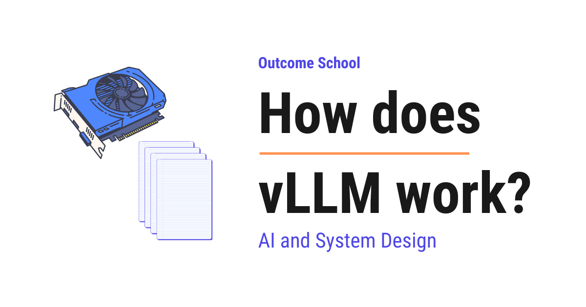

# How does vLLM work?

> Archived from <https://outcomeschool.com/blog/how-does-vllm-work> on 2026-11-25.

vLLM is a high-throughput engine for serving large language models. It manages the KV cache memory very efficiently using PagedAttention, so it can serve many more users at the same time on the same GPU.

In this blog, we will learn about how vLLM works. We will also see why we need it, how it manages memory so cleverly, and where it is used in the real world to serve large language models to many users at once.

We will cover the following:
<ul><li>What is serving an LLM?</li><li>A quick recap of prefill, decode, and the KV cache</li><li>The problem: the KV cache eats GPU memory</li><li>Why naive serving wastes memory</li><li>What is vLLM?</li><li>PagedAttention, the core idea</li><li>How PagedAttention shares memory</li><li>Continuous batching</li><li>The OpenAI-compatible API server</li><li>The benefits of vLLM</li><li>vLLM in the real world</li></ul>
I am <strong>Amit Shekhar</strong>, Founder @ <a target="_blank" rel="noopener noreferrer" href="https://outcomeschool.com">Outcome School</a>, I have taught and mentored many developers, and their efforts landed them high-paying tech jobs, helped many tech companies in solving their unique problems, and created many open-source libraries being used by top companies. I am passionate about sharing knowledge through open-source, blogs, and videos.

I teach <a target="_blank" rel="noopener noreferrer" href="https://outcomeschool.com/program/ai-and-machine-learning">AI and Machine Learning</a> at Outcome School.

Let&#x27;s get started.
<h3 id="what-is-serving-an-llm">What is serving an LLM?</h3>
Before we talk about vLLM, we must first understand what it means to <a target="_blank" rel="noopener noreferrer" href="model-serving.md">serve an LLM</a>.

A large language model, or <strong>LLM</strong>, is the technology behind tools like ChatGPT and Claude. We give it some text, and it gives us back some text.

<strong>Serving an LLM means running the model on a computer so that many users can send it questions and get answers at the same time.</strong>

In simple words, serving is the part that takes user requests, runs them through the model, and sends back the replies.

Let&#x27;s say we built a chat assistant. Thousands of people open it at once. Each person types a question. All of those questions arrive at our model, and every person expects a fast answer. The piece of software that takes all these requests, runs the model for each one, and returns each reply is called the <strong>serving engine</strong>.

We can picture this flow as below:

<pre><code class="code-highlight">SERVING AN LLM

User 1  --question--&gt;  +-----------------+      +-----------------+
User 2  --question--&gt;  |  serving engine |-----&gt;|  model on GPU   |
User 3  --question--&gt;  |  (takes requests|      | (does the heavy |
   ...                 |   sends replies)|&lt;-----|  math, replies) |
User N  --question--&gt;  +-----------------+      +-----------------+
                              |
                              +--reply--&gt; back to each user
</code></pre>

Here, we can see that many users send their questions at the same time. The serving engine sits in the middle. It collects all the requests, runs them through the model on the GPU, and sends each reply back to the right user.

Now, here is the important part. LLMs run on a special chip called a <strong><a target="_blank" rel="noopener noreferrer" href="how-does-a-gpu-work-for-deep-learning.md">GPU</a></strong>. A GPU is a powerful processor that is very good at the heavy math an LLM needs. GPUs are expensive and they have a limited amount of memory. So, if we waste GPU memory, we can serve fewer users, and our cost goes up.

So, the whole game of serving is this: we want to serve as many users as possible, as fast as possible, on one GPU. Keep this goal in mind, because vLLM is built exactly to win this game.
<h3 id="a-quick-recap-of-prefill-decode-and-the-kv-cache">A quick recap of prefill, decode, and the KV cache</h3>
To understand vLLM, we must understand a little about how an LLM produces an answer. Do not worry, we will keep it simple.

When we send a prompt, the model does not read it as full words. It first breaks the text into small pieces called <strong>tokens</strong>. A token is a small chunk of text, roughly a word or part of a word. So, the prompt becomes a list of tokens.

The model then works in two phases.

<strong>The first phase is <a target="_blank" rel="noopener noreferrer" href="prefill-vs-decode-llm-inference-optimization.md">prefill</a>.</strong> This is when the model reads our entire prompt and processes every token before writing even a single word of the reply. In simple words, prefill is the model reading and digesting our whole prompt.

<strong>The second phase is decode.</strong> This is when the model writes the reply, one token at a time. It writes a token, then looks at everything so far, then writes the next token, and keeps going until the answer is complete.

Now, during both phases, for every token, the model computes some internal values and stores them. These stored values are kept in something called the <a target="_blank" rel="noopener noreferrer" href="kv-cache-in-llms.md"><strong>KV cache</strong></a>.

Let&#x27;s understand the KV cache in plain words. As the model reads or writes each token, it creates a small summary of that token, a kind of note about what that token means in the context of everything before it. The KV cache is the collection of all these notes, one set of notes per token.

Here is why the KV cache matters so much. To write each new token during decode, the model needs the notes for every token that came before it. Without the KV cache, the model would have to recompute all those notes again for every single new word. That would be painfully slow. So, the model stores the notes once and reuses them. The KV cache is what makes generating long answers fast.

Here is the key point to remember:

<strong>The KV cache grows as the answer grows. Every new token adds one more set of notes to the KV cache, and all of these notes sit in GPU memory.</strong>

We can picture the two phases and the growing KV cache as below:

<pre><code class="code-highlight">PREFILL then DECODE: the KV cache grows one set of notes per token

prompt tokens:  [ Tell ][ me ][ a ][ joke ]
                   |      |     |     |
PREFILL writes:   [n]    [n]   [n]   [n]      (one note per prompt token)

so KV cache =   [n][n][n][n]                  (4 notes after prefill)

DECODE step 1:  writes &quot;Why&quot;      KV cache: [n][n][n][n][n]
DECODE step 2:  writes &quot;did&quot;      KV cache: [n][n][n][n][n][n]
DECODE step 3:  writes &quot;the&quot;      KV cache: [n][n][n][n][n][n][n]
                   ...                          (grows by one each step)
</code></pre>

Here, we can notice that prefill creates one set of notes for every prompt token in one go. Then decode writes the reply one token at a time, and each new token adds one more set of notes to the KV cache. So, the longer the answer, the larger the KV cache becomes in GPU memory.

This is the foundation we needed. Now we are ready to see the real problem.
<h3 id="the-problem-the-kv-cache-eats-gpu-memory">The problem: the KV cache eats GPU memory</h3>
Now that we know what the KV cache is, let&#x27;s see the trouble it causes.

The model itself <a target="_blank" rel="noopener noreferrer" href="llm-gpu-memory.md">takes up a big chunk of GPU memory</a>. Whatever memory is left over is used to hold the KV cache for all the requests we are serving right now.

So, the KV cache is the thing that decides how many users we can serve at once. The more KV cache memory we have free, the more requests we can run together.

Let&#x27;s put it simply. Each request that is being served has its own KV cache, and that KV cache keeps growing as its answer grows. If we are serving many users, all of their KV caches live in GPU memory together, fighting for the same limited space.

So, the real bottleneck in serving an LLM is not the math speed. It is the KV cache memory. <a target="_blank" rel="noopener noreferrer" href="kv-cache-compression.md">KV Cache Compression</a> techniques make each cache smaller, but no matter how small it gets, the engine still has to manage it well.

This means the whole challenge of serving an LLM comes down to managing memory. If we manage the KV cache memory well, we serve more users. If we manage it badly, we waste the GPU and serve fewer users.

Now, the next question is, how does the naive approach manage this memory, and why is it bad? Let&#x27;s see.
<h3 id="why-naive-serving-wastes-memory">Why naive serving wastes memory</h3>
Let&#x27;s understand how a simple, naive serving engine handles the KV cache, and where it goes wrong.

The naive approach does something that feels safe but is actually very wasteful. When a request comes in, the engine does not know how long the answer will be. So, to be safe, it reserves one big continuous block of memory large enough to hold the longest possible answer.

Let&#x27;s say the model can produce up to 2,000 tokens. For every single request, the naive engine reserves space for 2,000 tokens of KV cache right away, even before the model has written anything.

Here is the catch. Most answers are short. If a user&#x27;s answer is only 50 tokens long, then the space for the other 1,950 tokens just sits there, reserved but unused, doing nothing. We blocked a huge amount of memory for an answer that never needed it.

This waste has two names, and we must understand both.

<strong>The first is over-reservation.</strong> This means we reserved far more memory than the request actually used. The reserved-but-unused space cannot be given to anyone else, so it is wasted.

<strong>The second is fragmentation.</strong> Fragmentation means the free memory is broken into small scattered pieces that we cannot use. Let&#x27;s understand this with a picture.

We can picture the naive approach as below:

<pre><code class="code-highlight">NAIVE SERVING: one big continuous block reserved per request

Request A: [#### used (50) ............... wasted, reserved for 2000 ..............]
Request B: [###### used (120) ............ wasted, reserved for 2000 ..............]
Request C: [## used (20) ................. wasted, reserved for 2000 ..............]

free memory left: scattered tiny gaps  -&gt;  cannot fit a new request
</code></pre>

Here, we can see that each request grabbed a giant continuous block but only used a tiny part of it at the front. The rest is wasted. And the small leftover gaps between blocks are too small and too scattered to hold a new request. So, even though a lot of memory is technically free, we cannot use it. This is fragmentation.

The result is poor. The GPU has plenty of memory on paper, but because it is wasted and scattered, we can only serve a few users at a time. We are paying for a powerful GPU and using only a small part of it.

<strong>Planning your move into AI?</strong>

No matter which tech domain you work in today, with your effort, you can transition to these roles:
<ul><li>AI Engineer</li><li>Forward Deployed Engineer</li><li>AI Agent Engineer</li><li>Harness Engineer</li><li>Voice AI Engineer</li><li>AI Architect</li><li>LLM Engineer</li><li>LLM Inference Engineer</li><li>Gen AI Engineer</li><li>MLOps Engineer</li><li>ML Engineer</li><li>Deep Learning Engineer</li></ul>
Our <a target="_blank" rel="noopener noreferrer" href="https://outcomeschool.com/program/ai-and-machine-learning">AI and Machine Learning Program</a> at Outcome School takes you there.

So, here comes vLLM to the rescue.
<h3 id="what-is-vllm">What is vLLM?</h3>
Now that we understand the problem, let&#x27;s understand the solution.

<strong>vLLM is a high-throughput engine for serving LLMs. It is built to serve as many requests as possible on a GPU by managing the KV cache memory very efficiently.</strong>

In simple words, vLLM is a smart serving engine that stops wasting GPU memory, so it can serve many more users at the same time.

Let&#x27;s understand the word <strong>throughput</strong>, because it sits right in the name &quot;high-throughput&quot;. Throughput means how much work we finish in a given amount of time. High throughput means we serve a large number of tokens and requests every second. That is exactly what vLLM is built to maximize.

vLLM solves the memory problem with two main ideas working together:
<ul><li><strong>PagedAttention</strong>, which manages the KV cache in small fixed-size blocks instead of one giant block, so no memory is wasted.</li><li><strong>Continuous batching</strong>, which keeps the GPU busy by swapping finished requests out and new ones in at every step.</li></ul>
Do not worry, we will learn about each of them in detail. Let&#x27;s start with <a target="_blank" rel="noopener noreferrer" href="paged-attention-in-llms.md">PagedAttention</a>, because it is the heart of vLLM.
<h3 id="pagedattention-the-core-idea">PagedAttention, the core idea</h3>
Let&#x27;s understand the core idea behind vLLM step by step.

<strong>PagedAttention manages the KV cache in small fixed-size blocks, allocating memory on demand instead of reserving one big block upfront.</strong>

In simple words, instead of grabbing a huge block of memory for each request, vLLM hands out memory in small equal-sized pieces, only when the request actually needs more.

This idea is borrowed from how an operating system manages memory. The operating system manages memory using small fixed-size pieces called <strong>pages</strong>. When a program needs more memory, the operating system gives it one more page. The pages do not have to sit next to each other in memory. The operating system keeps a small table that remembers where each page is.

vLLM does exactly the same thing for the KV cache. It splits the KV cache memory into small fixed-size <strong>blocks</strong>, where each block holds the notes for a fixed number of tokens, for example 16 tokens. When a request needs to store more tokens, vLLM gives it one more block. The blocks do not have to sit next to each other. vLLM keeps a small table, called a <strong>block table</strong>, that remembers which blocks belong to which request and in what order.

Let&#x27;s walk through it with an example.

<strong>Step 1:</strong> A request comes in and starts generating an answer. vLLM gives it one block, enough for 16 tokens. The request starts filling that block.

<strong>Step 2:</strong> The answer crosses 16 tokens. The first block is full. vLLM simply gives the request one more block, wherever a free block is available in memory. It does not need to be next to the first block.

<strong>After that:</strong> The answer keeps growing, and vLLM keeps handing out one block at a time, only as needed. When the answer is finished, vLLM frees all of that request&#x27;s blocks at once, and those blocks immediately become available for other requests.

We can picture this with a simple diagram as below:

<pre><code class="code-highlight">PAGED ATTENTION: KV cache split into small fixed-size blocks

GPU memory:  [B1][B2][B3][B4][B5][B6][B7][B8][B9] ... (a pool of equal blocks)

Request A&#x27;s block table  -&gt;  B1, B4, B7      (3 blocks, given as needed)
Request B&#x27;s block table  -&gt;  B2, B3          (2 blocks, given as needed)
Request C&#x27;s block table  -&gt;  B5              (1 block, just started)

free blocks ready to hand out: B6, B8, B9
</code></pre>

Here, we can see that the memory is one shared pool of equal-sized blocks. Each request gets only the blocks it actually needs, and they can be scattered anywhere in the pool. The block table is the small map that ties a request to its blocks in the right order. When a request finishes, its blocks go straight back into the free pool for the next request to use.

The problem is solved. There is no over-reservation, because we only allocate a block when it is truly needed. And there is almost no fragmentation, because every block is the same size, so any free block fits any request. The wasted memory drops to nearly nothing.

To learn PagedAttention, the KV Cache, and vLLM in depth, check out our <a target="_blank" rel="noopener noreferrer" href="https://outcomeschool.com/program/ai-and-machine-learning">AI and Machine Learning Program</a> at Outcome School.
<h3 id="how-pagedattention-shares-memory">How PagedAttention shares memory</h3>
There is one more beautiful thing PagedAttention gives us, and it comes for free once we have blocks. It is <strong>sharing</strong>.

Because the KV cache is now made of small blocks, two different requests can point their block tables at the very same block in memory, instead of each keeping its own copy. This means they share the memory for the part that is identical.

Let&#x27;s understand this with two real cases where sharing helps a lot.

<strong>The first case is identical prefixes.</strong> A prefix is the starting part of something. Suppose many users send requests that all begin with the same long system instructions, for example &quot;You are a polite customer support agent for a car dealership.&quot; That long beginning is identical for everyone. With blocks, vLLM can store the KV cache for that shared beginning once, and let every request point to those same blocks. We do not store the same notes many times. We store them once and share. We have a detailed blog on <a target="_blank" rel="noopener noreferrer" href="how-does-prompt-caching-work.md">prompt caching</a> that explains how reusing the KV cache for an identical prefix works.

<strong>The second case is beam search.</strong> <a target="_blank" rel="noopener noreferrer" href="greedy-decoding-vs-beam-search.md">Beam search</a> is a way of generating text where the model explores several possible answers at the same time and then keeps the best one. These several answers, called <strong>beams</strong>, all share the same beginning and only differ later. With blocks, all the beams can share the blocks for the common beginning and only use separate blocks where they actually diverge.

We can picture sharing as below:

<pre><code class="code-highlight">SHARING WITH BLOCKS

shared beginning:   [B1][B2]   &lt;- one copy in memory, used by all
                       |
        +--------------+--------------+
        |              |              |
   Request A      Request B       Beam C
   adds [B5]      adds [B6]       adds [B7]
</code></pre>

Here, we can see that the blocks <code>B1</code> and <code>B2</code> hold the identical beginning and are stored only once. Three different paths all point to those same two blocks for the shared part, and each one adds its own separate blocks only for the part that is unique to it. We saved the memory of storing that beginning three times.

This is how PagedAttention not only stops waste but also lets requests share memory, which packs even more users onto the same GPU.

<strong>A quick note for you</strong>

No matter which tech domain you work in, get familiar with these topics:
<ul><li>LLM</li><li>RAG</li><li>MCP</li><li>Agent</li><li>Fine-tuning</li><li>Quantization</li></ul>
We put it all together in one video:

<a target="_blank" rel="noopener noreferrer" href="https://www.youtube.com/watch?v=lnfWvX66FUk">AI Engineering Explained: LLM, RAG, MCP, Agent, Fine-Tuning, and Quantization</a>

No need to stop reading - bookmark it and watch later when you get time. Future you will thank you.

Now, let&#x27;s get back to the topic.
<h3 id="continuous-batching">Continuous batching</h3>
Now, let&#x27;s learn about the second big idea in vLLM, which works together with PagedAttention.

To understand it, we first need to understand <strong>batching</strong>. Batching means running many requests together in one go, instead of one at a time. A GPU is much more efficient when it processes many requests together, so batching is how we keep the GPU busy and get high throughput.

But the naive way of batching has a problem. Let&#x27;s see it.

The naive way is called <strong>static batching</strong>. In static batching, we collect a batch of requests, run them all together, and we must wait for every request in the batch to finish before we start the next batch.

Here is the catch. Different requests produce answers of very different lengths. One user&#x27;s answer is 20 tokens, while another&#x27;s is 800 tokens. In static batching, the short request finishes early and then just sits there idle, waiting for the long request to finish, because the whole batch moves together. During that wait, the GPU slot for the finished request is doing nothing. That is wasted GPU time.

So, here comes <a target="_blank" rel="noopener noreferrer" href="continuous-batching-in-llms.md">continuous batching</a> to the rescue.

<strong>Continuous batching swaps finished requests out and brings new waiting requests in at every single step, instead of waiting for the whole batch to finish.</strong>

In simple words, the moment a request finishes, vLLM removes it and immediately pulls in a new request from the waiting line to take its place. The GPU never sits idle waiting.

Remember, decode produces the answer one token at a time, so there are many small steps. At each step, vLLM checks: did any request just finish? If yes, it drops that request and adds a new one. The batch is always kept full of active work.

Let&#x27;s compare the two approaches with a diagram as below:

<pre><code class="code-highlight">STATIC BATCHING (naive): the whole batch waits for the slowest one

step:   1    2    3    4    5    6    7    8
Req A:  X    X    X    done -    -    -    -     &lt;- idle, wasting the slot
Req B:  X    X    X    X    X    X    X    done

CONTINUOUS BATCHING (vLLM): finished slots are refilled right away

step:   1    2    3    4    5    6    7    8
slot1:  A    A    A    C    C    C    D    D     &lt;- A finished, C jumped in, then D
slot2:  B    B    B    B    B    B    B    done
</code></pre>

Here, we can see that in static batching, request A finished early but its slot stayed empty and idle until the slow request B finished. In continuous batching, the moment A finished, request C jumped into that slot, and when C finished, request D jumped in. The GPU is kept busy the whole time. No slot is wasted.

Continuous batching and PagedAttention fit together perfectly. PagedAttention frees a finished request&#x27;s blocks instantly, and continuous batching immediately uses that freed memory and that freed slot for a new waiting request. Together, they keep the GPU memory and the GPU compute both fully used.

This is how vLLM keeps the GPU working at full speed.

To master Continuous Batching, LLM Inference Engineering, and how to design an LLM Inference Platform (vLLM-as-a-Service) end to end, check out our <a target="_blank" rel="noopener noreferrer" href="https://outcomeschool.com/program/ai-and-machine-learning">AI and Machine Learning Program</a> at Outcome School.
<h3 id="the-openai-compatible-api-server">The OpenAI-compatible API server</h3>
Now, let&#x27;s see how we actually use vLLM in practice.

vLLM exposes an <strong>OpenAI-compatible API server</strong>.

vLLM can run as a server that listens for chat requests and sends back the model&#x27;s replies.

This matters a lot because a huge number of tools and applications are already written to talk to OpenAI&#x27;s API. If vLLM speaks the same language, then we can point those existing tools at our own vLLM server by just changing the address, without rewriting our code. We can run our own model on our own GPU and our application talks to it the same way it talked to OpenAI.

So, vLLM gives us the high-throughput engine on the inside, and a familiar, easy-to-use API on the outside. This is the part we must appreciate, because it makes vLLM very simple to adopt in real projects.

<strong>Stay updated:</strong> Subscribe to our <a target="_blank" rel="noopener noreferrer" href="https://outcomeschool.substack.com/subscribe">newsletter</a> to get our latest AI and Machine Learning blogs straight to your inbox.
<h3 id="the-benefits-of-vllm">The benefits of vLLM</h3>
Let&#x27;s quickly bring together the benefits, because they are the reason we use vLLM.
<ul><li><strong>Much higher throughput.</strong> Because PagedAttention stops wasting memory and continuous batching stops wasting GPU time, vLLM can serve far more tokens and far more users per second than a naive engine.</li><li><strong>Better GPU utilization.</strong> Utilization means how much of the GPU we are actually using. vLLM keeps both the GPU memory and the GPU compute close to fully used, so we get more value out of the expensive hardware.</li><li><strong>Lower cost per request.</strong> Since one GPU now serves many more users, the cost spread across each user drops a lot.</li><li><strong>Easy to adopt.</strong> The OpenAI-compatible API means we can plug vLLM into our existing applications with very little change.</li></ul>
In simple words, vLLM lets us serve more users, faster, and cheaper, on the same GPU, without changing the quality of the answers. The model still produces the same replies. vLLM just stops wasting memory and time. We have a detailed blog on <a target="_blank" rel="noopener noreferrer" href="llm-inference-optimization.md">LLM inference optimization</a> that covers the broader set of techniques behind fast serving.

That&#x27;s the beauty of vLLM.
<h3 id="vllm-in-the-real-world">vLLM in the real world</h3>
Now, let&#x27;s see where vLLM is used in real systems.

vLLM is one of the most popular open-source serving engines, and it is widely used by companies that want to run open large language models on their own GPUs. Anywhere we need to serve a model to many users at once, vLLM is a strong choice.

vLLM is not the only serving engine. We have a detailed blog on <a target="_blank" rel="noopener noreferrer" href="how-does-sglang-work.md">how SGLang works</a> that takes a different approach to prefix sharing, matching shared text precisely with a radix tree instead of fixed-size blocks. On NVIDIA hardware there is also <a target="_blank" rel="noopener noreferrer" href="how-does-tensorrt-llm-work.md">TensorRT-LLM</a>, NVIDIA&#x27;s own engine, which goes all the way down to kernels tuned for each GPU generation.

It is especially powerful in two kinds of systems.

The first is <strong>high-traffic chat applications</strong>. When many users are chatting at the same time, continuous batching keeps every GPU slot full, and PagedAttention packs many users&#x27; KV caches into the same memory. So, we serve a large crowd on fewer GPUs.

The second is <strong>agent systems</strong>. An <a target="_blank" rel="noopener noreferrer" href="ai-agent.md">agent</a> is an AI program that works on a task step by step, often calling tools and taking many turns to finish a job. Agents send the same big block of instructions on every step, so the identical-prefix sharing in PagedAttention saves a lot of memory, and continuous batching keeps the many short steps flowing without idle time.

So, anywhere we need to serve an LLM to many users efficiently and cheaply, vLLM helps us a lot.

This is how vLLM works. It treats the KV cache like an operating system treats memory, handing out small fixed-size blocks on demand and sharing them across requests through PagedAttention, it keeps the GPU always busy by swapping requests in and out every step through continuous batching, and it wraps all of this behind a familiar OpenAI-compatible API, so we get much higher throughput and far better GPU utilization on the same hardware.
<h2 id="frequently-asked-questions">Frequently Asked Questions</h2><h3 id="does-vllm-change-the-quality-of-the-models-answers">Does vLLM change the quality of the model&#x27;s answers?</h3>
No. vLLM does not change the quality of the answers. The model still produces the same replies. vLLM just stops wasting GPU memory and GPU time, so we can serve more users, faster, and cheaper, on the same GPU.
<h3 id="is-math-speed-the-main-bottleneck-when-serving-an-llm">Is math speed the main bottleneck when serving an LLM?</h3>
No. The real bottleneck in serving an LLM is the KV cache memory, not the math speed. Every request has its own KV cache that keeps growing with the answer, and all of them share the limited GPU memory. So, how well we manage that memory decides how many users we can serve.
<h3 id="do-we-need-to-rewrite-our-application-to-use-vllm-instead-of-openais-api">Do we need to rewrite our application to use vLLM instead of OpenAI&#x27;s API?</h3>
No. vLLM exposes an OpenAI-compatible API server. So, we can point our existing tools at our own vLLM server by just changing the address, without rewriting our code. Our application talks to our own model the same way it talked to OpenAI.
<h3 id="is-vllm-the-only-llm-serving-engine">Is vLLM the only LLM serving engine?</h3>
No. vLLM is one of the most popular open-source serving engines, but there are others. SGLang takes a different approach to prefix sharing, matching shared text precisely with a radix tree instead of fixed-size blocks. On NVIDIA hardware, there is also TensorRT-LLM, NVIDIA&#x27;s own engine.
<h3 id="why-is-vllm-a-good-fit-for-agent-systems">Why is vLLM a good fit for agent systems?</h3>
Agents send the same big block of instructions on every step. The identical-prefix sharing in PagedAttention stores that shared beginning once, which saves a lot of memory. At the same time, continuous batching keeps the many short agent steps flowing without idle time on the GPU.

That&#x27;s it for now.

Thanks

<strong>Amit Shekhar</strong> Founder @ <a target="_blank" rel="noopener noreferrer" href="https://outcomeschool.com">Outcome School</a>

You can connect with me on:
<ul><li><a target="_blank" rel="noopener noreferrer" href="https://x.com/amitiitbhu">X</a></li><li><a target="_blank" rel="noopener noreferrer" href="https://www.linkedin.com/in/amit-shekhar-iitbhu">LinkedIn</a></li><li><a target="_blank" rel="noopener noreferrer" href="https://github.com/amitshekhariitbhu">GitHub</a></li></ul>
Follow Outcome School on:
<ul><li><a target="_blank" rel="noopener noreferrer" href="https://x.com/outcome_school">X</a></li><li><a target="_blank" rel="noopener noreferrer" href="https://youtube.com/@OutcomeSchool">YouTube</a></li><li><a target="_blank" rel="noopener noreferrer" href="https://www.linkedin.com/company/outcomeschool">LinkedIn</a></li><li><a target="_blank" rel="noopener noreferrer" href="https://github.com/OutcomeSchool">GitHub</a></li></ul>
<a target="_blank" rel="noopener noreferrer" href="https://outcomeschool.com/blog"><strong>Read all of our high-quality blogs here.</strong></a>

