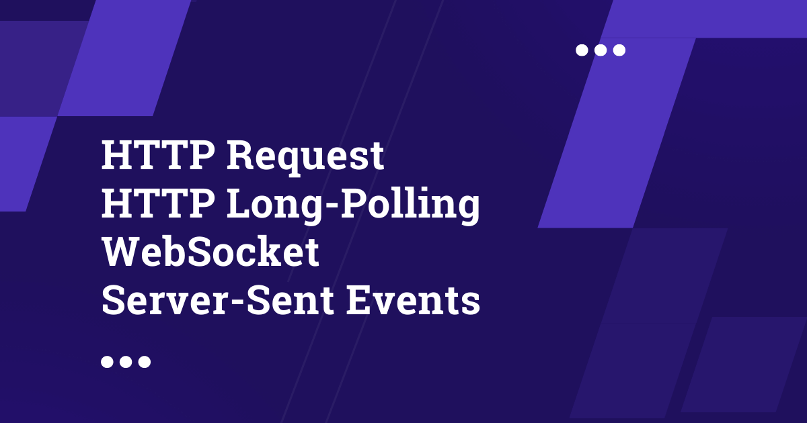

# HTTP Request vs HTTP Long-Polling vs WebSocket vs Server-Sent Events

> Archived from <https://outcomeschool.com/blog/http-request-long-polling-websocket-sse> on 2026-11-25.

In an HTTP Request, the client asks and the server answers once. In HTTP Long-Polling, the server holds the request until new data is ready. A WebSocket keeps a two-way connection open, and Server-Sent Events (SSE) let only the server push data to the client.

In this blog, we are going to learn the <strong>HTTP Request</strong> vs <strong>Http Long-Polling</strong> vs <strong>WebSocket</strong> vs <strong>Server-Sent Events(SSE)</strong>.

I am <strong>Amit Shekhar</strong>, Founder @ <a target="_blank" rel="noopener noreferrer" href="https://outcomeschool.com">Outcome School</a>, I have taught and mentored many developers, and their efforts landed them high-paying tech jobs, helped many tech companies in solving their unique problems, and created many open-source libraries being used by top companies. I am passionate about sharing knowledge through open-source, blogs, and videos.

I teach <strong>AI and Machine Learning</strong>, and <strong>Android</strong> at Outcome School.

Join <strong>Outcome School</strong> and get a high-paying tech job:
<ul><li><a target="_blank" rel="noopener noreferrer" href="https://outcomeschool.com/program/ai-and-machine-learning">Outcome School AI and Machine Learning Program</a></li><li><a target="_blank" rel="noopener noreferrer" href="https://outcomeschool.com/program/android">Outcome School Android Program</a></li></ul>
Let&#x27;s get started.

These are important when it comes to system design interviews.

First, let&#x27;s have a quick introduction to the HTTP request.
<h2 id="http-request">HTTP request</h2>
Consider there is a client and a server. The client makes a request to the server for the data, the handshaking is done, and the connection gets opened between the client and the server.

Then, the server does its work and sends the response back to the client using that already opened connection. And then finally the connection gets closed. That&#x27;s it.

One of the use-cases of the HTTP requests is: Fetching the profile information in Facebook applications.

This was a quick introduction to the HTTP request. Now, we need to discuss the HTTP Long Polling.

But, before discussing HTTP Long Polling, we also need to know about HTTP Polling which is actually different from HTTP Long Polling.
<h2 id="http-polling">HTTP Polling</h2>
Once again consider there is a client and a server. The client can make a request to the server for the data using the HTTP request.

So, here the client keeps making the request at a regular interval for example 1–2 seconds whatever it can be.

The server does its work and sends the response back to the client.

Here, we need to notice that the response can be empty because the server might not have any updates which are useful for the client. In that case, most of the requests might get an empty response. And in a few of the requests, the client gets the updates that are useful. So, the problem is that we are making so many unnecessary network calls.

Let&#x27;s take a look at the WhatsApp example for chatting use-case, we can consider client as the WhatsApp Android or iOS App, the server is the WhatsApp server.

Here the client will be making the request at regular intervals for example 2 seconds. There might be a case where we do not have any new messages, and we will keep polling, and draining the battery of the Mobile device.

But, for sending the message from the client to the server, we can make the HTTP request. But, this is not a good idea when it comes to getting the new messages from the server, because of two reasons:
<ul><li>First, delayed messages by 2 seconds in many cases as we will poll the server at regular intervals of 2 seconds.</li><li>Second, most of the time, we will be getting empty responses.</li></ul>
We need a better solution than this.

But when we consider another example, like a location update of a delivery boy coming to deliver the food, we are good with 2 seconds delay in the location update. So, HTTP polling can be used. I am not saying it is recommended but can be used for these types of use-cases.

<strong>Planning your move into AI?</strong>

No matter which tech domain you work in today, with your effort, you can transition to these roles:
<ul><li>AI Engineer</li><li>Forward Deployed Engineer</li><li>AI Agent Engineer</li><li>Harness Engineer</li><li>Voice AI Engineer</li><li>AI Architect</li><li>LLM Engineer</li><li>LLM Inference Engineer</li><li>Gen AI Engineer</li><li>MLOps Engineer</li><li>ML Engineer</li><li>Deep Learning Engineer</li></ul>
Our <a target="_blank" rel="noopener noreferrer" href="https://outcomeschool.com/program/ai-and-machine-learning">AI and Machine Learning Program</a> at Outcome School takes you there.

So, this was HTTP Polling. Now, let&#x27;s learn and try another solution which is HTTP Long Polling.
<h2 id="http-longpolling">HTTP Long Polling</h2>
Once again consider there is a client and a server. Again, the client can make a request to the server for the data using the HTTP request.

But, here is the catch, the client waits for the server to provide the response. There will be a connection opened till the server has a response to send back. As the connection is open for a long time, that&#x27;s why we call it HTTP Long-Polling. This is why it is different from HTTP Polling.

As soon the server has the response, it sends it back to the client and the connection gets closed. And the client makes another request and waits for the response and this keeps on going in this way again and again.

One more thing to notice is that we also add a timeout to each request. So, when the client either gets the response or a timeout occurs, the connection gets closed, it makes a new request, and starts waiting for the next response.

If we consider our WhatsApp example, this Long HTTP-Polling is a better solution than the HTTP-Polling because
<ul><li>The message can come in real-time.</li><li>And there will be no empty response although we will have timeout and reconnection again and again.</li></ul>
But again, we can have a better solution than this too.

And this was all about HTTP Long-Polling. Now, we know how it differs from HTTP Polling.

<strong>A quick note for you</strong>

No matter which tech domain you work in, get familiar with these topics:
<ul><li>LLM</li><li>RAG</li><li>MCP</li><li>Agent</li><li>Fine-tuning</li><li>Quantization</li></ul>
We put it all together in one video:

<a target="_blank" rel="noopener noreferrer" href="https://www.youtube.com/watch?v=lnfWvX66FUk">AI Engineering Explained: LLM, RAG, MCP, Agent, Fine-Tuning, and Quantization</a>

No need to stop reading - bookmark it and watch later when you get time. Future you will thank you.

Now, let&#x27;s get back to the topic.

Now, let&#x27;s learn about WebSocket.
<h2 id="websocket">WebSocket</h2>
First, we need to know about the WebSocket.

From the official documentation:
<blockquote>
A WebSocket is a persistent connection between a client and a server. WebSockets provide a bidirectional, full-duplex communications channel that operates over HTTP through a single TCP/IP socket connection. At its core, the WebSocket protocol facilitates message passing between a client and server.
</blockquote>
Let&#x27;s see how it works.

Again consider there is a client and a server.

First, the client does the WebSocket handshaking with the server, then, the TCP connection gets established between the server and the client through the WebSocket.

Now the important thing to notice here is that, as this is a bi-directional communication, the server can send data to the client anytime, and the client can send data to the server anytime.

Also notice that this will reduce the overhead of handshaking again and again, as we are doing the handshaking only once at the beginning. This way it reduces the overhead.

And this WebSocket has made our task very easy.

Now, when we use the WebSocket for the WhatsApp chat. Things become better, now we can easily send and receive messages. And this is the best solution. And, WhatsApp uses WebSocket.

<strong>Stay updated:</strong> Subscribe to our <a target="_blank" rel="noopener noreferrer" href="https://outcomeschool.substack.com/subscribe">newsletter</a> to get our latest AI and Machine Learning blogs straight to your inbox.

Now, let&#x27;s discuss the last one Server-Send Events(SSE).
<h2 id="server-send-eventssse">Server-Send Events(SSE)</h2>
As the name itself tells here server sends events.

According to the definition, it is a server push technology enabling a client to receive automatic updates from a server.

Again consider there is a client and a server. Using SSE, the clients make a persistent long-term connection with the server. Then, the server uses this connection to send the data to the client.

But the client can&#x27;t send the data to the server using the SSE. This is very important.

For that, we will have to use the normal HTTP request.

So if we see the WhatsApp example again, for getting the message from the server, it will work, but for sending the message, we will have to use the HTTP again, so this is not a better solution. The best solution was WebSocket for the WhatsApp chat use case.

But if we take the example of a real-time stock price application, this SSE can be used as we will get the updates from the server continuously and we will have nothing as such that we will send to the server. So, SSE is a good fit for this use case.

Another major modern use of SSE is token streaming in LLM apps like ChatGPT and Claude, where the server pushes the reply to the browser one token at a time over a single open connection. We have a blog on <a target="_blank" rel="noopener noreferrer" href="how-does-token-streaming-work.md">how Token Streaming works</a> that explains this in depth.

And now we know how HTTP Request, HTTP Long-Polling, WebSocket, and Server-Sent Events differ from each other.

Watch the video format: <a target="_blank" rel="noopener noreferrer" href="https://www.youtube.com/watch?v=8ksWRX4xV-s">HTTP Request vs HTTP Long-Polling vs WebSocket vs Server-Sent Events</a>
<h2 id="frequently-asked-questions">Frequently Asked Questions</h2><h3 id="which-one-is-the-best-for-a-chat-app-like-whatsapp">Which one is the best for a chat app like WhatsApp?</h3>
WebSocket is the best solution for a chat app like WhatsApp. It gives a bi-directional connection, so the server and the client can send data to each other anytime. This makes sending and receiving messages easy, and WhatsApp uses WebSocket.
<h3 id="can-the-client-send-data-to-the-server-using-sse">Can the client send data to the server using SSE?</h3>
No. With SSE, only the server uses the connection to send data to the client. For sending data from the client to the server, we have to use the normal HTTP request. This is why SSE is not the best fit for chat.
<h3 id="when-is-http-polling-good-enough">When is HTTP Polling good enough?</h3>
HTTP Polling can be used when a small delay in updates is fine. For example, the location update of a delivery boy coming to deliver the food can work with a 2 second delay. But it makes many unnecessary network calls, as most of the responses can be empty.
<h3 id="why-does-websocket-have-less-overhead-than-repeated-http-requests">Why does WebSocket have less overhead than repeated HTTP requests?</h3>
WebSocket does the handshaking only once at the beginning. After that, the same connection stays open for both the client and the server. With repeated HTTP requests, the connection gets opened and closed again and again, which adds overhead.
<h3 id="where-is-sse-used-in-modern-apps">Where is SSE used in modern apps?</h3>
SSE is used for token streaming in LLM apps like ChatGPT and Claude. The server pushes the reply to the browser one token at a time over a single open connection. It is also a good fit for a real-time stock price application.

That&#x27;s it for now.

Thanks

<strong>Amit Shekhar</strong> Founder @ <a target="_blank" rel="noopener noreferrer" href="https://outcomeschool.com">Outcome School</a>

You can connect with me on:
<ul><li><a target="_blank" rel="noopener noreferrer" href="https://x.com/amitiitbhu">X</a></li><li><a target="_blank" rel="noopener noreferrer" href="https://www.linkedin.com/in/amit-shekhar-iitbhu">LinkedIn</a></li><li><a target="_blank" rel="noopener noreferrer" href="https://github.com/amitshekhariitbhu">GitHub</a></li></ul>
Follow Outcome School on:
<ul><li><a target="_blank" rel="noopener noreferrer" href="https://x.com/outcome_school">X</a></li><li><a target="_blank" rel="noopener noreferrer" href="https://youtube.com/@OutcomeSchool">YouTube</a></li><li><a target="_blank" rel="noopener noreferrer" href="https://www.linkedin.com/company/outcomeschool">LinkedIn</a></li><li><a target="_blank" rel="noopener noreferrer" href="https://github.com/OutcomeSchool">GitHub</a></li></ul>
<a target="_blank" rel="noopener noreferrer" href="https://outcomeschool.com/blog"><strong>Read all of our high-quality blogs here.</strong></a>

