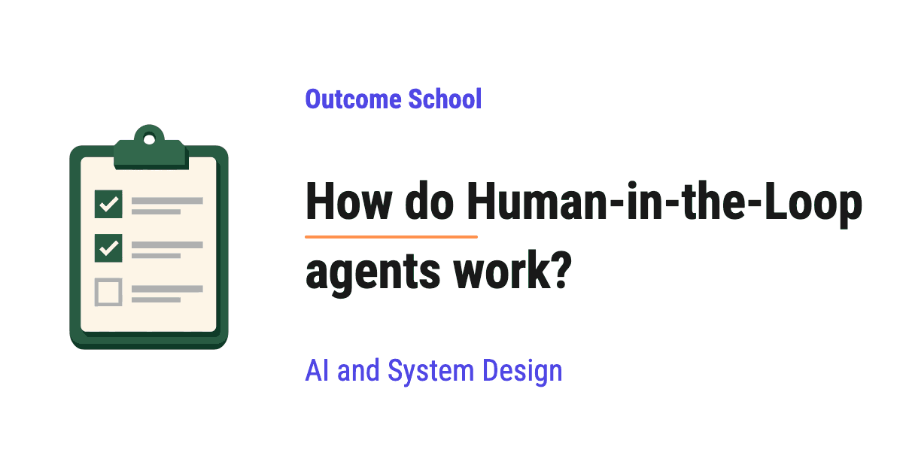

# How do Human-in-the-Loop agents work?

> Archived from <https://outcomeschool.com/blog/human-in-the-loop-agents> on 2026-11-25.

Human-in-the-Loop agents are AI agents that stop at important moments and ask a human to check, approve, edit, or answer before they continue. The agent does most of the work by itself, but a person stays in control of the decisions that matter.

In this blog, we will learn about how Human-in-the-Loop agents work. We will also see why a fully automatic agent is risky, the points where a human can step in, how an agent pauses and continues after the human replies, how to decide which actions need a human, and where this approach works well and where it slows us down.

We will cover the following:
<ul><li>The problem with fully automatic agents</li><li>What is a Human-in-the-Loop agent?</li><li>Where can a human step in?</li><li>How does a Human-in-the-Loop agent work?</li><li>How does the agent pause and continue?</li><li>A simple code example</li><li>Which actions need a human?</li><li>Common mistakes</li><li>Advantages and disadvantages</li></ul>
I am <strong>Amit Shekhar</strong>, Founder @ <a target="_blank" rel="noopener noreferrer" href="https://outcomeschool.com">Outcome School</a>, I have taught and mentored many developers, and their efforts landed them high-paying tech jobs, helped many tech companies in solving their unique problems, and created many open-source libraries being used by top companies. I am passionate about sharing knowledge through open-source, blogs, and videos.

I teach <a target="_blank" rel="noopener noreferrer" href="https://outcomeschool.com/program/ai-and-machine-learning">AI and Machine Learning</a> at Outcome School.

Let&#x27;s get started.
<h2 id="the-problem-with-fully-automatic-agents">The problem with fully automatic agents</h2>
<strong>An <a target="_blank" rel="noopener noreferrer" href="ai-agent.md">AI agent</a> is a system built around an LLM that <a target="_blank" rel="noopener noreferrer" href="ai-agent-loop.md">works in a loop</a>: it thinks about the goal, picks a tool, looks at the result, and repeats until the job is done.</strong> The LLM <a target="_blank" rel="noopener noreferrer" href="how-does-function-calling-work-in-llms.md">asks for a tool</a>, like <code>send_email</code> or <code>book_flight</code>, and our code runs it.

Let&#x27;s say we tell an agent, &quot;Book me a flight to Mumbai for next Friday.&quot; The agent searches flights, compares prices, picks one, and books it. In a fully automatic agent, nobody checks these steps.

But an agent can make mistakes, and it makes them fast.

Suppose the agent misunderstands &quot;next Friday&quot; and books the wrong date. Or it picks a flight that costs 5 times more than we wanted. Or it sends an email to the wrong customer. Or it deletes a file that we needed.

Some mistakes are small and easy to undo. Others cost money, hurt trust, or cannot be undone at all.

So, the following issues arise with a fully automatic agent:
<ul><li>It can take wrong actions that cannot be undone.</li><li>It can guess when it must ask.</li><li>It can do something that is against company rules.</li><li>Nobody is responsible for the final decision.</li></ul>
We need a solution where the agent still does most of the work, but a human checks the important parts. So, here comes the Human-in-the-Loop agent to the rescue.
<h2 id="what-is-a-human-in-the-loop-agent">What is a Human-in-the-Loop agent?</h2>
<strong>A Human-in-the-Loop agent is an AI agent that pauses at chosen points and waits for a human to approve, edit, reject, or answer before it continues.</strong>

Here, a human is placed inside the agent&#x27;s loop as one of the steps. People often write it as <strong>HITL</strong> in short.

Think of a junior employee and a manager. The junior does the research, fills in the forms, and prepares everything. But before signing a big contract or spending a large amount of money, the junior goes to the manager and says, &quot;Here is what I plan to do. Can you approve it?&quot;. The manager says yes, says no, or makes a small change.

The agent is the junior. We are the manager.

The agent does not ask about everything. That would waste the manager&#x27;s time. It asks only at the important moments.

<strong>Planning your move into AI?</strong>

No matter which tech domain you work in today, with your effort, you can transition to these roles:
<ul><li>AI Engineer</li><li>Forward Deployed Engineer</li><li>AI Agent Engineer</li><li>Harness Engineer</li><li>Voice AI Engineer</li><li>AI Architect</li><li>LLM Engineer</li><li>LLM Inference Engineer</li><li>Gen AI Engineer</li><li>MLOps Engineer</li><li>ML Engineer</li><li>Deep Learning Engineer</li></ul>
Our <a target="_blank" rel="noopener noreferrer" href="https://outcomeschool.com/program/ai-and-machine-learning">AI and Machine Learning Program</a> at Outcome School takes you there.
<h2 id="where-can-a-human-step-in">Where can a human step in?</h2>
Now, let&#x27;s see the common points where a human joins the loop.

<strong>Approve before an action:</strong> The agent prepares an action, like &quot;send this email&quot; or &quot;pay 20,000 rupees&quot;, and waits. The human can approve it, reject it, or edit it first. This is the most common pattern.

<strong>Answer a question:</strong> When the agent is not sure, it asks instead of guessing. For example, &quot;You said next Friday. Do you mean 9th October or 16th October?&quot;

<strong>Review the output:</strong> The agent writes a draft, like a report or a reply to a customer, and a human reviews it before it goes out.

<strong>Take over when stuck:</strong> If the agent fails again and again, or the case is unusual, it hands the task to a human. This is called <strong>escalation</strong>, which means passing the problem to someone with more authority.

<strong>Give feedback:</strong> The human says what was good or bad, and this feedback is used to improve the agent later.

Let me tabulate these points for your better understanding.
<table><thead><tr><th>Point</th><th>When it happens</th><th>Example</th></tr></thead><tbody><tr><td>Approve</td><td>Before a risky action</td><td>&quot;Approve sending this email?&quot;</td></tr><tr><td>Answer</td><td>When the agent is unsure</td><td>&quot;Which Friday do you mean?&quot;</td></tr><tr><td>Review</td><td>After a draft is ready</td><td>Human edits a customer reply</td></tr><tr><td>Take over</td><td>When the agent is stuck</td><td>Hand a complex refund to support staff</td></tr><tr><td>Feedback</td><td>After the task</td><td>&quot;This summary missed the price.&quot;</td></tr></tbody></table><h2 id="how-does-a-human-in-the-loop-agent-work">How does a Human-in-the-Loop agent work?</h2>
Let&#x27;s take the flight example and see it step by step.

<strong>Step 1:</strong> The agent works by itself. It searches flights and compares prices. These are safe actions because they only read data and change nothing. No human is needed here.

<strong>Step 2:</strong> The agent reaches a risky action. It wants to call the <code>book_flight</code> tool, which spends money. Our code has marked this tool as &quot;needs approval&quot;.

<strong>Step 3:</strong> The agent pauses. Instead of running the tool, our system stops the loop and creates an approval request. It shows the human exactly what the agent wants to do: &quot;Book flight AB-203, Friday 9th October, 7:00 AM, price 5,400 rupees.&quot;

<strong>Step 4:</strong> The human decides. The human can approve, reject with a reason, or edit the details, like changing the time to the evening flight.

<strong>Step 5:</strong> The agent continues. If approved, the tool runs. If edited, the tool runs with the new details. If rejected, the agent receives the reason and tries another way, or stops.

We can picture this as below:

<pre><code class="code-highlight language-text">          +----------------------+
          |    Search flights    |
          |     (safe, auto)     |
          +----------------------+
                     ↓
          +----------------------+
          |    Compare prices    |
          |     (safe, auto)     |
          +----------------------+
                     ↓
          +----------------------+
          |    Wants to book     |
          |       (risky)        |
          +----------------------+
                     ↓
          +----------------------+
          |   PAUSE: ask human   |
          +----------------------+
                     ↓
      +--------------+--------------+
      ↓              ↓              ↓
   Approve         Edit          Reject
      ↓              ↓              ↓
   Book as       Book with     Tell agent
   planned        changes      the reason
</code></pre>

Here, we can see that the safe steps run automatically, and only the risky step goes to the human.

<strong>A quick note for you</strong>

No matter which tech domain you work in, get familiar with these topics:
<ul><li>LLM</li><li>RAG</li><li>MCP</li><li>Agent</li><li>Fine-tuning</li><li>Quantization</li></ul>
We put it all together in one video:

<a target="_blank" rel="noopener noreferrer" href="https://www.youtube.com/watch?v=lnfWvX66FUk">AI Engineering Explained: LLM, RAG, MCP, Agent, Fine-Tuning, and Quantization</a>

No need to stop reading - bookmark it and watch later when you get time. Future you will thank you.

Now, let&#x27;s get back to the topic.
<h2 id="how-does-the-agent-pause-and-continue">How does the agent pause and continue?</h2>
Now, the next big question is: how does a program &quot;wait&quot; for a human? A human can take 2 seconds or 2 days to reply.

We cannot keep the program running and waiting for 2 days. The server can restart, and we would lose everything.

So, the answer is <strong>saving the state</strong>. The <strong>state</strong> is everything the agent knows at this moment: the goal, the steps done so far, the tool results, and the action it wants to take next.

It works as below:
<ul><li>When the agent pauses, the system saves the full state to a database. This saved copy is called a <strong>checkpoint</strong>.</li><li>The system sends the approval request to the human, for example as a button in a chat app, an email, or a task in a dashboard.</li><li>The program can now stop completely. Nothing is lost, because the checkpoint is safe in the database.</li><li>When the human replies, the system loads the checkpoint, adds the human&#x27;s answer, and continues the loop from exactly where it stopped.</li></ul>
Think of it like a bookmark in a book. We stop reading, put the bookmark, and close the book. Days later, we open the book at the bookmark and continue from the same line.

We have a detailed blog on <a target="_blank" rel="noopener noreferrer" href="what-is-graph-engineering.md">Graph Engineering</a> that explains how checkpoints let an AI system pause and resume step by step.

Popular agent frameworks support this directly. For example, <a target="_blank" rel="noopener noreferrer" href="how-does-langgraph-work.md">LangGraph</a> has an <code>interrupt</code> function that pauses the agent and saves a checkpoint, and the agent is resumed later with the human&#x27;s answer.

The idea looks like below:

<pre><code class="language-python code-highlight">from langgraph.types import interrupt, Command

def booking_step(state):
    decision = interrupt({&quot;action&quot;: &quot;book_flight&quot;,
                          &quot;details&quot;: state[&quot;chosen_flight&quot;]})
    if decision == &quot;approve&quot;:
        book_flight(state[&quot;chosen_flight&quot;])
    return state

# Later, when the human clicks &quot;approve&quot;:
graph.invoke(Command(resume=&quot;approve&quot;), config)
</code></pre>

Here, we can see that:
<ul><li><code>interrupt(...)</code> stops the agent at this line, saves a checkpoint, and sends the details to our app so that we can show them to the human.</li><li>The agent does nothing until a reply comes.</li><li>When the human replies, we call <code>graph.invoke</code> with <code>Command(resume=&quot;approve&quot;)</code>. Here, <code>graph</code> is our agent, and <code>config</code> tells it which saved conversation to continue.</li><li>The agent loads the checkpoint and runs this step again. This time, <code>interrupt</code> does not stop. It simply returns the human&#x27;s answer, so <code>decision</code> now holds &quot;approve&quot;, and the booking happens.</li></ul>
<strong>Note:</strong>
<ul><li>Because the step runs again from its start, we must keep any code that does real work, like booking, after the <code>interrupt</code> line, not before it.</li><li>For this to work, the agent must be set up with a <strong>checkpointer</strong>, which is the part that saves checkpoints to memory or a database.</li></ul>
To learn Tool use in Agents, Memory in Agents, Agent Architecture, and LangGraph, and to build an AI Coding Agent from scratch, check out our <a target="_blank" rel="noopener noreferrer" href="https://outcomeschool.com/program/ai-and-machine-learning">AI and Machine Learning Program</a> at Outcome School.
<h2 id="a-simple-code-example">A simple code example</h2>
Let&#x27;s see the idea in a very small Python example. This is written just for the sake of understanding, so it keeps everything in one simple program.

<pre><code class="language-python code-highlight">RISKY_TOOLS = {&quot;book_flight&quot;, &quot;send_email&quot;, &quot;delete_file&quot;}

def run_tool_with_approval(tool_name, args):
    if tool_name not in RISKY_TOOLS:
        return run_tool(tool_name, args)   # safe tool, run directly

    print(f&quot;Agent wants to call {tool_name} with {args}&quot;)
    choice = input(&quot;approve / edit / reject: &quot;)

    if choice == &quot;approve&quot;:
        return run_tool(tool_name, args)
    if choice == &quot;edit&quot;:
        new_args = ask_human_for_new_args(args)
        return run_tool(tool_name, new_args)
    reason = input(&quot;Why reject? &quot;)
    return f&quot;Human rejected this action. Reason: {reason}&quot;
</code></pre>

Here, we have:
<ul><li><code>RISKY_TOOLS</code> is the list of tools that need a human&#x27;s approval.</li><li>If the tool is not risky, we run it directly with <code>run_tool</code>, which is our function that runs any tool.</li><li>If the tool is risky, we show the human what the agent wants to do and ask for a choice.</li><li>On &quot;approve&quot;, we run the tool as planned.</li><li>On &quot;edit&quot;, we call <code>ask_human_for_new_args</code>, which lets the human change the inputs, and then we run the tool with the new inputs.</li><li>On &quot;reject&quot;, we do not run the tool. We return the reason as the tool result, so the agent reads it and can try another way.</li></ul>
<strong>Note:</strong> In a real system, we do not use <code>input()</code>, because it blocks the program. We save a checkpoint, send the request to the human, and resume later, as we learned in the previous section.
<h2 id="which-actions-need-a-human">Which actions need a human?</h2>
If the agent asks for approval on every small step, the human gets tired and starts clicking &quot;approve&quot; without reading. This is called <strong>approval fatigue</strong>, and it makes the human check useless.

So, we must choose carefully. A simple way is to ask two questions about each action:
<ul><li><strong>Can it be undone?</strong> Reading a file changes nothing, so there is nothing to undo. Sending an email cannot be undone.</li><li><strong>How big is the damage if it goes wrong?</strong> Renaming a draft is small. Paying money or deleting customer data is big.</li></ul>
We can group actions like below:
<table><thead><tr><th>Risk level</th><th>Example actions</th><th>What we do</th></tr></thead><tbody><tr><td>Low</td><td>Search, read, summarize</td><td>Run automatically</td></tr><tr><td>Medium</td><td>Create a draft, update a small setting</td><td>Run, but log it so a human can check later</td></tr><tr><td>High</td><td>Pay money, send to customers, delete data</td><td>Always ask a human first</td></tr></tbody></table>
We can also use simple rules, for example, &quot;refunds up to 500 rupees run automatically, refunds above 500 rupees need approval&quot;. This keeps the human focused only on the decisions that really matter.

<strong>Stay updated:</strong> Subscribe to our <a target="_blank" rel="noopener noreferrer" href="https://outcomeschool.substack.com/subscribe">newsletter</a> to get our latest AI and Machine Learning blogs straight to your inbox.
<h2 id="common-mistakes">Common mistakes</h2>
Most of the time, we do mistakes while building these agents. Let&#x27;s see the common ones:
<ul><li><strong>Showing too little.</strong> A request like &quot;Approve action?&quot; is useless. The human must see exactly what will happen: which tool, which inputs, and why.</li><li><strong>Ignoring rejections.</strong> When a human rejects, the agent must get the reason, so it does not try the same wrong action again.</li><li><strong>No timeout.</strong> If nobody replies, the request must not wait forever. We decide a safe default, like canceling after 24 hours or reminding someone.</li></ul><h2 id="advantages-and-disadvantages">Advantages and disadvantages</h2>
<strong>Advantages:</strong>
<ul><li>Risky actions are checked by a human before they happen.</li><li>The agent asks instead of guessing when something is unclear.</li><li>A person stays responsible for important decisions.</li><li>People trust the system more, so they are willing to use it.</li><li>Human edits and rejections become feedback to improve the agent.</li></ul>
<strong>Disadvantages:</strong>
<ul><li>It is slower, because the agent waits for a human.</li><li>It needs a human to be available.</li><li>It needs extra work to build: saving state, approval screens, and timeouts.</li><li>If designed badly, it causes approval fatigue.</li></ul>
So, it is a trade-off between speed and safety. The more risky the action, the more a human check is worth the wait.

Now we must have understood how Human-in-the-Loop agents work.
<h2 id="frequently-asked-questions">Frequently Asked Questions</h2><h3 id="does-a-human-in-the-loop-agent-ask-for-approval-on-every-step">Does a Human-in-the-Loop agent ask for approval on every step?</h3>
No. It asks only at the important moments. Safe actions like searching, reading, and summarizing run automatically, and only risky actions, like paying money, sending to customers, or deleting data, go to a human first. Asking on every small step causes approval fatigue, where the human starts clicking &quot;approve&quot; without reading.
<h3 id="what-happens-when-a-human-rejects-an-action">What happens when a human rejects an action?</h3>
The tool does not run. Instead, the agent receives the human&#x27;s reason as the tool result, so it can try another way or stop. Passing the reason back matters, because it stops the agent from trying the same wrong action again.
<h3 id="what-should-happen-if-nobody-replies-to-an-approval-request">What should happen if nobody replies to an approval request?</h3>
The request must not wait forever. We decide a safe default ahead of time, like canceling the action after 24 hours or reminding someone. Because the agent&#x27;s state is saved as a checkpoint, the program does not need to keep running while it waits.
<h3 id="why-must-the-real-work-come-after-the-interrupt-line-in-langgraph">Why must the real work come after the interrupt line in LangGraph?</h3>
Because when the agent resumes, it runs the paused step again from its start. This time, <code>interrupt</code> does not stop and simply returns the human&#x27;s answer. So, code that does real work, like booking a flight, must sit after the <code>interrupt</code> line, not before it.

That&#x27;s it for now.

Thanks

<strong>Amit Shekhar</strong> Founder @ <a target="_blank" rel="noopener noreferrer" href="https://outcomeschool.com">Outcome School</a>

You can connect with me on:
<ul><li><a target="_blank" rel="noopener noreferrer" href="https://x.com/amitiitbhu">X</a></li><li><a target="_blank" rel="noopener noreferrer" href="https://www.linkedin.com/in/amit-shekhar-iitbhu">LinkedIn</a></li><li><a target="_blank" rel="noopener noreferrer" href="https://github.com/amitshekhariitbhu">GitHub</a></li></ul>
Follow Outcome School on:
<ul><li><a target="_blank" rel="noopener noreferrer" href="https://x.com/outcome_school">X</a></li><li><a target="_blank" rel="noopener noreferrer" href="https://youtube.com/@OutcomeSchool">YouTube</a></li><li><a target="_blank" rel="noopener noreferrer" href="https://www.linkedin.com/company/outcomeschool">LinkedIn</a></li><li><a target="_blank" rel="noopener noreferrer" href="http://github.com/OutcomeSchool">GitHub</a></li></ul>
<a target="_blank" rel="noopener noreferrer" href="https://outcomeschool.com/blog"><strong>Read all of our high-quality blogs here.</strong></a>

