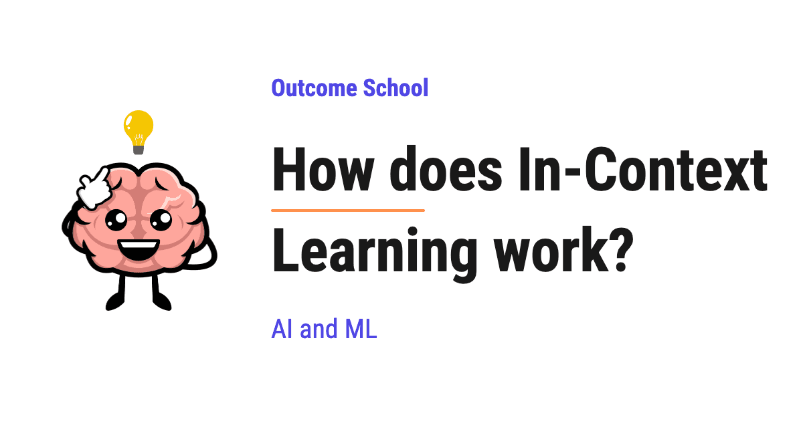

# How does In-Context Learning work?

> Archived from <https://outcomeschool.com/blog/in-context-learning> on 2026-11-25.

In-Context Learning is the ability of a large language model to learn a new task just from the examples and instructions in our prompt, without changing the model.

In this blog, we will learn about how In-Context Learning works. We will also see why we need it, how it works, how zero-shot, one-shot, and few-shot learning differ, how the context window limits it, how it compares with fine-tuning, and how to get the best results from it.

We will cover the following:
<ul><li>What is In-Context Learning?</li><li>Why do we need In-Context Learning?</li><li>How does In-Context Learning work?</li><li>Zero-shot, One-shot, and Few-shot learning</li><li>A worked example, step by step</li><li>The role of the context window</li><li>In-Context Learning vs Fine-tuning</li><li>Best practices for In-Context Learning</li></ul>
I am <strong>Amit Shekhar</strong>, Founder @ <a target="_blank" rel="noopener noreferrer" href="https://outcomeschool.com">Outcome School</a>, I have taught and mentored many developers, and their efforts landed them high-paying tech jobs, helped many tech companies in solving their unique problems, and created many open-source libraries being used by top companies. I am passionate about sharing knowledge through open-source, blogs, and videos.

I teach <a target="_blank" rel="noopener noreferrer" href="https://outcomeschool.com/program/ai-and-machine-learning">AI and Machine Learning</a> at Outcome School.

Let&#x27;s get started.
<h2 id="what-is-in-context-learning">What is In-Context Learning?</h2>
<strong>In-Context Learning is the ability of a large language model to learn a new task just from the examples and instructions we place inside our prompt, without changing the model itself.</strong>

Here, <strong>context</strong> means the text we provide in the prompt. Means, the model picks up the pattern from whatever we show it in the prompt, and then it answers in the same pattern.

The model does not change at all. Its internal knowledge stays exactly the same before and after. It only uses the examples in front of it to decide how to respond.
<h2 id="why-do-we-need-in-context-learning">Why do we need In-Context Learning?</h2>
Let&#x27;s understand the problem first.

Suppose we want a model to do a new task, like sorting customer reviews into &quot;Happy&quot; and &quot;Unhappy&quot;.

Traditionally, we would collect thousands of reviews, label each one by hand, and then <strong>train</strong> the model on them. Training means feeding examples to the model again and again so that it adjusts its internal settings. This process is slow, costly, and needs powerful machines.

The issue with this approach is that it is expensive and time-consuming for every small task.

So, here comes In-Context Learning to the rescue.

With In-Context Learning, we do not train anything. We just write a few examples inside the prompt and ask the model to follow the same pattern. The model does the new task immediately, without any training.
<h2 id="how-does-in-context-learning-work">How does In-Context Learning work?</h2>
Now, let&#x27;s understand the working part.

To understand this, we must first know one simple fact about a <a target="_blank" rel="noopener noreferrer" href="large-language-model-llm.md">large language model</a>. The only thing the model does is predict the next word, again and again, based on all the text it has seen so far.

Let&#x27;s say we type &quot;The sky is&quot;. The model looks at these three words and predicts the most likely next word, which is &quot;blue&quot;. Then it looks at &quot;The sky is blue&quot; and predicts the next word, and so on.

When we put examples in the prompt, those examples become part of the text the model is reading. The model treats our examples as a strong hint about what kind of word should come next.

The best way to learn this is by taking an example.

Suppose we send this prompt to the model:

<pre><code class="language-text code-highlight">Translate English to French.

English: cat
French: chat

English: dog
French: chien

English: house
French:
</code></pre>

Here, we have given two examples first. We showed that &quot;cat&quot; becomes &quot;chat&quot; and &quot;dog&quot; becomes &quot;chien&quot;. Then we asked for &quot;house&quot; and left the French part blank.

The model reads all of this as one long piece of text. It notices the clear pattern. Every English word is followed by its French translation. So, when it reaches the blank space after &quot;house&quot;, it predicts the French word &quot;maison&quot;.

The result will be:

<pre><code class="language-text code-highlight">maison
</code></pre>

Let&#x27;s visualize this flow as below:

<pre><code class="language-text code-highlight">       Prompt we send (the context)
+-------------------------------------+
|  English: cat   -&gt;  French: chat    |
|  English: dog   -&gt;  French: chien   |
|  English: house -&gt;  French: ______  |
+-------------------------------------+
                   ↓
    Model reads it all as one text
                   ↓
        +---------------------+
        |  Spot the pattern:  |
        |  English -&gt; French  |
        +---------------------+
                   ↓
        Predict the next word
                   ↓
             +----------+
             |  maison  |
             +----------+
</code></pre>

Here, we can see that the two examples set up a clear pattern of English mapped to French. The model reads everything as one long text, spots that pattern, and then predicts the next word <code>maison</code> to continue it.

It works perfectly. We never trained the model. We simply showed the pattern, and the model continued it.

This is how In-Context Learning works. The examples in the context set up a pattern, and the model completes that pattern by predicting the next words.

<strong>Planning your move into AI?</strong>

No matter which tech domain you work in today, with your effort, you can transition to these roles:
<ul><li>AI Engineer</li><li>Forward Deployed Engineer</li><li>AI Agent Engineer</li><li>Harness Engineer</li><li>Voice AI Engineer</li><li>AI Architect</li><li>LLM Engineer</li><li>LLM Inference Engineer</li><li>Gen AI Engineer</li><li>MLOps Engineer</li><li>ML Engineer</li><li>Deep Learning Engineer</li></ul>
Our <a target="_blank" rel="noopener noreferrer" href="https://outcomeschool.com/program/ai-and-machine-learning">AI and Machine Learning Program</a> at Outcome School takes you there.
<h2 id="zero-shot-one-shot-and-few-shot-learning">Zero-shot, One-shot, and Few-shot learning</h2>
Now, let&#x27;s learn the three common styles of In-Context Learning. The word <strong>shot</strong> here simply means one example. So, the number of shots means the number of examples we give.

<strong>Zero-shot</strong> means we give zero examples. We only give the instruction.

Let&#x27;s see the prompt for zero-shot as below:

<pre><code class="language-text code-highlight">Translate the word &quot;house&quot; from English to French.
</code></pre>

Here, we gave no example at all. We just gave a clear instruction. The model uses what it already knows and answers &quot;maison&quot;. This works when the task is common and easy.

<strong>One-shot</strong> means we give exactly one example.

Let&#x27;s see the prompt for one-shot as below:

<pre><code class="language-text code-highlight">English: cat
French: chat

English: house
French:
</code></pre>

Here, we gave one example, &quot;cat&quot; becomes &quot;chat&quot;. This single example helps the model understand the exact format we want. Then it answers &quot;maison&quot;.

<strong>Few-shot</strong> means we give a few examples, usually two or more.

Let&#x27;s see the prompt for few-shot as below:

<pre><code class="language-text code-highlight">English: cat
French: chat

English: dog
French: chien

English: bird
French: oiseau

English: house
French:
</code></pre>

Here, we gave three examples. More examples make the pattern even clearer, so the model becomes more reliable. This is similar to the example we saw earlier.

Let&#x27;s picture the three styles side by side as below:

<pre><code class="language-text code-highlight">   Zero-shot            One-shot             Few-shot

+--------------+     +--------------+     +----------------+
| (no example) |     | cat -&gt; chat  |     | cat -&gt; chat    |
+--------------+     +--------------+     | dog -&gt; chien   |
| house -&gt; ?   |     | house -&gt; ?   |     | bird -&gt; oiseau |
+--------------+     +--------------+     +----------------+
                                          | house -&gt; ?     |
                                          +----------------+

fewer examples, weaker pattern  ---&gt;  more examples, stronger pattern
</code></pre>

Here, we can see that as we move from zero-shot to few-shot, we add more examples to the prompt. More examples make the pattern stronger, so the model becomes more reliable.

If the task is simple, zero-shot is enough. If the task is tricky or needs a special format, few-shot is better.

<strong>A quick note for you</strong>

No matter which tech domain you work in, get familiar with these topics:
<ul><li>LLM</li><li>RAG</li><li>MCP</li><li>Agent</li><li>Fine-tuning</li><li>Quantization</li></ul>
We put it all together in one video:

<a target="_blank" rel="noopener noreferrer" href="https://www.youtube.com/watch?v=lnfWvX66FUk">AI Engineering Explained: LLM, RAG, MCP, Agent, Fine-Tuning, and Quantization</a>

No need to stop reading - bookmark it and watch later when you get time. Future you will thank you.

Now, let&#x27;s get back to the topic.
<h2 id="a-worked-example-step-by-step">A worked example, step by step</h2>
Now, let&#x27;s take a real use case to see In-Context Learning in action with a clear step-by-step walkthrough.

Suppose we want to sort customer messages into &quot;Happy&quot; or &quot;Unhappy&quot;. This task is called <strong>sentiment classification</strong>. Sentiment means the feeling behind the text.

We will use a few-shot prompt as below:

<pre><code class="language-text code-highlight">Classify the message as Happy or Unhappy.

Message: The food was amazing and the staff was kind.
Sentiment: Happy

Message: I waited two hours and my order never came.
Sentiment: Unhappy

Message: Best purchase I have made this year.
Sentiment: Happy

Message: The product broke on the very first day.
Sentiment:
</code></pre>

Let&#x27;s walk through what happens inside, step by step.

<strong>Step 1:</strong> The model reads the instruction. It learns that the goal is to label each message as &quot;Happy&quot; or &quot;Unhappy&quot;.

<strong>Step 2:</strong> The model reads the first example. A positive message maps to &quot;Happy&quot;. The model notices this link.

<strong>Step 3:</strong> The model reads the second example. A negative message maps to &quot;Unhappy&quot;. The pattern is now clearer.

<strong>Step 4:</strong> The model reads the third example. Another positive message maps to &quot;Happy&quot;. The pattern is now strong.

<strong>Step 5:</strong> The model reaches the final message, &quot;The product broke on the very first day.&quot; This message sounds negative. So, the model predicts the next word as &quot;Unhappy&quot;.

The result will be:

<pre><code class="language-text code-highlight">Unhappy
</code></pre>
<h2 id="the-role-of-the-context-window">The role of the context window</h2>
Now, there is an important limit we must understand.

The <strong><a target="_blank" rel="noopener noreferrer" href="context-window.md">context window</a></strong> is the maximum amount of text the model can read at one time. It includes our examples, our instruction, our question, and the model&#x27;s own answer.

We can picture the context window as below:

<pre><code class="language-text code-highlight">+================ Context Window ================+
|                                                |
|   [ Instruction ]                              |
|   [ Example 1 ]                                |
|   [ Example 2 ]                                |
|   [ Example 3 ]                                |
|   [ Our question ]                             |
|   [ Model&#x27;s answer ]                           |
|                                                |
+================================================+
   Everything must fit inside this fixed space.
</code></pre>

Here, we can see that the instruction, our examples, our question, and the model&#x27;s answer all share one fixed space.

If we put too many examples in the prompt, we may cross the context window limit. When that happens, either the request fails or some text gets cut, and the model can no longer see it.

So, we must keep our examples short and relevant. We must include only the examples that help. We have a detailed blog on <a target="_blank" rel="noopener noreferrer" href="context-engineering.md">Context Engineering</a> that covers how to decide what goes into the context.

In-Context Learning lives entirely inside the context window. The moment the conversation ends, the model forgets everything we taught it in the prompt. It does not remember it next time, because the model itself never changed.

<strong>Stay updated:</strong> Subscribe to our <a target="_blank" rel="noopener noreferrer" href="https://outcomeschool.substack.com/subscribe">newsletter</a> to get our latest AI and Machine Learning blogs straight to your inbox.
<h2 id="in-context-learning-vs-fine-tuning">In-Context Learning vs Fine-tuning</h2>
Now that we have learned about In-Context Learning, it&#x27;s time to compare it with another approach called <a target="_blank" rel="noopener noreferrer" href="how-does-fine-tuning-work.md">fine-tuning</a>, so we know when to use which one.

<strong>Fine-tuning</strong> is the process of training a model further on our own examples so that its internal settings change permanently. After fine-tuning, the model keeps the new behavior, even without examples in the prompt.

Let me tabulate the differences between In-Context Learning and Fine-tuning for your better understanding.
<table><thead><tr><th>In-Context Learning</th><th>Fine-tuning</th></tr></thead><tbody><tr><td>We give examples inside the prompt.</td><td>We train the model on examples.</td></tr><tr><td>The model does not change.</td><td>The model changes permanently.</td></tr><tr><td>No training cost, works instantly.</td><td>Needs time, data, and computing power.</td></tr><tr><td>The model forgets after the chat ends.</td><td>The model keeps the new behavior.</td></tr><tr><td>Limited by the context window size.</td><td>Not limited by the context window.</td></tr><tr><td>Great for quick tasks and experiments.</td><td>Great for large, repeated, specialized tasks.</td></tr></tbody></table>
So, when do we use which one?

We use In-Context Learning when we want a quick result, when we have only a few examples, and when we do not want to spend money on training. It works well for trying ideas fast.

We use fine-tuning when we have a large number of examples, when the task is very specific to our business, and when we will repeat the same task millions of times.

We choose based on our use case.

To master Fine-tuning, Parameter-Efficient Fine-Tuning (PEFT), and Prompt Engineering, we can check out our <a target="_blank" rel="noopener noreferrer" href="https://outcomeschool.com/program/ai-and-machine-learning">AI and Machine Learning Program</a> at Outcome School, where we learn them in depth.
<h2 id="best-practices-for-in-context-learning">Best practices for In-Context Learning</h2>
Now, let&#x27;s learn a few simple tips to get the best results from In-Context Learning.

<strong>Give clear instructions.</strong> Always start with a plain instruction that tells the model exactly what to do. A clear instruction removes confusion.

<strong>Use a consistent format.</strong> Keep every example in the same shape. If the first example uses &quot;Message:&quot; and &quot;Sentiment:&quot;, every example must use the same labels. The model follows the format we set.

<strong>Pick good examples.</strong> Choose examples that cover the different cases the model will face. If we expect both happy and unhappy messages, we must show both kinds.

<strong>Keep it short.</strong> Remember the context window. Include only the examples that truly help. Do not fill the prompt with too many examples.

<strong>Order matters.</strong> Sometimes the last example influences the answer more than the first. So, place a strong, clear example near the end when needed.

We have a detailed blog on <a target="_blank" rel="noopener noreferrer" href="prompt-engineering.md">Prompt Engineering</a> that explains how to write good prompts step by step.

Now, we have understood how In-Context Learning works.
<h2 id="frequently-asked-questions">Frequently Asked Questions</h2><h3 id="does-in-context-learning-change-the-models-weights">Does In-Context Learning change the model&#x27;s weights?</h3>
No. In-Context Learning does not change the model at all. Its internal knowledge stays exactly the same before and after. The model only uses the examples in the prompt to decide how to respond, so the moment the conversation ends, it forgets everything we taught it in the prompt.
<h3 id="how-many-examples-should-we-give-in-a-few-shot-prompt">How many examples should we give in a few-shot prompt?</h3>
Few-shot usually means two or more examples. More examples make the pattern clearer, so the model becomes more reliable. But every example takes space in the context window, so we must keep the examples short and relevant, and include only the ones that truly help.
<h3 id="when-is-a-zero-shot-prompt-enough">When is a zero-shot prompt enough?</h3>
A zero-shot prompt is enough when the task is simple and common, like translating a single word. The model uses what it already knows and follows the clear instruction. When the task is tricky or needs a special format, a few-shot prompt with examples works better.
<h3 id="does-the-order-of-examples-in-the-prompt-matter">Does the order of examples in the prompt matter?</h3>
Yes. Sometimes the last example influences the answer more than the first one. So, it helps to place a strong, clear example near the end of the prompt. We must also keep every example in the same format, because the model follows the format we set.

That&#x27;s it for now.

Thanks

<strong>Amit Shekhar</strong> Founder @ <a target="_blank" rel="noopener noreferrer" href="https://outcomeschool.com">Outcome School</a>

You can connect with me on:
<ul><li><a target="_blank" rel="noopener noreferrer" href="https://x.com/amitiitbhu">X</a></li><li><a target="_blank" rel="noopener noreferrer" href="https://www.linkedin.com/in/amit-shekhar-iitbhu">LinkedIn</a></li><li><a target="_blank" rel="noopener noreferrer" href="https://github.com/amitshekhariitbhu">GitHub</a></li></ul>
Follow Outcome School on:
<ul><li><a target="_blank" rel="noopener noreferrer" href="https://x.com/outcome_school">X</a></li><li><a target="_blank" rel="noopener noreferrer" href="https://youtube.com/@OutcomeSchool">YouTube</a></li><li><a target="_blank" rel="noopener noreferrer" href="https://www.linkedin.com/company/outcomeschool">LinkedIn</a></li><li><a target="_blank" rel="noopener noreferrer" href="http://github.com/OutcomeSchool">GitHub</a></li></ul>
<a target="_blank" rel="noopener noreferrer" href="https://outcomeschool.com/blog"><strong>Read all of our high-quality blogs here.</strong></a>

