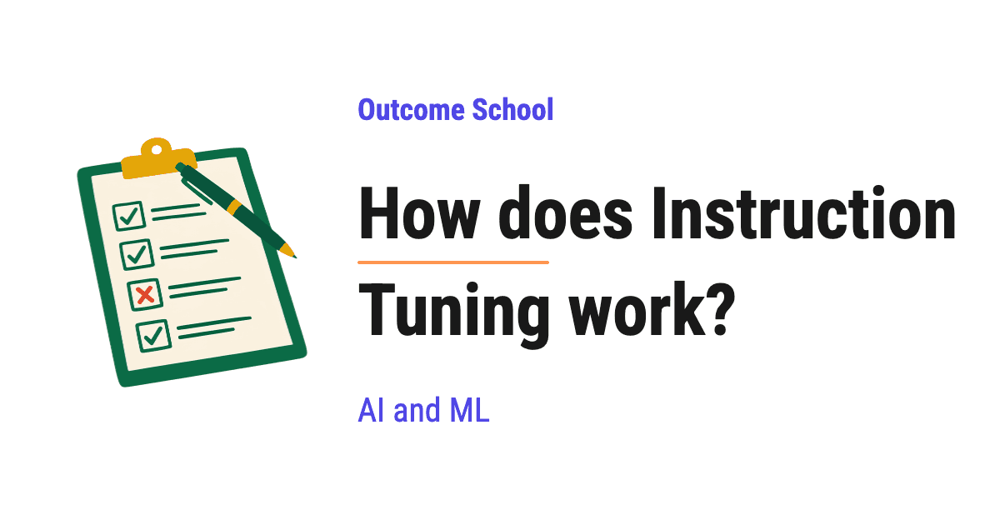

# How does Instruction Tuning work?

> Archived from <https://outcomeschool.com/blog/instruction-tuning> on 2026-11-25.

Instruction tuning is the training step that teaches a pretrained language model to follow instructions. We train it on many examples of an instruction paired with a good answer, so that it learns to respond helpfully instead of just continuing text.

In this blog, we will learn about how instruction tuning works. We will also see what problem a base model has, what an instruction dataset looks like and where it comes from, how the examples are formatted with a chat template, how the actual training happens step by step, why the model learns only from the answer part, and how it fits with the other training stages of an LLM.

We will cover the following:
<ul><li>What is a base model?</li><li>The problem with a base model</li><li>What is Instruction Tuning?</li><li>What does an instruction dataset look like?</li><li>Where do the examples come from?</li><li>Step 1: Formatting with a chat template</li><li>Step 2: Training on the examples</li><li>Step 3: Learning only from the answer</li><li>A complete walkthrough with one example</li><li>Why does instruction tuning work so well?</li><li>Quality matters more than quantity</li><li>Base model vs Instruction-tuned model</li><li>Where instruction tuning fits in the full pipeline</li><li>Limitations of instruction tuning</li></ul>
I am <strong>Amit Shekhar</strong>, Founder @ <a target="_blank" rel="noopener noreferrer" href="https://outcomeschool.com">Outcome School</a>, I have taught and mentored many developers, and their efforts landed them high-paying tech jobs, helped many tech companies in solving their unique problems, and created many open-source libraries being used by top companies. I am passionate about sharing knowledge through open-source, blogs, and videos.

I teach <a target="_blank" rel="noopener noreferrer" href="https://outcomeschool.com/program/ai-and-machine-learning">AI and Machine Learning</a> at Outcome School.

Let&#x27;s get started.
<h2 id="what-is-a-base-model">What is a base model?</h2>
Before jumping into instruction tuning, we must know what a base model is.

An <strong><a target="_blank" rel="noopener noreferrer" href="large-language-model-llm.md">LLM</a></strong> (Large Language Model) is built in stages. The first and biggest stage is called <strong><a target="_blank" rel="noopener noreferrer" href="llm-pretraining.md">pretraining</a></strong>.

During pretraining, the model reads a huge amount of text from the internet, books, and code. It plays one simple game again and again: <strong>predict the next token</strong>. A <a target="_blank" rel="noopener noreferrer" href="tokenization-in-llms.md">token</a> is a small piece of text, like a word or a part of a word.

<strong>A base model is the model we get at the end of pretraining. It knows a lot about language and the world, but it is only good at continuing text.</strong>
<h2 id="the-problem-with-a-base-model">The problem with a base model</h2>
Let&#x27;s say we give a base model this input:

<pre><code class="language-text code-highlight">Write a short poem about the rain.
</code></pre>

We expect a poem. But a base model can reply with something like:

<pre><code class="language-text code-highlight">Write a short poem about the sun.
Write a short poem about the sea.
Write a short poem about the wind.
</code></pre>

Why does this happen? Because on the internet, a line like &quot;Write a short poem about the rain.&quot; often appears inside a list of writing exercises. The base model just continues the text in the way that looks most likely. It does not understand that we are asking it to do something.

Similarly, if we ask &quot;What is the capital of Japan?&quot;, it can reply with &quot;What is the capital of China?&quot;. The knowledge is there. The model knows that the capital of Japan is Tokyo. But it does not know that it must answer the question.

So, the problem is: <strong>the base model has knowledge, but it does not know how to behave like a helpful assistant.</strong>

So, here comes instruction tuning to the rescue.
<h2 id="what-is-instruction-tuning">What is Instruction Tuning?</h2>
<strong>Instruction tuning is the process of training a base model on many examples of instructions and their ideal responses, so that it learns to follow instructions.</strong>

Here, <strong>tuning</strong> means training an already trained model a little more, to adjust its behavior. This is also called <strong><a target="_blank" rel="noopener noreferrer" href="how-does-fine-tuning-work.md">fine-tuning</a></strong>.

Instruction tuning is also commonly called <strong>Supervised Fine-Tuning</strong>, or <strong>SFT</strong> in short. &quot;Supervised&quot; means that we show the model the correct answer for every example, just like in <a target="_blank" rel="noopener noreferrer" href="supervised-vs-unsupervised-learning.md">supervised learning</a>.

Let&#x27;s take an analogy. Suppose a graduate joins a company. The graduate already knows a lot from years of study. But on the first day, they do not know how the company wants emails written or how customers must be answered. So, the manager shows them hundreds of examples: &quot;When a customer asks this, we reply like this.&quot; After seeing enough examples, the graduate understands the pattern and handles new requests on their own.

The base model is the graduate. Instruction tuning is the on-the-job training.

To learn LLM Fundamentals and Fine-tuning, and to build a Large Language Model (LLM) from scratch, check out our <a target="_blank" rel="noopener noreferrer" href="https://outcomeschool.com/program/ai-and-machine-learning">AI and Machine Learning Program</a> at Outcome School.
<h2 id="what-does-an-instruction-dataset-look-like">What does an instruction dataset look like?</h2>
The data used for instruction tuning is a collection of examples. Each example has an instruction and the ideal response. Some examples also have an extra input.

We can write an example as below:

<pre><code class="code-highlight language-json">{
  &quot;instruction&quot;: &quot;Summarize the following text in one sentence.&quot;,
  &quot;input&quot;: &quot;The meeting was moved from Monday to Wednesday because the manager was traveling. All team members must update their calendars.&quot;,
  &quot;output&quot;: &quot;The meeting has moved to Wednesday due to the manager&#x27;s travel, so everyone must update their calendars.&quot;
}
</code></pre>

Here, we have three parts:
<ul><li><code>instruction</code>: what the user asks the model to do.</li><li><code>input</code>: the extra content to work on. It can be empty.</li><li><code>output</code>: the ideal answer that we want the model to learn to give.</li></ul>
A good instruction dataset covers many different kinds of tasks, like below:

<pre><code class="language-text code-highlight">Task type          Example instruction
Question answer    &quot;Why is the sky blue?&quot;
Summarizing        &quot;Summarize this article in 3 points.&quot;
Translation        &quot;Translate this sentence into Hindi.&quot;
Writing            &quot;Write a polite leave request email.&quot;
Coding             &quot;Write a Python function to reverse a list.&quot;
Classification     &quot;Is this review positive or negative?&quot;
Reasoning          &quot;If a train leaves at 3 PM and takes 2 hours, when does it arrive?&quot;
Conversation       Multi-turn chats between a user and an assistant
</code></pre>

The variety is very important. We will see why later in this blog.
<h2 id="where-do-the-examples-come-from">Where do the examples come from?</h2>
Now, the question is: who creates these examples? There are three common sources.

<strong>Source 1: Written by humans</strong>

People are hired to write instructions and high-quality answers. This gives the best quality, but it is slow and expensive.

<strong>Source 2: Converted from existing datasets</strong>

Researchers already have many datasets for tasks like translation, question answering, and sentiment detection. We can convert them into instruction format by wrapping them in templates. For example, a translation pair can become: &quot;Translate the following sentence into French: ...&quot;. Google&#x27;s <strong>FLAN</strong> work used this idea and converted a large number of existing tasks into instructions.

<strong>Source 3: Generated by another LLM</strong>

A strong LLM is asked to generate instructions and answers. This is fast and cheap. For example, Stanford&#x27;s <strong>Alpaca</strong> project created 52,000 instruction examples using an OpenAI model, and then used them to instruction-tune a Llama model. The risk here is that mistakes from the generating model can get copied into our dataset.

In practice, many teams mix all three sources and then carefully filter the examples for quality.

<strong>Planning your move into AI?</strong>

No matter which tech domain you work in today, with your effort, you can transition to these roles:
<ul><li>AI Engineer</li><li>Forward Deployed Engineer</li><li>AI Agent Engineer</li><li>Harness Engineer</li><li>Voice AI Engineer</li><li>AI Architect</li><li>LLM Engineer</li><li>LLM Inference Engineer</li><li>Gen AI Engineer</li><li>MLOps Engineer</li><li>ML Engineer</li><li>Deep Learning Engineer</li></ul>
Our <a target="_blank" rel="noopener noreferrer" href="https://outcomeschool.com/program/ai-and-machine-learning">AI and Machine Learning Program</a> at Outcome School takes you there.
<h2 id="step-1-formatting-with-a-chat-template">Step 1: Formatting with a chat template</h2>
Now, let&#x27;s see how instruction tuning actually works, step by step.

First, every example is turned into one piece of text in a fixed format. This format is called a <strong>chat template</strong>. It uses special markers to show where the user&#x27;s message starts and where the assistant&#x27;s answer starts.

For the sake of understanding, a simple chat template looks like below:

<pre><code class="language-text code-highlight">&lt;|user|&gt;
Summarize the following text in one sentence.
The meeting was moved from Monday to Wednesday because the manager was traveling. All team members must update their calendars.
&lt;|assistant|&gt;
The meeting has moved to Wednesday due to the manager&#x27;s travel, so everyone must update their calendars.&lt;|end|&gt;
</code></pre>

Here, we can see that:
<ul><li><code>&lt;|user|&gt;</code> marks the start of the user&#x27;s message.</li><li><code>&lt;|assistant|&gt;</code> marks the start of the model&#x27;s answer.</li><li><code>&lt;|end|&gt;</code> marks the end of the answer, so that the model learns <a target="_blank" rel="noopener noreferrer" href="stop-tokens-in-llms.md">when to stop talking</a>.</li></ul>
Every model family has its own exact template, but the idea is the same everywhere. These markers are a very important part of the learning. They teach the model the difference between &quot;this is what someone asked&quot; and &quot;this is where I must answer&quot;.

<strong>Note:</strong> We must use the same chat template when we use the model later. If we train with one template and use another, the model gets confused.
<h2 id="step-2-training-on-the-examples">Step 2: Training on the examples</h2>
Now, the formatted examples are used for training.

Instruction tuning uses the same learning method as pretraining: <strong>predict the next token</strong>. Only the data is different.

The training loop looks like below:

<pre><code class="language-text code-highlight">     Formatted example
             ↓
 Model predicts next tokens
             ↓
Compare with correct answer
             ↓
      Measure the loss
             ↓
       Adjust weights
             ↓
Repeat with the next example
</code></pre>

Here, we have the following steps:
<ul><li>We give a formatted example to the model.</li><li>The model predicts the next token at each position.</li><li>We compare each prediction with the real token in the ideal answer.</li><li>We measure how wrong the predictions were. This number is called the <strong><a target="_blank" rel="noopener noreferrer" href="math-behind-cross-entropy-loss.md">loss</a></strong>.</li><li>We slightly adjust the model&#x27;s internal numbers, called <strong>weights</strong>, to reduce the loss.</li><li>We repeat this for all the examples, usually going through the whole dataset only a few times.</li></ul>
Compared to pretraining, instruction tuning is very small:
<ul><li>Pretraining uses trillions of tokens. Instruction tuning uses thousands to a few million examples.</li><li>Pretraining takes weeks or months on thousands of chips. Instruction tuning often takes hours to days.</li></ul>
We also make only small changes to the weights during instruction tuning. This is because we want to keep all the knowledge from pretraining and only change the behavior.

<strong>A quick note for you</strong>

No matter which tech domain you work in, get familiar with these topics:
<ul><li>LLM</li><li>RAG</li><li>MCP</li><li>Agent</li><li>Fine-tuning</li><li>Quantization</li></ul>
We put it all together in one video:

<a target="_blank" rel="noopener noreferrer" href="https://www.youtube.com/watch?v=lnfWvX66FUk">AI Engineering Explained: LLM, RAG, MCP, Agent, Fine-Tuning, and Quantization</a>

No need to stop reading - bookmark it and watch later when you get time. Future you will thank you.

Now, let&#x27;s get back to the topic.
<h2 id="step-3-learning-only-from-the-answer">Step 3: Learning only from the answer</h2>
Now, the question is: should the model learn to predict the user&#x27;s instruction too?

The answer is no. We do not want the model to learn to write questions. We want it to learn to write answers.

So, during instruction tuning, we calculate the loss only on the answer part. The instruction part is still given to the model as input, so that it can read it, but the model is not graded on it. This is called <strong>loss masking</strong>.

<pre><code class="language-text code-highlight">Part                                         Graded?
&lt;|user|&gt; Summarize the following text ...    No  (read only)
&lt;|assistant|&gt;                                No  (read only)
The meeting has moved ... &lt;|end|&gt;            Yes (loss is calculated here)
</code></pre>

Let&#x27;s see a simple code for this idea:

<pre><code class="code-highlight language-python">prompt_tokens = tokenizer(prompt_text)[&quot;input_ids&quot;]
answer_tokens = tokenizer(answer_text)[&quot;input_ids&quot;]

tokens = prompt_tokens + answer_tokens

labels = [-100] * len(prompt_tokens) + answer_tokens
</code></pre>

Here, we have used the tokenizer to turn the prompt text and the answer text into token IDs. Then, we have joined the prompt tokens and the answer tokens into one sequence. For the labels, which are the correct answers used for grading, we put <code>-100</code> in place of every prompt token. In popular model-training libraries like PyTorch and Hugging Face Transformers, a label of <code>-100</code> means &quot;ignore this position while calculating the loss&quot;. So, the model is graded only on the answer tokens.

This way, the model learns that when it sees an instruction, it must produce a good answer.

<strong>Note:</strong> Some teams train on the whole text, including the instruction. But masking the instruction part is the common choice.
<h2 id="a-complete-walkthrough-with-one-example">A complete walkthrough with one example</h2>
The best way to learn this is by taking an example. Let&#x27;s follow one example through instruction tuning.

<strong>Step 1:</strong> We take the example.

<pre><code class="language-text code-highlight">Instruction: What is the capital of Japan?
Answer:      The capital of Japan is Tokyo.
</code></pre>

<strong>Step 2:</strong> We format it with the chat template.

<pre><code class="language-text code-highlight">&lt;|user|&gt; What is the capital of Japan? &lt;|assistant|&gt; The capital of Japan is Tokyo.&lt;|end|&gt;
</code></pre>

<strong>Step 3:</strong> The model reads everything up to <code>&lt;|assistant|&gt;</code>. Now it must predict the first answer token.

Before training, the base model gives a high probability to something like &quot;What&quot;, because it wants to continue with more questions. The correct token is &quot;The&quot;. So, the loss is high, and the weights get adjusted.

<strong>Step 4:</strong> The model continues predicting each answer token: &quot;capital&quot;, &quot;of&quot;, &quot;Japan&quot;, &quot;is&quot;, &quot;Tokyo&quot;, &quot;.&quot;, and finally <code>&lt;|end|&gt;</code>. Each token that the model does not predict well adds to the loss, and the weights get adjusted.

<strong>Step 5:</strong> This repeats over thousands of different examples.

After training, when the model sees <code>&lt;|assistant|&gt;</code>, it has learned that it must start answering, and it must stop at the right time.

<pre><code class="language-text code-highlight">Before:  What is the capital of Japan? ---&gt;  What is the capital of China? ...
After:   What is the capital of Japan? ---&gt;  The capital of Japan is Tokyo.
</code></pre>
<h2 id="why-does-instruction-tuning-work-so-well">Why does instruction tuning work so well?</h2>
Now, the next big question is: we train on a limited number of examples, so how does the model handle instructions that it has never seen?

The answer is: the model does not memorize the examples. It learns the general pattern of &quot;someone asks, I help&quot;.

Google&#x27;s FLAN paper in 2021 showed this. They instruction-tuned a model on many groups of tasks, and then tested it on completely new kinds of tasks that it had never seen during tuning. The instruction-tuned model did much better on these unseen tasks than the same model without instruction tuning. They also found that the more kinds of tasks they included, the better the model became at new tasks.

So, instruction tuning does not teach the model new knowledge. The knowledge already came from pretraining. Instruction tuning unlocks that knowledge and teaches the model how to use it to help us.

There is another famous result. In OpenAI&#x27;s <a target="_blank" rel="noopener noreferrer" href="decoding-instructgpt.md">InstructGPT</a> work, people preferred the answers of a 1.3 billion parameter model trained to follow instructions over the answers of the original 175 billion parameter GPT-3. That model was more than 100 times smaller. <strong>Note:</strong> InstructGPT used instruction tuning followed by one more stage of training on human preferences, which we will see shortly. But it showed how much the right training matters, not just the size.

<strong>Stay updated:</strong> Subscribe to our <a target="_blank" rel="noopener noreferrer" href="https://outcomeschool.substack.com/subscribe">newsletter</a> to get our latest AI and Machine Learning blogs straight to your inbox.
<h2 id="quality-matters-more-than-quantity">Quality matters more than quantity</h2>
One more thing to notice. For instruction tuning, a small set of excellent examples can beat a large set of poor examples.

A research paper called <strong>LIMA</strong> showed this. The authors fine-tuned a large Llama model on only 1,000 carefully chosen, high-quality examples, and it gave strong results.

Their idea is called the <strong>Superficial Alignment Hypothesis</strong>. It says that almost all the knowledge comes from pretraining, and instruction tuning mainly teaches the style and format of answering. If that is true, we do not need millions of examples to teach style. We need good ones.

So, the lesson is clear:
<ul><li>Clean, correct, and well-written answers are more important than a huge number of examples.</li><li>A wide variety of tasks is more important than many copies of the same task.</li><li>Wrong answers in the data teach the model wrong behavior.</li></ul><h2 id="base-model-vs-instruction-tuned-model">Base model vs Instruction-tuned model</h2>
Let me tabulate the differences between a base model and an instruction-tuned model for your better understanding.
<table><thead><tr><th>Point</th><th>Base Model</th><th>Instruction-Tuned Model</th></tr></thead><tbody><tr><td>Training</td><td>Pretraining only</td><td>Pretraining + instruction tuning</td></tr><tr><td>Behavior</td><td>Continues the text</td><td>Follows the instruction</td></tr><tr><td>Answering questions</td><td>Often continues with more questions</td><td>Gives a direct answer</td></tr><tr><td>Knows when to stop</td><td>Not reliably</td><td>Yes, stops at the end marker</td></tr><tr><td>Best for</td><td>Further training, research, text completion</td><td>Chat, assistants, apps</td></tr><tr><td>Ease of use</td><td>Needs careful prompts</td><td>Works with plain requests</td></tr></tbody></table>
Many open model releases come in both versions. The instruction-tuned version usually has &quot;Instruct&quot; or &quot;Chat&quot; in its name. If we want to build an app, we use the instruction-tuned version. If we want to do our own training from a clean start, we use the base version.
<h2 id="where-instruction-tuning-fits-in-the-full-pipeline">Where instruction tuning fits in the full pipeline</h2>
Now, let&#x27;s see the full journey of a modern assistant model.

<pre><code class="language-text code-highlight">         [ Pretraining ]
    Reads trillions of tokens
        Result: base model
                ↓
      [ Instruction Tuning ]
  Learns to follow instructions
      Result: instruct model
                ↓
     [ Preference Training ]
Learns which answers people prefer
 Result: helpful, safer assistant
</code></pre>

After instruction tuning, many models go through one more stage called <strong>preference training</strong>. In this stage, the model learns from comparisons, like &quot;answer A is better than answer B&quot;. Popular methods for this are <strong><a target="_blank" rel="noopener noreferrer" href="reinforcement-learning-from-human-feedback-rlhf.md">RLHF</a></strong> (Reinforcement Learning from Human Feedback) and <strong><a target="_blank" rel="noopener noreferrer" href="direct-preference-optimization-dpo.md">DPO</a></strong> (Direct Preference Optimization).

Why do we need this extra stage? Because instruction tuning only shows the model one good answer for each example. It does not show the model what a bad answer looks like. Preference training teaches the model to choose the better answer among many possible ones, for example, the more helpful, more honest, or safer one.

If we want to go deep into Fine-tuning, RLHF (Reinforcement Learning from Human Feedback), and Direct Preference Optimization (DPO), we have a complete program - check out our <a target="_blank" rel="noopener noreferrer" href="https://outcomeschool.com/program/ai-and-machine-learning">AI and Machine Learning Program</a> at Outcome School to master them end to end.
<h2 id="limitations-of-instruction-tuning">Limitations of instruction tuning</h2>
Instruction tuning has some limits that we must know.
<ul><li><strong>It does not add much new knowledge:</strong> If the base model does not know something, instruction tuning will not reliably teach it. It mainly changes behavior.</li><li><strong>It copies the quality of the data:</strong> If the training answers have mistakes, the model learns those mistakes.</li><li><strong>It can teach the model to sound confident when it is wrong:</strong> If the examples always give confident answers, the model learns to answer confidently even when it does not know, which can lead to <a target="_blank" rel="noopener noreferrer" href="why-do-llms-hallucinate-the-token-level-explanation.md">made-up answers</a>.</li><li><strong>It sees only good answers:</strong> It does not learn what to avoid. That is why preference training comes after it.</li><li><strong>It can make the model forget:</strong> If we train too much or too hard on a narrow set of tasks, the model can lose some of its earlier skills. This is called <strong><a target="_blank" rel="noopener noreferrer" href="continual-learning-in-llms.md">catastrophic forgetting</a></strong>.</li></ul>
Now, we must have understood how instruction tuning works.
<h2 id="frequently-asked-questions">Frequently Asked Questions</h2><h3 id="is-instruction-tuning-the-same-as-supervised-fine-tuning">Is instruction tuning the same as supervised fine-tuning?</h3>
Yes. Instruction tuning is also commonly called Supervised Fine-Tuning, or SFT in short. &quot;Supervised&quot; means that we show the model the correct answer for every example. It is a type of fine-tuning, where we train an already trained model a little more to adjust its behavior.
<h3 id="does-instruction-tuning-teach-the-model-new-knowledge">Does instruction tuning teach the model new knowledge?</h3>
No. Instruction tuning does not add much new knowledge. The knowledge already comes from pretraining, and instruction tuning mainly changes behavior. It unlocks that knowledge and teaches the model how to use it to help us. If the base model does not know something, instruction tuning will not reliably teach it.
<h3 id="how-many-examples-do-we-need-for-instruction-tuning">How many examples do we need for instruction tuning?</h3>
Not as many as we might think. Instruction tuning uses thousands to a few million examples, which is very small compared to pretraining. The LIMA paper fine-tuned a large Llama model on only 1,000 carefully chosen, high-quality examples and got strong results. Clean answers and a wide variety of tasks matter more than a huge number of examples.
<h3 id="what-happens-if-we-use-a-different-chat-template-after-training">What happens if we use a different chat template after training?</h3>
The model gets confused. We must use the same chat template when we use the model later, because the markers in the template are a very important part of the learning. They teach the model the difference between &quot;this is what someone asked&quot; and &quot;this is where I must answer&quot;. Every model family has its own exact template.

That&#x27;s it for now.

Thanks

<strong>Amit Shekhar</strong> Founder @ <a target="_blank" rel="noopener noreferrer" href="https://outcomeschool.com">Outcome School</a>

You can connect with me on:
<ul><li><a target="_blank" rel="noopener noreferrer" href="https://x.com/amitiitbhu">X</a></li><li><a target="_blank" rel="noopener noreferrer" href="https://www.linkedin.com/in/amit-shekhar-iitbhu">LinkedIn</a></li><li><a target="_blank" rel="noopener noreferrer" href="https://github.com/amitshekhariitbhu">GitHub</a></li></ul>
Follow Outcome School on:
<ul><li><a target="_blank" rel="noopener noreferrer" href="https://x.com/outcome_school">X</a></li><li><a target="_blank" rel="noopener noreferrer" href="https://youtube.com/@OutcomeSchool">YouTube</a></li><li><a target="_blank" rel="noopener noreferrer" href="https://www.linkedin.com/company/outcomeschool">LinkedIn</a></li><li><a target="_blank" rel="noopener noreferrer" href="http://github.com/OutcomeSchool">GitHub</a></li></ul>
<a target="_blank" rel="noopener noreferrer" href="https://outcomeschool.com/blog"><strong>Read all of our high-quality blogs here.</strong></a>

