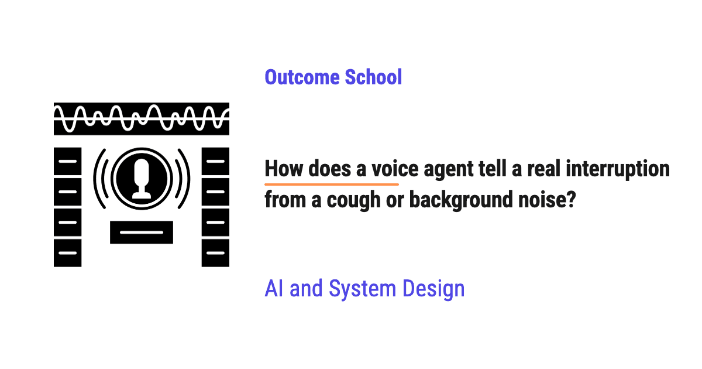

# How does a voice agent tell a real interruption from a cough or background noise?

> Archived from <https://outcomeschool.com/blog/interruption-vs-background-noise> on 2026-11-25.

A voice agent tells a real interruption from a cough or background noise by passing every sound through a series of checks, and it stops talking only when the sound passes all of them. It removes its own voice and the noise, then checks if the sound is human speech, lasts long enough, and contains real words.

In this blog, we will learn about how a voice agent tells a real interruption from a cough or background noise. We will also see why this is hard, how the agent cleans the sound before judging it, how it checks for human speech, length, and real words, how it pauses first and resumes when it was wrong, how a trained model helps, and where it works well and where it fails.

We will cover the following:
<ul><li>What is an interruption in a voice agent?</li><li>Why is it hard to tell a real interruption from noise?</li><li>Step 1: Remove the agent&#x27;s own voice</li><li>Step 2: Remove the background noise</li><li>Step 3: Is it human speech?</li><li>Step 4: Did it last long enough?</li><li>Step 5: Did the user say real words?</li><li>Step 6: Pause first, then decide</li><li>Using a trained interruption model</li><li>Putting it all together</li><li>Where it works well and where it fails</li></ul>
I am <strong>Amit Shekhar</strong>, Founder @ <a target="_blank" rel="noopener noreferrer" href="https://outcomeschool.com">Outcome School</a>, I have taught and mentored many developers, and their efforts landed them high-paying tech jobs, helped many tech companies in solving their unique problems, and created many open-source libraries being used by top companies. I am passionate about sharing knowledge through open-source, blogs, and videos.

I teach <a target="_blank" rel="noopener noreferrer" href="https://outcomeschool.com/program/ai-and-machine-learning">AI and Machine Learning</a> at Outcome School.

Let&#x27;s get started.
<h2 id="what-is-an-interruption-in-a-voice-agent">What is an interruption in a voice agent?</h2>
A <a target="_blank" rel="noopener noreferrer" href="design-a-real-time-voice-ai-agent.md">voice agent</a> is a system that talks with us using voice, like a customer support agent on a phone call. We speak, it listens, and then it speaks back.

<strong>An interruption is when the user starts speaking while the agent is still talking, because the user wants the agent to stop and listen.</strong> This is also called <a target="_blank" rel="noopener noreferrer" href="what-is-barge-in-in-a-voice-ai-agent.md"><strong>barge-in</strong></a>.

Let&#x27;s say the agent is reading out a long list of flight options. After the first option, we say, &quot;Wait, I want the morning flight.&quot; The agent must <a target="_blank" rel="noopener noreferrer" href="stopping-speech-on-interruption.md">stop talking right away</a> and listen to us. This is a real interruption.

But, a phone call is never perfectly quiet. While the agent is talking, many other sounds reach the microphone:
<ul><li>The user coughs or sneezes.</li><li>A door closes or a dog barks.</li><li>A TV is playing in the next room.</li><li>A car horn sounds outside.</li><li>The user says &quot;uh-huh&quot; just to show that they are listening.</li></ul>
None of these mean &quot;stop talking&quot;. When the agent stops for one of them anyway, it is called a <strong>false interruption</strong>.

So, the agent must answer one question again and again, many times every second: <strong>Is this sound a real interruption, or is it just noise?</strong>

Deciding when to stop and listen is one part of a bigger job. We have a detailed blog on <a target="_blank" rel="noopener noreferrer" href="what-is-turn-taking-in-a-voice-ai-agent.md">turn-taking in a voice AI agent</a> that explains how the agent and the user share the conversation.
<h2 id="why-is-it-hard-to-tell-a-real-interruption-from-noise">Why is it hard to tell a real interruption from noise?</h2>
For us humans, this is easy. When our friend coughs in the middle of our sentence, we keep talking. When our friend says &quot;Wait&quot;, we stop.

But, the agent does not hear sounds the way we do. The microphone gives it only a long stream of numbers. Each number tells how strongly the air was pushing on the microphone at that tiny moment. A cough, a dog bark, and the word &quot;Wait&quot; are all just numbers in this stream.

On top of this, the agent has to decide very fast. If it takes too long, the user keeps <a target="_blank" rel="noopener noreferrer" href="overlapping-speech-in-voice-agents.md">talking over the agent</a> and feels that the agent is not listening. If it stops at the very first sound, it stops for every cough.

Means, the agent is stuck between two mistakes:
<ul><li><strong>Stopping too easily:</strong> The agent stops for a cough or a door. The user is confused and has to say &quot;Please continue&quot;.</li><li><strong>Stopping too late:</strong> The agent keeps talking while the user is trying to say something important. The user feels ignored.</li></ul>
No single check solves this. So, the agent uses a series of checks, one after another. Each check removes some of the wrong sounds, and only the sounds that pass all the checks can stop the agent. Let&#x27;s understand each check step by step.
<h2 id="step-1-remove-the-agents-own-voice">Step 1: Remove the agent&#x27;s own voice</h2>
Before judging any sound, the agent must handle one problem: it can hear itself.

When the agent&#x27;s voice plays from the user&#x27;s phone speaker, it can go right back into the same phone&#x27;s microphone. If the agent does not handle this, it hears its own voice, thinks the user is speaking, and interrupts itself.

Here comes the <strong>Echo Cancellation</strong> into the picture.

The system knows exactly what sound it is playing through the speaker, because the agent created that sound. So, it can predict what that sound looks like when it comes back into the microphone, and subtract it from what the microphone hears. What remains is mostly the sound from the room and the user.

For the sake of understanding, consider this:

<pre><code class="code-highlight">Microphone hears:   Agent&#x27;s voice + User&#x27;s voice + Noise
Subtract:           Agent&#x27;s voice
What remains:       User&#x27;s voice + Noise
</code></pre>

Now, the agent is no longer confused by its own voice. Now, let&#x27;s handle the noise.
<h2 id="step-2-remove-the-background-noise">Step 2: Remove the background noise</h2>
The next step is <strong>Noise Suppression</strong>. Today, it is usually a model that has learned what human speech sounds like and what common noises sound like, such as fans, traffic, typing, and wind. It keeps the speech and lowers everything else.

Let&#x27;s say the user is calling from a busy street. Before noise suppression, the microphone has the user&#x27;s voice mixed with car engines. After noise suppression, the car engines become very quiet and the user&#x27;s voice stays clear.

This removes a large part of the problem. A steady fan or the sound of traffic does not reach the next checks.

Some systems go one step further with <strong>background voice cancellation</strong>. It tries to keep only the voice of the main speaker, the person closest to the microphone, and lowers the voices of other people, like a TV or someone talking in the next room. This matters because a voice on the TV is real human speech, but it is not our user.

But, noise suppression cannot remove everything. A cough is made by a human mouth, so it shares some sound qualities with speech. A sudden loud bang can also slip through. Hence, we need more checks.

<strong>Planning your move into AI?</strong>

No matter which tech domain you work in today, with your effort, you can transition to these roles:
<ul><li>AI Engineer</li><li>Forward Deployed Engineer</li><li>AI Agent Engineer</li><li>Harness Engineer</li><li>Voice AI Engineer</li><li>AI Architect</li><li>LLM Engineer</li><li>LLM Inference Engineer</li><li>Gen AI Engineer</li><li>MLOps Engineer</li><li>ML Engineer</li><li>Deep Learning Engineer</li></ul>
Our <a target="_blank" rel="noopener noreferrer" href="https://outcomeschool.com/program/ai-and-machine-learning">AI and Machine Learning Program</a> at Outcome School takes you there.
<h2 id="step-3-is-it-human-speech">Step 3: Is it human speech?</h2>
Now, the agent asks: is this cleaned sound human speech at all?

Here comes the <strong>Voice Activity Detection (VAD)</strong> to the rescue. VAD is a small model that listens to tiny pieces of audio, often around 30 milliseconds long, and gives a score between 0 and 1 for each piece. The score tells how likely it is that the piece contains human speech.
<ul><li>A score close to 1 means &quot;this is very likely speech&quot;.</li><li>A score close to 0 means &quot;this is not speech&quot;.</li></ul>
The agent picks a cut-off, for example 0.5. Pieces above the cut-off are treated as speech.

The VAD model is trained on many hours of audio where people have marked which parts are speech and which parts are not. So, it learns the patterns of the human voice. A dog bark, a door closing, or music without singing usually gets a low score.

But, a cough, a laugh, or a loud &quot;hmm&quot; can still get a high score, because these sounds come from a human throat. VAD can tell a human voice from other sounds quite well, but it cannot reliably tell a cough from a word.
<h2 id="step-4-did-it-last-long-enough">Step 4: Did it last long enough?</h2>
Now, the agent looks at time.

Let&#x27;s compare a cough with a real interruption:
<ul><li>A cough is very short, usually a fraction of a second.</li><li>A real interruption, like &quot;Wait, I want the morning flight&quot;, keeps going for longer.</li></ul>
So, the agent uses a rule: <strong>the speech must continue for a minimum amount of time before it counts as an interruption.</strong> Some voice agent frameworks use a default of about half a second (0.5 seconds), and we can change it based on our use case.

Let&#x27;s see how this works with a timeline:

<pre><code class="code-highlight">Time (seconds):     0.0   0.1   0.2   0.3   0.4   0.5   0.6
Cough:              ###########
User says &quot;Wait&quot;:   #####################################
                                                  ↑
                                          0.5 second mark
</code></pre>

Here, <code>#</code> marks the time when VAD hears speech. We can see that the cough ends before the 0.5 second mark, so it never reaches the minimum and the agent keeps talking. The real interruption keeps going past the mark, so it passes this check.

This check removes a large number of false interruptions, because most coughs, sneezes, claps, and bangs are short.

Now, there is a trade-off:
<ul><li><strong>A longer minimum</strong> removes more coughs, but the agent takes longer to stop for a real interruption.</li><li><strong>A shorter minimum</strong> makes the agent stop faster, but more coughs get through.</li></ul>
We must choose the value based on our use case. A noisy call center needs a longer minimum. A quiet app where users expect a quick response can use a shorter one.

<strong>A quick note for you</strong>

No matter which tech domain you work in, get familiar with these topics:
<ul><li>LLM</li><li>RAG</li><li>MCP</li><li>Agent</li><li>Fine-tuning</li><li>Quantization</li></ul>
We put it all together in one video:

<a target="_blank" rel="noopener noreferrer" href="https://www.youtube.com/watch?v=lnfWvX66FUk">AI Engineering Explained: LLM, RAG, MCP, Agent, Fine-Tuning, and Quantization</a>

No need to stop reading - bookmark it and watch later when you get time. Future you will thank you.

Now, let&#x27;s get back to the topic.
<h2 id="step-5-did-the-user-say-real-words">Step 5: Did the user say real words?</h2>
Time alone is still not enough. A long coughing fit or a burst of laughter can easily last more than half a second.

So, the agent uses its strongest proof: words.

Most voice agents already have a <strong>Speech-to-Text</strong> model. It listens to the audio and writes down the words that the user says. The agent can use this text to check the interruption:
<ul><li>A cough gives no words. The Speech-to-Text model writes nothing.</li><li>Background noise also gives no words, or gives random broken pieces.</li><li>A real interruption gives real words like &quot;Wait&quot; or &quot;Stop&quot; or &quot;No, not that one&quot;.</li></ul>
So, the agent can add a rule: <strong>only stop when the Speech-to-Text model has produced at least a certain number of words.</strong> Some systems wait for one word, some wait for two or more.

Let&#x27;s see an example. The agent is talking, and the user coughs for 0.7 seconds:

<pre><code class="code-highlight">VAD:            speech detected
Duration:       0.7 seconds (passes the 0.5 second minimum)
Speech-to-Text: &quot;&quot; (no words)
Decision:       not an interruption, keep talking
</code></pre>

Now, the user says &quot;Wait&quot;:

<pre><code class="code-highlight">VAD:            speech detected
Duration:       0.6 seconds
Speech-to-Text: &quot;wait&quot;
Decision:       real interruption, stop talking
</code></pre>

Here, we can notice that the cough passed the time check, but it failed the words check. The real interruption passed both.

The words also help with one more case: <a target="_blank" rel="noopener noreferrer" href="backchannels-in-voice-agents.md"><strong>backchannels</strong></a>. A backchannel is a short sound we make to show that we are listening, like &quot;uh-huh&quot;, &quot;okay&quot;, &quot;right&quot;, or &quot;mm-hmm&quot;. It is real speech, and the Speech-to-Text model writes it down as words, but it does not mean &quot;stop talking&quot;. It means &quot;go on, I am listening&quot;.

So, some agents keep a small list of such words. If the user only says &quot;uh-huh&quot; or &quot;okay&quot; while the agent is talking, the agent treats it as a backchannel and keeps talking. If the user says &quot;okay, but wait&quot;, the agent stops.

But, the words check has one problem: time. The Speech-to-Text model needs a moment to produce the first word. If the agent waits for words before doing anything, the user hears the agent talking over them for a bit longer. Let&#x27;s see how the next step solves this issue.
<h2 id="step-6-pause-first-then-decide">Step 6: Pause first, then decide</h2>
Instead of choosing between &quot;stop&quot; and &quot;keep talking&quot; right away, the agent can do something in between: pause.

The idea is like this:
<ul><li>As soon as VAD hears speech, the agent <strong>pauses</strong> its voice, or lowers it. It does not throw away what it was going to say.</li><li>Then, it waits for a short time to see what happens next.</li><li>If the speech lasts long enough and real words arrive, it is a real interruption. The agent stops fully and listens to the user.</li><li>If no words arrive and the user goes quiet, it was a <strong>false interruption</strong>. The agent <a target="_blank" rel="noopener noreferrer" href="false-interruption-recovery.md"><strong>resumes</strong> speaking from where it paused</a>.</li></ul>
Let&#x27;s see the cough case with this approach:

<pre><code class="code-highlight">Agent:  &quot;Your flight leaves at nine in the morning and...&quot;
User:   *cough*
Agent:  (pauses)
        (waits, hears silence, no words)
Agent:  &quot;...and arrives at noon.&quot;
</code></pre>

Here, the cough caused only a short pause, and the agent continued its sentence. To the user, it feels like a speaker who paused for a moment after hearing a cough.

In some frameworks, this waiting time is about 2 seconds of silence by default. A shorter wait makes the pause less noticeable, but the agent can then resume while the user is still about to speak.

This way, the agent reacts fast, because it pauses on the very first sign of speech. And, it does not lose its sentence when the sound turns out to be a cough.
<h2 id="using-a-trained-interruption-model">Using a trained interruption model</h2>
All the checks above are rules made by people: a minimum time, a minimum number of words, a list of backchannel words. Rules are easy to set up, but they have limits. A cough and the word &quot;Wait&quot; can both be short. Some users say &quot;yeah&quot; to agree, and some say &quot;yeah&quot; to start a new question.

So, some newer voice agents use an <strong>interruption model</strong>. It is a model trained on many real conversations, where each sound that the user made while the agent was talking is labeled as one of these:
<ul><li>A real interruption, where the user wanted the agent to stop.</li><li>A backchannel, where the user was only showing that they were listening.</li><li>Noise, like a cough, a laugh, or a background sound.</li></ul>
The model listens to the audio itself, not just the text. So, it can use the tone, the pitch, and the rhythm of the sound. A sharp, rising &quot;Wait&quot; sounds different from a soft, flat &quot;mm-hmm&quot;, even though both are short. Over many examples, the model learns these patterns better than a fixed rule can.

To learn Multimodal AI and how to Design a Real-Time Voice AI Agent end to end, check out our <a target="_blank" rel="noopener noreferrer" href="https://outcomeschool.com/program/ai-and-machine-learning">AI and Machine Learning Program</a> at Outcome School.
<h2 id="putting-it-all-together">Putting it all together</h2>
Now, let&#x27;s see the full journey of a sound while the agent is talking. Each &quot;If no&quot; line shows where a sound leaves the flow:

<pre><code class="code-highlight">Sound reaches the microphone
              ↓
Echo Cancellation: remove the agent&#x27;s own voice
              ↓
Noise Suppression: remove fans, traffic, other voices
              ↓
VAD: is it human speech?
If no: ignore it and keep talking
              ↓
Agent pauses its voice
              ↓
Time check: did it last about 0.5 seconds?
If no: resume talking
              ↓
Words check: real words, not just &quot;uh-huh&quot;?
If no: resume talking
              ↓
Real interruption: stop and listen
</code></pre>

Now, let&#x27;s run three sounds through it:
<ul><li><strong>A dog bark:</strong> Noise suppression lowers it, and VAD gives it a low score. The agent never even pauses.</li><li><strong>A cough:</strong> VAD may say &quot;speech&quot;, so the agent pauses. But, it is too short, or it has no words. The agent resumes.</li><li><strong>&quot;Wait, I want the morning flight&quot;:</strong> It passes VAD, lasts long enough, and has real words. The agent stops and listens.</li></ul>
<strong>Stay updated:</strong> Subscribe to our <a target="_blank" rel="noopener noreferrer" href="https://outcomeschool.substack.com/subscribe">newsletter</a> to get our latest AI and Machine Learning blogs straight to your inbox.
<h2 id="where-it-works-well-and-where-it-fails">Where it works well and where it fails</h2>
<strong>It works well when:</strong>
<ul><li>The noise is steady, like a fan, traffic, or an air conditioner. Noise suppression removes it easily.</li><li>The noise is short, like a cough, a clap, or a door. The time check and the words check catch it.</li><li>The user interrupts with a clear phrase, like &quot;Wait a second&quot; or &quot;No, not that one&quot;.</li></ul>
<strong>It struggles when:</strong>
<ul><li><strong>Another person is talking near the user.</strong> Their voice is real speech with real words. Background voice cancellation helps, but it is not perfect.</li><li><strong>The user interrupts with one very short word</strong>, like &quot;No&quot;. It is close to the minimum time and looks like a backchannel, so the agent can take a moment longer to stop.</li><li><strong>The user says &quot;yeah&quot; or &quot;okay&quot; to start a new point.</strong> It looks like a backchannel, so the agent can keep talking when it should stop.</li><li><strong>The line is very noisy</strong>, like a poor phone connection. Speech-to-Text can produce wrong words from noise, which can trigger a false interruption.</li></ul>
So, every setting is a trade-off. We must test the agent on real call recordings, with real coughs, real TVs, and real users, and tune the minimum time, the minimum words, and the pause timing based on our use case.

Now we must have understood how a voice agent tells a real interruption from a cough or background noise, why it uses a series of checks, how each check works, and where it works well and where it fails.
<h2 id="frequently-asked-questions">Frequently Asked Questions</h2><h3 id="what-is-a-false-interruption-in-a-voice-agent">What is a false interruption in a voice agent?</h3>
A false interruption is when the voice agent stops talking for a sound that does not mean &quot;stop talking&quot;. This can be a cough, a sneeze, a door, a dog bark, a TV in the next room, or a short &quot;uh-huh&quot;. The user is then confused and has to say &quot;Please continue&quot;.
<h3 id="should-a-voice-agent-stop-talking-when-the-user-says-uh-huh">Should a voice agent stop talking when the user says &quot;uh-huh&quot;?</h3>
No. Words like &quot;uh-huh&quot;, &quot;okay&quot;, &quot;right&quot;, and &quot;mm-hmm&quot; are backchannels. They mean &quot;go on, I am listening&quot;, not &quot;stop talking&quot;. Some agents keep a small list of such words and keep talking when the user only says one of them, but they stop if the user says something like &quot;okay, but wait&quot;.
<h3 id="can-noise-suppression-alone-stop-false-interruptions">Can noise suppression alone stop false interruptions?</h3>
No. Noise suppression removes steady noise like fans and traffic, but it cannot remove everything. A cough is made by a human mouth, so it shares some sound qualities with speech, and a sudden loud bang can also slip through. That is why the agent adds more checks for human speech, length, and real words.
<h3 id="how-long-should-the-user-speak-before-the-agent-treats-it-as-an-interruption">How long should the user speak before the agent treats it as an interruption?</h3>
Some voice agent frameworks use a default of about half a second, and we can change it based on our use case. A longer minimum removes more coughs but makes the agent slower to stop. A noisy call center needs a longer minimum, while a quiet app where users expect a quick response can use a shorter one.

That&#x27;s it for now.

Thanks

<strong>Amit Shekhar</strong> Founder @ <a target="_blank" rel="noopener noreferrer" href="https://outcomeschool.com">Outcome School</a>

You can connect with me on:
<ul><li><a target="_blank" rel="noopener noreferrer" href="https://x.com/amitiitbhu">X</a></li><li><a target="_blank" rel="noopener noreferrer" href="https://www.linkedin.com/in/amit-shekhar-iitbhu">LinkedIn</a></li><li><a target="_blank" rel="noopener noreferrer" href="https://github.com/amitshekhariitbhu">GitHub</a></li></ul>
Follow Outcome School on:
<ul><li><a target="_blank" rel="noopener noreferrer" href="https://x.com/outcome_school">X</a></li><li><a target="_blank" rel="noopener noreferrer" href="https://youtube.com/@OutcomeSchool">YouTube</a></li><li><a target="_blank" rel="noopener noreferrer" href="https://www.linkedin.com/company/outcomeschool">LinkedIn</a></li><li><a target="_blank" rel="noopener noreferrer" href="http://github.com/OutcomeSchool">GitHub</a></li></ul>
<a target="_blank" rel="noopener noreferrer" href="https://outcomeschool.com/blog"><strong>Read all of our high-quality blogs here.</strong></a>

