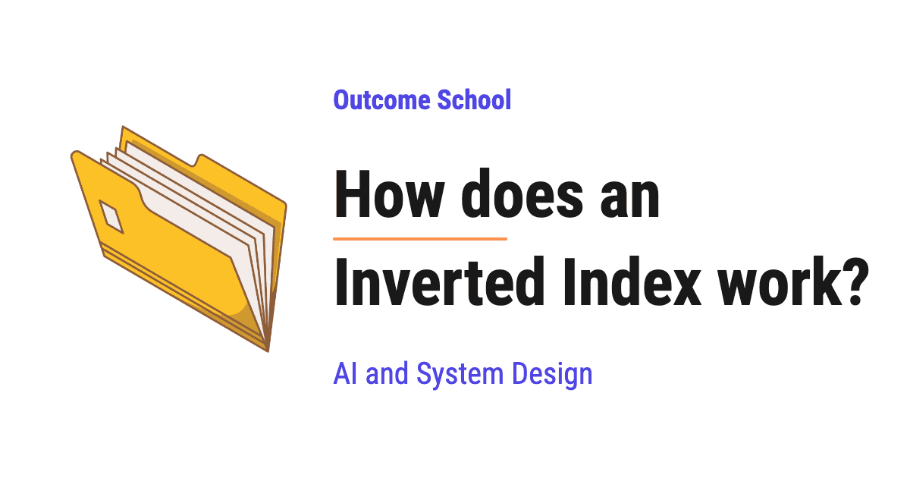

# How does an Inverted Index work?

> Archived from <https://outcomeschool.com/blog/inverted-index> on 2026-11-25.

An inverted index is a data structure that maps each word to the list of documents that contain it, like the index at the back of a book, making search almost instant.

In this blog, we will learn about how an inverted index works. We will also see why search engines need it, how it is built step by step, how a search query uses it, how it handles multiple words and phrases, and where it is used in the real world.

We will cover the following:
<ul><li>What is an inverted index?</li><li>The problem: searching without an index</li><li>The forward index</li><li>Why we flip it: the inverted index</li><li>How an inverted index is built step by step</li><li>How a search query uses the inverted index</li><li>Handling multiple words in a search</li><li>Storing positions for phrase search</li><li>Why the inverted index is so fast</li><li>Real-world use of the inverted index</li></ul>
I am <strong>Amit Shekhar</strong>, Founder @ <a target="_blank" rel="noopener noreferrer" href="https://outcomeschool.com">Outcome School</a>, I have taught and mentored many developers, and their efforts landed them high-paying tech jobs, helped many tech companies in solving their unique problems, and created many open-source libraries being used by top companies. I am passionate about sharing knowledge through open-source, blogs, and videos.

I teach <a target="_blank" rel="noopener noreferrer" href="https://outcomeschool.com/program/ai-and-machine-learning">AI and Machine Learning</a> at Outcome School.

Let&#x27;s get started.
<h3 id="what-is-an-inverted-index">What is an inverted index?</h3>
<strong>An inverted index is a data structure that maps each word to the list of documents that contain that word.</strong>

In simple words, it is like the index at the back of a book.

Let&#x27;s say we open a thick book on cooking. At the very end of the book, there is an index. It is a list of words in alphabetical order. Next to each word, there are page numbers.

So, if we want to find the word <code>tomato</code>, we look at the index. It says <code>tomato</code> is on pages 12, 45, and 78. We go straight to those pages. We do not read the whole book.

That is exactly what an inverted index does for a computer.

A <strong>document</strong> is just a piece of text. It can be a web page, a product description, an email, or a single sentence.

So, an inverted index takes a word and gives us the list of documents that contain that word. This is at the heart of how search engines find results so fast.

Now, let&#x27;s understand the name. The usual way of storing text goes from a document to its words. We invert it, which means we flip it, so that it goes from a word to its documents. That is why it is called an inverted index.
<h3 id="the-problem-searching-without-an-index">The problem: searching without an index</h3>
The best way to learn this is by taking an example.

Suppose we have three documents. Let&#x27;s keep them very short so they are easy to follow.
<ul><li>Document 1: <code>the cat sat on the mat</code></li><li>Document 2: <code>the dog sat on the log</code></li><li>Document 3: <code>the cat and the dog played</code></li></ul>
Now, a user comes and searches for the word <code>cat</code>.

How do we find which documents contain <code>cat</code>?

The naive way is simple. We open Document 1 and read every word. We check if any word is <code>cat</code>. Then we open Document 2 and read every word. Then we open Document 3 and read every word.

This works, but it does not scale.

We have only 3 documents here. A real search engine has millions, sometimes billions, of documents. Reading every word of every document for every single search is far too slow.

Let&#x27;s say there are one million documents, and each document has one thousand words. To answer one search, we would read one billion words. And we would do this again for the next search, and the next one.

We need a better way.

So, here comes the inverted index to the rescue.
<h3 id="the-forward-index">The forward index</h3>
Before we build the inverted index, we must first understand the <strong>forward index</strong>, because the inverted index is built by flipping it.

<strong>A forward index maps each document to the list of words it contains.</strong>

It is the natural way we store text. Each document points to its own words.

For our three documents, the forward index looks like below:

<pre><code class="language-text code-highlight">Document 1  -&gt;  the, cat, sat, on, the, mat
Document 2  -&gt;  the, dog, sat, on, the, log
Document 3  -&gt;  the, cat, and, the, dog, played
</code></pre>

Here, we can see that the arrow goes from a document to its words. We start with a document number, and we get the words inside it.

This is great if we already know the document and we want to read it. But it is bad for search.

Why is it bad for search?

Because when a user searches for <code>cat</code>, we still have to look inside every document to check if <code>cat</code> is present. The forward index does not directly tell us which documents have <code>cat</code>. We are back to the slow problem.

So, the forward index answers the question &quot;what words are in this document&quot;. But, search asks the opposite question: &quot;which documents contain this word&quot;.

The forward index points the wrong way for search. Let&#x27;s flip it.
<h3 id="why-we-flip-it-the-inverted-index">Why we flip it: the inverted index</h3>
Now, we take the forward index and we turn the arrows around.

Instead of going from a document to its words, we go from a word to its documents.

Let&#x27;s see the flip as below:

<pre><code class="language-text code-highlight">   Forward index                      Inverted index
   (document -&gt; words)                (word -&gt; documents)

   Document 1 -&gt; cat, mat             cat -&gt; Doc 1, Doc 3
   Document 2 -&gt; dog, log    flip     dog -&gt; Doc 2, Doc 3
   Document 3 -&gt; cat, dog  -------&gt;   mat -&gt; Doc 1
                                      log -&gt; Doc 2
</code></pre>

Here, we can see that on the left the arrow goes from a document to its words, and on the right the arrow is turned around, going from a word to the documents that contain it.

The inverted index for our three documents looks like below:

<pre><code class="language-text code-highlight">the     -&gt;  Document 1, Document 2, Document 3
cat     -&gt;  Document 1, Document 3
sat     -&gt;  Document 1, Document 2
on      -&gt;  Document 1, Document 2
mat     -&gt;  Document 1
dog     -&gt;  Document 2, Document 3
log     -&gt;  Document 2
and     -&gt;  Document 3
played  -&gt;  Document 3
</code></pre>

Here, we can see that the arrow now goes from a word to the documents that contain it.

So, when a user searches for <code>cat</code>, we look up the word <code>cat</code> in this list. It immediately tells us: Document 1 and Document 3.

We did not read any document word by word. We just looked up one word and got the answer.

The list of documents next to each word has a special name. It is called the <strong>posting list</strong>.

So, the posting list for <code>cat</code> is Document 1 and Document 3.

The problem of slow searching is solved.

<strong>Planning your move into AI?</strong>

No matter which tech domain you work in today, with your effort, you can transition to these roles:
<ul><li>AI Engineer</li><li>Forward Deployed Engineer</li><li>AI Agent Engineer</li><li>Harness Engineer</li><li>Voice AI Engineer</li><li>AI Architect</li><li>LLM Engineer</li><li>LLM Inference Engineer</li><li>Gen AI Engineer</li><li>MLOps Engineer</li><li>ML Engineer</li><li>Deep Learning Engineer</li></ul>
Our <a target="_blank" rel="noopener noreferrer" href="https://outcomeschool.com/program/ai-and-machine-learning">AI and Machine Learning Program</a> at Outcome School takes you there.
<h3 id="how-an-inverted-index-is-built-step-by-step">How an inverted index is built step by step</h3>
Now, let&#x27;s understand how a computer builds this inverted index from raw text. We will go step by step, and each step has a simple job.

<strong>Step 1:</strong> We collect the documents.

First, we gather all the documents we want to search through. In our example, these are Document 1, Document 2, and Document 3.

<strong>Step 2:</strong> We tokenize the text.

<strong>Tokenization</strong> means breaking a piece of text into individual words. Each single word is called a <strong>token</strong>.

For example, the text <code>the cat sat on the mat</code> becomes the tokens: <code>the</code>, <code>cat</code>, <code>sat</code>, <code>on</code>, <code>the</code>, <code>mat</code>.

We can see the full build pipeline as below:

<pre><code class="language-text code-highlight">   &quot;The Cat Sat&quot;
         |
         | tokenize
         ↓
   [The] [Cat] [Sat]
         |
         | normalize
         ↓
   [the] [cat] [sat]
         |
         | build posting lists
         ↓
   the -&gt; Doc 1
   cat -&gt; Doc 1
   sat -&gt; Doc 1
</code></pre>

Here, we can see that the raw text first becomes separate tokens, then the tokens are cleaned up into a common form, and finally each word is added to its posting list. We will now look at the normalization step in detail.

<strong>Step 3:</strong> We normalize the tokens.

<strong>Normalization</strong> means cleaning up the tokens so that different forms of the same word are treated as one word.

For example, the word <code>Cat</code>, <code>CAT</code>, and <code>cat</code> all mean the same thing. So, we convert every word to lowercase. Now they all become <code>cat</code>.

If a user searches for <code>cat</code> in lowercase, but the document stored <code>Cat</code> with a capital C, then without normalization we would miss it. Normalization makes sure the search still works.

Two more common normalization steps are worth knowing.

<strong>Stop word removal:</strong> Some words appear in almost every document, for example <code>the</code>, <code>is</code>, <code>on</code>, and <code>and</code>. These are called <strong>stop words</strong>. They carry very little meaning for search. Many systems remove them to save space. This is optional, and modern systems often keep them.

<strong>Stemming:</strong> <strong>Stemming</strong> means cutting a word down to its root form. For example, <code>running</code> and <code>runs</code> can both be reduced to the root <code>run</code>. So, a search for <code>run</code> can also match <code>running</code>. This is also optional and depends on our use case.

<strong>Step 4:</strong> We build the posting lists.

Now, we go through each document. For every token in the document, we add that document to the word&#x27;s posting list.

Let&#x27;s walk through it.

We start with Document 1. Its words are <code>the</code>, <code>cat</code>, <code>sat</code>, <code>on</code>, <code>the</code>, <code>mat</code>.
<ul><li>We see <code>the</code>. We add Document 1 to the posting list of <code>the</code>.</li><li>We see <code>cat</code>. We add Document 1 to the posting list of <code>cat</code>.</li><li>We see <code>sat</code>. We add Document 1 to the posting list of <code>sat</code>.</li><li>We see <code>on</code>. We add Document 1 to the posting list of <code>on</code>.</li><li>We see <code>the</code> again. It is already there for Document 1, so we do not add it twice.</li><li>We see <code>mat</code>. We add Document 1 to the posting list of <code>mat</code>.</li></ul>
Then we do the same for Document 2 and Document 3.

After we finish all documents, we have the complete inverted index that we saw earlier. This is how the inverted index is built.

<strong>A quick note for you</strong>

No matter which tech domain you work in, get familiar with these topics:
<ul><li>LLM</li><li>RAG</li><li>MCP</li><li>Agent</li><li>Fine-tuning</li><li>Quantization</li></ul>
We put it all together in one video:

<a target="_blank" rel="noopener noreferrer" href="https://www.youtube.com/watch?v=lnfWvX66FUk">AI Engineering Explained: LLM, RAG, MCP, Agent, Fine-Tuning, and Quantization</a>

No need to stop reading - bookmark it and watch later when you get time. Future you will thank you.

Now, let&#x27;s get back to the topic.
<h3 id="how-a-search-query-uses-the-inverted-index">How a search query uses the inverted index</h3>
Now that we have built the index, let&#x27;s see how a search actually uses it.

A user types a search word. We call this the <strong>query</strong>.

Suppose the query is <code>dog</code>.

<strong>Step 1:</strong> We take the query word <code>dog</code> and normalize it the same way we normalized the documents. So, we lowercase it. It stays <code>dog</code>.

It is very important that we normalize the query in the exact same way we normalized the documents. If documents are lowercased but the query is not, they will not match.

<strong>Step 2:</strong> We look up <code>dog</code> in the inverted index.

<strong>Step 3:</strong> The posting list for <code>dog</code> is Document 2 and Document 3. We return these as the search results.

One lookup gives us the answer.

Here, we can notice that the speed does not depend on reading all the documents. It depends on looking up one word and reading its posting list.
<h3 id="handling-multiple-words-in-a-search">Handling multiple words in a search</h3>
In real life, people search for more than one word at a time. Let&#x27;s say the user searches for <code>cat dog</code>.

Now, the question is: what should we return?

Most search engines treat this as &quot;find documents that contain both words&quot;. So, we want documents that have <code>cat</code> and <code>dog</code>.

First, we look up <code>cat</code>. Its posting list is Document 1 and Document 3.

Then, we look up <code>dog</code>. Its posting list is Document 2 and Document 3.

Now, we need documents that appear in both posting lists. We find the common documents between the two lists.
<ul><li>Document 1 is only in the <code>cat</code> list.</li><li>Document 2 is only in the <code>dog</code> list.</li><li>Document 3 is in both lists.</li></ul>
So, the result is Document 3. It is the only document that contains both <code>cat</code> and <code>dog</code>.

Let&#x27;s see this intersection as below:

<pre><code class="language-text code-highlight">   cat    -&gt; Doc 1, Doc 3
   dog    -&gt; Doc 2, Doc 3
   common -&gt; Doc 3
</code></pre>

Here, we can see that we line up both posting lists and keep only the document that appears in both. Document 3 is present in the <code>cat</code> list and in the <code>dog</code> list, so it is the only match.

This step of finding common documents between two posting lists is called an <strong>intersection</strong>.

There is a trick here. If we keep each posting list sorted by document number, then finding the common documents becomes very fast. We can walk through both sorted lists together and pick out the matches quickly.

So, sorting the posting lists makes the search faster.

<strong>Stay updated:</strong> Subscribe to our <a target="_blank" rel="noopener noreferrer" href="https://outcomeschool.substack.com/subscribe">newsletter</a> to get our latest AI and Machine Learning blogs straight to your inbox.
<h3 id="storing-positions-for-phrase-search">Storing positions for phrase search</h3>
Now, let&#x27;s go one step deeper.

Sometimes a user does not just want documents that contain two words. They want the two words to appear next to each other, in order. This is called a <strong>phrase search</strong>.

For example, the user searches for the exact phrase <code>cat sat</code>. They want <code>cat</code> immediately followed by <code>sat</code>, not just both words appearing anywhere in the document.

Our current inverted index only tells us which documents contain a word. It does not tell us where in the document the word appears. So, it cannot answer a phrase search yet.

So, here comes a small upgrade to the rescue.

We store the <strong>position</strong> of each word inside the document. The position is just the place of the word, for example the first word, the second word, and so on.

Let&#x27;s see the upgraded posting lists for Document 1, where the words are <code>the</code> at position 1, <code>cat</code> at position 2, <code>sat</code> at position 3, <code>on</code> at position 4, <code>the</code> at position 5, <code>mat</code> at position 6.

<pre><code class="language-text code-highlight">cat  -&gt;  Document 1 (position 2)
sat  -&gt;  Document 1 (position 3)
</code></pre>

Here, we can see that the posting list now stores not only the document, but also the position of the word inside that document.

Now, for the phrase <code>cat sat</code>, we do the following. We find <code>cat</code> at position 2 in Document 1. We find <code>sat</code> at position 3 in Document 1. The position of <code>sat</code> is exactly one more than the position of <code>cat</code>. So, the two words are next to each other, in the right order.

So, Document 1 matches the phrase <code>cat sat</code>. It works perfectly.

This is how search engines support exact phrase matching. The positions give us the extra detail we need.
<h3 id="why-the-inverted-index-is-so-fast">Why the inverted index is so fast</h3>
Let&#x27;s pause and understand clearly why this approach is so fast.

Without an inverted index, to find a word we must read through every document. The work grows with the total amount of text. More documents means more reading. This becomes very slow at large scale.

With an inverted index, we do one lookup of the word, and we immediately get the list of documents. The work does not depend on the total amount of text. It depends on looking up one word and reading its posting list.

So, we do the hard work once, while building the index. After that, every search is just a quick lookup. We pay the cost upfront so that every future search is cheap.

Once the inverted index finds the matching documents, a search engine still has to decide which ones to show on top. We have a detailed blog on <a target="_blank" rel="noopener noreferrer" href="bm25.md">how BM25 works</a> that explains how it ranks them.
<h3 id="real-world-use-of-the-inverted-index">Real-world use of the inverted index</h3>
Now, let&#x27;s see where the inverted index is used in the real world.

<strong>Search engines:</strong> Tools like Google use inverted indexes to find web pages that contain our search words. When we search for something and get results in a fraction of a second, an inverted index is doing most of the work.

<strong>Search libraries and databases:</strong> Search systems like <code>Apache Lucene</code> and <code>Elasticsearch</code> are built on inverted indexes. Many applications use them to add fast search to their products.

Search by exact words like this is called keyword search, and we have a detailed blog on <a target="_blank" rel="noopener noreferrer" href="how-does-hybrid-search-work.md">Hybrid Search</a> that explains how it is combined with <a target="_blank" rel="noopener noreferrer" href="how-does-semantic-search-work.md">Semantic Search</a>, which finds documents by meaning.

<strong>E-commerce search:</strong> When we search for a product on a shopping website, an inverted index helps find all the products whose titles or descriptions contain our words. This is how we get instant results from a huge product catalog.

<strong>Email and document search:</strong> When we search inside our emails or files, an inverted index quickly finds the messages and documents that contain our words.

<strong>Code search:</strong> Tools that let us search through large codebases also use inverted indexes to find files containing a particular function name or keyword.

Now we must have understood how an inverted index works, how it is built, and how it makes search fast.

If we want to go deep into how retrieval works in RAG and Vector Databases, our <a target="_blank" rel="noopener noreferrer" href="https://outcomeschool.com/program/ai-and-machine-learning">AI and Machine Learning Program</a> at Outcome School covers them end to end.
<h2 id="frequently-asked-questions">Frequently Asked Questions</h2><h3 id="what-is-a-posting-list-in-an-inverted-index">What is a posting list in an inverted index?</h3>
A posting list is the list of documents stored next to a word in an inverted index. For example, if the word <code>cat</code> appears in Document 1 and Document 3, then its posting list is Document 1 and Document 3. To support phrase search, the posting list can also store the position of the word inside each document.
<h3 id="do-we-need-to-normalize-the-search-query-too">Do we need to normalize the search query too?</h3>
Yes. We must normalize the query in the exact same way we normalized the documents. If the documents are lowercased but the query is not, the words will not match. Normalizing both sides the same way makes sure that <code>Cat</code>, <code>CAT</code>, and <code>cat</code> all match.
<h3 id="should-we-remove-stop-words-when-building-an-inverted-index">Should we remove stop words when building an inverted index?</h3>
It is optional. Stop words like <code>the</code>, <code>is</code>, <code>on</code>, and <code>and</code> appear in almost every document and carry very little meaning for search, so many systems remove them to save space. However, modern systems often keep them. Stemming, which reduces words like <code>running</code> and <code>runs</code> to <code>run</code>, is also optional and depends on our use case.
<h3 id="why-are-posting-lists-kept-sorted-by-document-number">Why are posting lists kept sorted by document number?</h3>
Sorted posting lists make multi-word search faster. To find documents that contain all the query words, we need the common documents between the posting lists, which is called an intersection. When each list is sorted by document number, we can walk through both lists together and pick out the matches quickly.
<h3 id="is-elasticsearch-built-on-an-inverted-index">Is Elasticsearch built on an inverted index?</h3>
Yes. Search systems like Apache Lucene and Elasticsearch are built on inverted indexes. Many applications use them to add fast search to their products. When we search and get results in a fraction of a second, an inverted index is doing most of the work.

That&#x27;s it for now.

Thanks

<strong>Amit Shekhar</strong> Founder @ <a target="_blank" rel="noopener noreferrer" href="https://outcomeschool.com">Outcome School</a>

You can connect with me on:
<ul><li><a target="_blank" rel="noopener noreferrer" href="https://x.com/amitiitbhu">X</a></li><li><a target="_blank" rel="noopener noreferrer" href="https://www.linkedin.com/in/amit-shekhar-iitbhu">LinkedIn</a></li><li><a target="_blank" rel="noopener noreferrer" href="https://github.com/amitshekhariitbhu">GitHub</a></li></ul>
Follow Outcome School on:
<ul><li><a target="_blank" rel="noopener noreferrer" href="https://x.com/outcome_school">X</a></li><li><a target="_blank" rel="noopener noreferrer" href="https://youtube.com/@OutcomeSchool">YouTube</a></li><li><a target="_blank" rel="noopener noreferrer" href="https://www.linkedin.com/company/outcomeschool">LinkedIn</a></li><li><a target="_blank" rel="noopener noreferrer" href="http://github.com/OutcomeSchool">GitHub</a></li></ul>
<a target="_blank" rel="noopener noreferrer" href="https://outcomeschool.com/blog"><strong>Read all of our high-quality blogs here.</strong></a>

