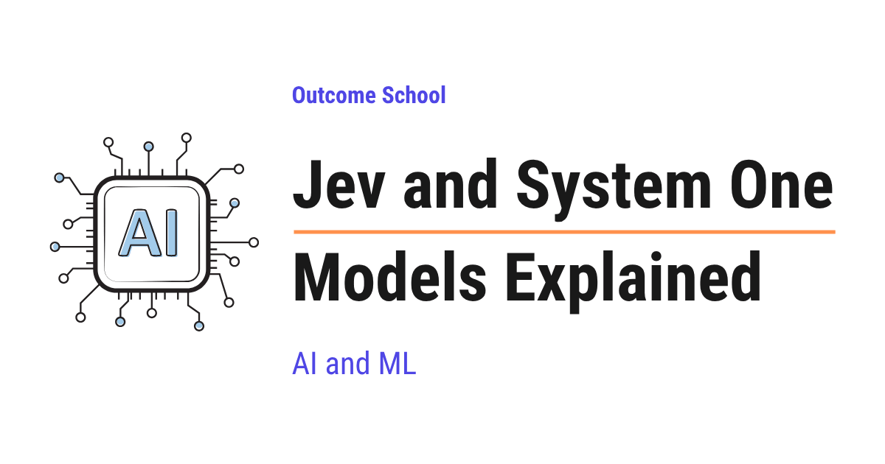

# Jev and System One Models Explained

> Archived from <https://outcomeschool.com/blog/jev-and-system-one-models-explained> on 2026-11-25.

Jev is the first System One Model, a new kind of AI model that does not write text at all. It looks at a situation and returns a decision from a fixed list of answers, along with how sure it is, that our software can use directly.

In this blog, we will learn about Jev and System One Models, a new kind of AI model that does not write text at all but only makes fast decisions that our software can use directly. We will also see what System One and System Two thinking mean, why using a normal LLM for small decisions is slow and unreliable, how Jev answers many questions in a single pass instead of one word at a time, what a typed answer is, how the probability attached to every answer is made honest, why Jev cannot hallucinate, and where it works well and where it fails.

We will cover the following:
<ul><li>What is a System One Model?</li><li>System One vs System Two Thinking</li><li>The Problem with Using an LLM for Decisions</li><li>What is Jev?</li><li>How Jev Works</li><li>Typed Answers: Choice, Score, and Yes/No</li><li>Calibration and RLCD</li><li>Why Jev Cannot Hallucinate</li><li>Jev vs LLM</li><li>Where Jev Works Well and Where It Fails</li><li>When to Use Which One</li></ul>
I am <strong>Amit Shekhar</strong>, Founder @ <a target="_blank" rel="noopener noreferrer" href="https://outcomeschool.com">Outcome School</a>, I have taught and mentored many developers, and their efforts landed them high-paying tech jobs, helped many tech companies in solving their unique problems, and created many open-source libraries being used by top companies. I am passionate about sharing knowledge through open-source, blogs, and videos.

I teach <a target="_blank" rel="noopener noreferrer" href="https://outcomeschool.com/program/ai-and-machine-learning">AI and Machine Learning</a> at Outcome School.

Let&#x27;s get started.
<h2 id="what-is-a-system-one-model">What is a System One Model?</h2>
<strong>A System One Model is an AI model that looks at a situation and returns a decision, not text.</strong>

In simple words, we give it some information and a fixed list of possible answers. It picks one answer from that list and also gives a number telling how sure it is.

Let&#x27;s say we run an online shop. A customer sends a message: &quot;My card was charged twice.&quot; We want to know which team must handle this message. The possible answers are <code>billing</code>, <code>technical</code>, and <code>account</code>. A System One Model reads the message and returns <code>billing</code> with a probability of 0.97, which means it is 97% sure.

That is all. It does not write a reply to the customer. It does not explain its thinking. It just decides.

<strong>System One Model = System One + Model</strong>

Here, &quot;System One&quot; comes from a famous idea about how the human brain thinks. And &quot;Model&quot; is the AI model. So, a System One Model is an AI model that thinks like the System One of our brain.

Before jumping into Jev, we must know what System One and System Two thinking mean.
<h2 id="system-one-vs-system-two-thinking">System One vs System Two Thinking</h2>
Daniel Kahneman, a psychologist who won the Nobel Prize, explained that our brain has two ways of thinking.

<strong>System 1</strong> is fast, automatic, and effortless. When we see a friend&#x27;s face, we know who it is instantly. When someone asks &quot;2 + 2?&quot;, we say &quot;4&quot; without thinking. We do not sit and calculate. The answer just comes.

<strong>System 2</strong> is slow, careful, and effortful. When someone asks &quot;17 × 24?&quot;, we stop, think step by step, and work it out. It takes time and energy.

Both are useful. System 1 handles thousands of small decisions every day. System 2 handles the hard ones.

<strong>Note:</strong> Kahneman writes them as System 1 and System 2. TypeSafe writes the model name as System One. Both mean the same thing.

Now, let&#x27;s connect this to AI.

An LLM, which stands for Large Language Model, is the AI model behind a chatbot like ChatGPT. It is built to produce text, one small piece at a time. Even when we ask it a simple yes or no question, it goes through this slow writing process. And the newer <a target="_blank" rel="noopener noreferrer" href="large-reasoning-models.md">reasoning models</a> go one step further, they write out their thinking step by step before giving the final answer. This is System 2 style work. It is powerful, but slow and costly.

But most of the decisions inside real software are small and repeated. Is this email spam or not? Which team must get this ticket? Is this review positive or negative? Is this answer safe to show to the user? These are System 1 type decisions. We need an instant answer, and we need it millions of times a day.

So, the question is: why are we using a slow, System 2 style model for fast, System 1 style decisions?

This is exactly the problem that System One Models are built to solve.

To learn Large Language Models (LLMs), Reasoning Models, and Autoregressive Models in depth, check out our <a target="_blank" rel="noopener noreferrer" href="https://outcomeschool.com/program/ai-and-machine-learning">AI and Machine Learning Program</a> at Outcome School.
<h2 id="the-problem-with-using-an-llm-for-decisions">The Problem with Using an LLM for Decisions</h2>
The best way to learn this is by taking an example.

Suppose we have a support system and we want to send every incoming ticket to the right team. Today, most of us do it with an LLM as below:

<pre><code class="language-python code-highlight">prompt = &quot;&quot;&quot;
Classify this support ticket into one of: billing, technical, account.
Reply with only the category name.

Ticket: My card was charged twice.
&quot;&quot;&quot;

response = llm.generate(prompt)
category = response.text.strip()
</code></pre>

Here, we are asking the LLM to read the ticket and reply with only the category name. It looks simple. But, here is the catch.

<strong>Problem 1: It writes the answer one token at a time.</strong>

A <a target="_blank" rel="noopener noreferrer" href="tokenization-in-llms.md">token</a> is a small piece of text, roughly a word or a part of a word. An LLM writes its answer <a target="_blank" rel="noopener noreferrer" href="autoregressive-models.md">one token at a time</a>. To write &quot;billing&quot;, it first predicts &quot;bill&quot;, then &quot;ing&quot;, and so on. Every single step is a full pass through a huge model. So, even a one-word answer takes many steps. And if the model decides to add an explanation, it takes even more steps.

<strong>Problem 2: We cannot trust the output format.</strong>

We asked for only the category name. But the model can reply &quot;The category is billing.&quot; or &quot;Billing.&quot; or &quot;billing, let me know if you need anything else.&quot; or even &quot;refund&quot;, which is not in our list at all. Now we must write extra code to clean this output. Most of the time, we do mistakes while writing this cleaning code, and it breaks in surprising ways.

<strong>Problem 3: We do not know how sure it is.</strong>

The model says &quot;billing&quot;. Was it 99% sure or 51% sure? We do not know. So, we cannot decide when to trust it and when to send the ticket to a human.

<strong>Problem 4: It is slow and costly.</strong>

A frontier LLM, which means one of the biggest and most capable models available today, takes seconds for such a call. If we have a million tickets a day, both the waiting time and the bill add up very fast.

We needed a model that only decides, does it instantly, always returns a valid answer, and tells us how sure it is.

So, here comes Jev to the rescue.
<h2 id="what-is-jev">What is Jev?</h2>
<strong>Jev is the first System One Model, built by a company called TypeSafe AI.</strong>

It was announced on September 15, 2026. TypeSafe AI was founded by Diogo Almeida, one of the people behind ChatGPT, and the team spent about two years quietly building a new way of training models. Jev is the result of that work.

The most surprising thing about Jev is this: <strong>it does not generate text at all.</strong>

We cannot chat with Jev. We cannot ask it to write an email or code. It takes a situation as input, and it returns typed decisions with probabilities as output. Nothing else.

<strong>Planning your move into AI?</strong>

No matter which tech domain you work in today, with your effort, you can transition to these roles:
<ul><li>AI Engineer</li><li>Forward Deployed Engineer</li><li>AI Agent Engineer</li><li>Harness Engineer</li><li>Voice AI Engineer</li><li>AI Architect</li><li>LLM Engineer</li><li>LLM Inference Engineer</li><li>Gen AI Engineer</li><li>MLOps Engineer</li><li>ML Engineer</li><li>Deep Learning Engineer</li></ul>
Our <a target="_blank" rel="noopener noreferrer" href="https://outcomeschool.com/program/ai-and-machine-learning">AI and Machine Learning Program</a> at Outcome School takes you there.

Now, let&#x27;s understand how it works.
<h2 id="how-jev-works">How Jev Works</h2>
Jev takes two things as input:
<ul><li><strong>State</strong>: the information about the situation. State is just a word for &quot;everything the model needs to know about the situation right now&quot;. It is always text. It can be a plain string, a list of texts, or a JSON object, which is a simple way of writing data as labels and values. For example, the customer message, their last few transactions, and the refund policy.</li><li><strong>Questions with allowed answers</strong>: what we want to decide, and what the valid answers are. For example, &quot;Which team?&quot; with the allowed answers <code>billing</code>, <code>technical</code>, and <code>account</code>.</li></ul>
And it returns:
<ul><li><strong>Typed answers</strong>: one answer per question, always chosen from the allowed answers.</li><li><strong>Probabilities</strong>: for every answer, a number between 0 and 1 telling how sure the model is.</li></ul>
Let&#x27;s see it in code. For the sake of understanding, the code below is simplified and is not the exact API:

<pre><code class="language-python code-highlight">result = jev.decide(
    state={
        &quot;message&quot;: &quot;My card was charged twice.&quot;,
        &quot;recent_transactions&quot;: [&quot;$49 on Sep 10&quot;, &quot;$49 on Sep 10&quot;]
    },
    questions={
        &quot;team&quot;: [&quot;billing&quot;, &quot;technical&quot;, &quot;account&quot;],
        &quot;is_urgent&quot;: &quot;yes_no&quot;,
        &quot;frustration&quot;: {&quot;min&quot;: 0, &quot;max&quot;: 2}
    }
)
</code></pre>

The result will be:

<pre><code class="code-highlight language-json">{
  &quot;team&quot;: { &quot;answer&quot;: &quot;billing&quot;, &quot;probability&quot;: 0.97 },
  &quot;is_urgent&quot;: { &quot;answer&quot;: true, &quot;probability&quot;: 0.88 },
  &quot;frustration&quot;: { &quot;answer&quot;: 1, &quot;probability&quot;: 0.74 }
}
</code></pre>

Here, we can notice a few things:
<ul><li>We asked three questions in one call and got three answers.</li><li>Every answer is one of the allowed answers. <code>team</code> can only be <code>billing</code>, <code>technical</code>, or <code>account</code>. It can never be &quot;refund&quot; or a sentence.</li><li>Every answer comes with a probability.</li></ul>
Now, the most important part: <strong>Jev answers all these questions in a single parallel pass.</strong>

Here, parallel means all at the same time, and a pass means one run through the model. Let&#x27;s understand what this means with an analogy.

An LLM is like a person writing an essay with a pen. Each word comes after the previous word. It cannot write the tenth word before writing the ninth.

Jev is like a person filling a form with checkboxes. It reads the whole state once, and then ticks all the boxes at the same time. There is no &quot;next word&quot; to wait for. That&#x27;s the beauty of a System One Model.

This is why Jev is so fast. A decision that takes a frontier LLM 3 seconds to a few minutes takes Jev about 70 to 500 milliseconds, which is a fraction of a second. TypeSafe reports that Jev is 40 to 200 times faster than LLMs of comparable intelligence on these tasks. In their own evaluation, they report Jev to be up to 193 times faster than Claude Sonnet 5 on decision tasks.

And because there is no text output, there is nothing to charge for on the output side. Jev costs $0.042 per million input tokens and the output is free.

So, it decides instantly, always returns a valid answer, tells us how sure it is, and costs very less. All four problems that we saw with the LLM approach got solved.

This was all about how Jev works. Now, let&#x27;s understand what &quot;typed&quot; means, because this is the heart of Jev.
<h2 id="typed-answers-choice-score-and-yesno">Typed Answers: Choice, Score, and Yes/No</h2>
In programming, a <strong>type</strong> tells what kind of value something can hold. A variable of type boolean can only hold <code>true</code> or <code>false</code>. It can never hold &quot;maybe&quot;. This is what we call <strong>type safety</strong>. The program cannot even represent a wrong kind of value. This is also where the company name TypeSafe comes from.

Jev brings the same idea to AI answers. Every question we ask has a type, and the answer must fit that type. Jev supports three kinds of typed answers:

<strong>Choice</strong>: pick one option from a fixed list. Example: <code>billing</code>, <code>technical</code>, or <code>account</code>. Jev supports up to 255 options in one list.

<strong>Score</strong>: pick a number from a fixed range. Example: frustration level from 0 to 2, or a quality score from 1 to 5.

<strong>Yes/No</strong>: a <code>true</code> or <code>false</code> answer. Example: &quot;Is this urgent?&quot;

And every one of these comes with a probability.

Now, the question is: how does Jev make sure the answer always fits the type?

Answer: Jev does not write the answer as text, it scores the options. Just for the sake of understanding, think of it like this. For a choice question with three options, Jev produces three probabilities, one for each option, and they add up to 1. The answer is simply the option with the highest probability. There is no way to output a fourth option, because there is no fourth slot.

This is very different from asking an LLM to &quot;reply in JSON&quot;. With an LLM, the JSON is still written token by token, and we hope it comes out valid. With Jev, the shape of the answer is fixed before the model even runs.

<strong>A quick note for you</strong>

No matter which tech domain you work in, get familiar with these topics:
<ul><li>LLM</li><li>RAG</li><li>MCP</li><li>Agent</li><li>Fine-tuning</li><li>Quantization</li></ul>
We put it all together in one video:

<a target="_blank" rel="noopener noreferrer" href="https://www.youtube.com/watch?v=lnfWvX66FUk">AI Engineering Explained: LLM, RAG, MCP, Agent, Fine-Tuning, and Quantization</a>

No need to stop reading - bookmark it and watch later when you get time. Future you will thank you.

Now, let&#x27;s get back to the topic.
<h2 id="calibration-and-rlcd">Calibration and RLCD</h2>
Till now, we have learned that Jev returns a probability with every answer. Now, the next big question is: can we trust that probability?

This is where <strong>calibration</strong> comes into the picture.

<strong>A model is calibrated when its probabilities match reality.</strong> In simple words, if we take all the answers where the model said &quot;I am 90% sure&quot;, then about 90% of them must actually be correct. Not 60%. Not 99%. Around 90%.

Let&#x27;s say a weather app says &quot;70% chance of rain&quot; on 100 different days. If it rained on about 70 of those days, the app is calibrated. If it rained on only 30 of those days, the app is not calibrated, and its 70% means nothing.

Most LLMs are not trained for this. They are <a target="_blank" rel="noopener noreferrer" href="reinforcement-learning-from-human-feedback-rlhf.md">trained to write text that humans like</a>. So, when an LLM says &quot;I am confident&quot;, it is just writing words that sound confident.

Jev is trained differently, using a method that TypeSafe calls <strong>RLCD</strong>.

<strong>RLCD = Reinforcement Learning for Calibrated Decisions</strong>

Let&#x27;s break it down.

<strong><a target="_blank" rel="noopener noreferrer" href="reinforcement-learning.md">Reinforcement Learning</a></strong> is a way of training where the model makes a decision, gets a reward when the decision turns out to be good, and gets a penalty when it turns out to be bad. Over millions of tries, the model learns to make better decisions.

<strong>For Calibrated Decisions</strong> means the reward is not just for being right. The reward is for being right and being honest about how sure it is. Let&#x27;s see with an example:
<ul><li>The model says 99% and is right: big reward.</li><li>The model says 99% and is wrong: big penalty.</li><li>The model says 55% and is right: small reward.</li><li>The model says 55% and is wrong: small penalty.</li></ul>
So, the only way for the model to score well is to say a high probability when it is truly likely to be right, and a low probability when it is not. This is how the probabilities become honest.

And this honest probability is very useful for us. Now, we can write code like below:

<pre><code class="language-python code-highlight">if result[&quot;team&quot;][&quot;probability&quot;] &gt; 0.9:
    route_to(result[&quot;team&quot;][&quot;answer&quot;])
else:
    send_to_human()
</code></pre>

Here, we are trusting Jev when it is very sure, and sending the ticket to a human when it is not. We could never write these lines with a normal LLM, because it never gave us an honest number. This makes our life easy.

<strong>Note:</strong> Calibration does not mean every single answer is correct. A 90% answer is still wrong 10% of the time. Calibration only means the number is honest, so we know how much to trust it.

If we want to go deep into RLHF (Reinforcement Learning from Human Feedback), Reward Models, and Proximal Policy Optimization (PPO), we have a complete program on this - check out our <a target="_blank" rel="noopener noreferrer" href="https://outcomeschool.com/program/ai-and-machine-learning">AI and Machine Learning Program</a> at Outcome School.
<h2 id="why-jev-cannot-hallucinate">Why Jev Cannot Hallucinate</h2>
You must have heard that <a target="_blank" rel="noopener noreferrer" href="why-do-llms-hallucinate-the-token-level-explanation.md">LLMs hallucinate</a>. In simple words, hallucination means the model confidently says something that is not true or does not exist. It can invent a book that was never written, a function that does not exist, or a category that is not in our list.

TypeSafe makes a strong claim: Jev cannot hallucinate. Let&#x27;s understand exactly what this means, because it is easy to misread.

There are two kinds of mistakes a model can make when we ask it to decide something:

<strong>Type error</strong>: the answer is not even a valid kind of answer. We asked for <code>billing</code>, <code>technical</code>, or <code>account</code>, and the model said &quot;refund&quot; or wrote a paragraph.

<strong>Wrong answer</strong>: the answer is valid, but it is the wrong one. The ticket was about a login problem, and the model said <code>billing</code>.

Jev can never make a type error. This is a mathematical guarantee, not a promise. The answer is always one of the allowed options, because the model only scores the allowed options. There is no path inside the model that can produce anything else. TypeSafe even says that a single counterexample would be enough to prove this claim false.

Jev can still give a wrong answer. But when it is unsure, the probability will be lower, because it is calibrated. So, most of the wrong answers can be caught by looking at the probability, and we can send those cases to a human.

This is the meaning of &quot;cannot hallucinate&quot; here: <strong>it can never invent an answer that does not exist, and when it is unsure, it tells us.</strong>

One more thing to notice. Normally, we think System 1 is fast but error-prone, and System 2 is slow but reliable. TypeSafe turns this idea around. For these decision tasks, a System One Model can be made more reliable than the slow alternative, because its answers are limited to the allowed options by design, and its confidence is honest by training.

<strong>Stay updated:</strong> Subscribe to our <a target="_blank" rel="noopener noreferrer" href="https://outcomeschool.substack.com/subscribe">newsletter</a> to get our latest AI and Machine Learning blogs straight to your inbox.
<h2 id="jev-vs-llm">Jev vs LLM</h2>
Now that we have learned about Jev in detail, it&#x27;s time to compare it with an LLM side by side.

Let me tabulate the differences between Jev and an LLM for your better understanding.
<table><thead><tr><th>Aspect</th><th>Jev (System One Model)</th><th>LLM</th></tr></thead><tbody><tr><td>Output</td><td>Typed decisions with probabilities</td><td>Free-form text</td></tr><tr><td>How it answers</td><td>All answers in one parallel pass</td><td>One token at a time</td></tr><tr><td>Can write text, code, replies</td><td>No</td><td>Yes</td></tr><tr><td>Can reason step by step</td><td>No</td><td>Yes</td></tr><tr><td>Output format guarantee</td><td>Always valid, by design</td><td>Must be cleaned and checked by our code</td></tr><tr><td>Confidence</td><td>Calibrated probability with every answer</td><td>Not available or not honest</td></tr><tr><td>Speed</td><td>70 to 500 milliseconds</td><td>Seconds to minutes</td></tr><tr><td>Cost</td><td>$0.042 per million input tokens, output free</td><td>Much higher, and output tokens cost extra</td></tr><tr><td>Input</td><td>Text, JSON, lists of text</td><td>Text, images, audio, and more</td></tr><tr><td>Best for</td><td>Classify, route, score, check, decide</td><td>Chat, write, code, reason, explain</td></tr></tbody></table><h2 id="where-jev-works-well-and-where-it-fails">Where Jev Works Well and Where It Fails</h2>
<strong>Where it works well:</strong>
<ul><li><strong>Routing</strong>: which team, <a target="_blank" rel="noopener noreferrer" href="llm-routing.md">which model</a>, or which workflow must handle this?</li><li><strong>Classification</strong>: spam or not, positive or negative, which category?</li><li><strong>Scoring</strong>: how relevant is this document, or <a target="_blank" rel="noopener noreferrer" href="llm-as-a-judge.md">how good is this answer</a>, from 1 to 5?</li><li><strong><a target="_blank" rel="noopener noreferrer" href="how-do-llm-guardrails-work.md">Guardrails</a></strong>, which means safety checks: is this LLM output safe, on topic, and correct? Jev can check an LLM&#x27;s answer in a fraction of a second before the user sees it.</li><li><strong>Real-time decisions</strong>: anything inside a user-facing app where we cannot wait for seconds.</li><li><strong>Large datasets</strong>: running the same decision over millions of rows, where cost and speed matter the most.</li></ul>
<strong>Where it fails:</strong>
<ul><li><strong>Writing anything</strong>: Jev cannot write a reply, an email, a summary, or code. There is no text output.</li><li><strong>Open-ended reasoning</strong>: if the task needs many steps of thinking, like solving a hard math problem, Jev is not the right tool.</li><li><strong>Explanations</strong>: Jev gives the answer and the probability, not the reason behind it.</li><li><strong>Images and audio</strong>: as of now, Jev accepts text only.</li><li><strong>Very large option lists</strong>: one choice question supports up to 255 options.</li></ul>
To master Orchestration and Routing, LLM as a Judge, and Evaluation of LLMs and Agents, check out our <a target="_blank" rel="noopener noreferrer" href="https://outcomeschool.com/program/ai-and-machine-learning">AI and Machine Learning Program</a> at Outcome School.
<h2 id="when-to-use-which-one">When to Use Which One</h2>
The simplest rule is this:

<strong>If the answer is a decision, use Jev. If the answer is text, use an LLM.</strong>

And in real systems, we use both together. Let&#x27;s say we are building a customer support system that replies to customers automatically.

First, Jev reads the ticket and decides the team, the urgency, and whether it is safe to reply automatically. This takes a fraction of a second.

Then, if Jev is sure it is safe, the LLM writes the reply.

After that, Jev checks the reply and decides whether it is correct and polite before it is sent.

Here, the LLM does the System 2 work: writing and reasoning. Jev does the System 1 work: deciding, fast and many times. Each one does what it is good at.

This kind of flow, where one step decides the path and another step does the work, is a common pattern. We have a detailed blog on <a target="_blank" rel="noopener noreferrer" href="ai-orchestration.md">AI Orchestration</a> that covers these patterns end to end.

Now we must have understood Jev and System One Models, how they think like the fast System 1 of our brain, how they answer all questions in a single pass instead of one token at a time, how typed answers make wrong formats impossible, how RLCD makes the probability honest, and when to use them along with an LLM.
<h2 id="frequently-asked-questions">Frequently Asked Questions</h2><h3 id="who-built-jev">Who built Jev?</h3>
Jev was built by a company called TypeSafe AI and announced on September 15, 2026. TypeSafe AI was founded by Diogo Almeida, one of the people behind ChatGPT. The team spent about two years building a new way of training models, and Jev is the result of that work.
<h3 id="can-we-ask-jev-several-questions-in-one-call">Can we ask Jev several questions in one call?</h3>
Yes. We can ask many questions in one call, and Jev answers all of them in a single parallel pass. It reads the whole state once and then ticks all the answers at the same time, like filling a form with checkboxes. Each answer comes with its own probability.
<h3 id="is-asking-an-llm-to-reply-in-json-the-same-as-jevs-typed-answers">Is asking an LLM to reply in JSON the same as Jev&#x27;s typed answers?</h3>
No. With an LLM, the JSON is still written token by token, and we hope it comes out valid. With Jev, the shape of the answer is fixed before the model even runs. Jev scores only the allowed options, so it cannot output anything outside them.
<h3 id="does-a-calibrated-probability-mean-jev-is-always-right">Does a calibrated probability mean Jev is always right?</h3>
No. Calibration does not mean every single answer is correct. A 90% answer is still wrong about 10% of the time. Calibration only means the number is honest, so we know how much to trust it and can send the unsure cases to a human.
<h3 id="how-much-does-jev-cost-to-use">How much does Jev cost to use?</h3>
Jev costs $0.042 per million input tokens, and the output is free. Since Jev does not generate any text, there is nothing to charge for on the output side. With an LLM, the cost is much higher, and output tokens cost extra.

That&#x27;s it for now.

Thanks

<strong>Amit Shekhar</strong> Founder @ <a target="_blank" rel="noopener noreferrer" href="https://outcomeschool.com">Outcome School</a>

You can connect with me on:
<ul><li><a target="_blank" rel="noopener noreferrer" href="https://x.com/amitiitbhu">X</a></li><li><a target="_blank" rel="noopener noreferrer" href="https://www.linkedin.com/in/amit-shekhar-iitbhu">LinkedIn</a></li><li><a target="_blank" rel="noopener noreferrer" href="https://github.com/amitshekhariitbhu">GitHub</a></li></ul>
Follow Outcome School on:
<ul><li><a target="_blank" rel="noopener noreferrer" href="https://x.com/outcome_school">X</a></li><li><a target="_blank" rel="noopener noreferrer" href="https://youtube.com/@OutcomeSchool">YouTube</a></li><li><a target="_blank" rel="noopener noreferrer" href="https://www.linkedin.com/company/outcomeschool">LinkedIn</a></li><li><a target="_blank" rel="noopener noreferrer" href="http://github.com/OutcomeSchool">GitHub</a></li></ul>
<a target="_blank" rel="noopener noreferrer" href="https://outcomeschool.com/blog"><strong>Read all of our high-quality blogs here.</strong></a>

