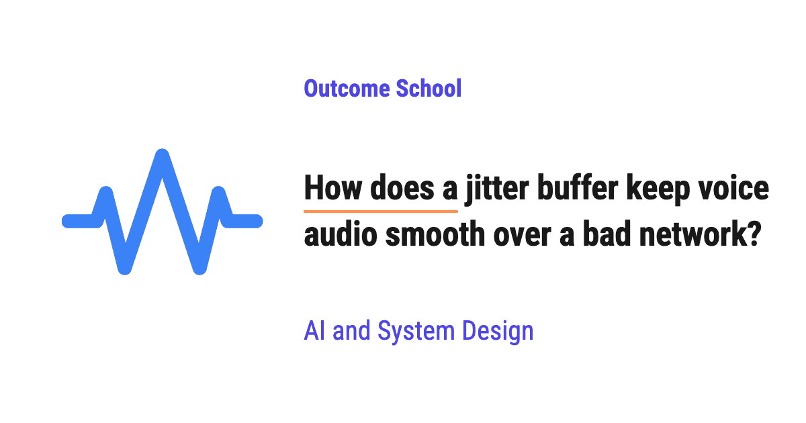

# How does a jitter buffer keep voice audio smooth over a bad network?

> Archived from <https://outcomeschool.com/blog/jitter-buffer> on 2026-11-25.

A jitter buffer is a small waiting area on the receiving side that holds incoming voice packets for a short time, puts them back in the right order, and plays them out at a steady pace. This keeps the audio smooth even when the network delivers the packets unevenly.

In this blog, we will learn about how a jitter buffer keeps voice audio smooth over a bad network. We will also see how voice travels over the internet in small packets, what jitter is and why it breaks the audio, how the jitter buffer fixes it step by step, how a fixed jitter buffer differs from an adaptive one, what happens when a packet arrives too late or never arrives, and where the jitter buffer sits in a voice AI agent.

We will cover the following:
<ul><li>How voice travels over the internet</li><li>What is jitter?</li><li>Why uneven arrival breaks the audio</li><li>What is a jitter buffer?</li><li>How a jitter buffer works step by step</li><li>The trade-off: smoothness vs delay</li><li>Fixed jitter buffer vs adaptive jitter buffer</li><li>What happens when a packet is late or lost</li><li>Where the jitter buffer sits in a voice AI agent</li></ul>
I am <strong>Amit Shekhar</strong>, Founder @ <a target="_blank" rel="noopener noreferrer" href="https://outcomeschool.com">Outcome School</a>, I have taught and mentored many developers, and their efforts landed them high-paying tech jobs, helped many tech companies in solving their unique problems, and created many open-source libraries being used by top companies. I am passionate about sharing knowledge through open-source, blogs, and videos.

I teach <a target="_blank" rel="noopener noreferrer" href="https://outcomeschool.com/program/ai-and-machine-learning">AI and Machine Learning</a> at Outcome School.

Let&#x27;s get started.
<h2 id="how-voice-travels-over-the-internet">How voice travels over the internet</h2>
Before jumping into the jitter buffer, we must know how our voice moves from one device to another over the internet.

When we speak into a phone or a laptop, the microphone captures our voice as a continuous sound. The device does not send this sound as one long piece. Instead, it cuts the sound into <a target="_blank" rel="noopener noreferrer" href="audio-frames-and-chunk-sizes.md">small pieces</a>. A common size is 20 milliseconds of audio per piece.

Each piece is compressed and put inside a small envelope called a <strong>packet</strong>. Each packet also carries two important labels:
<ul><li>A <strong>sequence number</strong>, which tells the order of the packet: 1, 2, 3, 4, and so on.</li><li>A <strong>timestamp</strong>, which tells which moment of the speech this piece of audio belongs to.</li></ul>
So, one second of speech becomes 50 packets, because 1000 milliseconds divided by 20 milliseconds is 50.

The sender sends these packets one after another, every 20 milliseconds, at a steady pace. The packets then travel across the internet through many routers and networks until they reach the other side.

On the receiving side, the device opens each packet, decompresses the audio, and plays it through the speaker.

If every packet took exactly the same time to travel, the receiver could simply play each packet the moment it arrives. But, the internet does not work like that.
<h2 id="what-is-jitter">What is jitter?</h2>
<strong>Jitter is the variation in the time that packets take to travel from the sender to the receiver.</strong>

In simple words, packets that leave at a steady pace do not arrive at a steady pace.

Let&#x27;s say the sender sends one packet every 20 milliseconds. The travel time of each packet is different, because each packet shares the network with traffic from many other people. Sometimes a router is busy and the packet waits in a queue. Sometimes the packet even takes a different path.

Assume that the travel times look like below:
<table><thead><tr><th>Packet</th><th>Sent at</th><th>Travel time</th><th>Arrives at</th></tr></thead><tbody><tr><td>1</td><td>0 ms</td><td>50 ms</td><td>50 ms</td></tr><tr><td>2</td><td>20 ms</td><td>50 ms</td><td>70 ms</td></tr><tr><td>3</td><td>40 ms</td><td>90 ms</td><td>130 ms</td></tr><tr><td>4</td><td>60 ms</td><td>40 ms</td><td>100 ms</td></tr><tr><td>5</td><td>80 ms</td><td>55 ms</td><td>135 ms</td></tr></tbody></table>
Here, we can notice a few things:
<ul><li>Packet 1 and packet 2 arrive 20 milliseconds apart, as expected.</li><li>Packet 3 got stuck somewhere and took 90 milliseconds instead of 50.</li><li>Packet 4 arrives before packet 3, which means the packets arrive out of order.</li><li>Packet 3 and packet 5 arrive almost together.</li></ul>
The average travel time can be fine, but the travel time keeps changing from packet to packet. This change is jitter. A bad network for <a target="_blank" rel="noopener noreferrer" href="voice-and-video-call.md">voice calls</a> is usually one with a lot of jitter, a lot of packet loss, or both.
<h2 id="why-uneven-arrival-breaks-the-audio">Why uneven arrival breaks the audio</h2>
Now, let&#x27;s see what happens if the receiver plays every packet the moment it arrives.

The speaker needs a new 20 millisecond piece of audio exactly every 20 milliseconds. If it pauses to wait, we hear the pause.

Using the table above:
<ul><li>At 50 ms, packet 1 arrives and plays from 50 ms to 70 ms.</li><li>At 70 ms, packet 2 arrives and plays from 70 ms to 90 ms.</li><li>At 90 ms, the speaker needs packet 3, but packet 3 is not here. The speaker has nothing to play. We hear a gap or a click.</li><li>At 100 ms, packet 4 arrives, but it belongs after packet 3. If we play it now, the words come out in the wrong order.</li><li>At 130 ms and 135 ms, packet 3 and packet 5 arrive almost together, so we have more audio than we can play at that moment.</li></ul>
The result is choppy, robotic audio with small gaps, skipped sounds, and sounds in the wrong order.

The problem is not that the packets are slow. The problem is that they are uneven. So, how can we turn uneven arrival back into a steady stream? The answer is the jitter buffer.
<h2 id="what-is-a-jitter-buffer">What is a jitter buffer?</h2>
<strong>A jitter buffer is a small waiting area on the receiving side where incoming voice packets are held for a short time, put back in the correct order, and then released to the speaker at a steady pace.</strong>

The word <strong>buffer</strong> here means a temporary holding space. The jitter buffer is a buffer that exists to absorb jitter.

Let&#x27;s say we are waiting at the gate of a movie hall for our friends. They come at random times. Some come early, some come late, and some come in a group. Instead of entering the hall one by one the moment each friend arrives, we decide to wait for 10 minutes at the gate, collect everyone, and then enter in a neat line. We spend 10 extra minutes waiting, but the entry becomes smooth.

The jitter buffer does exactly this with packets. It waits a little on purpose, so that late packets get time to catch up, and then it plays everything in a neat, steady line.

<strong>Planning your move into AI?</strong>

No matter which tech domain you work in today, with your effort, you can transition to these roles:
<ul><li>AI Engineer</li><li>Forward Deployed Engineer</li><li>AI Agent Engineer</li><li>Harness Engineer</li><li>Voice AI Engineer</li><li>AI Architect</li><li>LLM Engineer</li><li>LLM Inference Engineer</li><li>Gen AI Engineer</li><li>MLOps Engineer</li><li>ML Engineer</li><li>Deep Learning Engineer</li></ul>
Our <a target="_blank" rel="noopener noreferrer" href="https://outcomeschool.com/program/ai-and-machine-learning">AI and Machine Learning Program</a> at Outcome School takes you there.
<h2 id="how-a-jitter-buffer-works-step-by-step">How a jitter buffer works step by step</h2>
The best way to learn this is by taking an example. Let&#x27;s use the same five packets and a jitter buffer that holds audio for 60 milliseconds before playing.

<strong>Step 1:</strong> Packet 1 arrives at 50 ms. The jitter buffer does not play it immediately. It stores it and schedules it to play at 50 + 60 = 110 ms.

<strong>Step 2:</strong> From now on, the playback runs on a steady clock. The jitter buffer uses the timestamp of each packet to give it a playback slot. Packet 1 plays at 110 ms, packet 2 at 130 ms, packet 3 at 150 ms, packet 4 at 170 ms, and packet 5 at 190 ms.

<strong>Step 3:</strong> Packet 2 arrives at 70 ms and goes into the buffer. Its slot is at 130 ms, so it is early. It waits.

<strong>Step 4:</strong> Packet 4 arrives at 100 ms, before packet 3. The jitter buffer reads the sequence number, sees that it is packet 4, and places it in the fourth position. This is how the wrong order gets corrected.

<strong>Step 5:</strong> Packet 3 arrives at 130 ms. Its slot is at 150 ms, so it is still in time. The jitter buffer places it in the third position, between packet 2 and packet 4.

<strong>Step 6:</strong> Packet 5 arrives at 135 ms. Its slot is at 190 ms, so it is in time too.

Now, the speaker receives packet 1, 2, 3, 4, and 5 in the correct order, every 20 milliseconds, with no gaps.

We can see the full flow as below:

<pre><code class="code-highlight">Sender: packets leave every 20 ms
  ↓
Internet: packets get delayed by different amounts
  ↓
Jitter buffer: holds packets, reorders them by sequence number
  ↓
Speaker: plays one packet every 20 ms, in order
</code></pre>

Here, the jitter buffer takes uneven input and gives steady output. The only cost is that every packet now plays 60 milliseconds later than it could have.

<strong>A quick note for you</strong>

No matter which tech domain you work in, get familiar with these topics:
<ul><li>LLM</li><li>RAG</li><li>MCP</li><li>Agent</li><li>Fine-tuning</li><li>Quantization</li></ul>
We put it all together in one video:

<a target="_blank" rel="noopener noreferrer" href="https://www.youtube.com/watch?v=lnfWvX66FUk">AI Engineering Explained: LLM, RAG, MCP, Agent, Fine-Tuning, and Quantization</a>

No need to stop reading - bookmark it and watch later when you get time. Future you will thank you.

Now, let&#x27;s get back to the topic.
<h2 id="the-trade-off-smoothness-vs-delay">The trade-off: smoothness vs delay</h2>
Now, the question is: how long must the jitter buffer wait?

The waiting time is called the <strong>buffer delay</strong> or the <strong>buffer depth</strong>. Choosing it is a balance between smoothness and delay, and these two pull in opposite directions.

In our example, packet 3 took 40 milliseconds longer than packet 1, so a buffer of 60 milliseconds was enough. If the buffer was only 20 milliseconds, packet 1 would play at 70 ms, the slot of packet 3 would be at 110 ms, and packet 3 would arrive at 130 ms, which is too late.

<strong>If the buffer is too small:</strong>
<ul><li>Packets that are delayed by more than the buffer can absorb arrive after their slot.</li><li>The jitter buffer has to treat them as missing.</li><li>We hear more gaps and glitches.</li></ul>
<strong>If the buffer is too large:</strong>
<ul><li>Almost every packet arrives in time, so the audio is very smooth.</li><li>But every word reaches the listener later.</li><li>In a conversation, this extra delay often makes people talk over each other, because each person hears the other one late.</li></ul>
Let me tabulate the differences between a small buffer and a large buffer for your better understanding.
<table><thead><tr><th>Buffer depth</th><th>Smoothness</th><th>Delay</th><th>Best for</th></tr></thead><tbody><tr><td>Small (for example, 20 to 40 ms)</td><td>Glitches on a bad network</td><td>Low</td><td>Stable networks</td></tr><tr><td>Large (for example, 150 to 200 ms)</td><td>Very smooth</td><td>High</td><td>Very jittery networks</td></tr></tbody></table>
The ideal buffer is just large enough to absorb the jitter of the current network, and not larger. The problem is that the jitter of a network keeps changing. A Wi-Fi connection can be calm one minute and very jittery the next minute. This brings us to the two types of jitter buffers.
<h2 id="fixed-jitter-buffer-vs-adaptive-jitter-buffer">Fixed jitter buffer vs adaptive jitter buffer</h2>
<strong>Fixed jitter buffer:</strong> It uses one constant waiting time for the whole call, for example 60 milliseconds.
<ul><li><strong>Advantage:</strong> It is simple to build and its behavior is predictable.</li><li><strong>Disadvantage:</strong> If the network becomes worse, 60 milliseconds is not enough and we hear glitches. If the network becomes better, 60 milliseconds is more than needed and we add delay for no reason.</li></ul>
<strong>Adaptive jitter buffer:</strong> It keeps measuring how much the arrival times vary and changes its waiting time during the call.
<ul><li>When packets start arriving more unevenly, it grows the buffer to avoid gaps.</li><li>When the network becomes calm, it shrinks the buffer to reduce delay.</li></ul>
Now, the next big question is: how does an adaptive jitter buffer grow or shrink without causing a glitch itself?

If it simply paused the audio to grow the buffer, we would hear a silence. If it simply dropped audio to shrink the buffer, we would hear a jump. So, adaptive jitter buffers do this gently in two common ways:
<ul><li><strong>Adjust during silence:</strong> People pause between sentences. The jitter buffer can make a silent pause slightly longer to grow, or slightly shorter to shrink. A pause that is a few milliseconds longer is hard to notice.</li><li><strong>Time stretching:</strong> The jitter buffer plays the speech slightly slower, so that packets arrive a little faster than they are played and the stored audio grows, or slightly faster to reduce the stored audio, without changing the pitch of the voice. A good example is NetEq, the jitter buffer inside <a target="_blank" rel="noopener noreferrer" href="webrtc-vs-websocket-for-voice-ai.md">WebRTC</a>, which compares the amount of stored audio with a target delay and speeds up or slows down the audio in small amounts to reach that target.</li></ul>
Let me tabulate the differences between the fixed jitter buffer and the adaptive jitter buffer for your better understanding.
<table><thead><tr><th>Feature</th><th>Fixed jitter buffer</th><th>Adaptive jitter buffer</th></tr></thead><tbody><tr><td>Waiting time</td><td>Same for the whole call</td><td>Changes during the call</td></tr><tr><td>Reaction to a worse network</td><td>More glitches</td><td>Grows the buffer</td></tr><tr><td>Reaction to a better network</td><td>Keeps extra delay</td><td>Shrinks the buffer</td></tr><tr><td>Complexity</td><td>Simple</td><td>More complex</td></tr></tbody></table>
This is why real-time voice systems like WebRTC use an adaptive jitter buffer.

If we want to go deep into AI and ML System Design and how to Design a Real-Time Voice AI Agent, our <a target="_blank" rel="noopener noreferrer" href="https://outcomeschool.com/program/ai-and-machine-learning">AI and Machine Learning Program</a> at Outcome School covers them from the ground up.
<h2 id="what-happens-when-a-packet-is-late-or-lost">What happens when a packet is late or lost</h2>
No matter how good the jitter buffer is, some packets do not make it in time. There are two cases.

<strong>Case 1: The packet arrives too late.</strong> Its playback slot has already passed. The speaker has already moved past that moment. So, the jitter buffer throws the late packet away. For the listener, a late packet is the same as a lost packet.

<strong>Case 2: The packet never arrives.</strong> Some packets get dropped by the network. This is called <strong>packet loss</strong>.

In both cases, the speaker still needs 20 milliseconds of audio for that slot. If we play silence, we hear a gap. So, here comes <strong><a target="_blank" rel="noopener noreferrer" href="packet-loss-concealment.md">Packet Loss Concealment</a></strong> to the rescue.

<strong>Packet Loss Concealment</strong> means filling the missing slot with a guess of what the audio was likely to be, so that the listener does not hear a hard gap. Our voice does not change much within a few tens of milliseconds, so the receiver can create a short piece of sound that continues the previous sound.
<ul><li>For one missing packet, the guess is often good enough that the listener does not notice.</li><li>For many missing packets in a row, the guessed sound slowly fades out, because a long guess starts to sound unnatural.</li></ul>
The audio codec can also help here. A <strong>codec</strong> is the method that compresses the audio before sending and decompresses it after receiving. <a target="_blank" rel="noopener noreferrer" href="opus-codec.md">Opus</a> is a popular codec for voice calls. When Opus expects packet loss, it can carry a low-quality copy of a piece of audio inside the packet that comes after it. Opus calls this in-band <strong>Forward Error Correction</strong>. If a packet is lost but the next one arrives, the receiver can rebuild a rough version of the lost audio from it. This works because the jitter buffer is often already holding the next packet before the slot of the lost packet comes up for playback.

So, the jitter buffer corrects the timing and the order, and packet loss concealment fills the holes that are left.

<strong>Stay updated:</strong> Subscribe to our <a target="_blank" rel="noopener noreferrer" href="https://outcomeschool.substack.com/subscribe">newsletter</a> to get our latest AI and Machine Learning blogs straight to your inbox.
<h2 id="where-the-jitter-buffer-sits-in-a-voice-ai-agent">Where the jitter buffer sits in a voice AI agent</h2>
Now, let&#x27;s take a real use case: a <a target="_blank" rel="noopener noreferrer" href="design-a-real-time-voice-ai-agent.md">voice AI agent</a>. We talk to it, and it talks back.

When the audio travels over a real-time connection like WebRTC, it flows in two directions, and there is a jitter buffer on each receiving side:
<ul><li><strong>User to agent:</strong> Our voice goes from our device to the agent&#x27;s server. The server receives packets, puts them through a jitter buffer, and then sends the steady audio to the speech recognition model.</li><li><strong>Agent to user:</strong> The agent&#x27;s voice goes from the server to our device. Our device receives packets, puts them through a jitter buffer, and then plays the audio through the speaker.</li></ul>
We can see it as below:

<pre><code class="code-highlight">User speaks
  ↓
Network (jitter)
  ↓
Jitter buffer on server
  ↓
Speech recognition
  ↓
LLM
  ↓
Text to speech
  ↓
Network (jitter)
  ↓
Jitter buffer on user&#x27;s device
  ↓
User hears the reply
</code></pre>

The jitter buffer appears twice in one turn of the conversation. Every millisecond the jitter buffer waits is added to <a target="_blank" rel="noopener noreferrer" href="voice-to-voice-latency.md">the total time between the user finishing a sentence and hearing the agent&#x27;s reply</a>.

This is why the jitter buffer is an important item in the <a target="_blank" rel="noopener noreferrer" href="voice-agent-latency-budget.md">latency budget</a> of a voice agent, which is the total time we allow for each step of a reply. A large buffer gives clean audio but makes the agent feel slow. A small buffer makes the agent feel fast, but on a bad network the speech recognition hears broken audio and the user hears a choppy voice. An adaptive jitter buffer helps the voice agent stay smooth on a bad network and fast on a good network.

We have a detailed blog on <a target="_blank" rel="noopener noreferrer" href="tts-audio-buffering.md">why TTS audio buffering makes interruptions slow</a> that explains how the audio waiting on the user&#x27;s device affects interruptions.

Now we must have understood how a jitter buffer keeps voice audio smooth over a bad network, how it reorders packets and plays them at a steady pace, how a fixed jitter buffer differs from an adaptive one, how late and lost packets are handled, and where it sits in a voice AI agent.
<h2 id="frequently-asked-questions">Frequently Asked Questions</h2><h3 id="does-a-jitter-buffer-add-delay-to-a-voice-call">Does a jitter buffer add delay to a voice call?</h3>
Yes. A jitter buffer adds delay on purpose. It holds every packet for a short time before playing it, so that late packets get time to catch up. In a voice AI agent, every millisecond the jitter buffer waits is added to the time between the user finishing a sentence and hearing the reply.
<h3 id="what-is-a-good-jitter-buffer-size">What is a good jitter buffer size?</h3>
The ideal jitter buffer is just large enough to absorb the jitter of the current network, and not larger. A small buffer, like 20 to 40 milliseconds, suits a stable network. A large buffer, like 150 to 200 milliseconds, gives very smooth audio on a very jittery network, but every word reaches the listener later.
<h3 id="can-a-jitter-buffer-recover-a-lost-packet">Can a jitter buffer recover a lost packet?</h3>
No. A jitter buffer corrects the timing and the order of packets, but it cannot bring back a packet that never arrives. Packet loss concealment fills the missing slot with a guess of the audio. A codec like Opus can also rebuild a rough version of the lost audio from the next packet using in-band Forward Error Correction.
<h3 id="what-is-neteq-in-webrtc">What is NetEq in WebRTC?</h3>
NetEq is the adaptive jitter buffer inside WebRTC. It compares the amount of stored audio with a target delay. Then it speeds up or slows down the audio in small amounts to reach that target, without changing the pitch of the voice.

That&#x27;s it for now.

Thanks

<strong>Amit Shekhar</strong> Founder @ <a target="_blank" rel="noopener noreferrer" href="https://outcomeschool.com">Outcome School</a>

You can connect with me on:
<ul><li><a target="_blank" rel="noopener noreferrer" href="https://x.com/amitiitbhu">X</a></li><li><a target="_blank" rel="noopener noreferrer" href="https://www.linkedin.com/in/amit-shekhar-iitbhu">LinkedIn</a></li><li><a target="_blank" rel="noopener noreferrer" href="https://github.com/amitshekhariitbhu">GitHub</a></li></ul>
Follow Outcome School on:
<ul><li><a target="_blank" rel="noopener noreferrer" href="https://x.com/outcome_school">X</a></li><li><a target="_blank" rel="noopener noreferrer" href="https://youtube.com/@OutcomeSchool">YouTube</a></li><li><a target="_blank" rel="noopener noreferrer" href="https://www.linkedin.com/company/outcomeschool">LinkedIn</a></li><li><a target="_blank" rel="noopener noreferrer" href="http://github.com/OutcomeSchool">GitHub</a></li></ul>
<a target="_blank" rel="noopener noreferrer" href="https://outcomeschool.com/blog"><strong>Read all of our high-quality blogs here.</strong></a>

