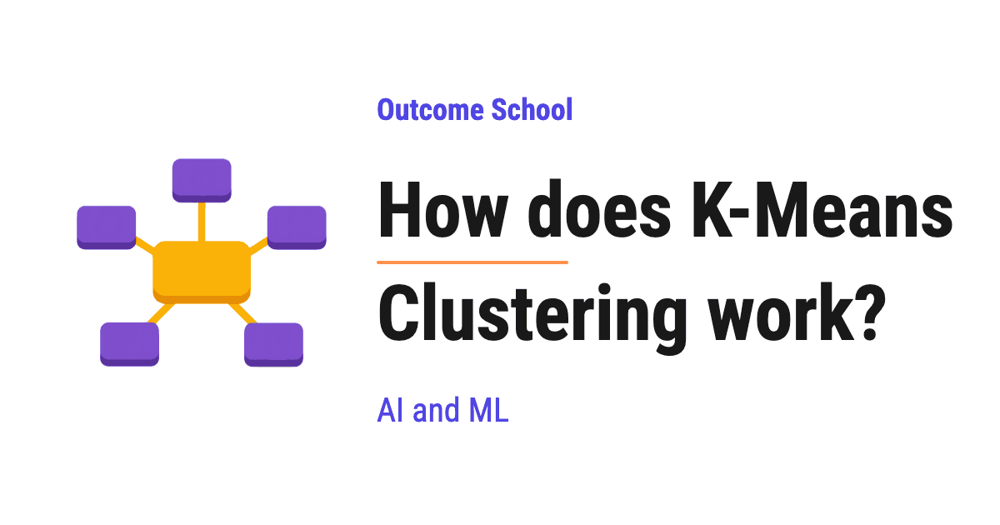

# How does K-Means Clustering work?

> Archived from <https://outcomeschool.com/blog/k-means-clustering> on 2026-11-25.

K-Means Clustering is a Machine Learning method that automatically splits data into K groups, where each item belongs to the group whose center is closest to it. It finds these groups on its own, without anyone telling it the correct answers.

In this blog, we will learn about how K-Means Clustering works. We will also see what clustering means, what a centroid is, the four steps that K-Means repeats with a full example with numbers, how to pick the right value of K using the elbow method, the common problems like bad starting points and unscaled data, and where it works well and where it fails.

We will cover the following:
<ul><li>What is clustering?</li><li>What is K-Means Clustering?</li><li>What is a centroid?</li><li>How do we measure closeness?</li><li>How does K-Means work? The four steps</li><li>A step-by-step example with numbers</li><li>Seeing it in code</li><li>How to choose the value of K?</li><li>Common problems and how to fix them</li><li>Where K-Means works well and where it fails</li></ul>
I am <strong>Amit Shekhar</strong>, Founder @ <a target="_blank" rel="noopener noreferrer" href="https://outcomeschool.com">Outcome School</a>, I have taught and mentored many developers, and their efforts landed them high-paying tech jobs, helped many tech companies in solving their unique problems, and created many open-source libraries being used by top companies. I am passionate about sharing knowledge through open-source, blogs, and videos.

I teach <a target="_blank" rel="noopener noreferrer" href="https://outcomeschool.com/program/ai-and-machine-learning">AI and Machine Learning</a> at Outcome School.

Let&#x27;s get started.
<h2 id="what-is-clustering">What is clustering?</h2>
<strong>Clustering is the task of putting similar items into the same group, and different items into different groups.</strong>

Each group is called a <strong>cluster</strong>. Clustering is <strong><a target="_blank" rel="noopener noreferrer" href="supervised-vs-unsupervised-learning.md">unsupervised learning</a></strong>, which means we give the machine only the data, with no correct answers, and it must find the groups on its own.

Let&#x27;s say a shop has 10,000 customers. For each customer, the shop knows two things: how often they visit and how much they spend. The shop wants to understand its customers better. But nobody has labeled the customers as &quot;big spenders&quot; or &quot;rare visitors&quot;.

If we cluster the customers, we can get groups like below:
<ul><li>Customers who visit often and spend a lot.</li><li>Customers who visit often but spend little.</li><li>Customers who visit rarely but spend a lot when they come.</li></ul>
Now, the shop can send different offers to each group. This is called <strong>customer segmentation</strong>, and it is one of the most common uses of clustering.

To learn Supervised and Unsupervised Learning and the rest of the Machine Learning Fundamentals, check out our <a target="_blank" rel="noopener noreferrer" href="https://outcomeschool.com/program/ai-and-machine-learning">AI and Machine Learning Program</a> at Outcome School.
<h2 id="what-is-k-means-clustering">What is K-Means Clustering?</h2>
<strong>K-Means Clustering is a clustering method that divides the data into exactly K clusters, where each cluster is represented by its center point, and every item belongs to the cluster with the nearest center.</strong>

K-Means = K + Means.
<ul><li><strong>K</strong> is the number of clusters we want. We choose it before we start. If we want 3 groups, K = 3.</li><li><strong>Means</strong> is the plural of mean, and a mean is an average. Each cluster&#x27;s center is calculated as the average of all the items in that cluster.</li></ul><h2 id="what-is-a-centroid">What is a centroid?</h2>
<strong>A centroid is the center point of a cluster. It is the average position of all the items in that cluster.</strong>

Suppose we have three houses on a straight road at positions 2, 4, and 9 kilometers from the start.

<pre><code class="language-text code-highlight">Centroid = (2 + 4 + 9) / 3 = 5
</code></pre>

So, the centroid of these three houses is at 5 kilometers. If we want to build one common shop for these three houses, position 5 is the balance point.

When each item has two numbers, like (visits, spending), we take the average of each number separately. For example, the centroid of (1, 2) and (3, 6) is ((1 + 3) / 2, (2 + 6) / 2) = (2, 4).
<h2 id="how-do-we-measure-closeness">How do we measure closeness?</h2>
K-Means keeps asking one question: &quot;Which centroid is this item closest to?&quot; So, we need a way to measure distance.

K-Means uses the normal straight-line distance that we measure with a ruler. It is called the <strong>Euclidean distance</strong>.

We have a detailed blog on <a target="_blank" rel="noopener noreferrer" href="cosine-similarity.md">Cosine Similarity</a> that compares it with Euclidean Distance and explains when to use each one.

For two points (x1, y1) and (x2, y2), it is calculated as below:

<strong>Distance = sqrt((x2 - x1)^2 + (y2 - y1)^2)</strong>

For example, the distance between (1, 1) and (4, 5) is:

<pre><code class="language-text code-highlight">Distance = square root of ((4 - 1)^2 + (5 - 1)^2)
         = square root of (9 + 16)
         = square root of 25
         = 5
</code></pre>

Smaller distance means the two points are more similar.
<h2 id="how-does-k-means-work-the-four-steps">How does K-Means work? The four steps</h2>
Now that we have learned about clusters, centroids, and distance, it&#x27;s time to learn how K-Means actually works.

K-Means follows four steps:

<strong>Step 1:</strong> Choose K. Decide how many clusters we want.

<strong>Step 2:</strong> Place K centroids. Put K starting centroids somewhere. The simplest way is to pick K random items from the data and use them as the starting centroids.

<strong>Step 3:</strong> Assign every item to its nearest centroid. For each item, calculate the distance to every centroid, and put the item in the cluster of the closest one.

<strong>Step 4:</strong> Move each centroid to the center of its cluster. For each cluster, calculate the average of all the items inside it. That average becomes the new centroid.

Then, we repeat Step 3 and Step 4 again and again. We stop when the items stop changing their clusters. At that point, the centroids also stop moving. We say that the algorithm has <strong>converged</strong>, which means it has settled down.

<pre><code class="language-text code-highlight">   Choose K
      |
      ↓
   Place K centroids
      |
      ↓
 +--&gt; Assign each item to the nearest centroid
 |    |
 |    ↓
 |    Move each centroid to the average of its items
 |    |
 |    ↓
 |    Did any item change its cluster?
 |    |                 |
 |   Yes                No
 |    |                 |
 +----+                 ↓
                       Stop
</code></pre>

Let&#x27;s think of it like a party. Suppose there are K snack tables placed randomly in a hall. Every guest walks to the nearest table. Then, each table is moved to the middle of the guests standing around it. Now, some guests find that another table is nearer, so they walk to it. The tables move again. After a few rounds, nobody needs to switch, and every table sits in the middle of its own crowd.

This is how K-Means works.

<strong>Planning your move into AI?</strong>

No matter which tech domain you work in today, with your effort, you can transition to these roles:
<ul><li>AI Engineer</li><li>Forward Deployed Engineer</li><li>AI Agent Engineer</li><li>Harness Engineer</li><li>Voice AI Engineer</li><li>AI Architect</li><li>LLM Engineer</li><li>LLM Inference Engineer</li><li>Gen AI Engineer</li><li>MLOps Engineer</li><li>ML Engineer</li><li>Deep Learning Engineer</li></ul>
Our <a target="_blank" rel="noopener noreferrer" href="https://outcomeschool.com/program/ai-and-machine-learning">AI and Machine Learning Program</a> at Outcome School takes you there.
<h2 id="a-step-by-step-example-with-numbers">A step-by-step example with numbers</h2>
The best way to learn this is by taking an example. We have 6 points, and we want K = 2 clusters.

<pre><code class="language-text code-highlight">A = (1, 1)    B = (2, 1)    C = (1, 2)
D = (8, 8)    E = (9, 8)    F = (8, 9)
</code></pre>

<pre><code class="language-text code-highlight">  y
 9 |                       F
 8 |                       D  E
 7 |
 . |
 2 |  C
 1 |  A  B
   +---------------------------- x
      1  2  .  .  .  .  .  8  9
</code></pre>

Just by looking, we can see two groups. But the computer cannot &quot;look&quot;. It must use the four steps.

<strong>Round 1:</strong> We pick the starting centroids.

For the sake of understanding, let&#x27;s say we start with a bad choice: we pick A and B as the two starting centroids. Both are in the bottom-left corner.

<pre><code class="language-text code-highlight">Centroid 1 = (1, 1)
Centroid 2 = (2, 1)
</code></pre>

<strong>Round 1:</strong> We assign each point to its nearest centroid.
<table><thead><tr><th>Point</th><th>Distance to Centroid 1 (1, 1)</th><th>Distance to Centroid 2 (2, 1)</th><th>Goes to</th></tr></thead><tbody><tr><td>A (1, 1)</td><td>0</td><td>1</td><td>Cluster 1</td></tr><tr><td>B (2, 1)</td><td>1</td><td>0</td><td>Cluster 2</td></tr><tr><td>C (1, 2)</td><td>1</td><td>1.41</td><td>Cluster 1</td></tr><tr><td>D (8, 8)</td><td>9.90</td><td>9.22</td><td>Cluster 2</td></tr><tr><td>E (9, 8)</td><td>10.63</td><td>9.90</td><td>Cluster 2</td></tr><tr><td>F (8, 9)</td><td>10.63</td><td>10.00</td><td>Cluster 2</td></tr></tbody></table>
So, Cluster 1 has A and C. Cluster 2 has B, D, E, and F.

Here, we can notice that B, which clearly belongs with A and C, has landed in the wrong cluster. K-Means will fix this on its own.

<strong>Round 1:</strong> We move the centroids.

<pre><code class="language-text code-highlight">Centroid 1 = average of A, C       = ((1 + 1) / 2, (1 + 2) / 2)
           = (1, 1.5)

Centroid 2 = average of B, D, E, F = ((2 + 8 + 9 + 8) / 4, (1 + 8 + 8 + 9) / 4)
           = (6.75, 6.5)
</code></pre>

Centroid 2 has moved a lot, towards the top-right group.

<strong>Round 2:</strong> We assign each point again.
<table><thead><tr><th>Point</th><th>Distance to Centroid 1 (1, 1.5)</th><th>Distance to Centroid 2 (6.75, 6.5)</th><th>Goes to</th></tr></thead><tbody><tr><td>A (1, 1)</td><td>0.50</td><td>7.96</td><td>Cluster 1</td></tr><tr><td>B (2, 1)</td><td>1.12</td><td>7.27</td><td>Cluster 1</td></tr><tr><td>C (1, 2)</td><td>0.50</td><td>7.30</td><td>Cluster 1</td></tr><tr><td>D (8, 8)</td><td>9.55</td><td>1.95</td><td>Cluster 2</td></tr><tr><td>E (9, 8)</td><td>10.31</td><td>2.70</td><td>Cluster 2</td></tr><tr><td>F (8, 9)</td><td>10.26</td><td>2.80</td><td>Cluster 2</td></tr></tbody></table>
Now, B has moved to Cluster 1. The mistake is fixed.

<strong>Round 2:</strong> We move the centroids again.

<pre><code class="language-text code-highlight">Centroid 1 = average of A, B, C = ((1 + 2 + 1) / 3, (1 + 1 + 2) / 3) = (1.33, 1.33)
Centroid 2 = average of D, E, F = ((8 + 9 + 8) / 3, (8 + 8 + 9) / 3) = (8.33, 8.33)
</code></pre>

<strong>Round 3:</strong> We assign each point again.

A, B, and C are still closest to Centroid 1. D, E, and F are still closest to Centroid 2. No point changed its cluster.

So, K-Means stops. Our final clusters are:

<pre><code class="language-text code-highlight">Cluster 1: A, B, C    with centroid (1.33, 1.33)
Cluster 2: D, E, F    with centroid (8.33, 8.33)
</code></pre>

Even with a bad start, K-Means found the two natural groups in just a few rounds.

<strong>A quick note for you</strong>

No matter which tech domain you work in, get familiar with these topics:
<ul><li>LLM</li><li>RAG</li><li>MCP</li><li>Agent</li><li>Fine-tuning</li><li>Quantization</li></ul>
We put it all together in one video:

<a target="_blank" rel="noopener noreferrer" href="https://www.youtube.com/watch?v=lnfWvX66FUk">AI Engineering Explained: LLM, RAG, MCP, Agent, Fine-Tuning, and Quantization</a>

No need to stop reading - bookmark it and watch later when you get time. Future you will thank you.

Now, let&#x27;s get back to the topic.
<h2 id="seeing-it-in-code">Seeing it in code</h2>
Now, let&#x27;s see the same example in Python using the <code>scikit-learn</code> library.

<pre><code class="code-highlight language-python">import numpy as np
from sklearn.cluster import KMeans

points = np.array([[1, 1], [2, 1], [1, 2],
                   [8, 8], [9, 8], [8, 9]])

kmeans = KMeans(n_clusters=2, n_init=10, random_state=0)
kmeans.fit(points)

print(&quot;Group of each point:&quot;, kmeans.labels_)
print(&quot;Centroids:&quot;, kmeans.cluster_centers_.round(2).tolist())
print(&quot;New point [2, 2] goes to group:&quot;, kmeans.predict([[2, 2]]))
</code></pre>

Here, we have done the following:
<ul><li>We have created our 6 points.</li><li><code>n_clusters=2</code> sets K = 2.</li><li><code>n_init=10</code> tells K-Means to run 10 times with different starting centroids and keep the best result. We will see why this matters soon.</li><li><code>random_state=0</code> fixes the random choices, so that we get the same result every time.</li><li><code>fit</code> runs the four steps until the clusters stop changing.</li><li><code>labels_</code> gives the cluster number of each point, and <code>cluster_centers_</code> gives the final centroids.</li><li><code>predict</code> puts a new point into the cluster with the nearest centroid.</li></ul>
This will print the following:

<pre><code class="language-text code-highlight">Group of each point: [1 1 1 0 0 0]
Centroids: [[8.33, 8.33], [1.33, 1.33]]
New point [2, 2] goes to group: [1]
</code></pre>

Here, we can see that A, B, and C are in one group, and D, E, and F are in the other. The centroids are exactly what we calculated by hand. The cluster numbers 0 and 1 are just names. They have no meaning on their own.
<h2 id="how-to-choose-the-value-of-k">How to choose the value of K?</h2>
Till now, we have chosen K ourselves. But in real data, we do not know how many groups exist. Now, the question is: how do we pick K?

First, we need a way to measure how good the clusters are. K-Means uses a number called <strong>inertia</strong>. <strong>Inertia is the sum of the squared distances of every item from its own centroid.</strong> Smaller inertia means the items are packed tightly around their centroids.

But, if we keep increasing K, the inertia always goes down. If K is equal to the number of items, every item is its own centroid, and the inertia becomes 0. But that is useless.

So, here comes the <strong>Elbow Method</strong> to the rescue. We run K-Means for K = 1, 2, 3, and so on, and note the inertia each time.

<pre><code class="code-highlight language-python">from sklearn.datasets import make_blobs
from sklearn.cluster import KMeans

X, _ = make_blobs(n_samples=300, centers=3, random_state=42)

for k in range(1, 7):
    kmeans = KMeans(n_clusters=k, n_init=10, random_state=0).fit(X)
    print(f&quot;K={k}  inertia={kmeans.inertia_:.0f}&quot;)
</code></pre>

Here, <code>make_blobs</code> creates 300 sample points that naturally form 3 groups. We pretend that we do not know this, and we try K from 1 to 6. For each K, <code>inertia_</code> gives us the inertia of the final clusters.

This will print the following:

<pre><code class="language-text code-highlight">K=1  inertia=20402
K=2  inertia=5763
K=3  inertia=567
K=4  inertia=497
K=5  inertia=426
K=6  inertia=361
</code></pre>

Let&#x27;s draw it:

<pre><code class="language-text code-highlight">Inertia
20402 |  *
      |
      |
 5763 |       *
      |
  567 |            *----*----*----*
      +--+----+----+----+----+----+--- K
         1    2    3    4    5    6
                   ^
                 elbow
</code></pre>

Here, we can see that the inertia drops a lot from K = 1 to K = 2, and again from K = 2 to K = 3. After K = 3, adding more clusters helps very little. The curve bends like an elbow at K = 3. So, K = 3 is a good choice, and the data really had 3 groups.

<strong>Note:</strong> In real data, the elbow is not always this clear. Another popular way is the <strong>Silhouette Score</strong>, which checks how close each item is to its own cluster compared to the nearest other cluster. A higher score means better separated clusters. And sometimes, K comes from the business need, like &quot;we want 4 customer groups for 4 offers&quot;.

<strong>Stay updated:</strong> Subscribe to our <a target="_blank" rel="noopener noreferrer" href="https://outcomeschool.substack.com/subscribe">newsletter</a> to get our latest AI and Machine Learning blogs straight to your inbox.
<h2 id="common-problems-and-how-to-fix-them">Common problems and how to fix them</h2>
Most of the time, we do mistakes while using K-Means because of the following problems.

<strong>Problem 1: Bad starting centroids.</strong>

K-Means always settles down, but it does not always find the best clusters. If the starting centroids are very unlucky, it can get stuck in a poor result. This is called getting stuck in a <strong>local minimum</strong>, which means a result that looks best nearby but is not the best overall.

<strong>Solution:</strong> Use a better start called <strong>K-Means++</strong>. It picks the first centroid at random, and then picks each next centroid far away from the ones already picked. This spreads the starting centroids out. Also, run K-Means many times with different starts and keep the result with the lowest inertia. In <code>scikit-learn</code>, K-Means++ is the default, and <code>n_init</code> controls how many times it runs.

<strong>Problem 2: Features on different scales.</strong>

Suppose one feature is age, from 18 to 70, and another is yearly income, from 2,00,000 to 50,00,000. The income numbers are so big that the distance is decided almost fully by income. Age gets ignored.

<strong>Solution:</strong> <strong>Scale</strong> the features before clustering, which means bringing all of them to a similar range. A common way is <code>StandardScaler</code> in <code>scikit-learn</code>, which makes every feature have an average of 0 and a similar spread.

<strong>Problem 3: Outliers.</strong>

An <strong>outlier</strong> is an item that is very far from all the others, like one customer who spends 100 times more than everyone. Since centroids are averages, one outlier can pull a centroid towards itself.

<strong>Solution:</strong> Find and remove clear outliers before clustering, or use a method that is less affected by them.
<h2 id="where-k-means-works-well-and-where-it-fails">Where K-Means works well and where it fails</h2>
K-Means works well when:
<ul><li>The groups are roughly round, like blobs.</li><li>The groups are of similar size.</li><li>We have a rough idea of how many groups we want.</li><li>The data is large and we need speed. K-Means is simple and fast.</li></ul>
K-Means fails when:
<ul><li>The groups have strange shapes, like two moons or rings inside rings. K-Means always draws straight boundaries between centroids, so it cuts such shapes in the wrong way.</li><li>The groups have very different sizes or very different spreads.</li><li>The data is full of outliers.</li></ul>
For such cases, other clustering methods like <strong>DBSCAN</strong>, which finds groups based on how crowded an area is, work better.

Some real-world uses of K-Means are:
<ul><li>Grouping customers for marketing.</li><li>Grouping similar news articles or documents.</li><li>Reducing the number of colors in an image, by grouping similar colors and replacing each one with its centroid color.</li><li>Finding unusual items, which are the ones far from every centroid.</li></ul>
We have a detailed blog on <a target="_blank" rel="noopener noreferrer" href="how-does-approximate-nearest-neighbor-ann-search-work.md">Approximate Nearest Neighbor (ANN) Search</a> that covers how vector search groups vectors into clusters to find similar items fast.

Now we must have understood how K-Means Clustering works.
<h2 id="frequently-asked-questions">Frequently Asked Questions</h2><h3 id="what-is-k-means">What is K-Means++?</h3>
K-Means++ is a better way to pick the starting centroids. It picks the first centroid at random, and then picks each next centroid far away from the ones already picked. This spreads the starting centroids out and lowers the chance of getting stuck in a poor result. In <code>scikit-learn</code>, K-Means++ is the default.
<h3 id="does-k-means-always-find-the-best-clusters">Does K-Means always find the best clusters?</h3>
No. K-Means always settles down, but it does not always find the best clusters. With very unlucky starting centroids, it can get stuck in a local minimum, which is a result that looks best nearby but is not the best overall. Running it many times with different starts and keeping the result with the lowest inertia helps.
<h3 id="what-is-inertia-in-k-means">What is inertia in K-Means?</h3>
Inertia is the sum of the squared distances of every item from its own centroid. Smaller inertia means the items are packed tightly around their centroids. Inertia always goes down as K increases, so we use it with the Elbow Method to pick K instead of simply choosing the K with the lowest inertia.
<h3 id="why-should-we-scale-features-before-using-k-means">Why should we scale features before using K-Means?</h3>
We should scale features because K-Means groups items by distance. If one feature has much bigger numbers than another, like yearly income compared to age, the distance is decided almost fully by that feature. Scaling, for example with <code>StandardScaler</code>, brings all features to a similar range so that each one counts.

That&#x27;s it for now.

Thanks

<strong>Amit Shekhar</strong> Founder @ <a target="_blank" rel="noopener noreferrer" href="https://outcomeschool.com">Outcome School</a>

You can connect with me on:
<ul><li><a target="_blank" rel="noopener noreferrer" href="https://x.com/amitiitbhu">X</a></li><li><a target="_blank" rel="noopener noreferrer" href="https://www.linkedin.com/in/amit-shekhar-iitbhu">LinkedIn</a></li><li><a target="_blank" rel="noopener noreferrer" href="https://github.com/amitshekhariitbhu">GitHub</a></li></ul>
Follow Outcome School on:
<ul><li><a target="_blank" rel="noopener noreferrer" href="https://x.com/outcome_school">X</a></li><li><a target="_blank" rel="noopener noreferrer" href="https://youtube.com/@OutcomeSchool">YouTube</a></li><li><a target="_blank" rel="noopener noreferrer" href="https://www.linkedin.com/company/outcomeschool">LinkedIn</a></li><li><a target="_blank" rel="noopener noreferrer" href="http://github.com/OutcomeSchool">GitHub</a></li></ul>
<a target="_blank" rel="noopener noreferrer" href="https://outcomeschool.com/blog"><strong>Read all of our high-quality blogs here.</strong></a>

