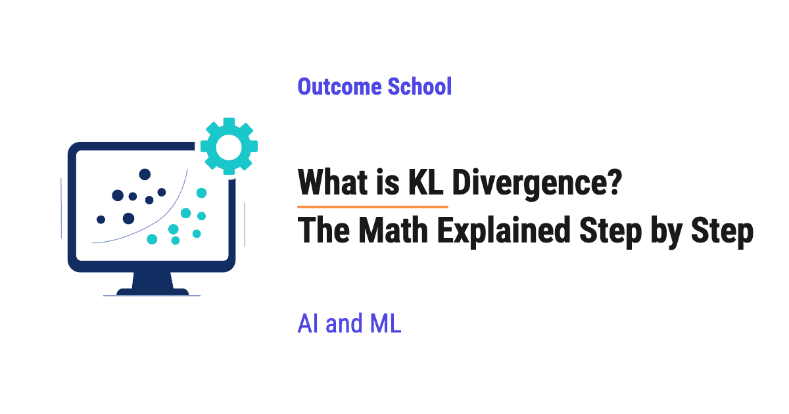

# What is KL Divergence? The Math Explained Step by Step

> Archived from <https://outcomeschool.com/blog/kl-divergence> on 2026-11-25.

KL Divergence is a number that tells us how different one probability distribution is from another. The bigger the number, the more different they are, and it is zero only when both are exactly the same.

In this blog, we will learn about KL Divergence. We will also see what a probability distribution is, how to build the KL Divergence formula piece by piece, how to compute it step by step with real numbers, its important properties, how it is related to cross-entropy, and where it is used in AI.

We will cover the following:
<ul><li>What is a Probability Distribution?</li><li>How different are two distributions?</li><li>Building the KL Divergence formula</li><li>Worked example step by step</li><li>Properties of KL Divergence</li><li>KL Divergence and Cross-Entropy</li><li>Where is KL Divergence used?</li></ul>
I am <strong>Amit Shekhar</strong>, Founder @ <a target="_blank" rel="noopener noreferrer" href="https://outcomeschool.com">Outcome School</a>, I have taught and mentored many developers, and their efforts landed them high-paying tech jobs, helped many tech companies in solving their unique problems, and created many open-source libraries being used by top companies. I am passionate about sharing knowledge through open-source, blogs, and videos.

I teach <a target="_blank" rel="noopener noreferrer" href="https://outcomeschool.com/program/ai-and-machine-learning">AI and Machine Learning</a> at Outcome School.

Let&#x27;s get started.
<h2 id="what-is-a-probability-distribution">What is a Probability Distribution?</h2>
<strong>A probability distribution is a list of all the possible outcomes along with how likely each outcome is. All the chances add up to 1.</strong>

The best way to learn this is by taking an example.

Let&#x27;s say we live in a city where the weather tomorrow can be only one of three things: Sunny, Cloudy, or Rainy. After watching the weather for many years, we know the real chances:
<ul><li>Sunny: 0.6 (60 percent)</li><li>Cloudy: 0.3 (30 percent)</li><li>Rainy: 0.1 (10 percent)</li></ul>
Here, 0.6 + 0.3 + 0.1 = 1. This list is a probability distribution. We will call it <strong>P</strong>. P is the truth.

Now, suppose a weather app makes its own guess for the same city:
<ul><li>Sunny: 0.3</li><li>Cloudy: 0.3</li><li>Rainy: 0.4</li></ul>
Here also, 0.3 + 0.3 + 0.4 = 1. This is another probability distribution. We will call it <strong>Q</strong>. Q is the guess.

An <a target="_blank" rel="noopener noreferrer" href="large-language-model-llm.md">LLM (Large Language Model)</a> works in the same way. For the next token, it gives a chance to every token it knows, and all those chances add up to 1. That is also a probability distribution. We have a detailed blog on the <a target="_blank" rel="noopener noreferrer" href="softmax-function.md">Softmax Function</a> that explains how a model turns its raw scores into these chances.
<h2 id="how-different-are-two-distributions">How different are two distributions?</h2>
Now, the question is: how far is the weather app&#x27;s guess Q from the truth P?

Just by looking, we can say that the app is wrong about Sunny and Rainy, and right about Cloudy. But &quot;wrong&quot; is not a number. We need a single number that tells us how different Q is from P.

Here comes the <strong>KL Divergence</strong> into the picture. KL stands for Kullback-Leibler, the names of the two mathematicians who introduced it. Divergence means &quot;how much two things move apart&quot;.

We write it as <strong>KL(P || Q)</strong> and read it as &quot;the KL Divergence of P from Q&quot;. Here, P is the truth and Q is the guess. In AI also, P is usually the truth from the data, and Q is the model&#x27;s guess. The order matters, and we will see why later in this blog.
<h2 id="building-the-kl-divergence-formula">Building the KL Divergence formula</h2>
Let&#x27;s build the formula piece by piece, one outcome at a time.

<strong>Step 1:</strong> We compare the two chances for one outcome using a ratio.

For Sunny, the truth says 0.6 and the guess says 0.3. So, P(x) / Q(x) = 0.6 / 0.3 = 2. Means, the truth gives Sunny two times more chance than the guess does.
<ul><li>If the ratio is 1, both agree.</li><li>If the ratio is bigger than 1, the guess gives too little chance.</li><li>If the ratio is smaller than 1, the guess gives too much chance.</li></ul>
Why a ratio and not a simple difference? Let&#x27;s say the truth gives an outcome 0.02 and the guess gives it 0.01. The difference is only 0.01, which looks tiny. But the guess is two times off. The ratio 0.02 / 0.01 = 2 captures this, and the difference does not.

<strong>Step 2:</strong> We take the log of the ratio.

Why the log? Because the log turns &quot;agree&quot; into zero. The log of 1 is 0. So, when P and Q agree on an outcome, that outcome adds nothing. When the ratio is bigger than 1, the log is positive. When the ratio is smaller than 1, the log is negative.

The log also treats &quot;two times more&quot; and &quot;two times less&quot; as equal and opposite. The log of 2 is 0.6931, and the log of 0.5 is -0.6931.

In this blog, we use the natural log, which is written as <code>ln</code> in math and as <code>np.log</code> in NumPy. With the natural log, the unit of KL Divergence is called <strong>nats</strong>. If we use log base 2, the unit is called <strong>bits</strong>. The idea stays the same.

<strong>Step 3:</strong> We weight the log ratio by P(x).

Not every outcome is equally important. Sunny happens 60 percent of the time in reality, and Rainy happens only 10 percent of the time. So, a mistake on Sunny matters more than a mistake on Rainy. That is why we multiply the log ratio by P(x), the true chance of that outcome.

<strong>Step 4:</strong> We add up the weighted values for all outcomes.

Putting all four steps together, we get the formula:

<strong>KL(P || Q) = sum over all x of P(x) * log(P(x) / Q(x))</strong>

Here:
<ul><li><code>x</code> is one outcome (Sunny, Cloudy, or Rainy).</li><li><code>P(x)</code> is the true chance of that outcome.</li><li><code>Q(x)</code> is the guessed chance of that outcome.</li><li><code>log</code> is the natural log.</li></ul>
In simple words, KL Divergence is the weighted average of the log ratio between the truth and the guess, where the weights are the true chances P(x).

<strong>Note:</strong> If P(x) is 0 for an outcome, that outcome adds 0, because it is multiplied by 0. But if Q(x) is 0 for an outcome that P says can happen, we divide by 0, and KL Divergence becomes infinite. Means, a guess that says &quot;this can never happen&quot; for something that does happen gets the biggest possible penalty.

<strong>Planning your move into AI?</strong>

No matter which tech domain you work in today, with your effort, you can transition to these roles:
<ul><li>AI Engineer</li><li>Forward Deployed Engineer</li><li>AI Agent Engineer</li><li>Harness Engineer</li><li>Voice AI Engineer</li><li>AI Architect</li><li>LLM Engineer</li><li>LLM Inference Engineer</li><li>Gen AI Engineer</li><li>MLOps Engineer</li><li>ML Engineer</li><li>Deep Learning Engineer</li></ul>
Our <a target="_blank" rel="noopener noreferrer" href="https://outcomeschool.com/program/ai-and-machine-learning">AI and Machine Learning Program</a> at Outcome School takes you there.
<h2 id="worked-example-step-by-step">Worked example step by step</h2>
Now, let&#x27;s compute KL(P || Q) for our weather example.
<table><thead><tr><th>Outcome</th><th>P(x)</th><th>Q(x)</th><th>P(x) / Q(x)</th><th>log(P(x) / Q(x))</th><th>P(x) * log(P(x) / Q(x))</th></tr></thead><tbody><tr><td>Sunny</td><td>0.6</td><td>0.3</td><td>2</td><td>0.6931</td><td>0.4159</td></tr><tr><td>Cloudy</td><td>0.3</td><td>0.3</td><td>1</td><td>0</td><td>0</td></tr><tr><td>Rainy</td><td>0.1</td><td>0.4</td><td>0.25</td><td>-1.3863</td><td>-0.1386</td></tr></tbody></table>
Let&#x27;s go row by row.

<strong>Sunny:</strong> The ratio is 0.6 / 0.3 = 2. The log of 2 is 0.6931. We multiply by P(Sunny) = 0.6 and get 0.4159.

<strong>Cloudy:</strong> The ratio is 0.3 / 0.3 = 1. The log of 1 is 0. So, Cloudy adds 0. Both distributions agree here.

<strong>Rainy:</strong> The ratio is 0.1 / 0.4 = 0.25. The log of 0.25 is -1.3863. We multiply by P(Rainy) = 0.1 and get -0.1386.

Finally, we add up the last column.

<strong>KL(P || Q) = 0.4159 + 0 + (-0.1386) = 0.2773 nats</strong>

Let&#x27;s see the four steps of the formula as a diagram:

<pre><code class="language-text code-highlight">┌──────────────────────────────────┐
│ Sunny: P(x) = 0.6, Q(x) = 0.3    │
└──────────────────────────────────┘
                  ↓
┌──────────────────────────────────┐
│ Step 1: ratio = 0.6 / 0.3 = 2    │
└──────────────────────────────────┘
                  ↓
┌──────────────────────────────────┐
│ Step 2: log(2) = 0.6931          │
└──────────────────────────────────┘
                  ↓
┌──────────────────────────────────┐
│ Step 3: 0.6 * 0.6931 = 0.4159    │
└──────────────────────────────────┘
                  ↓
┌──────────────────────────────────┐
│ Step 4: add all three outcomes   │
│ 0.4159 + 0 + (-0.1386)           │
│ = 0.2773 nats                    │
└──────────────────────────────────┘
</code></pre>

Here, we can see Steps 1 to 3 for Sunny. Cloudy and Rainy go through the same three steps, and Step 4 adds the results of all three outcomes.

One more thing to notice: one term is negative. That is fine. The total is still positive, and we will see in the next section that the total is never negative.

We can write the code for this as below:

<pre><code class="code-highlight language-python">import numpy as np

P = np.array([0.6, 0.3, 0.1])  # real weather
Q = np.array([0.3, 0.3, 0.4])  # weather app

def kl(p, q):
    return np.sum(p * np.log(p / q))

print(round(kl(P, Q), 4))
print(round(kl(Q, P), 4))
print(round(kl(P, P), 4))
</code></pre>

This will print the following:

<pre><code class="language-text code-highlight">0.2773
0.3466
0.0
</code></pre>

Here, we have:
<ul><li><code>p / q</code> divides the chances outcome by outcome.</li><li><code>np.log</code> takes the natural log of each ratio.</li><li><code>p * ...</code> weights each log ratio by the true chance.</li><li><code>np.sum</code> adds everything up.</li></ul>
The first line matches our hand calculation. We will use the other two lines in the next section.
<h2 id="properties-of-kl-divergence">Properties of KL Divergence</h2>
<strong>Property 1: KL Divergence is always greater than or equal to 0.</strong>

Some terms can be negative, like Rainy in our example. But the total never goes below 0.

Let&#x27;s see this with our example. Both P and Q add up to 1. So, when Q gives too much chance to Rainy, it must take that chance away from some other outcome. Here, Q took it away from Sunny. The log ratio for Rainy is -1.3863, but it is weighted by a small P(Rainy) = 0.1, so it becomes only -0.1386. The log ratio for Sunny is 0.6931, and it is weighted by a big P(Sunny) = 0.6, so it becomes 0.4159. The positive term wins.

The total is never negative for any P and Q. This is a proven result in math known as <strong>Gibbs&#x27; inequality</strong>.

<strong>Property 2: KL Divergence is 0 only when the two distributions are exactly the same.</strong>

In the code above, <code>kl(P, P)</code> printed 0.0. When P and Q are the same, every ratio is 1, every log is 0, and the total is 0. If the chances differ for even one outcome, the total becomes greater than 0.

<strong>Property 3: KL Divergence is not symmetric.</strong>

Means, KL(P || Q) is not the same as KL(Q || P). Let&#x27;s compute KL(Q || P). Now, Q takes the place of P in the formula:
<table><thead><tr><th>Outcome</th><th>Q(x)</th><th>P(x)</th><th>Q(x) / P(x)</th><th>log(Q(x) / P(x))</th><th>Q(x) * log(Q(x) / P(x))</th></tr></thead><tbody><tr><td>Sunny</td><td>0.3</td><td>0.6</td><td>0.5</td><td>-0.6931</td><td>-0.2079</td></tr><tr><td>Cloudy</td><td>0.3</td><td>0.3</td><td>1</td><td>0</td><td>0</td></tr><tr><td>Rainy</td><td>0.4</td><td>0.1</td><td>4</td><td>1.3863</td><td>0.5545</td></tr></tbody></table>
<strong>KL(Q || P) = -0.2079 + 0 + 0.5545 = 0.3466 nats</strong>

So, KL(P || Q) = 0.2773 and KL(Q || P) = 0.3466. They are different.

Why? Because the weights change. In KL(Q || P), the weights come from Q. Q gives 0.4 to Rainy, while P gives Rainy only 0.1. So, the big mistake on Rainy gets a bigger weight, and the total becomes bigger.

This is why KL Divergence is called a &quot;divergence&quot; and not a &quot;distance&quot;. A distance from A to B is the same as from B to A. KL Divergence does not follow this rule. So, we must always be careful about the order.

<strong>A quick note for you</strong>

No matter which tech domain you work in, get familiar with these topics:
<ul><li>LLM</li><li>RAG</li><li>MCP</li><li>Agent</li><li>Fine-tuning</li><li>Quantization</li></ul>
We put it all together in one video:

<a target="_blank" rel="noopener noreferrer" href="https://www.youtube.com/watch?v=lnfWvX66FUk">AI Engineering Explained: LLM, RAG, MCP, Agent, Fine-Tuning, and Quantization</a>

No need to stop reading - bookmark it and watch later when you get time. Future you will thank you.

Now, let&#x27;s get back to the topic.
<h2 id="kl-divergence-and-cross-entropy">KL Divergence and Cross-Entropy</h2>
Before jumping into the relation, we must know two terms. And for both, we need the idea of surprise.

The <strong>surprise</strong> of an outcome is -log(chance of that outcome). A rare outcome gives a big surprise. For example, Rainy with chance 0.1 gives -log(0.1) = 2.3026, and Sunny with chance 0.6 gives only -log(0.6) = 0.5108.

<strong><a target="_blank" rel="noopener noreferrer" href="entropy-in-information-theory.md">Entropy</a></strong> of P is the average surprise when outcomes come from P and we also use P to measure the surprise.

<strong>Entropy H(P) = - sum over all x of P(x) * log(P(x))</strong>

<strong>Cross-entropy</strong> of P and Q is the average surprise when outcomes come from P, but we use Q to measure the surprise.

<strong>Cross-entropy H(P, Q) = - sum over all x of P(x) * log(Q(x))</strong>

Now, here is the relation:

<strong>KL(P || Q) = H(P, Q) - H(P)</strong>

This comes directly from the KL formula. The log of a ratio is the difference of two logs: log(P(x) / Q(x)) = log(P(x)) - log(Q(x)). So, the KL formula splits into two parts. The part with log(Q(x)) gives the cross-entropy, and the part with log(P(x)) gives the entropy.

Means, KL Divergence is the extra surprise we get because we used the wrong distribution Q instead of the true distribution P.

Let&#x27;s verify this with our numbers.
<table><thead><tr><th>Outcome</th><th>P(x)</th><th>Q(x)</th><th>-P(x) * log(P(x))</th><th>-P(x) * log(Q(x))</th></tr></thead><tbody><tr><td>Sunny</td><td>0.6</td><td>0.3</td><td>0.3065</td><td>0.7224</td></tr><tr><td>Cloudy</td><td>0.3</td><td>0.3</td><td>0.3612</td><td>0.3612</td></tr><tr><td>Rainy</td><td>0.1</td><td>0.4</td><td>0.2303</td><td>0.0916</td></tr></tbody></table><ul><li>Entropy H(P) = 0.3065 + 0.3612 + 0.2303 = about 0.898</li><li>Cross-entropy H(P, Q) = 0.7224 + 0.3612 + 0.0916 = about 1.175</li><li>H(P, Q) - H(P) = 1.175 - 0.898 = 0.277</li></ul>
This matches KL(P || Q) = 0.2773 that we computed earlier.

This relation is very useful in training. When we train a classifier or an LLM, the true distribution P comes from the data, so H(P) is fixed. It does not change when the model changes. So, making the <a target="_blank" rel="noopener noreferrer" href="math-behind-cross-entropy-loss.md">cross-entropy loss</a> smaller is the same as making the KL Divergence smaller. This is why minimizing cross-entropy loss pushes the model&#x27;s guess Q closer to the truth P.

For example, when the correct answer is one fixed label, P gives 1 to that label and 0 to all others. In that case, H(P) = 0, and the cross-entropy loss is exactly equal to the KL Divergence.

To master Loss Functions, Logits, and Cross-Entropy, check out our <a target="_blank" rel="noopener noreferrer" href="https://outcomeschool.com/program/ai-and-machine-learning">AI and Machine Learning Program</a> at Outcome School.
<h2 id="where-is-kl-divergence-used">Where is KL Divergence used?</h2>
Now, let&#x27;s see where KL Divergence is used in AI.
<h3 id="rlhf-and-ppo-the-kl-penalty">RLHF and PPO: the KL penalty</h3>
In <a target="_blank" rel="noopener noreferrer" href="reinforcement-learning-from-human-feedback-rlhf.md">RLHF (Reinforcement Learning from Human Feedback)</a>, we improve an LLM using a <a target="_blank" rel="noopener noreferrer" href="reward-model.md">reward model</a>. The reward model gives a score to each answer. The LLM learns to get higher scores.

But, the LLM can find tricks to get a high score while writing strange or broken text. This is called <a target="_blank" rel="noopener noreferrer" href="reward-hacking.md">reward hacking</a>. To stop this, we keep a frozen copy of the model from before this training started, called the <strong>reference model</strong>. Then, for each answer, we compare the chances that the new model gives to the next tokens with the chances that the reference model gives to the same tokens. KL Divergence tells us how far the new model has moved away from the reference model.

<strong>Final reward = reward model score - beta * KL(new model || reference model)</strong>

Here, <code>beta</code> is a small number, like 0.1, that controls how strong the penalty is. The new model comes first in the KL Divergence because the answers are written by the new model, so its chances act as the weights.

If the new model moves too far from the reference model, the KL Divergence becomes big, and the final reward goes down. So, the model learns to get better scores while staying close to the reference model.

<a target="_blank" rel="noopener noreferrer" href="proximal-policy-optimization-ppo.md">PPO (Proximal Policy Optimization)</a> is the algorithm that is commonly used for this training.

Let&#x27;s see this as a diagram with <code>beta</code> = 0.1:

<pre><code class="language-text code-highlight">┌──────────────────────────────────┐
│ New model writes an answer       │
└──────────────────────────────────┘
                  ↓
┌──────────────────────────────────┐
│ Reward model gives score = 8.0   │
└──────────────────────────────────┘
                  ↓
┌──────────────────────────────────┐
│ Compare token chances:           │
│ new model vs reference model     │
│ KL = 2.0                         │
└──────────────────────────────────┘
                  ↓
┌──────────────────────────────────┐
│ Final reward = 8.0 - 0.1 * 2.0   │
│ = 7.8                            │
└──────────────────────────────────┘
                  ↓
┌──────────────────────────────────┐
│ PPO updates the new model        │
│ using the final reward 7.8       │
└──────────────────────────────────┘
</code></pre>

Here, we can see that the reward model gave a score of 8.0, but the new model had moved away from the reference model by a KL Divergence of 2.0. So, the final reward dropped from 8.0 to 7.8.

<strong>Stay updated:</strong> Subscribe to our <a target="_blank" rel="noopener noreferrer" href="https://outcomeschool.substack.com/subscribe">newsletter</a> to get our latest AI and Machine Learning blogs straight to your inbox.
<h3 id="knowledge-distillation">Knowledge Distillation</h3>
In <a target="_blank" rel="noopener noreferrer" href="how-does-knowledge-distillation-work.md">knowledge distillation</a>, a big model (the teacher) teaches a small model (the student). For each input, the teacher gives a probability distribution over the answers. For example, for a photo of a cat, the teacher can say: cat 0.7, tiger 0.2, dog 0.1. This tells the student much more than just &quot;cat&quot;. It also tells the student that a cat looks a bit like a tiger. The student is trained to make its distribution close to the teacher&#x27;s distribution. The loss we use is KL(teacher || student). The smaller this number, the more the student behaves like the teacher.
<h3 id="vaes-variational-autoencoders">VAEs (Variational Autoencoders)</h3>
A <a target="_blank" rel="noopener noreferrer" href="variational-autoencoders.md">VAE</a> is a model that learns to compress data, like images, into a small set of numbers and then rebuild the data from them. During training, the VAE adds a KL Divergence term to its loss. This term keeps the distribution of the compressed numbers close to a simple bell-shaped distribution called the standard normal distribution. Because of this, we can later pick random numbers from that simple distribution and generate new images.

Now we must have understood what KL Divergence is, how its formula is built step by step, how to compute it, and where it is used in AI.
<h2 id="frequently-asked-questions">Frequently Asked Questions</h2><h3 id="what-is-the-unit-of-kl-divergence">What is the unit of KL Divergence?</h3>
It depends on the log we use. With the natural log, the unit of KL Divergence is called nats. With log base 2, the unit is called bits. The idea stays the same in both cases, only the scale of the number changes.
<h3 id="can-kl-divergence-be-infinite">Can KL Divergence be infinite?</h3>
Yes. If the guess Q gives a chance of 0 to an outcome that the truth P says can happen, the formula divides by 0, and KL Divergence becomes infinite. Means, a guess that says &quot;this can never happen&quot; for something that does happen gets the biggest possible penalty.
<h3 id="why-is-kl-divergence-not-a-distance">Why is KL Divergence not a distance?</h3>
KL Divergence is not a distance because it is not symmetric. A distance from A to B is the same as from B to A, but KL(P || Q) is usually not equal to KL(Q || P). In our weather example, one is 0.2773 nats and the other is 0.3466 nats, so we must always be careful about the order.
<h3 id="is-minimizing-cross-entropy-loss-the-same-as-minimizing-kl-divergence">Is minimizing cross-entropy loss the same as minimizing KL Divergence?</h3>
Yes, when the true distribution P comes from the data. KL Divergence equals cross-entropy minus the entropy of P, and the entropy of P does not change when the model changes. So, making the cross-entropy loss smaller is the same as making the KL Divergence smaller, which pushes the model&#x27;s guess Q closer to the truth P.

That&#x27;s it for now.

Thanks

<strong>Amit Shekhar</strong> Founder @ <a target="_blank" rel="noopener noreferrer" href="https://outcomeschool.com">Outcome School</a>

You can connect with me on:
<ul><li><a target="_blank" rel="noopener noreferrer" href="https://x.com/amitiitbhu">X</a></li><li><a target="_blank" rel="noopener noreferrer" href="https://www.linkedin.com/in/amit-shekhar-iitbhu">LinkedIn</a></li><li><a target="_blank" rel="noopener noreferrer" href="https://github.com/amitshekhariitbhu">GitHub</a></li></ul>
Follow Outcome School on:
<ul><li><a target="_blank" rel="noopener noreferrer" href="https://x.com/outcome_school">X</a></li><li><a target="_blank" rel="noopener noreferrer" href="https://youtube.com/@OutcomeSchool">YouTube</a></li><li><a target="_blank" rel="noopener noreferrer" href="https://www.linkedin.com/company/outcomeschool">LinkedIn</a></li><li><a target="_blank" rel="noopener noreferrer" href="http://github.com/OutcomeSchool">GitHub</a></li></ul>
<a target="_blank" rel="noopener noreferrer" href="https://outcomeschool.com/blog"><strong>Read all of our high-quality blogs here.</strong></a>

