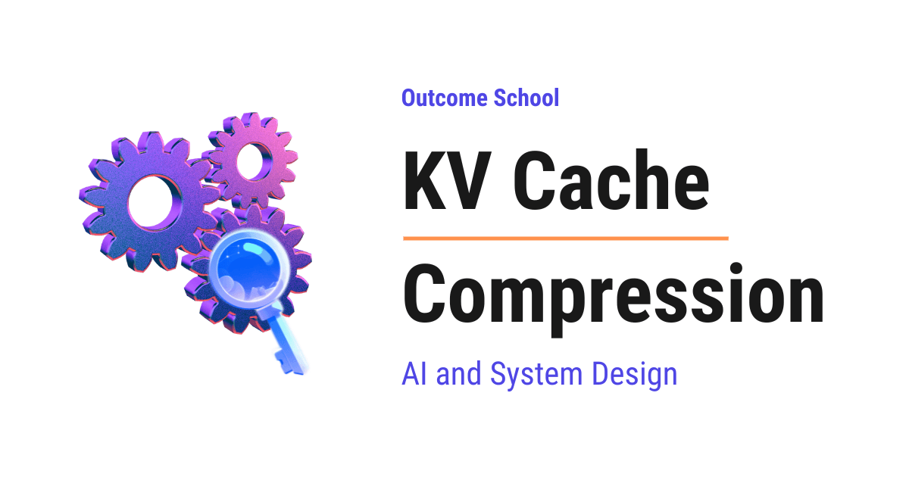

# What is KV Cache Compression?

> Archived from <https://outcomeschool.com/blog/kv-cache-compression> on 2026-11-25.

KV Cache Compression is a set of techniques that shrink the memory an AI model uses to remember the conversation while it is writing its reply, so that the model can handle longer text with less memory.

In this blog, we will learn about KV Cache Compression, the set of techniques that shrink the memory an AI model uses to remember the conversation while it is writing its reply. We will also see how an LLM writes one token at a time, what the KV Cache is and why we need it, why this cache becomes so huge, how quantization stores the same memory in fewer bits, how we can throw away the tokens that do not matter, how sharing across attention heads reduces the cache, how the cache can be squeezed into a small hidden vector, and when to use which one.

We will cover the following:
<ul><li>What is an LLM and how it writes text?</li><li>What is Attention?</li><li>What is the KV Cache?</li><li>Why the KV Cache becomes huge</li><li>What is KV Cache Compression?</li><li>Approach 1: Quantization</li><li>Approach 2: Token Eviction</li><li>Approach 3: Sharing Keys and Values across Heads</li><li>Approach 4: Low-Rank Compression</li><li>Comparison of the approaches</li><li>When to use which one</li></ul>
I am <strong>Amit Shekhar</strong>, Founder @ <a target="_blank" rel="noopener noreferrer" href="https://outcomeschool.com">Outcome School</a>, I have taught and mentored many developers, and their efforts landed them high-paying tech jobs, helped many tech companies in solving their unique problems, and created many open-source libraries being used by top companies. I am passionate about sharing knowledge through open-source, blogs, and videos.

I teach <a target="_blank" rel="noopener noreferrer" href="https://outcomeschool.com/program/ai-and-machine-learning">AI and Machine Learning</a> at Outcome School.

Let&#x27;s get started.
<h2 id="what-is-an-llm-and-how-it-writes-text">What is an LLM and how it writes text?</h2>
<strong>An LLM (Large Language Model) is an AI model that reads text and writes text.</strong> ChatGPT, Claude, Gemini, all of them are based on LLMs.

An LLM learns by reading a huge amount of text from the internet. This learning process is called <strong>training</strong>. Once the training is done, we can ask the model questions, and it writes the answers.

The most important thing to know about an LLM is that it does not write the full reply in one shot. It writes one small piece at a time. This small piece is called a <strong>token</strong>. For the sake of understanding, we can think of a token as a word.

Let&#x27;s say we ask the model, &quot;What is the capital of France?&quot;

The model writes &quot;The&quot;. Then it looks at everything so far and writes &quot;capital&quot;. Then it looks at everything so far again and writes &quot;of&quot;. Then &quot;France&quot;. Then &quot;is&quot;. Then &quot;Paris&quot;.

So, to write every new token, the model has to look back at all the previous tokens. This looking back is done by something called <strong><a target="_blank" rel="noopener noreferrer" href="self-attention-in-transformers.md">Attention</a></strong>.

Now, let&#x27;s understand Attention.
<h2 id="what-is-attention">What is Attention?</h2>
<strong>Attention is the way a model decides which previous tokens are important for writing the next token.</strong>

In simple words, Attention is looking back and picking what matters.

Let&#x27;s say the model is writing the sentence, &quot;The dog was tired, so it went to sleep.&quot; When the model reaches the word &quot;it&quot;, it needs to know that &quot;it&quot; refers to &quot;the dog&quot;. So, the model pays more attention to &quot;dog&quot; and less attention to the other words.

Now, the question is, how does the model do this?

Every token is converted into three things:
<ul><li><strong>Query (Q)</strong>: What the current token is looking for.</li><li><strong>Key (K)</strong>: What each previous token offers, like a label.</li><li><strong>Value (V)</strong>: The actual information that each previous token carries.</li></ul>
Each of these is just a list of numbers. In AI, a list of numbers is called a <strong>vector</strong>. So, every token has a Query vector, a Key vector, and a Value vector.

Let&#x27;s take an analogy. Suppose we are in a library. We have a question in our mind. This is the <strong>Query</strong>. Every book has a title on its spine. This is the <strong>Key</strong>. The content inside the book is the <strong>Value</strong>.

We compare our question with the title of every book. The books whose titles match our question well get more attention. Then we read the content of those books and combine what we learned.

This is exactly what Attention does. The Query of the new token is compared with the Key of every previous token. Based on how well they match, the Values are combined and passed forward to help write the next token.

We have a detailed blog on <a target="_blank" rel="noopener noreferrer" href="math-behind-attention-qkv.md">Math behind Attention - Q, K, and V</a> that explains this step by step.

One more thing to notice: A model does this Attention not just once. It has many <strong>layers</strong> stacked one after another, and every layer has many <strong><a target="_blank" rel="noopener noreferrer" href="multi-head-attention-in-transformers.md">attention heads</a></strong>. Each head is like a separate reader looking for a different thing. One head looks for grammar, one looks for names, one looks for what &quot;it&quot; refers to, and etc.

Now that we have learned about Attention, it&#x27;s time to learn about the KV Cache.

To master Q, K, V Matrices, Self-Attention and Multi-Head Attention, and build a Large Language Model (LLM) from scratch, check out our <a target="_blank" rel="noopener noreferrer" href="https://outcomeschool.com/program/ai-and-machine-learning">AI and Machine Learning Program</a> at Outcome School.
<h2 id="what-is-the-kv-cache">What is the KV Cache?</h2>
Now, let&#x27;s see the problem. For every new token, the model needs the Key and the Value of every previous token.

Let&#x27;s say the model has already written 100 tokens and is now writing the 101st token. It needs the Keys and Values of all 100 previous tokens. Without any memory, the model would calculate the Keys and Values of all the 100 tokens again. Then for the 102nd token, it would calculate for all 101 tokens again. And so on.

This is a huge waste. The Key and Value of a token never change once they are computed. So, why calculate them again and again?

So, here comes the <strong><a target="_blank" rel="noopener noreferrer" href="kv-cache-in-llms.md">KV Cache</a></strong> to the rescue.

<strong>KV Cache = Key + Value + Cache</strong>

A cache is just a memory where we store something so that we do not have to compute it again.

<strong>The KV Cache is the memory where the model stores the Keys and Values of every previous token so that it can reuse them while writing the next token.</strong>

Now, when the model writes the 101st token, it only calculates the Key and Value of the newest token, adds them to the cache, and reads everything else from the cache.

This makes text generation very fast. Problem Solved!

But, here is the catch. This cache grows with every single token. And it grows very fast.
<h2 id="why-the-kv-cache-becomes-huge">Why the KV Cache becomes huge</h2>
The best way to learn this is by taking an example.

Before jumping into the example, we must know two small things. A <strong>bit</strong> is the smallest unit of memory in a computer, it is either 0 or 1. And 8 bits make 1 <strong>byte</strong>.

Let&#x27;s take a model with the following. These numbers are close to the real numbers of Llama 2, a popular open-source model:
<ul><li>32 layers</li><li>32 attention heads in each layer</li><li>Each head has a Key vector of 128 numbers and a Value vector of 128 numbers</li><li>Each number is stored in 16 bits, which means 2 bytes</li></ul>
Now, let&#x27;s calculate how much memory one token needs in the cache.

For one head in one layer, we store 128 numbers for the Key and 128 numbers for the Value. That is 256 numbers.

For 32 heads, that is 256 x 32 = 8,192 numbers.

For 32 layers, that is 8,192 x 32 = 262,144 numbers.

Each number takes 2 bytes. So, one token needs 262,144 x 2 = 524,288 bytes. That is 0.5 MB. Here, 1 MB is about a million bytes, and 1 GB is about a thousand MB.

Let&#x27;s see the code for this calculation as below:

<pre><code class="language-python code-highlight">layers = 32
heads = 32
head_dim = 128
bytes_per_number = 2

# Key and Value, so multiply by 2
per_token = 2 * layers * heads * head_dim * bytes_per_number
print(per_token / (1024 * 1024))  # 0.5 MB
</code></pre>

Here, we are multiplying the number of layers, the number of heads, the size of each head, and the bytes per number. We multiply by 2 in the beginning because we store both the Key and the Value.

<strong>Planning your move into AI?</strong>

No matter which tech domain you work in today, with your effort, you can transition to these roles:
<ul><li>AI Engineer</li><li>Forward Deployed Engineer</li><li>AI Agent Engineer</li><li>Harness Engineer</li><li>Voice AI Engineer</li><li>AI Architect</li><li>LLM Engineer</li><li>LLM Inference Engineer</li><li>Gen AI Engineer</li><li>MLOps Engineer</li><li>ML Engineer</li><li>Deep Learning Engineer</li></ul>
Our <a target="_blank" rel="noopener noreferrer" href="https://outcomeschool.com/program/ai-and-machine-learning">AI and Machine Learning Program</a> at Outcome School takes you there.

Half an MB for one token does not sound like much. But now, let&#x27;s see the full picture.

Suppose the user has a conversation of 4,000 tokens. That is 4,000 x 0.5 MB = 2 GB.

Suppose the user pastes a long document of 100,000 tokens. That is 100,000 x 0.5 MB = 50 GB. Just for the cache of one user.

The model runs on a <strong><a target="_blank" rel="noopener noreferrer" href="how-does-a-gpu-work-for-deep-learning.md">GPU</a></strong>, a special chip that is very fast at doing math. A GPU has a fixed amount of memory, usually between 24 GB and 80 GB. And a big part of that memory is <a target="_blank" rel="noopener noreferrer" href="llm-gpu-memory.md">already taken by the model itself</a>.

Now, suppose 100 users are talking to the model at the same time on the same GPU. Each one needs their own cache. The memory required is way beyond what any GPU has.

This is the problem. <strong>The KV Cache grows with the length of the text and with the number of users, and it eats the memory of the GPU.</strong>

And, it is not just about memory. For every new token, the model has to read the full cache from memory. A bigger cache means more time to read, which means slower generation.

We needed a solution for that, and KV Cache Compression was introduced to solve this problem.

One part of the fix is to stop wasting the memory we already have, and we have a detailed blog on <a target="_blank" rel="noopener noreferrer" href="paged-attention-in-llms.md">Paged Attention</a> that explains how a serving system does that. The other part is to make the cache itself smaller, which is what we will learn now.
<h2 id="what-is-kv-cache-compression">What is KV Cache Compression?</h2>
<strong>KV Cache Compression is the set of techniques that make the KV Cache smaller while keeping the quality of the model output almost the same.</strong>

In simple words, we want to store the same memory of the conversation in less space.

<strong>A quick note for you</strong>

No matter which tech domain you work in, get familiar with these topics:
<ul><li>LLM</li><li>RAG</li><li>MCP</li><li>Agent</li><li>Fine-tuning</li><li>Quantization</li></ul>
We put it all together in one video:

<a target="_blank" rel="noopener noreferrer" href="https://www.youtube.com/watch?v=lnfWvX66FUk">AI Engineering Explained: LLM, RAG, MCP, Agent, Fine-Tuning, and Quantization</a>

No need to stop reading - bookmark it and watch later when you get time. Future you will thank you.

Now, let&#x27;s get back to the topic.

There are different ways to do this. Some of them can be applied to an existing model, and some need to be built into the model before training. Let&#x27;s understand each of them one by one, starting from the simplest.
<h2 id="approach-1-quantization">Approach 1: Quantization</h2>
<strong>Quantization means storing each number in the cache using fewer bits.</strong>

Let&#x27;s take an example. Suppose we want to write down the height of a person. We can write 175.4837 cm. Or we can write 175 cm. The second one takes less space to write, and for most purposes, it is good enough.

This is what <a target="_blank" rel="noopener noreferrer" href="how-does-model-quantization-work.md">quantization</a> does. Normally, each number in the KV Cache is stored in 16 bits. With quantization, we store it in 8 bits, or even 4 bits.

Let&#x27;s see with an example. Suppose the Key vector has these numbers:

<pre><code class="code-highlight">[0.31, -0.72, 0.05, 0.98]
</code></pre>

To store them in fewer bits, we first find the biggest value, which is 0.98. Then we scale every number to fit in a small range of whole numbers, from -127 to 127, which fits in 8 bits, as below:

<pre><code class="language-python code-highlight">values = [0.31, -0.72, 0.05, 0.98]
scale = max(abs(v) for v in values) / 127

quantized = [round(v / scale) for v in values]
print(quantized)  # [40, -93, 6, 127]
</code></pre>

Here, we are dividing every number by the scale and rounding it to the nearest whole number. Now, every number is a small whole number that fits in 8 bits instead of 16 bits. We just store the scale separately, so that we can get back close to the original values when needed.
<ul><li>16 bits to 8 bits: the cache becomes half the size.</li><li>16 bits to 4 bits: the cache becomes one-fourth the size.</li></ul>
<strong>Advantage:</strong> Very simple to add. We do not throw away any token. The quality loss is very less.

<strong>Disadvantage:</strong> Below 4 bits, the rounding error becomes big, and the model starts giving worse answers. So, there is a limit to how far we can go.

One more thing to notice: Keys and Values do not behave the same way. In Keys, a few positions always carry very big numbers, and normal rounding does not handle them well. So, good techniques like <strong>KIVI</strong> quantize Keys and Values in slightly different ways to keep the error small. Do not worry about the details, just remember that Keys and Values are treated differently for the best result.

The issue with this approach is that even with 4 bits, the cache still grows with every token. For very long conversations, it is still too big. Let&#x27;s see how the next approach solve this issue.

If we want to go deep into Quantization and Optimizations, Model Compression, and KV Cache, we have a complete program on it - check out our <a target="_blank" rel="noopener noreferrer" href="https://outcomeschool.com/program/ai-and-machine-learning">AI and Machine Learning Program</a> at Outcome School.
<h2 id="approach-2-token-eviction">Approach 2: Token Eviction</h2>
<strong>Token Eviction means throwing away the Keys and Values of the tokens that are not important.</strong>

Eviction simply means kicking something out. Here, we kick unimportant tokens out of the cache.

Let&#x27;s take an analogy. Suppose we are reading a 500-page novel. We do not remember every single sentence. We remember the important characters, the important events, and the last few pages we just read. Everything else, we forget. And still, we understand the story perfectly.

The same idea applies here. Not every previous token is equally important for writing the next token. When the model computes Attention, most of the attention goes to a few tokens. The rest of the tokens get almost zero attention.

So, why keep them in the cache?

Now, the question is, how do we know which tokens are important?

The answer is in the Attention itself. Every time the model writes a new token, it computes how much attention every previous token receives. We can keep a running total of this for every token. The tokens with the highest total are the important ones. These are called <strong>heavy hitters</strong>. This is what the <strong>H2O (Heavy Hitter Oracle)</strong> technique does.

So, the rule is simple:
<ul><li>Fix a budget, let&#x27;s say 1,000 tokens.</li><li>Always keep the most recent tokens, because the recent context is almost always important.</li><li>From the older tokens, keep only the heavy hitters.</li><li>Throw away the rest.</li></ul>
Now, the cache never grows beyond 1,000 tokens, no matter how long the conversation is.

But, here is the catch. There is one very interesting thing that was found. <strong>The very first few tokens of the text always receive a huge amount of attention, no matter what they are.</strong> Even if the first token is just a &quot;start&quot; marker with no meaning.

Why? Because Attention is like distributing 100 percent among all the previous tokens. The total must always be 100 percent. When no previous token is really useful, the model still has to put that attention somewhere. It learns to dump it on the first token. So, the first token acts like a sink where the unwanted attention goes.

Here comes the <strong><a target="_blank" rel="noopener noreferrer" href="how-do-attention-sinks-work.md">Attention Sink</a></strong> into the picture.

If we throw away the first token, the model output becomes meaningless. This was found by the <strong>StreamingLLM</strong> technique. So, the final rule is: always keep the first few tokens, always keep the recent tokens, and choose the heavy hitters from the middle.

<strong>Advantage:</strong> The cache has a fixed size. It does not matter how long the conversation is. This is the only approach that truly solves the unlimited growth problem.

<strong>Disadvantage:</strong> Once a token is thrown away, it is gone forever. If the user later asks about something that was in an evicted token, the model cannot remember it. This is a real loss of information. So, it works well for tasks like chatting and summarizing, but it fails for tasks that need exact recall, like &quot;find the phone number mentioned on page 40&quot;.

The issue with this approach is the risk of forgetting something important. Let&#x27;s see how the next approach solve this issue without throwing away anything.
<h2 id="approach-3-sharing-keys-and-values-across-heads">Approach 3: Sharing Keys and Values across Heads</h2>
Till now, we have compressed the cache after the model is trained. This approach is different. Here, we <a target="_blank" rel="noopener noreferrer" href="evolution-of-llm-architecture.md">change the design of the model itself</a> before training.

Remember that every layer has many attention heads, and every head has its own Key and Value. In our example, 32 heads means 32 sets of Keys and Values per layer.

Now, the question is, do all 32 heads really need their own separate Keys and Values?

The answer is no. It was found that many heads can share the same Keys and Values and still work well. Only the Query needs to be separate for each head.

Let&#x27;s take an analogy. Suppose 32 students are in a library. Each student has a different question in mind. This is the Query. But, the library does not need 32 separate copies of every book. All 32 students can look at the same shelf, the same book titles, and the same book contents. Only their questions are different.

There are two ways to do this:
<ul><li><strong>Multi-Query Attention (MQA)</strong>: All the heads share one single Key and one single Value. In our example, 32 heads share 1 set. The cache becomes 32 times smaller.</li><li><strong><a target="_blank" rel="noopener noreferrer" href="grouped-query-attention.md">Grouped-Query Attention (GQA)</a></strong>: Heads are divided into groups, and each group shares one Key and one Value. In our example, 32 heads divided into 8 groups means 8 sets instead of 32. The cache becomes 4 times smaller.</li></ul>
MQA compresses more but loses some quality. GQA is the middle ground. It gets most of the memory saving with almost no loss in quality. This is why most modern models like Llama 3, Mistral, and Gemma use GQA.

<strong>Advantage:</strong> No token is thrown away. No rounding error. The saving is built into the model, so it works all the time with no extra work while the model is running.

<strong>Disadvantage:</strong> This must be decided before training the model. We cannot apply it to an already trained model without retraining it. And, the cache still grows with every token, just at a slower rate.

The issue with this approach is that the saving is limited by the number of groups. Let&#x27;s see how the next approach compress even further.

To learn Grouped Query Attention, KV Cache, and LLM Inference Engineering in depth, check out our <a target="_blank" rel="noopener noreferrer" href="https://outcomeschool.com/program/ai-and-machine-learning">AI and Machine Learning Program</a> at Outcome School.
<h2 id="approach-4-low-rank-compression">Approach 4: Low-Rank Compression</h2>
<strong>Low-Rank Compression means storing a small compressed version of the Key and Value, and expanding it back only when needed.</strong>

A low rank means the same information can be held in fewer numbers.

Let&#x27;s take an analogy. Suppose we want to send a big photo to a friend. Instead of sending the full photo, we send a zipped file. The friend unzips it when they want to see it. The zipped file takes less space, and the photo is almost the same.

Here, instead of storing the full Key and Value of every token, the model stores one small vector called a <strong>latent vector</strong>. Latent simply means hidden. It is a hidden, compressed form of the Keys and Values. When the model needs the Key and Value, it expands the latent vector back using a small set of numbers it learned during training.

Let&#x27;s see the numbers. In our example, each head stores 128 numbers for the Key and 128 numbers for the Value. For 32 heads, that is 8,192 numbers per layer per token. With Low-Rank Compression, the model stores a single latent vector of, let&#x27;s say, 512 numbers per layer per token. That is 16 times smaller.

This is what the <strong>Multi-Head Latent Attention (MLA)</strong> technique does. It was introduced by DeepSeek in their DeepSeek-V2 model, and it is also used in DeepSeek-V3.

Now, you must be thinking, if we compress and then expand, do we not lose quality?

This is the beauty of this approach. The model is trained with this compression from the beginning. So, the model learns to put only the useful information inside the latent vector. Nothing important is lost.

<strong>Advantage:</strong> Huge memory saving. No token is thrown away. The quality is as good as the full Attention, and in some cases even better.

<strong>Disadvantage:</strong> Like GQA, this must be built into the model before training. We cannot apply it to an existing model. And, the model has to do a little extra computation to expand the latent vector.

DeepSeek-V4 pushes this idea even further by merging several consecutive tokens into one compressed cache entry. We have a detailed blog on <a target="_blank" rel="noopener noreferrer" href="decoding-deepseek-v4.md">Decoding DeepSeek-V4</a> that covers this end to end.

Now, we have understood all the four approaches.
<h2 id="comparison-of-the-approaches">Comparison of the approaches</h2>
One more thing to notice: These approaches are not competing with each other. They can be combined. A model can use MLA in its design, then we can apply quantization to the latent vectors, and then apply token eviction on top of that.

Let me tabulate the differences between these approaches for your better understanding.
<table><thead><tr><th></th><th>Quantization</th><th>Token Eviction</th><th>Sharing across Heads</th><th>Low-Rank Compression</th></tr></thead><tbody><tr><td>How it saves memory</td><td>Fewer bits per number</td><td>Fewer tokens stored</td><td>Fewer Keys and Values per layer</td><td>Smaller vector per token</td></tr><tr><td>Needs retraining</td><td>No</td><td>No</td><td>Yes</td><td>Yes</td></tr><tr><td>Throws away tokens</td><td>No</td><td>Yes</td><td>No</td><td>No</td></tr><tr><td>Typical saving</td><td>2x to 4x</td><td>Fixed cache size</td><td>4x to 8x</td><td>10x or more</td></tr><tr><td>Quality loss</td><td>Very less</td><td>Depends on the task</td><td>Very less</td><td>Almost none</td></tr><tr><td>Example</td><td>KIVI</td><td>H2O, StreamingLLM</td><td>GQA, MQA</td><td>MLA (DeepSeek)</td></tr></tbody></table>
<strong>Stay updated:</strong> Subscribe to our <a target="_blank" rel="noopener noreferrer" href="https://outcomeschool.substack.com/subscribe">newsletter</a> to get our latest AI and Machine Learning blogs straight to your inbox.
<h2 id="when-to-use-which-one">When to use which one</h2>
So, based on our use case:
<ul><li>If we are running an existing model and want a quick memory saving, use <strong>Quantization</strong>. It is the easiest thing to add.</li><li>If we have a very long conversation, or text that keeps coming in without an end, use <strong>Token Eviction</strong> with Attention Sinks.</li><li>If we need exact recall of everything in a long document, do not use Token Eviction. Use Quantization, or a model that has GQA or MLA built in.</li><li>If we are training a new model, use <strong>GQA</strong> or <strong>MLA</strong> in the design from day one.</li><li>If we want the maximum saving, combine them. Start with a model that has MLA or GQA, then quantize the cache, and then evict if the task allows.</li></ul>
This is how KV Cache Compression lets an LLM remember a very long conversation, serve many users at the same time, and write faster, and that too without needing a bigger GPU.

Now, we must have understood KV Cache Compression.
<h2 id="frequently-asked-questions">Frequently Asked Questions</h2><h3 id="does-a-smaller-kv-cache-also-make-text-generation-faster">Does a smaller KV Cache also make text generation faster?</h3>
Yes. For every new token, the model has to read the full cache from memory. A bigger cache means more time to read, which means slower generation. So, a smaller cache helps the model write faster, not just use less GPU memory.
<h3 id="is-paged-attention-a-kv-cache-compression-technique">Is Paged Attention a KV Cache Compression technique?</h3>
No. Paged Attention and KV Cache Compression solve two different parts of the memory problem. Paged Attention stops wasting the memory we already have in a serving system. KV Cache Compression makes the cache itself smaller.
<h3 id="can-we-use-more-than-one-kv-cache-compression-approach-together">Can we use more than one KV Cache Compression approach together?</h3>
Yes. These approaches are not competing with each other, and they can be combined. A model can use MLA in its design, then we can apply quantization to the latent vectors, and then apply token eviction on top of that for the maximum saving.
<h3 id="why-should-we-never-evict-the-first-tokens-from-the-cache">Why should we never evict the first tokens from the cache?</h3>
The very first few tokens always receive a huge amount of attention, no matter what they are. The model learns to dump its unwanted attention there, so they act like an attention sink. If we throw away the first token, the model output becomes meaningless.
<h3 id="can-we-add-grouped-query-attention-to-an-already-trained-model">Can we add Grouped-Query Attention to an already trained model?</h3>
No. Sharing Keys and Values across heads, like in GQA or MQA, must be decided before training the model. We cannot apply it to an already trained model without retraining it. The same is true for Low-Rank Compression like MLA.

That&#x27;s it for now.

Thanks

<strong>Amit Shekhar</strong> Founder @ <a target="_blank" rel="noopener noreferrer" href="https://outcomeschool.com">Outcome School</a>

You can connect with me on:
<ul><li><a target="_blank" rel="noopener noreferrer" href="https://x.com/amitiitbhu">X</a></li><li><a target="_blank" rel="noopener noreferrer" href="https://www.linkedin.com/in/amit-shekhar-iitbhu">LinkedIn</a></li><li><a target="_blank" rel="noopener noreferrer" href="https://github.com/amitshekhariitbhu">GitHub</a></li></ul>
Follow Outcome School on:
<ul><li><a target="_blank" rel="noopener noreferrer" href="https://x.com/outcome_school">X</a></li><li><a target="_blank" rel="noopener noreferrer" href="https://youtube.com/@OutcomeSchool">YouTube</a></li><li><a target="_blank" rel="noopener noreferrer" href="https://www.linkedin.com/company/outcomeschool">LinkedIn</a></li><li><a target="_blank" rel="noopener noreferrer" href="http://github.com/OutcomeSchool">GitHub</a></li></ul>
<a target="_blank" rel="noopener noreferrer" href="https://outcomeschool.com/blog"><strong>Read all of our high-quality blogs here.</strong></a>

