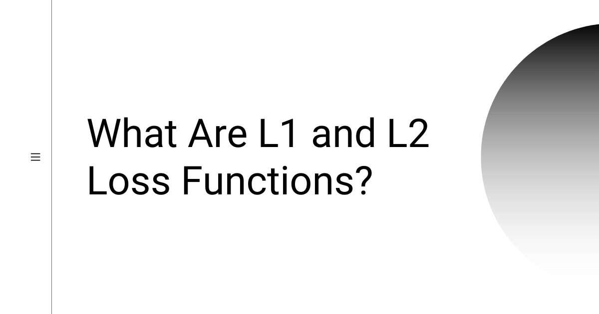

# What Are L1 and L2 Loss Functions?

> Archived from <https://outcomeschool.com/blog/l1-and-l2-loss-functions> on 2026-11-25.

L1 and L2 are two loss functions in machine learning used to minimize the error. L1 Loss is the Least Absolute Deviations, and L2 Loss is the Least Square Errors. L2 is preferred in most cases, but L1 works better when there are outliers.

In this blog, we will learn about the L1 and L2 Loss functions.

I am <strong>Amit Shekhar</strong>, Founder @ <a target="_blank" rel="noopener noreferrer" href="https://outcomeschool.com">Outcome School</a>, I have taught and mentored many developers, and their efforts landed them high-paying tech jobs, helped many tech companies in solving their unique problems, and created many open-source libraries being used by top companies. I am passionate about sharing knowledge through open-source, blogs, and videos.

I teach <a target="_blank" rel="noopener noreferrer" href="https://outcomeschool.com/program/ai-and-machine-learning">AI and Machine Learning</a> at Outcome School.

Let&#x27;s get started.

<strong>L1 vs L2 Loss Function</strong>

L1and L2 are two loss functions in <a target="_blank" rel="noopener noreferrer" href="machine-learning.md">machine learning</a> which are used to minimize the error.

<strong>L1 Loss function</strong> stands for <strong>Least Absolute Deviations</strong>. Also known as <strong>LAD</strong>.

<strong>L2 Loss function</strong> stands for <strong>Least Square Errors</strong>. Also known as <strong>LS</strong>.

<strong>Planning your move into AI?</strong>

No matter which tech domain you work in today, with your effort, you can transition to these roles:
<ul><li>AI Engineer</li><li>Forward Deployed Engineer</li><li>AI Agent Engineer</li><li>Harness Engineer</li><li>Voice AI Engineer</li><li>AI Architect</li><li>LLM Engineer</li><li>LLM Inference Engineer</li><li>Gen AI Engineer</li><li>MLOps Engineer</li><li>ML Engineer</li><li>Deep Learning Engineer</li></ul>
Our <a target="_blank" rel="noopener noreferrer" href="https://outcomeschool.com/program/ai-and-machine-learning">AI and Machine Learning Program</a> at Outcome School takes you there.
<h2 id="l1-loss-function">L1 Loss Function</h2>
L1 Loss Function is used to minimize the error which is the sum of the all the <strong>absolute</strong> differences between the true value and the predicted value.
<h2 id="l2-loss-function">L2 Loss Function</h2>
L2 Loss Function is used to minimize the error which is the sum of the all the <strong>squared</strong> differences between the true value and the predicted value.

<strong>A quick note for you</strong>

No matter which tech domain you work in, get familiar with these topics:
<ul><li>LLM</li><li>RAG</li><li>MCP</li><li>Agent</li><li>Fine-tuning</li><li>Quantization</li></ul>
We put it all together in one video:

<a target="_blank" rel="noopener noreferrer" href="https://www.youtube.com/watch?v=lnfWvX66FUk">AI Engineering Explained: LLM, RAG, MCP, Agent, Fine-Tuning, and Quantization</a>

No need to stop reading - bookmark it and watch later when you get time. Future you will thank you.

Now, let&#x27;s get back to the topic.
<h2 id="how-to-decide-between-l1-and-l2-loss-function">How to decide between L1 and L2 Loss Function?</h2>
Generally, L2 Loss Function is preferred in most of the cases. But when the outliers are present in the dataset, then the L2 Loss Function does not perform well. The reason behind this bad performance is that if the dataset is having outliers, then because of the consideration of the squared differences, it leads to the much larger error. Hence, L2 Loss Function is not useful here. Prefer L1 Loss Function as it is not affected by the outliers or remove the outliers and then use L2 Loss Function.

Watch the video format: <a target="_blank" rel="noopener noreferrer" href="https://www.youtube.com/watch?v=ToWgPhPbJ9U">L1 and L2 Loss Functions in Machine Learning</a>

<strong>Stay updated:</strong> Subscribe to our <a target="_blank" rel="noopener noreferrer" href="https://outcomeschool.substack.com/subscribe">newsletter</a> to get our latest AI and Machine Learning blogs straight to your inbox.
<h2 id="frequently-asked-questions">Frequently Asked Questions</h2><h3 id="what-are-the-other-names-of-l1-and-l2-loss-functions">What are the other names of L1 and L2 Loss Functions?</h3>
L1 Loss Function stands for Least Absolute Deviations, also known as LAD. L2 Loss Function stands for Least Square Errors, also known as LS. Both are loss functions in machine learning that are used to minimize the error.
<h3 id="is-l1-loss-function-affected-by-outliers">Is L1 Loss Function affected by outliers?</h3>
No. L1 Loss Function is not affected by the outliers. This is why we prefer L1 Loss Function when outliers are present in the dataset. L2 Loss Function does not perform well in that case.
<h3 id="why-do-outliers-hurt-l2-loss-function">Why do outliers hurt L2 Loss Function?</h3>
L2 Loss Function uses the squared differences between the true value and the predicted value. When the dataset has outliers, squaring their differences leads to a much larger error. This is why L2 Loss Function does not perform well with outliers.
<h3 id="can-we-still-use-l2-loss-function-if-the-dataset-has-outliers">Can we still use L2 Loss Function if the dataset has outliers?</h3>
Yes. We can remove the outliers first and then use L2 Loss Function. Removing them avoids the much larger error that their squared differences would cause. The other option is to prefer L1 Loss Function, as it is not affected by the outliers.

That&#x27;s it for now.

Thanks

<strong>Amit Shekhar</strong> Founder @ <a target="_blank" rel="noopener noreferrer" href="https://outcomeschool.com">Outcome School</a>

You can connect with me on:
<ul><li><a target="_blank" rel="noopener noreferrer" href="https://x.com/amitiitbhu">X</a></li><li><a target="_blank" rel="noopener noreferrer" href="https://www.linkedin.com/in/amit-shekhar-iitbhu">LinkedIn</a></li><li><a target="_blank" rel="noopener noreferrer" href="https://github.com/amitshekhariitbhu">GitHub</a></li></ul>
Follow Outcome School on:
<ul><li><a target="_blank" rel="noopener noreferrer" href="https://x.com/outcome_school">X</a></li><li><a target="_blank" rel="noopener noreferrer" href="https://youtube.com/@OutcomeSchool">YouTube</a></li><li><a target="_blank" rel="noopener noreferrer" href="https://www.linkedin.com/company/outcomeschool">LinkedIn</a></li><li><a target="_blank" rel="noopener noreferrer" href="https://github.com/OutcomeSchool">GitHub</a></li></ul>
<a target="_blank" rel="noopener noreferrer" href="https://outcomeschool.com/blog"><strong>Read all of our high-quality blogs here.</strong></a>

