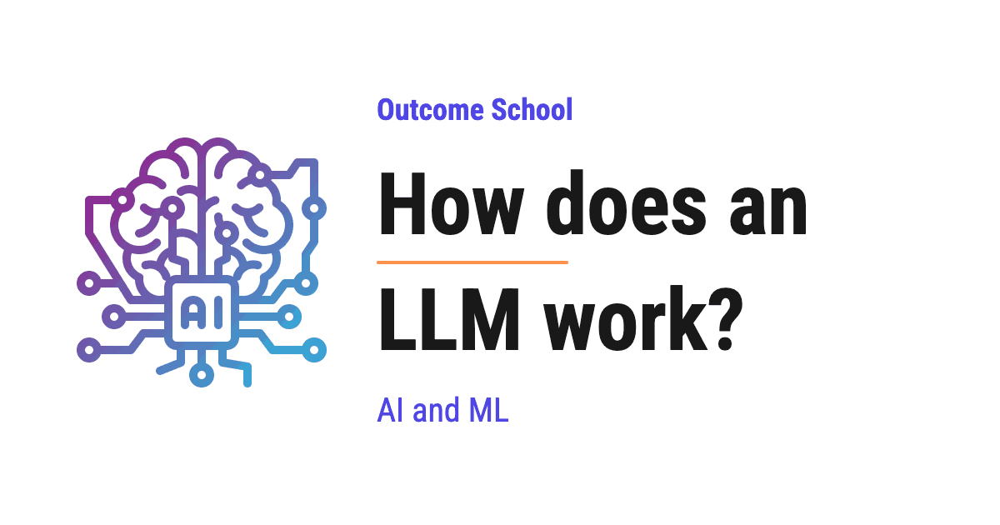

# How does an LLM work?

> Archived from <https://outcomeschool.com/blog/large-language-model-llm> on 2026-11-25.

An LLM works by predicting the next word. It turns text into tokens and embeddings, passes them through a Transformer using attention, and repeats word by word.

In this blog, we will learn about how an LLM works. We will also see how text is turned into tokens and embeddings, how the Transformer and attention work, how an LLM generates an answer word by word, how it is trained, what the context window and hallucination are, and where it is used in the real world.

We will cover the following:
<ul><li>What is an LLM?</li><li>What does it really do? (Predicting the next word)</li><li>How a computer turns words into numbers (Tokens)</li><li>How a token becomes meaning (Embeddings)</li><li>The Transformer</li><li>Attention</li><li>How an LLM generates a full answer, word by word</li><li>How an LLM is trained</li><li>Pretraining and Fine-tuning</li><li>The Context Window</li><li>Why an LLM sometimes makes things up (Hallucination)</li><li>Real-World Applications</li></ul>
I am <strong>Amit Shekhar</strong>, Founder @ <a target="_blank" rel="noopener noreferrer" href="https://outcomeschool.com">Outcome School</a>, I have taught and mentored many developers, and their efforts landed them high-paying tech jobs, helped many tech companies in solving their unique problems, and created many open-source libraries being used by top companies. I am passionate about sharing knowledge through open-source, blogs, and videos.

I teach <a target="_blank" rel="noopener noreferrer" href="https://outcomeschool.com/program/ai-and-machine-learning">AI and Machine Learning</a> at Outcome School.

Let&#x27;s get started.
<h2 id="what-is-an-llm">What is an LLM?</h2>
An <strong>LLM</strong> is a model that has read a huge amount of text and learned to understand and produce human language.

Let&#x27;s decompose the term:

<strong>LLM = Large Language Model</strong>

Let&#x27;s understand each word.

<strong>Large</strong> means it has learned from a very large amount of text, such as public web pages, books, articles, and code. It is also large because it has a huge number of internal numbers that it adjusts while learning. These numbers are called <strong>parameters</strong>, and an LLM can have billions of them.

<strong>Language</strong> means it works with human language, like English, Hindi, Spanish, and etc. It reads our words and writes words back to us.

<strong>Model</strong> means it learns patterns from examples instead of being given exact rules.

Let&#x27;s say a child reads thousands of storybooks over many years. After a while, the child can finish a sentence we start, write a new story, and answer questions. Nobody gave the child a rulebook for language. The child simply learned the patterns from all that reading.

An LLM learns in a very similar way. We show it an enormous amount of text, and it slowly learns how language works, and that too without us writing the exact rules for it.
<h2 id="what-does-it-really-do-predicting-the-next-word">What does it really do? (Predicting the next word)</h2>
<strong>At its core, an LLM does only one simple thing. It predicts the next word.</strong>

We give it some text, and it predicts the most likely next word that should come after it.

Let&#x27;s take an example. Suppose we give it this text:

<pre><code class="code-highlight">The sky is
</code></pre>

The LLM looks at these words and predicts what word is most likely to come next. It will probably predict:

<pre><code class="code-highlight">The sky is  -&gt;  blue
</code></pre>

The LLM has read so much text that it knows &quot;blue&quot; is a very common word to come after &quot;The sky is&quot;.

<strong>Note:</strong> An LLM does not just pick one word. It calculates a probability for many possible next words, and then chooses one. For our example, it may calculate something like below:

<pre><code class="code-highlight">blue     -&gt; 70%
clear    -&gt; 15%
grey     -&gt; 10%
falling  -&gt; 5%
</code></pre>

Here, we can see that each possible next word gets a percentage, which is its probability. The word &quot;blue&quot; has the highest chance, so it will most likely be chosen. We have a detailed blog on <a target="_blank" rel="noopener noreferrer" href="how-do-top-k-and-top-p-sampling-work.md">Top-k and Top-p Sampling</a> that explains how an LLM picks the next word from these probabilities.

Now, the next big question is: if an LLM only predicts one word, how does it write full paragraphs and long answers?

The answer is simple. It does this prediction again and again. We will understand this fully in the section on generating an answer.
<h2 id="how-a-computer-turns-words-into-numbers-tokens">How a computer turns words into numbers (Tokens)</h2>
An LLM cannot work with words directly. It only works with numbers.

So, the first step is to turn our text into numbers. To do this, we first break the text into small pieces. Each small piece is called a <strong>token</strong>.

A <strong>token</strong> is a small chunk of text. It can be a whole word, a part of a word, or even a single character.

Let&#x27;s take an example. Suppose we have the sentence &quot;I love learning&quot;. An LLM may break it into tokens like below:

<pre><code class="code-highlight">&quot;I love learning&quot;   -&gt;   [ &quot;I&quot; ] [ &quot; love&quot; ] [ &quot; learn&quot; ] [ &quot;ing&quot; ]
</code></pre>

Here, we can see that the sentence was broken into four tokens. Notice that the word &quot;learning&quot; was split into two tokens, &quot;learn&quot; and &quot;ing&quot;. This is because the LLM <a target="_blank" rel="noopener noreferrer" href="bpe-in-llms.md">breaks text into common chunks</a>, not always full words.

After breaking the text into tokens, each token is given a number, called a <strong>token ID</strong>. So our sentence becomes a list of numbers like below:

<pre><code class="code-highlight">[ &quot;I&quot; ]      -&gt;  40
[ &quot; love&quot; ]  -&gt;  1842
[ &quot; learn&quot; ] -&gt;  4673
[ &quot;ing&quot; ]    -&gt;  278
</code></pre>

Here, we can see that every token is now just a number. The whole sentence &quot;I love learning&quot; becomes the list of numbers <code>[40, 1842, 4673, 278]</code>. This process of breaking text into tokens is called <a target="_blank" rel="noopener noreferrer" href="tokenization-in-llms.md"><strong>tokenization</strong></a>. These token IDs are just for the sake of example, as every LLM has its own list of tokens.

So, when we say an LLM predicts the next word, it really predicts the next token. We will keep saying &quot;word&quot; just for the sake of understanding.
<h2 id="how-a-token-becomes-meaning-embeddings">How a token becomes meaning (Embeddings)</h2>
Now, a token ID like <code>1842</code> is just a label. The number itself does not carry any meaning. The number for &quot;love&quot; is not bigger or smaller than the number for &quot;hate&quot; in any meaningful way. We have a detailed blog on <a target="_blank" rel="noopener noreferrer" href="one-hot-encoding.md">One-hot Encoding</a> that covers how a token ID connects to its embedding.

Now, the question is: how does the LLM understand what a word means? So, here comes the <a target="_blank" rel="noopener noreferrer" href="what-are-embeddings.md"><strong>embedding</strong></a> to the rescue.

An <strong>embedding</strong> is a list of numbers that represents the meaning of a token.

Let&#x27;s say each token is turned into a list of numbers like below:

<pre><code class="code-highlight">&quot;king&quot;   -&gt;  [ 0.8,  0.6,  0.1,  ... ]
&quot;queen&quot;  -&gt;  [ 0.8,  0.6,  0.9,  ... ]
&quot;apple&quot;  -&gt;  [ 0.1,  0.2,  0.7,  ... ]
</code></pre>

Here, we can see that &quot;king&quot; and &quot;queen&quot; have very similar numbers, because their meanings are similar. The word &quot;apple&quot; has very different numbers, because its meaning is very different. Words with similar meaning get similar numbers.

The LLM learns these embeddings on its own while it is trained. We do not set these numbers by hand. The network figures out, from reading lots of text, that &quot;king&quot; and &quot;queen&quot; are related, and it gives them similar numbers.

So, an embedding is how a plain token gets a meaning that the computer can work with.

<strong>Planning your move into AI?</strong>

No matter which tech domain you work in today, with your effort, you can transition to these roles:
<ul><li>AI Engineer</li><li>Forward Deployed Engineer</li><li>AI Agent Engineer</li><li>Harness Engineer</li><li>Voice AI Engineer</li><li>AI Architect</li><li>LLM Engineer</li><li>LLM Inference Engineer</li><li>Gen AI Engineer</li><li>MLOps Engineer</li><li>ML Engineer</li><li>Deep Learning Engineer</li></ul>
Our <a target="_blank" rel="noopener noreferrer" href="https://outcomeschool.com/program/ai-and-machine-learning">AI and Machine Learning Program</a> at Outcome School takes you there.
<h2 id="the-transformer">The Transformer</h2>
Now, let&#x27;s learn about the engine that powers every modern LLM. This engine is called the <a target="_blank" rel="noopener noreferrer" href="decoding-transformer-architecture.md"><strong>Transformer</strong></a>.

The <strong>Transformer</strong> is the architecture that an LLM uses to process language and predict the next word.

The Transformer was introduced in 2017 in a famous research paper titled &quot;Attention Is All You Need&quot;. Before the Transformer, language models <a target="_blank" rel="noopener noreferrer" href="how-do-rnns-and-transformers-differ.md">read text one word at a time, in order</a>, which was slow and often lost track of earlier words. The Transformer can look at all the words at once and figure out how they relate to each other.

An LLM is built by stacking many Transformer layers one on top of another, like below:

<pre><code class="code-highlight">   input tokens (as embeddings)
              ↓
   +-----------------------+
   |  Transformer layer 1  |
   +-----------------------+
              ↓
   +-----------------------+
   |  Transformer layer 2  |
   +-----------------------+
              ↓
             ...
              ↓
   +-----------------------+
   |  Transformer layer N  |
   +-----------------------+
              ↓
   prediction for the next token
</code></pre>

Here, we can see that our tokens enter at the top as embeddings. They pass through many Transformer layers, one after another. Each layer improves the understanding of the text a little more. At the very end, the network produces the prediction for the next token.

So, the Transformer is the engine, and the most important part inside this engine is called <a target="_blank" rel="noopener noreferrer" href="self-attention-in-transformers.md"><strong>attention</strong></a>. We will learn about attention next.
<h2 id="attention">Attention</h2>
Now, let&#x27;s learn about the single most important idea inside a Transformer. It is called <strong>attention</strong>.

<strong>Attention is the mechanism that lets each word look at the other words in the sentence and decide which ones are important for its meaning.</strong>

The best way to learn this is by taking an example. Consider this sentence:

<pre><code class="code-highlight">The animal did not cross the street because it was too tired.
</code></pre>

Now, what does the word &quot;it&quot; refer to? Does &quot;it&quot; mean the animal, or the street? We humans know instantly that &quot;it&quot; means the animal, because a street cannot be tired.

For the LLM to understand this sentence correctly, the word &quot;it&quot; must pay attention to the word &quot;animal&quot;. This is exactly what attention does. It connects &quot;it&quot; to &quot;animal&quot;.

Let&#x27;s picture this connection like below:

<pre><code class="code-highlight">The   animal   did   not   cross   the   street   because   it   was   too   tired
        ^                                                    |
        |____________________________________________________|
                    &quot;it&quot; pays strong attention to &quot;animal&quot;
</code></pre>

Here, we can see that the word &quot;it&quot; looks back at all the earlier words and pays the strongest attention to &quot;animal&quot;. This is how the LLM understands that &quot;it&quot; means the animal and not the street.

So, every word in the sentence does this. In an LLM, every word <a target="_blank" rel="noopener noreferrer" href="causal-masking-in-attention.md">looks at itself and all the words before it</a>, and decides how much attention to pay to each one. This way, the LLM builds an understanding of how all the words relate to each other.

To learn LLM Internals, Tokenization, Embeddings, the Attention Mechanism, and the Transformer Architecture, and even build a Large Language Model (LLM) from scratch, check out our <a target="_blank" rel="noopener noreferrer" href="https://outcomeschool.com/program/ai-and-machine-learning">AI and Machine Learning Program</a> at Outcome School.
<h2 id="how-an-llm-generates-a-full-answer-word-by-word">How an LLM generates a full answer, word by word</h2>
Now, let&#x27;s connect everything and see how an LLM writes a full answer. Remember, an LLM only predicts the next word. So, how does it write a long answer?

The answer is that it predicts one word, adds it to the text, and then predicts the next word again. It repeats this loop until the answer is complete. This process is called <a target="_blank" rel="noopener noreferrer" href="autoregressive-models.md"><strong>autoregression</strong></a>, which simply means it feeds its own output back into itself.

Let&#x27;s take an example. Suppose we ask it to complete &quot;The capital of France is&quot;.

<strong>Step 1:</strong> The LLM reads &quot;The capital of France is&quot; and predicts the next word.

<pre><code class="code-highlight">The capital of France is  -&gt;  Paris
</code></pre>

<strong>Step 2:</strong> Now it adds &quot;Paris&quot; to the text and predicts the next word again.

<pre><code class="code-highlight">The capital of France is Paris  -&gt;  .
</code></pre>

<strong>Step 3:</strong> It keeps going until it decides the answer is complete and produces a special <a target="_blank" rel="noopener noreferrer" href="stop-tokens-in-llms.md">&quot;stop&quot; token</a>.

We can picture this whole loop like below:

<pre><code class="code-highlight">&quot;The capital of France is&quot;         -&gt; predict -&gt;  &quot;Paris&quot;
&quot;The capital of France is Paris&quot;   -&gt; predict -&gt;  &quot;.&quot;
&quot;The capital of France is Paris.&quot;  -&gt; predict -&gt;  [stop]
</code></pre>

Here, we can see that each predicted word is added back to the text, and the LLM uses the longer text to predict the next word. This repeats again and again. This is exactly why an LLM seems to &quot;type&quot; the answer to us one word at a time.

So, a long answer is just next-word prediction repeated many times, very fast.

<strong>A quick note for you</strong>

No matter which tech domain you work in, get familiar with these topics:
<ul><li>LLM</li><li>RAG</li><li>MCP</li><li>Agent</li><li>Fine-tuning</li><li>Quantization</li></ul>
We put it all together in one video:

<a target="_blank" rel="noopener noreferrer" href="https://www.youtube.com/watch?v=lnfWvX66FUk">AI Engineering Explained: LLM, RAG, MCP, Agent, Fine-Tuning, and Quantization</a>

No need to stop reading - bookmark it and watch later when you get time. Future you will thank you.

Now, let&#x27;s get back to the topic.
<h2 id="how-an-llm-is-trained">How an LLM is trained</h2>
When an LLM is brand new, all its internal numbers, the parameters, are just random. So its first predictions are pure nonsense. The question is: how does it learn?

It learns by playing a simple game on a huge amount of text. The game is called next-word prediction. Let&#x27;s understand it step by step.

<strong>Step 1:</strong> We take a real sentence from the training text, for example &quot;The sun rises in the east&quot;. We hide the last word and show the rest to the LLM.

<pre><code class="code-highlight">Show this:   &quot;The sun rises in the&quot;
Hide this:   &quot;east&quot;
</code></pre>

<strong>Step 2:</strong> The LLM predicts the next word. At the start, it predicts something random and wrong, for example &quot;banana&quot;.

<strong>Step 3:</strong> We compare its prediction with the correct word, which is &quot;east&quot;. The difference between the prediction and the correct answer is called the <a target="_blank" rel="noopener noreferrer" href="math-behind-cross-entropy-loss.md"><strong>loss</strong></a>, also called the error. A big loss means the LLM was very wrong.

<strong>Step 4:</strong> The LLM slightly adjusts its internal numbers so that next time it is a little more likely to predict &quot;east&quot;. This adjustment is done by methods called <a target="_blank" rel="noopener noreferrer" href="math-behind-backpropagation.md"><strong>backpropagation</strong></a> and <a target="_blank" rel="noopener noreferrer" href="math-behind-gradient-descent.md"><strong>gradient descent</strong></a>. Means, the network traces back its mistake and nudges every number a tiny bit in the direction that reduces the error.

We can picture the full training loop like below:

<pre><code class="code-highlight">hide a word
     ↓
predict
     ↓
compare with the correct word
     ↓
measure the loss
     ↓
adjust the numbers
     ↓
repeat
</code></pre>

Here, we can see that the LLM plays this guessing game on trillions of tokens, over and over. Each time, its numbers get a little better, and its predictions get a little more accurate. Slowly, the random network turns into a model that predicts language very well.

This is how an LLM learns, and the best part is that nobody labels this data by hand. The text itself provides the questions and the answers, because the correct next word is already there in the text.
<h2 id="pretraining-and-fine-tuning">Pretraining and Fine-tuning</h2>
Now, training an LLM happens in two main stages. Let&#x27;s understand both.

<strong><a target="_blank" rel="noopener noreferrer" href="llm-pretraining.md">Pretraining</a></strong> is the first stage. This is the big next-word prediction game we just learned, played on a massive amount of text from the internet, books, and code. After pretraining, the LLM knows a lot about language and the world, but it is just a raw text-completion machine. It does not yet know how to be a helpful assistant.

<a target="_blank" rel="noopener noreferrer" href="how-does-fine-tuning-work.md"><strong>Fine-tuning</strong></a> is the second stage. Here, we further train the LLM on carefully chosen examples that show it how to <a target="_blank" rel="noopener noreferrer" href="instruction-tuning.md">follow instructions</a> and be helpful, honest, and safe.

Pretraining gives the LLM its raw knowledge, and fine-tuning teaches it how to be useful.

Let&#x27;s picture the two stages like below:

<pre><code class="code-highlight">   Huge internet text (trillions of tokens)
                      ↓
              +---------------+
              |  Pretraining  |
              +---------------+
                      ↓
   Raw LLM that knows language and facts
                      ↓
              +---------------+
              |  Fine-tuning  |
              +---------------+
                      ↓
   Helpful assistant that follows instructions
</code></pre>

Here, we can see that pretraining comes first and builds raw knowledge, and fine-tuning comes after and shapes the LLM into a helpful assistant. A popular fine-tuning method uses human feedback, where humans rate the answers and the LLM learns to prefer the better ones. This method is called <a target="_blank" rel="noopener noreferrer" href="reinforcement-learning-from-human-feedback-rlhf.md"><strong>RLHF</strong></a>, which stands for Reinforcement Learning from Human Feedback.

So, the AI assistants we use every day are based on LLMs that have been both pretrained and fine-tuned.

<strong>Stay updated:</strong> Subscribe to our <a target="_blank" rel="noopener noreferrer" href="https://outcomeschool.substack.com/subscribe">newsletter</a> to get our latest AI and Machine Learning blogs straight to your inbox.
<h2 id="the-context-window">The Context Window</h2>
Now, let&#x27;s learn about an important limit of every LLM. It is called the <strong><a target="_blank" rel="noopener noreferrer" href="context-window.md">context window</a></strong>.

The <strong>context window</strong> is the maximum amount of text, measured in tokens, that an LLM can look at in one go.

We can think of it as the LLM&#x27;s short-term memory. It can only pay attention to the text that fits inside this window.

Let&#x27;s say an LLM has a context window of 100,000 tokens. This means it can read and consider about that many tokens of text at once, which includes both our question and its answer. If a conversation grows longer than the window, the application must drop or <a target="_blank" rel="noopener noreferrer" href="how-does-context-compaction-work.md">shorten the oldest text</a>, and the LLM can no longer see it.

We can picture the context window like below:

<pre><code class="code-highlight">   [=================== context window ===================]
    our question + earlier chat + the answer being written
    |&lt;-- everything here is visible to the LLM at once --&gt;|

    text older than this falls out and is forgotten
</code></pre>

Here, we can see that everything inside the window is visible to the LLM, and anything that falls outside is forgotten. This is why a very long chat can sometimes make the LLM forget what we said at the very beginning.

Many modern LLMs have very large context windows, which means they can read entire books or large codebases at once. But the limit always exists.
<h2 id="why-an-llm-sometimes-makes-things-up-hallucination">Why an LLM sometimes makes things up (Hallucination)</h2>
Now, let&#x27;s understand one important weakness of LLMs. Sometimes an LLM gives an answer that sounds confident and correct but is actually false. This is called a <a target="_blank" rel="noopener noreferrer" href="why-do-llms-hallucinate-the-token-level-explanation.md"><strong>hallucination</strong></a>.

A <strong>hallucination</strong> is when an LLM produces information that is wrong or made up, while sounding completely confident.

Why does this happen? Let&#x27;s remember our core idea. An LLM predicts the next most likely word. It does not look up facts in a database, and it does not truly &quot;know&quot; things the way a human does. It produces text that sounds right based on the patterns it learned.

So, if we ask about something it has not learned well, it may still produce a confident, smooth-sounding answer, because its job is to predict likely-sounding words, not to verify the truth.

Let&#x27;s say we ask it for a book written by a certain author. If the LLM is unsure, it may invent a realistic-sounding book title that does not actually exist, simply because that title fits the pattern of a likely answer.

This is why we must always verify important facts that an LLM gives us, especially names, numbers, dates, and quotes.

<strong>Note:</strong> To reduce hallucinations, modern systems often connect the LLM to trusted sources of information. One popular method is called <strong><a target="_blank" rel="noopener noreferrer" href="retrieval-augmented-generation-rag.md">RAG</a></strong>, which stands for Retrieval-Augmented Generation. The system first fetches facts from a trusted source and then gives them to the LLM to use while answering. This way, the LLM answers based on real information instead of guessing.
<h2 id="real-world-applications">Real-World Applications</h2>
Now, let&#x27;s discuss where LLMs are used in our daily life. We use them more often than we realize.
<ul><li><strong>AI assistants:</strong> When we ask a question and get a written answer, an LLM is generating it.</li><li><strong>Writing help:</strong> Drafting emails, essays, and summaries.</li><li><strong>Coding help:</strong> Writing code, finding bugs, and explaining how code works.</li><li><strong>Translation:</strong> Converting text from one language into another.</li><li><strong>Summarization:</strong> Turning a long document into a short summary.</li><li><strong>Customer support:</strong> Answering common questions automatically for companies.</li><li><strong>Search:</strong> Giving direct answers instead of just a list of links.</li></ul>
Now we must have understood how an LLM works, from tokens and embeddings to attention, next-word prediction, and training.
<h2 id="frequently-asked-questions">Frequently Asked Questions</h2><h3 id="does-an-llm-look-up-facts-in-a-database">Does an LLM look up facts in a database?</h3>
No. An LLM does not look up facts in a database. It predicts the next most likely word based on the patterns it learned from a huge amount of text. This is why it can sometimes produce a confident answer that is wrong, and why we should verify important facts like names, numbers, dates, and quotes.
<h3 id="does-an-llm-predict-words-or-tokens">Does an LLM predict words or tokens?</h3>
An LLM really predicts tokens, not whole words. A token is a small chunk of text, which can be a whole word, a part of a word, or a single character. For example, &quot;learning&quot; can be split into &quot;learn&quot; and &quot;ing&quot;. We often say &quot;word&quot; only to keep the explanation simple.
<h3 id="why-does-an-llm-show-its-answer-one-word-at-a-time">Why does an LLM show its answer one word at a time?</h3>
An LLM shows its answer one word at a time because it really generates it that way. It predicts one word, adds it to the text, and uses the longer text to predict the next word. It repeats this loop until it produces a special stop token, so a long answer is just next-word prediction repeated many times, very fast.
<h3 id="who-labels-the-data-used-to-train-an-llm">Who labels the data used to train an LLM?</h3>
Nobody labels the pretraining data by hand. The text itself provides both the questions and the answers, because the correct next word is already there in the text. During training, a word is hidden, the LLM predicts it, the loss is measured, and its parameters are adjusted, again and again on trillions of tokens.
<h3 id="why-does-an-llm-forget-the-start-of-a-long-chat">Why does an LLM forget the start of a long chat?</h3>
An LLM forgets the start of a long chat because of its context window. The context window is the maximum number of tokens it can look at in one go. When a conversation grows longer than this window, the oldest text is dropped or shortened, and the LLM can no longer see it.

That&#x27;s it for now.

Thanks

<strong>Amit Shekhar</strong> Founder @ <a target="_blank" rel="noopener noreferrer" href="https://outcomeschool.com">Outcome School</a>

You can connect with me on:
<ul><li><a target="_blank" rel="noopener noreferrer" href="https://x.com/amitiitbhu">X</a></li><li><a target="_blank" rel="noopener noreferrer" href="https://www.linkedin.com/in/amit-shekhar-iitbhu">LinkedIn</a></li><li><a target="_blank" rel="noopener noreferrer" href="https://github.com/amitshekhariitbhu">GitHub</a></li></ul>
Follow Outcome School on:
<ul><li><a target="_blank" rel="noopener noreferrer" href="https://x.com/outcome_school">X</a></li><li><a target="_blank" rel="noopener noreferrer" href="https://youtube.com/@OutcomeSchool">YouTube</a></li><li><a target="_blank" rel="noopener noreferrer" href="https://www.linkedin.com/company/outcomeschool">LinkedIn</a></li><li><a target="_blank" rel="noopener noreferrer" href="http://github.com/OutcomeSchool">GitHub</a></li></ul>
<a target="_blank" rel="noopener noreferrer" href="https://outcomeschool.com/blog"><strong>Read all of our high-quality blogs here.</strong></a>

