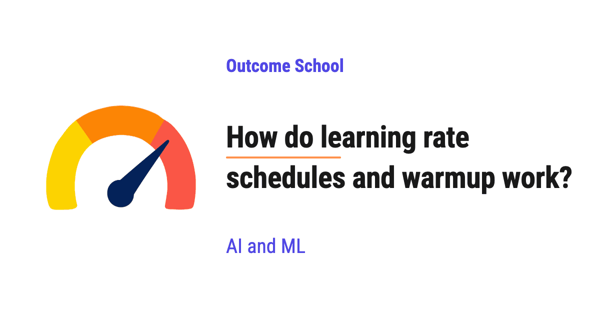

# How do learning rate schedules and warmup work?

> Archived from <https://outcomeschool.com/blog/learning-rate-schedules-and-warmup> on 2026-11-25.

Learning rate schedules and warmup work by changing the step size of a neural network during training instead of keeping it fixed. Warmup starts with tiny steps and slowly increases them, and the schedule then slowly decreases the steps so that the model settles at a good answer.

In this blog, we will learn about how learning rate schedules and warmup work. We will also see why a fixed learning rate is not enough, how popular schedules change the learning rate over time, why we need warmup at the very start, how warmup and cosine decay work together, how to write it in code, and when to use which one.

We will cover the following:
<ul><li>What is a learning rate?</li><li>The problem with a fixed learning rate</li><li>What is a learning rate schedule?</li><li>Step decay</li><li>Exponential decay</li><li>Linear decay</li><li>Cosine decay</li><li>What is warmup?</li><li>Why do we need warmup?</li><li>Warmup plus cosine decay: the modern recipe</li><li>Seeing it in code</li><li>Comparison of schedules</li><li>When to use which one</li></ul>
I am <strong>Amit Shekhar</strong>, Founder @ <a target="_blank" rel="noopener noreferrer" href="https://outcomeschool.com">Outcome School</a>, I have taught and mentored many developers, and their efforts landed them high-paying tech jobs, helped many tech companies in solving their unique problems, and created many open-source libraries being used by top companies. I am passionate about sharing knowledge through open-source, blogs, and videos.

I teach <a target="_blank" rel="noopener noreferrer" href="https://outcomeschool.com/program/ai-and-machine-learning">AI and Machine Learning</a> at Outcome School.

Let&#x27;s get started.
<h2 id="what-is-a-learning-rate">What is a learning rate?</h2>
Before jumping into schedules and warmup, we must know what a learning rate is.

A <a target="_blank" rel="noopener noreferrer" href="neural-network.md">neural network</a> is a model made of many numbers called <strong>weights</strong>. A weight is an importance number that decides how much one input matters. When a network starts, its <a target="_blank" rel="noopener noreferrer" href="random-weight-initialization.md">weights are random</a>, so its answers are wrong.

Training means fixing these weights little by little. At every training step, the network does the following:
<ul><li>It makes a guess.</li><li>It measures how wrong the guess is. This number is called the <strong>loss</strong>.</li><li>It finds which direction each weight must move to reduce the loss. This direction is called the <a target="_blank" rel="noopener noreferrer" href="math-behind-gradient-descent.md"><strong>gradient</strong></a>.</li><li>It moves each weight a small step in that direction.</li></ul>
<strong>The learning rate is the number that decides how big that small step is.</strong>

The rule is as below:

<pre><code class="language-text code-highlight">new_weight = old_weight - learning_rate x gradient
</code></pre>

Here, the gradient gives the direction, and the learning rate gives the size of the step.

Let&#x27;s take a real-world comparison. Imagine we are walking down a hill in thick fog to reach the lowest point of a valley. We cannot see far, but we can feel the slope under our feet. The slope is the gradient. The length of our stride is the learning rate. The lowest point of the valley is the best set of weights, where the loss is smallest.

To master Neural Networks, Gradient Descent, and Backpropagation, and to build a Neural Network from scratch, check out our <a target="_blank" rel="noopener noreferrer" href="https://outcomeschool.com/program/ai-and-machine-learning">AI and Machine Learning Program</a> at Outcome School.
<h2 id="the-problem-with-a-fixed-learning-rate">The problem with a fixed learning rate</h2>
Suppose we pick one learning rate and keep it the same for the whole training. Let&#x27;s see what happens.

<strong>If the learning rate is big:</strong> We take long strides. We move fast at the start, which is great. But near the bottom, our long strides keep jumping over the lowest point. We bounce from one side of the valley to the other and never settle.

<strong>If the learning rate is small:</strong> We take tiny strides. Near the bottom, we settle nicely. But at the start, we move very slowly. Training takes a very long time.

<pre><code class="language-text code-highlight"> Big fixed steps:     o -------&gt; o
                      o &lt;------- o      (keeps jumping over the bottom)

 Small fixed steps:   o.o.o.o.o.o.o.o.o.o.o.o.o ...   (very slow)

 What we want:        o -----&gt; o ---&gt; o -&gt; o &gt; o.o   (fast first, careful later)
</code></pre>

Here, we can see that neither a big nor a small fixed step is ideal. We want big steps when we are far from the bottom and small steps when we are close to it.

So, here comes the learning rate schedule to the rescue.
<h2 id="what-is-a-learning-rate-schedule">What is a learning rate schedule?</h2>
<strong>A learning rate schedule is a plan that changes the learning rate during training, usually starting high and going lower as training goes on.</strong>

It works like a timetable for the step size. It says, &quot;At step 0, use this learning rate. At step 1000, use that learning rate.&quot;

The word <strong>decay</strong> is used a lot here. Decay means &quot;slowly going down&quot;. When we say &quot;learning rate decay&quot;, we mean the learning rate goes down over time.

There are many schedules. They differ in how they go down: in sudden drops, in a smooth curve, or in a straight line. Let&#x27;s learn about the popular ones one by one.
<h2 id="step-decay">Step decay</h2>
<strong>Step decay keeps the learning rate fixed for a while, then suddenly cuts it by a fixed factor, again and again.</strong>

Let&#x27;s say we start with a learning rate of 0.1 and cut it in half every 10 rounds over the training data. One round over the full training data is called an <a target="_blank" rel="noopener noreferrer" href="epoch-batch-and-iteration.md"><strong>epoch</strong></a>.

<pre><code class="language-text code-highlight">Epoch  1 to 10:  learning rate = 0.1
Epoch 11 to 20:  learning rate = 0.05
Epoch 21 to 30:  learning rate = 0.025
</code></pre>

Let&#x27;s see it in a picture:

<pre><code class="language-text code-highlight"> lr
 0.1   |________
       |        |
 0.05  |        |________
       |                 |
 0.025 |                 |________
       +------------------------------ epochs
        0       10       20       30
</code></pre>

Here, we can see the learning rate looks like a staircase going down.

<strong>Advantage:</strong> Very simple to understand and set up.

<strong>Disadvantage:</strong> The sudden drops are rough. Also, we must choose when to drop and by how much, which needs trial and error.

The issue with this approach is the sudden jumps. Let&#x27;s see how the next approach solve this issue.
<h2 id="exponential-decay">Exponential decay</h2>
<strong>Exponential decay multiplies the learning rate by a number slightly less than 1 at every step or every epoch, so it goes down smoothly.</strong>

Let&#x27;s say we multiply by 0.9 every epoch, starting at 0.1:

<pre><code class="language-text code-highlight">Epoch 1:  0.1
Epoch 2:  0.1   x 0.9 = 0.09
Epoch 3:  0.09  x 0.9 = 0.081
Epoch 4:  0.081 x 0.9 = 0.0729
</code></pre>

Here, we can notice that there are no sudden drops anymore. The learning rate slides down smoothly.

<strong>Disadvantage:</strong> It drops very fast at the beginning and then becomes almost flat. Sometimes, the learning rate becomes tiny too early, and the model stops improving while there is still a lot to learn.

<strong>Planning your move into AI?</strong>

No matter which tech domain you work in today, with your effort, you can transition to these roles:
<ul><li>AI Engineer</li><li>Forward Deployed Engineer</li><li>AI Agent Engineer</li><li>Harness Engineer</li><li>Voice AI Engineer</li><li>AI Architect</li><li>LLM Engineer</li><li>LLM Inference Engineer</li><li>Gen AI Engineer</li><li>MLOps Engineer</li><li>ML Engineer</li><li>Deep Learning Engineer</li></ul>
Our <a target="_blank" rel="noopener noreferrer" href="https://outcomeschool.com/program/ai-and-machine-learning">AI and Machine Learning Program</a> at Outcome School takes you there.
<h2 id="linear-decay">Linear decay</h2>
<strong>Linear decay lowers the learning rate in a straight line, from a starting value down to a final value at the end of training.</strong>

<pre><code class="language-text code-highlight"> lr
 max |\
     |  \
     |    \
     |      \
     |        \
 min |          \
     +------------ steps
</code></pre>

Here, we can see that the learning rate goes down by the same amount at every step.

<strong>Advantage:</strong> Simple and predictable. We need to know the starting value, the final value, and the total number of steps.

Linear decay is popular when fine-tuning language models. <a target="_blank" rel="noopener noreferrer" href="how-does-fine-tuning-work.md">Fine-tuning</a> means taking an already trained model and training it a little more on our own data.
<h2 id="cosine-decay">Cosine decay</h2>
<strong>Cosine decay lowers the learning rate along a smooth curve shaped like half of a wave: slow at the start, faster in the middle, and slow again at the end.</strong>

The name comes from the cosine function in math, which draws a smooth wave. Here, we need to understand only the shape.

<pre><code class="language-text code-highlight"> lr
 max |---__
     |      `-.
     |         `.
     |           `.
     |             `-.
 min |                 `---___
     +---------------------------- steps
</code></pre>

Here, we can see three phases:
<ul><li><strong>At the start:</strong> The learning rate stays high for a while, so the model keeps learning fast.</li><li><strong>In the middle:</strong> The learning rate goes down steadily.</li><li><strong>At the end:</strong> The learning rate stays low for a while, so the model can settle gently into the bottom of the valley.</li></ul>
Cosine decay works very well in practice, and it needs very few settings: the maximum learning rate, the minimum learning rate, and the total number of steps.

Now, it&#x27;s time to learn about warmup, which raises the learning rate at the start.
<h2 id="what-is-warmup">What is warmup?</h2>
<strong>Warmup is a short phase at the very beginning of training where the learning rate starts very small and slowly increases up to its full value.</strong>

Let&#x27;s say our target learning rate is 0.001 and we use 100 warmup steps. Then, the learning rate climbs like below:

<pre><code class="language-text code-highlight">Step   0:  0.00001
Step  49:  0.0005
Step  99:  0.001   (warmup is done, full learning rate reached)
</code></pre>

Here, we can see that the learning rate grows a little at every step, in a straight line, until it reaches the target value. This is called <strong>linear warmup</strong>, and it is the most common type.

<strong>A quick note for you</strong>

No matter which tech domain you work in, get familiar with these topics:
<ul><li>LLM</li><li>RAG</li><li>MCP</li><li>Agent</li><li>Fine-tuning</li><li>Quantization</li></ul>
We put it all together in one video:

<a target="_blank" rel="noopener noreferrer" href="https://www.youtube.com/watch?v=lnfWvX66FUk">AI Engineering Explained: LLM, RAG, MCP, Agent, Fine-Tuning, and Quantization</a>

No need to stop reading - bookmark it and watch later when you get time. Future you will thank you.

Now, let&#x27;s get back to the topic.
<h2 id="why-do-we-need-warmup">Why do we need warmup?</h2>
Now, the next big question is: why should we start slow, when the beginning is the place where we are farthest from the answer?

The answer is that the very beginning of training is the most unstable moment. There are two main reasons.

<strong>Reason 1: The weights are random, so the gradients are wild.</strong>

At step 0, the network knows nothing. Its guesses are badly wrong, so the loss is very high. The gradients at this moment can be very large and point in strange directions. If we take a big step using such a wild gradient, the weights jump to a bad place. Sometimes, the loss even explodes to a huge number, and the training crashes. This crash is called <strong>divergence</strong>. We have a detailed blog on <a target="_blank" rel="noopener noreferrer" href="vanishing-and-exploding-gradients.md">Vanishing and Exploding Gradients</a> that explains why gradients can grow so large.

<strong>Reason 2: Optimizers like Adam need time to collect good averages.</strong>

An <a target="_blank" rel="noopener noreferrer" href="optimizers-in-deep-learning.md">optimizer</a> is the rule that updates the weights. One of the most popular optimizers, called <strong>Adam</strong>, keeps a running average of the past gradients to decide how big each step must be. At step 0, there is no history. These averages are based on only a few steps, so they are not reliable yet. If the learning rate is already high, these unreliable averages lead to bad, oversized steps.

Warmup gives the optimizer time to collect good averages before we let it take big steps.

<strong>Note:</strong> Warmup is especially important for <a target="_blank" rel="noopener noreferrer" href="decoding-transformer-architecture.md">Transformers</a>, which are the architecture behind <a target="_blank" rel="noopener noreferrer" href="large-language-model-llm.md">LLMs (Large Language Models)</a>. The original Transformer paper, &quot;Attention Is All You Need&quot;, used 4000 warmup steps. Without warmup, Transformers often fail to train properly.
<h2 id="warmup-plus-cosine-decay-the-modern-recipe">Warmup plus cosine decay: the modern recipe</h2>
Now, it&#x27;s time to put the schedules and warmup together.

Many modern LLMs are trained with this recipe:
<ul><li><strong>Phase 1, Warmup:</strong> Increase the learning rate in a straight line from almost 0 to the maximum value.</li><li><strong>Phase 2, Cosine decay:</strong> Lower the learning rate along the smooth cosine curve, from the maximum value down to a small minimum value.</li></ul>
<pre><code class="language-text code-highlight"> lr
 max |      /---__
     |     /      `-.
     |    /          `.
     |   /             `.
     |  /                `-.
 min | /                     `---___
     +/------------------------------- steps
      |warmup|     cosine decay      |
</code></pre>

Here, we can see the full journey of the learning rate. It climbs up carefully, stays high while the model learns the most, and then comes down smoothly so the model can settle.

This is how learning rate schedules and warmup work together.

<strong>Stay updated:</strong> Subscribe to our <a target="_blank" rel="noopener noreferrer" href="https://outcomeschool.substack.com/subscribe">newsletter</a> to get our latest AI and Machine Learning blogs straight to your inbox.
<h2 id="seeing-it-in-code">Seeing it in code</h2>
The best way to learn this is by taking an example. Let&#x27;s write a small Python function that gives the learning rate for any training step, using warmup plus cosine decay.

<pre><code class="code-highlight language-python">import math

def get_lr(step, max_lr=0.001, min_lr=0.0001, warmup_steps=100, total_steps=1000):
    # Phase 1: linear warmup
    if step &lt; warmup_steps:
        return max_lr * (step + 1) / warmup_steps

    # Phase 2: cosine decay
    progress = (step - warmup_steps) / (total_steps - warmup_steps)
    cosine = 0.5 * (1 + math.cos(math.pi * progress))
    return min_lr + (max_lr - min_lr) * cosine

for step in [0, 49, 99, 325, 550, 775, 999]:
    print(f&quot;step {step:4d}  lr = {get_lr(step):.6f}&quot;)
</code></pre>

Here, we have:
<ul><li><code>max_lr</code> is the highest learning rate, which we reach at the end of warmup.</li><li><code>min_lr</code> is the lowest learning rate, which we reach at the very end of training.</li><li>In the warmup phase, the learning rate grows in a straight line with the step number. We use <code>step + 1</code> so that the very first step does not have a learning rate of exactly 0.</li><li>In the cosine phase, <code>progress</code> goes from 0 to 1 as training moves from the end of warmup to the last step.</li><li><code>cosine</code> goes smoothly from 1 down to 0 as <code>progress</code> goes from 0 to 1. So, the learning rate goes smoothly from <code>max_lr</code> down to <code>min_lr</code>.</li></ul>
This will print the following:

<pre><code class="language-text code-highlight">step    0  lr = 0.000010
step   49  lr = 0.000500
step   99  lr = 0.001000
step  325  lr = 0.000868
step  550  lr = 0.000550
step  775  lr = 0.000232
step  999  lr = 0.000100
</code></pre>

Here, we can notice that the learning rate starts tiny at step 0, reaches its maximum of 0.001 at step 99, stays high for a while, reaches the halfway value of 0.00055 in the middle at step 550, and finally ends at the minimum of 0.0001.

In a real training loop, we call this function at every step and give the result to the optimizer as below:

<pre><code class="code-highlight language-python">for step in range(total_steps):
    lr = get_lr(step)
    for group in optimizer.param_groups:
        group[&quot;lr&quot;] = lr  # set the new learning rate

    # your code for the forward pass, loss, and backward pass
    optimizer.step()
</code></pre>

Here, we are using <a target="_blank" rel="noopener noreferrer" href="how-does-pytorch-work.md">PyTorch</a>. The <code>optimizer</code> is one we have already created, for example AdamW, and <code>total_steps</code> is 1000 like before. PyTorch keeps the settings of an optimizer, including the learning rate, inside <code>param_groups</code>. Before every update, we set the learning rate in each group to the value from our schedule. Then, <code>optimizer.step()</code> updates the weights using that learning rate.

<strong>Note:</strong> PyTorch also has ready-made schedulers inside <code>torch.optim.lr_scheduler</code>, such as <code>StepLR</code>, <code>ExponentialLR</code>, and <code>CosineAnnealingLR</code>. Writing our own function, like above, makes it clear what is happening.

If we want to go deep into PyTorch, Optimizers, and Model Development and Training, we have a complete program on it. Check out our <a target="_blank" rel="noopener noreferrer" href="https://outcomeschool.com/program/ai-and-machine-learning">AI and Machine Learning Program</a> at Outcome School to learn it end to end.
<h2 id="comparison-of-schedules">Comparison of schedules</h2>
Let me tabulate the differences between these schedules for your better understanding.
<table><thead><tr><th>Schedule</th><th>Shape</th><th>Advantage</th><th>Disadvantage</th><th>Common use</th></tr></thead><tbody><tr><td>Fixed</td><td>Flat line</td><td>Simplest</td><td>Too slow or too bouncy</td><td>Quick experiments</td></tr><tr><td>Step decay</td><td>Staircase</td><td>Easy to understand</td><td>Sudden drops, needs tuning of when to drop</td><td>Older image models</td></tr><tr><td>Exponential decay</td><td>Smooth curve that flattens fast</td><td>Smooth</td><td>Becomes tiny too early</td><td>Simple models</td></tr><tr><td>Linear decay</td><td>Straight line down</td><td>Simple and predictable</td><td>Lowers the rate even when the model is still learning fast</td><td>Fine-tuning language models</td></tr><tr><td>Cosine decay</td><td>Smooth half wave</td><td>Stays high early, settles gently late</td><td>Needs total steps known in advance</td><td>Many modern models</td></tr><tr><td>Warmup</td><td>Straight line up, at the start only</td><td>Prevents early crashes</td><td>Adds one more setting</td><td>Used before almost any schedule, especially for Transformers</td></tr></tbody></table><h2 id="when-to-use-which-one">When to use which one</h2>
Now, let&#x27;s see the practical guidance.
<ul><li><strong>Training a Transformer or an LLM from scratch:</strong> Use linear warmup followed by cosine decay. This is the most common recipe.</li><li><strong>Fine-tuning a pre-trained language model:</strong> Use a short warmup followed by linear decay. This is the default in many popular fine-tuning tools.</li><li><strong>Training a small model for learning or quick experiments:</strong> A fixed learning rate or step decay is fine.</li><li><strong>Training crashes or the loss explodes in the first few steps:</strong> Add warmup or make the warmup longer.</li><li><strong>The loss stops improving at the end of training:</strong> Lower the minimum learning rate or let the decay go on longer.</li></ul>
A common choice is to keep the warmup short, often a few percent of the total training steps. Warmup plus cosine decay is a good starting point. Later, depending on our use case, we can experiment.

Now, we must have understood how learning rate schedules and warmup work.
<h2 id="frequently-asked-questions">Frequently Asked Questions</h2><h3 id="how-many-warmup-steps-should-we-use">How many warmup steps should we use?</h3>
A common choice is to keep the warmup short, often a few percent of the total training steps. The original Transformer paper, &quot;Attention Is All You Need&quot;, used 4000 warmup steps. If training crashes or the loss explodes in the first few steps, we can make the warmup longer.
<h3 id="does-pytorch-have-built-in-learning-rate-schedulers">Does PyTorch have built-in learning rate schedulers?</h3>
Yes. PyTorch has ready-made schedulers inside <code>torch.optim.lr_scheduler</code>, such as <code>StepLR</code>, <code>ExponentialLR</code>, and <code>CosineAnnealingLR</code>. We can also write our own function that returns the learning rate for each step and set it in the optimizer&#x27;s <code>param_groups</code> before every update, which makes it clear what is happening.
<h3 id="what-happens-if-we-train-a-transformer-without-warmup">What happens if we train a Transformer without warmup?</h3>
Without warmup, Transformers often fail to train properly. At the start, the weights are random and the gradients can be very large, so big steps can push the weights to a bad place. The loss can even explode to a huge number, and the training crashes. This crash is called divergence.
<h3 id="what-settings-does-cosine-decay-need">What settings does cosine decay need?</h3>
Cosine decay needs very few settings: the maximum learning rate, the minimum learning rate, and the total number of steps. Because it needs the total number of steps, we must know how long training will run before we start. With warmup, we also choose the number of warmup steps.

That&#x27;s it for now.

Thanks

<strong>Amit Shekhar</strong> Founder @ <a target="_blank" rel="noopener noreferrer" href="https://outcomeschool.com">Outcome School</a>

You can connect with me on:
<ul><li><a target="_blank" rel="noopener noreferrer" href="https://x.com/amitiitbhu">X</a></li><li><a target="_blank" rel="noopener noreferrer" href="https://www.linkedin.com/in/amit-shekhar-iitbhu">LinkedIn</a></li><li><a target="_blank" rel="noopener noreferrer" href="https://github.com/amitshekhariitbhu">GitHub</a></li></ul>
Follow Outcome School on:
<ul><li><a target="_blank" rel="noopener noreferrer" href="https://x.com/outcome_school">X</a></li><li><a target="_blank" rel="noopener noreferrer" href="https://youtube.com/@OutcomeSchool">YouTube</a></li><li><a target="_blank" rel="noopener noreferrer" href="https://www.linkedin.com/company/outcomeschool">LinkedIn</a></li><li><a target="_blank" rel="noopener noreferrer" href="http://github.com/OutcomeSchool">GitHub</a></li></ul>
<a target="_blank" rel="noopener noreferrer" href="https://outcomeschool.com/blog"><strong>Read all of our high-quality blogs here.</strong></a>

