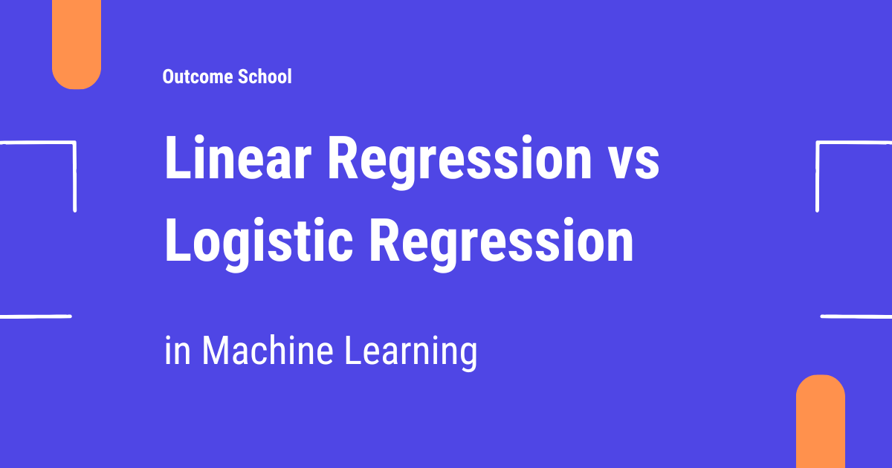

# Linear Regression vs Logistic Regression

> Archived from <https://outcomeschool.com/blog/linear-regression-vs-logistic-regression> on 2026-11-25.

Linear Regression predicts a continuous value, like the price of a house, whereas Logistic Regression predicts a category, like whether an email is spam or not.

In this blog, we will learn about Linear Regression vs Logistic Regression in Machine Learning.

I am <strong>Amit Shekhar</strong>, Founder @ <a target="_blank" rel="noopener noreferrer" href="https://outcomeschool.com">Outcome School</a>, I have taught and mentored many developers, and their efforts landed them high-paying tech jobs, helped many tech companies in solving their unique problems, and created many open-source libraries being used by top companies. I am passionate about sharing knowledge through open-source, blogs, and videos.

I teach <a target="_blank" rel="noopener noreferrer" href="https://outcomeschool.com/program/ai-and-machine-learning">AI and Machine Learning</a> at Outcome School.

Let&#x27;s get started.

In <a target="_blank" rel="noopener noreferrer" href="machine-learning.md">machine learning</a>, the two fundamental algorithms you will frequently encounter are <strong>Linear Regression</strong> and <strong>Logistic Regression</strong>. Although they sound similar, they are designed for <strong>fundamentally different tasks</strong>. Understanding their differences is crucial for choosing the right one. Let&#x27;s explore what they are, how they work, and when to use them.

But before diving into the algorithms, it&#x27;s important to understand the difference between <strong>regression and classification</strong>.

<strong>Regression</strong>

It predicts a <strong>continuous value</strong>.

A <strong>continuous value</strong> is numeric and can take any value. These values are measurable such as temperature, height, weight, or house prices.

Example: Predicting house prices, temperature, or stock prices.

<strong>Classification</strong>

It predicts a <strong>categorical value</strong>.

A <strong>categorical value</strong>, on the other hand, represents discrete groups or classes. These values are descriptive and usually non-numeric, like &quot;yes/no,&quot; &quot;red/blue/green,&quot; or &quot;spam/not-spam.&quot; Categorical values are used in <strong>classification problems</strong>, where the aim is to assign inputs to a specific category or class.

Example: Predicting whether an email is spam or not, or whether a patient has a disease or not.

Once such a classifier is built, its quality is measured using Precision and Recall. We have a detailed blog on <a target="_blank" rel="noopener noreferrer" href="precision-vs-recall.md">Precision vs Recall</a> that explains how both work.

<strong>Planning your move into AI?</strong>

No matter which tech domain you work in today, with your effort, you can transition to these roles:
<ul><li>AI Engineer</li><li>Forward Deployed Engineer</li><li>AI Agent Engineer</li><li>Harness Engineer</li><li>Voice AI Engineer</li><li>AI Architect</li><li>LLM Engineer</li><li>LLM Inference Engineer</li><li>Gen AI Engineer</li><li>MLOps Engineer</li><li>ML Engineer</li><li>Deep Learning Engineer</li></ul>
Our <a target="_blank" rel="noopener noreferrer" href="https://outcomeschool.com/program/ai-and-machine-learning">AI and Machine Learning Program</a> at Outcome School takes you there.

Now it&#x27;s time to jump into our main topic: Linear Regression vs Logistic Regression. Let&#x27;s start with Linear Regression.
<h2 id="linear-regression">Linear Regression</h2>
<strong>Linear Regression</strong> is one of the most basic algorithms in <a target="_blank" rel="noopener noreferrer" href="supervised-vs-unsupervised-learning.md">supervised learning</a>. It is used to predict a <strong>continuous value</strong> based on one or more input features.

Most importantly, it predicts a continuous value using a <strong>linear</strong> relationship between inputs and output.

Linear Regression uses a simple <strong>linear</strong> equation for the input variables <code>(x)</code> and the output variable <code>(y)</code>:

<pre><code class="language-python code-highlight">y = w1 × x1 + w2 × x2
</code></pre>
<ul><li><code>x1</code>, <code>x2</code> are input features.</li><li><code>w1</code>, <code>w2</code> are weights.</li><li><code>y</code> is the predicted continuous value.</li></ul>
The algorithm finds the line (or hyperplane in multiple dimensions) that best fits the data by minimizing the <strong>Mean Squared Error (MSE)</strong> between predicted and actual values.

Linear Regression fits a straight line to predict a continuous numeric value, with no limits on the output range, it can go below 0 or above 1.

And finally, as a prediction, we get a <strong>continuous value</strong>.

Example: Predicting house prices based on size and location.

This was all about the Linear Regression. Now it&#x27;s time to learn Logistic Regression.
<h2 id="logistic-regression">Logistic Regression</h2>
<strong>Logistic Regression</strong>, despite its name, is used for <strong>classification problems</strong> in supervised learning, not regression. It predicts the <strong>probability</strong> that a given input belongs to a particular class.

It starts with the same linear combination of inputs:

<pre><code class="language-python code-highlight">z = w1 × x1 + w2 × x2 // notice we’re using z instead of y
</code></pre>

Then applies the <a target="_blank" rel="noopener noreferrer" href="activation-functions.md"><strong>sigmoid (logistic) function</strong></a>:

<pre><code class="language-python code-highlight">y = σ(z) = 1 / (1 + e^(-z))
</code></pre>

This converts the raw value <code>z</code> into a probability between <strong>0</strong> and <strong>1</strong>.

That probability is then converted into a class:
<ul><li>If probability ≥ 0.5 → Class 1</li><li>If probability &lt; 0.5 → Class 0</li></ul>
The model is trained using <a target="_blank" rel="noopener noreferrer" href="math-behind-cross-entropy-loss.md"><strong>Cross-Entropy</strong></a> loss function. This loss function is mainly used for classification problems.

Logistic Regression uses an S-shaped curve (Sigmoid) to predict the probability, which is always restricted to the range [0, 1].

And finally, as a prediction, we get probabilities, that works well for classification.

<strong>A quick note for you</strong>

No matter which tech domain you work in, get familiar with these topics:
<ul><li>LLM</li><li>RAG</li><li>MCP</li><li>Agent</li><li>Fine-tuning</li><li>Quantization</li></ul>
We put it all together in one video:

<a target="_blank" rel="noopener noreferrer" href="https://www.youtube.com/watch?v=lnfWvX66FUk">AI Engineering Explained: LLM, RAG, MCP, Agent, Fine-Tuning, and Quantization</a>

No need to stop reading - bookmark it and watch later when you get time. Future you will thank you.

Now, let&#x27;s get back to the topic.

You might be wondering: if the algorithm is used for classification, why is it called Logistic <em>Regression</em>, especially the &quot;Regression&quot; part of the name?

The name comes from the <strong>way the model is built</strong>, not the task it performs.

Logistic Regression actually starts by doing something that looks exactly like <strong>linear regression</strong>. It takes the input features and forms a linear combination:

<pre><code class="language-python code-highlight">z = w1 × x1 + w2 × x2
</code></pre>

This part is literally a <strong>regression-style</strong> calculation, nothing about classification yet.

Then comes the twist: instead of using <code>z</code> directly, the model passes it through the <strong>logistic (sigmoid) function</strong> to convert it into a probability between 0 and 1:

<pre><code class="language-python code-highlight">y = σ(z) = 1 / (1 + e^(-z))
</code></pre>

That probability is then used to decide the final class.

So even though the final outcome is <strong>classification</strong>, the model&#x27;s internal mechanics are:
<ul><li>Linear <strong>regression-like</strong> equation</li><li>Followed by a <strong>logistic</strong> transformation using sigmoid function.</li><li>Producing probabilities for classification</li></ul>
Because the core computation is regression-based, the name <strong>&quot;Logistic Regression&quot;</strong> remained, even though we use it for classification.

That&#x27;s why the name is <strong>Logistic Regression</strong>.

So, this was all about the Logictic Regression.

To master Linear Regression, Logistic Regression, Cross-Entropy, and gradient descent end to end, check out our <a target="_blank" rel="noopener noreferrer" href="https://outcomeschool.com/program/ai-and-machine-learning">AI and Machine Learning Program</a> at Outcome School.
<h2 id="differences-between-linear-regression-and-logistic-regression">Differences Between Linear Regression and Logistic Regression</h2>
Let&#x27;s summarize the differences in a tabular format.
<table><thead><tr><th>Linear Regression</th><th>Logistic Regression</th></tr></thead><tbody><tr><td>Regression: Continuous value</td><td>Classification: Probability (0–1) → Class</td></tr><tr><td>y = w1 × x1 + w2 × x2</td><td>z = w1 × x1 + w2 × x2 → y = sigmoid(z)</td></tr><tr><td>Loss Function: Mean Squared Error</td><td>Loss Function: Cross-Entropy</td></tr><tr><td>Examples: House price, temperature</td><td>Examples: Spam detection, disease prediction</td></tr><tr><td>Use it when the target is continuous</td><td>Use it when the target is categorical</td></tr></tbody></table>
I hope this explanation helped.

You can find the complete code that contains the implementation of linear regression and logistic regression from scratch. Check <a target="_blank" rel="noopener noreferrer" href="https://github.com/amitshekhariitbhu/build-your-own-x-machine-learning">Build your own X - Machine Learning</a>

<strong>Stay updated:</strong> Subscribe to our <a target="_blank" rel="noopener noreferrer" href="https://outcomeschool.substack.com/subscribe">newsletter</a> to get our latest AI and Machine Learning blogs straight to your inbox.
<h2 id="frequently-asked-questions">Frequently Asked Questions</h2><h3 id="is-logistic-regression-used-for-regression-or-classification">Is Logistic Regression used for regression or classification?</h3>
Logistic Regression is used for classification, not regression. It predicts the probability that an input belongs to a particular class. The name comes from the way the model is built, since it starts with a regression-style linear equation before applying the sigmoid function.
<h3 id="what-is-the-difference-between-regression-and-classification">What is the difference between regression and classification?</h3>
Regression predicts a continuous value, and classification predicts a categorical value. A continuous value is numeric and measurable, like temperature, height, or house prices. A categorical value represents discrete groups, like spam or not spam, so the aim is to assign each input to a class.
<h3 id="can-linear-regression-predict-values-below-0-or-above-1">Can Linear Regression predict values below 0 or above 1?</h3>
Yes. Linear Regression fits a straight line, so its output has no limits on range and can go below 0 or above 1. Logistic Regression is different. It passes the value through the sigmoid function, so the output is always a probability between 0 and 1.
<h3 id="which-loss-function-does-each-model-use">Which loss function does each model use?</h3>
Linear Regression uses Mean Squared Error, and Logistic Regression uses Cross-Entropy. Linear Regression finds the line that best fits the data by minimizing the Mean Squared Error between predicted and actual values. Cross-Entropy is mainly used for classification problems, which is why Logistic Regression is trained with it.
<h3 id="how-does-logistic-regression-turn-a-probability-into-a-class">How does Logistic Regression turn a probability into a class?</h3>
Logistic Regression uses a threshold of 0.5. If the probability is greater than or equal to 0.5, the input goes to Class 1. If the probability is less than 0.5, the input goes to Class 0.

That&#x27;s it for now.

Thanks

<strong>Amit Shekhar</strong> Founder @ <a target="_blank" rel="noopener noreferrer" href="https://outcomeschool.com">Outcome School</a>

You can connect with me on:
<ul><li><a target="_blank" rel="noopener noreferrer" href="https://x.com/amitiitbhu">X</a></li><li><a target="_blank" rel="noopener noreferrer" href="https://www.linkedin.com/in/amit-shekhar-iitbhu">LinkedIn</a></li><li><a target="_blank" rel="noopener noreferrer" href="https://github.com/amitshekhariitbhu">GitHub</a></li></ul>
Follow Outcome School on:
<ul><li><a target="_blank" rel="noopener noreferrer" href="https://x.com/outcome_school">X</a></li><li><a target="_blank" rel="noopener noreferrer" href="https://youtube.com/@OutcomeSchool">YouTube</a></li><li><a target="_blank" rel="noopener noreferrer" href="https://www.linkedin.com/company/outcomeschool">LinkedIn</a></li><li><a target="_blank" rel="noopener noreferrer" href="https://github.com/OutcomeSchool">GitHub</a></li></ul>
<a target="_blank" rel="noopener noreferrer" href="https://outcomeschool.com/blog"><strong>Read all of our high-quality blogs here.</strong></a>

