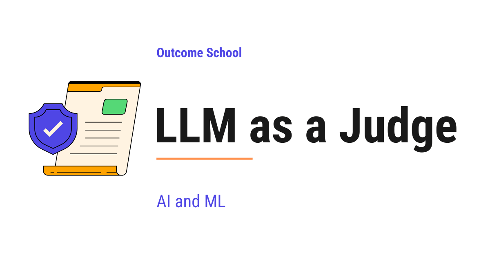

# What is LLM as a Judge? How to Use an LLM to Evaluate LLM Outputs

> Archived from <https://outcomeschool.com/blog/llm-as-a-judge> on 2026-11-25.

LLM as a Judge is a technique where we use a large language model to evaluate the output of another large language model. The judge LLM reads the output, compares it against our criteria, and gives a score or a verdict with a reason.

In this blog, we will learn about LLM as a Judge. We will also see how it works, why we need it, and how we can use it to evaluate the output of other LLMs.

We will cover the following:
<ul><li>What is LLM as a Judge?</li><li>Why do we need LLM as a Judge?</li><li>How does LLM as a Judge work?</li><li>Types of LLM as a Judge.</li><li>Steps to build an LLM Judge.</li><li>A prompt template for LLM as a Judge.</li><li>Chain-of-thought judging (G-Eval).</li><li>Biases in LLM as a Judge.</li><li>Best practices for LLM as a Judge.</li><li>Real-world use cases of LLM as a Judge.</li></ul>
I am <strong>Amit Shekhar</strong>, Founder @ <a target="_blank" rel="noopener noreferrer" href="https://outcomeschool.com">Outcome School</a>, I have taught and mentored many developers, and their efforts landed them high-paying tech jobs, helped many tech companies in solving their unique problems, and created many open-source libraries being used by top companies. I am passionate about sharing knowledge through open-source, blogs, and videos.

I teach <a target="_blank" rel="noopener noreferrer" href="https://outcomeschool.com/program/ai-and-machine-learning">AI and Machine Learning</a> at Outcome School.

Let&#x27;s get started.
<h3 id="what-is-llm-as-a-judge">What is LLM as a Judge?</h3>
<strong>LLM as a Judge</strong> is a technique where we use a large language model to evaluate the output of another large language model. The judge LLM reads the output, compares it against our criteria, and gives a score or a verdict with a reason.

In simple words, <strong>LLM as a Judge = LLM + Judge</strong>. We are using one LLM to judge the work of another LLM.

Let&#x27;s say we have built a chatbot using an LLM. The chatbot gives answers to user questions. Now, we want to know how good these answers are. We can ask a human to read every answer and rate it. But this is slow and expensive. Instead, we can ask another LLM to read the answers and rate them for us.

This is the core idea of LLM as a Judge.

The judge LLM acts like a teacher checking the homework of a student. The student is another LLM. The teacher reads the homework, compares it with the expected answer, and gives a grade with feedback.
<h3 id="why-do-we-need-llm-as-a-judge">Why do we need LLM as a Judge?</h3>
Before jumping into how it works, we must understand the problem it solves.

When we build an application using LLMs, we need to evaluate the quality of the output. The output of an LLM is open-ended text. There is no single correct answer. Two different answers can both be correct.

Let&#x27;s see the traditional ways of <a target="_blank" rel="noopener noreferrer" href="llm-evaluation.md">evaluating LLM outputs</a> and the problems with each approach.

<strong>Approach 1: Human evaluation.</strong>

We can ask humans to read every output and rate it. This gives high quality results because humans understand language well. But humans are slow. They are expensive. They get tired. They cannot evaluate millions of outputs every day.

The issue with this approach is that it does not scale. Let&#x27;s see how the next approach solve this issue.

<strong>Approach 2: Rule-based metrics like BLEU and ROUGE.</strong>

We can use rule-based metrics that compare the output with a reference answer word by word. These metrics are fast and cheap. But they only check word overlap. They miss the meaning. An answer can be correct but use different words. These metrics will give it a low score.

The issue with this approach is that it does not understand meaning. Let&#x27;s see how the next approach solve this issue.

<strong>Approach 3: LLM as a Judge.</strong>

We use another LLM to read the output and judge its quality. The LLM understands language. It understands meaning. It can compare two answers even if they use different words. It is fast. It is cheap compared to humans. It can evaluate millions of outputs every day.

So, here comes LLM as a Judge to the rescue.

It combines the quality of human evaluation with the speed and scale of automated metrics. This is the beauty of LLM as a Judge.

One more thing to notice. Studies have shown that strong LLM judges agree with human evaluators more than 80% of the time. This is roughly the same rate at which two humans agree with each other on the same task. So, a well-built LLM Judge is almost as reliable as a human evaluator, but much faster and much cheaper. This is the reason LLM as a Judge has become the default way of evaluating LLM applications.

The deeper question behind all of this is whether a task has an exact checker at all. We have a detailed blog on <a target="_blank" rel="noopener noreferrer" href="ai-is-only-as-good-as-our-definition-of-done.md">AI Is Only as Good as Our Definition of Done</a> that explains this in depth.
<h3 id="how-does-llm-as-a-judge-work">How does LLM as a Judge work?</h3>
The best way to learn this is by taking an example.

Let&#x27;s say we have built a customer support chatbot. A user asks a question. The chatbot gives an answer. We want to know if the answer is helpful.

Here is how LLM as a Judge works step-by-step:
<ul><li><strong>Step 1:</strong> We take the user question and the chatbot answer.</li><li><strong>Step 2:</strong> We write a prompt for the judge LLM. The prompt tells the judge what to do. It includes the question, the answer, and the rules for judging.</li><li><strong>Step 3:</strong> We send this prompt to the judge LLM.</li><li><strong>Step 4:</strong> The judge LLM reads everything and gives a score with a reason.</li><li><strong>Step 5:</strong> We use this score to decide if our chatbot is doing a good job.</li></ul>
A simple prompt for the judge can be as below:

<pre><code class="language-text code-highlight">You are an expert evaluator. Read the user question and the assistant answer below. Rate the answer on a scale of 1 to 5 based on helpfulness.

User question: How do I reset my password?

Assistant answer: To reset your password, click on the Forgot Password link on the login page. Enter your email address. You will receive a reset link in your email.

Give your score as a number from 1 to 5. Also give a short reason for your score.
</code></pre>

Here, we have given the judge a clear task. We have given the question, the answer, and the scoring rule.

The judge LLM will respond as below:

<pre><code class="language-text code-highlight">Score: 5
Reason: The answer is clear, step-by-step, and directly addresses the user question. It tells the user exactly what to do.
</code></pre>

This is how LLM as a Judge works.

In a real system, this judge usually sits as one step inside a bigger flow, where a low score sends the work back for another attempt. We have a detailed blog on <a target="_blank" rel="noopener noreferrer" href="what-is-graph-engineering.md">Graph Engineering</a> that explains how such steps are wired together.

<strong>Planning your move into AI?</strong>

No matter which tech domain you work in today, with your effort, you can transition to these roles:
<ul><li>AI Engineer</li><li>Forward Deployed Engineer</li><li>AI Agent Engineer</li><li>Harness Engineer</li><li>Voice AI Engineer</li><li>AI Architect</li><li>LLM Engineer</li><li>LLM Inference Engineer</li><li>Gen AI Engineer</li><li>MLOps Engineer</li><li>ML Engineer</li><li>Deep Learning Engineer</li></ul>
Our <a target="_blank" rel="noopener noreferrer" href="https://outcomeschool.com/program/ai-and-machine-learning">AI and Machine Learning Program</a> at Outcome School takes you there.
<h3 id="types-of-llm-as-a-judge">Types of LLM as a Judge</h3>
There are four common ways to use LLM as a Judge. Let&#x27;s learn about each of them.

<strong>Type 1: Single answer scoring.</strong>

We give the judge one answer and ask it to rate the answer on a scale, for example 1 to 5 or 1 to 10. The judge gives a score based on our criteria.

This is useful when we want to track the quality of our LLM over time. We can see if the average score is going up or down.

<strong>Type 2: Pairwise comparison.</strong>

We give the judge two answers to the same question. We ask the judge to pick the better one. The judge picks Answer A or Answer B and gives a reason.

This is useful when we are comparing two models or two versions of a prompt. We want to know which one is better.

<strong>Type 3: Reference-based evaluation.</strong>

We give the judge an answer and a reference answer. The reference answer is the correct or expected answer. The judge compares the two and gives a score based on how close they are in meaning.

This is useful when we have a ground truth answer and we want to check how close our LLM output is to that ground truth.

<strong>Type 4: Rubric-based evaluation.</strong>

We give the judge a rubric with multiple criteria. For each criterion, the judge gives a separate score. For example, the rubric can have accuracy, helpfulness, clarity, and tone as separate criteria. The judge gives a score for each one and an overall score at the end.

This is useful when quality is not a single number. A good answer must be correct, clear, and polite at the same time. Rubric-based evaluation tells us exactly where the answer is strong and where it is weak. This is the most common type used in production today.

Now, we have understood the types of LLM as a Judge. Let&#x27;s see how we can build one.
<h3 id="steps-to-build-an-llm-judge">Steps to build an LLM Judge</h3>
Now, let&#x27;s learn how to build our own LLM Judge step-by-step.

<strong>Step 1: Define the evaluation criteria.</strong>

First, we need to be very clear about what we want to evaluate. Are we evaluating helpfulness? Accuracy? Tone? Safety? We must write down the criteria in simple words.

For example, for a customer support chatbot, the criteria can be:
<ul><li>Is the answer correct?</li><li>Is the answer clear?</li><li>Is the answer polite?</li></ul>
<strong>Step 2: Choose the judge model.</strong>

We need to pick which LLM will act as our judge. Generally, we use a strong model like GPT-5, Claude Opus 4.7, or Gemini 3.1 Pro as the judge. The judge must be at least as capable as the model we are evaluating. Otherwise, the judge will miss the mistakes.

We can also explore open-source judge models when we do not want to send our data to a closed API like OpenAI or Anthropic.

<strong>Step 3: Write the judge prompt.</strong>

We write a prompt that tells the judge what to do. The prompt must include:
<ul><li>The task description.</li><li>The user input.</li><li>The model output to be judged.</li><li>The scoring scale and the rules.</li><li>The output format we want.</li></ul>
<strong>Step 4: Run the judge on a sample.</strong>

We run the judge on a small sample of outputs. We read the scores and reasons given by the judge. We check if the judge is doing a good job.

<strong>Step 5: Compare with human ratings.</strong>

We ask humans to rate the same sample. We compare the human ratings with the judge ratings. If they match closely, our judge is good. If they do not match, we need to improve the judge prompt.

<strong>Step 6: Iterate and improve.</strong>

Based on the comparison, we update the judge prompt. We add more rules. We give better examples. We test again. We keep doing this until the judge ratings match the human ratings.

<strong>Step 7: Use the judge at scale.</strong>

Once we trust the judge, we can use it to evaluate thousands or millions of outputs. We can also use it to compare different models, different prompts, and different versions of our application.

Now, our LLM Judge is ready.

To master Evaluation of LLMs and Agents, LLM as a Judge, and Prompt Engineering, check out our <a target="_blank" rel="noopener noreferrer" href="https://outcomeschool.com/program/ai-and-machine-learning">AI and Machine Learning Program</a> at Outcome School.
<h3 id="a-prompt-template-for-llm-as-a-judge">A prompt template for LLM as a Judge</h3>
Let&#x27;s see a complete prompt template that we can use for LLM as a Judge.

<pre><code class="language-text code-highlight">You are an expert evaluator. Your task is to evaluate the response given by an AI assistant to a user question.

Evaluate the response based on the following criteria:

1. Accuracy: Is the response factually correct?
2. Helpfulness: Does the response solve the user&#x27;s problem?
3. Clarity: Is the response easy to understand?

User question:
{user_question}

Assistant response:
{assistant_response}

Give your evaluation in the following format:

Accuracy score (1-5): &lt;score&gt;
Helpfulness score (1-5): &lt;score&gt;
Clarity score (1-5): &lt;score&gt;
Overall score (1-5): &lt;score&gt;
Reason: &lt;short explanation of your scores&gt;

Be fair and consistent. Base your scores only on the response given above.
</code></pre>

Here, we have built a clear and structured prompt. The judge LLM knows the task, the criteria, the input, and the output format. This makes the judge reliable and consistent.

<strong>A quick note for you</strong>

No matter which tech domain you work in, get familiar with these topics:
<ul><li>LLM</li><li>RAG</li><li>MCP</li><li>Agent</li><li>Fine-tuning</li><li>Quantization</li></ul>
We put it all together in one video:

<a target="_blank" rel="noopener noreferrer" href="https://www.youtube.com/watch?v=lnfWvX66FUk">AI Engineering Explained: LLM, RAG, MCP, Agent, Fine-Tuning, and Quantization</a>

No need to stop reading - bookmark it and watch later when you get time. Future you will thank you.

Now, let&#x27;s get back to the topic.
<h3 id="chain-of-thought-judging-g-eval">Chain-of-thought judging (G-Eval)</h3>
The basic prompt we have built so far works well, but we can make it much better. The trick is to ask the judge to think first and score later. This technique is called <strong>chain-of-thought judging</strong> and it is also known as <strong>G-Eval</strong>.

In simple words, <strong>G-Eval = Generate evaluation steps + Score</strong>. The judge first writes down the steps it will use to evaluate, then applies those steps to the answer, and only then gives a score.

Let&#x27;s see why this works.

When we ask the judge to give a score directly, the judge picks a number quickly without much thinking. The score is often shallow. But when we ask the judge to first write the evaluation steps, the judge slows down. It reads the answer more carefully. It applies each step one by one. The final score is much more reliable.

A G-Eval style prompt can be as below:

<pre><code class="language-text code-highlight">You are an expert evaluator. Your task is to evaluate the response below.

Criterion: Helpfulness

Step 1: Write down the evaluation steps you will use to check if the response is helpful. Think carefully.
Step 2: Apply each step to the response one by one. Write your reasoning for each step.
Step 3: Based on your reasoning, give a final score from 1 to 5.

User question:
{user_question}

Assistant response:
{assistant_response}

Now, follow Step 1, Step 2, and Step 3 in order.
</code></pre>

Here, we have asked the judge to think before scoring. The judge first builds its own checklist, then applies it, and finally gives the score. This is the same idea as <a target="_blank" rel="noopener noreferrer" href="how-does-chain-of-thought-prompting-work.md">chain-of-thought prompting</a>, applied to evaluation.

<strong>Note:</strong> G-Eval gives much better agreement with human ratings than the basic scoring prompt. If we want a reliable judge, we must use chain-of-thought judging.

If we want to go deep into Chain of Thought (CoT) Prompting, Prompt Engineering, and LLM as a Judge, we have a complete program on this - check out our <a target="_blank" rel="noopener noreferrer" href="https://outcomeschool.com/program/ai-and-machine-learning">AI and Machine Learning Program</a> at Outcome School.
<h3 id="biases-in-llm-as-a-judge">Biases in LLM as a Judge</h3>
LLM as a Judge is powerful, but it is not perfect. The judge LLM can have biases. We must understand these biases so that we can handle them in the right way.

<strong>Style bias.</strong>

This is the most dominant bias in LLM judges today. The judge often prefers a certain writing style, for example bullet points over paragraphs, or formal tone over casual tone. This style preference can be very strong and it can override the actual quality of the answer. The judge rewards the look and feel of the answer, not just the content. So, we must tell the judge in the prompt exactly what style is expected for our use case.

<strong>Position bias.</strong>

When we ask the judge to pick between Answer A and Answer B, the judge often prefers the answer that comes first. This is called position bias. To fix this, we can swap the order and run the judge twice. We take the average of the two results.

<strong>Verbosity bias.</strong>

The judge often prefers longer answers, even when the shorter answer is better. The judge sees more words and thinks the answer is more detailed. To fix this, we can tell the judge in the prompt to not prefer longer answers.

<strong>Self-preference bias.</strong>

This bias shows up at the time of evaluation. When the judge is asked to compare two answers, it gives a higher score to the answer that was generated by itself or by a model from its own family. For example, if we ask GPT-5 to pick between a GPT-5 answer and a Claude answer, GPT-5 picks itself more often than it should. The judge is doing the comparison fairly in its own mind, but it has a hidden preference for its own style. To fix this, we can use a different model as the judge, or use a Panel of Judges from different families.

<strong>Preference leakage.</strong>

This is a bigger problem and it works at the pipeline level, not at the single answer level. Self-preference bias is the mechanism. Preference leakage is what happens when this mechanism contaminates our whole evaluation setup.

Let&#x27;s see an example. Suppose we use GPT-5 to generate synthetic training data for our model. Then we use GPT-5 again as the judge to evaluate the trained model. The judge silently rewards answers that look like GPT-5 style, because the training data already pushed our model in that direction. Our scores look amazing on paper. But in the real world, with real users, the model does not perform as well as the scores suggest.

The data generator and the judge are not independent anymore. The eval is contaminated. To avoid this, the judge model family must be different from the family used to generate training data, prompts, or any other input that touches our pipeline.

<strong>Authority and bandwagon bias.</strong>

The judge often defers to confident-sounding answers and answers that quote experts or sources. Even if the content is wrong, the judge gives a high score because the answer sounds authoritative. Similarly, the judge can follow the crowd. If many earlier answers agree, the judge tends to agree as well, even when it should not. To fix this, we must remind the judge in the prompt to focus only on correctness, not on tone or confidence.

Now, we have understood the biases. Even frontier judge models still fail on bias-heavy tasks, so we must always test our judge against these biases before trusting it in production.
<h3 id="best-practices-for-llm-as-a-judge">Best practices for LLM as a Judge</h3>
Few important points to keep in mind:
<ul><li><strong>Use a strong judge model.</strong> The judge must be at least as capable as the model being judged.</li><li><strong>Write a clear prompt.</strong> The prompt must include the task, the criteria, the input, the output, and the format.</li><li><strong>Give examples in the prompt.</strong> <a target="_blank" rel="noopener noreferrer" href="in-context-learning.md">Few-shot examples</a> help the judge understand what a good score looks like.</li><li><strong>Use a clear scoring scale.</strong> A 1 to 5 scale is easier than a 1 to 100 scale. The judge gives more consistent scores on a small scale.</li><li><strong>Ask for a reason with the score.</strong> This makes the judge think more carefully. It also helps us debug the judge.</li><li><strong>Validate against humans.</strong> Always compare the judge ratings with human ratings on a sample. This tells us if we can trust the judge.</li><li><strong>Handle position bias.</strong> When doing pairwise comparison, swap the order and average the results.</li><li><strong>Use a Panel of LLM Judges.</strong> This is also called the Jury approach. We use more than one judge model from different families and average the scores. A panel reduces self-preference bias and gives more reliable results than any single judge.</li><li><strong>Keep the criteria simple.</strong> Do not ask the judge to evaluate too many things at once. Break it into separate evaluations if needed.</li></ul>
If we follow these practices, our LLM Judge will be reliable and useful.

<strong>Stay updated:</strong> Subscribe to our <a target="_blank" rel="noopener noreferrer" href="https://outcomeschool.substack.com/subscribe">newsletter</a> to get our latest AI and Machine Learning blogs straight to your inbox.
<h3 id="real-world-use-cases-of-llm-as-a-judge">Real-world use cases of LLM as a Judge</h3>
LLM as a Judge is used in many real-world scenarios across the industry. Let&#x27;s see some of them.

<strong>Model evaluation.</strong>

When we train or <a target="_blank" rel="noopener noreferrer" href="how-does-fine-tuning-work.md">fine-tune</a> an LLM, we need to know if the new version is better than the old version. We use LLM as a Judge to compare the outputs side by side. This is much faster than human evaluation.

<strong>Chatbot quality monitoring.</strong>

In a production chatbot, we cannot read every conversation. We use LLM as a Judge to score the conversations automatically. We get a daily report on how well the chatbot is doing.

<strong>Content moderation.</strong>

We can use LLM as a Judge to check if the output is safe. The judge reads the output and decides if it contains harmful content. We block such outputs before they reach the user. This is exactly how an output guardrail works, and we have a detailed blog on <a target="_blank" rel="noopener noreferrer" href="how-do-llm-guardrails-work.md">How do LLM guardrails work?</a> that explains it step by step.

<strong>RAG system evaluation.</strong>

In a <a target="_blank" rel="noopener noreferrer" href="retrieval-augmented-generation-rag.md">Retrieval-Augmented Generation (RAG)</a> system, we need to check if the answer is grounded in the retrieved documents. LLM as a Judge can check if the answer matches the documents. This helps us catch <a target="_blank" rel="noopener noreferrer" href="why-do-llms-hallucinate-the-token-level-explanation.md">hallucinations</a>, where the LLM makes up information that is not present in the documents.

<strong>Prompt engineering.</strong>

When we try different prompts for the same task, we need to know which prompt gives the best results. LLM as a Judge helps us compare prompts at scale.

<strong>Agent trajectory evaluation.</strong>

In <a target="_blank" rel="noopener noreferrer" href="ai-agent.md">agentic systems</a>, the agent takes multiple steps to solve a task. The agent calls tools, reads results, plans next actions, and so on. This full sequence of steps is called the trajectory. LLM as a Judge can read the full trajectory and decide if the agent picked the right tools, used them correctly, and reached the right answer. This is one of the fastest growing applications of LLM as a Judge because agentic systems are hard to evaluate with any other method. We have a detailed blog on <a target="_blank" rel="noopener noreferrer" href="ai-agent-evaluation.md">AI Agent Evaluation</a> that explains this in depth.

This way we can use LLM as a Judge to solve any evaluation problem in a very simple way.

Now we must have understood LLM as a Judge. It is a powerful technique that combines the quality of human evaluation with the speed and scale of automation. As LLM applications grow, LLM as a Judge becomes more and more important because we cannot scale human evaluation easily, but we can scale LLM evaluation very easily.

I will highly recommend that we always validate our LLM Judge against human ratings before trusting it.

This way we can use LLM as a Judge to evaluate the quality of our AI systems and build better products for our users.
<h2 id="frequently-asked-questions">Frequently Asked Questions</h2><h3 id="is-llm-as-a-judge-as-reliable-as-human-evaluation">Is LLM as a Judge as reliable as human evaluation?</h3>
Almost. Studies have shown that strong LLM judges agree with human evaluators more than 80% of the time, which is roughly the same rate at which two humans agree with each other. So, a well-built judge is almost as reliable as a human, but much faster and much cheaper.
<h3 id="why-not-just-use-bleu-or-rouge-to-evaluate-llm-outputs">Why not just use BLEU or ROUGE to evaluate LLM outputs?</h3>
BLEU and ROUGE only check word overlap, so they miss the meaning. An answer can be correct but use different words, and these metrics will give it a low score. An LLM judge understands meaning, so it can compare two answers even if they use different words.
<h3 id="can-the-same-model-be-used-as-both-the-generator-and-the-judge">Can the same model be used as both the generator and the judge?</h3>
It is better not to. A judge gives higher scores to answers from itself or its own model family, which is called self-preference bias. If the same family also generates the training data, the evaluation gets contaminated. The judge model family must be different from the family used anywhere else in the pipeline.
<h3 id="how-do-we-know-if-we-can-trust-our-llm-judge">How do we know if we can trust our LLM Judge?</h3>
We validate it against human ratings. We ask humans to rate a small sample, run the judge on the same sample, and compare the two. If they match closely, the judge is good. If not, we improve the judge prompt and test again until the ratings match.
<h3 id="should-the-judge-model-be-smaller-than-the-model-being-evaluated">Should the judge model be smaller than the model being evaluated?</h3>
No. The judge must be at least as capable as the model we are evaluating. Otherwise, the judge will miss the mistakes. Generally, we use a strong model as the judge, and we can explore open-source judge models when we do not want to send our data to a closed API.

That&#x27;s it for now.

Thanks

<strong>Amit Shekhar</strong> Founder @ <a target="_blank" rel="noopener noreferrer" href="https://outcomeschool.com">Outcome School</a>

You can connect with me on:
<ul><li><a target="_blank" rel="noopener noreferrer" href="https://x.com/amitiitbhu">X</a></li><li><a target="_blank" rel="noopener noreferrer" href="https://www.linkedin.com/in/amit-shekhar-iitbhu">LinkedIn</a></li><li><a target="_blank" rel="noopener noreferrer" href="https://github.com/amitshekhariitbhu">GitHub</a></li></ul>
Follow Outcome School on:
<ul><li><a target="_blank" rel="noopener noreferrer" href="https://x.com/outcome_school">X</a></li><li><a target="_blank" rel="noopener noreferrer" href="https://youtube.com/@OutcomeSchool">YouTube</a></li><li><a target="_blank" rel="noopener noreferrer" href="https://www.linkedin.com/company/outcomeschool">LinkedIn</a></li><li><a target="_blank" rel="noopener noreferrer" href="https://github.com/OutcomeSchool">GitHub</a></li></ul>
<a target="_blank" rel="noopener noreferrer" href="https://outcomeschool.com/blog"><strong>Read all of our high-quality blogs here.</strong></a>

