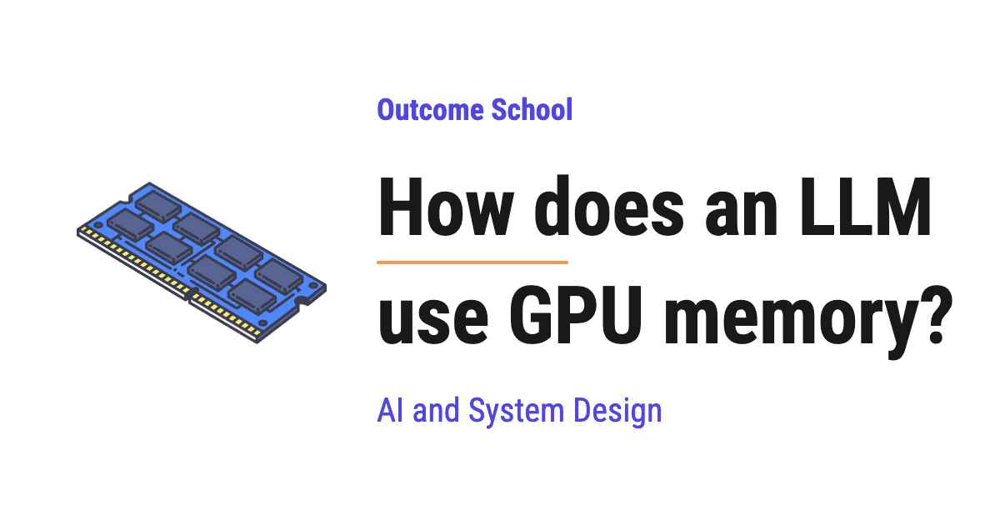

# How does an LLM use GPU memory?

> Archived from <https://outcomeschool.com/blog/llm-gpu-memory> on 2026-11-25.

An LLM uses GPU memory for three things, the model weights, the KV cache, and some overhead, so the simple formula is VRAM = weights + KV cache + overhead.

In this blog, we will learn about how an LLM uses GPU memory. We will also see what GPU memory is, the formula VRAM = weights + KV cache + overhead, how the weights, the KV cache, and the overhead each take up space, a complete worked-out example, and how we can reduce GPU memory usage.

We will cover the following:
<ul><li>What is GPU memory (VRAM)?</li><li>The simple formula for GPU memory usage</li><li>What are weights and how much memory they take</li><li>What is the KV cache and how much memory it takes?</li><li>What is the overhead?</li><li>A complete worked-out example</li><li>How to reduce GPU memory usage</li></ul>
I am <strong>Amit Shekhar</strong>, Founder @ <a target="_blank" rel="noopener noreferrer" href="https://outcomeschool.com">Outcome School</a>, I have taught and mentored many developers, and their efforts landed them high-paying tech jobs, helped many tech companies in solving their unique problems, and created many open-source libraries being used by top companies. I am passionate about sharing knowledge through open-source, blogs, and videos.

I teach <a target="_blank" rel="noopener noreferrer" href="https://outcomeschool.com/program/ai-and-machine-learning">AI and Machine Learning</a> at Outcome School.

Let&#x27;s get started.
<h3 id="what-is-gpu-memory-vram">What is GPU memory (VRAM)?</h3>
<strong>GPU memory is the fast storage that sits right next to the GPU. It is called VRAM, which stands for Video RAM.</strong>

VRAM is the working memory that belongs to the GPU. Anything the GPU needs to look at while working must be placed inside this workspace.

Let&#x27;s say a cook is preparing food. The cook is the GPU. The kitchen counter is the VRAM. The cook can only work with the items that are already placed on the counter.

If the counter is small, the cook cannot keep many items on it. In the same way, if the VRAM is small, the GPU cannot keep a large model and a long conversation in it at the same time.

VRAM is limited. A single GPU may have 16 GB, 24 GB, 40 GB, or 80 GB of VRAM. So, we must understand exactly where this limited memory goes.

We have a detailed blog on <a target="_blank" rel="noopener noreferrer" href="how-does-a-gpu-work-for-deep-learning.md">How does a GPU work for Deep Learning?</a> that explains how the GPU does this work step by step.

Now, the next big question is: where does all this GPU memory get used? The answer is the simple formula.
<h3 id="the-simple-formula-for-gpu-memory-usage">The simple formula for GPU memory usage</h3>
When we run an LLM on a GPU, the VRAM is used by three things.

<strong>VRAM = weights + KV cache + overhead</strong>

So, the total GPU memory used is the sum of three parts.
<ul><li><strong>Weights</strong> are the learned numbers of the model that we load once.</li><li><strong><a target="_blank" rel="noopener noreferrer" href="kv-cache-in-llms.md">KV cache</a></strong> is the short-term memory of the current conversation.</li><li><strong>Overhead</strong> is the extra working space the GPU needs while running.</li></ul>
We can see this in a diagram like below:

<pre><code class="code-highlight language-text">+--------------------------------------------------+
|                  GPU memory (VRAM)               |
+--------------------------------------------------+
|                                                  |
|  +------------+   +-----------+   +----------+   |
|  |  Weights   | + | KV cache  | + | Overhead |   |
|  | (loaded    |   | (grows    |   | (working |   |
|  |  once,     |   |  with     |   |  scratch |   |
|  |  fixed)    |   |  tokens)  |   |  space)  |   |
|  +------------+   +-----------+   +----------+   |
|                                                  |
+--------------------------------------------------+
</code></pre>

Here, we can see that the full VRAM is shared by three parts that sit side by side. The weights are loaded once and stay fixed. The KV cache grows as the conversation gets longer. The overhead is the working scratch space. The total of these three must fit inside the limited VRAM.

<strong>Planning your move into AI?</strong>

No matter which tech domain you work in today, with your effort, you can transition to these roles:
<ul><li>AI Engineer</li><li>Forward Deployed Engineer</li><li>AI Agent Engineer</li><li>Harness Engineer</li><li>Voice AI Engineer</li><li>AI Architect</li><li>LLM Engineer</li><li>LLM Inference Engineer</li><li>Gen AI Engineer</li><li>MLOps Engineer</li><li>ML Engineer</li><li>Deep Learning Engineer</li></ul>
Our <a target="_blank" rel="noopener noreferrer" href="https://outcomeschool.com/program/ai-and-machine-learning">AI and Machine Learning Program</a> at Outcome School takes you there.

Let&#x27;s understand them one by one.
<h3 id="what-are-weights-and-how-much-memory-they-take">What are weights and how much memory they take</h3>
<strong>Weights are the numbers that the model learned during training. They are the knowledge of the model.</strong>

Weights are millions or billions of numbers that decide how the model behaves. When we hear that a model has &quot;7 billion parameters&quot;, those parameters are the weights. They do not change while we chat with the model. They only change during training.

To use the model, we must load all these weights into the VRAM first. This happens once, when the model starts.

Now, the question is: how much memory do the weights take? It depends on how many weights there are, and how many bytes each weight takes.

Each number is stored using some number of bytes. A common choice is 2 bytes per weight. This 2-byte format is often called <code>FP16</code> or half precision.

So, the memory for weights is simple to calculate as below:

<pre><code class="code-highlight language-python"># Memory for weights
number_of_weights = 7_000_000_000   # 7 billion parameters
bytes_per_weight = 2                 # FP16 means 2 bytes per weight

weights_memory_bytes = number_of_weights * bytes_per_weight
weights_memory_gb = weights_memory_bytes / (1024 ** 3)

print(weights_memory_gb)   # around 13 GB
</code></pre>

Here, we have taken a model with 7 billion weights. Each weight takes 2 bytes. So, we multiply 7 billion by 2 to get 14 billion bytes. When we divide that by 1024 three times to convert bytes into gigabytes, we get around 13 GB.

So, just to load a 7 billion parameter model, we need about 13 GB of VRAM.

This is how weights use GPU memory. Now, let&#x27;s move to the KV cache.
<h3 id="what-is-the-kv-cache-and-how-much-memory-it-takes">What is the KV cache and how much memory it takes?</h3>
An LLM reads and writes text one token at a time. A <strong><a target="_blank" rel="noopener noreferrer" href="tokenization-in-llms.md">token</a></strong> is a small piece of text, like a word or a part of a word. For the sake of understanding, we can think of a token as roughly one word.

When the model generates the next token, it must look back at every token that came before it. If the conversation has 1000 tokens, the model looks back at all 1000 tokens to decide the next one.

If the model recalculated everything for every single new token, it would repeat the same work again and again. That is very slow and wasteful.

So, here comes the <strong>KV cache</strong> to the rescue.

<strong>The KV cache is the memory where the model stores the results it already calculated for past tokens, so it does not have to calculate them again.</strong>

KV cache = Key cache + Value cache. For every token, the model calculates two things called the <a target="_blank" rel="noopener noreferrer" href="math-behind-attention-qkv.md">Key and the Value</a>. Instead of throwing them away, the model saves them in the VRAM. The next token can reuse them directly.

Let&#x27;s say we are solving a long math problem on paper. Instead of redoing the earlier steps every time, we keep our earlier results written down and reuse them. The KV cache is exactly that written-down workpad.

This makes the model much faster. The KV cache grows with every new token. The longer the conversation, the bigger the KV cache becomes.

<strong>A quick note for you</strong>

No matter which tech domain you work in, get familiar with these topics:
<ul><li>LLM</li><li>RAG</li><li>MCP</li><li>Agent</li><li>Fine-tuning</li><li>Quantization</li></ul>
We put it all together in one video:

<a target="_blank" rel="noopener noreferrer" href="https://www.youtube.com/watch?v=lnfWvX66FUk">AI Engineering Explained: LLM, RAG, MCP, Agent, Fine-Tuning, and Quantization</a>

No need to stop reading - bookmark it and watch later when you get time. Future you will thank you.

Now, let&#x27;s get back to the topic.

We can picture the growth as below:

<pre><code class="code-highlight language-text">Token 1   |  KV cache: [K1,V1]
Token 2   |  KV cache: [K1,V1][K2,V2]
Token 3   |  KV cache: [K1,V1][K2,V2][K3,V3]
Token 4   |  KV cache: [K1,V1][K2,V2][K3,V3][K4,V4]
   .      |
   .      |  (keeps growing with every new token)
   .      |
Token N   |  KV cache: [K1,V1][K2,V2] ... [KN,VN]

          |--- bigger and bigger ---&gt;
</code></pre>

Here, we can see that each new token adds its own Key and Value pair to the KV cache and nothing is thrown away. So the cache that started tiny at token 1 keeps getting bigger with every token, and a long conversation ends up with a large KV cache.

So, the question is: how much memory does the KV cache take? It depends on the length of the text, the size of the model, and the number of layers inside the model.

A <strong>layer</strong> is one processing stage inside the model. A model has many layers stacked one after another, and each layer keeps its own Key and Value for every token. So more layers and more tokens mean a bigger KV cache.

Let&#x27;s see a simple calculation as below:

<pre><code class="code-highlight language-python"># Memory for the KV cache
num_tokens = 4000        # total tokens in the conversation
num_layers = 32          # number of layers in the model
hidden_size = 4096       # size of the model&#x27;s internal list of numbers
bytes_per_number = 2     # FP16 again

# 2 is for Key and Value (two of them)
kv_cache_bytes = 2 * num_tokens * num_layers * hidden_size * bytes_per_number
kv_cache_gb = kv_cache_bytes / (1024 ** 3)

print(kv_cache_gb)   # around 2 GB
</code></pre>

Here, we can see the parts of the calculation. We multiply by 2 because we store both a Key and a Value. We multiply by the number of tokens, because every token needs its own entry. We multiply by the number of layers, because every layer keeps its own copy. We multiply by the hidden size and the bytes per number to get the full size. For 4000 tokens, this comes to around 2 GB.

<strong>Note:</strong> This calculation is for a model where every attention head keeps its own Key and Value, like Llama 2 7B. Many newer models <a target="_blank" rel="noopener noreferrer" href="grouped-query-attention.md">share Keys and Values across heads</a>, so their KV cache is smaller.

Now, notice one thing. If one user has a 4000 token conversation, the KV cache is around 2 GB. If 10 users are chatting at the same time, we need around 20 GB just for the KV cache. This is why long conversations and many users can fill up the GPU memory very fast.

This is how the KV cache uses GPU memory. Now, let&#x27;s move to the overhead.

To learn KV Cache, Paged Attention, and vLLM in depth, check out our <a target="_blank" rel="noopener noreferrer" href="https://outcomeschool.com/program/ai-and-machine-learning">AI and Machine Learning Program</a> at Outcome School.
<h3 id="what-is-the-overhead">What is the overhead?</h3>
<strong>Overhead is the extra GPU memory used by everything that is not the weights and not the KV cache.</strong>

In simple words, overhead is the scratch space the GPU needs while it is doing its work.

Let&#x27;s say a cook is cooking. The ingredients are the weights. The notes about the current dish are the KV cache. But the cook also needs empty space on the counter to chop, mix, and stir. That empty working space is the overhead.

The overhead includes temporary results created during calculation, the memory used by the software that runs the GPU, and small reserved blocks. We cannot make this zero. It is always there.

For a rough estimate, we can keep around 1 GB to 2 GB for overhead, or sometimes 10 to 20 percent of the total. The exact number depends on the model and the software, so we keep some buffer for it.

This is how the overhead uses GPU memory. Now, let&#x27;s put all three together in one example.
<h3 id="a-complete-worked-out-example">A complete worked-out example</h3>
The best way to learn this is by taking an example.

Assume that we have a 7 billion parameter model. We are using <code>FP16</code>, so each number takes 2 bytes. We want to support one user with a 4000 token conversation. Let&#x27;s add up the memory step by step.

<strong>Step 1:</strong> Calculate the weights memory. We have 7 billion weights, each taking 2 bytes. That is about 13 GB.

<strong>Step 2:</strong> Calculate the KV cache memory. For a 4000 token conversation on this model, that is about 2 GB.

<strong>Step 3:</strong> Add the overhead. We keep about 1 GB for the scratch space and the software.

<strong>Step 4:</strong> Add all three together. 13 GB plus 2 GB plus 1 GB gives us about 16 GB.

Let me tabulate this for your better understanding.
<table><thead><tr><th>Part</th><th>What it is</th><th>Memory</th></tr></thead><tbody><tr><td>Weights</td><td>The learned knowledge of the model</td><td>About 13 GB</td></tr><tr><td>KV cache</td><td>The short-term memory of the conversation</td><td>About 2 GB</td></tr><tr><td>Overhead</td><td>The working scratch space</td><td>About 1 GB</td></tr><tr><td>Total</td><td>The full GPU memory needed</td><td>About 16 GB</td></tr></tbody></table>
So, a 7 billion parameter model needs around 16 GB of VRAM to serve one user comfortably. This is why a 24 GB GPU is a common choice for running such a model in <code>FP16</code>.

<strong>Stay updated:</strong> Subscribe to our <a target="_blank" rel="noopener noreferrer" href="https://outcomeschool.substack.com/subscribe">newsletter</a> to get our latest AI and Machine Learning blogs straight to your inbox.

Now, let&#x27;s see how we can reduce it.
<h3 id="how-to-reduce-gpu-memory-usage">How to reduce GPU memory usage</h3>
We have learned that VRAM = weights + KV cache + overhead. So, to use less memory, we must shrink one or more of these three parts.

The first big trick is <strong><a target="_blank" rel="noopener noreferrer" href="how-does-model-quantization-work.md">quantization</a></strong>. Quantization means storing each weight using fewer bytes. Instead of 2 bytes per weight, we can use 1 byte or even less. This directly cuts the weights memory.

With 1 byte per weight, a 7 billion parameter model takes around 6.5 GB instead of 13 GB. The model becomes a little less precise, but it fits in a smaller GPU.

The second trick is to <strong>limit the conversation length</strong>. The KV cache grows with every token. If we keep conversations shorter, the KV cache stays smaller. So we set a limit on how many tokens we allow. We have a detailed blog on <a target="_blank" rel="noopener noreferrer" href="kv-cache-compression.md">KV Cache Compression</a> that covers other ways to shrink the KV cache in depth.

The third trick is to use a <strong>smaller model</strong>. A 7 billion parameter model needs more memory than a 3 billion parameter model. If a smaller model is good enough for our use case, we save a lot of weights memory.

The fourth trick is to use <strong>better KV cache handling</strong>. Modern serving software <a target="_blank" rel="noopener noreferrer" href="paged-attention-in-llms.md">stores the KV cache in small blocks</a> so that very little memory is wasted. This lets us serve more users with the same GPU.

So, depending on our use case, we can mix these tricks to fit the model into the GPU memory we have.

Now we must have understood how an LLM uses GPU memory, and how the weights, the KV cache, and the overhead add up to the total VRAM.
<h2 id="frequently-asked-questions">Frequently Asked Questions</h2><h3 id="do-the-weights-take-more-gpu-memory-as-the-conversation-gets-longer">Do the weights take more GPU memory as the conversation gets longer?</h3>
No. The weights are loaded into the VRAM once, when the model starts, and they stay fixed while we chat with the model. Only the KV cache grows with every new token, so a longer conversation increases the KV cache memory, not the weights memory.
<h3 id="why-does-serving-many-users-at-once-need-so-much-more-gpu-memory">Why does serving many users at once need so much more GPU memory?</h3>
Each user&#x27;s conversation needs its own KV cache. For a 7 billion parameter model in FP16, one 4000 token conversation needs around 2 GB of KV cache. If 10 users are chatting at the same time, we need around 20 GB just for the KV cache, which fills up the GPU memory very fast.
<h3 id="can-a-7-billion-parameter-model-fit-on-a-smaller-gpu">Can a 7 billion parameter model fit on a smaller GPU?</h3>
Yes, with quantization. In FP16, with 2 bytes per weight, the weights alone take about 13 GB, and the total for one user is about 16 GB. With 1 byte per weight, the weights take around 6.5 GB instead. The model becomes a little less precise, but it fits in a smaller GPU.
<h3 id="can-we-make-the-overhead-zero">Can we make the overhead zero?</h3>
No. The overhead is the scratch space the GPU needs while working, including temporary results, the memory used by the software that runs the GPU, and small reserved blocks. It is always there. For a rough estimate, we keep around 1 GB to 2 GB, or sometimes 10 to 20 percent of the total, as a buffer for it.

That&#x27;s it for now.

Thanks

<strong>Amit Shekhar</strong> Founder @ <a target="_blank" rel="noopener noreferrer" href="https://outcomeschool.com">Outcome School</a>

You can connect with me on:
<ul><li><a target="_blank" rel="noopener noreferrer" href="https://x.com/amitiitbhu">X</a></li><li><a target="_blank" rel="noopener noreferrer" href="https://www.linkedin.com/in/amit-shekhar-iitbhu">LinkedIn</a></li><li><a target="_blank" rel="noopener noreferrer" href="https://github.com/amitshekhariitbhu">GitHub</a></li></ul>
Follow Outcome School on:
<ul><li><a target="_blank" rel="noopener noreferrer" href="https://x.com/outcome_school">X</a></li><li><a target="_blank" rel="noopener noreferrer" href="https://youtube.com/@OutcomeSchool">YouTube</a></li><li><a target="_blank" rel="noopener noreferrer" href="https://www.linkedin.com/company/outcomeschool">LinkedIn</a></li><li><a target="_blank" rel="noopener noreferrer" href="http://github.com/OutcomeSchool">GitHub</a></li></ul>
<a target="_blank" rel="noopener noreferrer" href="https://outcomeschool.com/blog"><strong>Read all of our high-quality blogs here.</strong></a>

