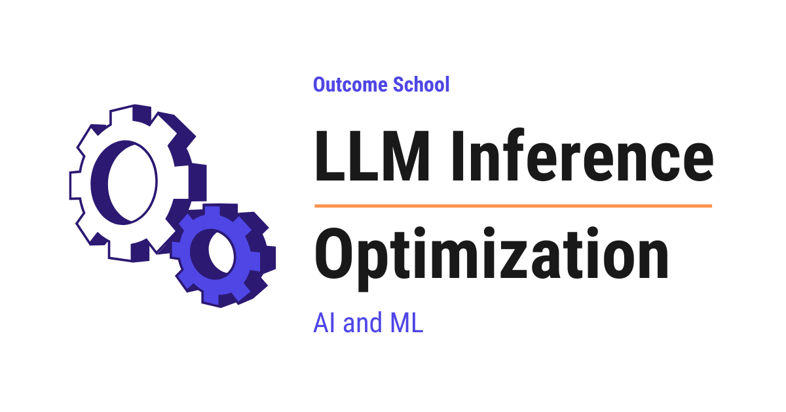

# LLM Inference Optimization

> Archived from <https://outcomeschool.com/blog/llm-inference-optimization> on 2026-11-25.

LLM Inference Optimization is the set of techniques that make a Large Language Model generate its answers faster and serve more users at a lower cost.

Techniques like KV Cache, Paged Attention, Flash Attention, Speculative Decoding, and Continuous Batching are what make LLMs fast and scalable in production. Let’s learn all of these techniques one by one.
<h2 id="kv-cache-in-llms">KV Cache in LLMs</h2>
In this blog, we will learn about <strong>KV Cache</strong> - where <strong>K</strong> stands for <strong>Key</strong> and <strong>V</strong> stands for <strong>Value</strong> - and why it is used in Large Language Models (LLMs) to speed up text generation.

We will start with how LLMs generate text one token at a time, understand the role of Key, Value, and Query inside the model, see the problem of repeated computation through an example, and then walk through how KV Cache solves this problem by storing and reusing past results.

<strong>Read here:</strong> <a target="_blank" rel="noopener noreferrer" href="kv-cache-in-llms.md">KV Cache in LLMs</a>

<h2 id="kv-cache-compression">KV Cache Compression</h2>
In this blog, we will learn about <strong>KV Cache Compression</strong>, the set of techniques that shrink the memory an AI model uses to remember the conversation while it is writing its reply.

We will cover the following:
<ul><li>What is an LLM and how it writes text</li><li>What is Attention</li><li>What is the KV Cache</li><li>Why the KV Cache becomes huge</li><li>What is KV Cache Compression</li><li>Approach 1: Quantization</li><li>Approach 2: Token Eviction</li><li>Approach 3: Sharing Keys and Values across Heads</li><li>Approach 4: Low-Rank Compression</li><li>Comparison of the approaches</li><li>When to use which one</li></ul>
<strong>Read here:</strong> <a target="_blank" rel="noopener noreferrer" href="kv-cache-compression.md">KV Cache Compression</a>

<h2 id="paged-attention-in-llms">Paged Attention in LLMs</h2>
In this blog, we will learn about <strong>Paged Attention</strong>, a technique that solves the memory waste problem of KV Cache, allowing LLMs to serve many more users at the same time.

We will start with a quick recap of KV Cache, understand the memory problem it creates, see how traditional memory allocation wastes space through an example, and then walk through how Paged Attention solves this problem by borrowing an idea from how computers manage memory.

<strong>Read here:</strong> <a target="_blank" rel="noopener noreferrer" href="paged-attention-in-llms.md">Paged Attention in LLMs</a>

<h2 id="decoding-flash-attention-in-llms">Decoding Flash Attention in LLMs</h2>
In this blog, we will learn about <strong>Flash Attention</strong> by decoding it piece by piece - understanding why standard attention is slow, what makes Flash Attention fast, how it uses GPU memory cleverly, and why it is used in almost every modern Large Language Model (LLM).

We will cover the following:
<ul><li>A quick recap of standard attention</li><li>Why standard attention is slow</li><li>How GPU memory actually works (HBM vs SRAM)</li><li>The core idea behind Flash Attention</li><li>Tiling: breaking the work into small blocks</li><li>Online softmax: computing softmax without the full matrix</li><li>Recomputation in the backward pass</li><li>Flash Attention 2</li><li>Flash Attention 3</li><li>Advantages and impact of Flash Attention</li></ul>
<strong>Read here:</strong> <a target="_blank" rel="noopener noreferrer" href="decoding-flash-attention.md">Decoding Flash Attention in LLMs</a>

<strong>Planning your move into AI?</strong>

No matter which tech domain you work in today, with your effort, you can transition to these roles:
<ul><li>AI Engineer</li><li>Forward Deployed Engineer</li><li>AI Agent Engineer</li><li>Harness Engineer</li><li>Voice AI Engineer</li><li>AI Architect</li><li>LLM Engineer</li><li>LLM Inference Engineer</li><li>Gen AI Engineer</li><li>MLOps Engineer</li><li>ML Engineer</li><li>Deep Learning Engineer</li></ul>
Our <a target="_blank" rel="noopener noreferrer" href="https://outcomeschool.com/program/ai-and-machine-learning">AI and Machine Learning Program</a> at Outcome School takes you there.
<h2 id="grouped-query-attention">Grouped Query Attention</h2>
In this blog, we will learn about <strong>Grouped-Query Attention (GQA)</strong> and how it differs from <strong>Multi-Head Attention (MHA)</strong>.

Today, we will cover the following topics:
<ul><li>Quick Recap: Multi-Head Attention (MHA)</li><li>The Problem with Multi-Head Attention</li><li>What is Multi-Query Attention (MQA)?</li><li>What is Grouped-Query Attention (GQA)?</li><li>How Grouped-Query Attention Works</li><li>GQA is a Generalization of MHA and MQA</li><li>GQA vs MHA vs MQA</li><li>Real-World Use Cases</li><li>A Note on Terminology</li><li>Uptraining: Converting MHA to GQA</li><li>Quick Summary</li></ul>
<strong>Read here:</strong> <a target="_blank" rel="noopener noreferrer" href="grouped-query-attention.md">Grouped Query Attention</a>

<h2 id="speculative-decoding">Speculative Decoding</h2>
In this blog, we will learn about <strong>Speculative Decoding</strong> - what it is, why LLM generation is slow without it, how a small draft model and a big target model work together to produce tokens faster, the rejection sampling math that guarantees no quality loss, real numbers showing the 2× to 3× speedup, where it is used in production, and the trade-offs to watch out for.

We will cover the following:
<ul><li>What problem does Speculative Decoding solve?</li><li>The Big Picture</li><li>Why is LLM generation slow?</li><li>The core idea behind Speculative Decoding</li><li>Step-by-step walkthrough</li><li>The verification step</li><li>Real numbers and speedup</li><li>Where it is used</li><li>Trade-offs</li><li>Quick Summary</li></ul>
<strong>Read here:</strong> <a target="_blank" rel="noopener noreferrer" href="speculative-decoding.md">Speculative Decoding</a>

<h2 id="decoding-medusa">Decoding Medusa</h2>
In this blog, we will learn about <strong>Medusa</strong>, a simple way to make a language model generate text 2 to 3 times faster by giving it several extra heads that guess multiple future tokens at once.

We will cover the following:
<ul><li>What is Medusa</li><li>Why text generation is slow</li><li>A quick recap of speculative decoding</li><li>The problem with needing a draft model</li><li>The big idea: many heads on one model</li><li>How tree attention checks many guesses at once</li><li>The math behind the speedup with small numbers</li><li>The results</li><li>How Medusa lives on today</li><li>Quick Summary</li></ul>
<strong>Read here:</strong> <a target="_blank" rel="noopener noreferrer" href="decoding-medusa.md">Decoding Medusa</a>

<h2 id="decoding-eagle">Decoding EAGLE</h2>
In this blog, we will learn about <strong>EAGLE</strong>, a state-of-the-art way to speed up language model generation by drafting tokens at the feature level instead of the token level.

We will cover the following:
<ul><li>What is EAGLE</li><li>A quick recap of speculative decoding</li><li>The problem with token-level drafting</li><li>The big idea: draft at the feature level</li><li>Resolving the uncertainty by feeding back the token</li><li>The math behind the speedup with small numbers</li><li>EAGLE-2 and dynamic draft trees</li><li>How EAGLE lives on today</li><li>Quick Summary</li></ul>
<strong>Read here:</strong> <a target="_blank" rel="noopener noreferrer" href="decoding-eagle.md">Decoding EAGLE</a>

<h2 id="n-gram-speculation-in-llms">N-gram Speculation in LLMs</h2>
In this blog, we will learn about <strong>N-gram Speculation in LLMs</strong>, a simple trick that makes a language model write its answer faster by guessing the next few words from the text it has already seen.

We will cover the following:
<ul><li>How an LLM generates text</li><li>Why generating text is slow</li><li>What is Speculative Decoding</li><li>The cost of a draft model</li><li>What is an N-gram</li><li>What is N-gram Speculation</li><li>N-gram Speculation step by step</li><li>Why the output stays exactly the same</li><li>Where it works well and where it fails</li><li>N-gram Speculation vs Draft Model Speculative Decoding</li></ul>
<strong>Read here:</strong> <a target="_blank" rel="noopener noreferrer" href="n-gram-speculation-in-llms.md">N-gram Speculation in LLMs</a>

<strong>A quick note for you</strong>

No matter which tech domain you work in, get familiar with these topics:
<ul><li>LLM</li><li>RAG</li><li>MCP</li><li>Agent</li><li>Fine-tuning</li><li>Quantization</li></ul>
We put it all together in one video:

<a target="_blank" rel="noopener noreferrer" href="https://www.youtube.com/watch?v=lnfWvX66FUk">AI Engineering Explained: LLM, RAG, MCP, Agent, Fine-Tuning, and Quantization</a>

No need to stop reading - bookmark it and watch later when you get time. Future you will thank you.

Now, let&#x27;s get back to the topic.
<h2 id="continuous-batching-in-llms">Continuous Batching in LLMs</h2>
In this blog, we will learn about <strong>Continuous Batching</strong>, a technique that lets LLM servers handle many more users at the same time by keeping the GPU busy at every single step of generation.

We will cover the following:
<ul><li>Quick Recap: How an LLM Generates Tokens</li><li>Why Batching Matters for LLMs</li><li>The Old Way: Static Batching</li><li>The Problem with Static Batching</li><li>What is Continuous Batching?</li><li>The Ride-Share Analogy</li><li>How Continuous Batching Works Step by Step</li><li>A Numeric Example</li><li>Real Numbers and Speedup</li><li>Benefits of Continuous Batching</li><li>A Few Important Notes</li><li>Quick Summary</li></ul>
<strong>Read here:</strong> <a target="_blank" rel="noopener noreferrer" href="continuous-batching-in-llms.md">Continuous Batching in LLMs</a>

<h2 id="prompt-caching">Prompt Caching</h2>
In this blog, we will learn about how Prompt Caching works. We will also see why we need it, how it actually works inside a large language model, and where it is used in real systems like AI assistants and agents.

We will cover the following:
<ul><li>What is a prompt</li><li>A quick recap of how an LLM reads a prompt</li><li>What is Prompt Caching</li><li>Why we need Prompt Caching</li><li>The core idea behind Prompt Caching</li><li>The exact-prefix rule</li><li>Cache write vs cache read and TTL</li><li>What we should put in the cache</li><li>The benefits of Prompt Caching</li><li>Prompt Caching in the real world</li></ul>
<strong>Read here:</strong> <a target="_blank" rel="noopener noreferrer" href="how-does-prompt-caching-work.md">How does Prompt Caching work?</a>

<h2 id="prefill-vs-decode-llm-inference-optimization">Prefill vs Decode: LLM Inference Optimization</h2>
In this blog, we will learn about Prefill vs Decode, the two phases of LLM inference, and how understanding them helps us optimize the speed of an LLM. We will also see how the prefill and decode phases work, how the KV cache connects them, how they differ and when to use which one based on our use case, and how we optimize each phase to make an LLM faster.

We will cover the following:
<ul><li>The two phases: Prefill and Decode</li><li>Prefill explained in simple words</li><li>Decode explained in simple words</li><li>A diagram of the two phases and the KV cache flow</li><li>The KV cache as the bridge between the two phases</li><li>A step-by-step walkthrough of a few decode steps</li><li>Prefill vs Decode comparison table</li><li>Why this split matters: compute-bound vs memory-bound</li><li>The key metrics: TTFT, TPOT, throughput, and end-to-end latency</li><li>Optimization techniques mapped to each phase</li></ul>
<strong>Read here:</strong> <a target="_blank" rel="noopener noreferrer" href="prefill-vs-decode-llm-inference-optimization.md">Prefill vs Decode: LLM Inference Optimization</a>

<h2 id="prefill-decode-disaggregation">Prefill-Decode Disaggregation</h2>
In this blog, we will learn about <strong>Prefill-Decode Disaggregation</strong>, a way of running a large language model where the reading of the prompt and the writing of the answer happen on separate machines.

We will cover the following:
<ul><li>How an LLM answers a request</li><li>What is the KV Cache?</li><li>Prefill is compute-heavy, Decode is memory-heavy</li><li>The problem when both run on the same GPU</li><li>TTFT vs TPOT</li><li>The naive approaches and their issues</li><li>What is Prefill-Decode Disaggregation?</li><li>How Prefill-Decode Disaggregation works</li><li>Walkthrough of one request</li><li>Advantages of Prefill-Decode Disaggregation</li><li>Disadvantages of Prefill-Decode Disaggregation</li><li>Where it works well and where it is overkill</li><li>Co-located vs Disaggregated serving</li></ul>
<strong>Read here:</strong> <a target="_blank" rel="noopener noreferrer" href="prefill-decode-disaggregation.md">Prefill-Decode Disaggregation</a>

<h2 id="how-does-vllm-work">How does vLLM work?</h2>
In this blog, we will learn about how vLLM works. We will also see why we need it, how it manages memory so cleverly, and where it is used in the real world to serve large language models to many users at once.

We will cover the following:
<ul><li>What is serving an LLM</li><li>A quick recap of prefill, decode, and the KV cache</li><li>The problem: the KV cache eats GPU memory</li><li>Why naive serving wastes memory</li><li>What is vLLM</li><li>PagedAttention, the core idea</li><li>How PagedAttention shares memory</li><li>Continuous batching</li><li>The OpenAI-compatible API server</li><li>The benefits of vLLM</li><li>vLLM in the real world</li></ul>
<strong>Read here:</strong> <a target="_blank" rel="noopener noreferrer" href="how-does-vllm-work.md">How does vLLM work?</a>

<h2 id="how-does-sglang-work">How does SGLang work?</h2>
In this blog, we will learn about how SGLang works. We will also see what problem it solves, how it makes serving large language models faster, and the clever ideas that make it special.

We will cover the following:
<ul><li>What is SGLang</li><li>RadixAttention: the heart of SGLang</li><li>How RadixAttention reuses past work</li><li>The frontend language of SGLang</li><li>Continuous batching in SGLang</li><li>Structured output and faster decoding</li><li>More powerful features of SGLang</li><li>How SGLang compares to vLLM</li></ul>
<strong>Read here:</strong> <a target="_blank" rel="noopener noreferrer" href="how-does-sglang-work.md">How does SGLang work?</a>

<h2 id="how-does-tensorrt-llm-work">How does TensorRT-LLM work?</h2>
In this blog, we will learn about how TensorRT-LLM works, NVIDIA&#x27;s own engine that squeezes the highest possible speed out of an NVIDIA GPU when it runs a large language model.

We will cover the following:
<ul><li>What is inference</li><li>What is a GPU and what is a kernel</li><li>The problem: the GPU spends its time on the wrong things</li><li>What is TensorRT-LLM</li><li>The big idea: prepare the model ahead of time</li><li>The build step: from a model to an engine</li><li>Kernel fusion</li><li>Quantization</li><li>Custom attention kernels</li><li>The paged KV cache</li><li>In-flight batching</li><li>CUDA graphs</li><li>Speculative decoding</li><li>Running one model across many GPUs</li><li>How we actually serve the model</li><li>The PyTorch backend, the newer and easier path</li><li>The full journey of one request</li><li>TensorRT-LLM vs vLLM</li><li>Where it works well and where it fails</li></ul>
<strong>Read here:</strong> <a target="_blank" rel="noopener noreferrer" href="how-does-tensorrt-llm-work.md">How does TensorRT-LLM work?</a>

<strong>Stay updated:</strong> Subscribe to our <a target="_blank" rel="noopener noreferrer" href="https://outcomeschool.substack.com/subscribe">newsletter</a> to get our latest AI and Machine Learning blogs straight to your inbox.
<h2 id="how-does-ollama-work">How does Ollama work?</h2>
In this blog, we will learn about how Ollama works, the free tool that lets us download and run LLMs on our own computer with one simple command. We will also see why model files must be shrunk before they fit on a laptop, how Ollama&#x27;s client and server talk to each other, and how models are loaded onto the CPU and GPU.

We will cover the following:
<ul><li>What does running an LLM locally mean?</li><li>What is Ollama?</li><li>The big problem: models are huge</li><li>Quantization and the GGUF file format</li><li>The architecture: client and server</li><li>What happens when we run a model?</li><li>How models are downloaded and stored</li><li>How the model runs on CPU and GPU</li><li>What is a Modelfile?</li><li>Using Ollama from code through its API</li><li>Where it works well and where it fails</li></ul>
<strong>Read here:</strong> <a target="_blank" rel="noopener noreferrer" href="how-does-ollama-work.md">How does Ollama work?</a>

<h2 id="how-do-cuda-kernels-work">How do CUDA Kernels work?</h2>
In this blog, we will learn about how CUDA Kernels work, the small programs that run on a GPU and do the heavy lifting behind almost every modern AI model.

We will cover the following:
<ul><li>Why do we need a GPU?</li><li>What is CUDA?</li><li>What is a CUDA Kernel?</li><li>Threads, Blocks, and Grids</li><li>Host and Device</li><li>Writing our first CUDA Kernel</li><li>How a thread finds its own work</li><li>What happens inside the GPU when a kernel runs</li><li>Memory in CUDA</li><li>Why CUDA Kernels matter for AI</li><li>Where CUDA Kernels work well and where they fail</li></ul>
<strong>Read here:</strong> <a target="_blank" rel="noopener noreferrer" href="how-do-cuda-kernels-work.md">How do CUDA Kernels work?</a>

<h2 id="how-does-an-lpu-work">How does an LPU work?</h2>
In this blog, we will learn about how an <strong>LPU</strong> works, the chip that was built for one single job, running a large language model that is already trained and producing text as fast as possible.

We will cover the following:
<ul><li>What is an LPU</li><li>How an LLM writes text, one token at a time</li><li>The real bottleneck is memory, not math</li><li>Why a GPU struggles here</li><li>Keeping the model on the chip</li><li>Removing all the guesswork with a compiler</li><li>A network that never waits</li><li>What happens when we send a prompt</li><li>Where an LPU works well and where it does not</li><li>LPU vs GPU</li></ul>
<strong>Read here:</strong> <a target="_blank" rel="noopener noreferrer" href="how-does-an-lpu-work.md">How does an LPU work?</a>

<h2 id="frequently-asked-questions">Frequently Asked Questions</h2><h3 id="does-speculative-decoding-reduce-the-quality-of-the-output">Does Speculative Decoding reduce the quality of the output?</h3>
No. In Speculative Decoding, a small draft model and a big target model work together to produce tokens faster. The rejection sampling math guarantees no quality loss. It gives a speedup of around 2 to 3 times.
<h3 id="can-we-speed-up-generation-without-a-separate-draft-model">Can we speed up generation without a separate draft model?</h3>
Yes. Medusa gives the model several extra heads that guess multiple future tokens at once, so it does not need a draft model. N-gram Speculation guesses the next few words from the text the model has already seen.
<h3 id="what-is-the-difference-between-the-prefill-and-decode-phases">What is the difference between the prefill and decode phases?</h3>
Prefill and decode are the two phases of LLM inference. Prefill reads the prompt and is compute-heavy, while decode writes the answer and is memory-heavy. The KV cache acts as the bridge between the two phases. Prefill-Decode Disaggregation goes one step further and runs these two phases on separate machines.
<h3 id="which-techniques-help-an-llm-server-handle-more-users-at-the-same-time">Which techniques help an LLM server handle more users at the same time?</h3>
Paged Attention and Continuous Batching both help here. Paged Attention solves the memory waste problem of the KV Cache, allowing LLMs to serve many more users at the same time. Continuous Batching keeps the GPU busy at every single step of generation, so the server can handle many more users.

That&#x27;s it for now.

Thanks

<strong>Amit Shekhar</strong> Founder @ <a target="_blank" rel="noopener noreferrer" href="https://outcomeschool.com">Outcome School</a>

You can connect with me on:
<ul><li><a target="_blank" rel="noopener noreferrer" href="https://x.com/amitiitbhu">X</a></li><li><a target="_blank" rel="noopener noreferrer" href="https://www.linkedin.com/in/amit-shekhar-iitbhu">LinkedIn</a></li><li><a target="_blank" rel="noopener noreferrer" href="https://github.com/amitshekhariitbhu">GitHub</a></li></ul>
Follow Outcome School on:
<ul><li><a target="_blank" rel="noopener noreferrer" href="https://x.com/outcome_school">X</a></li><li><a target="_blank" rel="noopener noreferrer" href="https://youtube.com/@OutcomeSchool">YouTube</a></li><li><a target="_blank" rel="noopener noreferrer" href="https://www.linkedin.com/company/outcomeschool">LinkedIn</a></li><li><a target="_blank" rel="noopener noreferrer" href="https://github.com/OutcomeSchool">GitHub</a></li></ul>
<a target="_blank" rel="noopener noreferrer" href="https://outcomeschool.com/blog"><strong>Read all of our high-quality blogs here.</strong></a>

