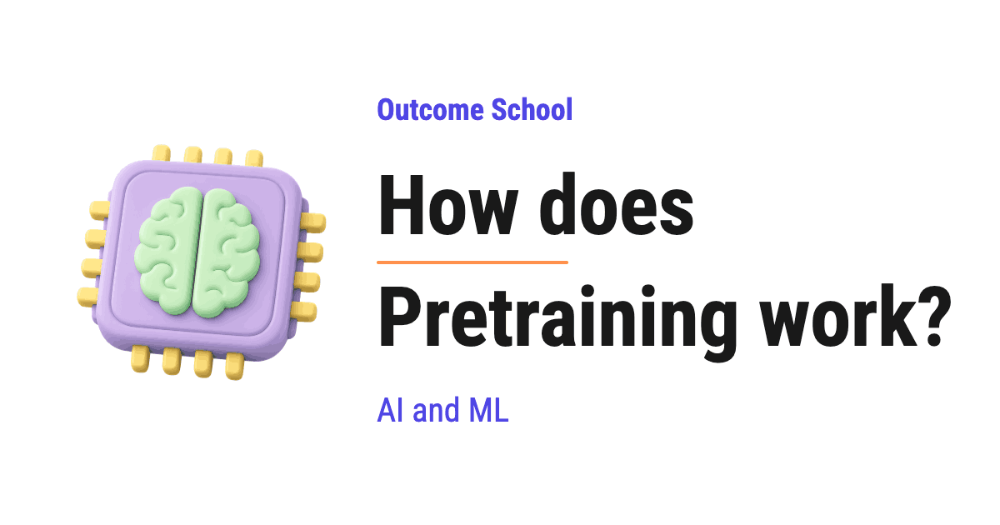

# How does Pretraining work?

> Archived from <https://outcomeschool.com/blog/llm-pretraining> on 2026-11-25.

Pretraining is the first and biggest stage of building an LLM, where the model reads a huge amount of text and learns to predict the next word again and again. By doing this billions of times, it learns language, facts, and patterns of reasoning.

In this blog, we will learn about how pretraining works. We will also see what simple game the model plays during pretraining, where the training text comes from and how it is cleaned, how the model learns from its mistakes, why it needs so much data and computing power, what we get at the end of pretraining, and how pretraining is different from the stages that come after it.

We will cover the following:
<ul><li>What is Pretraining?</li><li>Why is it called &quot;pre&quot; training?</li><li>The simple game: predict the next word</li><li>Why no human labels are needed</li><li>Step 1: Collecting the text</li><li>Step 2: Cleaning the text</li><li>Step 3: Breaking text into tokens</li><li>Step 4: The training loop</li><li>A tiny example of learning from a mistake</li><li>Why does pretraining need so much data and compute?</li><li>What do we get after pretraining?</li><li>What comes after pretraining?</li><li>Pretraining vs Fine-tuning</li></ul>
I am <strong>Amit Shekhar</strong>, Founder @ <a target="_blank" rel="noopener noreferrer" href="https://outcomeschool.com">Outcome School</a>, I have taught and mentored many developers, and their efforts landed them high-paying tech jobs, helped many tech companies in solving their unique problems, and created many open-source libraries being used by top companies. I am passionate about sharing knowledge through open-source, blogs, and videos.

I teach <a target="_blank" rel="noopener noreferrer" href="https://outcomeschool.com/program/ai-and-machine-learning">AI and Machine Learning</a> at Outcome School.

Let&#x27;s get started.
<h2 id="what-is-pretraining">What is Pretraining?</h2>
Inside an <a target="_blank" rel="noopener noreferrer" href="large-language-model-llm.md">LLM (Large Language Model)</a>, there are billions of numbers called <strong>weights</strong>. These weights store everything the model knows. At the very beginning, these numbers are random, so the model knows nothing. It writes only nonsense.

So, the question is: how does a model full of random numbers become a model that can write essays, answer questions, and write code?

The answer is: training. And the first and biggest part of this training is called pretraining.

<strong>Pretraining is the stage where a model reads a massive amount of general text and learns to predict the next word. This gives the model a broad understanding of language and the world.</strong>

Pretraining is like the model&#x27;s school education. Before a person becomes a doctor or a lawyer, they first go to school and learn reading, writing, math, science, and general knowledge. Pretraining is that general schooling for the model.
<h2 id="why-is-it-called-pre-training">Why is it called &quot;pre&quot; training?</h2>
&quot;Pre&quot; means &quot;before&quot;. So, pretraining is the training that happens before everything else.

After pretraining, the model goes through more training stages to become a helpful assistant. Those later stages are smaller and more focused. Pretraining comes first and builds the foundation on which everything else stands.

<pre><code class="language-text code-highlight">   Random model
 (knows nothing)
        ↓
 [ Pretraining ]
        ↓
    Base model
 (knows language)
        ↓
[ Later training ]
        ↓
    Assistant
  (like ChatGPT)
</code></pre>

The model we get right after pretraining is called a <strong>base model</strong>. We will learn about the base model in detail later in this blog.
<h2 id="the-simple-game-predict-the-next-word">The simple game: predict the next word</h2>
Now, let&#x27;s understand what the model actually does during pretraining.

The model plays one very simple game again and again: <strong>guess the next word.</strong>

Let&#x27;s say the model sees this sentence:

<pre><code class="language-text code-highlight">The cat sat on the ___
</code></pre>

The model has to <a target="_blank" rel="noopener noreferrer" href="autoregressive-models.md">guess what comes next</a>. A good guess is &quot;mat&quot;. A bad guess is &quot;banana&quot;.

To guess the next word correctly, again and again, across all kinds of text, the model is forced to learn many things:
<ul><li>To complete &quot;The capital of France is ___&quot;, the model must learn facts.</li><li>To complete &quot;She was very hungry, so she ___&quot;, the model must learn cause and effect.</li><li>To complete &quot;2 + 3 = ___&quot;, the model must learn some math.</li><li>To complete a line of Python code, the model must learn programming.</li><li>To complete a sentence in Hindi, the model must learn Hindi.</li></ul>
So, by playing this one game at a huge scale, the model ends up learning grammar, facts, reasoning patterns, coding, and much more.

<strong>Note:</strong> The model actually predicts the next <strong><a target="_blank" rel="noopener noreferrer" href="tokenization-in-llms.md">token</a></strong>, not the next word. A token is a small piece of text, like a word or a part of a word. We will see tokens in a moment. For now, we can think of a token as a word, just for the sake of understanding.
<h2 id="why-no-human-labels-are-needed">Why no human labels are needed</h2>
In the usual style of Machine Learning, humans give the model the correct answers. For example, to teach a model to spot cats in photos, humans have to label thousands of photos as &quot;cat&quot; or &quot;not cat&quot;. This is slow and expensive.

But pretraining does not need any human to label anything. The correct answer is already inside the text itself.

Let&#x27;s take the sentence: &quot;The cat sat on the mat.&quot;

From this one sentence, we can make many practice questions automatically, like below:

<pre><code class="language-text code-highlight">Input                        Correct next word
&quot;The&quot;                   ---&gt; &quot;cat&quot;
&quot;The cat&quot;               ---&gt; &quot;sat&quot;
&quot;The cat sat&quot;           ---&gt; &quot;on&quot;
&quot;The cat sat on&quot;        ---&gt; &quot;the&quot;
&quot;The cat sat on the&quot;    ---&gt; &quot;mat&quot;
</code></pre>

Here, we can see that every word in the sentence becomes a correct answer for the words before it. Nobody had to write these answers. The text provides them.

We can write the code to create these practice questions as below:

<pre><code class="code-highlight language-python">tokens = [&quot;The&quot;, &quot;cat&quot;, &quot;sat&quot;, &quot;on&quot;, &quot;the&quot;, &quot;mat&quot;]

for i in range(1, len(tokens)):
    context = tokens[:i]
    target = tokens[i]
    print(context, &quot;-&gt;&quot;, target)
</code></pre>

Here, we have a list of tokens. In each round of the loop, <code>context</code> holds all the tokens before position <code>i</code>, and <code>target</code> holds the token at position <code>i</code>, which is the correct next token. It will print the following:

<pre><code class="language-text code-highlight">[&#x27;The&#x27;] -&gt; cat
[&#x27;The&#x27;, &#x27;cat&#x27;] -&gt; sat
[&#x27;The&#x27;, &#x27;cat&#x27;, &#x27;sat&#x27;] -&gt; on
[&#x27;The&#x27;, &#x27;cat&#x27;, &#x27;sat&#x27;, &#x27;on&#x27;] -&gt; the
[&#x27;The&#x27;, &#x27;cat&#x27;, &#x27;sat&#x27;, &#x27;on&#x27;, &#x27;the&#x27;] -&gt; mat
</code></pre>

Only five lines of code, and one sentence gave us five practice questions with correct answers.

This way of learning, where the data creates its own answers, is called <strong><a target="_blank" rel="noopener noreferrer" href="self-supervised-learning.md">self-supervised learning</a></strong>.

Means, any text can be used for training without anyone labeling it. That is why we can train on trillions of tokens.

<strong>Planning your move into AI?</strong>

No matter which tech domain you work in today, with your effort, you can transition to these roles:
<ul><li>AI Engineer</li><li>Forward Deployed Engineer</li><li>AI Agent Engineer</li><li>Harness Engineer</li><li>Voice AI Engineer</li><li>AI Architect</li><li>LLM Engineer</li><li>LLM Inference Engineer</li><li>Gen AI Engineer</li><li>MLOps Engineer</li><li>ML Engineer</li><li>Deep Learning Engineer</li></ul>
Our <a target="_blank" rel="noopener noreferrer" href="https://outcomeschool.com/program/ai-and-machine-learning">AI and Machine Learning Program</a> at Outcome School takes you there.
<h2 id="step-1-collecting-the-text">Step 1: Collecting the text</h2>
Now, let&#x27;s see the pretraining process step by step.

First, we need a huge amount of text. This text comes from many sources:
<ul><li>Web pages collected from the public internet. A popular public collection is <strong>Common Crawl</strong>, which has been saving copies of web pages for many years.</li><li>Books.</li><li>Wikipedia and other encyclopedias.</li><li>Code from public code websites.</li><li>Research papers.</li><li>Text in many languages.</li></ul>
The amount is enormous. Modern LLMs are trained on trillions of tokens. For example, Meta has shared that its Llama 3 models were pretrained on more than 15 trillion tokens.

To understand how big this is, if a person reads one book every day, they will not finish even a tiny part of this text in their whole life.
<h2 id="step-2-cleaning-the-text">Step 2: Cleaning the text</h2>
But the internet has a lot of low-quality text. If we train the model on low-quality text, it learns low-quality patterns.

So, before training, the text is cleaned. The common cleaning steps are:
<ul><li><strong>Removing duplicates:</strong> The same page often appears many times. Repeated text makes the model memorize instead of learn, so we keep only one copy.</li><li><strong>Removing low-quality text:</strong> Spam, broken pages, random lists of keywords, and pages with very little real content are filtered out.</li><li><strong>Removing harmful content:</strong> Toxic and unsafe text is filtered out as much as possible.</li><li><strong>Removing private information:</strong> Things like phone numbers and email addresses are removed or masked.</li><li><strong>Balancing the mix:</strong> The team decides how much of the final data comes from web pages, books, code, math, and other languages.</li></ul>
<strong>Very important:</strong> The quality of the data matters as much as the quantity. A smaller amount of clean, high-quality text often teaches the model better than a larger amount of messy text.
<h2 id="step-3-breaking-text-into-tokens">Step 3: Breaking text into tokens</h2>
The model does not understand letters or words directly. It only understands numbers. So, the text is broken into tokens, and each token gets an ID number.

<pre><code class="language-text code-highlight">&quot;Pretraining is powerful&quot;
        ↓
[&quot;Pre&quot;, &quot;training&quot;, &quot; is&quot;, &quot; powerful&quot;]
        ↓
[ 4721,   8812,     318,   3665 ]
</code></pre>

Here, for the sake of example, the ID numbers are made up. Each model has its own fixed list of tokens called its <strong>vocabulary</strong>, and every token in the vocabulary has its own ID.

Common words usually become one token. Rare or long words get split into smaller pieces. This way, the model can handle any word, even a word it has never seen. We have a detailed blog on <a target="_blank" rel="noopener noreferrer" href="bpe-in-llms.md">Byte Pair Encoding (BPE)</a> that explains how this splitting works step by step.

<strong>A quick note for you</strong>

No matter which tech domain you work in, get familiar with these topics:
<ul><li>LLM</li><li>RAG</li><li>MCP</li><li>Agent</li><li>Fine-tuning</li><li>Quantization</li></ul>
We put it all together in one video:

<a target="_blank" rel="noopener noreferrer" href="https://www.youtube.com/watch?v=lnfWvX66FUk">AI Engineering Explained: LLM, RAG, MCP, Agent, Fine-Tuning, and Quantization</a>

No need to stop reading - bookmark it and watch later when you get time. Future you will thank you.

Now, let&#x27;s get back to the topic.
<h2 id="step-4-the-training-loop">Step 4: The training loop</h2>
The model is a big <strong><a target="_blank" rel="noopener noreferrer" href="neural-network.md">neural network</a></strong>, which is made of many layers of simple math steps and learns patterns from examples. It learns through a loop that repeats millions of times.

<strong>Step A:</strong> We take a chunk of text from our cleaned data, for example, &quot;The cat sat on the&quot;.

<strong>Step B:</strong> The model makes a guess. It does not pick just one word. It gives a <strong>probability</strong> for every token in its vocabulary. All these probabilities together add up to 1. Let&#x27;s say, at some point in training, the guesses look like below:

<pre><code class="language-text code-highlight">Next token     Probability
&quot;mat&quot;          0.10
&quot;floor&quot;        0.08
&quot;banana&quot;       0.05
...            ...
</code></pre>

<strong>Step C:</strong> We check how wrong the guess was. The correct next word from the real text is &quot;mat&quot;. So, we look at how much probability the model gave to &quot;mat&quot;. If it gave a high probability, the model did well. If it gave a low probability, the model did badly.

This &quot;how wrong&quot; score is called the <strong><a target="_blank" rel="noopener noreferrer" href="math-behind-cross-entropy-loss.md">loss</a></strong>. A lower loss means a better guess.

<strong>Step D:</strong> We adjust the weights. The model slightly changes its billions of weights, so that next time it gives a little more probability to &quot;mat&quot; in this kind of sentence. The method that figures out which weights to change, and by how much, is called <strong><a target="_blank" rel="noopener noreferrer" href="math-behind-backpropagation.md">backpropagation</a></strong>. The method that actually makes the small changes is called <strong><a target="_blank" rel="noopener noreferrer" href="math-behind-gradient-descent.md">gradient descent</a></strong>.

The idea is simple: <strong>find the mistake, then nudge every weight a tiny bit in the direction that reduces the mistake.</strong>

<strong>Step E:</strong> We repeat steps A to D with the next piece of text, and the next, and the next, across trillions of tokens.

<pre><code class="language-text code-highlight">        Take text
            ↓
    Guess next token
            ↓
      Measure loss
            ↓
     Adjust weights
            ↓
Repeat with the next text
</code></pre>

In practice, the model does not learn from one sentence at a time. It learns from a large group of text chunks at once, called a <strong><a target="_blank" rel="noopener noreferrer" href="epoch-batch-and-iteration.md">batch</a></strong>. This makes training much faster on powerful chips.
<h2 id="a-tiny-example-of-learning-from-a-mistake">A tiny example of learning from a mistake</h2>
The best way to learn this is by taking an example. Let&#x27;s follow one sentence over a few rounds of training. The numbers are made up just for the sake of understanding.

Sentence: &quot;The cat sat on the ___&quot;. Correct answer: &quot;mat&quot;.

<pre><code class="language-text code-highlight">Round 1:   P(&quot;mat&quot;) = 0.01   ---&gt; very wrong, high loss  ---&gt; big adjustment
Round 2:   P(&quot;mat&quot;) = 0.05   ---&gt; still wrong            ---&gt; adjustment
Round 3:   P(&quot;mat&quot;) = 0.20   ---&gt; getting better         ---&gt; smaller adjustment
...
Round N:   P(&quot;mat&quot;) = 0.60   ---&gt; good guess, low loss   ---&gt; tiny adjustment
</code></pre>

Here, we can notice that the probability for the correct word slowly goes up, and the loss slowly goes down.

But the model is not just memorizing this one sentence. The same weights are shared across all sentences. So, while learning that cats sit on mats, the model also learns that dogs sit on mats, that &quot;on the&quot; is often followed by a place or an object, and many such patterns. Every update helps with millions of other sentences too.

It also never gets to 1.0 for &quot;mat&quot;, and that is correct. A cat can also sit on the floor, the sofa, or the bed. A good model learns a sensible spread of probabilities, not one fixed answer.

To learn Loss Functions, Backpropagation, and Gradient Descent in depth, and to build a Large Language Model (LLM) from scratch, check out our <a target="_blank" rel="noopener noreferrer" href="https://outcomeschool.com/program/ai-and-machine-learning">AI and Machine Learning Program</a> at Outcome School.
<h2 id="why-does-pretraining-need-so-much-data-and-compute">Why does pretraining need so much data and compute?</h2>
Now, the next big question is: why does pretraining need such huge resources?

<strong>Reason 1: Language is huge.</strong> To know facts about the whole world, many languages, coding, and math, the model must see a very large amount of varied text.

<strong>Reason 2: The model is huge.</strong> A model with billions of weights needs a lot of examples to set all those numbers well.

<strong>Reason 3: Every token costs computation.</strong> For every token, the model does a huge amount of math, both for guessing and for adjusting the weights.

So, pretraining runs on thousands of <strong><a target="_blank" rel="noopener noreferrer" href="how-does-a-gpu-work-for-deep-learning.md">GPUs</a></strong>, which are special chips that do this kind of math very fast. These GPUs <a target="_blank" rel="noopener noreferrer" href="distributed-training.md">work together</a> for weeks or months. This costs a huge amount of money and electricity. That is why only a few large companies and labs pretrain big models from scratch.

We have a detailed blog on <a target="_blank" rel="noopener noreferrer" href="chinchilla-scaling-laws.md">the Chinchilla scaling laws</a> that explains how to split a fixed training budget between model size and training data.
<h2 id="what-do-we-get-after-pretraining">What do we get after pretraining?</h2>
At the end of pretraining, we get a <strong>base model</strong>.

A base model is very knowledgeable, but it is not yet a good assistant. It is a text completer. It continues whatever text we give it.

Let&#x27;s say we give a base model this input:

<pre><code class="language-text code-highlight">What is the capital of France?
</code></pre>

A base model can reply with something like:

<pre><code class="language-text code-highlight">What is the capital of Germany? What is the capital of Italy?
</code></pre>

Why? Because on the internet, a question like this often appears inside a list of quiz questions. The model is just continuing the text in the most likely way. It is not trying to help us.

So, the base model has the knowledge, but not the behavior of a helpful assistant.

<strong>Stay updated:</strong> Subscribe to our <a target="_blank" rel="noopener noreferrer" href="https://outcomeschool.substack.com/subscribe">newsletter</a> to get our latest AI and Machine Learning blogs straight to your inbox.
<h2 id="what-comes-after-pretraining">What comes after pretraining?</h2>
To turn the base model into a helpful assistant, we do more training stages. These are much smaller than pretraining.
<ul><li><strong><a target="_blank" rel="noopener noreferrer" href="instruction-tuning.md">Instruction tuning</a>:</strong> We train the model on examples of instructions and good answers, so that it learns to follow what we ask.</li><li><strong>Learning from human preferences:</strong> Humans compare the model&#x27;s answers and pick the better ones. The model learns to give answers that people prefer. A popular method for this is called <strong><a target="_blank" rel="noopener noreferrer" href="reinforcement-learning-from-human-feedback-rlhf.md">RLHF</a></strong> (Reinforcement Learning from Human Feedback).</li></ul>
<pre><code class="language-text code-highlight">                   Pretraining
     (learns knowledge, trillions of tokens)
                        ↓
                Instruction tuning
(learns to follow instructions, much smaller data)
                        ↓
               Preference training
(learns to be helpful and safe, much smaller data)
</code></pre>

Here, we can see that pretraining builds the knowledge, and the later stages shape how the model behaves.

If we want to go deep into Fine-tuning, Parameter-Efficient Fine-Tuning (PEFT), and RLHF, we have a complete program - check out our <a target="_blank" rel="noopener noreferrer" href="https://outcomeschool.com/program/ai-and-machine-learning">AI and Machine Learning Program</a> at Outcome School.
<h2 id="pretraining-vs-fine-tuning">Pretraining vs Fine-tuning</h2>
<strong><a target="_blank" rel="noopener noreferrer" href="how-does-fine-tuning-work.md">Fine-tuning</a></strong> means taking an already trained model and training it a little more on a smaller, focused set of data. Instruction tuning is one type of fine-tuning.

Let me tabulate the differences between pretraining and fine-tuning for your better understanding.
<table><thead><tr><th>Point</th><th>Pretraining</th><th>Fine-tuning</th></tr></thead><tbody><tr><td>Starting point</td><td>Random weights</td><td>An already trained model</td></tr><tr><td>Data</td><td>Trillions of tokens of general text</td><td>Thousands to millions of focused examples</td></tr><tr><td>Labels</td><td>None needed, the text is the answer</td><td>Usually prepared examples</td></tr><tr><td>Goal</td><td>Learn language and world knowledge</td><td>Learn a behavior or a special skill</td></tr><tr><td>Cost</td><td>Huge, weeks or months on thousands of GPUs</td><td>Much smaller, hours to days</td></tr><tr><td>Who does it</td><td>A few large labs</td><td>Many companies and developers</td></tr></tbody></table>
In real life, almost nobody needs to pretrain a model from scratch. We take an already pretrained model and fine-tune it, or simply use it with good prompts.

Now, we must have understood how pretraining works.
<h2 id="frequently-asked-questions">Frequently Asked Questions</h2><h3 id="can-a-base-model-be-used-as-a-chatbot">Can a base model be used as a chatbot?</h3>
Not well. A base model is very knowledgeable, but it is a text completer, not a helpful assistant. It continues whatever text we give it in the most likely way. So, if we ask it a question, it can reply with more questions, because questions like this often appear inside lists of quiz questions on the internet.
<h3 id="how-much-data-is-an-llm-pretrained-on">How much data is an LLM pretrained on?</h3>
Modern LLMs are pretrained on trillions of tokens. For example, Meta has shared that its Llama 3 models were pretrained on more than 15 trillion tokens. This text comes from web pages, books, Wikipedia, code, research papers, and text in many languages.
<h3 id="does-the-model-just-memorize-the-text-during-pretraining">Does the model just memorize the text during pretraining?</h3>
No. The same weights are shared across all sentences, so every update helps with millions of other sentences too. The model learns general patterns, not one fixed answer. This is also why duplicate pages are removed before training, because repeated text makes the model memorize instead of learn.
<h3 id="is-more-data-always-better-for-pretraining">Is more data always better for pretraining?</h3>
Not always. The quality of the data matters as much as the quantity. A smaller amount of clean, high-quality text often teaches the model better than a larger amount of messy text. That is why the text is cleaned before training by removing duplicates, low-quality pages, harmful content, and private information.
<h3 id="do-we-need-to-pretrain-our-own-llm">Do we need to pretrain our own LLM?</h3>
No. Almost nobody needs to pretrain a model from scratch. Pretraining runs on thousands of GPUs for weeks or months, so only a few large companies and labs do it. We take an already pretrained model and fine-tune it, or simply use it with good prompts.

That&#x27;s it for now.

Thanks

<strong>Amit Shekhar</strong> Founder @ <a target="_blank" rel="noopener noreferrer" href="https://outcomeschool.com">Outcome School</a>

You can connect with me on:
<ul><li><a target="_blank" rel="noopener noreferrer" href="https://x.com/amitiitbhu">X</a></li><li><a target="_blank" rel="noopener noreferrer" href="https://www.linkedin.com/in/amit-shekhar-iitbhu">LinkedIn</a></li><li><a target="_blank" rel="noopener noreferrer" href="https://github.com/amitshekhariitbhu">GitHub</a></li></ul>
Follow Outcome School on:
<ul><li><a target="_blank" rel="noopener noreferrer" href="https://x.com/outcome_school">X</a></li><li><a target="_blank" rel="noopener noreferrer" href="https://youtube.com/@OutcomeSchool">YouTube</a></li><li><a target="_blank" rel="noopener noreferrer" href="https://www.linkedin.com/company/outcomeschool">LinkedIn</a></li><li><a target="_blank" rel="noopener noreferrer" href="http://github.com/OutcomeSchool">GitHub</a></li></ul>
<a target="_blank" rel="noopener noreferrer" href="https://outcomeschool.com/blog"><strong>Read all of our high-quality blogs here.</strong></a>

