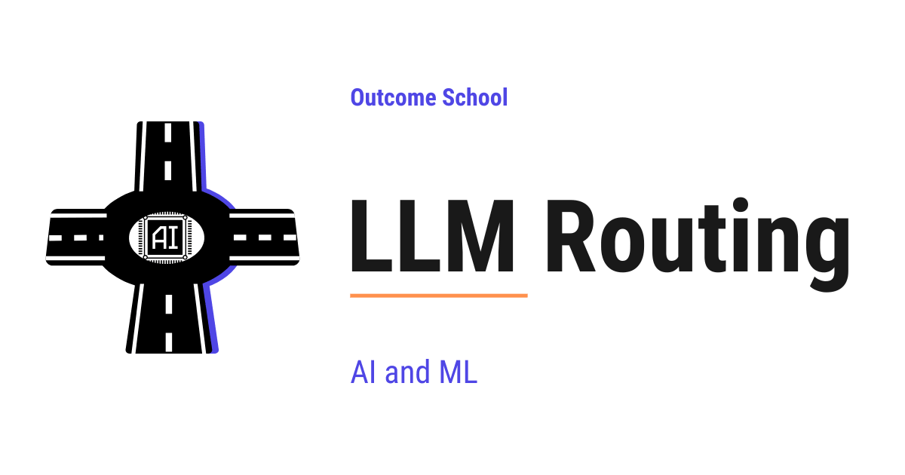

# What is LLM Routing? How to Send Each Query to the Right LLM

> Archived from <https://outcomeschool.com/blog/llm-routing> on 2026-11-25.

LLM Routing is the practice of choosing the right LLM for each user query, based on cost, latency, and quality, instead of sending every query to the same LLM.

In this blog, we will learn about LLM Routing, why it matters, and how to send each user query to the right LLM based on cost, latency, and quality.

We will cover the following:
<ul><li>The Big Picture</li><li>What is LLM Routing?</li><li>Why we need LLM Routing</li><li>Anatomy of an LLM Router</li><li>Routing Strategies</li><li>A Full Trace Example</li><li>LLM Routing vs Mixture of Experts</li><li>When LLM Routing is Worth It</li><li>Common Mistakes and How to Fix Them</li><li>Quick Summary</li></ul>
I am <strong>Amit Shekhar</strong>, Founder @ <a target="_blank" rel="noopener noreferrer" href="https://outcomeschool.com">Outcome School</a>, I have taught and mentored many developers, and their efforts landed them high-paying tech jobs, helped many tech companies in solving their unique problems, and created many open-source libraries being used by top companies. I am passionate about sharing knowledge through open-source, blogs, and videos.

I teach <a target="_blank" rel="noopener noreferrer" href="https://outcomeschool.com/program/ai-and-machine-learning">AI and Machine Learning</a> at Outcome School.

Let&#x27;s get started.
<h2 id="the-big-picture">The Big Picture</h2>
LLM Routing is the layer that sits in front of many LLMs. It looks at each user query and decides which LLM should answer it. The goal is simple - send the easy queries to small, cheap, fast LLMs, and send the hard queries to big, smart, expensive LLMs. This way, we save cost without losing quality.

In simple words:

<strong>LLM Routing = Pick the right LLM for each query.</strong>
<h2 id="what-is-llm-routing">What is LLM Routing?</h2>
<strong>LLM Routing</strong> is the practice of choosing the right LLM for each user query, instead of sending every query to the same LLM.

Let&#x27;s decompose the term:

<strong>LLM Routing = LLM + Routing.</strong>
<ul><li><strong>LLM</strong> stands for Large Language Model, the model that generates the answer. We have a detailed blog on <a target="_blank" rel="noopener noreferrer" href="decoding-transformer-architecture.md">Transformer Architecture</a> that explains the architecture behind every modern LLM, including how Multi-Head Attention works inside it.</li><li><strong>Routing</strong> means deciding which path a request should take.</li></ul>
Means, LLM Routing decides the path of a query - which LLM will handle it.

Let&#x27;s say we walk into a hospital with a problem. A receptionist looks at our problem, then sends us to the right doctor. A common cold goes to a general physician. A heart problem goes to a cardiologist. A brain problem goes to a neurologist.

The receptionist is the router. The doctors are the LLMs. The patient is our user query.

This is the same idea behind LLM Routing.
<h2 id="why-we-need-llm-routing">Why we need LLM Routing</h2>
Today we have many LLMs available - frontier LLMs (the biggest, smartest LLMs at the top of the market, like the latest from OpenAI, Anthropic, and Google), mid-size LLMs, <a target="_blank" rel="noopener noreferrer" href="small-language-models-slms.md">small LLMs</a>, and even task-specific LLMs for code, math, or vision. They differ on three things:
<ul><li><strong>Cost.</strong> Frontier LLMs are expensive. Small LLMs are very cheap.</li><li><strong>Latency.</strong> Bigger LLMs are slower. Smaller LLMs are faster.</li><li><strong>Quality.</strong> Some queries need the smartest LLM. Many do not.</li></ul>
Let&#x27;s put this into perspective with real numbers:
<ul><li>Frontier LLM: around <code>$15</code> per 1M output tokens.</li><li>Small LLM: around <code>$0.50</code> per 1M output tokens.</li></ul>
That is a <code>30x</code> cost gap.

Now, here is the catch. Most user queries are simple - &quot;What is 2 + 2?&quot;, &quot;Summarize this email&quot;, &quot;What is the capital of France?&quot;. Sending every such query to a frontier LLM is a waste of cost and time.

So, here comes LLM Routing to the rescue. It sends each query to the LLM that fits best, based on our use case.
<h2 id="anatomy-of-an-llm-router">Anatomy of an LLM Router</h2>
Let&#x27;s see the high-level picture as below:

<pre><code class="code-highlight">                  ┌────────────────┐
   user query  →  │                │
                  │   LLM Router   │
                  │                │
                  └───────┬────────┘
                          │
              ┌───────────┼───────────┐
              ▼           ▼           ▼
        ┌──────────┐ ┌──────────┐ ┌──────────┐
        │  Small   │ │   Mid    │ │ Frontier │
        │   LLM    │ │   LLM    │ │   LLM    │
        └──────────┘ └──────────┘ └──────────┘
</code></pre>

Here, we can see four parts. Let&#x27;s decode each one.

<strong>1. The Query.</strong> The raw input from the user. This is the only thing the router sees.

<strong>2. The Router.</strong> A small, fast component that decides which LLM should handle this query. The router can be a set of rules, a small classifier, an embedding lookup, or even a small LLM itself.

<strong>3. The LLM Pool.</strong> A set of LLMs with different strengths, costs, and speeds. We can have a small LLM, a mid-size LLM, a frontier LLM, and a code-specialist LLM all in the pool.

<strong>4. The Selected LLM.</strong> The one LLM the router has picked for this query. The query is then forwarded to it, and the response is returned to the user.

This is how an LLM Router is structured.

<strong>Note:</strong> The router itself must be very fast. A good rule of thumb is to keep the router&#x27;s own latency under 10 percent of the chosen LLM&#x27;s latency. If the chosen LLM takes 1 second, the router should add at most 100 ms.

<strong>Planning your move into AI?</strong>

No matter which tech domain you work in today, with your effort, you can transition to these roles:
<ul><li>AI Engineer</li><li>Forward Deployed Engineer</li><li>AI Agent Engineer</li><li>Harness Engineer</li><li>Voice AI Engineer</li><li>AI Architect</li><li>LLM Engineer</li><li>LLM Inference Engineer</li><li>Gen AI Engineer</li><li>MLOps Engineer</li><li>ML Engineer</li><li>Deep Learning Engineer</li></ul>
Our <a target="_blank" rel="noopener noreferrer" href="https://outcomeschool.com/program/ai-and-machine-learning">AI and Machine Learning Program</a> at Outcome School takes you there.
<h2 id="routing-strategies">Routing Strategies</h2>
Now, let&#x27;s understand the most common ways to build the router. We will go through five strategies.
<h3 id="1-rule-based-routing">1. Rule-based Routing</h3>
The simplest strategy. Look at keywords, length, or patterns in the query and pick an LLM.

Example code:

<pre><code class="code-highlight language-python">def route(query: str) -&gt; str:
    q = query.lower()
    if &quot;code&quot; in q or &quot;function&quot; in q or &quot;bug&quot; in q:
        return &quot;code-llm&quot;
    if len(q) &lt; 50:
        return &quot;small-llm&quot;
    if len(q) &lt; 200:
        return &quot;mid-llm&quot;
    return &quot;frontier-llm&quot;
</code></pre>

Here, we have a small function that picks an LLM based on simple rules. A query about code goes to the code LLM. A very short query goes to the small LLM. A medium-length query goes to the mid LLM. Everything longer goes to the frontier LLM.

<strong>Advantage:</strong> Very fast and very cheap. No model call needed for routing.

<strong>Disadvantage:</strong> Brittle. A query like &quot;Why is my Python script broken?&quot; may slip past the keyword check, since none of <code>code</code>, <code>function</code>, or <code>bug</code> appear in it. New patterns break the rules.
<h3 id="2-classifier-based-routing">2. Classifier-based Routing</h3>
Here, we train a small classifier on past data of <code>(query, best-LLM)</code> pairs. At runtime, the classifier takes the query and predicts the right LLM.

The classifier can be a simple <a target="_blank" rel="noopener noreferrer" href="linear-regression-vs-logistic-regression.md">logistic regression</a> on top of query embeddings, a small neural network, or a <a target="_blank" rel="noopener noreferrer" href="jev-and-system-one-models-explained.md">System One Model</a> like Jev that returns the chosen LLM along with a calibrated probability.

<strong>Advantage:</strong> Learns from real data. Picks up patterns that simple rules miss.

<strong>Disadvantage:</strong> Needs labeled training data and a retraining loop.

Sakana&#x27;s Fugu is a real model built on this idea - a lightweight selection head reads the query and scores each model to pick the best one. We have a detailed blog on <a target="_blank" rel="noopener noreferrer" href="decoding-sakana-fugu.md">Sakana Fugu</a> that covers how it learns which model is best.
<h3 id="3-embedding-based-routing">3. Embedding-based Routing</h3>
Here, we convert each query into <a target="_blank" rel="noopener noreferrer" href="what-are-embeddings.md">an embedding</a> - a vector of numbers that captures its meaning. We also keep a small set of reference embeddings, one per LLM, that represent the kind of queries each LLM is best at. Because the same queries get embedded again and again here, we have a detailed blog on <a target="_blank" rel="noopener noreferrer" href="how-does-an-embedding-cache-work.md">how an Embedding Cache works</a> that explains how caching them removes the repeated cost.

For each new query, we find the closest reference embedding. The LLM that owns that reference handles the query.

<strong>Advantage:</strong> No training. Easy to add a new LLM - just add one more reference.

<strong>Disadvantage:</strong> Quality depends on how good the reference embeddings are.
<h3 id="4-llm-as-router">4. LLM-as-Router</h3>
Here, we use a small, cheap LLM as the router. The router LLM is a separate LLM whose only job is to read the query and pick which target LLM should answer it. The idea is simple: the router speaks the same language as the query, so it can understand intent and difficulty far better than fixed rules.

Example code:

<pre><code class="code-highlight language-python">def route_with_llm(query: str) -&gt; str:
    prompt = f&quot;&quot;&quot;Pick the best LLM for this query.
Options: small-llm, mid-llm, frontier-llm, code-llm.
Query: {query}
Answer with one word from the options:&quot;&quot;&quot;
    return router_llm(prompt).strip()
</code></pre>

Here, <code>router_llm</code> is the small, cheap LLM acting as the router. It reads the query and outputs the name of the target LLM to use - one of <code>small-llm</code>, <code>mid-llm</code>, <code>frontier-llm</code>, or <code>code-llm</code>. The router itself is separate from these target LLMs.

<strong>Advantage:</strong> Very flexible. No training needed. We can change the routing rules just by changing the prompt.

<strong>Disadvantage:</strong> Adds one extra LLM call before the main one. We must keep this router LLM small and fast.
<h3 id="5-cascade-routing">5. Cascade Routing</h3>
This is the most cost-saving strategy. Send the query to the cheapest LLM first. If the answer looks low-confidence or wrong, escalate to a bigger LLM.

<pre><code class="code-highlight">query  →  small LLM  →  confident? ── yes ──▶ return answer
                          │
                          no
                          ▼
                       mid LLM  →  confident? ── yes ──▶ return answer
                                     │
                                     no
                                     ▼
                                  frontier LLM ───────▶ return answer
</code></pre>

Here, we can see a chain. Each LLM either answers the query, or hands it up to a bigger one.

The &quot;confident?&quot; check can be a self-rating from the LLM, a verifier model, or a simple heuristic like answer length and presence of &quot;I do not know&quot;.

A small example in code:

<pre><code class="code-highlight language-python">def cascade(query: str) -&gt; str:
    answer = small_llm(query)
    if is_confident(answer):
        return answer
    answer = mid_llm(query)
    if is_confident(answer):
        return answer
    return frontier_llm(query)
</code></pre>

Here, we have used a simple cascade. Each step either returns the answer or escalates to the next LLM.

<strong>Advantage:</strong> Great cost savings. Most queries get solved by the cheapest LLM.

<strong>Disadvantage:</strong> Slow for hard queries, since they pay for two or three LLM calls.
<h3 id="comparing-the-strategies">Comparing the Strategies</h3>
Let me tabulate the differences between the routing strategies for your better understanding so that you can decide which one to use based on your use case.
<table><thead><tr><th>Strategy</th><th>Speed</th><th>Cost</th><th>Flexibility</th><th>Needs Training</th></tr></thead><tbody><tr><td>Rule-based</td><td>Very Fast</td><td>Very Low</td><td>Low</td><td>No</td></tr><tr><td>Classifier-based</td><td>Fast</td><td>Low</td><td>Medium</td><td>Yes</td></tr><tr><td>Embedding-based</td><td>Fast</td><td>Low</td><td>Medium</td><td>No</td></tr><tr><td>LLM-as-Router</td><td>Medium</td><td>Medium</td><td>High</td><td>No</td></tr><tr><td>Cascade</td><td>Slow on hard queries</td><td>Lowest on average</td><td>High</td><td>No</td></tr></tbody></table>
There is no clear winner here. We pick the strategy based on our use case. For a small system with a few clear query types, rule-based is enough. For a large product with mixed queries, cascade or LLM-as-router works better.

To master Orchestration and Routing, and Embeddings, we have a complete program on this - check out our <a target="_blank" rel="noopener noreferrer" href="https://outcomeschool.com/program/ai-and-machine-learning">AI and Machine Learning Program</a> at Outcome School.
<h2 id="a-full-trace-example">A Full Trace Example</h2>
Let&#x27;s say we run a chatbot with four LLMs behind a router - <code>small-llm</code>, <code>mid-llm</code>, <code>frontier-llm</code>, and <code>code-llm</code>.

We will use a simple rule-based router for the sake of understanding.

<strong>Query 1:</strong> &quot;What is 2 + 2?&quot;
<ul><li>Router decision: <code>small-llm</code> (length is small, no code keyword).</li><li>Cost: very low. Latency: about 100 ms.</li><li>Response: &quot;4&quot;.</li></ul>
<strong>Query 2:</strong> &quot;Summarize this 3-line email for me: Hi John, can you please review my Q3 sales report draft by Friday? Thanks, Sarah.&quot;
<ul><li>Router decision: <code>mid-llm</code> (length is medium, no code keyword).</li><li>Cost: low. Latency: about 500 ms.</li><li>Response: a clean one-line summary.</li></ul>
<strong>Query 3:</strong> &quot;Fix the bug in this Python function that calculates Fibonacci.&quot;
<ul><li>Router decision: <code>code-llm</code> (the words &quot;bug&quot; and &quot;function&quot; both match code keywords).</li><li>Cost: low. Latency: about 700 ms.</li><li>Response: a corrected Python function.</li></ul>
<strong>Query 4:</strong> &quot;Design a comprehensive multi-agent system for medical diagnosis that covers symptom analysis, differential diagnoses, treatment recommendations, edge cases like rare diseases, ethical considerations, and the trade-offs between accuracy and latency.&quot;
<ul><li>Router decision: <code>frontier-llm</code> (length is large, no code keyword).</li><li>Cost: high. Latency: about 3 s.</li><li>Response: a detailed multi-step design.</li></ul>
Let&#x27;s put all four together as below:

<pre><code class="code-highlight">&quot;What is 2 + 2?&quot;           ──▶ router ──▶ small-llm     ──▶ fast &amp; cheap
&quot;Summarize this email...&quot;  ──▶ router ──▶ mid-llm       ──▶ balanced
&quot;Fix the bug in...&quot;        ──▶ router ──▶ code-llm      ──▶ specialist
&quot;Design a multi-agent...&quot;  ──▶ router ──▶ frontier-llm  ──▶ smart &amp; slow
</code></pre>

Here, we can see that each query went to the right LLM based on its nature. Simple math went to the small one. Summary went to the mid one. Code went to the code one. Hard reasoning went to the frontier one. The receptionist did the right job.

Now, let&#x27;s think about cost. Without routing, all four queries would have gone to the frontier LLM. With routing, only one of them did. That is a big cost saving across millions of queries.

It works perfectly.

<strong>A quick note for you</strong>

No matter which tech domain you work in, get familiar with these topics:
<ul><li>LLM</li><li>RAG</li><li>MCP</li><li>Agent</li><li>Fine-tuning</li><li>Quantization</li></ul>
We put it all together in one video:

<a target="_blank" rel="noopener noreferrer" href="https://www.youtube.com/watch?v=lnfWvX66FUk">AI Engineering Explained: LLM, RAG, MCP, Agent, Fine-Tuning, and Quantization</a>

No need to stop reading - bookmark it and watch later when you get time. Future you will thank you.

Now, let&#x27;s get back to the topic.
<h2 id="llm-routing-vs-mixture-of-experts">LLM Routing vs Mixture of Experts</h2>
A natural question arises - is LLM Routing the same as Mixture of Experts?

The answer is: no, but the idea is similar.
<ul><li><strong>LLM Routing</strong> picks one full LLM out of many full LLMs, at the query level.</li><li><strong>Mixture of Experts</strong> picks a few small expert sub-networks inside one LLM, at the token level.</li></ul>
Let me tabulate the differences between LLM Routing and Mixture of Experts for your better understanding.
<table><thead><tr><th>Aspect</th><th>LLM Routing</th><th>Mixture of Experts</th></tr></thead><tbody><tr><td>Where it lives</td><td>Outside the LLMs, in the application layer</td><td>Inside one LLM, in the model layer</td></tr><tr><td>What it routes</td><td>A full user query</td><td>A single token at a time</td></tr><tr><td>What it picks</td><td>One full LLM</td><td>A few expert sub-networks</td></tr><tr><td>Who controls it</td><td>The application developer</td><td>The model architecture</td></tr></tbody></table>
Both use a router. Both pick a subset of compute. But LLM Routing works at the system level, and Mixture of Experts works inside a single model. We have a detailed blog on <a target="_blank" rel="noopener noreferrer" href="mixture-of-experts.md">Mixture of Experts</a> that explains the inside-the-model routing.

If we want to go deep into Mixture of Experts and the broader LLM Internals, we have a complete program on this - check out our <a target="_blank" rel="noopener noreferrer" href="https://outcomeschool.com/program/ai-and-machine-learning">AI and Machine Learning Program</a> at Outcome School.
<h2 id="when-llm-routing-is-worth-it">When LLM Routing is Worth It</h2>
LLM Routing has real engineering cost. So, we must add it only when it pays off. Here are the signals that say it is worth it:
<ul><li><strong>High query volume.</strong> A few thousand queries per day rarely justify routing. Millions per day almost always do.</li><li><strong>Mixed query difficulty.</strong> If most queries are simple but some are hard, routing wins big. If every query is the same level, one LLM is enough.</li><li><strong>Cost pressure.</strong> If our LLM bill is high, routing brings it down fast.</li><li><strong>Multiple LLMs already in use.</strong> If we are already using two or more LLMs for different reasons, a router cleans up that ad-hoc logic.</li></ul>
If none of these apply, a single mid-size LLM may be a better choice for our use case.

<strong>Stay updated:</strong> Subscribe to our <a target="_blank" rel="noopener noreferrer" href="https://outcomeschool.substack.com/subscribe">newsletter</a> to get our latest AI and Machine Learning blogs straight to your inbox.
<h2 id="common-mistakes-and-how-to-fix-them">Common Mistakes and How to Fix Them</h2>
Let&#x27;s go through the common mistakes and how to fix them.

<strong>1. The router itself is too heavy.</strong>

If we use a frontier LLM as the router, the router cost can be higher than the saving. Use a tiny LLM, a classifier, or simple rules for the router.

<strong>2. No fallback path.</strong>

The chosen LLM may fail, time out, or return a bad answer. Always keep a fallback LLM. If the small LLM fails, fall back to the mid LLM, and so on.

<strong>3. The router adds too much latency.</strong>

A router that adds 500 ms before the real call kills the user experience. Keep the router fast - rules in microseconds, classifiers in a few milliseconds, small LLMs under 200 ms.

<strong>4. Mixing routing with orchestration.</strong>

Routing picks one LLM for one query. <a target="_blank" rel="noopener noreferrer" href="ai-orchestration.md">Orchestration</a> coordinates many LLMs across many steps. Do not confuse the two. Build the router as one focused component.

<strong>5. No observability.</strong>

We must log which LLM handled which query, the cost, the latency, and the quality. Without these logs, we cannot tune the router or catch bad routing decisions.

<strong>6. Routing on the wrong signal.</strong>

Routing only on query length is not enough. A short query like &quot;Prove the Riemann hypothesis&quot; is hard. A long query like &quot;Please summarize this email for me, thanks&quot; is easy. Use intent and difficulty signals, not just length.
<h2 id="quick-summary">Quick Summary</h2>
Let&#x27;s recap what we have decoded:
<ul><li><strong>LLM Routing</strong> is the practice of picking the right LLM for each user query.</li><li><strong>Why it matters:</strong> cost, latency, and quality. Frontier LLMs can be <code>30x</code> more costly than small ones.</li><li><strong>Anatomy:</strong> Query → Router → LLM Pool → Selected LLM → Response.</li><li><strong>Routing Strategies:</strong> rule-based, classifier-based, embedding-based, LLM-as-router, and cascade.</li><li><strong>Cascade Routing</strong> saves the most cost by escalating only when the cheap LLM is not confident.</li><li><strong>LLM Routing vs Mixture of Experts:</strong> routing picks a full LLM at the query level, while MoE picks expert sub-networks inside one LLM at the token level.</li><li><strong>When it is worth it:</strong> high query volume, mixed query difficulty, real cost pressure, or already using multiple LLMs.</li><li><strong>Common Mistakes:</strong> heavy router, no fallback, slow router, mixing routing with orchestration, no logs, and routing on the wrong signal.</li></ul>
Now, we have understood LLM Routing.
<h2 id="frequently-asked-questions">Frequently Asked Questions</h2><h3 id="is-llm-routing-the-same-as-ai-orchestration">Is LLM Routing the same as AI orchestration?</h3>
No. Routing picks one LLM for one query. Orchestration coordinates many LLMs across many steps. We should not confuse the two, and we should build the router as one focused component.
<h3 id="how-fast-should-an-llm-router-be">How fast should an LLM router be?</h3>
The router must be very fast. A good rule of thumb is to keep the router&#x27;s own latency under 10 percent of the chosen LLM&#x27;s latency. If the chosen LLM takes 1 second, the router should add at most 100 ms. Rules run in microseconds, classifiers in a few milliseconds, and small LLMs should stay under 200 ms.
<h3 id="can-we-use-a-frontier-llm-as-the-router">Can we use a frontier LLM as the router?</h3>
It is a bad idea. If we use a frontier LLM as the router, the router cost can be higher than the saving. We should use a tiny LLM, a classifier, or simple rules for the router instead.
<h3 id="is-query-length-a-good-signal-for-routing">Is query length a good signal for routing?</h3>
Not on its own. A short query like &quot;Prove the Riemann hypothesis&quot; is hard, while a long query like &quot;Please summarize this email for me, thanks&quot; is easy. We should use intent and difficulty signals, not just length.
<h3 id="which-routing-strategy-saves-the-most-cost">Which routing strategy saves the most cost?</h3>
Cascade Routing saves the most cost. It sends the query to the cheapest LLM first and escalates to a bigger LLM only when the answer looks low-confidence. The trade-off is that hard queries become slow, since they pay for two or three LLM calls.

That&#x27;s it for now.

Thanks

<strong>Amit Shekhar</strong> Founder @ <a target="_blank" rel="noopener noreferrer" href="https://outcomeschool.com">Outcome School</a>

You can connect with me on:
<ul><li><a target="_blank" rel="noopener noreferrer" href="https://x.com/amitiitbhu">X</a></li><li><a target="_blank" rel="noopener noreferrer" href="https://www.linkedin.com/in/amit-shekhar-iitbhu">LinkedIn</a></li><li><a target="_blank" rel="noopener noreferrer" href="https://github.com/amitshekhariitbhu">GitHub</a></li></ul>
Follow Outcome School on:
<ul><li><a target="_blank" rel="noopener noreferrer" href="https://x.com/outcome_school">X</a></li><li><a target="_blank" rel="noopener noreferrer" href="https://youtube.com/@OutcomeSchool">YouTube</a></li><li><a target="_blank" rel="noopener noreferrer" href="https://www.linkedin.com/company/outcomeschool">LinkedIn</a></li><li><a target="_blank" rel="noopener noreferrer" href="https://github.com/OutcomeSchool">GitHub</a></li></ul>
<a target="_blank" rel="noopener noreferrer" href="https://outcomeschool.com/blog"><strong>Read all of our high-quality blogs here.</strong></a>

