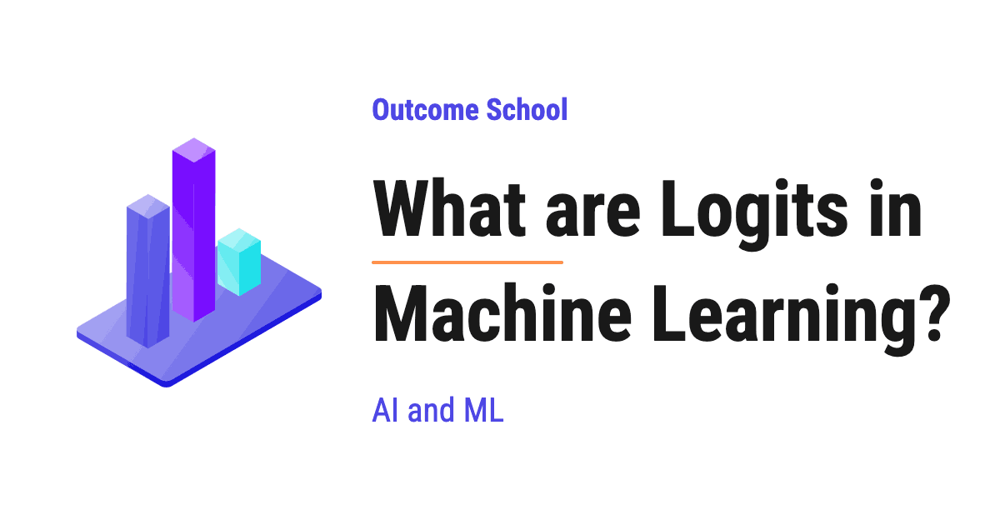

# What are Logits in Machine Learning?

> Archived from <https://outcomeschool.com/blog/logits-in-machine-learning> on 2026-11-25.

Logits are the raw scores that a machine learning model gives to each possible answer before those scores are turned into probabilities. A higher logit means the model is more confident about that answer, but a logit by itself is not a probability.

In this blog, we will learn about logits in machine learning. We will also see where logits come from inside a model, how softmax turns logits into probabilities, how sigmoid does the same for yes or no questions, why the name logit comes from log-odds, why models output logits instead of probabilities, and how LLMs use logits to pick the next token.

We will cover the following:
<ul><li>What are Logits?</li><li>Where do Logits come from?</li><li>From Logits to Probabilities using Softmax</li><li>Logits for Yes or No Questions using Sigmoid</li><li>Why is it called a Logit?</li><li>Why do Models output Logits instead of Probabilities?</li><li>Logits in LLMs</li></ul>
I am <strong>Amit Shekhar</strong>, Founder @ <a target="_blank" rel="noopener noreferrer" href="https://outcomeschool.com">Outcome School</a>, I have taught and mentored many developers, and their efforts landed them high-paying tech jobs, helped many tech companies in solving their unique problems, and created many open-source libraries being used by top companies. I am passionate about sharing knowledge through open-source, blogs, and videos.

I teach <a target="_blank" rel="noopener noreferrer" href="https://outcomeschool.com/program/ai-and-machine-learning">AI and Machine Learning</a> at Outcome School.

Let&#x27;s get started.
<h2 id="what-are-logits">What are Logits?</h2>
<strong>Logits are the raw, unnormalized scores that come out of the last layer of a model, one score for each possible answer.</strong>

Here, &quot;unnormalized&quot; means that these scores are not squeezed into any fixed range. A logit can be any number: positive, negative, small, or big. They also do not add up to 1.

Let&#x27;s say we have a model that looks at a photo and tells us whether it is a cat, a dog, or a bird. For one photo, the model gives the following three numbers:
<ul><li>cat: 2.0</li><li>dog: 1.0</li><li>bird: 0.1</li></ul>
These three numbers are the logits.

Here, we can see that the cat has the highest score, so the model believes that the photo is most likely a cat. But we cannot say &quot;the model is 2.0 sure&quot;. The number 2.0 is not a percentage. It is only a score that we can compare with the other scores.

To get real probabilities, we pass the logits through a function like <a target="_blank" rel="noopener noreferrer" href="softmax-function.md">softmax</a> or sigmoid. We will learn both in this blog.
<h2 id="where-do-logits-come-from">Where do Logits come from?</h2>
A <a target="_blank" rel="noopener noreferrer" href="neural-network.md">neural network</a> is made of layers. Each layer takes numbers in, multiplies them by its weights, adds a <a target="_blank" rel="noopener noreferrer" href="bias-in-artificial-neural-network.md">bias</a>, and passes the result to the next layer. The weights and the bias are the numbers that the model learns during training.

The last layer has one output for each possible answer. If our model chooses between 3 answers (also called classes), the last layer gives 3 numbers. These numbers are the logits. For a yes or no question, the last layer gives only 1 number, which means only 1 logit.

Let&#x27;s see this as a diagram:

<pre><code class="language-text code-highlight">┌────────────────────────────┐
│     Input: a cat photo     │
└────────────────────────────┘
              ↓
┌────────────────────────────┐
│       Hidden layers        │
└────────────────────────────┘
              ↓
┌────────────────────────────┐
│   Last layer: 3 outputs    │
└────────────────────────────┘
              ↓
┌────────────────────────────┐
│ Logits                     │
│ cat:  2.0                  │
│ dog:  1.0                  │
│ bird: 0.1                  │
└────────────────────────────┘
              ↓
┌────────────────────────────┐
│          Softmax           │
└────────────────────────────┘
              ↓
┌────────────────────────────┐
│ Probabilities              │
│ cat:  0.659                │
│ dog:  0.242                │
│ bird: 0.099                │
└────────────────────────────┘
</code></pre>

Here, we can see that the logits sit between the last layer and the final probabilities. The last layer does not apply any <a target="_blank" rel="noopener noreferrer" href="activation-functions.md">activation function</a> on its outputs. So, the logits are the plain result of multiplying by the weights and adding the bias.

Now, the next big question is: how do we turn these raw scores into probabilities? Let&#x27;s understand that.
<h2 id="from-logits-to-probabilities-using-softmax">From Logits to Probabilities using Softmax</h2>
When a model picks one answer out of many, we use a function called <strong>softmax</strong> to convert logits into probabilities.

Softmax does two things:
<ul><li>It makes every number positive by raising <code>e</code> (a special number, about 2.718) to the power of each logit.</li><li>It divides each of those positive numbers by their total, so that all of them add up to 1.</li></ul>
The formula is:

<strong>softmax(z_i) = exp(z_i) / (exp(z_1) + exp(z_2) + ... + exp(z_n))</strong>

Here, <code>z_i</code> is the logit of answer <code>i</code>, <code>n</code> is the number of answers, and <code>exp(z_i)</code> means <code>e</code> raised to the power <code>z_i</code>.

The best way to learn this is by taking an example. Let&#x27;s use our logits: cat 2.0, dog 1.0, bird 0.1.

<strong>Step 1:</strong> We raise <code>e</code> to the power of each logit.
<ul><li>cat: exp(2.0) = 7.389</li><li>dog: exp(1.0) = 2.718</li><li>bird: exp(0.1) = 1.105</li></ul>
<strong>Step 2:</strong> We add them up.

7.389 + 2.718 + 1.105 = 11.212

<strong>Step 3:</strong> We divide each one by the total.
<ul><li>cat: 7.389 / 11.212 = 0.659</li><li>dog: 2.718 / 11.212 = 0.242</li><li>bird: 1.105 / 11.212 = 0.099</li></ul>
Now, we have 0.659 + 0.242 + 0.099 = 1.000. These are real probabilities. Means, the model thinks there is a 65.9% chance that the photo is a cat.

One more thing to notice: the order never changes. The highest logit always gets the highest probability. Softmax only changes the scale, not the ranking.

Another important property: if we add the same number to all the logits, the probabilities do not change at all. For example, the logits 12.0, 11.0, and 10.1 also give 0.659, 0.242, and 0.099. Only the gaps between the logits matter.

<strong>Planning your move into AI?</strong>

No matter which tech domain you work in today, with your effort, you can transition to these roles:
<ul><li>AI Engineer</li><li>Forward Deployed Engineer</li><li>AI Agent Engineer</li><li>Harness Engineer</li><li>Voice AI Engineer</li><li>AI Architect</li><li>LLM Engineer</li><li>LLM Inference Engineer</li><li>Gen AI Engineer</li><li>MLOps Engineer</li><li>ML Engineer</li><li>Deep Learning Engineer</li></ul>
Our <a target="_blank" rel="noopener noreferrer" href="https://outcomeschool.com/program/ai-and-machine-learning">AI and Machine Learning Program</a> at Outcome School takes you there.
<h2 id="logits-for-yes-or-no-questions-using-sigmoid">Logits for Yes or No Questions using Sigmoid</h2>
Some models answer only a yes or no question. For example, &quot;Is this email spam?&quot;

Such a model gives only one logit. To turn that one logit into a probability, we use a function called <strong>sigmoid</strong>.

<strong>sigmoid(z) = 1 / (1 + exp(-z))</strong>

Sigmoid squeezes any number into the range 0 to 1:
<ul><li>A logit of 0 gives a probability of 0.5. The model is unsure.</li><li>A big positive logit gives a probability close to 1. The model says yes.</li><li>A big negative logit gives a probability close to 0. The model says no.</li></ul>
Let&#x27;s say our spam model gives a logit of 2.0. Then:

sigmoid(2.0) = 1 / (1 + exp(-2.0)) = 1 / (1 + 0.135) = 0.881

So, the model thinks there is an 88.1% chance that the email is spam.

If the logit is -1.0, then sigmoid(-1.0) = 0.269, which means only a 26.9% chance of spam.
<h2 id="why-is-it-called-a-logit">Why is it called a Logit?</h2>
The name comes from the <strong>logit function</strong> in statistics. To understand it, we must first know what <strong>odds</strong> are.

Odds compare the chance of something happening with the chance of it not happening:

<strong>odds = p / (1 - p)</strong>

Here, <code>p</code> is the probability. Suppose the chance of rain tomorrow is 0.8. Then the chance of no rain is 0.2, and the odds are 0.8 / 0.2 = 4. Means, rain is 4 times as likely as no rain.

Now, the <strong>logit</strong> of a probability is the natural log of its odds. The natural log of a number answers one question: <code>e</code> raised to what power gives this number? For example, log(4) = 1.386, because exp(1.386) is about 4.

So, the formula is:

<strong>logit(p) = log(p / (1 - p))</strong>

So, logit = log + odds = log-odds. That is where the name comes from.

Let&#x27;s put our rain example in it:

logit(0.8) = log(0.8 / 0.2) = log(4) = 1.386

Now, if we put 1.386 into sigmoid, we get back 0.8:

sigmoid(1.386) = 1 / (1 + exp(-1.386)) = 1 / (1 + 0.25) = 0.8

Let&#x27;s see this as a diagram:

<pre><code class="language-text code-highlight">┌──────────────────────────┐
│     Probability: 0.8     │
└──────────────────────────┘
             ↓
      logit function
             ↓
┌──────────────────────────┐
│       Logit: 1.386       │
└──────────────────────────┘
             ↓
          sigmoid
             ↓
┌──────────────────────────┐
│     Probability: 0.8     │
└──────────────────────────┘
</code></pre>

Here, we can see that sigmoid and the logit function undo each other. The logit function takes a probability and gives a score. Sigmoid takes that score and gives the same probability back.

This is why the raw score of a yes or no model is called a logit. It is exactly the log-odds of the &quot;yes&quot; answer.

A few useful values:
<ul><li>p = 0.5 gives logit 0 (equal chance)</li><li>p = 0.9 gives logit 2.197</li><li>p = 0.1 gives logit -2.197</li></ul>
Over time, the name &quot;logits&quot; was also used for the raw scores that go into softmax in models with many classes. There, a logit is not exactly the log-odds of one class, but the idea is the same: a raw score that a function turns into a probability.

<strong>A quick note for you</strong>

No matter which tech domain you work in, get familiar with these topics:
<ul><li>LLM</li><li>RAG</li><li>MCP</li><li>Agent</li><li>Fine-tuning</li><li>Quantization</li></ul>
We put it all together in one video:

<a target="_blank" rel="noopener noreferrer" href="https://www.youtube.com/watch?v=lnfWvX66FUk">AI Engineering Explained: LLM, RAG, MCP, Agent, Fine-Tuning, and Quantization</a>

No need to stop reading - bookmark it and watch later when you get time. Future you will thank you.

Now, let&#x27;s get back to the topic.
<h2 id="why-do-models-output-logits-instead-of-probabilities">Why do Models output Logits instead of Probabilities?</h2>
Now, the question is: if we finally need probabilities, why does the model not give probabilities directly? There are two main reasons.

<strong>Reason 1: Numerical stability.</strong>

Computers store numbers with limited precision. The value of <code>exp(1000)</code> is too big for a computer to store, so it becomes infinity. In fact, many models use 32-bit numbers, and there, even <code>exp(100)</code> is too big. One infinity breaks the whole calculation.

When we keep the raw logits, we can apply a trick. We subtract the biggest logit from all the logits before doing <code>exp</code>. As we learned, adding or subtracting the same number from all the logits does not change the probabilities. But now, the biggest value going into <code>exp</code> is 0, and exp(0) = 1. So, no value becomes too big to store.

Let&#x27;s see the code for the same:

<pre><code class="code-highlight language-python">import numpy as np

def softmax(logits):
    shifted = logits - np.max(logits)   # subtract the biggest logit
    exps = np.exp(shifted)
    return exps / np.sum(exps)

logits = np.array([2.0, 1.0, 0.1])     # cat, dog, bird
print(softmax(logits).round(3))

big_logits = np.array([1000.0, 999.0, 998.1])
print(softmax(big_logits).round(3))
</code></pre>

This will print the following:

<pre><code class="language-text code-highlight">[0.659 0.242 0.099]
[0.659 0.242 0.099]
</code></pre>

Here, we can see that both sets of logits give the same probabilities, because their gaps are the same. Without the subtraction, <code>np.exp(1000.0)</code> gives <code>inf</code> (infinity), and the result becomes <code>nan</code>, which means &quot;not a number&quot;.

<strong>Reason 2: Loss functions take logits directly.</strong>

During training, we measure how wrong the model is using a <strong>loss function</strong>. For classification, the most common one is <a target="_blank" rel="noopener noreferrer" href="math-behind-cross-entropy-loss.md"><strong>cross-entropy loss</strong></a>. It needs the <a target="_blank" rel="noopener noreferrer" href="logprobs-in-llms.md">log of the probability</a> of the correct answer.

If we first do softmax and then take the log, there is a problem. A very tiny probability can get rounded to exactly 0 by the computer, and the log of 0 is minus infinity. Instead, the loss function takes the logits directly and combines softmax and log into one stable calculation:

<strong>log(softmax(z_i)) = z_i - log(exp(z_1) + exp(z_2) + ... + exp(z_n))</strong>

Here, the right side works directly on the logits. With the same trick of subtracting the biggest logit first, the sum inside the log is always at least 1, so the result never becomes minus infinity by mistake.

This is why, in popular libraries, the loss functions expect logits as input:
<ul><li>In <a target="_blank" rel="noopener noreferrer" href="how-does-pytorch-work.md">PyTorch</a>, <code>nn.CrossEntropyLoss</code> takes logits, and <code>nn.BCEWithLogitsLoss</code> takes the one logit of a yes or no model.</li><li>In TensorFlow, we pass <code>from_logits=True</code> to tell the loss that the input is logits.</li></ul>
<strong>Note:</strong> Many times, we do mistakes here by applying softmax in the model and then passing the result to a loss that already applies softmax. Softmax gets applied twice, and the model learns poorly.

There is one more practical benefit. When we only need the best answer, we can pick the highest logit directly. We do not need softmax at all, because softmax never changes the ranking.

To master Neural Networks, Logits, and Cross-Entropy, and to build a Neural Network from scratch, check out our <a target="_blank" rel="noopener noreferrer" href="https://outcomeschool.com/program/ai-and-machine-learning">AI and Machine Learning Program</a> at Outcome School.
<h2 id="logits-in-llms">Logits in LLMs</h2>
Now, let&#x27;s see how logits work in an <a target="_blank" rel="noopener noreferrer" href="large-language-model-llm.md">LLM (Large Language Model)</a>.

An LLM generates text <a target="_blank" rel="noopener noreferrer" href="autoregressive-models.md">one token at a time</a>. A <a target="_blank" rel="noopener noreferrer" href="tokenization-in-llms.md">token</a> is a word or a piece of a word. The LLM knows a fixed list of tokens called its <strong>vocabulary</strong>.

To pick the next token, the LLM gives one logit for every token in its vocabulary. For example, if the vocabulary has 50,000 tokens, the LLM gives 50,000 logits at every step. A higher logit means that the LLM thinks that the token is a better fit as the next token.

Let&#x27;s say the input is &quot;The sky is&quot;. Let&#x27;s see this as a diagram:

<pre><code class="language-text code-highlight">┌──────────────────────────────┐
│     Input: &quot;The sky is&quot;      │
└──────────────────────────────┘
               ↓
┌──────────────────────────────┐
│             LLM              │
└──────────────────────────────┘
               ↓
┌──────────────────────────────┐
│ 50,000 logits, one per token │
│ &quot;blue&quot;   :  2.0              │
│ &quot;clear&quot;  :  1.0              │
│ &quot;dark&quot;   :  0.1              │
│ &quot;banana&quot; : -5.0              │
│ ... and 49,996 more tokens   │
└──────────────────────────────┘
               ↓
┌──────────────────────────────┐
│ Temperature and top-k        │
│ (change the logits)          │
└──────────────────────────────┘
               ↓
┌──────────────────────────────┐
│ Softmax gives probabilities  │
└──────────────────────────────┘
               ↓
┌──────────────────────────────┐
│ Pick next token, like &quot;blue&quot; │
└──────────────────────────────┘
</code></pre>

Here, we can see that the logits are the place where we can control how the LLM picks the next token. Two common controls act directly on the logits.

<strong>Temperature:</strong> We divide every logit by a number called the <a target="_blank" rel="noopener noreferrer" href="how-does-temperature-control-llm-output.md">temperature</a> before softmax. A temperature of 1.0 keeps the logits as they are.

Just for the sake of understanding, let&#x27;s take a vocabulary of only three tokens with logits 2.0, 1.0, and 0.1.
<table><thead><tr><th>Temperature</th><th>Logits after dividing</th><th>Probabilities</th></tr></thead><tbody><tr><td>0.5</td><td>4.0, 2.0, 0.2</td><td>0.864, 0.117, 0.019</td></tr><tr><td>1.0</td><td>2.0, 1.0, 0.1</td><td>0.659, 0.242, 0.099</td></tr><tr><td>2.0</td><td>1.0, 0.5, 0.05</td><td>0.502, 0.304, 0.194</td></tr></tbody></table>
Here, we can notice that:
<ul><li>A low temperature makes the gaps between logits bigger, so the top token gets most of the probability. The output becomes more focused and predictable.</li><li>A high temperature makes the gaps smaller, so the probabilities become closer to each other. The output becomes more varied and creative.</li></ul>
<strong>Stay updated:</strong> Subscribe to our <a target="_blank" rel="noopener noreferrer" href="https://outcomeschool.substack.com/subscribe">newsletter</a> to get our latest AI and Machine Learning blogs straight to your inbox.

<strong>Top-k:</strong> We keep only the <code>k</code> highest logits and set all the other logits to minus infinity. After softmax, minus infinity becomes a probability of 0, so those tokens can never be picked.

For example, with top-k = 2 on our &quot;The sky is&quot; example, only &quot;blue&quot; (2.0) and &quot;clear&quot; (1.0) stay. Softmax on 2.0 and 1.0 gives 0.731 and 0.269. A token that does not fit, like &quot;banana&quot;, can never be picked.

We have a detailed blog on <a target="_blank" rel="noopener noreferrer" href="how-do-top-k-and-top-p-sampling-work.md">Top-K and Top-P Sampling</a> that explains this step by step.

After this, the next token is picked at random using these probabilities, so a token with a higher probability gets picked more often. When we instead always pick the token with the highest logit, it is called <strong><a target="_blank" rel="noopener noreferrer" href="greedy-decoding-vs-beam-search.md">greedy decoding</a></strong>. Again, we do not need softmax for this, because the highest logit is always the highest probability.

Now we must have understood what logits are, how they turn into probabilities, why models output them, and how LLMs use them to pick the next token.
<h2 id="frequently-asked-questions">Frequently Asked Questions</h2><h3 id="can-a-logit-be-negative">Can a logit be negative?</h3>
Yes. A logit can be any number: positive, negative, small, or big. Logits are not squeezed into any fixed range and they do not add up to 1. For a yes or no model, a big negative logit gives a probability close to 0 after sigmoid, which means the model says no.
<h3 id="what-does-a-logit-of-0-mean">What does a logit of 0 mean?</h3>
A logit of 0 means the model is unsure in a yes or no model. When we pass 0 through sigmoid, we get a probability of 0.5. In terms of odds, a probability of 0.5 means equal chance of yes and no, and the log of those odds is 0.
<h3 id="should-we-apply-softmax-before-passing-logits-to-the-loss-function">Should we apply softmax before passing logits to the loss function?</h3>
No. Loss functions like <code>nn.CrossEntropyLoss</code> in PyTorch take the raw logits and combine softmax and log into one stable calculation. If we apply softmax in the model and then pass the result to a loss that already applies softmax, softmax gets applied twice and the model learns poorly.
<h3 id="do-we-need-softmax-to-pick-the-most-likely-answer">Do we need softmax to pick the most likely answer?</h3>
No. Softmax only changes the scale, not the ranking, so the highest logit always gets the highest probability. When we only need the best answer, we can pick the highest logit directly. This is also how greedy decoding works in an LLM: it always picks the token with the highest logit.
<h3 id="does-adding-the-same-number-to-all-logits-change-the-probabilities">Does adding the same number to all logits change the probabilities?</h3>
No. If we add or subtract the same number from all the logits, the probabilities after softmax do not change at all, because only the gaps between the logits matter. This is why we can subtract the biggest logit before doing <code>exp</code>, so that no value becomes too big to store.

That&#x27;s it for now.

Thanks

<strong>Amit Shekhar</strong> Founder @ <a target="_blank" rel="noopener noreferrer" href="https://outcomeschool.com">Outcome School</a>

You can connect with me on:
<ul><li><a target="_blank" rel="noopener noreferrer" href="https://x.com/amitiitbhu">X</a></li><li><a target="_blank" rel="noopener noreferrer" href="https://www.linkedin.com/in/amit-shekhar-iitbhu">LinkedIn</a></li><li><a target="_blank" rel="noopener noreferrer" href="https://github.com/amitshekhariitbhu">GitHub</a></li></ul>
Follow Outcome School on:
<ul><li><a target="_blank" rel="noopener noreferrer" href="https://x.com/outcome_school">X</a></li><li><a target="_blank" rel="noopener noreferrer" href="https://youtube.com/@OutcomeSchool">YouTube</a></li><li><a target="_blank" rel="noopener noreferrer" href="https://www.linkedin.com/company/outcomeschool">LinkedIn</a></li><li><a target="_blank" rel="noopener noreferrer" href="http://github.com/OutcomeSchool">GitHub</a></li></ul>
<a target="_blank" rel="noopener noreferrer" href="https://outcomeschool.com/blog"><strong>Read all of our high-quality blogs here.</strong></a>

