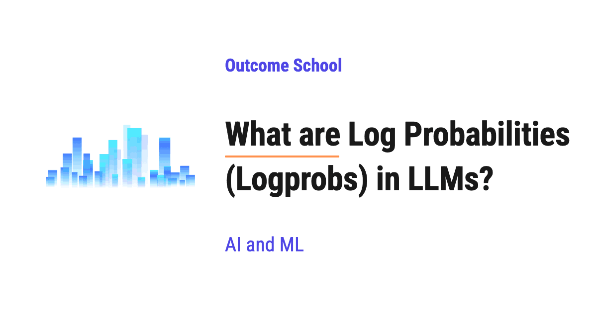

# What are Log Probabilities (Logprobs) in LLMs?

> Archived from <https://outcomeschool.com/blog/logprobs-in-llms> on 2026-11-25.

Log Probabilities (Logprobs) in LLMs are the log of the probability (the chance) that the model gives to each token it can write next. They tell us how sure the LLM was about every token it picked.

In this blog, we will learn about Log Probabilities (Logprobs) in LLMs. We will also see how an LLM gives a probability to every next token, what a log is in plain words, why we use logprobs instead of plain probabilities, how to get the probability of a full sentence by adding logprobs, what top logprobs are, and where logprobs are used in the real world.

We will cover the following:
<ul><li>How an LLM picks the next token</li><li>What is a log?</li><li>What are Log Probabilities (Logprobs)?</li><li>Why do we use logprobs?</li><li>Probability of a full sentence</li><li>Top logprobs</li><li>Where are logprobs used?</li></ul>
I am <strong>Amit Shekhar</strong>, Founder @ <a target="_blank" rel="noopener noreferrer" href="https://outcomeschool.com">Outcome School</a>, I have taught and mentored many developers, and their efforts landed them high-paying tech jobs, helped many tech companies in solving their unique problems, and created many open-source libraries being used by top companies. I am passionate about sharing knowledge through open-source, blogs, and videos.

I teach <a target="_blank" rel="noopener noreferrer" href="https://outcomeschool.com/program/ai-and-machine-learning">AI and Machine Learning</a> at Outcome School.

Let&#x27;s get started.
<h2 id="how-an-llm-picks-the-next-token">How an LLM picks the next token</h2>
An <a target="_blank" rel="noopener noreferrer" href="large-language-model-llm.md">LLM (Large Language Model)</a> writes text one token at a time. A <a target="_blank" rel="noopener noreferrer" href="tokenization-in-llms.md"><strong>token</strong></a> is a small piece of text. It can be a full word like &quot;cat&quot; or a part of a word.

At every step, the LLM looks at the text so far and predicts which token comes next.

Let&#x27;s say the text so far is &quot;My pet is a&quot;. For the sake of understanding, let&#x27;s assume that the LLM knows only three tokens: &quot;cat&quot;, &quot;dog&quot;, and &quot;car&quot;.

The LLM does not pick one token directly. First, it gives a raw score to every token it knows. These raw scores are called <a target="_blank" rel="noopener noreferrer" href="logits-in-machine-learning.md"><strong>logits</strong></a>. A higher logit means the model prefers that token more.

Then, a function called <a target="_blank" rel="noopener noreferrer" href="softmax-function.md"><strong>softmax</strong></a> turns these logits into probabilities. A <strong>probability</strong> is a number between 0 and 1 that tells us the chance of something. All the probabilities add up to 1.
<table><thead><tr><th>Token</th><th>Logit</th><th>Probability</th></tr></thead><tbody><tr><td>cat</td><td>3.64</td><td>0.70</td></tr><tr><td>dog</td><td>2.61</td><td>0.25</td></tr><tr><td>car</td><td>1.00</td><td>0.05</td></tr></tbody></table>
Here, we can see that the LLM gives a 70 percent chance to &quot;cat&quot;, a 25 percent chance to &quot;dog&quot;, and only a 5 percent chance to &quot;car&quot;. The three probabilities add up to 1.

A real LLM knows tens of thousands of tokens or more, so it gives a probability to every one of them at every step.

We have a detailed blog on <a target="_blank" rel="noopener noreferrer" href="how-do-top-k-and-top-p-sampling-work.md">Top-k and Top-p Sampling</a> that explains how the LLM picks one token from these probabilities.

Now, before we take the next step, we must understand what a log is.
<h2 id="what-is-a-log">What is a log?</h2>
A <strong>log</strong> answers one question: &quot;How many times do we need to multiply a fixed number to reach this number?&quot;

Let&#x27;s take an example with the number 10.
<ul><li>10 * 10 = 100, so the log of 100 (with base 10) is 2.</li><li>10 * 10 * 10 = 1000, so the log of 1000 (with base 10) is 3.</li></ul>
The answer can also be a fraction or a negative number. For example, the log of 0.1 (with base 10) is -1, because 0.1 = 1 / 10.

The fixed number is called the <strong>base</strong>. In LLMs, we use the <strong>natural log</strong>, written as <code>ln</code>. Its base is a special number called <code>e</code>, which is about 2.718. We do not need to calculate it by hand. Every programming language does it for us.

We need to know three facts about the log for this blog:
<ul><li>The log of 1 is 0.</li><li>The log of any number between 0 and 1 is a negative number. The smaller the number, the more negative its log.</li><li>The log turns multiplication into addition: <strong>log(a * b) = log(a) + log(b)</strong></li></ul>
We will use the third fact very soon.
<h2 id="what-are-log-probabilities-logprobs">What are Log Probabilities (Logprobs)?</h2>
A <strong>Log Probability (Logprob)</strong> is the natural log of a probability.

<strong>logprob = ln(probability)</strong>

We take the probability that the LLM gave to a token, and we take its natural log.

Let&#x27;s see some probabilities and their logprobs:
<table><thead><tr><th>Probability</th><th>Logprob</th><th>Meaning</th></tr></thead><tbody><tr><td>1.0</td><td>0</td><td>Completely sure</td></tr><tr><td>0.9</td><td>-0.11</td><td>Very sure</td></tr><tr><td>0.5</td><td>-0.69</td><td>50-50 chance</td></tr><tr><td>0.25</td><td>-1.39</td><td>Not very sure</td></tr><tr><td>0.1</td><td>-2.30</td><td>Unsure</td></tr><tr><td>0.01</td><td>-4.61</td><td>Very unsure</td></tr><tr><td>0.001</td><td>-6.91</td><td>Almost no chance</td></tr></tbody></table>
Here, we can notice a few things:
<ul><li>A logprob is always 0 or a negative number. It is never positive, because a probability is never more than 1.</li><li>A logprob close to 0 means the model is very sure.</li><li>A more negative logprob means the model is less sure.</li></ul>
Now, let&#x27;s see the full flow from a token to its logprob as a diagram:

<pre><code class="language-text code-highlight">┌─────────────────────────────────┐
│ Text so far: &quot;My pet is a&quot;      │
└─────────────────────────────────┘
                 ↓
┌─────────────────────────────────┐
│ Logits                          │
│ cat 3.64, dog 2.61, car 1.00    │
└─────────────────────────────────┘
                 ↓
              softmax
                 ↓
┌─────────────────────────────────┐
│ Probabilities                   │
│ cat 0.70, dog 0.25, car 0.05    │
└─────────────────────────────────┘
                 ↓
            natural log
                 ↓
┌─────────────────────────────────┐
│ Logprobs                        │
│ cat -0.36, dog -1.39, car -3.00 │
└─────────────────────────────────┘
</code></pre>

Here, we can see that the logits go through softmax to become probabilities, and the probabilities go through the natural log to become logprobs.

Let&#x27;s see the code for the same:

<pre><code class="code-highlight language-python">import numpy as np

logits = np.array([3.64, 2.61, 1.00])  # scores for &quot;cat&quot;, &quot;dog&quot;, &quot;car&quot;

probs = np.exp(logits) / np.exp(logits).sum()  # softmax
logprobs = np.log(probs)                       # natural log

print(&quot;probs:   &quot;, probs.round(2))
print(&quot;logprobs:&quot;, logprobs.round(2))
</code></pre>

It will print the following:

<pre><code class="language-text code-highlight">probs:    [0.7  0.25 0.05]
logprobs: [-0.36 -1.39 -3.  ]
</code></pre>

Here, we have used <code>np.exp</code> and a division to apply softmax, and then <code>np.log</code> to take the natural log. <code>np.log</code> is the natural log, not the log with base 10.

<strong>Planning your move into AI?</strong>

No matter which tech domain you work in today, with your effort, you can transition to these roles:
<ul><li>AI Engineer</li><li>Forward Deployed Engineer</li><li>AI Agent Engineer</li><li>Harness Engineer</li><li>Voice AI Engineer</li><li>AI Architect</li><li>LLM Engineer</li><li>LLM Inference Engineer</li><li>Gen AI Engineer</li><li>MLOps Engineer</li><li>ML Engineer</li><li>Deep Learning Engineer</li></ul>
Our <a target="_blank" rel="noopener noreferrer" href="https://outcomeschool.com/program/ai-and-machine-learning">AI and Machine Learning Program</a> at Outcome School takes you there.

Now, the question is: why do we not just use the probabilities directly? Let&#x27;s understand this.
<h2 id="why-do-we-use-logprobs">Why do we use logprobs?</h2>
An LLM writes many tokens, one after another. To get the chance of the whole text, we need to multiply the probabilities of all the tokens. This is because the chance of one thing happening and then another thing happening is found by multiplying their chances.

The problem is that probabilities are numbers smaller than 1. When we multiply many small numbers, the result becomes tiny very fast.
<ul><li>0.1 * 0.1 = 0.01</li><li>0.1 * 0.1 * 0.1 = 0.001</li><li>After 400 tokens: 0.1 multiplied 400 times is a decimal point, then 399 zeros, and then a 1.</li></ul>
A computer stores every number in a limited space. A normal Python float cannot hold a number much smaller than about 10 to the power of -308. Anything far smaller becomes 0. This problem is called <strong>underflow</strong>.

Here comes the log into the picture. Since the log turns multiplication into addition, we can add the logprobs instead of multiplying the probabilities. Adding negative numbers just gives a more negative number. It never becomes 0 by mistake.

Let&#x27;s see this with an example:

<pre><code class="code-highlight language-python">import math

prob = 1.0
logprob = 0.0
for _ in range(400):
    prob = prob * 0.1                  # multiply probabilities
    logprob = logprob + math.log(0.1)  # add logprobs

print(prob)
print(round(logprob, 2))
</code></pre>

It will print the following:

<pre><code class="language-text code-highlight">0.0
-921.03
</code></pre>

Here, we can see that multiplying the probabilities gave us 0.0, which is wrong. The true answer is not zero, it is just very small. But adding the logprobs gave us -921.03, which is correct and easy to store.

This is why LLMs work with logprobs during training and in their outputs. We have a detailed blog on <a target="_blank" rel="noopener noreferrer" href="math-behind-cross-entropy-loss.md">Cross-Entropy Loss</a> that covers how the training loss is built from the log of a probability.

<strong>A quick note for you</strong>

No matter which tech domain you work in, get familiar with these topics:
<ul><li>LLM</li><li>RAG</li><li>MCP</li><li>Agent</li><li>Fine-tuning</li><li>Quantization</li></ul>
We put it all together in one video:

<a target="_blank" rel="noopener noreferrer" href="https://www.youtube.com/watch?v=lnfWvX66FUk">AI Engineering Explained: LLM, RAG, MCP, Agent, Fine-Tuning, and Quantization</a>

No need to stop reading - bookmark it and watch later when you get time. Future you will thank you.

Now, let&#x27;s get back to the topic.
<h2 id="probability-of-a-full-sentence">Probability of a full sentence</h2>
Now, let&#x27;s use logprobs to find how likely a full sentence is.

Let&#x27;s say the prompt is &quot;I love&quot;, and the LLM writes &quot;to read books&quot;. The LLM gives the following probabilities:
<table><thead><tr><th>Token</th><th>Probability</th><th>Logprob</th></tr></thead><tbody><tr><td>to</td><td>0.5</td><td>-0.69</td></tr><tr><td>read</td><td>0.2</td><td>-1.61</td></tr><tr><td>books</td><td>0.6</td><td>-0.51</td></tr></tbody></table>
Using plain probabilities, we multiply:

<strong>0.5 * 0.2 * 0.6 = 0.06</strong>

Using logprobs, we add:

<strong>-0.69 + (-1.61) + (-0.51) = -2.81</strong>

Both tell us the same thing. If we take <code>e</code> to the power of -2.81, we get back 0.06.

Let&#x27;s see this as a diagram:

<pre><code class="language-text code-highlight">┌───────────────┐   ┌───────────────┐   ┌───────────────┐
│ &quot;to&quot;          │   │ &quot;read&quot;        │   │ &quot;books&quot;       │
│ prob 0.5      │   │ prob 0.2      │   │ prob 0.6      │
│ logprob -0.69 │   │ logprob -1.61 │   │ logprob -0.51 │
└───────────────┘   └───────────────┘   └───────────────┘
        │                   │                   │
        └───────────────────┼───────────────────┘
                            ↓
                  add all the logprobs
                            ↓
              ┌───────────────────────────┐
              │ Sentence logprob = -2.81  │
              │ e^(-2.81) = 0.06          │
              └───────────────────────────┘
</code></pre>

Here, we can see that each token has its own logprob, and we add them together to get the logprob of the full sentence.

This is how we find the probability of a full text without ever running into underflow.

To master Tokenization, Logits, and Cross-Entropy, and to build a Large Language Model (LLM) from scratch, check out our <a target="_blank" rel="noopener noreferrer" href="https://outcomeschool.com/program/ai-and-machine-learning">AI and Machine Learning Program</a> at Outcome School.
<h2 id="top-logprobs">Top logprobs</h2>
Till now, we have looked only at the token the LLM picked. But at every step, the LLM also gave probabilities to all the other tokens. We can use these other choices too.

<strong>Top logprobs</strong> are the logprobs of the few most likely tokens at a step, not just the picked one.

Let&#x27;s go back to &quot;My pet is a&quot;. The LLM picked &quot;cat&quot;. The top 3 logprobs at this step are:
<table><thead><tr><th>Token</th><th>Logprob</th></tr></thead><tbody><tr><td>cat</td><td>-0.36</td></tr><tr><td>dog</td><td>-1.39</td></tr><tr><td>car</td><td>-3.00</td></tr></tbody></table>
Here, we can see that &quot;dog&quot; was a strong second choice, and &quot;car&quot; was a weak third choice.

Many LLM APIs let us ask for these values. Usually, there are two options:
<ul><li><code>logprobs</code>: set it to <code>true</code> to get the logprob of every token the LLM writes.</li><li><code>top_logprobs</code>: set it to a number like <code>3</code> to also get the top 3 choices at every step.</li></ul>
A response for one token then looks like below:

<pre><code class="code-highlight language-json">{
  &quot;token&quot;: &quot;cat&quot;,
  &quot;logprob&quot;: -0.36,
  &quot;top_logprobs&quot;: [
    { &quot;token&quot;: &quot;cat&quot;, &quot;logprob&quot;: -0.36 },
    { &quot;token&quot;: &quot;dog&quot;, &quot;logprob&quot;: -1.39 },
    { &quot;token&quot;: &quot;car&quot;, &quot;logprob&quot;: -3.0 }
  ]
}
</code></pre>

Here, we get the picked token, its logprob, and the top 3 choices with their logprobs.

Now, let&#x27;s see where we use all this.
<h2 id="where-are-logprobs-used">Where are logprobs used?</h2><h3 id="1-confidence-estimation">1. Confidence estimation</h3>
The logprob tells us how sure the LLM was. To turn a logprob back into a probability, we take <code>e</code> to the power of the logprob.

<strong>probability = e^(logprob)</strong>

For example, a logprob of -0.11 means a probability of 0.9, which is 90 percent sure. A logprob of -2.30 means a probability of 0.1, which is only 10 percent sure.

For a long answer, we can look at the average logprob of all its tokens. Based on this, we can show the answer to the user when the LLM is sure, and ask a human to check it when the LLM is unsure.
<h3 id="2-classification-with-llms">2. Classification with LLMs</h3>
Let&#x27;s say we want to use an LLM to tell if a review is positive or negative. We ask the LLM to answer with only one word: &quot;Positive&quot; or &quot;Negative&quot;.

Now, we read the top 2 logprobs of the first token:
<table><thead><tr><th>Token</th><th>Logprob</th><th>Probability</th></tr></thead><tbody><tr><td>Positive</td><td>-0.05</td><td>0.95</td></tr><tr><td>Negative</td><td>-3.00</td><td>0.05</td></tr></tbody></table>
Here, we get not just the label but also a score. The LLM is 95 percent sure that the review is positive. We can set a threshold, for example &quot;accept only if the probability is more than 0.8&quot;, and send the rest for review.
<h3 id="3-perplexity">3. Perplexity</h3>
<strong><a target="_blank" rel="noopener noreferrer" href="perplexity-in-language-models.md">Perplexity</a></strong> is a number that tells us how surprised a model is by a piece of text. Lower perplexity means the model found the text more natural.

We calculate it from the logprobs:

<strong>perplexity = e^(-(average logprob))</strong>

Let&#x27;s take our sentence &quot;to read books&quot; again. The logprobs are -0.69, -1.61, and -0.51.

<strong>Step 1:</strong> We add the logprobs: -0.69 + (-1.61) + (-0.51) = -2.81.

<strong>Step 2:</strong> We find the average by dividing by the number of tokens: -2.81 / 3 = about -0.94.

<strong>Step 3:</strong> We flip the sign to get 0.94.

<strong>Step 4:</strong> We take <code>e</code> to the power of 0.94, which gives about 2.56.

So, the perplexity is about 2.56. Means, on average, the model was as unsure as if it was choosing between about 2.56 equally likely tokens at each step. If the model were completely sure of every token, the perplexity would be 1.

We use perplexity to compare language models on the same text. The model with lower perplexity predicts the text better.

<strong>Stay updated:</strong> Subscribe to our <a target="_blank" rel="noopener noreferrer" href="https://outcomeschool.substack.com/subscribe">newsletter</a> to get our latest AI and Machine Learning blogs straight to your inbox.
<h3 id="4-detecting-hallucination-risk">4. Detecting hallucination risk</h3>
A <a target="_blank" rel="noopener noreferrer" href="why-do-llms-hallucinate-the-token-level-explanation.md"><strong>hallucination</strong></a> is when an LLM writes something that sounds right but is wrong.

Let&#x27;s say the LLM writes &quot;The Eiffel Tower was built in 1889.&quot; If the token &quot;1889&quot; has a logprob of -0.02, the LLM was very sure. If it has a logprob of -2.5, the LLM was unsure, and the top logprobs show other years close behind.

A very low logprob on an important token, like a name, a date, or a number, is a warning sign. It does not prove that the answer is wrong, and a sure answer can still be wrong. But it helps us find the parts of the answer that we must check.
<h3 id="5-reinforcement-learning-training">5. Reinforcement Learning training</h3>
In <a target="_blank" rel="noopener noreferrer" href="reinforcement-learning.md"><strong>Reinforcement Learning (RL)</strong></a>, the LLM learns from rewards. A good answer gets a positive reward and a bad answer gets a negative reward.

<strong><a target="_blank" rel="noopener noreferrer" href="policy-gradient-reinforce.md">Policy gradient</a></strong> methods train the LLM in the following way. For every answer, we take the logprobs of its tokens and push them in a direction based on the reward:
<ul><li>If the reward is positive, we increase the logprobs of the tokens in that answer, so the LLM writes such answers more often.</li><li>If the reward is negative, we decrease the logprobs of those tokens, so the LLM writes such answers less often.</li></ul>
Let&#x27;s see the case of a positive reward as a diagram:

<pre><code class="language-text code-highlight">┌─────────────────────────────────┐
│ LLM writes an answer            │
│ &quot;to read books&quot;                 │
└─────────────────────────────────┘
                 ↓
┌─────────────────────────────────┐
│ The answer gets a reward        │
│ reward = +1 (good answer)       │
└─────────────────────────────────┘
                 ↓
┌─────────────────────────────────┐
│ Training increases the logprobs │
│ of &quot;to&quot;, &quot;read&quot;, and &quot;books&quot;    │
└─────────────────────────────────┘
                 ↓
┌─────────────────────────────────┐
│ Next time, the LLM writes       │
│ such an answer more often       │
└─────────────────────────────────┘
</code></pre>

Here, we can see that a positive reward pushes up the logprobs of the tokens in the answer. A negative reward pushes them down in the same way.

In a simple form, the training tries to make this number as large as possible:

<strong>objective = reward * (sum of logprobs of the answer tokens)</strong>

Logprobs are also used to check <a target="_blank" rel="noopener noreferrer" href="kl-divergence.md">how far the trained LLM has moved away from the original LLM</a>, by comparing the logprobs of the two models on the same tokens. This keeps the training from changing the LLM too much.

Now we must have understood what Log Probabilities (Logprobs) in LLMs are, why we use them, and where they are used.
<h2 id="frequently-asked-questions">Frequently Asked Questions</h2><h3 id="can-a-logprob-be-positive">Can a logprob be positive?</h3>
No. A logprob is always 0 or a negative number. This is because a probability is never more than 1, and the log of any number between 0 and 1 is negative. A logprob of exactly 0 means a probability of 1, which means the model was completely sure.
<h3 id="how-do-we-convert-a-logprob-back-into-a-probability">How do we convert a logprob back into a probability?</h3>
We take <code>e</code> to the power of the logprob. For example, a logprob of -0.11 gives a probability of 0.9, which is 90 percent sure. A logprob of -2.30 gives a probability of 0.1, which is only 10 percent sure.
<h3 id="what-is-the-difference-between-logits-and-logprobs">What is the difference between logits and logprobs?</h3>
Logits are the raw scores that the LLM gives to every token it knows, and a higher logit means the model prefers that token more. Logprobs come after two steps: softmax turns the logits into probabilities that add up to 1, and then the natural log turns those probabilities into logprobs.
<h3 id="does-a-high-logprob-mean-the-answer-is-correct">Does a high logprob mean the answer is correct?</h3>
No. A high logprob only means the LLM was sure about that token, and a sure answer can still be wrong. In the same way, a very low logprob on an important token, like a name, a date, or a number, does not prove the answer is wrong. It is a warning sign that helps us find the parts we must check.

That&#x27;s it for now.

Thanks

<strong>Amit Shekhar</strong> Founder @ <a target="_blank" rel="noopener noreferrer" href="https://outcomeschool.com">Outcome School</a>

You can connect with me on:
<ul><li><a target="_blank" rel="noopener noreferrer" href="https://x.com/amitiitbhu">X</a></li><li><a target="_blank" rel="noopener noreferrer" href="https://www.linkedin.com/in/amit-shekhar-iitbhu">LinkedIn</a></li><li><a target="_blank" rel="noopener noreferrer" href="https://github.com/amitshekhariitbhu">GitHub</a></li></ul>
Follow Outcome School on:
<ul><li><a target="_blank" rel="noopener noreferrer" href="https://x.com/outcome_school">X</a></li><li><a target="_blank" rel="noopener noreferrer" href="https://youtube.com/@OutcomeSchool">YouTube</a></li><li><a target="_blank" rel="noopener noreferrer" href="https://www.linkedin.com/company/outcomeschool">LinkedIn</a></li><li><a target="_blank" rel="noopener noreferrer" href="http://github.com/OutcomeSchool">GitHub</a></li></ul>
<a target="_blank" rel="noopener noreferrer" href="https://outcomeschool.com/blog"><strong>Read all of our high-quality blogs here.</strong></a>

