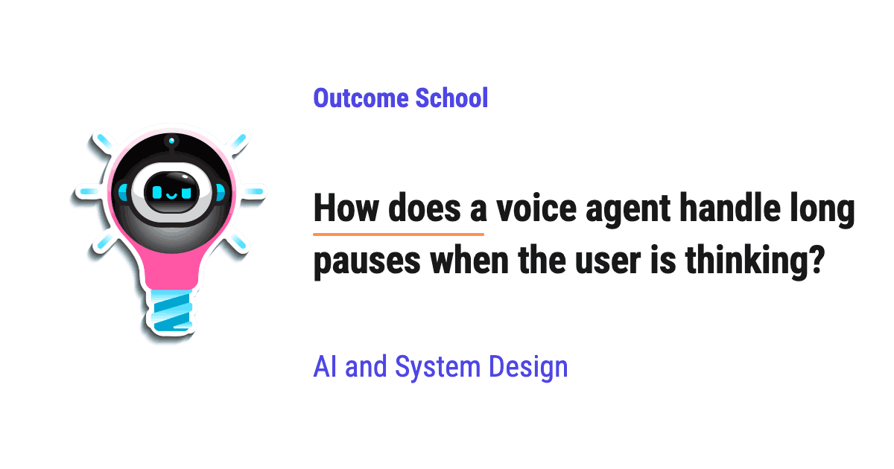

# How does a voice agent handle long pauses when the user is thinking?

> Archived from <https://outcomeschool.com/blog/long-pauses-in-voice-agents> on 2026-11-25.

A voice agent handles long pauses by not treating every silence as the end of the user&#x27;s turn. It checks the words, the voice, and the time together, and it waits longer when the user sounds like they are still thinking.

In this blog, we will learn about how a voice agent handles long pauses when the user is thinking. We will also see why silence is confusing for a voice agent, why a simple silence timer fails, how the agent uses the words and the voice to decide, how it changes its waiting time, what it does when it speaks too early or the user stays silent for very long, and where it works well and where it fails.

We will cover the following:
<ul><li>What is a thinking pause?</li><li>Why is a long pause a hard problem?</li><li>How does a voice agent hear silence?</li><li>Approach 1: A fixed silence timer</li><li>Approach 2: A longer silence timer</li><li>Approach 3: Looking at the words</li><li>Approach 4: Listening to how the words are said</li><li>Changing the waiting time dynamically</li><li>What if the agent starts speaking too early?</li><li>What if the user stays silent for a very long time?</li><li>The complete flow</li><li>Where it works well and where it fails</li></ul>
I am <strong>Amit Shekhar</strong>, Founder @ <a target="_blank" rel="noopener noreferrer" href="https://outcomeschool.com">Outcome School</a>, I have taught and mentored many developers, and their efforts landed them high-paying tech jobs, helped many tech companies in solving their unique problems, and created many open-source libraries being used by top companies. I am passionate about sharing knowledge through open-source, blogs, and videos.

I teach <a target="_blank" rel="noopener noreferrer" href="https://outcomeschool.com/program/ai-and-machine-learning">AI and Machine Learning</a> at Outcome School.

Let&#x27;s get started.
<h2 id="what-is-a-thinking-pause">What is a thinking pause?</h2>
A <a target="_blank" rel="noopener noreferrer" href="design-a-real-time-voice-ai-agent.md"><strong>voice agent</strong></a> is an AI system that we talk to with our voice, and it talks back to us with its voice. A customer support bot on a phone call is a good example.

When we talk, we do not speak in one long smooth line. We stop in the middle to think.

Let&#x27;s say we call a pharmacy voice agent and it asks, &quot;What is your date of birth?&quot;

We reply like below:

<pre><code class="code-highlight">&quot;It is the 14th of... [silence for 2 seconds] ...March, 1990.&quot;
</code></pre>

That 2-second silence in the middle is a <strong>thinking pause</strong>. The user has not finished. The user is remembering the month.

<strong>A thinking pause is a silence in which the user is still in the middle of their turn.</strong>

Now, compare it with this:

<pre><code class="code-highlight">&quot;It is the 14th of March, 1990.&quot; [silence for 2 seconds]
</code></pre>

Here also, there is a 2-second silence. But this time, the user has finished. The user is now waiting for the agent to reply.

Both silences are of the same length. One means &quot;wait for me&quot;, and the other means &quot;your turn now&quot;.
<h2 id="why-is-a-long-pause-a-hard-problem">Why is a long pause a hard problem?</h2>
A conversation works by taking turns. One person speaks, then the other person speaks. This is called <a target="_blank" rel="noopener noreferrer" href="what-is-turn-taking-in-a-voice-ai-agent.md"><strong>turn-taking</strong></a>.

A voice agent must decide, again and again, &quot;Has the user finished speaking, or not?&quot; This decision is called <strong>end-of-turn detection</strong>, and it is also known as <a target="_blank" rel="noopener noreferrer" href="endpointing-in-voice-agents.md"><strong>endpointing</strong></a>.

If the agent gets this decision wrong, one of two bad things happens:
<ul><li><strong>Speaking too early:</strong> The agent <a target="_blank" rel="noopener noreferrer" href="voice-agents-cutting-users-off.md">cuts in while the user is still thinking</a>. The user feels interrupted, and the agent replies to half a sentence. In our example, it hears only &quot;It is the 14th of&quot; and replies to an incomplete date.</li><li><strong>Speaking too late:</strong> The agent waits too long after the user has finished. The user hears dead silence and wonders if the call has dropped.</li></ul>
So, the agent is always balancing between two things: not interrupting, and not being slow.
<h2 id="how-does-a-voice-agent-hear-silence">How does a voice agent hear silence?</h2>
Before jumping into the approaches, we must know how a voice agent knows that the user is silent.

A voice agent uses a small model called <strong>Voice Activity Detection</strong>, or <strong>VAD</strong>. It listens to the incoming audio in very small pieces, often 10 to 32 milliseconds each, and for each piece it answers one question: &quot;Is a human speaking in this piece, or not?&quot;

So, the VAD gives us a simple signal like below:

<pre><code class="code-highlight">speech speech speech silence silence silence silence speech speech
</code></pre>

From this signal, the agent knows two things:
<ul><li>When the user started speaking.</li><li>How long the user has been silent.</li></ul>
<strong>Note:</strong> VAD only tells us whether there is speech. It does not tell us whether the user has finished. That decision is what the rest of this blog is about.

Now, let&#x27;s see the approaches one by one.
<h2 id="approach-1-a-fixed-silence-timer">Approach 1: A fixed silence timer</h2>
The simplest approach is a timer.

The rule is: &quot;If the user is silent for more than X milliseconds, the turn is over.&quot;

Let&#x27;s say we pick 500 milliseconds, which is half a second.

<pre><code class="code-highlight">User: &quot;It is the 14th of...&quot;
       [silence starts]
       [500 ms passes]
Agent: decides the turn is over and starts replying
</code></pre>

This works well for short and quick answers like &quot;Yes&quot;, &quot;No&quot;, or &quot;Book it&quot;.

People who are thinking often pause for more than half a second. In our date of birth example, the user paused for 2 seconds. The agent cut in after half a second.

The issue with this approach is that it interrupts the user every time they stop to think. Let&#x27;s see how the next approach solve this issue.
<h2 id="approach-2-a-longer-silence-timer">Approach 2: A longer silence timer</h2>
If half a second is too short, let&#x27;s make the timer longer.

Let&#x27;s say we pick 3 seconds.

<pre><code class="code-highlight">User: &quot;It is the 14th of...&quot;
       [silence for 2 seconds]
User: &quot;...March, 1990.&quot;
       [silence starts]
       [3 seconds pass]
Agent: starts replying
</code></pre>

Now, the user is not interrupted during the thinking pause.

But this creates a new problem. Now, every single reply is slow. When the user says just &quot;Yes&quot;, the agent still waits for 3 full seconds before it replies. The conversation feels like talking to someone on a very bad phone line.

The issue with this approach is that one fixed number cannot be right for every situation. A short timer interrupts thinkers, a long timer makes everyone wait, and a pause longer than 3 seconds still gets cut off. Let&#x27;s see how the next approach solve this issue.
<h2 id="approach-3-looking-at-the-words">Approach 3: Looking at the words</h2>
Humans do not decide only by the length of the silence. We also listen to what was said.

If someone says &quot;It is the 14th of&quot; and stops, we know they are not done. The sentence is clearly incomplete. &quot;of&quot; needs something after it.

So, the voice agent can do the same. Here comes the <a target="_blank" rel="noopener noreferrer" href="silence-vs-model-based-turn-detection.md"><strong>semantic turn detection</strong></a> into the picture.

The agent already converts the user&#x27;s speech into text using <strong>Speech-to-Text</strong>, also called <strong>ASR</strong> (Automatic Speech Recognition). It then gives this text to a <a target="_blank" rel="noopener noreferrer" href="small-language-models-slms.md">small language model</a> that is trained to answer one question: &quot;Given what the user has said so far, how likely is it that they have finished their turn?&quot; The model is kept small so that it answers very quickly on every pause.

<strong>Planning your move into AI?</strong>

No matter which tech domain you work in today, with your effort, you can transition to these roles:
<ul><li>AI Engineer</li><li>Forward Deployed Engineer</li><li>AI Agent Engineer</li><li>Harness Engineer</li><li>Voice AI Engineer</li><li>AI Architect</li><li>LLM Engineer</li><li>LLM Inference Engineer</li><li>Gen AI Engineer</li><li>MLOps Engineer</li><li>ML Engineer</li><li>Deep Learning Engineer</li></ul>
Our <a target="_blank" rel="noopener noreferrer" href="https://outcomeschool.com/program/ai-and-machine-learning">AI and Machine Learning Program</a> at Outcome School takes you there.

The model gives back a score between 0 and 1. Let&#x27;s see a few examples:
<table><thead><tr><th>What the user said so far</th><th>Likely finished?</th><th>Why</th></tr></thead><tbody><tr><td>&quot;It is the 14th of&quot;</td><td>Low (0.05)</td><td>The sentence is incomplete</td></tr><tr><td>&quot;It is the 14th of March, 1990.&quot;</td><td>High (0.95)</td><td>It is a complete answer</td></tr><tr><td>&quot;Hmm, let me think...&quot;</td><td>Low (0.10)</td><td>The user said they are thinking</td></tr><tr><td>&quot;I want to book a table for&quot;</td><td>Low (0.05)</td><td>The sentence is incomplete</td></tr><tr><td>&quot;Um, so, the thing is&quot;</td><td>Low (0.10)</td><td>Filler words show the user is not done</td></tr></tbody></table>
<strong>Note:</strong> These scores are only for the sake of understanding. A real model gives its own numbers.

Here, we can notice that this model catches many thinking signals:
<ul><li><strong>Incomplete sentences:</strong> &quot;for&quot;, &quot;of&quot;, &quot;and&quot;, &quot;but&quot; at the end mean more words are coming.</li><li><strong>Filler words:</strong> &quot;um&quot;, &quot;uh&quot;, &quot;hmm&quot;, and &quot;so&quot; often mean the user is still thinking.</li><li><strong>Thinking phrases:</strong> &quot;let me think&quot;, &quot;give me a second&quot;, &quot;let me check&quot; are direct signals.</li></ul>
The model also looks at the conversation so far. If the agent asked &quot;What is your date of birth?&quot;, then &quot;14th of March, 1990&quot; is a complete answer, and &quot;14th of March&quot; alone is less likely to be complete, because the year is still missing.

But the user can say a complete sentence and still not be done:

<pre><code class="code-highlight">&quot;I want to book a table for two.&quot; [pause] &quot;Actually, make it four.&quot;
</code></pre>

The first part is a full sentence, so the words alone say &quot;finished&quot;. But a human listener hears that the user said &quot;two&quot; slowly, with a flat voice, and knows that the user is still deciding. The issue with this approach is that the text loses how the words were spoken. Let&#x27;s see how the next approach solve this issue.
<h2 id="approach-4-listening-to-how-the-words-are-said">Approach 4: Listening to how the words are said</h2>
When we speak, our voice carries signals beyond the words. This is called <strong>prosody</strong>. Prosody means the pitch, the speed, the loudness, and the length of the sounds in our speech.

The best way to learn this is by taking an example. Let&#x27;s say the word &quot;Okay&quot; in two ways:
<ul><li>&quot;Okay.&quot; with the pitch going down at the end. This sounds finished.</li><li>&quot;Okay...&quot; with the pitch staying flat or going up, and the sound stretched out. This sounds like more is coming.</li></ul>
A few common prosody signals:
<ul><li><strong>Falling pitch</strong> at the end often means the user is done.</li><li><strong>Flat or slightly rising pitch</strong> in the middle of a statement often means the user is going to continue. Many questions in English also end with a rising pitch, so the model must learn the difference from many examples.</li><li><strong>Stretched sounds</strong>, like &quot;sooooo&quot; or &quot;and uhhhh&quot;, often mean the user is thinking.</li></ul>
So, some turn detection models listen to the raw audio directly, not just the text. They look at the last few seconds of the user&#x27;s audio and give a score, just like the text model. They learn these voice patterns from many hours of recorded human speech.

Now, the agent has three sources of information:
<ul><li><strong>Silence length</strong> from the VAD.</li><li><strong>Meaning of the words</strong> from the text model.</li><li><strong>Tone of the voice</strong> from the audio model.</li></ul>
Good systems combine them. A long silence after &quot;for&quot; with a flat pitch is very likely a thinking pause. A short silence after &quot;Yes.&quot; with a falling pitch is very likely the end of the turn.

<strong>A quick note for you</strong>

No matter which tech domain you work in, get familiar with these topics:
<ul><li>LLM</li><li>RAG</li><li>MCP</li><li>Agent</li><li>Fine-tuning</li><li>Quantization</li></ul>
We put it all together in one video:

<a target="_blank" rel="noopener noreferrer" href="https://www.youtube.com/watch?v=lnfWvX66FUk">AI Engineering Explained: LLM, RAG, MCP, Agent, Fine-Tuning, and Quantization</a>

No need to stop reading - bookmark it and watch later when you get time. Future you will thank you.

Now, let&#x27;s get back to the topic.
<h2 id="changing-the-waiting-time-dynamically">Changing the waiting time dynamically</h2>
Now, the question is: how does the agent turn all this information into an action?

The answer is a <a target="_blank" rel="noopener noreferrer" href="dynamic-endpointing.md"><strong>dynamic waiting time</strong></a>. Instead of one fixed timer, the agent picks how long to wait based on how sure it is.

The agent keeps two limits:
<ul><li><strong>Minimum wait:</strong> the shortest time the agent waits, even when it is very sure the user is done. This gives the user a small chance to continue, and gives the Speech-to-Text time to finish the last words.</li><li><strong>Maximum wait:</strong> the longest time the agent waits, even when it thinks the user is still thinking. This avoids waiting forever.</li></ul>
Then, it uses the score from the models to pick how long to wait within these two limits like below:

<pre><code class="code-highlight">If the model is very sure the user is done:
    wait close to the minimum (fast reply)

If the model thinks the user is still thinking:
    wait close to the maximum (patient)
</code></pre>

Let&#x27;s see this with our two examples. Assume that the minimum wait is 0.5 seconds and the maximum wait is 4 seconds, just for the sake of example.

<strong>Example 1:</strong> The user says &quot;Yes.&quot; with a falling pitch. The model is very sure the turn is over. The agent waits 0.5 seconds and replies.

<strong>Example 2:</strong> The user says &quot;It is the 14th of...&quot; and stops. The model is very sure the user is not done. The agent stretches its wait toward 4 seconds. The user says &quot;...March, 1990.&quot; within 2 seconds, so the agent does not interrupt. Now, the sentence is complete, so the agent waits close to 0.5 seconds and replies.

This is how the agent is fast when the user is clearly done, and patient when the user is clearly thinking.

One more thing to notice. While waiting, the agent keeps checking. If the user speaks again, the timer resets, and the new words are added to the same turn.

If we want to go deep into how to Design a Real-Time Voice AI Agent, including SLMs and Model Distillation for fast turn detection models, we can check out our <a target="_blank" rel="noopener noreferrer" href="https://outcomeschool.com/program/ai-and-machine-learning">AI and Machine Learning Program</a> at Outcome School.
<h2 id="what-if-the-agent-starts-speaking-too-early">What if the agent starts speaking too early?</h2>
No detection is perfect. Sometimes the agent still guesses wrong and starts replying while the user was only thinking.

So, a good voice agent also handles this mistake. This is called <a target="_blank" rel="noopener noreferrer" href="what-is-barge-in-in-a-voice-ai-agent.md"><strong>barge-in</strong></a> or <strong>interruption handling</strong>.

The flow is as below:

<pre><code class="code-highlight">Agent starts speaking
        ↓
VAD detects the user speaking again
        ↓
Agent stops its own speech immediately
        ↓
Agent throws away the rest of its reply
        ↓
Agent listens to the rest of the user&#x27;s turn
</code></pre>

Here, we can see that the agent lets the user continue. The user&#x27;s new words are joined with the earlier words, and the agent creates a fresh reply based on the full sentence. The agent also keeps in its conversation history only the part of its reply that the user actually heard, so that it does not assume the user heard the rest.

<strong>Note:</strong> The agent must not <a target="_blank" rel="noopener noreferrer" href="interruption-vs-background-noise.md">treat every small sound as an interruption</a>. A cough, a short &quot;mm-hmm&quot;, or background noise must not stop the agent. So, many systems wait for real words or a minimum length of speech before they stop.

Some agents also save time by <a target="_blank" rel="noopener noreferrer" href="speculative-generation-in-voice-agents.md">preparing a reply early</a>. They start creating the answer during the pause, but they do not speak it until the turn is confirmed. If the user continues, they throw that draft away and create a new one. The cost is some wasted work every time the user keeps talking.
<h2 id="what-if-the-user-stays-silent-for-a-very-long-time">What if the user stays silent for a very long time?</h2>
Sometimes the user pauses for much longer. They can be searching for a credit card, reading a long ID number, or talking to someone else in the room.

If the silence goes past the maximum wait and the words still look incomplete, the agent must not just reply to half a sentence. It also must not stay silent forever.

So, the agent uses a gentle check-in. Let&#x27;s see the steps:

<strong>Step 1:</strong> After a long silence, the agent says something short and kind, like &quot;Take your time.&quot; or &quot;No problem, I am here when you are ready.&quot;

<strong>Step 2:</strong> If the silence continues, the agent asks, &quot;Are you still there?&quot;

<strong>Step 3:</strong> If there is still no answer after a few tries, the agent <a target="_blank" rel="noopener noreferrer" href="call-ending-in-voice-agents.md">politely ends the call</a> or offers to call back.

The user can also ask for time directly. If the user says &quot;Hold on, let me find my card&quot;, the agent treats this as a request to wait. It replies with &quot;Sure, take your time.&quot;, and our code raises the silence limit for a while, so the agent waits much longer than usual before checking in.

<strong>Stay updated:</strong> Subscribe to our <a target="_blank" rel="noopener noreferrer" href="https://outcomeschool.substack.com/subscribe">newsletter</a> to get our latest AI and Machine Learning blogs straight to your inbox.
<h2 id="the-complete-flow">The complete flow</h2>
Now, let&#x27;s put everything together in one diagram.

<pre><code class="code-highlight">User is speaking
        ↓
VAD detects silence
        ↓
Text model and audio model check: &quot;Is the user done?&quot;
        ↓
Agent picks a waiting time between the minimum and the maximum
        ↓
Does the user speak again during the wait?
  Yes: add the new words to the same turn and keep listening
  No:  move to the next check
        ↓
Do the words and the voice say the turn is complete?
  Yes: the agent replies (and stops if the user cuts in)
  No:  the agent checks in gently (&quot;Take your time.&quot;)
</code></pre>
<h2 id="where-it-works-well-and-where-it-fails">Where it works well and where it fails</h2>
<strong>It works well when:</strong>
<ul><li>The user leaves clear signals like filler words, thinking phrases, incomplete sentences, or a flat pitch.</li><li>The agent asked a clear question, so the model knows what a complete answer looks like.</li></ul>
<strong>It fails when:</strong>
<ul><li>The user pauses after a complete-sounding sentence and then adds more. The words and the tone both say &quot;done&quot;, so the agent cuts in.</li><li>The background is noisy, so the VAD can mistake the noise for speech and never see the silence.</li><li>The user speaks a language or accent that the turn detection model was not trained on, so its signals are less reliable.</li><li>The user is reading out a long number, like a card number, with long gaps between groups of digits. Each group can look like a complete answer.</li></ul>
For the last case, some agents use a special rule: when they ask for a number, they wait longer between digit groups, or they <a target="_blank" rel="noopener noreferrer" href="unfinished-input-in-voice-agents.md">wait until they have the expected count of digits</a>.

Now we must have understood how a voice agent handles long pauses when the user is thinking, and how the words, the voice, and a flexible waiting time work together.
<h2 id="frequently-asked-questions">Frequently Asked Questions</h2><h3 id="how-long-should-a-voice-agent-wait-before-replying">How long should a voice agent wait before replying?</h3>
There is no single right number. A short fixed timer interrupts users who stop to think, and a long fixed timer makes every reply slow. A good voice agent picks its waiting time between a minimum wait and a maximum wait, based on how sure its turn detection models are that the user is done.
<h3 id="can-voice-activity-detection-vad-alone-tell-when-the-user-has-finished-speaking">Can Voice Activity Detection (VAD) alone tell when the user has finished speaking?</h3>
No. VAD only tells us whether a human is speaking in each small piece of audio. It does not tell us whether the user has finished their turn. For that, the voice agent also looks at the meaning of the words and the tone of the voice.
<h3 id="do-filler-words-like-um-and-uh-help-a-voice-agent-detect-a-thinking-pause">Do filler words like &quot;um&quot; and &quot;uh&quot; help a voice agent detect a thinking pause?</h3>
Yes. Filler words like &quot;um&quot;, &quot;uh&quot;, &quot;hmm&quot;, and &quot;so&quot; often mean the user is still thinking. The turn detection model gives a low score to text that ends with them, so the voice agent waits longer instead of cutting in.
<h3 id="what-should-a-voice-agent-do-when-the-user-says-hold-on">What should a voice agent do when the user says &quot;hold on&quot;?</h3>
It should treat it as a request to wait. The agent replies with something short like &quot;Sure, take your time.&quot;, and the silence limit is raised for a while. This way, the agent waits much longer than usual before it checks in with the user.
<h3 id="why-is-reading-out-a-card-number-hard-for-a-voice-agent">Why is reading out a card number hard for a voice agent?</h3>
Because the user leaves long gaps between groups of digits, and each group can look like a complete answer. To handle this, some agents wait longer between digit groups when they ask for a number, or they wait until they have the expected count of digits.

That&#x27;s it for now.

Thanks

<strong>Amit Shekhar</strong> Founder @ <a target="_blank" rel="noopener noreferrer" href="https://outcomeschool.com">Outcome School</a>

You can connect with me on:
<ul><li><a target="_blank" rel="noopener noreferrer" href="https://x.com/amitiitbhu">X</a></li><li><a target="_blank" rel="noopener noreferrer" href="https://www.linkedin.com/in/amit-shekhar-iitbhu">LinkedIn</a></li><li><a target="_blank" rel="noopener noreferrer" href="https://github.com/amitshekhariitbhu">GitHub</a></li></ul>
Follow Outcome School on:
<ul><li><a target="_blank" rel="noopener noreferrer" href="https://x.com/outcome_school">X</a></li><li><a target="_blank" rel="noopener noreferrer" href="https://youtube.com/@OutcomeSchool">YouTube</a></li><li><a target="_blank" rel="noopener noreferrer" href="https://www.linkedin.com/company/outcomeschool">LinkedIn</a></li><li><a target="_blank" rel="noopener noreferrer" href="http://github.com/OutcomeSchool">GitHub</a></li></ul>
<a target="_blank" rel="noopener noreferrer" href="https://outcomeschool.com/blog"><strong>Read all of our high-quality blogs here.</strong></a>

