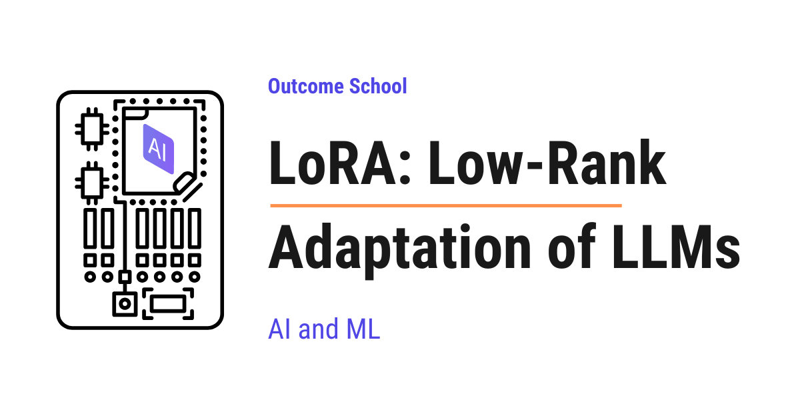

# What is LoRA (Low-Rank Adaptation) and How Does It Fine-Tune LLMs?

> Archived from <https://outcomeschool.com/blog/lora-low-rank-adaptation-of-llms> on 2026-11-25.

LoRA (Low-Rank Adaptation) is a way to fine-tune a large model without updating all of its weights. It keeps the original weights frozen and learns a tiny pair of extra matrices on the side.

In this blog, we will learn about LoRA - Low-Rank Adaptation of Large Language Models.

Today, we will cover the following topics:
<ul><li>The Big Picture</li><li>Why Full Fine-Tuning Is Expensive</li><li>The Core Idea Behind LoRA</li><li>How LoRA Works Step by Step</li><li>A Small Numeric Example</li><li>Where LoRA Is Applied in a Transformer</li><li>Merging LoRA Back Into the Model</li><li>Real-World Use Cases</li><li>Quick Summary</li></ul>
I am <strong>Amit Shekhar</strong>, Founder @ <a target="_blank" rel="noopener noreferrer" href="https://outcomeschool.com">Outcome School</a>, I have taught and mentored many developers, and their efforts landed them high-paying tech jobs, helped many tech companies in solving their unique problems, and created many open-source libraries being used by top companies. I am passionate about sharing knowledge through open-source, blogs, and videos.

I teach <a target="_blank" rel="noopener noreferrer" href="https://outcomeschool.com/program/ai-and-machine-learning">AI and Machine Learning</a> at Outcome School.

Let&#x27;s get started.
<h2 id="the-big-picture">The Big Picture</h2>
Before we go into the details, let&#x27;s understand the big picture.

LoRA is a way to <a target="_blank" rel="noopener noreferrer" href="how-does-fine-tuning-work.md">fine-tune</a> a large model <strong>without updating all of its weights</strong>. Instead of changing the original weight matrix, we keep it frozen and learn a tiny pair of extra matrices on the side. These tiny matrices capture the &quot;adjustment&quot; we want.

In simple words:

<strong>LoRA = Frozen original weights + A small low-rank update learned on the side.</strong>

This makes fine-tuning much cheaper, faster, and lighter on storage. And, we still get strong task-specific performance.
<h2 id="why-full-fine-tuning-is-expensive">Why Full Fine-Tuning Is Expensive</h2>
Before jumping into LoRA, we must first understand why full fine-tuning is hard.

We can learn everything about fine-tuning in this <a target="_blank" rel="noopener noreferrer" href="https://www.youtube.com/watch?v=lnfWvX66FUk">video</a>.

A modern Large Language Model can have billions of parameters. For example, a 7 billion parameter model has 7 billion numbers inside it. When we do full fine-tuning, we update <strong>every single one</strong> of these numbers.

This causes the following issues:
<ul><li><strong>GPU memory explodes.</strong> We need to keep the weights, the gradients, and the optimizer states in memory. For <a target="_blank" rel="noopener noreferrer" href="optimizers-in-deep-learning.md">Adam</a>, this can be 3 to 4 times the size of the model itself.</li><li><strong>Training is slow.</strong> Updating billions of parameters takes a lot of compute.</li><li><strong>Storage is heavy.</strong> Each fine-tuned copy of the model is the same size as the original. If we have 10 different tasks, we need 10 full copies of a multi-gigabyte model.</li><li><strong>Sharing is hard.</strong> A multi-gigabyte checkpoint per task is not easy to ship to users.</li></ul>
We need a smarter way. We need a way to adapt the model to a new task <strong>without touching most of its weights</strong>.

So, here comes <strong>LoRA</strong> to the rescue.
<h2 id="the-core-idea-behind-lora">The Core Idea Behind LoRA</h2>
The full form of LoRA is <strong>Low-Rank Adaptation</strong>.

Let&#x27;s decompose the name:

<strong>LoRA = Low-Rank + Adaptation.</strong>
<ul><li><strong>Adaptation</strong> means we are adapting the model to a new task or a new style.</li><li><strong>Low-Rank</strong> means the change we apply to the weights is represented in a very compact form using two small matrices.</li></ul>
The idea is based on a powerful observation from the original LoRA paper from Microsoft:
<blockquote>
When we fine-tune a large model, the actual update that we apply to the weights is very low-rank. We do not need a full giant update matrix - a much smaller one is enough.
</blockquote>
In simple words, the &quot;adjustment&quot; needed to teach the model a new task is much smaller than the model itself. So, we do not need a giant matrix to represent it.

Why does this work? The <a target="_blank" rel="noopener noreferrer" href="llm-pretraining.md">pre-trained model</a> already knows a lot. It has learned grammar, facts, reasoning, and general patterns. Fine-tuning it for a new task is not a rewrite. It is just a small nudge along a few important directions. That is exactly what &quot;low-rank&quot; means.

Let&#x27;s take a real-world analogy. Think of the pre-trained model as a giant textbook. Full fine-tuning is like rewriting every page of the textbook for a new topic. LoRA is like keeping the textbook unchanged and adding a small set of sticky notes on top that carry the new knowledge. The textbook stays the same, and the small notes do the actual adjustment.

Now, let&#x27;s see how this works in math.

A weight matrix <code>W</code> inside the model has shape <code>d x d</code>. In full fine-tuning, we learn a new matrix <code>W_new</code> of the same shape:

<pre><code class="code-highlight">W_new = W + ΔW
</code></pre>

Here, <code>ΔW</code> is the change we want to apply. Both <code>W</code> and <code>ΔW</code> are huge.

LoRA replaces this huge <code>ΔW</code> with a product of <strong>two small matrices</strong>:

<pre><code class="code-highlight">ΔW = BA
</code></pre>

Where:
<ul><li><code>A</code> has shape <code>r x d</code></li><li><code>B</code> has shape <code>d x r</code></li><li><code>r</code> is the <strong>rank</strong>, a small number like 4, 8, 16, 32, or 64</li><li><code>d</code> is the original dimension, often 4096 or larger</li></ul>
Now, <code>BA</code> still has shape <code>d x d</code>, but we never store the full <code>d x d</code> update. We only store <code>A</code> and <code>B</code>, which are tiny compared to <code>W</code>.

<strong>Note:</strong> For simplicity, we are assuming <code>W</code> is a square <code>d x d</code> matrix. In real Large Language Models, attention projection matrices are square, but feed-forward layers are not. They are usually <code>d x 4d</code> or <code>4d x d</code>. LoRA works for any rectangular matrix - if <code>W</code> has shape <code>d x k</code>, then <code>B</code> becomes <code>d x r</code> and <code>A</code> becomes <code>r x k</code>. The idea stays exactly the same.

Here is a simple ASCII diagram comparing the sizes.

<pre><code class="code-highlight">       ΔW (full update)                 B            x            A
        (d x d matrix)              (d x r)                   (r x d)

     +-------------------+             +--+              +-------------------+
     |                   |             |  |              +-------------------+
     |                   |             |  |
     |                   |             |  |
     |                   |     =       |  |      x
     |                   |             |  |
     |                   |             |  |
     |                   |             |  |
     |                   |             |  |
     +-------------------+             +--+
</code></pre>

Here, the big square is the full update we would have to store. The thin column <code>B</code> and the short row <code>A</code> together carry all the information we actually train. The visual size difference is exactly why LoRA is so memory-efficient.

The forward pass for an input vector <code>x</code> becomes:

<pre><code class="code-highlight">h = Wx + (BA)x
</code></pre>

Here, <code>W</code> is <strong>frozen</strong>. Only <code>A</code> and <code>B</code> are trained.

<strong>Planning your move into AI?</strong>

No matter which tech domain you work in today, with your effort, you can transition to these roles:
<ul><li>AI Engineer</li><li>Forward Deployed Engineer</li><li>AI Agent Engineer</li><li>Harness Engineer</li><li>Voice AI Engineer</li><li>AI Architect</li><li>LLM Engineer</li><li>LLM Inference Engineer</li><li>Gen AI Engineer</li><li>MLOps Engineer</li><li>ML Engineer</li><li>Deep Learning Engineer</li></ul>
Our <a target="_blank" rel="noopener noreferrer" href="https://outcomeschool.com/program/ai-and-machine-learning">AI and Machine Learning Program</a> at Outcome School takes you there.
<h2 id="how-lora-works-step-by-step">How LoRA Works Step by Step</h2>
Let&#x27;s walk through LoRA step by step.

<strong>Step 1:</strong> Take the pre-trained model and freeze all of its original weights. Nothing inside the original model will be updated during training.

<strong>Step 2:</strong> For each weight matrix we want to adapt, add two small matrices <code>A</code> and <code>B</code> next to it.
<ul><li><code>A</code> is initialized with small random values (Gaussian).</li><li><code>B</code> is initialized with <strong>all zeros</strong>.</li></ul>
This zero initialization is important. At the start of training, <code>BA = 0</code>, so the model behaves exactly like the original pre-trained model. Training then gradually nudges <code>BA</code> away from zero.

<strong>Step 3:</strong> During training, only <code>A</code> and <code>B</code> receive gradient updates. The original <code>W</code> stays untouched.

<strong>Step 4:</strong> During the forward pass, compute the output as:

<pre><code class="code-highlight">h = Wx + (alpha / r) * (BA)x
</code></pre>

Here, <code>alpha</code> is a scaling factor. The ratio <code>alpha / r</code> controls how strongly the LoRA update influences the output. A common choice is <code>alpha = 2 * r</code>.

<strong>Step 5:</strong> After training, we have a tiny set of new weights <code>A</code> and <code>B</code> that capture the task-specific knowledge. The original model is still untouched.

That&#x27;s the entire idea.

Going back to our textbook analogy, the original textbook is the frozen <code>W</code>. The sticky notes are <code>A</code> and <code>B</code>. The notes start blank because <code>B</code> is zero. As training goes on, the notes fill up with corrections that nudge the textbook&#x27;s behavior toward the new task.

<strong>Note:</strong> The choice of rank <code>r</code> is the most important LoRA hyperparameter. A smaller <code>r</code> means fewer trainable parameters and faster training, but the adapter has less capacity to learn complex changes. A larger <code>r</code> gives more capacity but loses some of the efficiency benefits. In practice, ranks of 8 to 64 work well for most tasks.

To learn fine-tuning, PEFT, and LoRA in depth, check out our <a target="_blank" rel="noopener noreferrer" href="https://outcomeschool.com/program/ai-and-machine-learning">AI and Machine Learning Program</a> at Outcome School.
<h2 id="a-small-numeric-example">A Small Numeric Example</h2>
Let&#x27;s put this into perspective with real numbers.

Suppose we have a weight matrix <code>W</code> of shape <code>4096 x 4096</code>. The number of parameters in <code>W</code> is:

<pre><code class="code-highlight">4096 x 4096 = 16,777,216
</code></pre>

That&#x27;s around 16.8 million parameters in <strong>just one matrix</strong>. A full fine-tune would update all of them.

Now, let&#x27;s apply LoRA with rank <code>r = 8</code>.
<ul><li><code>A</code> has shape <code>8 x 4096</code> = 32,768 parameters</li><li><code>B</code> has shape <code>4096 x 8</code> = 32,768 parameters</li><li>Total LoRA parameters = 65,536</li></ul>
Let&#x27;s compare:
<ul><li>Full fine-tune: 16,777,216 parameters per matrix</li><li>LoRA with r=8: 65,536 parameters per matrix</li></ul>
That is roughly <strong>256x fewer parameters</strong> for the same matrix. And, this is just for one matrix - the savings multiply across every layer of the model.

For a full 7B parameter model, full fine-tuning updates 7 billion parameters. LoRA with rank 8 typically updates only a few million. The trainable parameter count drops by <strong>a factor of around 1000x or more</strong>, depending on the rank and where LoRA is applied.

<strong>A quick note for you</strong>

No matter which tech domain you work in, get familiar with these topics:
<ul><li>LLM</li><li>RAG</li><li>MCP</li><li>Agent</li><li>Fine-tuning</li><li>Quantization</li></ul>
We put it all together in one video:

<a target="_blank" rel="noopener noreferrer" href="https://www.youtube.com/watch?v=lnfWvX66FUk">AI Engineering Explained: LLM, RAG, MCP, Agent, Fine-Tuning, and Quantization</a>

No need to stop reading - bookmark it and watch later when you get time. Future you will thank you.

Now, let&#x27;s get back to the topic.
<h2 id="where-lora-is-applied-in-a-transformer">Where LoRA Is Applied in a Transformer</h2>
LoRA can be applied to any linear layer in the model. But, in practice, LoRA is most commonly applied to the <strong>attention projection matrices</strong>.

We have a detailed blog on <a target="_blank" rel="noopener noreferrer" href="decoding-transformer-architecture.md">Transformer Architecture</a> that explains how attention layers work inside a transformer.

Inside each attention block, we have four projection matrices:
<ul><li><code>W_Q</code> - the Query projection</li><li><code>W_K</code> - the Key projection</li><li><code>W_V</code> - the Value projection</li><li><code>W_O</code> - the Output projection</li></ul>
If we want to go deeper into how Q, K, and V are computed and used, we can read <a target="_blank" rel="noopener noreferrer" href="math-behind-attention-qkv.md">Math Behind Attention: Q, K, V</a>.

The original LoRA paper found that adapting just <code>W_Q</code> and <code>W_V</code> is often enough to get strong task performance with minimal extra parameters. In practice, we can also apply LoRA to all four projections, or even to the feed-forward layers, for better quality at the cost of more trainable parameters.

Here is a simple ASCII diagram showing the structure for a single weight matrix.

<pre><code class="code-highlight">              Input x
                |
        +-------+-------+
        |               |
        v               v
   +---------+      +-------+
   |  W      |      |   A   |   (trainable, r x d)
   | (frozen)|      +-------+
   +---------+          |
        |               v
        |          +---------+
        |          |    B    |   (trainable, d x r)
        |          +---------+
        |               |
        v               v
        +-------+-------+
                |
                v
        h = Wx + (BA)x
</code></pre>

Here, <code>W</code> stays frozen and only <code>A</code> and <code>B</code> are trained. The two paths are added together to form the final output.

If we want to go deep into the Transformer architecture, attention, and Q/K/V projections, we have a complete program - check out our <a target="_blank" rel="noopener noreferrer" href="https://outcomeschool.com/program/ai-and-machine-learning">AI and Machine Learning Program</a> at Outcome School.
<h2 id="merging-lora-back-into-the-model">Merging LoRA Back Into the Model</h2>
Here is one of the most beautiful properties of LoRA.

Once training is done, we can <strong>merge</strong> <code>BA</code> directly into <code>W</code>:

<pre><code class="code-highlight">W_merged = W + (alpha / r) * (BA)
</code></pre>

Now, the model uses a single weight matrix <code>W_merged</code> exactly like the original. There are no extra matrices and no extra computation at inference time.

This means LoRA adds <strong>zero inference latency</strong> when merged. We get the benefits of fine-tuning without any runtime overhead.

In our textbook analogy, merging is like permanently writing the sticky notes into the textbook itself. The notes are gone, but the textbook now carries the new knowledge.

We can also keep <code>A</code> and <code>B</code> separate from <code>W</code> if we want to swap between different tasks at runtime. This is the basis of <strong>adapter swapping</strong>.

<strong>Note:</strong> Merging is a one-way operation. Once we merge <code>A</code> and <code>B</code> into <code>W</code>, we cannot easily swap that adapter out for a different one. So, if we want to serve many tasks from the same base model, we should keep the adapters unmerged and load them on demand.

This ability to merge is also what sets LoRA apart from the other Parameter-Efficient Fine-Tuning methods. We have a detailed blog on <a target="_blank" rel="noopener noreferrer" href="how-does-prefix-tuning-work.md">How does Prefix Tuning work?</a> that explains a method where nothing gets merged, and a small learned prefix steers every attention layer of the frozen model instead.

<strong>Stay updated:</strong> Subscribe to our <a target="_blank" rel="noopener noreferrer" href="https://outcomeschool.substack.com/subscribe">newsletter</a> to get our latest AI and Machine Learning blogs straight to your inbox.
<h2 id="real-world-use-cases">Real-World Use Cases</h2>
LoRA is everywhere in modern LLM workflows. Let&#x27;s see where LoRA is used in practice.
<ul><li><strong>Fine-tuning open-source LLMs on a single GPU.</strong> Models like LLaMA, Mistral, and Qwen are commonly fine-tuned using LoRA on a single consumer or workstation GPU. Without LoRA, this would need a cluster of expensive GPUs.</li><li><strong>Task-specific adapters.</strong> Teams train small LoRA adapters for each task - one for summarization, one for code generation, one for customer support - and load only the adapter they need. The base model stays the same.</li><li><strong>Style and domain adaptation.</strong> LoRA is used to teach a base model a specific writing style, a domain like medical or legal, or a specific persona.</li><li><strong>Image generation models.</strong> LoRA is widely used in image models like <a target="_blank" rel="noopener noreferrer" href="diffusion-models.md">Stable Diffusion</a> to add new characters, styles, or concepts without retraining the whole model. The community shares thousands of small LoRA files.</li><li><strong>Foundation for QLoRA.</strong> LoRA is the building block for QLoRA, which combines LoRA with <a target="_blank" rel="noopener noreferrer" href="how-does-model-quantization-work.md">4-bit quantization</a> to fine-tune very large models on a single consumer GPU.</li></ul>
Because LoRA freezes the base model and trains only a small adapter, it is also a popular way to do <a target="_blank" rel="noopener noreferrer" href="continual-learning-in-llms.md">Continual Learning in LLMs</a> - we can teach the model new tasks without overwriting the knowledge it already has.

<strong>Note:</strong> When we ship LoRA adapters to users, we only ship the small <code>A</code> and <code>B</code> matrices. These are often just a few megabytes. Compare that to a multi-gigabyte full fine-tuned model. This is why LoRA adapters are so easy to share, swap, and version.
<h2 id="quick-summary">Quick Summary</h2>
Let&#x27;s recap what we have decoded:
<ul><li><strong>LoRA = Low-Rank Adaptation.</strong> We freeze the original weights and learn a small low-rank update on the side.</li><li><strong>The update is <code>ΔW = BA</code></strong> where <code>A</code> and <code>B</code> are tiny matrices controlled by a small rank <code>r</code>.</li><li><strong><code>A</code> is random, <code>B</code> is zero at the start.</strong> This makes the model start exactly like the original pre-trained model.</li><li><strong>Only <code>A</code> and <code>B</code> are trained.</strong> The original <code>W</code> stays frozen, which saves massive amounts of memory and compute.</li><li><strong>Trainable parameters drop by 100x to 1000x or more</strong> depending on the rank and where LoRA is applied.</li><li><strong>LoRA can be merged into the original weights</strong> after training, so there is zero extra latency at inference time.</li><li><strong>Adapter swapping</strong> lets us serve many tasks from a single base model by loading different <code>A</code> and <code>B</code> matrices.</li><li><strong>LoRA is used everywhere</strong> - LLMs, image models, domain adaptation, and as the foundation for QLoRA.</li></ul>
This is how LoRA makes fine-tuning of Large Language Models cheap, fast, and accessible.
<h2 id="frequently-asked-questions">Frequently Asked Questions</h2><h3 id="does-lora-slow-down-inference">Does LoRA slow down inference?</h3>
No. Once training is done, we can merge <code>BA</code> directly into the original weight matrix. The model then uses a single weight matrix exactly like the original, with no extra matrices and no extra computation. So, LoRA adds zero inference latency when merged.
<h3 id="what-rank-should-we-choose-for-lora">What rank should we choose for LoRA?</h3>
In practice, ranks of 8 to 64 work well for most tasks. A smaller rank means fewer trainable parameters and faster training, but less capacity to learn complex changes. A larger rank gives more capacity but loses some of the efficiency benefits. The rank is the most important LoRA hyperparameter.
<h3 id="why-is-the-matrix-b-initialized-with-zeros">Why is the matrix B initialized with zeros?</h3>
Because at the start of training, <code>BA</code> becomes zero. This makes the model behave exactly like the original pre-trained model. Training then gradually nudges <code>BA</code> away from zero, while <code>A</code> starts with small random values.
<h3 id="can-one-base-model-serve-many-tasks-with-lora">Can one base model serve many tasks with LoRA?</h3>
Yes. Teams train small LoRA adapters for each task and load only the adapter they need, while the base model stays the same. To do this, we should keep the adapters unmerged, because merging is a one-way operation and a merged adapter cannot easily be swapped out.
<h3 id="what-is-the-relation-between-lora-and-qlora">What is the relation between LoRA and QLoRA?</h3>
LoRA is the building block for QLoRA. QLoRA combines LoRA with 4-bit quantization to fine-tune very large models on a single consumer GPU.

That&#x27;s it for now.

Thanks

<strong>Amit Shekhar</strong> Founder @ <a target="_blank" rel="noopener noreferrer" href="https://outcomeschool.com">Outcome School</a>

You can connect with me on:
<ul><li><a target="_blank" rel="noopener noreferrer" href="https://x.com/amitiitbhu">X</a></li><li><a target="_blank" rel="noopener noreferrer" href="https://www.linkedin.com/in/amit-shekhar-iitbhu">LinkedIn</a></li><li><a target="_blank" rel="noopener noreferrer" href="https://github.com/amitshekhariitbhu">GitHub</a></li></ul>
Follow Outcome School on:
<ul><li><a target="_blank" rel="noopener noreferrer" href="https://x.com/outcome_school">X</a></li><li><a target="_blank" rel="noopener noreferrer" href="https://youtube.com/@OutcomeSchool">YouTube</a></li><li><a target="_blank" rel="noopener noreferrer" href="https://www.linkedin.com/company/outcomeschool">LinkedIn</a></li><li><a target="_blank" rel="noopener noreferrer" href="https://github.com/OutcomeSchool">GitHub</a></li></ul>
<a target="_blank" rel="noopener noreferrer" href="https://outcomeschool.com/blog"><strong>Read all of our high-quality blogs here.</strong></a>

