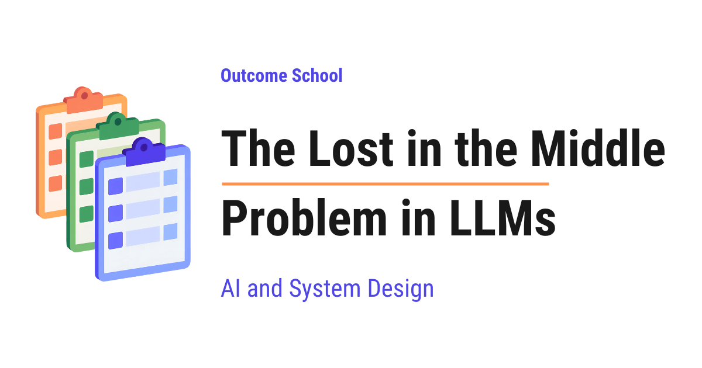

# What is the Lost in the Middle Problem in LLMs and How to Fix It?

> Archived from <https://outcomeschool.com/blog/lost-in-the-middle-problem-in-llms> on 2026-11-25.

The Lost in the Middle problem is the behaviour where an LLM pays strong attention to the information at the beginning and at the end of a long input, and pays very less attention to the information in the middle.

In this blog, we will learn about the Lost in the Middle problem in LLMs, the strange behaviour where a model reads a very long text, uses the beginning and the end very well, and quietly ignores whatever is sitting in the middle. We will also see what a context window really means, how the accuracy forms a U-shaped curve, why the middle gets forgotten, how this silently breaks RAG systems and long conversations, how we can test our own model for it, and what we can do to fix it.

We will cover the following:
<ul><li>What is a context window?</li><li>What is the Lost in the Middle problem?</li><li>Let&#x27;s understand it with an example</li><li>The U-shaped curve</li><li>Why does this happen</li><li>Where this hurts us in real life</li><li>How to test for the Lost in the Middle problem</li><li>How to solve the Lost in the Middle problem</li><li>Key points to remember</li></ul>
I am <strong>Amit Shekhar</strong>, Founder @ <a target="_blank" rel="noopener noreferrer" href="https://outcomeschool.com">Outcome School</a>, I have taught and mentored many developers, and their efforts landed them high-paying tech jobs, helped many tech companies in solving their unique problems, and created many open-source libraries being used by top companies. I am passionate about sharing knowledge through open-source, blogs, and videos.

I teach <a target="_blank" rel="noopener noreferrer" href="https://outcomeschool.com/program/ai-and-machine-learning">AI and Machine Learning</a> at Outcome School.

Let&#x27;s get started.
<h3 id="what-is-a-context-window">What is a context window?</h3>
Before jumping into the Lost in the Middle problem, we must know <a target="_blank" rel="noopener noreferrer" href="context-window.md">what a context window is</a>.

An <strong>LLM</strong> which means <strong>Large Language Model</strong> is a model that reads text and predicts what comes next. But it can not read unlimited text at once. There is a limit.

<strong>A context window is the maximum amount of text that a model can look at in one go.</strong>

Let&#x27;s break the term itself.

<strong>Context Window = Context + Window</strong>

Context means all the text that we hand over to the model, and window means the fixed opening through which it is allowed to look. So, the context window is the fixed opening through which the model sees whatever we have given.

In simple words, the context window is the working desk of the model. Whatever we place on that desk, the model can see. Whatever we keep outside the desk, the model can not see at all.

Whatever we place on that desk is called the <strong>prompt</strong>. The prompt is simply everything that we send to the model in one request, which includes our instruction, the documents that we are giving, and our actual question.

Let&#x27;s say a model has a context window of 100,000 tokens. A <strong><a target="_blank" rel="noopener noreferrer" href="tokenization-in-llms.md">token</a></strong> is a small piece of text, roughly three-fourth of a word. So, this model can look at around 75,000 words at once.

Now, here is where the confusion starts. Most of us assume that if the text fits inside the context window, the model reads all of it equally well.

That assumption is wrong. And that is exactly the Lost in the Middle problem.
<h3 id="what-is-the-lost-in-the-middle-problem">What is the Lost in the Middle problem?</h3>
<strong>The Lost in the Middle problem is the behaviour where an LLM pays strong attention to the information placed at the beginning and at the end of a long input, and pays very less attention to the information placed in the middle.</strong>

In simple words, the model reads the start, the model reads the end, and the middle just slips away.

Let&#x27;s take a real world comparison. Think about a meeting that ran for three hours. The next day, we clearly remember how the meeting started, and we clearly remember the decision that was taken at the end. The discussion that happened in the ninetieth minute is almost gone from our memory. We were present the whole time. We heard every single word. Still, the middle faded away.

An LLM does exactly the same thing with a long prompt.

This behaviour was studied by researchers who took the same answer and kept moving it to different positions inside a long input. They found the same weakness again and again, across many models, and the name Lost in the Middle stuck because it describes exactly what happens.

The important thing to notice here is that the information is present. We did give it to the model. It is sitting nicely inside the context window. The model simply fails to use it.

<strong>Very important:</strong> This is not the same as our text getting cut off. When the text is too big for the context window, some part of it gets removed before it ever reaches the model, and that is a completely different problem. Here, nothing is removed. Everything reaches the model. The model still behaves as if the middle was never there.

This is what makes the problem dangerous. There is no error. There is no warning. The model answers confidently with a wrong or incomplete answer, and we have no idea that the correct answer was already sitting right in front of it.
<h3 id="lets-understand-it-with-an-example">Let&#x27;s understand it with an example</h3>
The best way to learn this is by taking an example.

Let&#x27;s say we are building an app that answers questions about our company. We have 20 documents about the company. We put all 20 documents into the prompt and then ask a question as below:

<pre><code class="language-text code-highlight">Here are 20 documents about our company.

Document 1: ...
Document 2: ...
...
Document 20: ...

Question: What is our refund policy?
</code></pre>

Let say the refund policy is written inside Document 2. The model reads Document 2 early, because it is sitting close to the top, and it answers correctly.

Now, let&#x27;s move the same document to a different place. Let say the refund policy is now written inside Document 10, right in the middle of the pile. Everything else is exactly the same. The same 20 documents, the same question, the same model.

This time the model replies with something like &quot;I could not find the refund policy in the given documents.&quot;

Nothing changed except the position. The content was identical. Only the seat number changed.

Let&#x27;s move it once more, this time into Document 19, near the end. The model answers correctly again.

Same information. Same model. Same question. Three different positions, and two correct answers with one silent failure in the middle.

This is the Lost in the Middle problem.
<h3 id="the-u-shaped-curve">The U-shaped curve</h3>
Now, let&#x27;s understand this behaviour in a slightly more measurable way.

If we take one small fact, keep moving it from the first position to the last position, and note down the accuracy at every position, we get a very clear shape.
<ul><li>When the fact sits at the <strong>beginning</strong>, accuracy is high</li><li>When the fact moves towards the <strong>middle</strong>, accuracy keeps dropping</li><li>When the fact reaches the <strong>end</strong>, accuracy goes high again</li></ul>
If we draw this on a graph with the position on one side and the accuracy on the other side, the line goes down and then comes back up. It looks like the letter <strong>U</strong>.

Let&#x27;s see it visually as below:

<pre><code class="language-text code-highlight">Accuracy
  high  |  *                                   *
        |     *                             *
        |         *                     *
        |             *     *     *
  low   |________________________________________
          start          middle             end

                  Position of the answer
</code></pre>

<strong>This is called the U-shaped performance curve.</strong>

Two very well known human behaviours explain this nicely:
<ul><li><strong>Primacy bias</strong>: we remember the first thing very well</li><li><strong>Recency bias</strong>: we remember the last thing very well</li></ul>
The model behaves in the same way. It is strong at the first thing, strong at the last thing, and weak in between.

<strong>Note:</strong> The dip in the middle becomes deeper as the input becomes longer. With a short prompt, we may not notice anything at all. With a very long prompt, the middle almost disappears.

<strong>Planning your move into AI?</strong>

No matter which tech domain you work in today, with your effort, you can transition to these roles:
<ul><li>AI Engineer</li><li>Forward Deployed Engineer</li><li>AI Agent Engineer</li><li>Harness Engineer</li><li>Voice AI Engineer</li><li>AI Architect</li><li>LLM Engineer</li><li>LLM Inference Engineer</li><li>Gen AI Engineer</li><li>MLOps Engineer</li><li>ML Engineer</li><li>Deep Learning Engineer</li></ul>
Our <a target="_blank" rel="noopener noreferrer" href="https://outcomeschool.com/program/ai-and-machine-learning">AI and Machine Learning Program</a> at Outcome School takes you there.
<h3 id="why-does-this-happen">Why does this happen</h3>
Now, the next big question is: why does a model that can technically see all the text still ignore the middle?

There is no single reason. There are four reasons working together. Do not worry, we will learn about each of them in detail.

<strong>Reason 1: Attention gets spread very thin</strong>

An LLM uses a mechanism called <strong><a target="_blank" rel="noopener noreferrer" href="self-attention-in-transformers.md">attention</a></strong>. In simple words, attention decides how much importance every word should give to every other word while producing the answer.

Attention works by distributing a fixed budget of importance. Let&#x27;s say the model has one full unit of importance to give away. If there are 10 other words, each one can get a healthy share. If there are 100,000 other words, each one gets a tiny share.

Let&#x27;s take a simple comparison. Think about a torch light in a dark room. If the room is small, the light falls strongly on every corner. If the room is very big, the same torch has to cover a much larger area, so everything becomes dim. Attention behaves in exactly the same way.

So, as the input grows, the importance given to any single token becomes very small. The loudest tokens still win, and the ones sitting quietly in the middle get crushed.

<strong>Reason 2: The way position is handled</strong>

A model does not naturally know the order of the words. We have to tell it. We do this using <strong><a target="_blank" rel="noopener noreferrer" href="math-behind-rope-rotary-position-embedding.md">positional encoding</a></strong>, which is a way of tagging every token with information about where it sits.

Many modern models use a scheme where tokens that are far away from each other get a weaker connection than tokens that are close to each other. This is very useful in general, because nearby words are usually more related to each other.

But this creates a side effect. The last part of the input sits very close to the place where the model is writing the answer, so it stays strong. The first part usually holds the instruction, and the model gets trained again and again to respect it, so it also stays strong. The middle is far from the answer and it is not anchored by anything, so it becomes the weakest region. The very first tokens get one more pull on top of this, because the model uses them as <a target="_blank" rel="noopener noreferrer" href="how-do-attention-sinks-work.md">attention sinks</a>, a dumping ground for the attention it does not need anywhere else.

<strong>Reason 3: Human writing teaches this habit</strong>

Models learn from human text. And human text has a very strong structure.

Think about an article, a research paper, an email, or a report. The important thing is usually stated at the beginning as the introduction, and repeated at the end as the conclusion. The middle carries the supporting details.

The model learns this pattern from millions of documents. So, it slowly develops a habit of trusting the start and the end more than the middle. It is doing exactly what we taught it to do.

<strong>Reason 4: Training rarely uses the full length</strong>

A model may support a context window of 128,000 tokens, but most of the examples it learned from were much shorter than that. The long window is usually added in a later stage of training, where the model is taught to handle much bigger inputs than it originally saw.

So, the model has a lot of practice with short inputs and very less practice with genuinely long inputs where the answer is buried deep inside. It supports the long window, but it is not equally skilled across the entire window.

It is like a student who studied five page chapters for years and is now handed a five hundred page book. The student can turn every page, but the attention is not evenly spread across the book.

These four reasons together create the dip in the middle.

To learn Attention Mechanism, Positional Encodings, and LLM Internals, and to build a Large Language Model (LLM) from scratch, check out our <a target="_blank" rel="noopener noreferrer" href="https://outcomeschool.com/program/ai-and-machine-learning">AI and Machine Learning Program</a> at Outcome School.
<h3 id="where-this-hurts-us-in-real-life">Where this hurts us in real life</h3>
Till now, we have learned about what the problem is and why it happens. Now, it is time to see where it actually bites us. Let&#x27;s take a few real use cases.

<strong>RAG systems</strong>

<strong><a target="_blank" rel="noopener noreferrer" href="retrieval-augmented-generation-rag.md">RAG</a></strong> which means <strong>Retrieval Augmented Generation</strong> is a very common setup. We take all our documents, cut them into small pieces called <strong><a target="_blank" rel="noopener noreferrer" href="chunking-strategies-for-rag.md">chunks</a></strong>, and store them. When a question comes, a <strong><a target="_blank" rel="noopener noreferrer" href="how-does-semantic-search-work.md">retriever</a></strong> searches through those chunks, picks the ones that look most related to the question, puts them into the prompt, and asks the model to answer using them.

But, here is the catch. Most of us stuff 20 or 50 chunks into the prompt, thinking that more context means a better answer. The chunks sitting in the middle get ignored. So, we retrieve the right answer, we place it in the prompt, and the model still fails.

The retrieval was perfect. The generation failed. And when we debug this, we usually blame the retriever, which was never the problem in the first place.

<strong>Note:</strong> If our retriever puts the correct chunk at rank 12 out of 30, we have technically retrieved it. But rank 12 sits deep in the middle of the prompt, so the model behaves as if we never retrieved it at all.

<strong>Long chat history</strong>

In a long conversation, the early messages and the latest messages stay strong. The instruction that we gave somewhere in the middle of the conversation quietly loses its power.

This is why a chatbot often follows a rule for some time and then starts breaking it. The rule did not get deleted. It just moved into the weak middle region.

This is also the reason why a long chat gets shrunk as it grows. We have a detailed blog on <a target="_blank" rel="noopener noreferrer" href="how-does-context-compaction-work.md">How does context compaction work?</a> that explains how the older part of a conversation is summarized without losing the important points.

<strong>Long document analysis</strong>

When we give a 200 page contract or a huge log file and ask the model to find every issue, it reliably catches the issues near the start and near the end. The issues sitting in the middle sections get missed.

This is very dangerous, because the output looks complete. The model never says &quot;I skipped the middle.&quot; It just gives a confident partial answer.

<strong>Multi-document comparison</strong>

When we ask the model to compare 10 reports, the reports placed in the middle get a very shallow treatment. The summary looks balanced, but it is quietly weighted towards the first and the last reports.

<strong>AI agents</strong>

An <a target="_blank" rel="noopener noreferrer" href="ai-agent.md">AI agent</a> works step by step. It thinks, it uses a tool, it reads the result, and then it repeats. Every step adds its own output into the context.

After 30 steps, the goal that we gave at the very beginning is still safe, and the most recent step is still safe. But everything that the agent discovered in between starts fading away. This is why a long running agent slowly drifts away from what we originally asked it to do.

<strong>A quick note for you</strong>

No matter which tech domain you work in, get familiar with these topics:
<ul><li>LLM</li><li>RAG</li><li>MCP</li><li>Agent</li><li>Fine-tuning</li><li>Quantization</li></ul>
We put it all together in one video:

<a target="_blank" rel="noopener noreferrer" href="https://www.youtube.com/watch?v=lnfWvX66FUk">AI Engineering Explained: LLM, RAG, MCP, Agent, Fine-Tuning, and Quantization</a>

No need to stop reading - bookmark it and watch later when you get time. Future you will thank you.

Now, let&#x27;s get back to the topic.
<h3 id="how-to-test-for-the-lost-in-the-middle-problem">How to test for the Lost in the Middle problem</h3>
This was all about the places where the problem hurts us. Now, let&#x27;s learn how to catch it inside our own system.

Before fixing something, we must be able to measure it. There is a very simple and popular test for this, called the <strong>Needle in a Haystack</strong> test.

Here is how it works.

<strong>Step 1:</strong> Take a very long text that has nothing to do with our question. This is the haystack. It can be any long filler content.

<strong>Step 2:</strong> Write one small unique fact. This is the needle. For the sake of understanding, let&#x27;s take &quot;The secret code for the Mumbai office is BLUE-4471.&quot;

<strong>Step 3:</strong> Insert the needle at a chosen depth inside the haystack, for example at 10 percent depth.

<strong>Step 4:</strong> Ask the model a question whose answer is present only in the needle, for example &quot;What is the secret code for the Mumbai office?&quot;

<strong>Step 5:</strong> Note down whether the model found it or not.

After that, we repeat the whole thing by placing the needle at 0 percent, 10 percent, 20 percent, and so on, till 100 percent. We also repeat it at different input lengths.

Once we put all these results into a grid, we get a very clear picture. We can see exactly where our model becomes weak, and how long the input can become before the middle starts collapsing.

<strong>Note:</strong> We must run this test with our own model, our own prompt format, and our own kind of content. Every model has a different weak zone, and it changes with every new model version.

If we want to go deep into Evaluation of LLMs and Agents, and LLM as a Judge, check out our <a target="_blank" rel="noopener noreferrer" href="https://outcomeschool.com/program/ai-and-machine-learning">AI and Machine Learning Program</a> at Outcome School, where we cover them from the ground up.
<h3 id="how-to-solve-the-lost-in-the-middle-problem">How to solve the Lost in the Middle problem</h3>
Now that we have learned about the problem and we know how to measure it, it is time to learn how to solve it.

We will go through the approaches one by one, starting from the naive one.

<strong>Approach 1: Put everything into the context</strong>

This is what most of us do first. The model supports a huge context window, so we simply push everything into it and hope that the model will figure it out.

The issue with this approach is that a large context window is a capacity number, not a quality guarantee. The middle still gets lost, and on top of that we pay for every single token and we wait longer for the response. Let&#x27;s see how the next approach solve this issue.

<strong>Approach 2: Send less, but send the right thing</strong>

Here comes the simplest and the most effective fix into the picture. Instead of sending 50 chunks, we send 5 good chunks.

A short and precise context has a very small middle, so there is almost nothing left to lose. The model reads all of it properly.

To do this well, we improve the retrieval step using a <strong><a target="_blank" rel="noopener noreferrer" href="how-does-a-reranker-work.md">reranker</a></strong>. A reranker is a smaller model that takes the retrieved chunks and scores how well each chunk actually answers our question. We keep only the top few and we throw away the rest.

The issue with this approach is that sometimes we genuinely need many chunks, because the answer is spread across several documents. Let&#x27;s see how the next approach solve this issue.

<strong>Approach 3: Order the chunks smartly</strong>

If we must send many chunks, then we must decide their seating arrangement very carefully. This is the cheapest fix of all, because we are not removing anything, we are only changing the order.

We already know the shape of the curve. The beginning is strong, the end is strong, and the middle is weak. So, we place the most relevant chunk at the very beginning, the second most relevant chunk at the very end, the third one just after the first, the fourth one just before the last, and we keep folding inwards like this.

The weakest chunks land in the middle, which is exactly where we can afford to lose them.

Let&#x27;s see it visually as below:

<pre><code class="language-text code-highlight">Ranked chunks:   1   2   3   4   5   6   7

Final order:     1   3   5   7   6   4   2
                 ^                       ^
              strongest              strongest
              position                position
</code></pre>

This simple reordering costs us nothing and it gives a real improvement.

<strong>Note:</strong> We must also keep the actual question at the very end of the prompt, right before the answer begins. That is the strongest position in the whole prompt.

One more thing to notice here. If we have a critical instruction, such as &quot;answer only from the given documents&quot;, then we must write it twice, once at the very beginning and once again at the very end. Repeating it costs a few tokens, and it makes sure that the instruction never falls into the weak middle.

Deciding what goes into the prompt, and in which order, is a skill of its own. We have a detailed blog on <a target="_blank" rel="noopener noreferrer" href="context-engineering.md">Context Engineering</a> that covers it end to end.

The issue with this approach is that it only reduces the damage, it does not remove it. If the answer needs a chunk that landed in the middle, we still fail. Let&#x27;s see how the next approach solve this issue.

<strong>Approach 4: Break the big job into small jobs</strong>

Instead of asking one question over one giant prompt, we break the input into small pieces and we process each piece separately.

We take each chunk, ask the model the same question on that chunk alone, and collect a small answer from each one. After that, we take all these small answers, which are now very short, and ask the model to combine them into the final answer.

Here, every chunk gets its own turn to sit at the beginning and at the end of a short prompt. There is no weak middle, because there is no long input at all.

This is often called the map and reduce style of processing. Map means we run the same small job on every piece, and reduce means we join all those small results into one final result.

For the sake of understanding, let&#x27;s say we have 30 documents. Instead of one call with 30 documents, we make 30 small calls with one document each, and then one final call with the 30 short answers. The final call is tiny, so nothing gets buried in it.

There is a smarter version of this idea, where the model itself decides how to split the input and what to ask for every piece. We have a detailed blog on <a target="_blank" rel="noopener noreferrer" href="recursive-language-models.md">Recursive Language Models (RLMs)</a> that explains how that works.

<strong>Advantage:</strong> Nothing gets ignored, because every piece is read inside a short context.

<strong>Disadvantage:</strong> We make many model calls, so it costs more and it takes more time.

<strong>Approach 5: Force the model to look before it answers</strong>

Sometimes we can fix a lot by simply changing the instruction.

Instead of asking the model to answer directly, we first ask it to go through the documents and copy out the lines that are relevant, along with the document number. After that, we ask it to answer using only those copied lines.

This works because copying is a much easier job than reasoning. The model scans and extracts, and the extracted lines then become a short and fresh context where nothing is buried.

We can write the instruction as below:

<pre><code class="language-text code-highlight">First, list the document number and the exact sentences that are relevant
to the question. Do not answer the question yet.

Then, using only the sentences that you have listed above, write the
final answer.
</code></pre>

Here, we have split one hard job into two easy jobs, which is a simple form of <a target="_blank" rel="noopener noreferrer" href="how-does-prompt-chaining-work.md">prompt chaining</a>. The first job pulls the buried information up to the surface, and the second job works on a clean and short input.

<strong>Approach 6: Choose the model carefully</strong>

Every model has a different weak zone. Some models hold the middle very well up to 30,000 tokens and then collapse after that. Some models hold it much longer.

So, we must never pick a model by looking at the advertised context window size. We must pick it by running the Needle in a Haystack test at the length that we actually use, with the kind of content that we actually have.

<strong>A model that advertises a one million token window is not promising that it understands one million tokens equally well. It is only promising that it will accept them.</strong>

This way we can use these simple approaches to solve the interesting problem, and it makes our life easy, because we stop fighting the model and we start working with the way it actually reads.

<strong>Stay updated:</strong> Subscribe to our <a target="_blank" rel="noopener noreferrer" href="https://outcomeschool.substack.com/subscribe">newsletter</a> to get our latest AI and Machine Learning blogs straight to your inbox.
<h3 id="key-points-to-remember">Key points to remember</h3>
Let me summarize the important points for our better understanding:
<ul><li>The context window tells us how much text the model will accept, not how well it understands every part of it</li><li>The accuracy is high at the beginning, it drops in the middle, and it rises again at the end, which gives us the U-shaped curve</li><li>The problem becomes worse as the input becomes longer</li><li>It happens because attention gets spread thin, position handling favours the nearby and the starting tokens, and human writing trains the model to trust the start and the end</li><li>It fails silently, so we get a confident wrong answer instead of an error message</li><li>The best fix is to send less context and better context</li><li>If we must send a lot, then we must put the most important content at the start and at the end</li><li>Breaking the work into small pieces removes the weak middle completely</li><li>It is not only a RAG problem, it hits long chats and long running AI agents in exactly the same way</li><li>We must test our own model using the Needle in a Haystack test instead of trusting the advertised numbers</li></ul>
Now, we have understood the Lost in the Middle problem in LLMs.

The next time our system gives a wrong answer even though the correct information was present in the prompt, we must not assume that the model failed to understand it. We must first check where that information was sitting.

Most of the time, the answer was already there. It was just sitting in the middle.
<h2 id="frequently-asked-questions">Frequently Asked Questions</h2><h3 id="is-the-lost-in-the-middle-problem-the-same-as-text-getting-cut-off">Is the Lost in the Middle problem the same as text getting cut off?</h3>
No. When text is too big for the context window, some part of it gets removed before it ever reaches the model. In the Lost in the Middle problem, nothing is removed and everything reaches the model. The model still behaves as if the middle was never there.
<h3 id="does-a-bigger-context-window-fix-the-lost-in-the-middle-problem">Does a bigger context window fix the Lost in the Middle problem?</h3>
No. A large context window is a capacity number, not a quality guarantee. It tells us how much text the model will accept, not how well it understands every part of it. The middle still gets lost, and we also pay for every token and wait longer for the response.
<h3 id="where-should-we-put-the-question-in-a-long-prompt">Where should we put the question in a long prompt?</h3>
We should keep the question at the very end of the prompt, right before the answer begins. That is the strongest position in the whole prompt. If we have a critical instruction, we should write it twice, once at the very beginning and once again at the very end.
<h3 id="why-does-a-chatbot-follow-a-rule-for-some-time-and-then-start-breaking-it">Why does a chatbot follow a rule for some time and then start breaking it?</h3>
Because the rule moved into the weak middle region of the conversation. In a long chat, the early messages and the latest messages stay strong, while an instruction given somewhere in the middle quietly loses its power. The rule did not get deleted.
<h3 id="is-the-lost-in-the-middle-problem-only-a-rag-problem">Is the Lost in the Middle problem only a RAG problem?</h3>
No. It also hits long chats, long document analysis, multi-document comparison, and long running AI agents. After many steps, an agent still remembers its original goal and its most recent step, but what it discovered in between starts fading away.

That&#x27;s it for now.

Thanks

<strong>Amit Shekhar</strong> Founder @ <a target="_blank" rel="noopener noreferrer" href="https://outcomeschool.com">Outcome School</a>

You can connect with me on:
<ul><li><a target="_blank" rel="noopener noreferrer" href="https://x.com/amitiitbhu">X</a></li><li><a target="_blank" rel="noopener noreferrer" href="https://www.linkedin.com/in/amit-shekhar-iitbhu">LinkedIn</a></li><li><a target="_blank" rel="noopener noreferrer" href="https://github.com/amitshekhariitbhu">GitHub</a></li></ul>
Follow Outcome School on:
<ul><li><a target="_blank" rel="noopener noreferrer" href="https://x.com/outcome_school">X</a></li><li><a target="_blank" rel="noopener noreferrer" href="https://youtube.com/@OutcomeSchool">YouTube</a></li><li><a target="_blank" rel="noopener noreferrer" href="https://www.linkedin.com/company/outcomeschool">LinkedIn</a></li><li><a target="_blank" rel="noopener noreferrer" href="http://github.com/OutcomeSchool">GitHub</a></li></ul>
<a target="_blank" rel="noopener noreferrer" href="https://outcomeschool.com/blog"><strong>Read all of our high-quality blogs here.</strong></a>

