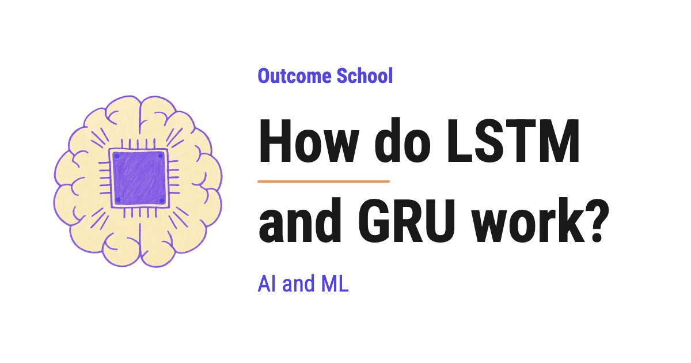

# How do LSTM and GRU work?

> Archived from <https://outcomeschool.com/blog/lstm-and-gru> on 2026-11-25.

LSTM and GRU are special kinds of neural networks that read data one step at a time and keep a memory of what matters. They use small &quot;gates&quot; that decide what to remember, what to forget, and what to use, so they can remember important things for a long time.

In this blog, we will learn about how LSTM and GRU work. We will also see how a simple Recurrent Neural Network reads a sequence and why it forgets things, what gates are, how the three gates of an LSTM work together, how a GRU does the same job with fewer gates, how to use both in code, and when to use which one.

We will cover the following:
<ul><li>What is sequence data?</li><li>What is a Recurrent Neural Network?</li><li>The problem: an RNN forgets</li><li>What is a gate?</li><li>What is an LSTM?</li><li>The cell state</li><li>The forget gate</li><li>The input gate</li><li>The output gate</li><li>An LSTM step with numbers</li><li>Why does an LSTM remember for a long time?</li><li>What is a GRU?</li><li>The update gate and the reset gate</li><li>LSTM and GRU in code</li><li>LSTM vs GRU</li><li>Where are LSTM and GRU used today?</li></ul>
I am <strong>Amit Shekhar</strong>, Founder @ <a target="_blank" rel="noopener noreferrer" href="https://outcomeschool.com">Outcome School</a>, I have taught and mentored many developers, and their efforts landed them high-paying tech jobs, helped many tech companies in solving their unique problems, and created many open-source libraries being used by top companies. I am passionate about sharing knowledge through open-source, blogs, and videos.

I teach <a target="_blank" rel="noopener noreferrer" href="https://outcomeschool.com/program/ai-and-machine-learning">AI and Machine Learning</a> at Outcome School.

Let&#x27;s get started.
<h2 id="what-is-sequence-data">What is sequence data?</h2>
Before jumping into LSTM and GRU, we must know about sequence data, because LSTM and GRU are made to work on it.

<strong>Sequence data is data where the order matters.</strong>

Let&#x27;s see a few examples:
<ul><li>A sentence: &quot;The dog bit the man&quot; and &quot;The man bit the dog&quot; have the same words, but a different meaning because of the order.</li><li>Daily temperatures over a month.</li><li>Stock prices over a year.</li><li>Sound, which is a long series of values over time.</li></ul>
To understand sequence data, a program must read it in order and remember what came before.
<h2 id="what-is-a-recurrent-neural-network">What is a Recurrent Neural Network?</h2>
A normal <a target="_blank" rel="noopener noreferrer" href="neural-network.md">neural network</a> looks at the whole input at once and has no memory. It cannot read step by step.

<strong>A Recurrent Neural Network (RNN) is a neural network that reads a sequence one step at a time and carries a small memory from one step to the next.</strong>

Recurrent means &quot;happening again and again&quot;. The same network runs again and again, once for each step.

This small memory is called the <strong>hidden state</strong>. It is just a list of numbers that summarizes what the network has read so far.

<pre><code class="code-highlight"> &quot;The&quot;      &quot;cat&quot;      &quot;sat&quot;
   |          |          |
   ↓          ↓          ↓
 [RNN] ---&gt; [RNN] ---&gt; [RNN] ---&gt; final memory
       h1         h2         h3
</code></pre>

Here, at each step, the RNN takes two things: the current word and the memory from the previous step. It mixes them and produces a new memory. <code>h1</code>, <code>h2</code>, and <code>h3</code> are the hidden states after each word.

We have a detailed blog on <a target="_blank" rel="noopener noreferrer" href="recurrent-neural-network.md">Recurrent Neural Network</a> that explains this in depth.
<h2 id="the-problem-an-rnn-forgets">The problem: an RNN forgets</h2>
The simple RNN works well for short sequences. But for long sequences, it forgets the early parts.

Let&#x27;s say we have this sentence:

&quot;Riya grew up in France, she moved to India for her job ten years ago, she loves cricket now, but at home she still speaks fluent ___.&quot;

The answer is &quot;French&quot;. To get it, the network must remember &quot;France&quot; from the very beginning.

In a simple RNN, the whole memory is rewritten at every step. The new memory is the old memory mixed with the new word. After many steps, the information about &quot;France&quot; gets mixed and diluted so many times that almost nothing remains.

There is a second reason too. During training, the network learns by sending a correction message backward through all the steps. This message is called the <strong>gradient</strong>. At every step back, it gets multiplied by a number that is often smaller than 1.

<pre><code class="code-highlight">0.5 * 0.5 * 0.5 * ... (30 times) = almost 0
</code></pre>

So, the early steps get almost no correction, and the network never learns to keep early information. This is called the <strong><a target="_blank" rel="noopener noreferrer" href="vanishing-and-exploding-gradients.md">vanishing gradient problem</a></strong>.

We needed a solution for that, and LSTM was introduced to solve this problem. Later, GRU came as a simpler version of the same idea.
<h2 id="what-is-a-gate">What is a gate?</h2>
Before jumping into LSTM, we must understand one small idea: a <strong>gate</strong>.

<strong>A gate is a set of numbers between 0 and 1 that controls how much information passes through.</strong>
<ul><li>0 means &quot;let nothing pass&quot;. The gate is closed.</li><li>1 means &quot;let everything pass&quot;. The gate is fully open.</li><li>0.5 means &quot;let half pass&quot;.</li></ul>
The gate gets its numbers from a function called <strong><a target="_blank" rel="noopener noreferrer" href="activation-functions.md">sigmoid</a></strong>. Sigmoid takes any number and squeezes it into the range 0 to 1. A big positive number becomes close to 1. A big negative number becomes close to 0.

We use the gate by multiplying:

<pre><code class="code-highlight">information = [ 8,   4,   6 ]
gate        = [ 1,   0,   0.5 ]
result      = [ 8,   0,   3 ]
</code></pre>

Here, the first value passes fully, the second value is blocked, and the third value is cut in half.

The gate values are not fixed. The network learns, from the current input and the memory, what gate values to use at each step. So, the gates learn when to open and when to close.

We will also see one more function called <strong>tanh</strong>. It squeezes any number into the range -1 to 1. It is used for the actual content, while sigmoid is used for the gates.

To learn Neural Networks, Activation Functions, and Backpropagation in depth, check out our <a target="_blank" rel="noopener noreferrer" href="https://outcomeschool.com/program/ai-and-machine-learning">AI and Machine Learning Program</a> at Outcome School.
<h2 id="what-is-an-lstm">What is an LSTM?</h2>
<strong>LSTM stands for Long Short-Term Memory. It is a type of RNN that uses gates to decide what to forget, what to store, and what to output, so it can keep important information for a long time.</strong>

The name means it gives a long life to the short-term memory of an RNN. LSTM was introduced by Sepp Hochreiter and Jürgen Schmidhuber in 1997.

An LSTM carries two things from one step to the next:
<ul><li><strong>Cell state</strong> (<code>c</code>): the long-term memory.</li><li><strong>Hidden state</strong> (<code>h</code>): the short-term working memory, which is also the output at each step.</li></ul>
It has three gates:
<ul><li><strong>Forget gate</strong>: what to erase from the long-term memory.</li><li><strong>Input gate</strong>: what new information to write into the long-term memory.</li><li><strong>Output gate</strong>: what part of the long-term memory to show as the output right now.</li></ul>
Let&#x27;s draw the big picture:

<pre><code class="code-highlight">                 cell state (long-term memory)
  c(prev) ----[ * forget gate ]----[ + new info ]-------------+----&gt; c(new)
                                          ↑                   |
                                          |                   ↓
                               input gate * candidate    output gate
                                          ↑                   |
                                          |                   ↓
  h(prev) + x(now) -----------------------+                h(new) (output)
</code></pre>

Here, the top line is the long-term memory. At each step, the forget gate removes some of it, the input gate adds some new information to it, and the output gate decides what to show from it as <code>h(new)</code>. All three gates take their decision by looking at <code>h(prev)</code> and the current input <code>x(now)</code>.

We will learn about each part one by one.

Think of an LSTM as a student who keeps a notebook while reading a long story. At each new page, the student does three things:
<ul><li>Erases old notes that are no longer useful.</li><li>Writes down new important facts.</li><li>Looks at the notebook and says what is relevant right now.</li></ul>
<strong>Planning your move into AI?</strong>

No matter which tech domain you work in today, with your effort, you can transition to these roles:
<ul><li>AI Engineer</li><li>Forward Deployed Engineer</li><li>AI Agent Engineer</li><li>Harness Engineer</li><li>Voice AI Engineer</li><li>AI Architect</li><li>LLM Engineer</li><li>LLM Inference Engineer</li><li>Gen AI Engineer</li><li>MLOps Engineer</li><li>ML Engineer</li><li>Deep Learning Engineer</li></ul>
Our <a target="_blank" rel="noopener noreferrer" href="https://outcomeschool.com/program/ai-and-machine-learning">AI and Machine Learning Program</a> at Outcome School takes you there.
<h2 id="the-cell-state">The cell state</h2>
The cell state is the most important part of an LSTM.

<strong>The cell state is a list of numbers that flows from step to step and is changed only by small, controlled updates.</strong>

In a simple RNN, the memory is fully rewritten at every step. In an LSTM, the cell state is not rewritten. It only goes through two operations at each step: a multiplication by the forget gate and an addition of new information.
<h2 id="the-forget-gate">The forget gate</h2>
<strong>The forget gate decides how much of the old cell state to keep.</strong>

It looks at the previous hidden state <code>h(prev)</code> and the current input <code>x(now)</code>, and produces a value between 0 and 1 for each number in the cell state.

<strong>f = sigmoid(W_f * [h(prev), x(now)] + b_f)</strong>

Here, <code>W_f</code> and <code>b_f</code> are the weights and bias of the forget gate, which are learned during training. <code>[h(prev), x(now)]</code> means we join the two lists together into one list.
<ul><li><code>f</code> close to 1: keep this memory.</li><li><code>f</code> close to 0: forget this memory.</li></ul>
Let&#x27;s say the LSTM is reading a story and it remembers that the main person is &quot;Riya&quot;. When the story says &quot;Then Rahul entered the room...&quot;, the forget gate can lower the memory about who the main person is, to make room for the new person.
<h2 id="the-input-gate">The input gate</h2>
<strong>The input gate decides how much new information to write into the cell state.</strong>

It works in two parts.

First, the LSTM creates a <strong>candidate</strong>, which is the new information that could be added. It uses tanh, so the values are between -1 and 1.

<strong>g = tanh(W_g * [h(prev), x(now)] + b_g)</strong>

Then, the input gate decides how much of this candidate to actually write:

<strong>i = sigmoid(W_i * [h(prev), x(now)] + b_i)</strong>

Now, the new cell state is calculated as below:

<strong>c(new) = f * c(prev) + i * g</strong>

Here, we can see that:
<ul><li><code>f * c(prev)</code> is the old memory after forgetting some parts.</li><li><code>i * g</code> is the new information that we decided to add.</li><li>We add both to get the updated memory.</li></ul><h2 id="the-output-gate">The output gate</h2>
<strong>The output gate decides which part of the cell state to show as the hidden state, which is the output at this step.</strong>

<strong>o = sigmoid(W_o * [h(prev), x(now)] + b_o)</strong>

<strong>h(new) = o * tanh(c(new))</strong>

Here, we first pass the cell state through tanh to keep the values between -1 and 1. Then the output gate picks how much of each value to reveal.

The notebook can have many notes, but we do not need all of them right now. Let&#x27;s say the next word to predict is a verb. The output gate can reveal the note &quot;the subject is singular&quot; so that the network picks &quot;is&quot; instead of &quot;are&quot;, and keep the other notes hidden for now.
<h2 id="an-lstm-step-with-numbers">An LSTM step with numbers</h2>
Now, let&#x27;s take one step with simple numbers for the sake of understanding. We will use only one number in the cell state.

Let&#x27;s say the old cell state <code>c(prev) = 5</code>. It stores something important from earlier.

<strong>Step 1:</strong> The forget gate looks at the current input and decides to keep most of the memory.

<pre><code class="code-highlight">f = 0.9
f * c(prev) = 0.9 * 5 = 4.5
</code></pre>

<strong>Step 2:</strong> The candidate and input gate decide to add a little new information.

<pre><code class="code-highlight">g = 1.0
i = 0.2
i * g = 0.2 * 1.0 = 0.2
</code></pre>

<strong>Step 3:</strong> Update the cell state.

<pre><code class="code-highlight">c(new) = 4.5 + 0.2 = 4.7
</code></pre>

<strong>Step 4:</strong> The output gate decides how much to reveal.

<pre><code class="code-highlight">o = 0.5
tanh(4.7) = 0.9998 (very close to 1)
h(new) = 0.5 * 0.9998 = 0.4999
</code></pre>

Here, we can see that the old memory of 5 mostly survived as 4.7. If the forget gate stays near 1 for many steps, the memory survives for a very long time.

Now, let&#x27;s see the opposite case. Suppose a new sentence starts and the old memory is no longer useful. The forget gate can become 0.0. Then <code>0.0 * 5 = 0</code>, and the old memory is erased. Then the input gate can write fresh information.

This is how an LSTM controls its memory.

<strong>A quick note for you</strong>

No matter which tech domain you work in, get familiar with these topics:
<ul><li>LLM</li><li>RAG</li><li>MCP</li><li>Agent</li><li>Fine-tuning</li><li>Quantization</li></ul>
We put it all together in one video:

<a target="_blank" rel="noopener noreferrer" href="https://www.youtube.com/watch?v=lnfWvX66FUk">AI Engineering Explained: LLM, RAG, MCP, Agent, Fine-Tuning, and Quantization</a>

No need to stop reading - bookmark it and watch later when you get time. Future you will thank you.

Now, let&#x27;s get back to the topic.
<h2 id="why-does-an-lstm-remember-for-a-long-time">Why does an LSTM remember for a long time?</h2>
Now, the question is: why does this design fix the forgetting problem?

The answer is the plus sign in the cell state update:

<strong>c(new) = f * c(prev) + i * g</strong>

In a simple RNN, the memory passes through a full mixing step every time, and the backward correction message gets multiplied down at each step.

In an LSTM, the cell state moves forward mostly by being multiplied with the forget gate <code>f</code> and having something added. When <code>f</code> is close to 1, the old memory passes almost unchanged. In the backward direction, the correction message also flows back through the same path, multiplied by <code>f</code> at each step. So, when the network wants to remember, <code>f</code> stays near 1, and the message does not fade.

Let&#x27;s compare:

<pre><code class="code-highlight">Simple RNN, 30 steps:   0.5 * 0.5 * ... * 0.5   = almost 0
LSTM, 30 steps (f=0.99): 0.99 * 0.99 * ... * 0.99 = about 0.74
</code></pre>

Here, we can see that the LSTM keeps a strong signal even after 30 steps. And the best part is that the network itself learns when to keep <code>f</code> near 1 and when to lower it.

So, the &quot;France&quot; from the beginning of our sentence can travel all the way to the end on the cell state.
<h2 id="what-is-a-gru">What is a GRU?</h2>
Now that we have learned about LSTM, it&#x27;s time to learn about GRU.

<strong>GRU stands for Gated Recurrent Unit. It is a simpler version of the LSTM that uses only two gates and keeps only one memory instead of two.</strong>

GRU was introduced by Kyunghyun Cho and his team in 2014.

The main differences from LSTM:
<ul><li>There is no separate cell state. The GRU keeps only the hidden state <code>h</code>, and it acts as both the long-term memory and the output.</li><li>There are two gates instead of three: the <strong>update gate</strong> and the <strong>reset gate</strong>.</li></ul>
Since it has fewer gates, it has fewer weights to learn and runs a little faster.
<h2 id="the-update-gate-and-the-reset-gate">The update gate and the reset gate</h2>
<strong>The update gate decides how much of the old memory to keep and how much new memory to take.</strong>

<strong>z = sigmoid(W_z * [h(prev), x(now)] + b_z)</strong>

The update gate does the job of both the forget gate and the input gate of the LSTM, and that too in one go. It works like a slider between old and new:

<strong>h(new) = (1 - z) * h(prev) + z * h(candidate)</strong>
<ul><li>If <code>z</code> is close to 0, we keep the old memory almost as it is.</li><li>If <code>z</code> is close to 1, we replace it with the new candidate.</li><li>If <code>z</code> is 0.3, we keep 70% old and take 30% new.</li></ul>
Here, the forgetting and the adding are tied together. Whatever fraction we take from the new, we drop from the old.

<strong>The reset gate decides how much of the old memory to use while creating the new candidate.</strong>

<strong>r = sigmoid(W_r * [h(prev), x(now)] + b_r)</strong>

<strong>h(candidate) = tanh(W_h * [r * h(prev), x(now)] + b_h)</strong>
<ul><li>If <code>r</code> is close to 0, the candidate ignores the past and is built mostly from the current input. This is useful when a new topic starts.</li><li>If <code>r</code> is close to 1, the candidate uses the past fully.</li></ul>
Let&#x27;s take a quick numeric example. Say <code>h(prev) = 0.8</code>, <code>h(candidate) = -0.4</code>, and the update gate <code>z = 0.25</code>.

<pre><code class="code-highlight">h(new) = (1 - 0.25) * 0.8 + 0.25 * (-0.4)
       = 0.6 - 0.1
       = 0.5
</code></pre>

Here, we kept 75% of the old memory and took 25% of the new candidate.

Think of the GRU as a person updating a single whiteboard instead of keeping a separate notebook. The reset gate decides whether to look at the old whiteboard while drafting the new note. The update gate decides how much of the whiteboard to wipe and replace with the new note.

<strong>Note:</strong> Some books and libraries write the update formula with <code>z</code> and <code>(1 - z)</code> swapped. The idea is exactly the same: one gate slides between old and new.
<h2 id="lstm-and-gru-in-code">LSTM and GRU in code</h2>
Now, let&#x27;s see the code for using both in PyTorch.

<pre><code class="code-highlight language-python">import torch
import torch.nn as nn

# 4 sentences, each 10 words long, each word is a list of 8 numbers
x = torch.randn(4, 10, 8)

lstm = nn.LSTM(input_size=8, hidden_size=16, batch_first=True)
gru = nn.GRU(input_size=8, hidden_size=16, batch_first=True)

lstm_out, (h_lstm, c_lstm) = lstm(x)
gru_out, h_gru = gru(x)

print(lstm_out.shape, h_lstm.shape, c_lstm.shape)
print(gru_out.shape, h_gru.shape)
</code></pre>

Here, we have created some random input for the sake of example. In a real project, each word is first turned into <a target="_blank" rel="noopener noreferrer" href="what-are-embeddings.md">a list of numbers that represents its meaning</a>.
<ul><li><code>x</code> has the shape <code>(4, 10, 8)</code>, which means 4 sentences, 10 steps each, and 8 numbers per step.</li><li><code>input_size=8</code> tells the layer how many numbers come in at each step.</li><li><code>hidden_size=16</code> is the size of the memory, which means the hidden state has 16 numbers.</li><li><code>batch_first=True</code> tells PyTorch that the first number in the shape is the number of sentences.</li><li>The LSTM returns the outputs at all steps, plus the final hidden state <code>h_lstm</code> and the final cell state <code>c_lstm</code>.</li><li>The GRU returns the outputs at all steps and the final hidden state <code>h_gru</code>. There is no cell state.</li></ul>
It will print the following:

<pre><code class="code-highlight">torch.Size([4, 10, 16]) torch.Size([1, 4, 16]) torch.Size([1, 4, 16])
torch.Size([4, 10, 16]) torch.Size([1, 4, 16])
</code></pre>

Here, we can notice that the LSTM gives back two memories and the GRU gives back only one. The <code>1</code> in the shape is the number of stacked layers.

Now, let&#x27;s see the number of weights in each:

<pre><code class="code-highlight language-python">count = lambda m: sum(p.numel() for p in m.parameters())
print(count(lstm), count(gru))
</code></pre>

It will print the following:

<pre><code class="code-highlight">1664 1248
</code></pre>

Here, we can see that the GRU has exactly 3/4 of the weights of the LSTM. This is because the LSTM has four sets of weights (forget gate, input gate, candidate, output gate), while the GRU has three sets (update gate, reset gate, candidate).

If we want to go deep into PyTorch and build a Neural Network from scratch, we have a complete program for it: our <a target="_blank" rel="noopener noreferrer" href="https://outcomeschool.com/program/ai-and-machine-learning">AI and Machine Learning Program</a> at Outcome School.
<h2 id="lstm-vs-gru">LSTM vs GRU</h2>
Let me tabulate the differences between LSTM and GRU for your better understanding so that you can decide which one to use based on your use case.
<table><thead><tr><th>Point</th><th>LSTM</th><th>GRU</th></tr></thead><tbody><tr><td>Full name</td><td>Long Short-Term Memory</td><td>Gated Recurrent Unit</td></tr><tr><td>Introduced</td><td>1997</td><td>2014</td></tr><tr><td>Memories carried</td><td>Two: cell state and hidden state</td><td>One: hidden state</td></tr><tr><td>Gates</td><td>Three: forget, input, output</td><td>Two: update, reset</td></tr><tr><td>Sets of weights</td><td>Four</td><td>Three</td></tr><tr><td>Forget and add</td><td>Controlled separately</td><td>Tied together by one update gate</td></tr><tr><td>Speed</td><td>A little slower</td><td>A little faster</td></tr><tr><td>Control over memory</td><td>More fine control</td><td>Simpler</td></tr><tr><td>Accuracy</td><td>Similar on many tasks</td><td>Similar on many tasks</td></tr></tbody></table>
On many tasks, both give similar results. A practical rule:
<ul><li>Start with GRU when we want a smaller and faster model, or when we have less data.</li><li>Use LSTM when the sequences are very long or the task needs fine control over memory.</li><li>If accuracy matters a lot, try both and keep the one that does better on our validation data.</li></ul>
<strong>Stay updated:</strong> Subscribe to our <a target="_blank" rel="noopener noreferrer" href="https://outcomeschool.substack.com/subscribe">newsletter</a> to get our latest AI and Machine Learning blogs straight to your inbox.
<h2 id="where-are-lstm-and-gru-used-today">Where are LSTM and GRU used today?</h2>
LSTM and GRU powered many real products for years:
<ul><li><strong>Speech recognition:</strong> Turning our voice into text.</li><li><strong>Machine translation:</strong> Translating sentences from one language to another, before <a target="_blank" rel="noopener noreferrer" href="evolution-of-llm-architecture.md">Transformers took over</a>.</li><li><strong>Text prediction:</strong> Suggesting the next word on phone keyboards.</li><li><strong>Time series:</strong> Forecasting sales, energy use, or sensor readings.</li><li><strong>Music and handwriting generation.</strong></li></ul>
<strong>Note:</strong> Today, most LLMs (Large Language Models) use the <strong><a target="_blank" rel="noopener noreferrer" href="decoding-transformer-architecture.md">Transformer</a></strong> architecture instead. A Transformer can <a target="_blank" rel="noopener noreferrer" href="how-do-rnns-and-transformers-differ.md">look at all the tokens at once instead of one by one</a>, which makes training on huge data much faster. But LSTM and GRU are still used a lot for small devices, real-time streaming data, and time series, because they are light and process one step at a time with a fixed amount of memory.

Now we must have understood how LSTM and GRU work.
<h2 id="frequently-asked-questions">Frequently Asked Questions</h2><h3 id="who-introduced-lstm-and-gru">Who introduced LSTM and GRU?</h3>
LSTM was introduced by Sepp Hochreiter and Jürgen Schmidhuber in 1997. GRU was introduced by Kyunghyun Cho and his team in 2014. GRU came later as a simpler version of the same idea, with two gates instead of three and only one memory instead of two.
<h3 id="is-gru-faster-than-lstm">Is GRU faster than LSTM?</h3>
Yes, a little. A GRU has two gates instead of three and three sets of weights instead of four, so it has fewer weights to learn and runs a little faster. With the same sizes in PyTorch, a GRU has exactly 3/4 of the weights of an LSTM. On many tasks, both give similar results.
<h3 id="why-do-lstm-and-gru-use-both-sigmoid-and-tanh">Why do LSTM and GRU use both sigmoid and tanh?</h3>
Sigmoid is used for the gates and tanh is used for the actual content. Sigmoid squeezes any number into the range 0 to 1, which is exactly what a gate needs to control how much information passes through. Tanh squeezes any number into the range -1 to 1, and it is used for the candidate and for the cell state before the output.
<h3 id="why-do-llms-use-transformers-instead-of-lstm">Why do LLMs use Transformers instead of LSTM?</h3>
Because a Transformer can look at all the tokens at once instead of one by one, which makes training on huge data much faster. LSTM and GRU read one step at a time. They are still used a lot for small devices, real-time streaming data, and time series, because they are light and use a fixed amount of memory.

That&#x27;s it for now.

Thanks

<strong>Amit Shekhar</strong> Founder @ <a target="_blank" rel="noopener noreferrer" href="https://outcomeschool.com">Outcome School</a>

You can connect with me on:
<ul><li><a target="_blank" rel="noopener noreferrer" href="https://x.com/amitiitbhu">X</a></li><li><a target="_blank" rel="noopener noreferrer" href="https://www.linkedin.com/in/amit-shekhar-iitbhu">LinkedIn</a></li><li><a target="_blank" rel="noopener noreferrer" href="https://github.com/amitshekhariitbhu">GitHub</a></li></ul>
Follow Outcome School on:
<ul><li><a target="_blank" rel="noopener noreferrer" href="https://x.com/outcome_school">X</a></li><li><a target="_blank" rel="noopener noreferrer" href="https://youtube.com/@OutcomeSchool">YouTube</a></li><li><a target="_blank" rel="noopener noreferrer" href="https://www.linkedin.com/company/outcomeschool">LinkedIn</a></li><li><a target="_blank" rel="noopener noreferrer" href="http://github.com/OutcomeSchool">GitHub</a></li></ul>
<a target="_blank" rel="noopener noreferrer" href="https://outcomeschool.com/blog"><strong>Read all of our high-quality blogs here.</strong></a>

