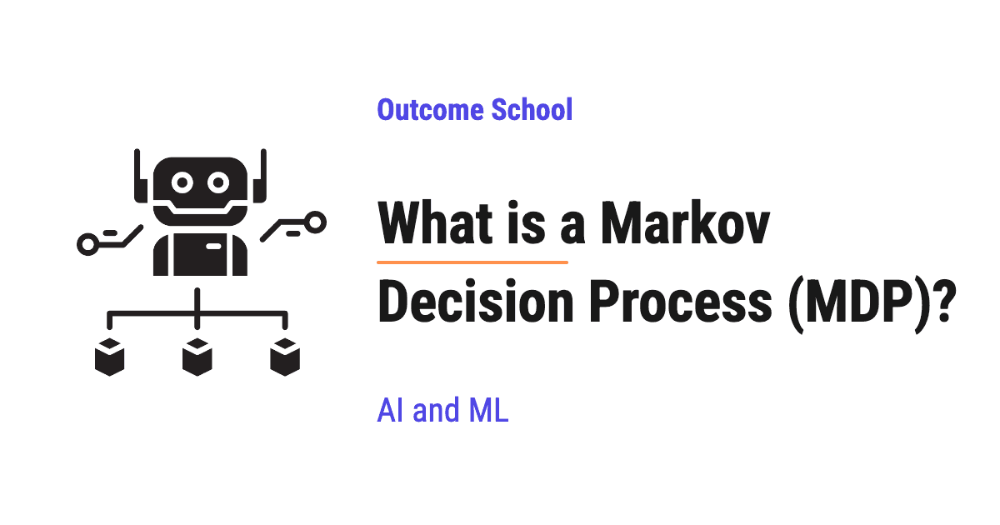

# What is a Markov Decision Process (MDP)?

> Archived from <https://outcomeschool.com/blog/markov-decision-process-mdp> on 2026-11-25.

A Markov Decision Process (MDP) is a way to describe a problem where an agent makes decisions step by step, each decision changes the situation, and each step brings a reward. It is the standard way to write down a reinforcement learning problem.

In this blog, we will learn about what a Markov Decision Process (MDP) is. We will also see the basic setup of reinforcement learning, the Markov property, the five parts of an MDP using one robot example, how a policy and the return with discounting work, the difference between episodic and continuing tasks, and how an LLM generating text can be seen as an MDP.

We will cover the following:
<ul><li>The Reinforcement Learning Setup</li><li>What is the Markov Property?</li><li>What is a Markov Decision Process (MDP)?</li><li>Our Example: A Robot Going to Its Charging Dock</li><li>The Five Parts of an MDP</li><li>What is a Policy?</li><li>What is the Return?</li><li>Episodic vs Continuing Tasks</li><li>An LLM Generating Text as an MDP</li></ul>
I am <strong>Amit Shekhar</strong>, Founder @ <a target="_blank" rel="noopener noreferrer" href="https://outcomeschool.com">Outcome School</a>, I have taught and mentored many developers, and their efforts landed them high-paying tech jobs, helped many tech companies in solving their unique problems, and created many open-source libraries being used by top companies. I am passionate about sharing knowledge through open-source, blogs, and videos.

I teach <a target="_blank" rel="noopener noreferrer" href="https://outcomeschool.com/program/ai-and-machine-learning">AI and Machine Learning</a> at Outcome School.

Let&#x27;s get started.
<h2 id="the-reinforcement-learning-setup">The Reinforcement Learning Setup</h2>
Before jumping into the MDP, we must know the setup in which it is used.

<strong><a target="_blank" rel="noopener noreferrer" href="reinforcement-learning.md">Reinforcement Learning</a></strong> is a way of learning where a learner tries things, sees what happens, and gets a score for it. Over time, it learns to do more of what brings a good score.

There are four words we will use again and again:
<ul><li><strong>Agent:</strong> The learner that makes the decisions. For example, a cleaning robot.</li><li><strong>Environment:</strong> The world the agent lives in and acts upon. For example, the house the robot moves in.</li><li><strong>Action:</strong> A choice the agent makes. For example, &quot;Forward&quot;.</li><li><strong>Reward:</strong> A number the environment gives back after an action. A positive number is good, and a negative number is bad.</li></ul>
The agent and the environment talk to each other in a loop. The agent looks at the current situation, picks an action, and the environment replies with a new situation and a reward. The current situation is called the <strong>state</strong>.

Let&#x27;s see this as a diagram:

<pre><code class="language-text code-highlight">┌─────────────────────────┐
│          Agent          │
│     state: Kitchen      │
│     picks an action     │
└─────────────────────────┘
             ↓
      action: Forward
             ↓
┌─────────────────────────┐
│       Environment       │
│ (the house, its rules)  │
└─────────────────────────┘
             ↓
      new state: Hall
        reward: -1
             ↓
┌─────────────────────────┐
│          Agent          │
│       state: Hall       │
│  picks the next action  │
└─────────────────────────┘
             ↓
     the loop repeats
</code></pre>

Here, we can see that the robot starts in the Kitchen, chooses Forward, and the environment moves it to the Hall with a reward of -1. Then, the robot picks again from the Hall. Nobody tells the agent the right answer. It only gets a reward number after acting, and it must learn from these numbers which actions are good.

Now, the question is: how much of the past must the state include? Here comes the Markov property into the picture.
<h2 id="what-is-the-markov-property">What is the Markov Property?</h2>
<strong>The Markov property says that the future depends only on the present state, and not on how we reached that state.</strong>

Let&#x27;s take an example of a game of chess. If we look at the board right now, we know everything we need to decide the next move. It does not matter which moves were played to reach this board. The current board is enough.

Means, a state has the Markov property when it holds all the useful information about the past. Once we know the current state, the history adds nothing more.

So, the agent does not need to remember a long history. It needs to look only at the current state to decide what to do.

To learn Reinforcement Learning from the ground up, check out our <a target="_blank" rel="noopener noreferrer" href="https://outcomeschool.com/program/ai-and-machine-learning">AI and Machine Learning Program</a> at Outcome School.
<h2 id="what-is-a-markov-decision-process-mdp">What is a Markov Decision Process (MDP)?</h2>
<strong>A Markov Decision Process (MDP) is a mathematical way to describe a decision-making problem using five parts: states, actions, transition probabilities, rewards, and a discount factor.</strong>

The word <strong>Markov</strong> in the name comes from the Markov property. In an MDP, where the agent lands next depends only on the current state and the action it takes.

The best way to learn this is by taking an example.
<h2 id="our-example-a-robot-going-to-its-charging-dock">Our Example: A Robot Going to Its Charging Dock</h2>
Let&#x27;s say we have a cleaning robot in a house. Its battery is low, and it wants to reach its charging dock.

The house has these places:
<ul><li><strong>Kitchen:</strong> Where the robot starts.</li><li><strong>Hall:</strong> The middle of the house.</li><li><strong>Corridor:</strong> A longer but safe path around the stairs.</li><li><strong>Dock:</strong> The charging dock. This is the goal.</li><li><strong>Stairs:</strong> If the robot falls down the stairs, it breaks. This is bad.</li></ul>
From the Hall, the robot has two choices:
<ul><li><strong>Straight:</strong> The short path to the Dock. But the floor near the stairs is slippery. 80% of the time it reaches the Dock, and 20% of the time it slips and falls down the Stairs.</li><li><strong>Around:</strong> The long path through the Corridor. It is safe, but it takes one extra step.</li></ul>
From the Kitchen, the robot can only go <strong>Forward</strong> to the Hall. From the Corridor, it can only go <strong>Forward</strong> to the Dock.

Every normal move costs -1, because it uses battery. Reaching the Dock gives +10. Falling down the Stairs gives -10.

Let&#x27;s see this as a diagram:

<pre><code class="language-text code-highlight">                   ┌─────────────────┐
                   │     Kitchen     │
                   │     (start)     │
                   └─────────────────┘
                            ↓
                     action: Forward
                      prob 1.0, -1
                            ↓
                   ┌─────────────────┐
                   │      Hall       │
                   └─────────────────┘
                            ↓
              ┌─────────────┴──────────────┐
              ↓                            ↓
      action: Straight              action: Around
              ↓                            ↓
      ┌───────┴──────┐               prob 1.0, -1
      ↓              ↓                     ↓
prob 0.8, +10  prob 0.2, -10        ┌───────────────┐
      ↓              ↓              │   Corridor    │
 ┌─────────┐    ┌─────────┐         └───────────────┘
 │  Dock   │    │ Stairs  │                 ↓
 │  (end)  │    │  (end)  │         action: Forward
 └─────────┘    └─────────┘          prob 1.0, +10
                                           ↓
                                   ┌───────────────┐
                                   │     Dock      │
                                   │     (end)     │
                                   └───────────────┘
</code></pre>

Here, each label under an action shows the chance of that outcome and the reward for it. For example, <code>prob 0.8, +10</code> means that 80% of the time the robot reaches the Dock and gets +10. We can see that the Kitchen, the Hall, and the Corridor are normal states. The Dock and the Stairs are end states. Once the robot reaches one of them, the run is over.

<strong>Planning your move into AI?</strong>

No matter which tech domain you work in today, with your effort, you can transition to these roles:
<ul><li>AI Engineer</li><li>Forward Deployed Engineer</li><li>AI Agent Engineer</li><li>Harness Engineer</li><li>Voice AI Engineer</li><li>AI Architect</li><li>LLM Engineer</li><li>LLM Inference Engineer</li><li>Gen AI Engineer</li><li>MLOps Engineer</li><li>ML Engineer</li><li>Deep Learning Engineer</li></ul>
Our <a target="_blank" rel="noopener noreferrer" href="https://outcomeschool.com/program/ai-and-machine-learning">AI and Machine Learning Program</a> at Outcome School takes you there.
<h2 id="the-five-parts-of-an-mdp">The Five Parts of an MDP</h2>
Every MDP is made of five parts. Let&#x27;s understand each one using our robot.
<h3 id="1-states-s">1. States (S)</h3>
<strong>States</strong> are all the situations the agent can be in.

In our example, the states are: Kitchen, Hall, Corridor, Dock, and Stairs. The Dock and the Stairs are end states, also called <strong>terminal states</strong>.
<h3 id="2-actions-a">2. Actions (A)</h3>
<strong>Actions</strong> are all the choices the agent can make.

In our example, the actions are: Forward, Straight, and Around. Not every action is available in every state. In the Hall, the robot can choose Straight or Around. In the Kitchen and the Corridor, it can only choose Forward.
<h3 id="3-transition-probabilities-p">3. Transition Probabilities (P)</h3>
<strong>Transition probabilities</strong> tell us the chance of landing in each next state, when the agent takes an action in a state.

We write it as <code>P(next state | state, action)</code>. We read it as &quot;the chance of reaching the next state, given the current state and the action&quot;.

In our example:
<ul><li><code>P(Hall | Kitchen, Forward) = 1.0</code></li><li><code>P(Dock | Hall, Straight) = 0.8</code></li><li><code>P(Stairs | Hall, Straight) = 0.2</code></li><li><code>P(Corridor | Hall, Around) = 1.0</code></li><li><code>P(Dock | Corridor, Forward) = 1.0</code></li></ul>
Here, we can notice that the same action in the same state does not always lead to the same place. Taking Straight from the Hall leads to the Dock most of the time, but not always. The transition probabilities capture this uncertainty. For each state and action, the chances add up to 1.

This is also where the Markov property comes in. The chances depend only on the current state and the action. It does not matter how the robot reached the Hall.

We have a detailed blog on <a target="_blank" rel="noopener noreferrer" href="how-do-world-models-work.md">How do World Models work?</a> that explains how an AI can learn to predict the next state and the reward by itself.
<h3 id="4-rewards-r">4. Rewards (R)</h3>
<strong>Rewards</strong> are the numbers the agent gets after each step.

In our example:
<ul><li>Moving to the Hall or the Corridor: -1</li><li>Reaching the Dock: +10</li><li>Falling down the Stairs: -10</li></ul>
The reward is how we tell the agent what we want. We never tell the robot &quot;go around&quot;. We only say &quot;the Dock is good, the Stairs are bad, and wasting battery is a little bad&quot;. The agent must find the best way by itself.
<h3 id="5-discount-factor-gamma">5. Discount Factor (gamma)</h3>
The <strong>discount factor</strong>, written as <strong>gamma</strong>, is a number between 0 and 1. It tells the agent how much to care about future rewards compared to rewards right now.
<ul><li>A gamma close to 0 means the agent cares mostly about the very next reward.</li><li>A gamma close to 1 means the agent cares about future rewards almost as much as the current one.</li></ul>
Let&#x27;s say someone offers us 100 rupees today or 100 rupees after one year. Most of us prefer it today. A reward that comes later is worth a little less to us. Gamma captures this same idea.

In our example, we will use gamma = 0.9.

<strong>A quick note for you</strong>

No matter which tech domain you work in, get familiar with these topics:
<ul><li>LLM</li><li>RAG</li><li>MCP</li><li>Agent</li><li>Fine-tuning</li><li>Quantization</li></ul>
We put it all together in one video:

<a target="_blank" rel="noopener noreferrer" href="https://www.youtube.com/watch?v=lnfWvX66FUk">AI Engineering Explained: LLM, RAG, MCP, Agent, Fine-Tuning, and Quantization</a>

No need to stop reading - bookmark it and watch later when you get time. Future you will thank you.

Now, let&#x27;s get back to the topic.
<h2 id="what-is-a-policy">What is a Policy?</h2>
Now that we have learned about the five parts of an MDP, it&#x27;s time to learn about the policy.

<strong>A policy is the rule the agent follows to pick an action in each state.</strong>

In our example, here are two possible policies:
<ul><li><strong>Policy A:</strong> Kitchen -&gt; Forward, Hall -&gt; Straight</li><li><strong>Policy B:</strong> Kitchen -&gt; Forward, Hall -&gt; Around, Corridor -&gt; Forward</li></ul>
A policy can also be based on chances. For example, &quot;in the Hall, choose Straight 30% of the time and Around 70% of the time&quot;. This is called a <strong>stochastic policy</strong>. Stochastic means &quot;based on chance&quot;.

The goal of reinforcement learning is to find the best policy. The best policy is the one that collects the most total reward on average. To compare policies, we need a way to add up the rewards of a run into one number. This number is called the return.
<h2 id="what-is-the-return">What is the Return?</h2>
<strong>The return is the total reward the agent collects from now on, where future rewards are multiplied by gamma once for every step of delay.</strong>

We can write it as below:

<strong>G = R_1 + gamma * R_2 + gamma^2 * R_3 + gamma^3 * R_4 + ...</strong>

Here, <code>G</code> is the return, <code>R_1</code> is the first reward, <code>R_2</code> is the second reward, and so on. The first reward counts fully. The second reward is multiplied by gamma once. The third reward is multiplied by gamma twice, and so on.

Let&#x27;s calculate the return for one run of our robot with Policy B and gamma = 0.9.

The robot goes Kitchen -&gt; Hall -&gt; Corridor -&gt; Dock. It gets these rewards: -1, -1, +10.

<strong>Step 1:</strong> The first reward is -1. It counts fully, so it adds -1.

<strong>Step 2:</strong> The second reward is -1. We multiply it by gamma once: 0.9 * (-1) = -0.9.

<strong>Step 3:</strong> The third reward is +10. We multiply it by gamma twice: 0.9 * 0.9 * 10 = 0.81 * 10 = 8.1.

<strong>Step 4:</strong> We add them all: -1 + (-0.9) + 8.1 = 6.2.

So, the return for this run is 6.2.

We can calculate the same in Python as below:

<pre><code class="code-highlight language-python">rewards = [-1, -1, 10]
gamma = 0.9

G = 0
for t, r in enumerate(rewards):
    G += (gamma ** t) * r

print(round(G, 2))
</code></pre>

This will print the following:

<pre><code class="language-text code-highlight">6.2
</code></pre>

Here, <code>t</code> is the step number starting from 0, so the first reward is multiplied by <code>gamma ** 0 = 1</code>, the second by <code>gamma ** 1 = 0.9</code>, and the third by <code>gamma ** 2 = 0.81</code>.

Now, let&#x27;s use the return to compare the two choices in the Hall. We start counting from the Hall itself.

<strong>Straight:</strong> 80% of the time, the robot gets +10. 20% of the time, it gets -10. On average, it gets 0.8 * 10 + 0.2 * (-10) = 8 - 2 = 6. This average return is called the <strong>expected return</strong>.

<strong>Around:</strong> The robot always gets -1 first, and then +10 one step later. So, its expected return is -1 + 0.9 * 10 = -1 + 9 = 8.

So, with gamma = 0.9, Around is better (8 is more than 6). The best policy is Policy B.

We have a detailed blog on <a target="_blank" rel="noopener noreferrer" href="value-function-and-q-learning.md">Value Function and Q-Learning</a> that explains how an agent learns the expected return of every state and action step by step.

Now, let&#x27;s change gamma to 0.5. This means the agent cares much less about the future.
<ul><li>Straight still gives 6, because its reward comes right away.</li><li>Around gives -1 + 0.5 * 10 = -1 + 5 = 4.</li></ul>
Now, Straight is better (6 is more than 4). Here, we can see that the same MDP with a different gamma has a different best policy. An impatient agent takes the risky short path. A patient agent takes the safe long path.

If we want to go deep into Reinforcement Learning and the algorithms like PPO and GRPO that find the best policy, our <a target="_blank" rel="noopener noreferrer" href="https://outcomeschool.com/program/ai-and-machine-learning">AI and Machine Learning Program</a> at Outcome School covers it in depth.
<h2 id="episodic-vs-continuing-tasks">Episodic vs Continuing Tasks</h2>
There are two kinds of tasks in an MDP.

<strong>Episodic tasks</strong> have an end. One full run from the start to an end state is called an <strong>episode</strong>. Our robot task is episodic. Every episode ends when the robot reaches the Dock or falls down the Stairs. Then, a new episode starts again from the Kitchen.

<strong>Continuing tasks</strong> never end. For example, an agent that controls the temperature of a building keeps working forever. There is no end state.

In continuing tasks, gamma becomes very important. If the agent gets a reward of 1 at every step forever, the plain sum 1 + 1 + 1 + ... keeps growing without any limit. With gamma = 0.9, the return becomes 1 + 0.9 + 0.81 + 0.729 + ..., and this adds up to exactly 1 / (1 - 0.9) = 10. Because each new reward counts for less, the sum stays finite. This is why continuing tasks use a gamma less than 1.

In episodic tasks, gamma can be 1, because the sum always ends.

<strong>Stay updated:</strong> Subscribe to our <a target="_blank" rel="noopener noreferrer" href="https://outcomeschool.substack.com/subscribe">newsletter</a> to get our latest AI and Machine Learning blogs straight to your inbox.
<h2 id="an-llm-generating-text-as-an-mdp">An LLM Generating Text as an MDP</h2>
Now, let&#x27;s see how the same idea applies to an <a target="_blank" rel="noopener noreferrer" href="large-language-model-llm.md">LLM (Large Language Model)</a>.

An LLM writes text one <strong><a target="_blank" rel="noopener noreferrer" href="tokenization-in-llms.md">token</a></strong> at a time. A token is a small piece of text, such as a word or a part of a word. At each step, the LLM looks at all the text so far and picks the next token.

We can describe this as an MDP:
<table><thead><tr><th>MDP part</th><th>In an LLM</th></tr></thead><tbody><tr><td>State</td><td>The prompt plus all the tokens generated so far</td></tr><tr><td>Action</td><td>The next token, chosen from the vocabulary (all the tokens the LLM knows)</td></tr><tr><td>Transition probabilities</td><td>Certain: the chosen token is added to the end of the text (chance 1.0)</td></tr><tr><td>Reward</td><td>Often 0 for every token, and one score at the end for the full answer</td></tr><tr><td>Discount factor (gamma)</td><td>Often set to 1, because the answer always ends</td></tr><tr><td>Policy</td><td>The LLM itself, which gives a chance to every possible next token</td></tr></tbody></table>
Let&#x27;s say the prompt is &quot;The capital of France is&quot;. Let&#x27;s see the steps as a diagram:

<pre><code class="language-text code-highlight">┌─────────────────────────────────────┐
│               State 1               │
│     &quot;The capital of France is&quot;      │
└─────────────────────────────────────┘
                   ↓
         action: token &quot;Paris&quot;
                   ↓
┌─────────────────────────────────────┐
│               State 2               │
│  &quot;The capital of France is Paris&quot;   │
└─────────────────────────────────────┘
                   ↓
           action: token &quot;.&quot;
                   ↓
┌─────────────────────────────────────┐
│               State 3               │
│  &quot;The capital of France is Paris.&quot;  │
└─────────────────────────────────────┘
                   ↓
           action: end token
                   ↓
┌─────────────────────────────────────┐
│            Episode ends             │
│   reward: +1 (answer is correct)    │
└─────────────────────────────────────┘
</code></pre>

Here, we can see that each action adds one token to the text, and the new text becomes the next state. When the LLM picks the special <a target="_blank" rel="noopener noreferrer" href="stop-tokens-in-llms.md">end token</a>, the episode ends. Only then, a reward is given for the full answer. It comes from a <a target="_blank" rel="noopener noreferrer" href="reinforcement-learning-from-human-feedback-rlhf.md">reward model</a> (another model trained to score answers) or from a checker that can tell if the answer is correct.

Here, we can notice a few things:
<ul><li>The state includes the full text so far, so it has the Markov property. The next state depends only on this text and the chosen token.</li><li>The transitions are certain. Adding a token always gives one exact new text. The only uncertainty is in which token the policy picks.</li><li>The LLM gives a chance to every possible next token and then picks one, so it is a stochastic policy.</li><li>This is an episodic task. Every answer ends with the end token or when it hits a maximum length.</li></ul>
This is how reinforcement learning methods can train an LLM. They treat the LLM as a policy, give a reward for good answers, and update the LLM so that it picks tokens that lead to a higher return. We have detailed blogs on <a target="_blank" rel="noopener noreferrer" href="proximal-policy-optimization-ppo.md">Proximal Policy Optimization (PPO)</a> and <a target="_blank" rel="noopener noreferrer" href="group-relative-policy-optimization-grpo.md">Group Relative Policy Optimization (GRPO)</a> that explain this training step by step.

Now we must have understood what a Markov Decision Process (MDP) is, its five parts, how a policy and the return work, and how an LLM generating text fits into it.
<h2 id="frequently-asked-questions">Frequently Asked Questions</h2><h3 id="does-an-agent-in-an-mdp-need-to-remember-the-full-history">Does an agent in an MDP need to remember the full history?</h3>
No. An agent in an MDP does not need to remember the full history. Because of the Markov property, the current state holds all the useful information about the past. Where the agent lands next depends only on the current state and the action it takes, so the agent looks only at the current state to decide what to do.
<h3 id="why-can-a-different-discount-factor-change-the-best-policy">Why can a different discount factor change the best policy?</h3>
A different discount factor changes how much the agent cares about future rewards. In the robot example, with gamma = 0.9, the safe long path gives an expected return of 8 and beats the risky short path at 6. With gamma = 0.5, the long path drops to 4, so the risky short path wins. An impatient agent takes the risky path, and a patient agent takes the safe one.
<h3 id="can-the-discount-factor-be-equal-to-1">Can the discount factor be equal to 1?</h3>
Yes, but only in episodic tasks. In an episodic task, the sum of rewards always ends, so gamma can be 1. In a continuing task, the plain sum of rewards can keep growing without any limit, so we use a gamma less than 1. Then each new reward counts for less, and the return stays finite.
<h3 id="where-does-the-reward-come-from-when-an-llm-is-trained-as-an-mdp">Where does the reward come from when an LLM is trained as an MDP?</h3>
The reward usually comes at the end of the full answer. It is often 0 for every token, and one score is given only when the episode ends. That score comes from a reward model, which is another model trained to score answers, or from a checker that can tell if the answer is correct.

That&#x27;s it for now.

Thanks

<strong>Amit Shekhar</strong> Founder @ <a target="_blank" rel="noopener noreferrer" href="https://outcomeschool.com">Outcome School</a>

You can connect with me on:
<ul><li><a target="_blank" rel="noopener noreferrer" href="https://x.com/amitiitbhu">X</a></li><li><a target="_blank" rel="noopener noreferrer" href="https://www.linkedin.com/in/amit-shekhar-iitbhu">LinkedIn</a></li><li><a target="_blank" rel="noopener noreferrer" href="https://github.com/amitshekhariitbhu">GitHub</a></li></ul>
Follow Outcome School on:
<ul><li><a target="_blank" rel="noopener noreferrer" href="https://x.com/outcome_school">X</a></li><li><a target="_blank" rel="noopener noreferrer" href="https://youtube.com/@OutcomeSchool">YouTube</a></li><li><a target="_blank" rel="noopener noreferrer" href="https://www.linkedin.com/company/outcomeschool">LinkedIn</a></li><li><a target="_blank" rel="noopener noreferrer" href="http://github.com/OutcomeSchool">GitHub</a></li></ul>
<a target="_blank" rel="noopener noreferrer" href="https://outcomeschool.com/blog"><strong>Read all of our high-quality blogs here.</strong></a>

