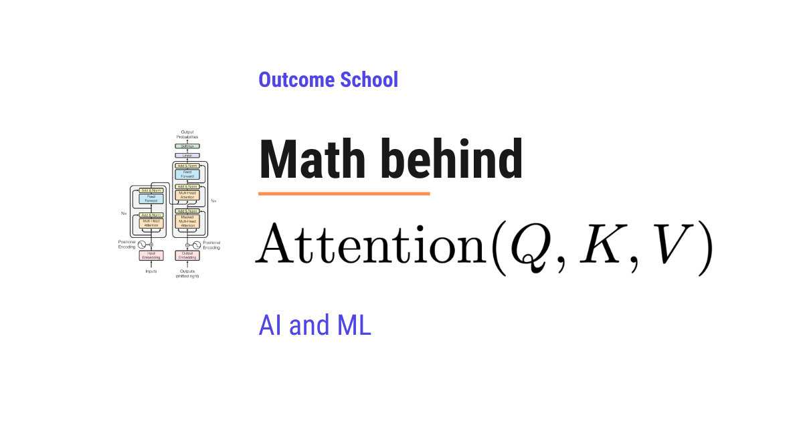

# How Does Attention Work? The Math Behind Q, K, and V Step by Step

> Archived from <https://outcomeschool.com/blog/math-behind-attention-qkv> on 2026-11-25.

Attention works by comparing the Query (Q) of each word with the Key (K) of every word to get scores, turning those scores into weights using softmax, and then using the weights to mix the Values (V). The formula is <code>softmax(Q x K^T / sqrt(d_k)) x V</code>.

In this blog, we will learn about the math behind Attention: Query(Q), Key(K), and Value(V) with a step-by-step numeric example.

We will cover the following:
<ul><li>The Attention Formula</li><li>Setting Up: From Words to Vectors</li><li>Creating Q, K, and V Matrices</li><li>Computing Attention Scores (Q x K^T)</li><li>Scaling the Scores</li><li>Applying Softmax</li><li>Computing the Final Output (Attention Weights x V)</li><li>Putting It All Together</li></ul>
I am <strong>Amit Shekhar</strong>, Founder @ <a target="_blank" rel="noopener noreferrer" href="https://outcomeschool.com">Outcome School</a>, I have taught and mentored many developers, and their efforts landed them high-paying tech jobs, helped many tech companies in solving their unique problems, and created many open-source libraries being used by top companies. I am passionate about sharing knowledge through open-source, blogs, and videos.

I teach <a target="_blank" rel="noopener noreferrer" href="https://outcomeschool.com/program/ai-and-machine-learning">AI and Machine Learning</a> at Outcome School.

Let&#x27;s get started.
<h2 id="the-attention-formula">The Attention Formula</h2>
The core formula for <strong>Scaled Dot-Product Attention</strong> is:

<pre><code class="code-highlight">Attention(Q, K, V) = softmax(Q x K^T / sqrt(d_k)) x V
</code></pre>

Here:
<ul><li><code>Q</code> is the Query matrix</li><li><code>K</code> is the Key matrix</li><li><code>V</code> is the Value matrix</li><li><code>K^T</code> is the transpose of the Key matrix</li><li><code>d_k</code> is the dimension of the Key vector</li><li><code>sqrt</code> means square root</li></ul>
Do not worry if this formula looks complex. We will break it down step by step with actual numbers. By the end of this blog, every part of this formula will be clear.

The idea is simple: we compare what each word is looking for (<strong>Query</strong>) with what every other word offers (<strong>Key</strong>), and then use those comparisons to collect the actual information (<strong>Value</strong>) from the most relevant words.

Now, let&#x27;s see this with real numbers.
<h2 id="setting-up-from-words-to-vectors">Setting Up: From Words to Vectors</h2>
Let&#x27;s take a simple sentence with 3 words:

<strong>&quot;I love AI&quot;</strong>

In a <a target="_blank" rel="noopener noreferrer" href="decoding-transformer-architecture.md">Transformer</a>, each word is first converted into a vector (i.e. a list of numbers) called an <a target="_blank" rel="noopener noreferrer" href="https://www.youtube.com/watch?v=LedXW6xl21s">embedding</a>. Just for the sake of understanding, we will use very small vectors of size 4 (i.e. <code>d_emb = 4</code>).

<pre><code class="code-highlight">&quot;I&quot;    → [1.0, 0.0, 1.0, 0.0]
&quot;love&quot; → [0.0, 1.0, 0.0, 1.0]
&quot;AI&quot;   → [1.0, 1.0, 0.0, 0.0]
</code></pre>

We stack these into an <strong>input matrix X</strong> of shape <code>3 x 4</code> (3 words, each with 4 numbers):

<pre><code class="code-highlight">X = | 1.0  0.0  1.0  0.0 |   ← &quot;I&quot;
    | 0.0  1.0  0.0  1.0 |   ← &quot;love&quot;
    | 1.0  1.0  0.0  0.0 |   ← &quot;AI&quot;
</code></pre>

Here, each row is one word and each column is one number in the embedding. This is our starting point.

<strong>Planning your move into AI?</strong>

No matter which tech domain you work in today, with your effort, you can transition to these roles:
<ul><li>AI Engineer</li><li>Forward Deployed Engineer</li><li>AI Agent Engineer</li><li>Harness Engineer</li><li>Voice AI Engineer</li><li>AI Architect</li><li>LLM Engineer</li><li>LLM Inference Engineer</li><li>Gen AI Engineer</li><li>MLOps Engineer</li><li>ML Engineer</li><li>Deep Learning Engineer</li></ul>
Our <a target="_blank" rel="noopener noreferrer" href="https://outcomeschool.com/program/ai-and-machine-learning">AI and Machine Learning Program</a> at Outcome School takes you there.
<h2 id="creating-q-k-and-v-matrices">Creating Q, K, and V Matrices</h2>
Now, we need to create three separate matrices: <strong>Q (Query)</strong>, <strong>K (Key)</strong>, and <strong>V (Value)</strong>.

How do we create them? We <a target="_blank" rel="noopener noreferrer" href="matrix-multiplication-in-neural-networks.md">multiply the input matrix <code>X</code></a> with three separate <strong>weight matrices</strong>: <code>W_Q</code>, <code>W_K</code>, and <code>W_V</code>. These weight matrices are learned during training.

<pre><code class="code-highlight">Q = X x W_Q
K = X x W_K
V = X x W_V
</code></pre>

For our example, let&#x27;s say <code>d_k = 3</code> (i.e. we want Q, K, V vectors of size 3). So each weight matrix has the shape <code>4 x 3</code> (input dimension 4, output dimension 3).

Let&#x27;s use the following weight matrices for the sake of understanding:

<pre><code class="code-highlight">W_Q = | 1  0  1 |
      | 0  1  0 |
      | 1  0  0 |
      | 0  1  1 |

W_K = | 0  1  0 |
      | 1  0  1 |
      | 0  0  1 |
      | 1  1  0 |

W_V = | 1  0  0 |
      | 0  1  0 |
      | 0  0  1 |
      | 1  1  0 |
</code></pre>

Now, let&#x27;s compute Q, K, and V.

<strong>Computing Q = X x W_Q:</strong>

<pre><code class="code-highlight">Q = | 1.0  0.0  1.0  0.0 |     | 1  0  1 |
    | 0.0  1.0  0.0  1.0 |  x  | 0  1  0 |
    | 1.0  1.0  0.0  0.0 |     | 1  0  0 |
                               | 0  1  1 |
</code></pre>

For the first row (&quot;I&quot;): <code>[1*1 + 0*0 + 1*1 + 0*0, 1*0 + 0*1 + 1*0 + 0*1, 1*1 + 0*0 + 1*0 + 0*1]</code> = <code>[2, 0, 1]</code>

For the second row (&quot;love&quot;): <code>[0*1 + 1*0 + 0*1 + 1*0, 0*0 + 1*1 + 0*0 + 1*1, 0*1 + 1*0 + 0*0 + 1*1]</code> = <code>[0, 2, 1]</code>

For the third row (&quot;AI&quot;): <code>[1*1 + 1*0 + 0*1 + 0*0, 1*0 + 1*1 + 0*0 + 0*1, 1*1 + 1*0 + 0*0 + 0*1]</code> = <code>[1, 1, 1]</code>

<pre><code class="code-highlight">Q = | 2  0  1 |   ← &quot;I&quot;
    | 0  2  1 |   ← &quot;love&quot;
    | 1  1  1 |   ← &quot;AI&quot;
</code></pre>

<strong>Computing K = X x W_K:</strong>

For the first row (&quot;I&quot;): <code>[1*0 + 0*1 + 1*0 + 0*1, 1*1 + 0*0 + 1*0 + 0*1, 1*0 + 0*1 + 1*1 + 0*0]</code> = <code>[0, 1, 1]</code>

For the second row (&quot;love&quot;): <code>[0*0 + 1*1 + 0*0 + 1*1, 0*1 + 1*0 + 0*0 + 1*1, 0*0 + 1*1 + 0*1 + 1*0]</code> = <code>[2, 1, 1]</code>

For the third row (&quot;AI&quot;): <code>[1*0 + 1*1 + 0*0 + 0*1, 1*1 + 1*0 + 0*0 + 0*1, 1*0 + 1*1 + 0*1 + 0*0]</code> = <code>[1, 1, 1]</code>

<pre><code class="code-highlight">K = | 0  1  1 |   ← &quot;I&quot;
    | 2  1  1 |   ← &quot;love&quot;
    | 1  1  1 |   ← &quot;AI&quot;
</code></pre>

<strong>Computing V = X x W_V:</strong>

For the first row (&quot;I&quot;): <code>[1*1 + 0*0 + 1*0 + 0*1, 1*0 + 0*1 + 1*0 + 0*1, 1*0 + 0*0 + 1*1 + 0*0]</code> = <code>[1, 0, 1]</code>

For the second row (&quot;love&quot;): <code>[0*1 + 1*0 + 0*0 + 1*1, 0*0 + 1*1 + 0*0 + 1*1, 0*0 + 1*0 + 0*1 + 1*0]</code> = <code>[1, 2, 0]</code>

For the third row (&quot;AI&quot;): <code>[1*1 + 1*0 + 0*0 + 0*1, 1*0 + 1*1 + 0*0 + 0*1, 1*0 + 1*0 + 0*1 + 0*0]</code> = <code>[1, 1, 0]</code>

<pre><code class="code-highlight">V = | 1  0  1 |   ← &quot;I&quot;
    | 1  2  0 |   ← &quot;love&quot;
    | 1  1  0 |   ← &quot;AI&quot;
</code></pre>

Now, we have our Q, K, and V matrices ready.

<strong>Note:</strong> In real models, these weight matrices are not set by hand. They are learned during training. We are using simple numbers here for the sake of understanding.

Till now, we have learned how to create Q, K, and V from the input. Now, let&#x27;s move to the next step.

If we want to go deep into Q/K/V matrices, embeddings, and Transformer internals from the ground up, we have a complete program on it - check out our <a target="_blank" rel="noopener noreferrer" href="https://outcomeschool.com/program/ai-and-machine-learning">AI and Machine Learning Program</a> at Outcome School.
<h2 id="computing-attention-scores-q-x-kt">Computing Attention Scores (Q x K^T)</h2>
The first step in the attention formula is to compute <code>Q x K^T</code>.

This tells us how much each word should attend to every other word. We multiply the Query of each word with the Key of every other word.

First, we need <code>K^T</code> (transpose of K). Transposing simply means we swap the rows and columns. The first row becomes the first column, the second row becomes the second column, and so on:

<pre><code class="code-highlight">K^T = | 0  2  1 |
      | 1  1  1 |
      | 1  1  1 |
</code></pre>

Now, let&#x27;s compute <code>Q x K^T</code>:

<pre><code class="code-highlight">Q x K^T = | 2  0  1 |     | 0  2  1 |
          | 0  2  1 |  x  | 1  1  1 |
          | 1  1  1 |     | 1  1  1 |
</code></pre>

For &quot;I&quot; attending to all words:
<ul><li>&quot;I&quot; → &quot;I&quot;: <code>2*0 + 0*1 + 1*1</code> = <code>1</code></li><li>&quot;I&quot; → &quot;love&quot;: <code>2*2 + 0*1 + 1*1</code> = <code>5</code></li><li>&quot;I&quot; → &quot;AI&quot;: <code>2*1 + 0*1 + 1*1</code> = <code>3</code></li></ul>
For &quot;love&quot; attending to all words:
<ul><li>&quot;love&quot; → &quot;I&quot;: <code>0*0 + 2*1 + 1*1</code> = <code>3</code></li><li>&quot;love&quot; → &quot;love&quot;: <code>0*2 + 2*1 + 1*1</code> = <code>3</code></li><li>&quot;love&quot; → &quot;AI&quot;: <code>0*1 + 2*1 + 1*1</code> = <code>3</code></li></ul>
For &quot;AI&quot; attending to all words:
<ul><li>&quot;AI&quot; → &quot;I&quot;: <code>1*0 + 1*1 + 1*1</code> = <code>2</code></li><li>&quot;AI&quot; → &quot;love&quot;: <code>1*2 + 1*1 + 1*1</code> = <code>4</code></li><li>&quot;AI&quot; → &quot;AI&quot;: <code>1*1 + 1*1 + 1*1</code> = <code>3</code></li></ul>
<pre><code class="code-highlight">            &quot;I&quot;   &quot;love&quot;   &quot;AI&quot;
Scores = |  1      5       3  |   ← &quot;I&quot;
         |  3      3       3  |   ← &quot;love&quot;
         |  2      4       3  |   ← &quot;AI&quot;
</code></pre>

Here, we can see that the word &quot;I&quot; gives the highest attention score of <code>5</code> to &quot;love&quot;, meaning &quot;I&quot; finds &quot;love&quot; the most relevant. The word &quot;love&quot; gives equal scores of <code>3</code> to all words. The word &quot;AI&quot; gives the highest score of <code>4</code> to &quot;love&quot;.

This was all about computing the attention scores. Now, let&#x27;s move to scaling.
<h2 id="scaling-the-scores">Scaling the Scores</h2>
Now, we divide every score by <code>sqrt(d_k)</code>.

In our example, <code>d_k = 3</code> (the dimension of our Key vectors), so <code>sqrt(3) = 1.732</code>.

Now, the question is: why do we scale? The answer is: if the dot product values are too large, the softmax function in the next step will produce very extreme values (close to 0 or 1). This makes it difficult for the model to learn. Scaling keeps the values in a manageable range. We have a detailed blog on the <a target="_blank" rel="noopener noreferrer" href="scaling-dot-product-attention.md">Math behind √dₖ Scaling Factor in Attention</a> that explains this in depth.

<pre><code class="code-highlight">Scaled Scores = Scores / sqrt(3)
</code></pre>

<pre><code class="code-highlight">                    &quot;I&quot;      &quot;love&quot;     &quot;AI&quot;
Scaled Scores = |  0.577    2.887     1.732  |   ← &quot;I&quot;
                |  1.732    1.732     1.732  |   ← &quot;love&quot;
                |  1.155    2.309     1.732  |   ← &quot;AI&quot;
</code></pre>

Here, we can notice that the relative order of the scores has not changed. The word &quot;I&quot; still attends to &quot;love&quot; the most. But the values are now smaller, which is exactly what we wanted.

In the future, I plan to write about why we choose to divide by <code>sqrt(d_k)</code> instead of some other factor.

<strong>A quick note for you</strong>

No matter which tech domain you work in, get familiar with these topics:
<ul><li>LLM</li><li>RAG</li><li>MCP</li><li>Agent</li><li>Fine-tuning</li><li>Quantization</li></ul>
We put it all together in one video:

<a target="_blank" rel="noopener noreferrer" href="https://www.youtube.com/watch?v=lnfWvX66FUk">AI Engineering Explained: LLM, RAG, MCP, Agent, Fine-Tuning, and Quantization</a>

No need to stop reading - bookmark it and watch later when you get time. Future you will thank you.

Now, let&#x27;s get back to the topic.

Now, let&#x27;s apply softmax.
<h2 id="applying-softmax">Applying Softmax</h2>
Now, we apply the <strong>softmax</strong> function to each row. <a target="_blank" rel="noopener noreferrer" href="https://www.youtube.com/watch?v=2Zx6x01WwWM">Softmax</a> converts the scores into probabilities that add up to 1.

The softmax formula for a value <code>x_i</code> in a row is:

<pre><code class="code-highlight">softmax(x_i) = e^(x_i) / sum(e^(x_j) for all j in that row)
</code></pre>

Here, <code>e</code> is the mathematical constant (approximately 2.718). Do not worry about the formula too much. We will compute it step by step.

<strong>For the &quot;I&quot; row: [0.577, 2.887, 1.732]</strong>
<ul><li><code>e^0.577</code> = 1.781</li><li><code>e^2.887</code> = 17.940</li><li><code>e^1.732</code> = 5.651</li><li>Sum = 1.781 + 17.940 + 5.651 = 25.372</li></ul>
Attention Weights:
<ul><li>&quot;I&quot; → &quot;I&quot;: 1.781 / 25.372 = <strong>0.070</strong></li><li>&quot;I&quot; → &quot;love&quot;: 17.940 / 25.372 = <strong>0.707</strong></li><li>&quot;I&quot; → &quot;AI&quot;: 5.651 / 25.372 = <strong>0.223</strong></li></ul>
<strong>For the &quot;love&quot; row: [1.732, 1.732, 1.732]</strong>

All values are equal, so each word gets equal attention:
<ul><li>&quot;love&quot; → &quot;I&quot;: <strong>0.333</strong></li><li>&quot;love&quot; → &quot;love&quot;: <strong>0.333</strong></li><li>&quot;love&quot; → &quot;AI&quot;: <strong>0.333</strong></li></ul>
<strong>For the &quot;AI&quot; row: [1.155, 2.309, 1.732]</strong>
<ul><li><code>e^1.155</code> = 3.174</li><li><code>e^2.309</code> = 10.063</li><li><code>e^1.732</code> = 5.651</li><li>Sum = 3.174 + 10.063 + 5.651 = 18.888</li></ul>
Attention Weights:
<ul><li>&quot;AI&quot; → &quot;I&quot;: 3.174 / 18.888 = <strong>0.168</strong></li><li>&quot;AI&quot; → &quot;love&quot;: 10.063 / 18.888 = <strong>0.533</strong></li><li>&quot;AI&quot; → &quot;AI&quot;: 5.651 / 18.888 = <strong>0.299</strong></li></ul>
The final <strong>Attention Weight Matrix</strong> is:

<pre><code class="code-highlight">                       &quot;I&quot;     &quot;love&quot;    &quot;AI&quot;
Attention Weights = | 0.070    0.707    0.223 |   ← &quot;I&quot;
                    | 0.333    0.333    0.333 |   ← &quot;love&quot;
                    | 0.168    0.533    0.299 |   ← &quot;AI&quot;
</code></pre>

Here, we can see that:
<ul><li>The word <strong>&quot;I&quot;</strong> pays 70.7% of its attention to <strong>&quot;love&quot;</strong>, 22.3% to <strong>&quot;AI&quot;</strong>, and only 7.0% to itself.</li><li>The word <strong>&quot;love&quot;</strong> pays equal attention to all three words (33.3% each).</li><li>The word <strong>&quot;AI&quot;</strong> pays 53.3% of its attention to <strong>&quot;love&quot;</strong>, 29.9% to itself, and 16.8% to <strong>&quot;I&quot;</strong>.</li></ul>
Each row adds up to 1.0 (i.e. 100%). This is what softmax ensures.

Now, we have the attention weights. It is time to compute the final output.
<h2 id="computing-the-final-output-attention-weights-x-v">Computing the Final Output (Attention Weights x V)</h2>
Now, we multiply the Attention Weight Matrix with the Value matrix <code>V</code> to get the final output.

<pre><code class="code-highlight">Output = Attention Weights x V
</code></pre>

<pre><code class="code-highlight">Output = | 0.070  0.707  0.223 |     | 1  0  1 |
         | 0.333  0.333  0.333 |  x  | 1  2  0 |
         | 0.168  0.533  0.299 |     | 1  1  0 |
</code></pre>

<strong>For &quot;I&quot;:</strong>
<ul><li><code>0.070*1 + 0.707*1 + 0.223*1</code> = <code>1.000</code></li><li><code>0.070*0 + 0.707*2 + 0.223*1</code> = <code>1.637</code></li><li><code>0.070*1 + 0.707*0 + 0.223*0</code> = <code>0.070</code></li></ul>
<strong>For &quot;love&quot;:</strong>
<ul><li><code>0.333*1 + 0.333*1 + 0.333*1</code> = <code>0.999</code></li><li><code>0.333*0 + 0.333*2 + 0.333*1</code> = <code>0.999</code></li><li><code>0.333*1 + 0.333*0 + 0.333*0</code> = <code>0.333</code></li></ul>
<strong>For &quot;AI&quot;:</strong>
<ul><li><code>0.168*1 + 0.533*1 + 0.299*1</code> = <code>1.000</code></li><li><code>0.168*0 + 0.533*2 + 0.299*1</code> = <code>1.365</code></li><li><code>0.168*1 + 0.533*0 + 0.299*0</code> = <code>0.168</code></li></ul>
<pre><code class="code-highlight">Output = | 1.000  1.637  0.070 |   ← &quot;I&quot;
         | 1.000  1.000  0.333 |   ← &quot;love&quot;
         | 1.000  1.365  0.168 |   ← &quot;AI&quot;
</code></pre>

Here, we can see that each word now has a new vector that is a <strong>weighted combination</strong> of the Value vectors of all words. The word &quot;I&quot; gets a new representation that is heavily influenced by the Value of &quot;love&quot; (because it had the highest attention weight of 0.707 for &quot;love&quot;). This is the power of the attention mechanism.

The output for each word is no longer just about that word alone. It now contains information from all the other words, weighted by how relevant they are. This is how the model understands context and relationships between words.

This was all about computing the final output. Now, let&#x27;s put it all together.

To master self-attention, multi-head attention, and the full Transformer math in depth, check out our <a target="_blank" rel="noopener noreferrer" href="https://outcomeschool.com/program/ai-and-machine-learning">AI and Machine Learning Program</a> at Outcome School.
<h2 id="putting-it-all-together">Putting It All Together</h2>
Let&#x27;s summarize the entire computation in one place:

<strong>Step 1:</strong> Start with the input embeddings (X).

<strong>Step 2:</strong> Multiply X with weight matrices to get Q, K, and V.

<strong>Step 3:</strong> Compute attention scores by multiplying Q with the transpose of K (Q x K^T).

<strong>Step 4:</strong> Scale the scores by dividing by sqrt(d_k).

<strong>Step 5:</strong> Apply softmax to get attention weights (probabilities).

<strong>Step 6:</strong> Multiply attention weights with V to get the final output.

The entire process in one formula:

<pre><code class="code-highlight">Attention(Q, K, V) = softmax(Q x K^T / sqrt(d_k)) x V
</code></pre>

Now, every part of this formula is clear.

This is how the math behind Query, Key, and Value works in the Attention mechanism.

Every Large Language Model uses this exact computation at its core. The numbers we used were small for the sake of understanding, but in real models, the dimensions are much larger (512, 1024, or more) and the weight matrices are learned during training.

In real models, this Q, K, and V computation also runs many times in parallel, once per head. We have a detailed blog on <a target="_blank" rel="noopener noreferrer" href="multi-head-attention-in-transformers.md">Multi-Head Attention in Transformers</a> that explains how these parallel heads work.

Now, we must have understood the math behind Attention: Q, K, and V.

<strong>Stay updated:</strong> Subscribe to our <a target="_blank" rel="noopener noreferrer" href="https://outcomeschool.substack.com/subscribe">newsletter</a> to get our latest AI and Machine Learning blogs straight to your inbox.
<h2 id="frequently-asked-questions">Frequently Asked Questions</h2><h3 id="are-the-weight-matrices-for-q-k-and-v-set-by-hand">Are the weight matrices for Q, K, and V set by hand?</h3>
No. In real models, the weight matrices <code>W_Q</code>, <code>W_K</code>, and <code>W_V</code> are learned during training. Simple hand-picked numbers are only used for the sake of understanding the math.
<h3 id="does-scaling-by-sqrtd_k-change-which-word-gets-the-most-attention">Does scaling by sqrt(d_k) change which word gets the most attention?</h3>
No. Dividing by <code>sqrt(d_k)</code> does not change the relative order of the scores. It only makes the values smaller, so that softmax does not produce extreme values close to 0 or 1, which would make it difficult for the model to learn.
<h3 id="why-do-the-attention-weights-in-each-row-add-up-to-1">Why do the attention weights in each row add up to 1?</h3>
Because softmax converts the scores into probabilities. Softmax is applied to each row, and it makes sure that every row adds up to 1.0, which is 100%. So, each weight tells us what share of its attention a word pays to every other word.
<h3 id="is-the-attention-output-of-a-word-only-about-that-word">Is the attention output of a word only about that word?</h3>
No. The output for each word is a weighted combination of the Value vectors of all words. It contains information from all the other words, weighted by how relevant they are. This is how the model understands context and relationships between words.
<h3 id="do-real-llms-use-the-same-attention-computation-with-bigger-numbers">Do real LLMs use the same attention computation with bigger numbers?</h3>
Yes. Every Large Language Model uses this exact computation at its core. In real models, the dimensions are much larger, like 512, 1024, or more. The Q, K, and V computation also runs many times in parallel, once per head.

That&#x27;s it for now.

Thanks

<strong>Amit Shekhar</strong> Founder @ <a target="_blank" rel="noopener noreferrer" href="https://outcomeschool.com">Outcome School</a>

You can connect with me on:
<ul><li><a target="_blank" rel="noopener noreferrer" href="https://x.com/amitiitbhu">X</a></li><li><a target="_blank" rel="noopener noreferrer" href="https://www.linkedin.com/in/amit-shekhar-iitbhu">LinkedIn</a></li><li><a target="_blank" rel="noopener noreferrer" href="https://github.com/amitshekhariitbhu">GitHub</a></li></ul>
Follow Outcome School on:
<ul><li><a target="_blank" rel="noopener noreferrer" href="https://x.com/outcome_school">X</a></li><li><a target="_blank" rel="noopener noreferrer" href="https://youtube.com/@OutcomeSchool">YouTube</a></li><li><a target="_blank" rel="noopener noreferrer" href="https://www.linkedin.com/company/outcomeschool">LinkedIn</a></li><li><a target="_blank" rel="noopener noreferrer" href="https://github.com/OutcomeSchool">GitHub</a></li></ul>
<a target="_blank" rel="noopener noreferrer" href="https://outcomeschool.com/blog"><strong>Read all of our high-quality blogs here.</strong></a>

