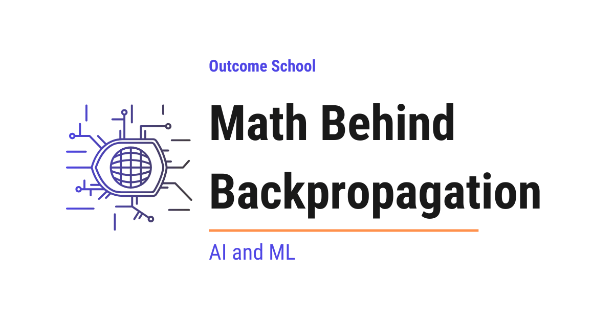

# How Does Backpropagation Work? The Math Explained Step by Step

> Archived from <https://outcomeschool.com/blog/math-behind-backpropagation> on 2026-11-25.

Backpropagation is a method used to calculate how much each weight in a neural network contributed to the error, so that we can adjust those weights to reduce the error. It does this by sending the error backward through the network, using the chain rule.

In this blog, we will learn about the math behind backpropagation in neural networks.

Backpropagation is the core algorithm that allows neural networks to learn from their mistakes. Without it, training neural networks efficiently would not be possible. Understanding the math behind it gives us a deeper understanding of how neural networks actually learn. Do not worry, we will learn about each concept step by step so that everything is clear.

We will cover the following topics:
<ul><li>What is backpropagation?</li><li>The chain rule of calculus</li><li>Forward pass</li><li>Loss calculation</li><li>Backward pass (backpropagation)</li><li>Step-by-step numeric example</li><li>Weight update using gradient descent</li><li>Backpropagation in Python</li></ul>
I am <strong>Amit Shekhar</strong>, Founder @ <a target="_blank" rel="noopener noreferrer" href="https://outcomeschool.com">Outcome School</a>, I have taught and mentored many developers, and their efforts landed them high-paying tech jobs, helped many tech companies in solving their unique problems, and created many open-source libraries being used by top companies. I am passionate about sharing knowledge through open-source, blogs, and videos.

I teach <a target="_blank" rel="noopener noreferrer" href="https://outcomeschool.com/program/ai-and-machine-learning">AI and Machine Learning</a> at Outcome School.

Let&#x27;s get started.
<h2 id="what-is-backpropagation">What is Backpropagation?</h2>
<strong>Backpropagation is a method used to calculate how much each weight in a <a target="_blank" rel="noopener noreferrer" href="neural-network.md">neural network</a> contributed to the error, so that we can adjust those weights to reduce the error.</strong>

In simple words, <strong>Backpropagation = Backward + Propagation</strong>. It means propagating (sending) the error backward through the network. Here, <strong>weights</strong> are the numbers that the network adjusts during training to make better predictions.

Let&#x27;s say a student takes a math test and gets a wrong answer. The teacher does not just say &quot;wrong&quot; - the teacher goes back through each step to find exactly where the student made the mistake. That is what backpropagation does. It goes backward through each layer of the network to find how much each weight contributed to the error.
<h2 id="the-chain-rule-of-calculus">The Chain Rule of Calculus</h2>
Before we dive into backpropagation, we must understand the chain rule. Do not worry, we will keep it simple.

The chain rule is a formula from calculus that tells us how to find the rate of change of a value that depends on another value, which in turn depends on yet another value.

Let&#x27;s say we have a chain of dependencies: the number of hours we study affects our knowledge, and our knowledge affects our exam score. If we want to know how study hours affect the exam score, we need to trace through the chain.

In mathematical terms, let&#x27;s say we have three variables: x, y, and z.
<ul><li>y depends on x: y = f(x)</li><li>z depends on y: z = g(y)</li></ul>
Now, if we want to know how z changes when x changes, we use the chain rule as below:

<pre><code class="code-highlight">dz/dx = (dz/dy) * (dy/dx)
</code></pre>

Here, <code>dz/dx</code> means &quot;how much does z change when x changes by a tiny amount?&quot;

This is very important because in a neural network, the output depends on the activations of each layer, and each layer&#x27;s activation depends on its own weights and the activations from the previous layer. The chain rule allows us to trace the error all the way back to each weight.
<h2 id="forward-pass">Forward Pass</h2>
In the forward pass, the input data flows through the network from the input layer to the output layer. At each neuron, we perform two operations:

<strong>Step 1: Weighted Sum</strong>

We multiply each input by its weight and add a bias. For a neuron with two inputs, this looks like below:

<pre><code class="code-highlight">z = (w1 * x1) + (w2 * x2) + b
</code></pre>

Here, <code>w1</code> and <code>w2</code> are weights, <code>x1</code> and <code>x2</code> are inputs, and <code>b</code> is the bias. The bias is an extra value that helps the neuron adjust its output even when the inputs are zero. If a neuron has only one input, the formula simplifies to <code>z = w * x + b</code>.

<strong>Step 2: Activation Function</strong>

We pass the weighted sum through an <a target="_blank" rel="noopener noreferrer" href="activation-functions.md">activation function</a>. Let&#x27;s use the sigmoid function for our example as below:

<pre><code class="code-highlight">a = sigmoid(z) = 1 / (1 + e^(-z))
</code></pre>

Here, <code>e</code> is Euler&#x27;s number (approximately <code>2.71828</code>). The sigmoid function always outputs a value between 0 and 1, which makes it useful for representing probabilities and keeping values in a manageable range.

The activation function introduces non-linearity, which allows the network to learn complex patterns (i.e. curves and non-linear relationships). Without it, no matter how many layers we stack, the network would only be able to learn simple straight-line relationships. We have a detailed blog on <a target="_blank" rel="noopener noreferrer" href="multilayer-perceptron-mlp.md">Multilayer Perceptron (MLP)</a> that shows this with the XOR problem step by step.

The output of one layer becomes the input to the next layer. This continues until we get the final output.
<h2 id="loss-calculation">Loss Calculation</h2>
After the forward pass, we compare the predicted output with the actual expected output. The difference between them is called the <strong>loss</strong> (or error).

A common loss function is the <strong>Squared Error Loss</strong>:

<pre><code class="code-highlight">Loss = (1/2) * (y_actual - y_predicted)^2
</code></pre>

Here, we use <code>(1/2)</code> as a constant to make the math cleaner when we calculate the derivative (i.e. the rate of change). This only changes the scale of the gradients, not their direction, and the learning rate compensates for this. When we have multiple training examples, we average this loss over all examples, and that is called the <strong>Mean Squared Error (MSE)</strong>. For our example, we have a single training example, so we will use this simpler form.

The goal of training is to minimize this loss. And to minimize it, we need to know how each weight affects the loss. This is exactly where backpropagation comes into the picture.
<h2 id="backward-pass-backpropagation">Backward Pass (Backpropagation)</h2>
Now, we need to find out: &quot;How much does each weight contribute to the loss?&quot; In mathematical terms, we need to calculate the <strong>gradient</strong> of the loss with respect to each weight.

In simple words, the gradient is like a slope. Suppose we are standing on a hill and we want to reach the lowest point. The gradient tells us which direction to walk (uphill or downhill) and how steep the slope is.

The gradient tells us: The <strong>direction</strong> in which we need to change the weight (increase or decrease).

We use the chain rule to calculate these gradients, going backward from the output layer to the input layer.

<strong>Planning your move into AI?</strong>

No matter which tech domain you work in today, with your effort, you can transition to these roles:
<ul><li>AI Engineer</li><li>Forward Deployed Engineer</li><li>AI Agent Engineer</li><li>Harness Engineer</li><li>Voice AI Engineer</li><li>AI Architect</li><li>LLM Engineer</li><li>LLM Inference Engineer</li><li>Gen AI Engineer</li><li>MLOps Engineer</li><li>ML Engineer</li><li>Deep Learning Engineer</li></ul>
Our <a target="_blank" rel="noopener noreferrer" href="https://outcomeschool.com/program/ai-and-machine-learning">AI and Machine Learning Program</a> at Outcome School takes you there.
<h3 id="setting-up-a-simple-network">Setting Up a Simple Network</h3>
Let&#x27;s take a very simple neural network with:
<ul><li>1 input neuron (x)</li><li>1 hidden neuron</li><li>1 output neuron</li><li>Sigmoid activation function at the hidden and output neurons</li></ul>
The network looks like below:

<pre><code class="code-highlight">Input (x) --[w1]--&gt; Hidden (h) --[w2]--&gt; Output (o)
</code></pre>

<strong>Forward pass equations:</strong>

<pre><code class="code-highlight">z_h = w1 * x + b1        (weighted sum at hidden neuron)
a_h = sigmoid(z_h)        (activation at hidden neuron)

z_o = w2 * a_h + b2       (weighted sum at output neuron)
a_o = sigmoid(z_o)         (activation at output neuron, this is our prediction)
</code></pre>

<strong>Loss:</strong>

<pre><code class="code-highlight">L = (1/2) * (y - a_o)^2
</code></pre>

Here, <code>y</code> is the actual expected output and <code>a_o</code> is our predicted output.
<h3 id="calculating-gradients">Calculating Gradients</h3>
Now, we want to find <code>dL/dw2</code> (how much the loss changes when w2 changes) and <code>dL/dw1</code> (how much the loss changes when w1 changes).

<strong>Gradient for w2:</strong>

Using the chain rule:

<pre><code class="code-highlight">dL/dw2 = (dL/da_o) * (da_o/dz_o) * (dz_o/dw2)
</code></pre>

Let&#x27;s calculate each part:

<pre><code class="code-highlight">dL/da_o = -(y - a_o)
</code></pre>

This tells us how the loss changes with respect to the predicted output.

<pre><code class="code-highlight">da_o/dz_o = a_o * (1 - a_o)
</code></pre>

This is the derivative (i.e. the rate of change) of the sigmoid function. Let&#x27;s see how we get this result.

We know that <code>a_o = sigmoid(z_o) = 1 / (1 + e^(-z_o))</code>. We can rewrite this as <code>(1 + e^(-z_o))^(-1)</code>.

Now, we apply the chain rule:

<pre><code class="code-highlight">da_o/dz_o = -1 * (1 + e^(-z_o))^(-2) * (-e^(-z_o))
          = e^(-z_o) / (1 + e^(-z_o))^2
</code></pre>

Here, we can notice that:

<pre><code class="code-highlight">1 - a_o = 1 - 1 / (1 + e^(-z_o))
        = e^(-z_o) / (1 + e^(-z_o))
</code></pre>

So, we can rewrite our derivative as below:

<pre><code class="code-highlight">e^(-z_o) / (1 + e^(-z_o))^2 = [1 / (1 + e^(-z_o))] * [e^(-z_o) / (1 + e^(-z_o))]
                             = a_o * (1 - a_o)
</code></pre>

The sigmoid function has this nice property where its derivative can be expressed using its own output. This is also very convenient because we already computed <code>a_o</code> during the forward pass, so we do not need to recalculate anything.

<pre><code class="code-highlight">dz_o/dw2 = a_h
</code></pre>

This is because <code>z_o = w2 * a_h + b2</code>, so the derivative with respect to <code>w2</code> is simply <code>a_h</code>.

Putting it all together:

<pre><code class="code-highlight">dL/dw2 = -(y - a_o) * a_o * (1 - a_o) * a_h
</code></pre>

<strong>A quick note for you</strong>

No matter which tech domain you work in, get familiar with these topics:
<ul><li>LLM</li><li>RAG</li><li>MCP</li><li>Agent</li><li>Fine-tuning</li><li>Quantization</li></ul>
We put it all together in one video:

<a target="_blank" rel="noopener noreferrer" href="https://www.youtube.com/watch?v=lnfWvX66FUk">AI Engineering Explained: LLM, RAG, MCP, Agent, Fine-Tuning, and Quantization</a>

No need to stop reading - bookmark it and watch later when you get time. Future you will thank you.

Now, let&#x27;s get back to the topic.

<strong>Gradient for w1:</strong>

For w1, the chain is longer because w1 is further from the output. But the principle is exactly the same - we just multiply more terms together. We need to go through more steps:

<pre><code class="code-highlight">dL/dw1 = (dL/da_o) * (da_o/dz_o) * (dz_o/da_h) * (da_h/dz_h) * (dz_h/dw1)
</code></pre>

We already know the first two terms. Let&#x27;s calculate the new ones:

<pre><code class="code-highlight">dz_o/da_h = w2
</code></pre>

This is because <code>z_o = w2 * a_h + b2</code>, so the derivative with respect to <code>a_h</code> is <code>w2</code>.

<pre><code class="code-highlight">da_h/dz_h = a_h * (1 - a_h)
</code></pre>

This is again the derivative of the sigmoid function.

<pre><code class="code-highlight">dz_h/dw1 = x
</code></pre>

This is because <code>z_h = w1 * x + b1</code>, so the derivative with respect to <code>w1</code> is <code>x</code>.

Putting it all together:

<pre><code class="code-highlight">dL/dw1 = -(y - a_o) * a_o * (1 - a_o) * w2 * a_h * (1 - a_h) * x
</code></pre>

Here, we can see that the gradient for w1 reuses the error signal <code>dL/da_o * da_o/dz_o</code> that we already computed for w2. This is the key insight of backpropagation - we reuse the error signals computed at later layers when computing gradients for earlier layers. This makes the computation very efficient because we do not have to calculate everything from scratch for each weight.

We have a detailed blog on <a target="_blank" rel="noopener noreferrer" href="vanishing-and-exploding-gradients.md">Why do vanishing and exploding gradients happen?</a> that covers what goes wrong when this chain of multiplications gets very long.

<strong>Gradients for biases:</strong>

We also need to calculate the gradients for the biases. The process is similar. For <code>b2</code>, since <code>z_o = w2 * a_h + b2</code>, the derivative of <code>z_o</code> with respect to <code>b2</code> is simply <code>1</code>. So:

<pre><code class="code-highlight">dL/db2 = -(y - a_o) * a_o * (1 - a_o) * 1
</code></pre>

Similarly, for <code>b1</code>, since <code>z_h = w1 * x + b1</code>, the derivative of <code>z_h</code> with respect to <code>b1</code> is <code>1</code>. So:

<pre><code class="code-highlight">dL/db1 = -(y - a_o) * a_o * (1 - a_o) * w2 * a_h * (1 - a_h) * 1
</code></pre>

Here, we can see that the bias gradients follow the same chain rule pattern as the weight gradients. The only difference is that the last term in the chain is <code>1</code> instead of the input value.

To learn Backpropagation, the chain rule, and how to build a Neural Network from scratch, check out our <a target="_blank" rel="noopener noreferrer" href="https://outcomeschool.com/program/ai-and-machine-learning">AI and Machine Learning Program</a> at Outcome School.
<h2 id="step-by-step-numeric-example">Step-by-Step Numeric Example</h2>
The best way to learn this is by taking an example. Let&#x27;s initialize our network with the following values:

<pre><code class="code-highlight">x = 0.5       (input)
y = 1.0       (expected output)
w1 = 0.3      (weight 1)
b1 = 0.1      (bias 1)
w2 = 0.7      (weight 2)
b2 = 0.2      (bias 2)
</code></pre>

<strong>Forward Pass:</strong>

Step 1: Calculate the hidden neuron output.

<pre><code class="code-highlight">z_h = w1 * x + b1 = 0.3 * 0.5 + 0.1 = 0.25
a_h = sigmoid(0.25) = 1 / (1 + e^(-0.25)) = 0.5622
</code></pre>

Step 2: Calculate the output neuron output.

<pre><code class="code-highlight">z_o = w2 * a_h + b2 = 0.7 * 0.5622 + 0.2 = 0.5935
a_o = sigmoid(0.5935) = 1 / (1 + e^(-0.5935)) = 0.6442
</code></pre>

Here, our predicted output is <code>0.6442</code>, but the expected output is <code>1.0</code>.

<strong>Note:</strong> We are rounding intermediate values to 4 decimal places for clarity. The Python implementation later uses full precision, so you may notice slight differences in the final digits.

Step 3: Calculate the loss.

<pre><code class="code-highlight">L = (1/2) * (1.0 - 0.6442)^2 = (1/2) * (0.3558)^2 = 0.0633
</code></pre>

<strong>Backward Pass:</strong>

Now, let&#x27;s calculate the gradients.

Step 4: Gradient for w2.

<pre><code class="code-highlight">dL/da_o = -(1.0 - 0.6442) = -0.3558
da_o/dz_o = 0.6442 * (1 - 0.6442) = 0.6442 * 0.3558 = 0.2292
dz_o/dw2 = a_h = 0.5622

dL/dw2 = -0.3558 * 0.2292 * 0.5622 = -0.0459
</code></pre>

Step 5: Gradient for w1.

<pre><code class="code-highlight">dz_o/da_h = w2 = 0.7
da_h/dz_h = 0.5622 * (1 - 0.5622) = 0.5622 * 0.4378 = 0.2461
dz_h/dw1 = x = 0.5

dL/dw1 = -0.3558 * 0.2292 * 0.7 * 0.2461 * 0.5 = -0.0070
</code></pre>

Now, we have the gradients. The negative sign tells us that we need to increase both weights to reduce the loss. Now, it&#x27;s time to learn about how we use these gradients to update the weights.
<h2 id="weight-update-using-gradient-descent">Weight Update Using Gradient Descent</h2>
Once we have the gradients, we update the weights using the <a target="_blank" rel="noopener noreferrer" href="math-behind-gradient-descent.md">gradient descent</a> formula:

<pre><code class="code-highlight">w_new = w_old - learning_rate * (dL/dw)
</code></pre>

Here, the <strong>learning rate</strong> is a small number (like 0.1 or 0.01) that controls how big each step is. If the learning rate is too large, we overshoot the optimal value. If it is too small, learning will be very slow.

Let&#x27;s use a learning rate of 0.5:

<pre><code class="code-highlight">w2_new = 0.7 - 0.5 * (-0.0459) = 0.7 + 0.0229 = 0.7229
w1_new = 0.3 - 0.5 * (-0.0070) = 0.3 + 0.0035 = 0.3035
</code></pre>

Here, we can see that both weights increased slightly. If we run the forward pass again with these new weights, we will get a prediction closer to <code>1.0</code> and the loss will be smaller.

This process of forward pass, loss calculation, backward pass, and weight update is repeated many times during training. With each iteration, the network gets better at making predictions.

This same loop runs when we take an already trained model and adapt it to our own task. We have a detailed blog on <a target="_blank" rel="noopener noreferrer" href="how-does-fine-tuning-work.md">How does fine-tuning work?</a> that explains it end to end.

Now, we have understood the complete math. Till now, we have learned all the theory and verified it with a numeric example. Now, let&#x27;s put it all together in a working Python implementation.

If we want to go deep into gradient descent, optimizers, and loss functions from the ground up, we have a complete program - check out our <a target="_blank" rel="noopener noreferrer" href="https://outcomeschool.com/program/ai-and-machine-learning">AI and Machine Learning Program</a> at Outcome School.
<h2 id="backpropagation-in-python">Backpropagation in Python</h2>
Now, let&#x27;s implement the complete backpropagation example in Python as below:

<pre><code class="code-highlight language-python">import math

# Initialize
x = 0.5
y = 1.0
w1, b1 = 0.3, 0.1
w2, b2 = 0.7, 0.2
learning_rate = 0.5

def sigmoid(z):
    return 1 / (1 + math.exp(-z))

# Training loop
for epoch in range(1000):
    # Forward pass
    z_h = w1 * x + b1
    a_h = sigmoid(z_h)
    z_o = w2 * a_h + b2
    a_o = sigmoid(z_o)

    # Loss
    loss = 0.5 * (y - a_o) ** 2

    # Backward pass
    dL_da_o = -(y - a_o)
    da_o_dz_o = a_o * (1 - a_o)
    dz_o_dw2 = a_h
    dz_o_da_h = w2
    da_h_dz_h = a_h * (1 - a_h)
    dz_h_dw1 = x

    dL_dw2 = dL_da_o * da_o_dz_o * dz_o_dw2
    dL_dw1 = dL_da_o * da_o_dz_o * dz_o_da_h * da_h_dz_h * dz_h_dw1
    dL_db2 = dL_da_o * da_o_dz_o
    dL_db1 = dL_da_o * da_o_dz_o * dz_o_da_h * da_h_dz_h

    # Weight update
    w2 = w2 - learning_rate * dL_dw2
    w1 = w1 - learning_rate * dL_dw1
    b2 = b2 - learning_rate * dL_db2
    b1 = b1 - learning_rate * dL_db1

    if epoch % 200 == 0:
        print(f&quot;Epoch {epoch}, Loss: {loss:.6f}, Prediction: {a_o:.6f}&quot;)

print(f&quot;Final prediction: {a_o:.6f}&quot;)
</code></pre>

Here, we have implemented the complete forward pass, backward pass, and weight update in a training loop. We run it for 1000 epochs (an <strong><a target="_blank" rel="noopener noreferrer" href="epoch-batch-and-iteration.md">epoch</a></strong> is one complete pass through the training data). Since we have a single training example, each iteration is one epoch. The loss decreases with each epoch, and the prediction gets closer and closer to the expected output of <code>1.0</code>.

This will print the following:

<pre><code class="code-highlight">Epoch 0, Loss: 0.063306, Prediction: 0.644173
Epoch 200, Loss: 0.001997, Prediction: 0.936796
Epoch 400, Loss: 0.000917, Prediction: 0.957166
Epoch 600, Loss: 0.000585, Prediction: 0.965799
Epoch 800, Loss: 0.000426, Prediction: 0.970806
Final prediction: 0.974146
</code></pre>

Here, we can see how the loss decreases from <code>0.063306</code> to almost <code>0.000426</code> after 800 epochs, and the prediction moves from <code>0.644173</code> to <code>0.974146</code>, which is very close to our expected output of <code>1.0</code>.

This is how the math behind backpropagation works. The chain rule allows us to efficiently compute how much each weight contributes to the error. And gradient descent uses that information to update the weights in the right direction. Now, we have understood the complete math behind backpropagation and how neural networks learn from their mistakes.

<strong>Stay updated:</strong> Subscribe to our <a target="_blank" rel="noopener noreferrer" href="https://outcomeschool.substack.com/subscribe">newsletter</a> to get our latest AI and Machine Learning blogs straight to your inbox.
<h2 id="frequently-asked-questions">Frequently Asked Questions</h2><h3 id="is-backpropagation-the-same-as-gradient-descent">Is backpropagation the same as gradient descent?</h3>
No. Backpropagation uses the chain rule to compute how much each weight contributes to the error. Gradient descent then uses those gradients to update the weights in the right direction. The two work together in every training loop.
<h3 id="why-is-backpropagation-efficient">Why is backpropagation efficient?</h3>
Backpropagation reuses the error signals computed at later layers when it computes gradients for earlier layers. For example, the gradient for <code>w1</code> reuses the error signal already computed for <code>w2</code>. So, we do not have to calculate everything from scratch for each weight.
<h3 id="why-does-a-neural-network-need-an-activation-function">Why does a neural network need an activation function?</h3>
The activation function introduces non-linearity, which allows the network to learn complex patterns like curves. Without it, no matter how many layers we stack, the network would only be able to learn simple straight-line relationships.
<h3 id="what-happens-if-the-learning-rate-is-too-large-or-too-small">What happens if the learning rate is too large or too small?</h3>
If the learning rate is too large, we overshoot the optimal value. If it is too small, learning will be very slow. The learning rate is a small number that controls how big each step of the weight update is.
<h3 id="why-is-there-a-12-in-the-squared-error-loss">Why is there a 1/2 in the squared error loss?</h3>
The <code>(1/2)</code> is a constant that makes the math cleaner when we calculate the derivative. It only changes the scale of the gradients, not their direction, and the learning rate compensates for this.

That&#x27;s it for now.

Thanks

<strong>Amit Shekhar</strong> Founder @ <a target="_blank" rel="noopener noreferrer" href="https://outcomeschool.com">Outcome School</a>

You can connect with me on:
<ul><li><a target="_blank" rel="noopener noreferrer" href="https://x.com/amitiitbhu">X</a></li><li><a target="_blank" rel="noopener noreferrer" href="https://www.linkedin.com/in/amit-shekhar-iitbhu">LinkedIn</a></li><li><a target="_blank" rel="noopener noreferrer" href="https://github.com/amitshekhariitbhu">GitHub</a></li></ul>
Follow Outcome School on:
<ul><li><a target="_blank" rel="noopener noreferrer" href="https://x.com/outcome_school">X</a></li><li><a target="_blank" rel="noopener noreferrer" href="https://youtube.com/@OutcomeSchool">YouTube</a></li><li><a target="_blank" rel="noopener noreferrer" href="https://www.linkedin.com/company/outcomeschool">LinkedIn</a></li><li><a target="_blank" rel="noopener noreferrer" href="https://github.com/OutcomeSchool">GitHub</a></li></ul>
<a target="_blank" rel="noopener noreferrer" href="https://outcomeschool.com/blog"><strong>Read all of our high-quality blogs here.</strong></a>

