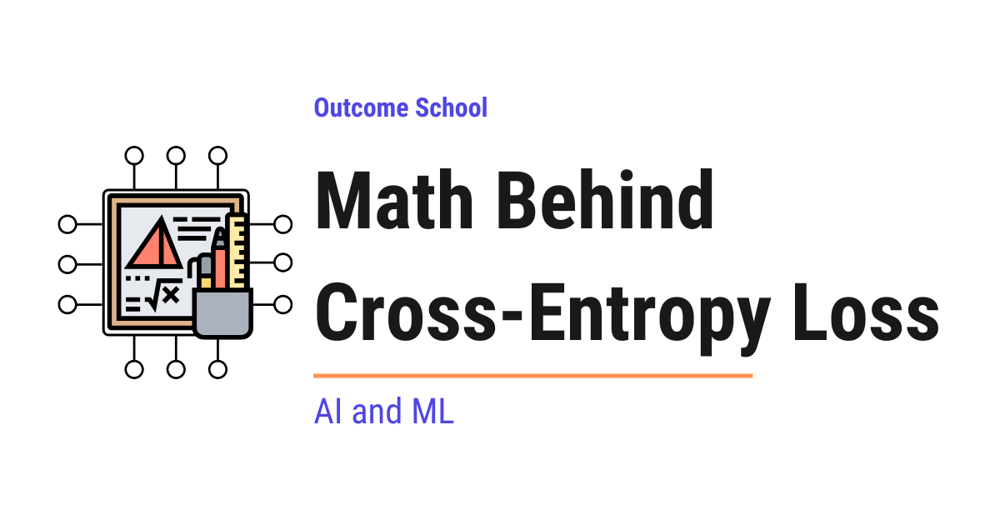

# What is Cross-Entropy Loss?

> Archived from <https://outcomeschool.com/blog/math-behind-cross-entropy-loss> on 2026-11-25.

Cross-Entropy Loss is a number that tells us how wrong our predicted probabilities are. It measures how different the model&#x27;s predicted probabilities are from the true answer. The closer the prediction is to the truth, the smaller the loss.

In this blog, we will learn about the math behind Cross-Entropy Loss with a step-by-step numeric example.

When we train a classification model in <a target="_blank" rel="noopener noreferrer" href="machine-learning.md">machine learning</a>, the model predicts probabilities for each class. For example, given an image, the model outputs something like: &quot;I am 70% sure this is a cat, 20% sure it is a dog, and 10% sure it is a rabbit.&quot; To train the model, we need a way to measure how wrong these predictions are compared to the true answer. This is exactly what <strong>Cross-Entropy Loss</strong> does. It is the most widely used loss function in classification tasks, and it powers the training of almost every modern AI model, including GPT, BERT, and image classifiers.

When we hear Cross-Entropy Loss, it sounds complex. But do not worry. If we break it down into its individual parts, every single piece is simple. Our goal is to decode this so clearly that by the end, we will be able to explain how Cross-Entropy Loss works to anyone.

We will cover the following:
<ul><li>The Big Picture</li><li>What is Cross-Entropy?</li><li>The Cross-Entropy Loss Formula</li><li>Why We Take the Negative Log</li><li>Binary Cross-Entropy Loss</li><li>Categorical Cross-Entropy Loss</li><li>Step-by-Step Numeric Example</li><li>Cross-Entropy Loss for Language Models</li><li>The Gradient of Cross-Entropy Loss</li><li>Quick Summary</li></ul>
I am <strong>Amit Shekhar</strong>, Founder @ <a target="_blank" rel="noopener noreferrer" href="https://outcomeschool.com">Outcome School</a>, I have taught and mentored many developers, and their efforts landed them high-paying tech jobs, helped many tech companies in solving their unique problems, and created many open-source libraries being used by top companies. I am passionate about sharing knowledge through open-source, blogs, and videos.

I teach <a target="_blank" rel="noopener noreferrer" href="https://outcomeschool.com/program/ai-and-machine-learning">AI and Machine Learning</a> at Outcome School.

Let&#x27;s get started.
<h2 id="the-big-picture">The Big Picture</h2>
Before we go into the details, let&#x27;s understand the big picture. Cross-Entropy Loss measures how different the predicted probability distribution is from the true probability distribution. If our prediction is close to the truth, the loss is small. If our prediction is far from the truth, the loss is large.

In simple words:

<strong>Cross-Entropy Loss = A number that tells us how wrong our predicted probabilities are.</strong>

The lower the cross-entropy, the better the model. During training, we keep updating the model weights to make this loss as small as possible. The algorithm that actually performs these weight updates is called gradient descent. We have a detailed blog on <a target="_blank" rel="noopener noreferrer" href="math-behind-gradient-descent.md">Math Behind Gradient Descent</a> that explains how this works step by step.
<h2 id="what-is-cross-entropy">What is Cross-Entropy?</h2>
The word <strong>Cross-Entropy</strong> comes from information theory. Let&#x27;s decompose it:

<strong>Cross-Entropy = Cross + Entropy</strong>
<ul><li><strong><a target="_blank" rel="noopener noreferrer" href="entropy-in-information-theory.md">Entropy</a></strong> measures the uncertainty of a probability distribution. If a coin is perfectly fair (50% heads, 50% tails), the entropy is high because we are very unsure about the outcome. If a coin always lands heads (100% heads, 0% tails), the entropy is zero because there is no uncertainty.</li><li><strong>Cross</strong> means we are comparing two distributions: the <strong>true distribution</strong> (what should happen) and the <strong>predicted distribution</strong> (what our model thinks will happen).</li></ul>
So, Cross-Entropy measures the uncertainty we have when we use the predicted distribution to describe events that actually follow the true distribution. If the two distributions are identical, the cross-entropy is at its minimum. If they are very different, the cross-entropy is large. We have a detailed blog on <a target="_blank" rel="noopener noreferrer" href="kl-divergence.md">KL Divergence</a> that explains how this gap between two distributions is measured.

<strong>The Weather Forecaster Analogy</strong>

The best way to learn this is by taking an example. Suppose we have a weather forecaster who every morning announces the chance of rain, sunshine, and snow as probabilities (e.g. &quot;60% rain, 30% sunshine, 10% snow&quot;). At the end of the day, exactly one of these actually happens.

Now, how do we score this forecaster fairly?
<ul><li>If she says &quot;90% rain&quot; and it rains, she gets a very small penalty. Great forecast.</li><li>If she says &quot;90% sunshine&quot; and it rains, she gets a huge penalty. She was confidently wrong.</li><li>If she says &quot;34% rain, 33% sunshine, 33% snow&quot; (completely unsure) and it rains, she gets a moderate penalty. Hedging is neither punished heavily nor rewarded.</li></ul>
Cross-Entropy Loss is exactly this scoring system. The model is the forecaster, the <a target="_blank" rel="noopener noreferrer" href="https://www.youtube.com/watch?v=2Zx6x01WwWM"><strong>softmax</strong></a> output is the probability announcement, and the true label is what actually happened. We will keep coming back to this analogy throughout the blog.
<h2 id="the-cross-entropy-loss-formula">The Cross-Entropy Loss Formula</h2>
Before we write the formula, let&#x27;s see the full pipeline of how cross-entropy loss is computed during training:

<pre><code class="code-highlight">  [raw scores]        [probabilities]         [loss]
   (logits)     --&gt;    (after softmax)  --&gt;  (-log of correct class)
  z = [2, 3, 1]        p = [0.24, 0.66, 0.09]     0.4076
       |                     |                       |
       +-----&gt; softmax ------+----&gt; -log(p_dog) -----+
</code></pre>

The raw scores (<a target="_blank" rel="noopener noreferrer" href="logits-in-machine-learning.md">logits</a>) come out of the final layer of the model. Softmax turns them into probabilities that sum to 1. Cross-Entropy Loss then looks at the probability of the correct class and takes its negative log.

The general formula for Cross-Entropy Loss is:

<pre><code class="code-highlight">CE = - sum over all classes i of [ y_i * log(p_i) ]
</code></pre>

Here:
<ul><li><code>y_i</code> is the true label for class <code>i</code> (usually 1 for the correct class, 0 for all others)</li><li><code>p_i</code> is the predicted probability for class <code>i</code></li><li><code>log</code> is the natural logarithm (base <code>e</code>)</li><li>The sum runs over all classes</li></ul>
Since <code>y_i</code> is 1 only for the correct class and 0 for all others, the formula simplifies to:

<pre><code class="code-highlight">CE = - log(p_correct)
</code></pre>

Where <code>p_correct</code> is the predicted probability for the correct class.

In simple words, cross-entropy loss is just the negative <a target="_blank" rel="noopener noreferrer" href="logprobs-in-llms.md">log of the probability</a> that our model assigned to the correct answer.

<strong>Planning your move into AI?</strong>

No matter which tech domain you work in today, with your effort, you can transition to these roles:
<ul><li>AI Engineer</li><li>Forward Deployed Engineer</li><li>AI Agent Engineer</li><li>Harness Engineer</li><li>Voice AI Engineer</li><li>AI Architect</li><li>LLM Engineer</li><li>LLM Inference Engineer</li><li>Gen AI Engineer</li><li>MLOps Engineer</li><li>ML Engineer</li><li>Deep Learning Engineer</li></ul>
Our <a target="_blank" rel="noopener noreferrer" href="https://outcomeschool.com/program/ai-and-machine-learning">AI and Machine Learning Program</a> at Outcome School takes you there.
<h2 id="why-we-take-the-negative-log">Why We Take the Negative Log</h2>
Now, a natural question arises - why do we take the log, and why the negative sign?
<blockquote>
Why should a forecaster who says &quot;90% sunshine&quot; on a rainy day be punished far more than one who says &quot;60% sunshine&quot;? Because confident mistakes are more dangerous than hedged mistakes. The log makes this punishment happen automatically.
</blockquote>
Let&#x27;s understand this step by step.

<strong>Why log?</strong>

Suppose our model predicts the correct class with probability <code>0.9</code>. This is a great prediction. Now suppose another model predicts the correct class with probability <code>0.1</code>. This is a terrible prediction. We want our loss to reflect this difference strongly.

If we just used <code>1 - p</code>, the difference between <code>0.9</code> and <code>0.1</code> would be only <code>0.8</code>. That does not feel strong enough. But if we use <code>log(p)</code>:
<ul><li><code>log(0.9) = -0.105</code></li><li><code>log(0.1) = -2.303</code></li></ul>
The log stretches out the small probabilities and punishes them much more harshly. Let&#x27;s put this into perspective with real numbers:
<ul><li><code>-log(0.1) = 2.303</code></li><li><code>-log(0.01) = 4.605</code></li><li><code>-log(0.001) = 6.908</code></li></ul>
A prediction of <code>0.01</code> gets almost double the penalty of a prediction of <code>0.1</code>, and a prediction of <code>0.001</code> gets three times the penalty. Every time the predicted probability shrinks by a factor of 10, the penalty goes up by a fixed amount (about <code>2.303</code>).

Here is the deeper reason why <code>log</code> is the right tool:
<ul><li><code>1 - p</code> is <strong>linear and capped at 1</strong>. Even a confidently wrong prediction of <code>p = 0.01</code> gets a penalty of only <code>0.99</code>.</li><li><code>-log(p)</code> is <strong>unbounded as p approaches 0</strong>. A confidently wrong prediction of <code>p = 0.001</code> gets a penalty of <code>6.908</code>, and the penalty keeps growing without limit as <code>p</code> gets smaller.</li></ul>
This is exactly what we want - the model should be strongly discouraged from being confidently wrong.

<strong>Why negative?</strong>

The log of any number between 0 and 1 is always negative. Since loss should be a positive number (lower is better), we put a negative sign in front to flip it. So:
<ul><li><code>p = 0.9</code> -&gt; <code>-log(0.9) = 0.105</code> (small loss, good prediction)</li><li><code>p = 0.1</code> -&gt; <code>-log(0.1) = 2.303</code> (large loss, bad prediction)</li><li><code>p = 1.0</code> -&gt; <code>-log(1.0) = 0</code> (zero loss, perfect prediction)</li><li><code>p</code> close to <code>0</code> -&gt; <code>-log(p)</code> close to <code>infinity</code> (huge loss, the forecaster said &quot;0% chance of rain&quot; and it rained)</li></ul>
This is how cross-entropy gives a clean, well-behaved loss value that is small when we are right and large when we are wrong.

<strong>A quick note for you</strong>

No matter which tech domain you work in, get familiar with these topics:
<ul><li>LLM</li><li>RAG</li><li>MCP</li><li>Agent</li><li>Fine-tuning</li><li>Quantization</li></ul>
We put it all together in one video:

<a target="_blank" rel="noopener noreferrer" href="https://www.youtube.com/watch?v=lnfWvX66FUk">AI Engineering Explained: LLM, RAG, MCP, Agent, Fine-Tuning, and Quantization</a>

No need to stop reading - bookmark it and watch later when you get time. Future you will thank you.

Now, let&#x27;s get back to the topic.
<h2 id="binary-cross-entropy-loss">Binary Cross-Entropy Loss</h2>
Now, let&#x27;s look at the simplest case - when we have only two classes (e.g. spam or not spam, cat or dog, rain or no rain). This is the exact setting of our forecaster analogy when she only predicts &quot;rain&quot; or &quot;no rain&quot;.

In this case, the true label <code>y</code> is either <code>0</code> or <code>1</code>, and the predicted probability <code>p</code> is a single number between <code>0</code> and <code>1</code> (usually the output of a <a target="_blank" rel="noopener noreferrer" href="activation-functions.md">sigmoid function</a>).

The formula is:

<pre><code class="code-highlight">BCE = - [ y * log(p) + (1 - y) * log(1 - p) ]
</code></pre>

Here, only one of the two terms is active at a time:
<ul><li>If <code>y = 1</code>: only <code>-log(p)</code> is active. We want <code>p</code> to be close to 1.</li><li>If <code>y = 0</code>: only <code>-log(1 - p)</code> is active. We want <code>p</code> to be close to 0.</li></ul>
Let&#x27;s see with an example. Suppose the true label is <code>y = 1</code> and the model predicts <code>p = 0.8</code>:

<pre><code class="code-highlight">BCE = - [ 1 * log(0.8) + 0 * log(0.2) ]
    = - log(0.8)
    = 0.223
</code></pre>

Now suppose the true label is <code>y = 1</code> but the model predicts <code>p = 0.2</code>:

<pre><code class="code-highlight">BCE = - [ 1 * log(0.2) + 0 * log(0.8) ]
    = - log(0.2)
    = 1.609
</code></pre>

The second prediction is punished with a much larger loss. It works perfectly.
<h2 id="categorical-cross-entropy-loss">Categorical Cross-Entropy Loss</h2>
Now, let&#x27;s move to the case with multiple classes (e.g. classifying an image as cat, dog, rabbit, or bird).

In this case, the true label is a <a target="_blank" rel="noopener noreferrer" href="one-hot-encoding.md"><strong>one-hot vector</strong></a>. A one-hot vector is just a list of zeros with a single <code>1</code> at the position of the correct class. If we want to understand one-hot encoding in detail, we can watch <a target="_blank" rel="noopener noreferrer" href="https://www.youtube.com/watch?v=6AmedU5i9go">this video on one-hot encoding</a>. For example, if the true class is &quot;dog&quot; out of [cat, dog, rabbit, bird], the true label is:

<pre><code class="code-highlight">y = [0, 1, 0, 0]
</code></pre>

The model outputs a probability distribution over all classes, usually by applying a <strong>softmax</strong> function on top of the raw scores (also called <strong>logits</strong>). Let&#x27;s say the model predicts:

<pre><code class="code-highlight">p = [0.2, 0.7, 0.05, 0.05]
</code></pre>

The categorical cross-entropy is:

<pre><code class="code-highlight">CE = - sum [ y_i * log(p_i) ]
   = - [ 0 * log(0.2) + 1 * log(0.7) + 0 * log(0.05) + 0 * log(0.05) ]
   = - log(0.7)
   = 0.357
</code></pre>

Since the true label is one-hot, only the term for the correct class survives. So the formula reduces to <code>- log(p_correct)</code>.

To master cross-entropy, loss functions, and logits in depth, check out our <a target="_blank" rel="noopener noreferrer" href="https://outcomeschool.com/program/ai-and-machine-learning">AI and Machine Learning Program</a> at Outcome School.
<h2 id="step-by-step-numeric-example">Step-by-Step Numeric Example</h2>
Let&#x27;s put this into perspective with real numbers. Suppose we have a classification problem with 3 classes: <strong>cat, dog, rabbit</strong>. The true label is <strong>dog</strong>, so the one-hot true vector is:

<pre><code class="code-highlight">y = [0, 1, 0]
</code></pre>

Our model produces the following raw scores (logits) for an input image:

<pre><code class="code-highlight">z = [2.0, 3.0, 1.0]
</code></pre>

<strong>Step 1:</strong> Apply softmax to convert logits into probabilities.

The softmax formula is:

<pre><code class="code-highlight">p_i = exp(z_i) / sum of exp(z_j) over all j
</code></pre>

Let&#x27;s compute each exponent:
<ul><li><code>exp(2.0) = 7.389</code></li><li><code>exp(3.0) = 20.086</code></li><li><code>exp(1.0) = 2.718</code></li></ul>
The sum is: <code>7.389 + 20.086 + 2.718 = 30.193</code>

So the probabilities are:
<ul><li><code>p_cat = 7.389 / 30.193 = 0.2447</code></li><li><code>p_dog = 20.086 / 30.193 = 0.6652</code></li><li><code>p_rabbit = 2.718 / 30.193 = 0.0900</code></li></ul>
We are rounding intermediate values to 4 decimal places for clarity.

<strong>Step 2:</strong> Compute the cross-entropy loss.

Since the true class is dog, we only care about <code>p_dog</code>:

<pre><code class="code-highlight">CE = - log(p_dog)
   = - log(0.6652)
   = 0.4076
</code></pre>

So the cross-entropy loss for this prediction is approximately <code>0.4076</code>. The model said &quot;66% chance it&#x27;s a dog&quot; and it was a dog - a decent but not great forecast.

<strong>Step 3:</strong> Let&#x27;s see what happens if the model is more confident.

Suppose the logits become:

<pre><code class="code-highlight">z = [1.0, 5.0, 0.5]
</code></pre>
<ul><li><code>exp(1.0) = 2.718</code></li><li><code>exp(5.0) = 148.413</code></li><li><code>exp(0.5) = 1.649</code></li></ul>
Sum: <code>2.718 + 148.413 + 1.649 = 152.780</code>
<ul><li><code>p_cat = 2.718 / 152.780 = 0.0178</code></li><li><code>p_dog = 148.413 / 152.780 = 0.9714</code></li><li><code>p_rabbit = 1.649 / 152.780 = 0.0108</code></li></ul>
Now the loss is:

<pre><code class="code-highlight">CE = - log(0.9714) = 0.0290
</code></pre>

The loss dropped from <code>0.4076</code> to <code>0.0290</code>. The more confident and correct the model is, the smaller the loss. This is the beauty of cross-entropy. Our forecaster just got better - she said &quot;97% chance of what actually happened&quot; and barely got penalized.

<strong>Step 4:</strong> Let&#x27;s see what happens if the model is confidently wrong.

Suppose the logits are:

<pre><code class="code-highlight">z = [5.0, 1.0, 0.5]
</code></pre>
<ul><li><code>exp(5.0) = 148.413</code></li><li><code>exp(1.0) = 2.718</code></li><li><code>exp(0.5) = 1.649</code></li></ul>
Sum: <code>148.413 + 2.718 + 1.649 = 152.780</code>
<ul><li><code>p_cat = 148.413 / 152.780 = 0.9714</code></li><li><code>p_dog = 2.718 / 152.780 = 0.0178</code></li><li><code>p_rabbit = 1.649 / 152.780 = 0.0108</code></li></ul>
The loss is:

<pre><code class="code-highlight">CE = - log(0.0178) = 4.029
</code></pre>

Here, the loss jumped from <code>0.4076</code> to a huge <code>4.029</code>. The model was confidently predicting &quot;cat&quot; when the true answer was &quot;dog&quot;, so cross-entropy punishes it heavily. This is exactly the behavior we want. Coming back to our forecaster analogy, this is the forecaster who said &quot;97% sunshine&quot; on a day it rained - a big penalty.

<strong>Note:</strong> In practice, deep learning frameworks like <a target="_blank" rel="noopener noreferrer" href="how-does-pytorch-work.md">PyTorch</a> and TensorFlow do not compute softmax and cross-entropy as two separate steps. They fuse them into a single numerically stable function (e.g. <code>CrossEntropyLoss</code> in PyTorch, <code>softmax_cross_entropy_with_logits</code> in TensorFlow). The reason is that computing <code>exp(z)</code> for large logits can overflow, and computing <code>log</code> on very small probabilities can underflow. The fused version applies the <code>log-sum-exp</code> trick to avoid both problems. So in real code, we pass the raw logits directly, not the softmax output.

<strong>Stay updated:</strong> Subscribe to our <a target="_blank" rel="noopener noreferrer" href="https://outcomeschool.substack.com/subscribe">newsletter</a> to get our latest AI and Machine Learning blogs straight to your inbox.
<h2 id="cross-entropy-loss-for-language-models">Cross-Entropy Loss for Language Models</h2>
Now, let&#x27;s take a real use-case in modern AI. In <a target="_blank" rel="noopener noreferrer" href="large-language-model-llm.md">large language models</a> like GPT, which are built on the <a target="_blank" rel="noopener noreferrer" href="decoding-transformer-architecture.md">Transformer architecture</a>, the model predicts the next token from a vocabulary of tens of thousands of tokens (often 50,000+).

At each position in the sequence, the model outputs a probability distribution over the entire vocabulary. The true label is the actual next token (represented as a one-hot vector of size 50,000+).

For a single token prediction:

<pre><code class="code-highlight">CE = - log(p_actual_next_token)
</code></pre>

For a full sequence of <code>N</code> tokens, we compute the loss at every position and take the average:

<pre><code class="code-highlight">Total Loss = (1 / N) * sum over all positions of [ - log(p_actual_next_token) ]
</code></pre>

For example, if the sentence is &quot;The cat sat on the mat&quot; and the model is predicting each next token, we compute <code>- log(p)</code> for each correct token (&quot;cat&quot;, &quot;sat&quot;, &quot;on&quot;, &quot;the&quot;, &quot;mat&quot;) and average them.

This average cross-entropy loss is also closely related to another famous metric called <strong><a target="_blank" rel="noopener noreferrer" href="perplexity-in-language-models.md">Perplexity</a></strong>, which is simply <code>exp(average cross-entropy)</code>. A lower cross-entropy means a lower perplexity, which means a better language model. If we want to go deeper into the attention math that produces those next-token probabilities in the first place, we can read our blog on <a target="_blank" rel="noopener noreferrer" href="math-behind-attention-qkv.md">Math Behind Attention - Q, K, V</a>.

If we want to go deep into LLM fundamentals, the Transformer architecture, and how language models are trained end to end, we have a complete program - check out our <a target="_blank" rel="noopener noreferrer" href="https://outcomeschool.com/program/ai-and-machine-learning">AI and Machine Learning Program</a> at Outcome School.
<h2 id="the-gradient-of-cross-entropy-loss">The Gradient of Cross-Entropy Loss</h2>
Now, let&#x27;s understand why cross-entropy is the go-to loss function when combined with softmax.

The gradient of cross-entropy loss with respect to the logits <code>z</code> has a remarkably simple form:

<pre><code class="code-highlight">dCE / dz_i = p_i - y_i
</code></pre>

This means the gradient is just <code>predicted probability - true label</code>. That is it.

Let&#x27;s see what this means with our earlier example. With <code>p = [0.2447, 0.6652, 0.0900]</code> and <code>y = [0, 1, 0]</code>:

<pre><code class="code-highlight">Gradient = [0.2447 - 0, 0.6652 - 1, 0.0900 - 0]
         = [0.2447, -0.3348, 0.0900]
</code></pre>

Here, we can see that:
<ul><li>The gradient for <strong>cat</strong> is positive (<code>0.2447</code>), so the model will reduce the score for cat.</li><li>The gradient for <strong>dog</strong> is negative (<code>-0.3348</code>), so the model will increase the score for dog.</li><li>The gradient for <strong>rabbit</strong> is positive (<code>0.0900</code>), so the model will reduce the score for rabbit.</li></ul>
This is exactly what we want. The gradient naturally pushes the model to assign higher probability to the correct class and lower probability to the wrong classes.

The fact that the gradient is this clean makes cross-entropy extremely efficient to train with. There is no messy chain rule explosion, no <a target="_blank" rel="noopener noreferrer" href="vanishing-and-exploding-gradients.md">vanishing gradients</a> from the loss itself. This is why <strong>softmax + cross-entropy</strong> is the default pairing for classification in almost every deep learning framework.

This <code>p_i - y_i</code> is the starting point of <strong>backpropagation</strong> - the gradient that then flows backward through every layer of the network to update all the weights. We have a detailed blog on <a target="_blank" rel="noopener noreferrer" href="math-behind-backpropagation.md">Math Behind Backpropagation</a> that explains this end-to-end flow step by step.
<h2 id="quick-summary">Quick Summary</h2>
Let&#x27;s recap what we have decoded:
<ul><li><strong>Cross-Entropy Loss</strong> measures how different the predicted probability distribution is from the true distribution. Think of it as the scoring system for our weather forecaster.</li><li><strong>Formula:</strong> <code>CE = - sum [ y_i * log(p_i) ]</code>. For one-hot labels, this simplifies to <code>CE = - log(p_correct)</code>.</li><li><strong>Why log:</strong> It punishes confidently wrong predictions much more than slightly wrong ones.</li><li><strong>Why negative:</strong> The log of a probability is always negative, so we flip it to get a positive loss value.</li><li><strong>Binary Cross-Entropy</strong> is used for two-class problems and uses the sigmoid output.</li><li><strong>Categorical Cross-Entropy</strong> is used for multi-class problems and uses the softmax output.</li><li><strong>In language models</strong>, cross-entropy is computed at every token position and averaged over the sequence. It is tightly connected to <strong>Perplexity</strong>.</li><li><strong>Gradient:</strong> <code>dCE / dz_i = p_i - y_i</code>. This clean form is one of the main reasons cross-entropy is the default loss for classification.</li><li><strong>In real code</strong>, frameworks fuse softmax and cross-entropy into a single numerically stable op. We pass raw logits in, not probabilities.</li></ul>
This is how cross-entropy loss works. Now, we have understood the math behind Cross-Entropy Loss. It is the simple idea of measuring <code>- log(probability of the correct answer)</code> that drives the training of almost every classification model we use today.
<h2 id="frequently-asked-questions">Frequently Asked Questions</h2><h3 id="should-we-pass-softmax-probabilities-or-raw-logits-to-the-loss-function-in-pytorch">Should we pass softmax probabilities or raw logits to the loss function in PyTorch?</h3>
We should pass the raw logits. Frameworks like PyTorch and TensorFlow fuse softmax and cross-entropy into a single numerically stable function. Computing <code>exp(z)</code> for large logits can overflow, and computing <code>log</code> on very small probabilities can underflow. The fused version uses the log-sum-exp trick to avoid both problems.
<h3 id="why-not-use-1---p-as-the-loss-instead-of-the-negative-log">Why not use 1 - p as the loss instead of the negative log?</h3>
Because <code>1 - p</code> is linear and capped at 1. Even a confidently wrong prediction of <code>p = 0.01</code> gets a penalty of only <code>0.99</code>. The negative log is unbounded as <code>p</code> approaches 0, so it strongly discourages the model from being confidently wrong.
<h3 id="when-should-we-use-binary-cross-entropy-instead-of-categorical-cross-entropy">When should we use Binary Cross-Entropy instead of Categorical Cross-Entropy?</h3>
We use Binary Cross-Entropy for two-class problems, like spam or not spam, where the prediction usually comes from a sigmoid output. We use Categorical Cross-Entropy for multi-class problems, like cat, dog, rabbit, or bird, where the prediction comes from a softmax output and the true label is a one-hot vector.
<h3 id="can-the-cross-entropy-loss-be-zero">Can the cross-entropy loss be zero?</h3>
Yes. If the model assigns a probability of 1.0 to the correct class, the loss is <code>-log(1.0)</code>, which is 0. This is a perfect prediction. As the probability of the correct class moves close to 0, the loss moves close to infinity.
<h3 id="how-is-cross-entropy-related-to-perplexity">How is cross-entropy related to perplexity?</h3>
Perplexity is simply the exponential of the average cross-entropy. In language models, cross-entropy is computed at every token position and averaged over the sequence. A lower cross-entropy means a lower perplexity, which means a better language model.

That&#x27;s it for now.

Thanks

<strong>Amit Shekhar</strong> Founder @ <a target="_blank" rel="noopener noreferrer" href="https://outcomeschool.com">Outcome School</a>

You can connect with me on:
<ul><li><a target="_blank" rel="noopener noreferrer" href="https://x.com/amitiitbhu">X</a></li><li><a target="_blank" rel="noopener noreferrer" href="https://www.linkedin.com/in/amit-shekhar-iitbhu">LinkedIn</a></li><li><a target="_blank" rel="noopener noreferrer" href="https://github.com/amitshekhariitbhu">GitHub</a></li></ul>
Follow Outcome School on:
<ul><li><a target="_blank" rel="noopener noreferrer" href="https://x.com/outcome_school">X</a></li><li><a target="_blank" rel="noopener noreferrer" href="https://youtube.com/@OutcomeSchool">YouTube</a></li><li><a target="_blank" rel="noopener noreferrer" href="https://www.linkedin.com/company/outcomeschool">LinkedIn</a></li><li><a target="_blank" rel="noopener noreferrer" href="https://github.com/OutcomeSchool">GitHub</a></li></ul>
<a target="_blank" rel="noopener noreferrer" href="https://outcomeschool.com/blog"><strong>Read all of our high-quality blogs here.</strong></a>

