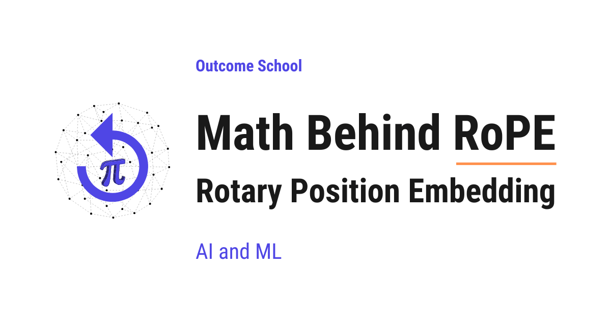

# What is RoPE (Rotary Position Embedding)? The Math Behind It

> Archived from <https://outcomeschool.com/blog/math-behind-rope-rotary-position-embedding> on 2026-11-25.

RoPE (Rotary Position Embedding) is a way to give position information to a Transformer. It rotates the Query (Q) and Key (K) vectors by an angle that depends on the token&#x27;s position, so that attention depends on the relative distance between tokens.

In this blog, we will learn about the math behind Rotary Position Embedding (RoPE) and why it is used in modern Large Language Models.

Today, we will cover the following topics:
<ul><li>The Big Picture</li><li>Why a Transformer Needs Position Information</li><li>Older Approaches and Their Problems</li><li>The Core Idea Behind RoPE</li><li>The 2D Rotation Math</li><li>How RoPE Is Applied to Q and K</li><li>Why the Dot Product Captures Relative Position</li><li>A Small Numeric Example</li><li>Real-World Use Cases</li><li>Quick Summary</li></ul>
I am <strong>Amit Shekhar</strong>, Founder @ <a target="_blank" rel="noopener noreferrer" href="https://outcomeschool.com">Outcome School</a>, I have taught and mentored many developers, and their efforts landed them high-paying tech jobs, helped many tech companies in solving their unique problems, and created many open-source libraries being used by top companies. I am passionate about sharing knowledge through open-source, blogs, and videos.

I teach <a target="_blank" rel="noopener noreferrer" href="https://outcomeschool.com/program/ai-and-machine-learning">AI and Machine Learning</a> at Outcome School.

Let&#x27;s get started.
<h2 id="the-big-picture">The Big Picture</h2>
Before we go into the details, let&#x27;s understand the big picture.

A Transformer reads all the tokens in a sentence at the same time. It does not know which word came first and which came last. So, we have to give it position information separately. RoPE is a clever way to do that. Instead of adding a position vector, RoPE <strong>rotates</strong> the Query and Key vectors based on their position. After the rotation, the dot product between any two tokens automatically reflects the relative distance between them.

In simple words:

<strong>RoPE = Rotate the Q and K vectors by an angle that depends on the token&#x27;s position.</strong>

This makes the attention score depend only on the relative distance between two tokens, which is exactly what we want.

We have a detailed blog on <a target="_blank" rel="noopener noreferrer" href="math-behind-attention-qkv.md">Math Behind Attention: Q, K, V</a> that explains how Q, K, and V are used inside attention.
<h2 id="why-a-transformer-needs-position-information">Why a Transformer Needs Position Information</h2>
A Transformer processes all the tokens in a sentence in parallel. It does not read them one by one like we do.

We have a detailed blog on <a target="_blank" rel="noopener noreferrer" href="decoding-transformer-architecture.md">Transformer Architecture</a> that explains how a Transformer works end to end.

Let&#x27;s see why this is a problem.

Consider these two sentences:
<ul><li>&quot;The cat chased the dog.&quot;</li><li>&quot;The dog chased the cat.&quot;</li></ul>
Both sentences contain the exact same words. The only difference is the order. To us, the meaning is completely different. But, to a raw Transformer, both look the same. It has no idea who chased whom.

We need to inject position information into the model so that it knows the order of the words.
<h2 id="older-approaches-and-their-problems">Older Approaches and Their Problems</h2>
There are two well-known older approaches to add position information.

<strong>Approach 1: Sinusoidal Positional Encoding.</strong> This is the original method from the &quot;Attention Is All You Need&quot; paper. We compute a fixed vector for each position using sine and cosine functions. We add this vector to the token embedding before feeding it into the model.

<strong>Approach 2: Learned Positional Embeddings.</strong> Instead of using a fixed formula, we let the model learn a separate embedding for each position. We add this learned vector to the token embedding.

Both approaches share two big problems.
<ul><li><strong>They use addition.</strong> The position vector is added to the token embedding. This mixes position information into the meaning of the word, and the two end up competing inside the same vector.</li><li><strong>They do not encode relative distance.</strong> With absolute positional embeddings, the model has to learn from scratch how every pair of positions relates. There is no built-in structure that says &quot;positions 5 and 10&quot; have the same relationship as &quot;positions 105 and 110&quot;.</li><li><strong>They struggle with longer sequences.</strong> If the model was trained on sequences of length 2048 and we suddenly give it 8192 tokens at inference time, learned embeddings have nothing to fall back on. Sinusoidal encoding can technically extrapolate, and the original &quot;Attention Is All You Need&quot; paper actually proposed it partly for this reason. But, later research showed that this property does not hold up well in practice.</li></ul>
We need a smarter way. We need a method that handles position more cleanly and works at any sequence length.

So, here comes <strong>RoPE</strong> to the rescue.
<h2 id="the-core-idea-behind-rope">The Core Idea Behind RoPE</h2>
The full form of RoPE is <strong>Rotary Position Embedding</strong>.

Let&#x27;s decompose the name:

<strong>RoPE = Rotary + Position + Embedding.</strong>
<ul><li><strong>Position</strong> means we are encoding the position of a token.</li><li><strong>Embedding</strong> means we are doing this inside the vector space the model uses. Learn more about Embeddings: <a target="_blank" rel="noopener noreferrer" href="https://www.youtube.com/watch?v=LedXW6xl21s">Embeddings in Machine Learning</a></li><li><strong>Rotary</strong> means we are using <strong>rotation</strong> as the encoding mechanism.</li></ul>
The idea is simple. Instead of adding a position vector to the token embedding, we <strong>rotate</strong> the Query and Key vectors by an angle that depends on the token&#x27;s position. The further along a token is in the sequence, the more we rotate its vector.

The magic is in the dot product. When we compute the attention score <code>Q · K</code>, the rotations combine in a way that the result depends only on the <strong>difference</strong> in positions between the two tokens, not on their absolute positions.

So, RoPE gives us <strong>relative position information for free</strong> through the dot product.

Let&#x27;s take a real-world analogy. Think of each pair of dimensions inside a token&#x27;s vector as a clock hand. (We will see in a later section that the vector is split into many such pairs, each acting as its own clock at its own speed.) A token at position 1 rotates the hand to &quot;1 o&#x27;clock&quot;. A token at position 5 rotates it to &quot;5 o&#x27;clock&quot;. When we compare two tokens, we are not asking &quot;where does each hand point?&quot; - we are asking &quot;how many hours apart are the two hands?&quot;. That is exactly the relative-position information attention needs.

<strong>Planning your move into AI?</strong>

No matter which tech domain you work in today, with your effort, you can transition to these roles:
<ul><li>AI Engineer</li><li>Forward Deployed Engineer</li><li>AI Agent Engineer</li><li>Harness Engineer</li><li>Voice AI Engineer</li><li>AI Architect</li><li>LLM Engineer</li><li>LLM Inference Engineer</li><li>Gen AI Engineer</li><li>MLOps Engineer</li><li>ML Engineer</li><li>Deep Learning Engineer</li></ul>
Our <a target="_blank" rel="noopener noreferrer" href="https://outcomeschool.com/program/ai-and-machine-learning">AI and Machine Learning Program</a> at Outcome School takes you there.
<h2 id="the-2d-rotation-math">The 2D Rotation Math</h2>
To understand RoPE, we must first understand how rotation works in 2D.

Suppose we have a 2D vector <code>v = [x, y]</code>. We want to rotate it by an angle <code>θ</code> (theta). The new vector <code>v&#x27;</code> is:

<pre><code class="code-highlight">x&#x27; = x * cos(θ) - y * sin(θ)
y&#x27; = x * sin(θ) + y * cos(θ)
</code></pre>

This is the standard 2D rotation. We can write it as a matrix multiplication:

<pre><code class="code-highlight">| x&#x27; |   | cos(θ)  -sin(θ) |   | x |
|    | = |                 | * |   |
| y&#x27; |   | sin(θ)   cos(θ) |   | y |
</code></pre>

That is the rotation matrix. It rotates any 2D vector by angle <code>θ</code> while keeping its length unchanged.

Here is a simple ASCII diagram showing the rotation.

<pre><code class="code-highlight">                  y
                  |
                  |     v&#x27;
                  |    /
                  |   /
                  |  /
                  | /  θ
                  |/___________ v
                  +------------- x
</code></pre>

Here, the vector <code>v</code> starts along the x-axis. After rotating by angle <code>θ</code>, it becomes <code>v&#x27;</code>. The length of the vector stays the same. Only the direction changes.

<strong>A quick note for you</strong>

No matter which tech domain you work in, get familiar with these topics:
<ul><li>LLM</li><li>RAG</li><li>MCP</li><li>Agent</li><li>Fine-tuning</li><li>Quantization</li></ul>
We put it all together in one video:

<a target="_blank" rel="noopener noreferrer" href="https://www.youtube.com/watch?v=lnfWvX66FUk">AI Engineering Explained: LLM, RAG, MCP, Agent, Fine-Tuning, and Quantization</a>

No need to stop reading - bookmark it and watch later when you get time. Future you will thank you.

Now, let&#x27;s get back to the topic.
<h2 id="how-rope-is-applied-to-q-and-k">How RoPE Is Applied to Q and K</h2>
Now, let&#x27;s see how this rotation is used inside attention.

We have a Query vector <code>Q</code> and a Key vector <code>K</code>. These are not 2D vectors. They have many dimensions, often 64 or 128.

RoPE works on these high-dimensional vectors by <strong>splitting them into pairs of 2D vectors</strong>. If <code>Q</code> has 64 dimensions, we treat it as 32 pairs of 2D vectors. Each pair gets its own rotation.

For a token at position <code>m</code>, RoPE rotates each pair by an angle <code>m * θ_i</code>, where <code>θ_i</code> is a fixed frequency that depends on which pair we are looking at.

Here is a simple ASCII diagram showing how a Q vector with <code>d = 8</code> dimensions is split and rotated.

<pre><code class="code-highlight">Q = [ q_1, q_2 | q_3, q_4 | q_5, q_6 | q_7, q_8 ]
      \______/   \______/   \______/   \______/
       pair 1     pair 2     pair 3     pair 4
         |           |           |           |
         v           v           v           v
      rotate      rotate      rotate      rotate
      by m*θ_1    by m*θ_2    by m*θ_3    by m*θ_4
      (fastest)                           (slowest)
</code></pre>

Here, the 8-dimensional vector is split into 4 pairs. Each pair is rotated by its own angle, and the rotation amount also scales with the token&#x27;s position <code>m</code>.

The standard formula for the frequencies is:

<pre><code class="code-highlight">θ_i = 10000^(-2(i-1)/d)    for i = 1, 2, ..., d/2
</code></pre>

Here, <code>d</code> is the per-head dimension. For the first pair this gives <code>θ_1 = 1</code> (largest, fastest rotation). For the last pair, with <code>d = 128</code> (a common per-head size), this gives <code>θ_(d/2) ≈ 0.0001</code> (smallest, slowest rotation). So, low-index pairs rotate fast and high-index pairs rotate slowly. This is similar to how sinusoidal positional encoding uses many frequencies, but here the frequencies are applied as <strong>rotations</strong>, not as added vectors.

<strong>Note:</strong> This formula is the exact knob that long-context techniques like <strong>YaRN</strong> and <strong>NTK-aware scaling</strong> tune. They modify these frequencies so a model trained on shorter sequences can handle much longer ones at inference.

After applying RoPE, the rotated <code>Q</code> for a token at position <code>m</code> is <code>R_m * Q</code>, where <code>R_m</code> is the rotation matrix for position <code>m</code>. Similarly, the <code>K</code> vector at position <code>n</code> gets its own rotation <code>R_n * K</code>.

<strong>Note:</strong> The original RoPE paper presents the splitting as consecutive pairs <code>(q_1, q_2), (q_3, q_4), ...</code> as shown above. In real-world implementations like LLaMA and Mistral, the splitting is done as <code>(q_i, q_(i + d/2))</code> - the first half of the vector paired with the second half. Both schemes are mathematically equivalent. They are just a permutation of dimensions, so the explanation here applies to either.

<strong>Note:</strong> RoPE is applied only to the Query and Key vectors. The Value vector <code>V</code> is left untouched. This is because the relative-position property we want comes from the <code>Q · K</code> dot product. The <code>V</code> vector is just the content being weighted by attention scores, so it does not need any position information.

To learn positional encodings, Q/K/V matrices, and the Transformer architecture in depth, check out our <a target="_blank" rel="noopener noreferrer" href="https://outcomeschool.com/program/ai-and-machine-learning">AI and Machine Learning Program</a> at Outcome School.
<h2 id="why-the-dot-product-captures-relative-position">Why the Dot Product Captures Relative Position</h2>
This is where the magic happens.

When we compute the attention score between a query at position <code>m</code> and a key at position <code>n</code>, we calculate:

<pre><code class="code-highlight">score = (R_m * Q) · (R_n * K)
</code></pre>

Because of how rotation matrices work, this expression simplifies to:

<pre><code class="code-highlight">score = Q · (R_(n-m) * K)
</code></pre>

This works because rotation matrices are orthogonal, which means <code>R_m^T = R_(-m)</code>. The intuition is simple: rotating by <code>-m</code> undoes a rotation by <code>m</code>. So, rotating by <code>-m</code> and then by <code>n</code> combines into a single rotation by <code>n - m</code>. The full derivation is just one line of matrix algebra:

<pre><code class="code-highlight">(R_m * Q) · (R_n * K) = Q^T * R_m^T * R_n * K
                      = Q^T * R_(-m) * R_n * K
                      = Q^T * R_(n-m) * K
                      = Q · (R_(n-m) * K)
</code></pre>

The <code>m</code> rotation on <code>Q</code> effectively cancels, leaving a single net rotation by <code>n - m</code> on <code>K</code>.

The score depends only on <code>n - m</code>, which is the <strong>relative distance</strong> between the two tokens. The absolute positions <code>m</code> and <code>n</code> disappear from the formula.

This is the beauty of RoPE. The model does not see &quot;token at position 5&quot; and &quot;token at position 12&quot;. Instead, it sees &quot;these two tokens are 7 positions apart&quot;. This relative view of position is exactly what attention needs.

Let&#x27;s see why this matters with a concrete example. Consider these two sentences:
<ul><li>&quot;The cat sat on the mat.&quot;</li><li>&quot;Yesterday, the cat sat on the mat.&quot;</li></ul>
In sentence 1, &quot;cat&quot; is at position 2 and &quot;mat&quot; is at position 6. The distance between them is 4.

In sentence 2, &quot;cat&quot; is at position 3 and &quot;mat&quot; is at position 7. The distance is again 4.

The relationship between &quot;cat&quot; and &quot;mat&quot; is identical in both sentences. They are 4 words apart, and the meaning of how they relate is the same. The fact that the whole sentence shifted by one word does not change anything about how &quot;cat&quot; relates to &quot;mat&quot;.

Now, what if we used absolute positions instead? The model would have to separately learn:
<ul><li>How (cat at pos 2) relates to (mat at pos 6)</li><li>How (cat at pos 3) relates to (mat at pos 7)</li><li>How (cat at pos 100) relates to (mat at pos 104)</li><li>And so on, for every possible pair</li></ul>
That is wasteful. All of these are the same relationship - &quot;two specific words, 4 positions apart&quot;. RoPE lets the model learn this once, and reuse it everywhere.

Going back to our clock analogy, when we look at two clock hands, we do not need to know what time each one shows individually. We only care about the angle between them. RoPE gives the model the same view of position.

<strong>Note:</strong> This relative-position property comes out of the math automatically. We did not design the model to learn relative positions. The rotation operation gives it to us for free.

<strong>Stay updated:</strong> Subscribe to our <a target="_blank" rel="noopener noreferrer" href="https://outcomeschool.substack.com/subscribe">newsletter</a> to get our latest AI and Machine Learning blogs straight to your inbox.
<h2 id="a-small-numeric-example">A Small Numeric Example</h2>
Let&#x27;s put this into perspective with a small example.

Suppose we have a 2D Query vector <code>Q = [1, 0]</code> for the token at position <code>m = 1</code>. Let <code>θ = π / 4</code> (45 degrees).

The rotation matrix at position 1 is:

<pre><code class="code-highlight">R_1 = | cos(π/4)  -sin(π/4) |   | 0.707  -0.707 |
      |                     | = |               |
      | sin(π/4)   cos(π/4) |   | 0.707   0.707 |
</code></pre>

The rotated Query is:

<pre><code class="code-highlight">R_1 * Q = | 0.707  -0.707 |   | 1 |   | 0.707 |
          |               | * |   | = |       |
          | 0.707   0.707 |   | 0 |   | 0.707 |
</code></pre>

Now, suppose we have a Key vector <code>K = [1, 0]</code> at position <code>n = 2</code>. The rotation angle is <code>2 * π/4 = π/2</code>.

<pre><code class="code-highlight">R_2 = | cos(π/2)  -sin(π/2) |   | 0  -1 |
      |                     | = |       |
      | sin(π/2)   cos(π/2) |   | 1   0 |
</code></pre>

The rotated Key is:

<pre><code class="code-highlight">R_2 * K = | 0  -1 |   | 1 |   | 0 |
          |       | * |   | = |   |
          | 1   0 |   | 0 |   | 1 |
</code></pre>

The attention score is the dot product:

<pre><code class="code-highlight">score = (R_1 * Q) · (R_2 * K)
      = 0.707 * 0 + 0.707 * 1
      = 0.707
</code></pre>

So, the score for two tokens at a relative distance of <code>1</code> is <code>0.707</code>.

Now, let&#x27;s verify the relative-position property. Let&#x27;s pick a different pair with the same relative distance: <code>m = 2, n = 3</code>.

The rotated Query at position 2 uses the same <code>R_2</code> matrix from before:

<pre><code class="code-highlight">R_2 * Q = | 0  -1 |   | 1 |   | 0 |
          |       | * |   | = |   |
          | 1   0 |   | 0 |   | 1 |
</code></pre>

The rotated Key at position 3 uses angle <code>3 * π/4</code>:

<pre><code class="code-highlight">R_3 * K = | cos(3π/4)  -sin(3π/4) |   | 1 |   | -0.707 |
          |                       | * |   | = |        |
          | sin(3π/4)   cos(3π/4) |   | 0 |   |  0.707 |
</code></pre>

The attention score:

<pre><code class="code-highlight">score = (R_2 * Q) · (R_3 * K)
      = 0 * (-0.707) + 1 * 0.707
      = 0.707
</code></pre>

The score is <code>0.707</code> again. The absolute positions changed from <code>(1, 2)</code> to <code>(2, 3)</code>, but the relative distance stayed at <code>1</code>, so the score stayed at <code>0.707</code>. This is exactly the property RoPE was designed to give us.
<h2 id="real-world-use-cases">Real-World Use Cases</h2>
RoPE has become the standard for positional encoding in modern Large Language Models. Let&#x27;s see where RoPE is used in practice.
<ul><li><strong>LLaMA family.</strong> All LLaMA models from Meta use RoPE.</li><li><strong>Mistral and Mixtral.</strong> Both use RoPE for positional encoding.</li><li><strong>Qwen.</strong> Alibaba&#x27;s Qwen models use RoPE.</li><li><strong>DeepSeek.</strong> DeepSeek models use RoPE as well.</li><li><strong>Gemma.</strong> Google&#x27;s open-weight Gemma models use RoPE.</li></ul>
<strong>Note:</strong> RoPE is also the foundation for many long-context techniques. Methods like <strong>YaRN</strong>, <strong>Position Interpolation</strong>, and <strong>NTK-aware scaling</strong> all extend RoPE so that a model trained on, say, 4K tokens can be used on 32K or 128K tokens at inference time. None of this would be possible if we were still using learned positional embeddings.
<h2 id="quick-summary">Quick Summary</h2>
Let&#x27;s recap what we have decoded:
<ul><li><strong>A Transformer reads all tokens in parallel.</strong> It does not naturally know the order of words, so we must inject position information.</li><li><strong>Older methods add a position vector to the token embedding.</strong> Sinusoidal encoding and learned embeddings lack built-in relative-distance structure and struggle with longer sequences.</li><li><strong>RoPE rotates the Q and K vectors instead of adding to them.</strong> The rotation angle depends on the token&#x27;s position.</li><li><strong>The high-dimensional vector is split into pairs.</strong> Each pair is rotated by its own frequency.</li><li><strong>The dot product of two rotated vectors depends only on relative position.</strong> This gives us relative position information for free.</li><li><strong>No learned parameters.</strong> RoPE itself introduces no additional learned parameters, unlike learned positional embeddings.</li><li><strong>RoPE is the standard in modern LLMs.</strong> LLaMA, Mistral, Qwen, DeepSeek, and Gemma all use it.</li><li><strong>RoPE makes long-context extension possible.</strong> Techniques like YaRN and Position Interpolation rely on RoPE&#x27;s structure.</li></ul>
This is how RoPE gives modern Large Language Models a clean, scalable, and elegant way to understand position.
<h2 id="frequently-asked-questions">Frequently Asked Questions</h2><h3 id="is-rope-applied-to-the-value-vector-too">Is RoPE applied to the Value vector too?</h3>
No. RoPE is applied only to the Query and Key vectors, and the Value vector is left untouched. The relative-position property comes from the <code>Q · K</code> dot product. The Value vector is just the content being weighted by the attention scores, so it does not need any position information.
<h3 id="does-rope-add-any-learned-parameters-to-the-model">Does RoPE add any learned parameters to the model?</h3>
No. RoPE itself introduces no additional learned parameters. The rotation angles come from a fixed frequency formula and the token&#x27;s position. This is different from learned positional embeddings, where the model learns a separate embedding for each position.
<h3 id="can-a-model-with-rope-handle-longer-text-than-it-was-trained-on">Can a model with RoPE handle longer text than it was trained on?</h3>
Yes, with the help of long-context techniques built on top of RoPE. Methods like YaRN, Position Interpolation, and NTK-aware scaling extend RoPE so that a model trained on, say, 4K tokens can be used on 32K or 128K tokens at inference time.
<h3 id="does-rotating-the-query-and-key-vectors-change-their-length">Does rotating the Query and Key vectors change their length?</h3>
No. A rotation keeps the length of the vector unchanged, and only its direction changes. RoPE uses this rotation as the encoding mechanism, instead of adding a position vector that mixes position into the meaning of the word.
<h3 id="does-it-matter-how-the-vector-is-split-into-pairs">Does it matter how the vector is split into pairs?</h3>
No. The original RoPE paper splits the vector into consecutive pairs, while implementations like LLaMA and Mistral pair the first half of the vector with the second half. Both schemes are mathematically equivalent, since they are just a permutation of dimensions.

That&#x27;s it for now.

Thanks

<strong>Amit Shekhar</strong> Founder @ <a target="_blank" rel="noopener noreferrer" href="https://outcomeschool.com">Outcome School</a>

You can connect with me on:
<ul><li><a target="_blank" rel="noopener noreferrer" href="https://x.com/amitiitbhu">X</a></li><li><a target="_blank" rel="noopener noreferrer" href="https://www.linkedin.com/in/amit-shekhar-iitbhu">LinkedIn</a></li><li><a target="_blank" rel="noopener noreferrer" href="https://github.com/amitshekhariitbhu">GitHub</a></li></ul>
Follow Outcome School on:
<ul><li><a target="_blank" rel="noopener noreferrer" href="https://x.com/outcome_school">X</a></li><li><a target="_blank" rel="noopener noreferrer" href="https://youtube.com/@OutcomeSchool">YouTube</a></li><li><a target="_blank" rel="noopener noreferrer" href="https://www.linkedin.com/company/outcomeschool">LinkedIn</a></li><li><a target="_blank" rel="noopener noreferrer" href="https://github.com/OutcomeSchool">GitHub</a></li></ul>
<a target="_blank" rel="noopener noreferrer" href="https://outcomeschool.com/blog"><strong>Read all of our high-quality blogs here.</strong></a>

