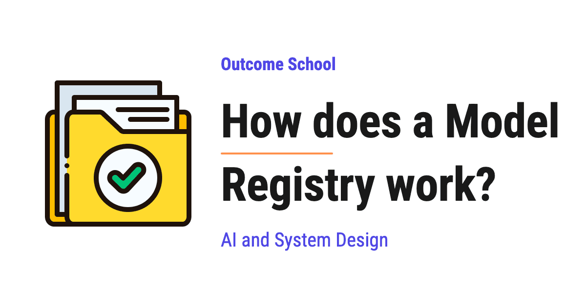

# How does a Model Registry work?

> Archived from <https://outcomeschool.com/blog/model-registry> on 2026-11-25.

A Model Registry is a central catalog that stores and tracks all our trained model versions in one place, so that the right model goes to production.

In this blog, we will learn about how a Model Registry works. We will also see what problem it solves, what it stores about each model version, how lineage tracks where a model came from, how stages like Staging and Production help us, how it connects to serving, and how a real tool like MLflow does it.

We will cover the following:
<ul><li>What is a trained model and a model version?</li><li>The problem before a Model Registry</li><li>What is a Model Registry?</li><li>What a Model Registry stores about each model version</li><li>Lineage: tracking where a model came from</li><li>Stages: Staging, Production, and Archived</li><li>How a Model Registry connects to serving</li><li>Example: MLflow Model Registry</li></ul>
I am <strong>Amit Shekhar</strong>, Founder @ <a target="_blank" rel="noopener noreferrer" href="https://outcomeschool.com">Outcome School</a>, I have taught and mentored many developers, and their efforts landed them high-paying tech jobs, helped many tech companies in solving their unique problems, and created many open-source libraries being used by top companies. I am passionate about sharing knowledge through open-source, blogs, and videos.

I teach <a target="_blank" rel="noopener noreferrer" href="https://outcomeschool.com/program/ai-and-machine-learning">AI and Machine Learning</a> at Outcome School.

Let&#x27;s get started.
<h3 id="what-is-a-trained-model-and-a-model-version">What is a trained model and a model version?</h3>
Before jumping into the Model Registry, we must understand two words: a trained model and a model version.

When we finish training, we get a file (or a set of files) that holds everything the model learned. This file is called the <strong>model artifact</strong>. It is the model saved to disk, ready to be loaded and used later.

We almost never train a model just once. We train it, look at the results, change something, and train it again. Each time we train, we get a new artifact. Each of these is a <strong>model version</strong>.

So, a model version is one specific trained copy of a model, produced at one specific time, with specific settings.

Let&#x27;s say we are building a model that tells whether a photo shows a cat or a dog. We train it a few times:
<ul><li>Version 1: trained on 10,000 photos.</li><li>Version 2: trained on 50,000 photos.</li><li>Version 3: trained on 50,000 photos but with a setting that made it learn slower and more carefully.</li></ul>
Each of these is a separate version, a separate artifact file, and each one behaves a little differently.

Over weeks and months, a team can produce hundreds of these versions.
<h3 id="the-problem-before-a-model-registry">The problem before a Model Registry</h3>
Let&#x27;s understand the problem we face when we do not have a Model Registry.

Imagine a small team training models every day. Each person saves their trained model wherever is convenient. One saves it on their laptop. Another saves a shared file named <code>model_final.bin</code>. Another saves <code>model_final_v2_real.bin</code>. A few days later, nobody remembers which file was which.

This leads to the following problems:
<ul><li><strong>Too many experiments, too many versions:</strong> We trained the model fifty times this month. The files are scattered with confusing names, and we cannot tell them apart.</li><li><strong>No clear production model:</strong> When something goes wrong, the first question is always &quot;which exact model is serving users right now?&quot; Without a central place to look, nobody knows for sure.</li><li><strong>No reproducibility:</strong> Reproducibility means being able to recreate the same result later. Six months from now, someone asks &quot;how did we build the model that is live?&quot; If we did not record the data, the settings, and the code that produced it, we cannot rebuild it.</li><li><strong>No safe way to go back:</strong> Suppose the new model we deployed starts making bad predictions. We want to quickly switch back to the previous good model. But if we do not even know which file was the previous good one, going back is slow and risky.</li></ul>
We can see this in a diagram like below:

<pre><code class="language-text code-highlight">Priya&#x27;s laptop     Shared drive               Ravi&#x27;s laptop
--------------     ------------------------   -----------------------
model.bin          model_final.bin            best_model.bin
model_new.bin      model_final_v2_real.bin    model_v2_real_final.bin
final.bin

Which one is live? Which one is best? Where did each come from?
</code></pre>

Here, we can notice that the model files are scattered across different machines with confusing names, and there is no single place that tells us which one is live, which one is best, or where each one came from.

So, the core problem is that our models are scattered, unlabeled, and untracked. We have no single trusted place that answers &quot;what models do we have, which one is live, and where did each one come from?&quot;

So, here comes the Model Registry to the rescue.
<h3 id="what-is-a-model-registry">What is a Model Registry?</h3>
Now that we understand the problem, let&#x27;s understand the solution.

<strong>A Model Registry is a central catalog that stores and tracks all of our trained model versions in one organized place.</strong>

Each model version in it is recorded with a name, a number, and useful information about it.

A <strong>catalog</strong> is an organized list of things, like the catalog in a library. Suppose we run a library. We do not throw books into a heap on the floor. We give each book an entry: its title, its author, when it arrived, and which shelf it sits on. Anyone can walk in, look up the catalog, and find the exact book. A Model Registry does the same for models. It does not dump the files in a pile. Each model version gets an entry with a number, and we can always look it up.

So, a Model Registry answers, in one place, the questions we could not answer before: what models do we have, which version is which, which one is live, and where did each one come from.

<strong>Planning your move into AI?</strong>

No matter which tech domain you work in today, with your effort, you can transition to these roles:
<ul><li>AI Engineer</li><li>Forward Deployed Engineer</li><li>AI Agent Engineer</li><li>Harness Engineer</li><li>Voice AI Engineer</li><li>AI Architect</li><li>LLM Engineer</li><li>LLM Inference Engineer</li><li>Gen AI Engineer</li><li>MLOps Engineer</li><li>ML Engineer</li><li>Deep Learning Engineer</li></ul>
Our <a target="_blank" rel="noopener noreferrer" href="https://outcomeschool.com/program/ai-and-machine-learning">AI and Machine Learning Program</a> at Outcome School takes you there.

Now, let&#x27;s see exactly what it records.
<h3 id="what-a-model-registry-stores-about-each-model-version">What a Model Registry stores about each model version</h3>
A Model Registry does not only store the model artifact. The artifact alone is just a file. The real value is the information stored alongside it, called <strong>metadata</strong>.

<strong>Metadata is data about the model: facts that describe and explain it.</strong>

In simple words, the artifact is the model itself, and the metadata is the label that tells us everything we need to know about that model.

For each model version, a Model Registry typically stores the following:
<ul><li><strong>The artifact location:</strong> This is the address where the actual model file is saved, for example a path in cloud storage. Often the registry does not hold the big file itself. It holds a pointer that says &quot;the real file lives over there.&quot; Either way, from the registry we can always reach the file.</li><li><strong>Metrics:</strong> These are the numbers that tell us how good the model is, for example &quot;it was correct 94 percent of the time.&quot; Metrics let us compare versions and pick the best one.</li><li><strong>Parameters:</strong> These are the settings we chose for training, for example how many photos we trained on or how carefully the model learned. These settings explain why a version behaves the way it does.</li><li><strong>Training data reference:</strong> This records which exact data was used to train this version. It is usually a reference, which means a pointer to the dataset, not a copy of all the data.</li><li><strong>Who and when:</strong> This records the person who created this version and the date and time it was created. So we always know who made it and when.</li></ul>
Let&#x27;s see a simple picture of one entry in the registry, as below:

<pre><code class="language-text code-highlight">MODEL: cat-or-dog-classifier
  Version 3
  --------------------------------------------------
  Artifact location : s3://our-models/cat-dog/v3/model.bin
  Metrics           : accuracy = 94%
  Parameters        : photos = 50,000 , learning speed = slow
  Training data     : dataset &quot;pet-photos-2026-05&quot;
  Created by        : Priya
  Created on        : 2026-05-20 10:15
  Stage             : Production
</code></pre>

Here, we can see that one model version is not just a file. It is a complete record. We can look at this single entry and instantly know how good the model is, how it was trained, which data it used, who built it, when, and whether it is live. This is exactly the information we were missing before.

<strong>A quick note for you</strong>

No matter which tech domain you work in, get familiar with these topics:
<ul><li>LLM</li><li>RAG</li><li>MCP</li><li>Agent</li><li>Fine-tuning</li><li>Quantization</li></ul>
We put it all together in one video:

<a target="_blank" rel="noopener noreferrer" href="https://www.youtube.com/watch?v=lnfWvX66FUk">AI Engineering Explained: LLM, RAG, MCP, Agent, Fine-Tuning, and Quantization</a>

No need to stop reading - bookmark it and watch later when you get time. Future you will thank you.

Now, let&#x27;s get back to the topic.
<h3 id="lineage-tracking-where-a-model-came-from">Lineage: tracking where a model came from</h3>
Now, let&#x27;s learn one more important idea, called lineage.

<strong>Lineage is the recorded trail of where a model came from, all the ingredients that went into making it.</strong>

In simple words, lineage answers the question &quot;how exactly was this model produced?&quot; by linking the model version back to the data, the settings, and the code that created it.

Let&#x27;s use a food analogy. Suppose we taste a delicious cake and want to make it again. We need the recipe: the exact ingredients, the exact amounts, and the exact steps. Lineage is the recipe for a model. It connects the final model back to its training data, its parameters, and the code version that produced it.

We can see how lineage links a model version back to its ingredients in a diagram like below:

<pre><code class="language-text code-highlight">              Model version 3
                     ↓
         Lineage links it back to
                     ↓
     +---------------+---------------+
     ↓               ↓               ↓
Training data   Parameters     Code version
 (dataset)      (settings)       (program)
</code></pre>

Here, we can see that the model version is linked back to the three ingredients that produced it: the training data, the parameters, and the code version. Following these links is like reading the recipe, so we can recreate the exact same model whenever we need to.

This is what gives us reproducibility. Because the lineage is recorded, six months later we can look at the live model, follow its lineage back to the exact data and settings, and rebuild the same model from scratch.

To learn Data Management and Versioning, along with Model Development and Training, check out our <a target="_blank" rel="noopener noreferrer" href="https://outcomeschool.com/program/ai-and-machine-learning">AI and Machine Learning Program</a> at Outcome School.
<h3 id="stages-staging-production-and-archived">Stages: Staging, Production, and Archived</h3>
Now, we have many versions recorded. But we still need to know which version is being tested, which one is live, and which ones are old. A Model Registry handles this using <strong>stages</strong>.

<strong>A stage is a label on a model version that tells us where that version is in its life: being tested, live for users, or retired.</strong>

So, a stage is a status tag we attach to a version. The common stages are these:
<ul><li><strong>Staging:</strong> This means the version is being tested before it goes live. We try the model here, check that it behaves well, and make sure it is safe before real users touch it.</li><li><strong>Production:</strong> This means the version is live and serving real users right now. Only one version is usually in Production at a time, so the answer to &quot;which model is live?&quot; is always clear.</li><li><strong>Archived:</strong> This means the version is retired and no longer in use, but we keep it on record. We do not delete it. We mark it as old.</li></ul>
Moving a version from one stage to another is called <strong>promoting</strong>. For example, when a model passes its tests, we promote it from Staging to Production. This is the moment we decide &quot;this version is now the one serving users.&quot;

We can see how a version moves through the stages in a diagram like below:

<pre><code class="language-text code-highlight">New version trained
        ↓
Staging
        ↓
Passes tests, promote
        ↓
Production (live for users)
        ↓
A newer version takes over
        ↓
Archived (kept on record)
</code></pre>

Here, we can see that a version starts in Staging, gets promoted to Production once it passes its tests, and is later moved to Archived when a newer version replaces it. At every moment, the stage label tells us exactly where each version stands.

Stages also make rolling back easy. Suppose we promote Version 3 to Production and it starts making bad predictions. Because Version 2 is still recorded in the registry, we can promote Version 2 back to Production. This is called a <strong>rollback</strong>, which means returning to a previous good version. We do not need to retrain anything or search for a lost file.

So, stages give us a clear, safe way to promote a version forward and to roll back when something goes wrong.

<strong>Stay updated:</strong> Subscribe to our <a target="_blank" rel="noopener noreferrer" href="https://outcomeschool.substack.com/subscribe">newsletter</a> to get our latest AI and Machine Learning blogs straight to your inbox.
<h3 id="how-a-model-registry-connects-to-serving">How a Model Registry connects to serving</h3>
Now, let&#x27;s see how the registry helps when we put a model live. <strong>Serving</strong> is the system that loads a model and uses it to make predictions for real users.

Instead of the serving system pointing at some random file on someone&#x27;s laptop, it pulls a specific model version from the registry. Usually, it pulls whichever version is currently in the Production stage.

We have a detailed blog on <a target="_blank" rel="noopener noreferrer" href="model-serving.md">Model Serving</a> that explains how serving works end to end.

Let&#x27;s walk through it step by step.

<strong>Step 1:</strong> We train a new model and register it. The registry records it as a new version with all its metadata and lineage.

<strong>Step 2:</strong> We promote that version to Staging and test it. If it behaves well, we promote it to Production.

<strong>Step 3:</strong> The serving system asks the registry, &quot;give me the version in Production for this model.&quot; The registry hands over the exact artifact location, and the serving system loads that exact version. If that version later misbehaves, we promote the previous good version back to Production, and the serving system loads the good version again.

We can see this connection in a diagram like below:

<pre><code class="language-text code-highlight">Serving system asks: &quot;Give me the Production version&quot;
                          ↓
Model Registry returns the exact version and its artifact location
                          ↓
Serving system loads that file from artifact storage
                          ↓
Serving system answers users
</code></pre>

Here, we can see that the serving system does not guess which model to use. It asks the registry for the Production version, the registry returns the exact version and where its file lives, and the serving system loads precisely that one. Because the registry is the single source of truth, the answer to &quot;which model is live?&quot; is always exact and reliable.

So, the registry and serving work together. We control which version is live just by changing its stage in the registry, and serving follows along.
<h3 id="example-mlflow-model-registry">Example: MLflow Model Registry</h3>
Let&#x27;s look at a real example.

<strong>MLflow</strong> is a popular open-source tool used in machine learning, and it includes a feature called the <strong>MLflow Model Registry</strong>. This is exactly the kind of central catalog we have been describing.

With the MLflow Model Registry, a team can register a trained model under a name, and MLflow gives it a version number automatically. Each version keeps its metrics, its parameters, its lineage back to the run that produced it, and a record of who created it and when. To label and promote versions, current MLflow uses <strong>aliases</strong> and <strong>tags</strong> instead of fixed stages. An alias is a movable name we point at one version, for example a <code>champion</code> alias for the version that is live, written as <code>@champion</code>. A tag is a small label we attach to a version, such as marking it as tested. The serving side can ask MLflow for a specific version number, or for whatever version an alias like <code>@champion</code> currently points to. So when we promote a new version, we move the <code>champion</code> alias to it, and serving follows along.

<strong>Note:</strong> The older Staging, Production, and Archived stages are now deprecated in MLflow in favor of these aliases and tags, so newer projects use aliases and tags.

Now we must have understood how a Model Registry works and how it makes sure the right model goes live.
<h2 id="frequently-asked-questions">Frequently Asked Questions</h2><h3 id="does-a-model-registry-store-the-actual-model-file">Does a Model Registry store the actual model file?</h3>
Not always. Often the registry does not hold the big model file itself. It holds the artifact location, a pointer to where the file is saved, for example a path in cloud storage. Either way, from the registry we can always reach the file, along with its metrics, parameters, training data reference, and who created it and when.
<h3 id="what-is-the-difference-between-a-model-artifact-and-model-metadata">What is the difference between a model artifact and model metadata?</h3>
The model artifact is the model itself, the file saved to disk that holds everything the model learned. The metadata is data about the model, such as its metrics, parameters, training data reference, and who created it and when. The artifact alone is just a file. The real value comes from the metadata stored alongside it.
<h3 id="how-do-we-roll-back-a-bad-model-using-a-model-registry">How do we roll back a bad model using a Model Registry?</h3>
We promote the previous good version back to Production. Because the older version is still recorded in the registry, we do not need to retrain anything or search for a lost file. The serving system asks the registry for the Production version, so it simply loads the good version again.
<h3 id="does-mlflow-still-use-staging-and-production-stages">Does MLflow still use Staging and Production stages?</h3>
No. The older Staging, Production, and Archived stages are now deprecated in MLflow in favor of aliases and tags. An alias is a movable name we point at one version, for example a champion alias for the live version. When we promote a new version, we move the alias to it, and serving follows along.

That&#x27;s it for now.

Thanks

<strong>Amit Shekhar</strong> Founder @ <a target="_blank" rel="noopener noreferrer" href="https://outcomeschool.com">Outcome School</a>

You can connect with me on:
<ul><li><a target="_blank" rel="noopener noreferrer" href="https://x.com/amitiitbhu">X</a></li><li><a target="_blank" rel="noopener noreferrer" href="https://www.linkedin.com/in/amit-shekhar-iitbhu">LinkedIn</a></li><li><a target="_blank" rel="noopener noreferrer" href="https://github.com/amitshekhariitbhu">GitHub</a></li></ul>
Follow Outcome School on:
<ul><li><a target="_blank" rel="noopener noreferrer" href="https://x.com/outcome_school">X</a></li><li><a target="_blank" rel="noopener noreferrer" href="https://youtube.com/@OutcomeSchool">YouTube</a></li><li><a target="_blank" rel="noopener noreferrer" href="https://www.linkedin.com/company/outcomeschool">LinkedIn</a></li><li><a target="_blank" rel="noopener noreferrer" href="http://github.com/OutcomeSchool">GitHub</a></li></ul>
<a target="_blank" rel="noopener noreferrer" href="https://outcomeschool.com/blog"><strong>Read all of our high-quality blogs here.</strong></a>

