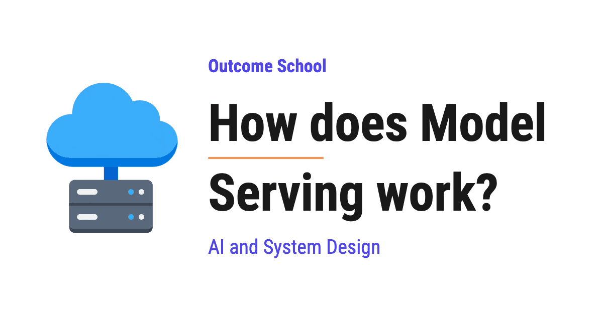

# How does Model Serving work?

> Archived from <https://outcomeschool.com/blog/model-serving> on 2026-11-25.

Model Serving means taking a trained model and making it available behind an API, so that applications can send input and get back predictions in real time.

In this blog, we will learn about how Model Serving works. We will also see why we need it, what happens step by step when a request comes in, how batching and replicas make it fast and scalable, online serving vs batch serving, and how monitoring and versioning keep it reliable.

We will cover the following:
<ul><li>What is Model Serving?</li><li>Why we need Model Serving</li><li>The steps inside Model Serving</li><li>Loading the model weights into memory</li><li>Batching requests together for the GPU</li><li>Latency vs throughput</li><li>Scaling with replicas and a load balancer</li><li>Online serving vs batch serving</li><li>Serving frameworks</li><li>Monitoring and versioning</li></ul>
I am <strong>Amit Shekhar</strong>, Founder @ <a target="_blank" rel="noopener noreferrer" href="https://outcomeschool.com">Outcome School</a>, I have taught and mentored many developers, and their efforts landed them high-paying tech jobs, helped many tech companies in solving their unique problems, and created many open-source libraries being used by top companies. I am passionate about sharing knowledge through open-source, blogs, and videos.

I teach <a target="_blank" rel="noopener noreferrer" href="https://outcomeschool.com/program/ai-and-machine-learning">AI and Machine Learning</a> at Outcome School.

Let&#x27;s get started.
<h3 id="what-is-model-serving">What is Model Serving?</h3>
<strong>Model Serving means taking a trained model and making it available behind an API, so that applications can send input and get back predictions in real time.</strong>

In simple words, Model Serving connects a trained model sitting on a disk to the real users who want answers from it.

So, Model Serving puts our model behind an API. Any application, a website, a mobile app, or another server, can send some input to this API and receive a prediction. Running the model on a new input to get a prediction is called <strong>inference</strong>. Model Serving is the way we run inference for real users, in real time.

Let&#x27;s say we trained a model that looks at a photo and tells us whether it is a cat or a dog. By itself, the model is just a file sitting on a computer. It cannot do anything useful for a user. Model Serving wraps that file inside a running program, opens an API for it, and now a photo app can send a photo and instantly get back &quot;cat&quot; or &quot;dog&quot;.

We have a detailed blog on <a target="_blank" rel="noopener noreferrer" href="cloud-vs-on-device-model-deployment.md">Cloud vs On-device Model Deployment</a> that explains when a model should run on a far-away server and when it should run on the device itself.

Now, the question is, why do we need a separate system for this? Let&#x27;s see.
<h3 id="why-we-need-model-serving">Why we need Model Serving</h3>
A trained model file on its own cannot serve users. Many things have to happen around it before it becomes useful.

Let&#x27;s list the problems we face if we have just the model file and nothing else.
<ul><li><strong>The model file cannot accept requests.</strong> It is just data. It has no way to listen for users.</li><li><strong>The model is slow to start.</strong> A large model takes time and a lot of memory to load. We cannot load it fresh for every single request.</li><li><strong>Many users come at the same time.</strong> A real app may get thousands of requests per second. One model copy cannot handle all of them alone.</li><li><strong>The input is not ready to use.</strong> A user sends a raw photo or raw text. The model expects the input in a specific numeric form. Someone has to convert it.</li><li><strong>We must keep it running and healthy.</strong> If the model crashes, users get errors. We need something watching over it.</li></ul>
So, here comes Model Serving to the rescue. Model Serving is the system that solves all of these problems around the model, so the model can focus on just one job, which is making predictions.

To learn Model Deployment and Serving, along with Monitoring and Logging, check out our <a target="_blank" rel="noopener noreferrer" href="https://outcomeschool.com/program/ai-and-machine-learning">AI and Machine Learning Program</a> at Outcome School.
<h3 id="the-steps-inside-model-serving">The steps inside Model Serving</h3>
Now, let&#x27;s see what happens, step by step, when a request comes in.

There are six main steps.

<strong>Step 1 (Load the model weights into memory):</strong> When the serving program starts, it reads the trained model from disk and puts it into memory, often onto a <a target="_blank" rel="noopener noreferrer" href="how-does-a-gpu-work-for-deep-learning.md">GPU</a>. This happens once at startup.

<strong>Step 2 (Expose an endpoint):</strong> The program opens an API address, called an <strong>endpoint</strong>, where applications can send their requests.

<strong>Step 3 (Accept a request):</strong> A user&#x27;s application sends some input to the endpoint, for example a photo or a sentence.

<strong>Step 4 (Preprocess the input):</strong> The raw input is converted into the numeric form the model expects. This is called <strong>preprocessing</strong>.

<strong>Step 5 (Run the forward pass):</strong> The model takes the prepared input and computes the prediction. This computation is called the <strong>forward pass</strong>, which is the model running its math from input to output.

<strong>Step 6 (Postprocess and return the result):</strong> The raw output of the model is turned into a clean, human-friendly answer. This is called <strong>postprocessing</strong>. Then the answer is sent back through the endpoint to the application.

We can see this whole flow in a diagram like below:

<pre><code class="language-text code-highlight">User app sends a photo
          ↓
Endpoint receives it
          ↓
Preprocess (photo into numbers)
          ↓
Forward pass (model runs its math)
          ↓
Postprocess (numbers into &quot;cat&quot; or &quot;dog&quot;)
          ↓
Reply goes back to the app
</code></pre>

Here, we can see that the request travels in a straight line. It enters through the endpoint, gets prepared, runs through the model, gets cleaned up, and comes back out as a clean answer. The user only sees the input going in and the answer coming out. All the middle work is hidden inside the serving system.

This is how a single request is handled. Now, let&#x27;s understand the most important steps in detail, starting with loading the model.
<h3 id="loading-the-model-weights-into-memory">Loading the model weights into memory</h3>
We just said the model is loaded into memory at startup. Let&#x27;s understand this properly.

<strong>Model weights are the numbers the model learned during training. They are the actual knowledge of the model.</strong>

When a model trains, all that learning is stored as a huge list of numbers called weights. A small model may have a few million weights. A large language model may have billions of weights.

To make predictions, the model needs all these weights ready in fast memory. Reading them from the disk for every request would be far too slow. So, we load them once when the serving program starts, and then keep them sitting in memory, ready to use.

For large models, these weights are loaded onto a <strong>GPU</strong>. A GPU can do thousands of math operations at the same time. Since a forward pass is mostly multiplications and additions, a GPU is a good fit for it.

We can see this in a diagram like below:

<pre><code class="language-text code-highlight">At startup (once):

Model file on disk
        ↓
Weights loaded on the GPU

For each request (many times):

Input
  ↓
GPU runs the math using the loaded weights
  ↓
Prediction
</code></pre>

Here, we can see that loading is a one-time cost that happens at startup. After that, the GPU already holds the weights, so every request can be answered quickly without touching the disk again. This is why a served model feels fast even though the model itself is huge.

<strong>Planning your move into AI?</strong>

No matter which tech domain you work in today, with your effort, you can transition to these roles:
<ul><li>AI Engineer</li><li>Forward Deployed Engineer</li><li>AI Agent Engineer</li><li>Harness Engineer</li><li>Voice AI Engineer</li><li>AI Architect</li><li>LLM Engineer</li><li>LLM Inference Engineer</li><li>Gen AI Engineer</li><li>MLOps Engineer</li><li>ML Engineer</li><li>Deep Learning Engineer</li></ul>
Our <a target="_blank" rel="noopener noreferrer" href="https://outcomeschool.com/program/ai-and-machine-learning">AI and Machine Learning Program</a> at Outcome School takes you there.
<h3 id="batching-requests-together-for-the-gpu">Batching requests together for the GPU</h3>
Now, let&#x27;s learn a trick that makes serving much more efficient.

We just learned that a GPU can do thousands of operations at the same time. But if we send it only one request, most of the GPU sits idle. It is like running an empty bus with one passenger.

<strong>Batching means grouping several requests together and running them through the model at the same time, in one go.</strong>

Let&#x27;s say four users send photos within the same tiny moment. Without batching, the GPU handles photo 1, then photo 2, then photo 3, then photo 4, one after another. With batching, the GPU handles all four photos together in a single forward pass.

We can see this in a diagram like below:

<pre><code class="language-text code-highlight">Without batching (one by one):

GPU run 1: Photo 1
GPU run 2: Photo 2
GPU run 3: Photo 3
GPU run 4: Photo 4

With batching (together):

Photo 1   Photo 2   Photo 3   Photo 4
                 ↓
      GPU runs all four at once
                 ↓
          Four predictions
</code></pre>

Here, we can see that batching fills up the GPU and gets more work done with the same effort. The GPU was capable of handling many things at once, so we feed it many things at once. This is why most serving systems batch requests when they can.

<strong>Note:</strong> Batching waits for a few requests to arrive before running them together. This waiting adds a tiny delay for each request, but it lets us serve far more requests in total. So we tune the batch size based on our use case.

We have a detailed blog on <a target="_blank" rel="noopener noreferrer" href="continuous-batching-in-llms.md">Continuous Batching in LLMs</a> that covers how LLM servers keep the GPU busy at every step.
<h3 id="latency-vs-throughput">Latency vs throughput</h3>
That last note brings us to two important words, latency and throughput. A serving system has to balance them.

<strong>Latency is the time taken to answer one request. Throughput is the number of requests we can answer in a given time.</strong>

In simple words, latency is &quot;how long does one user wait&quot;, and throughput is &quot;how many users can we serve per second&quot;.

Let&#x27;s say a coffee shop has one person making coffee. If that person makes one cup quickly, the latency is low for that customer. But one person can make only a few cups per minute, so the throughput is low, and if a hundred customers come, the line gets long.

Now, batching connects directly to this. When we batch requests, we make each individual request wait a tiny bit longer, so latency goes up slightly. But we serve many more requests together, so throughput goes up a lot.

So, there is a trade-off here.
<ul><li>If we care most about each user getting an instant answer, we keep batches small and latency low.</li><li>If we care most about serving a huge number of users cheaply, we use bigger batches and accept a little more latency.</li></ul>
Let me tabulate this trade-off for your better understanding.
<table><thead><tr><th>Batch size</th><th>Latency</th><th>Throughput</th></tr></thead><tbody><tr><td>Small batch</td><td>Low</td><td>Low (GPU not full)</td></tr><tr><td>Large batch</td><td>Higher (each user waits a bit)</td><td>High (GPU well used)</td></tr></tbody></table>
Here, we can notice that as we move from a small batch to a large batch, latency goes up a little while throughput goes up a lot. We slide along this trade-off to pick the spot that fits our use case.

We choose the balance based on our use case. A live chat needs low latency. A background system that processes millions of items cares more about throughput.

<strong>A quick note for you</strong>

No matter which tech domain you work in, get familiar with these topics:
<ul><li>LLM</li><li>RAG</li><li>MCP</li><li>Agent</li><li>Fine-tuning</li><li>Quantization</li></ul>
We put it all together in one video:

<a target="_blank" rel="noopener noreferrer" href="https://www.youtube.com/watch?v=lnfWvX66FUk">AI Engineering Explained: LLM, RAG, MCP, Agent, Fine-Tuning, and Quantization</a>

No need to stop reading - bookmark it and watch later when you get time. Future you will thank you.

Now, let&#x27;s get back to the topic.
<h3 id="scaling-with-replicas-and-a-load-balancer">Scaling with replicas and a load balancer</h3>
So far we have one running copy of the model. But one copy can only do so much. When millions of users come, one copy is not enough. Let&#x27;s see how we handle this.

<strong>Scaling means running many copies of the served model so that together they can handle far more requests.</strong>

Each running copy of the model is called a <strong>replica</strong>. If one replica can handle 100 requests per second, then ten replicas can together handle around 1,000 requests per second.

Now, a new question arises. If we have ten replicas, how does a request know which replica to go to? We do not want all requests crowding into one replica while the others sit empty.

So, here comes the <strong>load balancer</strong> into the picture.

<strong>A load balancer is a traffic manager that sits in front of all the replicas and spreads the incoming requests evenly across them.</strong>

The load balancer is like a person at a bank who directs each new customer to whichever counter is free.

We can see the full setup in a diagram like below:

<pre><code class="language-text code-highlight">             User requests
                   ↓
             Load balancer
                   ↓
     +-------------+-------------+
     ↓             ↓             ↓
 Replica 1     Replica 2     Replica 3
</code></pre>

Here, we can see that all requests first reach the load balancer. The load balancer then sends each request to a free replica. Every replica holds the same model, so it does not matter which one answers. This way, the system can grow by adding more replicas behind the load balancer.
<h3 id="online-serving-vs-batch-serving">Online serving vs batch serving</h3>
Now, let&#x27;s learn about the two main styles of serving. We choose between them based on whether the user is waiting right now or not.

<strong>Online serving means answering each request in real time, while the user waits.</strong> This is also called real-time serving.

Online serving is what we have been describing so far. A user sends input, and they need the answer immediately. Think of a chat assistant replying to a message, or a fraud check running the moment we tap &quot;pay&quot;.

<strong>Batch serving means collecting a large pile of inputs and running the model over all of them later, when no one is waiting.</strong> This is also called offline serving.

Batch serving is for work that does not need an instant answer. We gather a big collection of data and process it all at once, often at night or on a schedule.

Let&#x27;s understand with an example. Suppose a shopping company wants to predict tomorrow&#x27;s recommended products for all ten million of its users. No single user is waiting for this in real time. So, the company runs the model overnight on all ten million users in one big batch job, stores the results, and shows them the next morning. That is batch serving.

Let me tabulate the differences between online serving and batch serving for your better understanding.
<table><thead><tr><th>Point</th><th>Online serving</th><th>Batch serving</th></tr></thead><tbody><tr><td>When it runs</td><td>Right now, on demand</td><td>Later, on a schedule</td></tr><tr><td>Is the user waiting</td><td>Yes, immediately</td><td>No</td></tr><tr><td>Speed need</td><td>Very fast, low latency</td><td>Can be slow</td></tr><tr><td>Example</td><td>Chat reply, fraud check</td><td>Overnight recommendations</td></tr></tbody></table>
Here, we can see that the choice comes down to one question: is someone waiting for this answer right now? If yes, we use online serving. If no, batch serving is cheaper and simpler.

<strong>Stay updated:</strong> Subscribe to our <a target="_blank" rel="noopener noreferrer" href="https://outcomeschool.substack.com/subscribe">newsletter</a> to get our latest AI and Machine Learning blogs straight to your inbox.
<h3 id="serving-frameworks">Serving frameworks</h3>
Now, we know all the pieces of serving: loading weights, an endpoint, preprocessing, the forward pass, postprocessing, batching, and scaling. We do not want to build all of this from scratch every time. So, ready-made tools exist that do most of this work for us. These are called <strong>serving frameworks</strong>.

<strong>A serving framework is a ready-made tool that handles the common work of model serving, so we only have to plug in our model.</strong>

A serving framework gives us the endpoint, the batching, and the request handling for free. We just give it the model.

Here are some popular serving frameworks:
<ul><li><strong>TensorFlow Serving:</strong> A framework for serving models built with <a target="_blank" rel="noopener noreferrer" href="how-does-the-machine-learning-library-tensorflow-work.md">TensorFlow</a>, a popular library for building models.</li><li><strong>NVIDIA Triton:</strong> A flexible framework that can serve models from many different libraries, and is built to use GPUs very well.</li><li><strong>vLLM:</strong> A framework made specially for serving large language models. It is built to serve them with high throughput.</li></ul>
So, we pick a framework based on our use case. If we have a large language model, <a target="_blank" rel="noopener noreferrer" href="how-does-vllm-work.md">vLLM</a> is a strong choice. If we have a <a target="_blank" rel="noopener noreferrer" href="how-does-pytorch-work.md">PyTorch</a> model, NVIDIA Triton is a good option, because it can serve PyTorch models and is built to use GPUs very well.
<h3 id="monitoring-and-versioning">Monitoring and versioning</h3>
Two more important pieces make a serving system trustworthy in the real world. Let&#x27;s understand both.

The first is <strong>monitoring</strong>.

<strong>Monitoring means continuously watching the serving system to make sure it is healthy and giving good answers.</strong>

Monitoring is like a dashboard that keeps an eye on our model in production. We watch things like how long each request takes, how many requests fail, how busy the GPU is, and whether the predictions still look correct. If something goes wrong, monitoring alerts us quickly, before too many users are affected.

The second is <strong>versioning</strong>.

<strong>Versioning means keeping track of which version of the model is being served, so we can update or roll back safely.</strong>

Over time, we train better versions of the model. Versioning lets us label each one, like version 1, version 2, and so on. When we have a new and better model, we can switch the endpoint to the new version. And if the new version turns out to be worse, we can go back to the old version instantly. This switching back is called a rollback.

We have a detailed blog on <a target="_blank" rel="noopener noreferrer" href="model-registry.md">Model Registry</a> that explains how we keep track of every model version in one place.

A common safe practice is to send a small share of traffic to the new version first, watch the monitoring, and only then move everyone over. This way, if the new version misbehaves, only a few users are affected, and we can roll back at once.

We can see this switch in a diagram like below:

<pre><code class="language-text code-highlight">               User requests
                     ↓
               Load balancer
                     ↓
        +------------+------------+
        ↓                         ↓
Version 1 (old)            Version 2 (new)
95% of users               5% of users
                                  ↓
                    Monitoring watches Version 2
</code></pre>

Here, we can see that the load balancer sends most users to the old, trusted version and only a small share to the new version. Monitoring keeps an eye on the new version. If it looks good, we slowly move more traffic to it. If it looks bad, we roll back and send everyone to the old version again. This way, a bad new model affects only a few users.

So, monitoring tells us if the system is healthy, and versioning lets us change the model safely. Together they keep serving reliable for a long time.

Now we must have understood how Model Serving works and how real systems make it fast, scalable, and reliable.
<h2 id="frequently-asked-questions">Frequently Asked Questions</h2><h3 id="is-inference-the-same-as-model-serving">Is inference the same as Model Serving?</h3>
No. Inference means running the model on a new input to get a prediction. Model Serving is the way we run inference for real users, in real time. It wraps the trained model inside a running program, opens an API for it, and handles the work around the model, like preprocessing, batching, and scaling.
<h3 id="does-batching-make-each-request-slower">Does batching make each request slower?</h3>
Yes, a little. Batching waits for a few requests to arrive before running them together, so each request waits a tiny bit longer and latency goes up slightly. In return, the GPU is well used and throughput goes up a lot. This is why we tune the batch size based on our use case.
<h3 id="which-serving-framework-should-we-use-for-a-large-language-model">Which serving framework should we use for a large language model?</h3>
vLLM is a strong choice for a large language model. It is a framework made specially for serving large language models, and it is built to serve them with high throughput. For a PyTorch model, NVIDIA Triton is a good option, because it can serve PyTorch models and is built to use GPUs very well.
<h3 id="what-is-a-rollback-in-model-serving">What is a rollback in Model Serving?</h3>
A rollback means switching the endpoint back to the old version of the model when the new version turns out to be worse. Versioning makes this possible by labeling each model. A common safe practice is to send a small share of traffic to the new version first, so a bad model affects only a few users.

That&#x27;s it for now.

Thanks

<strong>Amit Shekhar</strong> Founder @ <a target="_blank" rel="noopener noreferrer" href="https://outcomeschool.com">Outcome School</a>

You can connect with me on:
<ul><li><a target="_blank" rel="noopener noreferrer" href="https://x.com/amitiitbhu">X</a></li><li><a target="_blank" rel="noopener noreferrer" href="https://www.linkedin.com/in/amit-shekhar-iitbhu">LinkedIn</a></li><li><a target="_blank" rel="noopener noreferrer" href="https://github.com/amitshekhariitbhu">GitHub</a></li></ul>
Follow Outcome School on:
<ul><li><a target="_blank" rel="noopener noreferrer" href="https://x.com/outcome_school">X</a></li><li><a target="_blank" rel="noopener noreferrer" href="https://youtube.com/@OutcomeSchool">YouTube</a></li><li><a target="_blank" rel="noopener noreferrer" href="https://www.linkedin.com/company/outcomeschool">LinkedIn</a></li><li><a target="_blank" rel="noopener noreferrer" href="http://github.com/OutcomeSchool">GitHub</a></li></ul>
<a target="_blank" rel="noopener noreferrer" href="https://outcomeschool.com/blog"><strong>Read all of our high-quality blogs here.</strong></a>

