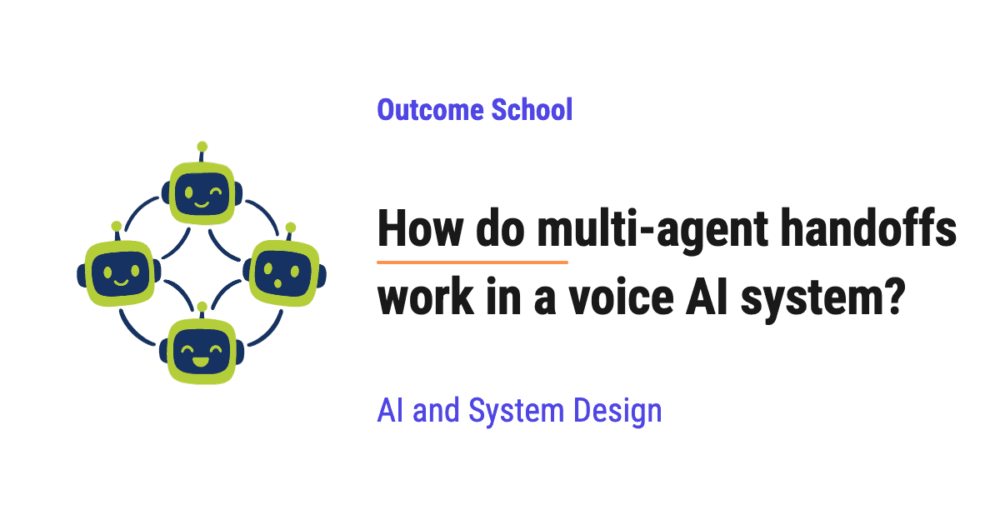

# How do multi-agent handoffs work in a voice AI system?

> Archived from <https://outcomeschool.com/blog/multi-agent-handoffs-in-voice-ai> on 2026-11-25.

A multi-agent handoff in a voice AI system is the moment when one AI agent passes a live phone call to another, more specialized AI agent, along with everything that has been said so far. The LLM of the current agent recommends the handoff, our code switches to the instructions and tools of the new agent, and the caller stays on the same call without repeating anything.

In this blog, we will learn about how multi-agent handoffs work in a voice AI system. We will also see why one big agent is not enough, how a handoff is described to the LLM as a tool, what our code does when the LLM recommends a handoff, how the conversation history travels to the next agent, what makes a handoff smooth for the caller, and where handoffs go wrong.

We will cover the following:
<ul><li>What is a multi-agent voice AI system?</li><li>Why not one big agent?</li><li>What is a handoff?</li><li>Where the handoff happens in the voice pipeline</li><li>Step 1: Describe the handoff as a tool</li><li>Step 2: The LLM recommends a handoff</li><li>Step 3: Our code swaps the active agent</li><li>Step 4: The context travels with the call</li><li>Step 5: The new agent speaks</li><li>The complete flow in one diagram</li><li>Making the handoff smooth for the caller</li><li>Handing back and handoff loops</li><li>Putting it all together in code</li></ul>
I am <strong>Amit Shekhar</strong>, Founder @ <a target="_blank" rel="noopener noreferrer" href="https://outcomeschool.com">Outcome School</a>, I have taught and mentored many developers, and their efforts landed them high-paying tech jobs, helped many tech companies in solving their unique problems, and created many open-source libraries being used by top companies. I am passionate about sharing knowledge through open-source, blogs, and videos.

I teach <a target="_blank" rel="noopener noreferrer" href="https://outcomeschool.com/program/ai-and-machine-learning">AI and Machine Learning</a> at Outcome School.

Let&#x27;s get started.
<h2 id="what-is-a-multi-agent-voice-ai-system">What is a multi-agent voice AI system?</h2>
A <a target="_blank" rel="noopener noreferrer" href="design-a-real-time-voice-ai-agent.md">voice AI agent</a> is a system built around an <a target="_blank" rel="noopener noreferrer" href="large-language-model-llm.md">LLM (Large Language Model)</a> that can talk with us over a phone call or a voice app. It listens to what we say, decides what to reply, and speaks the reply back to us.

<strong>A multi-agent voice AI system is a voice system where, instead of one agent doing everything, there are several specialized AI agents, and each one is good at one kind of job.</strong>

Let&#x27;s say we call the help line of an online store. The system can have:
<ul><li>A <strong>Greeter agent</strong> that welcomes us and understands why we called.</li><li>An <strong>Orders agent</strong> that tracks orders and changes delivery addresses.</li><li>A <strong>Billing agent</strong> that handles refunds and payment problems.</li></ul>
Each agent has its own instructions, its own tools, and its own small job. This is very similar to a real office, where the person at the front desk sends us to the right department.

But, there is one big difference. In a real office, we walk to another room. In a voice AI system, the caller never moves. The call stays on the same line, and only the agent behind the voice changes.

We have a detailed blog on <a target="_blank" rel="noopener noreferrer" href="multi-agent-systems.md">Multi-Agent Systems</a> that explains when to use them in depth.
<h2 id="why-not-one-big-agent">Why not one big agent?</h2>
Now, the question is: why do we need many agents at all? Why not write one agent that knows everything?

We can do that for a small system. But as the system grows, the following issues arise:
<ul><li><strong>Long instructions confuse the LLM.</strong> When one prompt has rules for orders, billing, returns, and complaints all together, the LLM can mix them up and follow the wrong rule at the wrong time.</li><li><strong>Too many tools make the choice harder.</strong> When the LLM sees 40 tools at once, it has a higher chance of picking the wrong one.</li><li><strong>Voice needs speed.</strong> In a phone call, a pause of even one or two seconds feels awkward. A very long prompt with many tools means more tokens for the LLM to read on every turn, and that can add delay.</li><li><strong>It is hard to change.</strong> A small change to the billing rules can break the orders behaviour, because everything lives in one place.</li></ul>
When we split the work, each agent gets a short prompt and the few tools it needs.

So, here comes the handoff to the rescue. It lets many small agents work together on one call, as if they were one.
<h2 id="what-is-a-handoff">What is a handoff?</h2>
<strong>A handoff is when the system sees that another agent can handle the request of the caller better, and passes control of the live conversation from the current agent to that agent.</strong>

After the handoff, the new agent becomes the <strong>active agent</strong>. From that point, every new thing the caller says goes to the new agent, until it hands the call to another agent or the call ends.

Three things matter in every handoff:
<ul><li><strong>Who decides</strong> that a handoff is needed. In many systems, the LLM of the current agent recommends it. Sometimes, our code decides it with a fixed rule, like moving to the Billing agent right after the caller&#x27;s identity is checked.</li><li><strong>What moves</strong> to the new agent. This is the conversation history and any useful facts, like the order number.</li><li><strong>What the caller hears</strong> during the switch. This must feel like one smooth conversation.</li></ul>
We will learn about each of them in detail.
<h2 id="where-the-handoff-happens-in-the-voice-pipeline">Where the handoff happens in the voice pipeline</h2>
Before jumping into the steps, we must know how a voice agent is built. A common voice agent has three parts working one after another, like below:

<pre><code class="code-highlight">Caller speaks
      ↓
Speech-to-Text (turns audio into text)
      ↓
LLM (decides what to reply, or which tool to use)
      ↓
Text-to-Speech (turns the reply into audio)
      ↓
Caller hears the reply
</code></pre>

Here, we can see that the LLM sits in the middle of the pipeline. The phone line, the Speech-to-Text part, and the Text-to-Speech part stay the same for the whole call.

<strong>A handoff changes only what the LLM part is configured with: the instructions, the tools, and sometimes the voice used by the Text-to-Speech part.</strong> The phone connection is never dropped.

This is the reason why a handoff between AI agents takes very less time compared to <a target="_blank" rel="noopener noreferrer" href="call-transfer-with-context.md">transferring a call to a human</a>. Nothing is dialled again. Our code changes the settings of the LLM part in the middle, and the call continues.

<strong>Note:</strong> Some voice agents use a <a target="_blank" rel="noopener noreferrer" href="cascaded-vs-speech-to-speech.md">speech-to-speech model</a>, which listens to audio and speaks audio directly, without separate Speech-to-Text and Text-to-Speech parts. The idea of a handoff stays the same there: our code updates the live session with the instructions and tools of the new agent.

<strong>Planning your move into AI?</strong>

No matter which tech domain you work in today, with your effort, you can transition to these roles:
<ul><li>AI Engineer</li><li>Forward Deployed Engineer</li><li>AI Agent Engineer</li><li>Harness Engineer</li><li>Voice AI Engineer</li><li>AI Architect</li><li>LLM Engineer</li><li>LLM Inference Engineer</li><li>Gen AI Engineer</li><li>MLOps Engineer</li><li>ML Engineer</li><li>Deep Learning Engineer</li></ul>
Our <a target="_blank" rel="noopener noreferrer" href="https://outcomeschool.com/program/ai-and-machine-learning">AI and Machine Learning Program</a> at Outcome School takes you there.
<h2 id="step-1-describe-the-handoff-as-a-tool">Step 1: Describe the handoff as a tool</h2>
The best way to learn this is by taking an example.

The LLM can only recommend things that we tell it about. So, we describe each possible handoff to the LLM as a tool, just like any other tool.

For the Greeter agent, we can describe the handoff tools as below:

<pre><code class="code-highlight language-json">[
  {
    &quot;name&quot;: &quot;transfer_to_orders&quot;,
    &quot;description&quot;: &quot;Use this when the caller wants to track an order or change a delivery address.&quot;,
    &quot;parameters&quot;: { &quot;reason&quot;: &quot;string&quot; }
  },
  {
    &quot;name&quot;: &quot;transfer_to_billing&quot;,
    &quot;description&quot;: &quot;Use this when the caller wants a refund or has a payment problem.&quot;,
    &quot;parameters&quot;: { &quot;reason&quot;: &quot;string&quot; }
  }
]
</code></pre>

Here, we have two tools. Each tool has a name, a clear description, and one input called <code>reason</code>, where the LLM writes why it wants the handoff. The description is very important, because the LLM uses it to decide when to pick that tool.

We also write the instructions of the Greeter agent to say: &quot;Find out why the caller is calling. If it is about an order, transfer to the Orders agent. If it is about a payment, transfer to the Billing agent. Do not try to solve these problems yourself.&quot;
<h2 id="step-2-the-llm-recommends-a-handoff">Step 2: The LLM recommends a handoff</h2>
Let&#x27;s say the caller is Priya. The Greeter has already asked for her name and her order number, A1234, and has checked her identity. Now, she speaks.

Caller: &quot;Hi, I was charged twice for my order.&quot;

The Speech-to-Text part turns this audio into text and gives it to the LLM of the Greeter agent. The LLM reads the text, reads its instructions, and looks at the tools it has.

From the text and the tool descriptions, it finds that this is a payment problem. So, instead of a normal reply, it replies with a <a target="_blank" rel="noopener noreferrer" href="function-calling-in-voice-agents.md">tool call</a> like below:

<pre><code class="code-highlight language-json">{ &quot;tool&quot;: &quot;transfer_to_billing&quot;, &quot;arguments&quot;: { &quot;reason&quot;: &quot;caller was charged twice&quot; } }
</code></pre>

<strong>The LLM never moves the call itself.</strong> It only recommends the handoff. Our code, which runs the agent, reads this recommendation and does the actual switch.

To master Tool use in Agents and Agent Architecture, and build an AI Coding Agent from scratch, check out our <a target="_blank" rel="noopener noreferrer" href="https://outcomeschool.com/program/ai-and-machine-learning">AI and Machine Learning Program</a> at Outcome School.
<h2 id="step-3-our-code-swaps-the-active-agent">Step 3: Our code swaps the active agent</h2>
When our code sees the <code>transfer_to_billing</code> tool call, it does the following:
<ul><li>It marks the Billing agent as the new active agent.</li><li>It loads the instructions of the Billing agent in place of the Greeter&#x27;s instructions.</li><li>It loads the tools of the Billing agent, like <code>check_payment</code> and <code>issue_refund</code>, in place of the Greeter&#x27;s tools.</li><li>If the Billing agent uses a different voice, it tells the Text-to-Speech part to use that voice.</li></ul>
The Speech-to-Text part and the phone line do not change at all.

Now, the Billing agent has its instructions and its tools. But, it still does not know what Priya has said so far. That is our next step.
<h2 id="step-4-the-context-travels-with-the-call">Step 4: The context travels with the call</h2>
If the Billing agent starts with an empty memory, it can say: &quot;Hello, how can I help you today?&quot; Then, the caller has to explain the problem again, and that is a bad experience.

So, how can we avoid this? The answer is: we pass the context to the new agent along with the call.

There are two common ways to do this:

<strong>Way 1:</strong> We pass the full history, which means the complete list of messages from the call so far. The Billing agent reads everything the caller and the Greeter said.

<strong>Advantage:</strong> Nothing is lost.

<strong>Disadvantage:</strong> In a long call, this history becomes very long. More tokens means more cost and more delay on every turn, and voice cannot afford much delay.

<strong>Way 2:</strong> We pass a short summary with key facts. Before the switch, our code, or the LLM itself, writes a short note like below:

<pre><code class="code-highlight language-json">{ &quot;reason&quot;: &quot;charged twice&quot;, &quot;order_id&quot;: &quot;A1234&quot;, &quot;caller_name&quot;: &quot;Priya&quot;, &quot;verified&quot;: true }
</code></pre>

Here, <code>verified</code> means that the caller&#x27;s identity was already checked, so the Billing agent does not ask for it again.

<strong>Advantage:</strong> It is short, so the new agent stays fast.

<strong>Disadvantage:</strong> If the summary misses something important, the new agent will not know it.

In practice, many systems mix both: they pass a short summary of the facts plus the last few messages of the conversation. We must choose based on our use case.

We have a detailed blog on <a target="_blank" rel="noopener noreferrer" href="conversation-state-in-voice-agents.md">how a voice agent manages conversation state across a long call</a> that covers this end to end.
<h2 id="step-5-the-new-agent-speaks">Step 5: The new agent speaks</h2>
Now, the Billing agent has its instructions, its tools, and the context. Its LLM reads all of this and writes its first reply.

Billing agent: &quot;Priya, I understand that you were charged twice for order A1234. Let me check the payments for you.&quot;

The Text-to-Speech part turns this reply into audio, and the caller hears it.

Here, we can notice that Priya did not repeat anything, not even her name or her order number. The Billing agent continued the same conversation from where the Greeter left it.

This is how a handoff completes.

<strong>A quick note for you</strong>

No matter which tech domain you work in, get familiar with these topics:
<ul><li>LLM</li><li>RAG</li><li>MCP</li><li>Agent</li><li>Fine-tuning</li><li>Quantization</li></ul>
We put it all together in one video:

<a target="_blank" rel="noopener noreferrer" href="https://www.youtube.com/watch?v=lnfWvX66FUk">AI Engineering Explained: LLM, RAG, MCP, Agent, Fine-Tuning, and Quantization</a>

No need to stop reading - bookmark it and watch later when you get time. Future you will thank you.

Now, let&#x27;s get back to the topic.
<h2 id="the-complete-flow-in-one-diagram">The complete flow in one diagram</h2>
Let&#x27;s put all the steps together in one diagram, like below:

<pre><code class="code-highlight">Caller: &quot;I was charged twice.&quot;
                ↓
Speech-to-Text turns audio into text
                ↓
Greeter agent&#x27;s LLM reads the text
                ↓
LLM recommends: transfer_to_billing
                ↓
Greeter says: &quot;Let me connect you.&quot;
                ↓
Our code switches the active agent
(new instructions, new tools, same call)
                ↓
Our code passes the context
(full history or a short summary)
                ↓
Billing agent&#x27;s LLM writes its reply
                ↓
Text-to-Speech speaks the reply
                ↓
Caller hears the Billing agent
</code></pre>

Here, we can see that the call never stops. Only the agent in the middle changes, and the history goes along with it.
<h2 id="making-the-handoff-smooth-for-the-caller">Making the handoff smooth for the caller</h2>
In a text chat, a small pause during a handoff is fine. In a voice call, silence feels like the call has dropped. So, we must design the handoff for a voice call.

A few things help:
<ul><li><strong>Say something before the switch.</strong> The Greeter can say &quot;Sure, let me connect you to our billing team.&quot; while our code prepares the Billing agent. This <a target="_blank" rel="noopener noreferrer" href="filler-phrases-in-voice-agents.md">covers the small delay</a>.</li><li><strong>Do not make the new agent greet again.</strong> We tell the new agent in its instructions to continue the conversation, not to start a new one.</li><li><strong>Decide on the voice.</strong> If all agents use the same voice, the caller hears one assistant. If each agent has a different voice, the caller hears a new person, so the previous agent must tell the caller about the transfer.</li><li><strong>Keep listening during the switch.</strong> If the caller speaks while the switch is happening, our code must keep that audio and give its text to the new agent, so that nothing the caller says is lost.</li><li><strong>Keep the switch fast.</strong> We load the instructions and tools of every agent at the start of the call, so that the switch takes almost no time.</li></ul>
<strong>Stay updated:</strong> Subscribe to our <a target="_blank" rel="noopener noreferrer" href="https://outcomeschool.substack.com/subscribe">newsletter</a> to get our latest AI and Machine Learning blogs straight to your inbox.
<h2 id="handing-back-and-handoff-loops">Handing back and handoff loops</h2>
Now, the next big question is: what happens after the Billing agent finishes its job?

The caller can say: &quot;Thanks. Also, where is my other order?&quot; This is not a billing question. So, the Billing agent needs a way to hand the call back. We give it a tool like <code>transfer_to_greeter</code> or <code>transfer_to_orders</code>, and the same five steps happen again.

But, the following issue arises. Suppose the Greeter thinks a question is about billing and sends it to the Billing agent. The Billing agent thinks it is about orders and sends it to the Orders agent. The Orders agent thinks it is about billing and sends it to the Billing agent again. The caller keeps hearing &quot;let me transfer you&quot; and nobody answers the question.

This is called a <strong>handoff loop</strong>.

We can prevent it in the following ways:
<ul><li>Write clear, non-overlapping descriptions for each handoff tool, so that each agent knows exactly what belongs to whom.</li><li>Set a limit on how many handoffs can happen in one call. After the limit, the current agent must answer, or the call goes to a human.</li><li>Pass the reason for the handoff in the context, so that the receiving agent knows why the call came to it and does not send it away for the same reason.</li></ul>
If we want to go deep into Multi-Agent Systems, Orchestration and Routing, and Design a Real-Time Voice AI Agent, we have a complete program on this - check out our <a target="_blank" rel="noopener noreferrer" href="https://outcomeschool.com/program/ai-and-machine-learning">AI and Machine Learning Program</a> at Outcome School.
<h2 id="putting-it-all-together-in-code">Putting it all together in code</h2>
Now, let&#x27;s see the code for a simple handoff. We can write the code as below:

<pre><code class="code-highlight language-python">MAX_HANDOFFS = 3

agents = {
    &quot;greeter&quot;: Agent(GREETER_PROMPT,
                     tools=[transfer_to_orders, transfer_to_billing],
                     voice=&quot;voice_a&quot;),
    &quot;orders&quot;: Agent(ORDERS_PROMPT,
                    tools=[track_order, transfer_to_billing, transfer_to_greeter],
                    voice=&quot;voice_a&quot;),
    &quot;billing&quot;: Agent(BILLING_PROMPT,
                     tools=[check_payment, issue_refund, transfer_to_orders, transfer_to_greeter],
                     voice=&quot;voice_a&quot;),
}

active = &quot;greeter&quot;
history = []
handoffs = 0

def handle_turn(user_text):
    global active, handoffs
    history.append({ &quot;role&quot;: &quot;user&quot;, &quot;content&quot;: user_text })

    while True:
        agent = agents[active]
        result = llm.run(agent.instructions, agent.tools, history)

        if result.tool_name and result.tool_name.startswith(&quot;transfer_to_&quot;):
            if handoffs &gt;= MAX_HANDOFFS:
                transfer_to_human(history)  # stop the loop, a person takes over
                return
            speak(&quot;Sure, let me connect you.&quot;, agent.voice)
            active = result.tool_name.replace(&quot;transfer_to_&quot;, &quot;&quot;)
            handoffs += 1
            history.append({ &quot;role&quot;: &quot;system&quot;, &quot;content&quot;: &quot;Handoff reason: &quot; + result.arguments[&quot;reason&quot;] })
            continue  # the new agent replies to the same history

        history.append({ &quot;role&quot;: &quot;assistant&quot;, &quot;content&quot;: result.text })
        speak(result.text, agent.voice)
        return
</code></pre>

Here, I have kept only the important lines of the code and removed other lines for brevity, like running normal tools such as <code>check_payment</code>.

Here, we have:
<ul><li><code>agents</code>: each agent has its own instructions, its own tools, and its own voice. All three use the same voice here, so the caller hears one assistant.</li><li><code>active</code>: the name of the agent that is talking right now. At its core, a handoff is a change of this one value.</li><li><code>history</code>: one shared list of messages for the whole call. Every agent reads the same list, so the context travels with the call. This is Way 1 from Step 4.</li><li><code>handle_turn</code>: it runs every time the Speech-to-Text part gives us what the caller said.</li><li>When the LLM recommends a <code>transfer_to_</code> tool, our code speaks a short line, switches <code>active</code>, adds the reason to the history, and runs the loop again, so that the new agent replies right away.</li><li><code>MAX_HANDOFFS</code>: it stops a handoff loop. If the LLM recommends a fourth handoff in the same call, our code sends the call to a human instead.</li></ul>
Now we must have understood how multi-agent handoffs work in a voice AI system, how the context travels with the call, and how to keep the handoff smooth for the caller.
<h2 id="frequently-asked-questions">Frequently Asked Questions</h2><h3 id="does-the-phone-call-drop-during-a-multi-agent-handoff">Does the phone call drop during a multi-agent handoff?</h3>
No. The phone call does not drop during a handoff. The phone line, the Speech-to-Text part, and the Text-to-Speech part stay the same for the whole call. A handoff changes only the instructions, the tools, and sometimes the voice of the LLM part, so the caller stays on the same line.
<h3 id="is-a-handoff-between-ai-agents-faster-than-transferring-a-call-to-a-human">Is a handoff between AI agents faster than transferring a call to a human?</h3>
Yes. A handoff between AI agents takes very less time compared to transferring a call to a human, because nothing is dialled again. Our code only changes the settings of the LLM part, and the call continues. If we load the instructions and tools of every agent at the start of the call, the switch takes almost no time.
<h3 id="should-every-agent-in-a-voice-ai-system-use-a-different-voice">Should every agent in a voice AI system use a different voice?</h3>
Not necessarily. If all agents use the same voice, the caller hears one assistant. If each agent has a different voice, the caller hears a new person, so the previous agent must tell the caller about the transfer.
<h3 id="do-handoffs-work-with-a-speech-to-speech-model">Do handoffs work with a speech-to-speech model?</h3>
Yes. A speech-to-speech model listens to audio and speaks audio directly, without separate Speech-to-Text and Text-to-Speech parts. The idea of a handoff stays the same there: our code updates the live session with the instructions and tools of the new agent.

That&#x27;s it for now.

Thanks

<strong>Amit Shekhar</strong> Founder @ <a target="_blank" rel="noopener noreferrer" href="https://outcomeschool.com">Outcome School</a>

You can connect with me on:
<ul><li><a target="_blank" rel="noopener noreferrer" href="https://x.com/amitiitbhu">X</a></li><li><a target="_blank" rel="noopener noreferrer" href="https://www.linkedin.com/in/amit-shekhar-iitbhu">LinkedIn</a></li><li><a target="_blank" rel="noopener noreferrer" href="https://github.com/amitshekhariitbhu">GitHub</a></li></ul>
Follow Outcome School on:
<ul><li><a target="_blank" rel="noopener noreferrer" href="https://x.com/outcome_school">X</a></li><li><a target="_blank" rel="noopener noreferrer" href="https://youtube.com/@OutcomeSchool">YouTube</a></li><li><a target="_blank" rel="noopener noreferrer" href="https://www.linkedin.com/company/outcomeschool">LinkedIn</a></li><li><a target="_blank" rel="noopener noreferrer" href="http://github.com/OutcomeSchool">GitHub</a></li></ul>
<a target="_blank" rel="noopener noreferrer" href="https://outcomeschool.com/blog"><strong>Read all of our high-quality blogs here.</strong></a>

