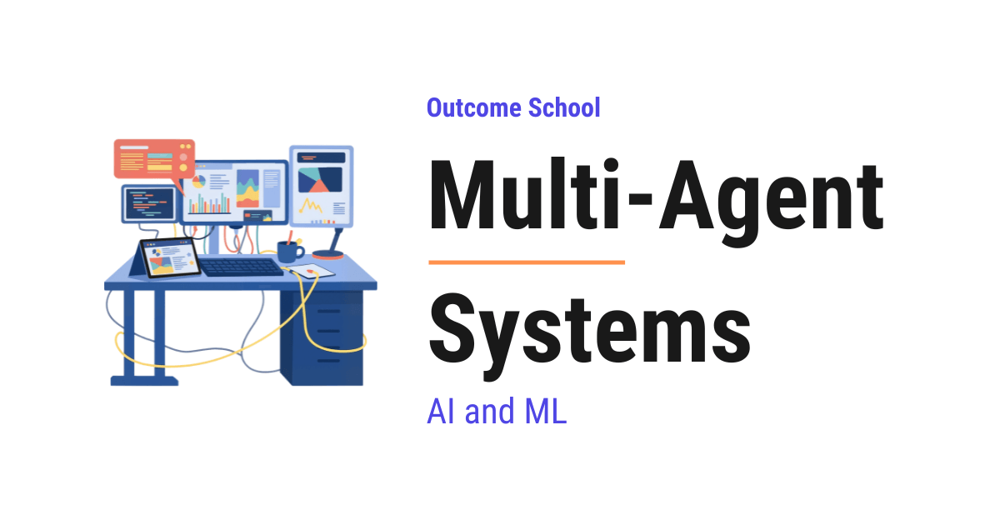

# What are Multi-Agent Systems and When Should We Use Them?

> Archived from <https://outcomeschool.com/blog/multi-agent-systems> on 2026-11-25.

A Multi-Agent System is a setup where two or more LLM-driven agents work together on a shared task. Each agent has its own prompt and its own tools, and a coordination layer decides who does what and in what order.

In this blog, we will learn about Multi-Agent Systems - what they are, the three pillars that hold them together, the common agent roles, how agents communicate and coordinate, the trade-offs, and when to use them.

We will cover the following:
<ul><li>The Big Picture</li><li>What is a Multi-Agent System?</li><li>The Three Pillars</li><li>Common Agent Roles</li><li>How Agents Communicate</li><li>How Agents Coordinate</li><li>Multi-Agent vs Single Agent - The Trade-offs</li><li>Common Mistakes</li><li>When to Use a Multi-Agent System</li><li>Quick Summary</li></ul>
I am <strong>Amit Shekhar</strong>, Founder @ <a target="_blank" rel="noopener noreferrer" href="https://outcomeschool.com">Outcome School</a>, I have taught and mentored many developers, and their efforts landed them high-paying tech jobs, helped many tech companies in solving their unique problems, and created many open-source libraries being used by top companies. I am passionate about sharing knowledge through open-source, blogs, and videos.

I teach <a target="_blank" rel="noopener noreferrer" href="https://outcomeschool.com/program/ai-and-machine-learning">AI and Machine Learning</a> at Outcome School.

Let&#x27;s get started.
<h2 id="the-big-picture">The Big Picture</h2>
Before we go into the details, let&#x27;s understand the big picture.

A <strong>Multi-Agent System</strong> is a group of <a target="_blank" rel="noopener noreferrer" href="ai-agent.md">AI agents</a>. Each agent has its own role. They work together to finish a task. No single agent could handle this task well alone.

The agents specialize. They talk to each other. They coordinate their work.

In simple words:

<strong>Multi-Agent System = Specialized Agents + A Way to Communicate + A Way to Coordinate.</strong>

Let&#x27;s think of a Multi-Agent System like a movie production crew. The director decides what to shoot. The cinematographer handles the camera. The actors perform. The editor puts it all together.

No one person does everything. Each specialist owns their piece. There are clear rules for how they hand work to each other. The movie that comes out is something no single person could have made alone.

A single agent is a solo chef. A multi-agent system is the full restaurant - kitchen, dining room, host, and all.
<h2 id="what-is-a-multi-agent-system">What is a Multi-Agent System?</h2>
Now that we have the big picture, let&#x27;s tighten the definition.

A <strong>Multi-Agent System</strong> is a setup where two or more <strong>LLM (Large Language Model)</strong>-driven agents work together on a shared task. Each agent has its own prompt. Each agent has its own tools. Each agent often has its own model.

We wire them together with a coordination layer. The coordination layer decides who does what and in what order.

A bunch of agents that do not talk to each other is not a multi-agent system. It is just a bunch of agents. The &quot;system&quot; part is what makes it multi-agent - the glue that lets them collaborate.

Now, let&#x27;s understand what that glue is made of.
<h2 id="the-three-pillars">The Three Pillars</h2>
Every multi-agent system rests on three pillars. Remove any one, and it falls apart. Let&#x27;s understand each one.

<strong>Pillar 1: Specialization.</strong> Each agent has a focused role. One agent is the researcher. Another is the writer. Another is the reviewer. This keeps each agent&#x27;s <a target="_blank" rel="noopener noreferrer" href="system-prompt.md">system prompt</a> small. The tool set stays relevant. The behavior stays reliable.

<strong>Pillar 2: Communication.</strong> Agents must be able to share information. We do this through messages, shared memory, or structured handoffs. Without communication, the agents cannot build on each other&#x27;s work.

<strong>Pillar 3: Coordination.</strong> Someone has to decide who goes next. Someone has to decide who waits. Someone has to decide when the task is done. This can be a dedicated orchestrator agent. It can be a fixed workflow. It can be a set of routing rules. We have a detailed blog on <a target="_blank" rel="noopener noreferrer" href="ai-orchestration.md">AI Orchestration</a> that covers the patterns we use to coordinate multiple LLMs, tools, and steps together.

If any one of these is weak, the system breaks. Agents that are not specialized act like a slightly less capable single agent. Agents that cannot communicate cannot cooperate. Agents without coordination step on each other or leave gaps.

All three pillars must be strong.

<strong>Planning your move into AI?</strong>

No matter which tech domain you work in today, with your effort, you can transition to these roles:
<ul><li>AI Engineer</li><li>Forward Deployed Engineer</li><li>AI Agent Engineer</li><li>Harness Engineer</li><li>Voice AI Engineer</li><li>AI Architect</li><li>LLM Engineer</li><li>LLM Inference Engineer</li><li>Gen AI Engineer</li><li>MLOps Engineer</li><li>ML Engineer</li><li>Deep Learning Engineer</li></ul>
Our <a target="_blank" rel="noopener noreferrer" href="https://outcomeschool.com/program/ai-and-machine-learning">AI and Machine Learning Program</a> at Outcome School takes you there.
<h2 id="common-agent-roles">Common Agent Roles</h2>
Now that we know the pillars, let&#x27;s look at the agents themselves. Not every multi-agent system looks the same. Most reuse a small set of roles. Let&#x27;s break each one down.

<strong>Orchestrator.</strong> The agent that runs the show. It receives the user request. It breaks the request into subtasks. It delegates them. It combines the results into a final answer. We also call it a manager or coordinator.

<strong>Worker.</strong> A specialist agent that does one kind of task well. Workers include researchers, writers, coders, data analysts, and anything else that maps to a real-world specialization. The more focused the role, the more reliable the agent. A focused worker like this is also called a <a target="_blank" rel="noopener noreferrer" href="ai-subagents.md">SubAgent</a> - a smaller, specialized agent that runs under a main agent.

<strong>Router.</strong> An agent whose only job is to look at a request and decide which worker should handle it. We use it when the system has many workers and the right one depends on the input. It keeps each worker&#x27;s system prompt small and focused.

<strong>Planner.</strong> An agent that produces a step-by-step plan for a complex task. The workers then execute the plan. Separating planning from execution makes both steps more reliable - this is the idea behind the <a target="_blank" rel="noopener noreferrer" href="plan-and-execute-agent.md">Plan-and-Execute Agent</a> pattern.

<strong>Critic or Reviewer.</strong> An agent that checks another agent&#x27;s output for quality, safety, or correctness. It sends the output back for revisions if needed. It is great for reducing hallucinations and errors. The condition is that the critic must have independent grounding (sources, tools), not just the same context as the writer. This role is a close cousin of <a target="_blank" rel="noopener noreferrer" href="llm-as-a-judge.md">LLM as a Judge</a> - one LLM evaluating another LLM&#x27;s output against explicit criteria, wired here as an in-loop reviewer instead of an external scorer.

<strong>Tool Specialist.</strong> An agent that owns the prompting strategy and schema knowledge for a specific tool or data source. The calling agent does not have to know these details. For example, a &quot;database agent&quot; that knows the schema deeply and writes good SQL. Or a &quot;web search agent&quot; that knows how to phrase strong queries.

Let&#x27;s see how these roles work together with a concrete example. Suppose we want a system that handles customer support emails. We can split the work across four agents:
<ul><li>The <strong>Orchestrator</strong> receives a customer email like &quot;I want a refund for my last order, it arrived damaged&quot;.</li><li>It hands off the lookup to a <strong>Researcher Worker</strong> that pulls the order details, the return policy, and the customer&#x27;s account history.</li><li>It hands the gathered notes to a <strong>Writer Worker</strong> that drafts a personalized reply.</li><li>It hands the draft to a <strong>Critic</strong> that checks for tone, accuracy, and policy compliance, and sends it back for revisions if needed.</li><li>Once the Critic approves, the Orchestrator sends the final reply to the customer.</li></ul>
Four agents, each with one job. The Researcher does not know about writing replies. The Writer does not know about looking up customer data. The Critic does not know about drafting from scratch.

Each agent has a small, focused system prompt. The tool set is tight. This is exactly what makes the system more reliable. A single agent trying to juggle all four jobs would be less reliable.

Here is what the wiring looks like end to end:

<pre><code class="code-highlight">Customer Email
    |
    v
Orchestrator
    |
    v
Researcher --&gt; notes
    |
    v
Writer --&gt; draft
    |
    v
Critic --&gt; approve or revise
    |
    v
Final Reply
</code></pre>

The Orchestrator runs the workers in sequence here. Each step needs the previous one&#x27;s output.

And, the actual messages flowing between the Orchestrator and each worker look like this. Let&#x27;s go through each round.

<strong>Round 1: Orchestrator asks the Researcher to gather information.</strong>

The Orchestrator sends:

<pre><code class="language-json code-highlight">{
  &quot;task&quot;: &quot;look up order details, return policy, and customer history&quot;,
  &quot;order_id&quot;: &quot;4521&quot;
}
</code></pre>

The Researcher does the lookup and sends back:

<pre><code class="language-json code-highlight">{
  &quot;notes&quot;: {
    &quot;order&quot;: {
      &quot;id&quot;: &quot;4521&quot;,
      &quot;item&quot;: &quot;blue running shoes&quot;,
      &quot;status&quot;: &quot;delivered&quot;,
      &quot;delivered_on&quot;: &quot;2026-04-10&quot;
    },
    &quot;policy&quot;: &quot;Damaged items can be returned within 30 days for a full refund.&quot;,
    &quot;customer&quot;: {
      &quot;name&quot;: &quot;Alex&quot;,
      &quot;tier&quot;: &quot;regular&quot;,
      &quot;past_returns&quot;: 1
    }
  }
}
</code></pre>

Here, the Researcher returns the order details, the return policy, and the customer history. The Writer will use these notes in the next round.

<strong>Round 2: Orchestrator asks the Writer to draft a reply.</strong>

The Orchestrator forwards the notes and adds a few hints:

<pre><code class="language-json code-highlight">{
  &quot;notes&quot;: { &quot;...&quot;: &quot;the notes from Round 1&quot; },
  &quot;customer_name&quot;: &quot;Alex&quot;,
  &quot;tone&quot;: &quot;warm and clear&quot;
}
</code></pre>

The Writer drafts the reply:

<pre><code class="language-json code-highlight">{
  &quot;draft&quot;: &quot;Hi Alex, I am sorry to hear your blue running shoes arrived damaged...&quot;
}
</code></pre>

Here, the Writer turns the raw notes into a personalized reply. The &quot;tone&quot; hint tells the Writer how to sound. The Critic will check the draft next.

<strong>Round 3: Orchestrator asks the Critic to review the draft.</strong>

The Orchestrator sends the draft and the things to check:

<pre><code class="language-json code-highlight">{
  &quot;draft&quot;: &quot;Hi Alex, I am sorry to hear your blue running shoes arrived damaged...&quot;,
  &quot;check_for&quot;: [&quot;tone&quot;, &quot;accuracy&quot;, &quot;policy compliance&quot;]
}
</code></pre>

The Critic returns its verdict:

<pre><code class="language-json code-highlight">{
  &quot;verdict&quot;: &quot;needs revision&quot;,
  &quot;issues&quot;: [&quot;The reply does not mention the 30-day return window.&quot;]
}
</code></pre>

Here, the Critic flags one issue. The Orchestrator hands the draft back to the Writer with the feedback. The loop continues until the Critic approves.

Each message is a structured object with named fields. It is not unstructured chat. That is what keeps the agents on the rails.

<strong>Note:</strong> Not every system needs all of these. A simple multi-agent system can have just an orchestrator and two workers. A complex one can have a planner, a router, five workers, and a critic. We start small. We add roles only when a real gap shows up.

To master Multi-Agent Systems, subagents, agent architecture, and orchestration, check out our <a target="_blank" rel="noopener noreferrer" href="https://outcomeschool.com/program/ai-and-machine-learning">AI and Machine Learning Program</a> at Outcome School.
<h2 id="how-agents-communicate">How Agents Communicate</h2>
With the roles clear, the next question is <a target="_blank" rel="noopener noreferrer" href="how-ai-agents-communicate.md">how they actually talk to each other</a>. Agents need to share information to work together. There are three main ways they do it. Let&#x27;s understand each one.

<pre><code class="code-highlight">Message Passing:    A &lt;--msg--&gt; B    (point-to-point between any agent pair)

Shared State:        A     B     C
                      \    |    /
                       v   v   v
                    +-------------+
                    |  Blackboard |   (all agents read and write)
                    +-------------+

Handoffs:           A --(work + context)--&gt; B --(work + context)--&gt; C
</code></pre>

<strong>1. Message passing.</strong> One agent sends a structured message to another. The message contains the task, the context, and any inputs needed. This is direct and clear. It can get noisy when many agents are involved. It works well for small systems with a few well-defined agents.

<strong>2. Shared state or blackboard.</strong> All agents read from and write to a shared memory. Each agent picks up what is relevant to it. It does its work. It writes the result back. This is flexible. It needs careful rules to avoid chaos.

<strong>3. Handoffs.</strong> A handoff is a message that also transfers control. One agent finishes its part. It passes both the work and the context to the next agent. It then steps out of the loop. This is like a relay race - clean, predictable, and easy to reason about. Only one agent is &quot;active&quot; at a time.

In simple words:

<strong>Handoff = Message + Control transfer.</strong>

<strong>Note:</strong> These three modes overlap. A handoff is mechanically a special case of message passing - a message that also transfers control. Real systems mix all three. We use handoffs for the main flow. We use message passing for side queries. We use shared state for context everyone needs.

We have a detailed blog on <a target="_blank" rel="noopener noreferrer" href="multi-agent-handoffs-in-voice-ai.md">how multi-agent handoffs work in a voice AI system</a> that shows a handoff on a live phone call.

<strong>Very important:</strong> If we want this to work reliably, communication between agents must be structured. If agents just chat in unstructured text, misunderstandings multiply quickly. We define clear message formats. We define expected fields. We define what each agent is responsible for.

One more thing to notice. Agents can share <a target="_blank" rel="noopener noreferrer" href="ai-agent-memory.md">memory</a> fully. They can share it partially via summaries. They can share nothing at all. Each choice trades context richness for token cost.

<strong>A quick note for you</strong>

No matter which tech domain you work in, get familiar with these topics:
<ul><li>LLM</li><li>RAG</li><li>MCP</li><li>Agent</li><li>Fine-tuning</li><li>Quantization</li></ul>
We put it all together in one video:

<a target="_blank" rel="noopener noreferrer" href="https://www.youtube.com/watch?v=lnfWvX66FUk">AI Engineering Explained: LLM, RAG, MCP, Agent, Fine-Tuning, and Quantization</a>

No need to stop reading - bookmark it and watch later when you get time. Future you will thank you.

Now, let&#x27;s get back to the topic.

Now that we know how agents talk, the next question is who runs when.
<h2 id="how-agents-coordinate">How Agents Coordinate</h2>
Coordination is how the system decides who runs when. There are five common patterns. Let&#x27;s go through each one.

<pre><code class="code-highlight">Sequential:    A -&gt; B -&gt; C -&gt; D

Parallel:      Request
                 |
             +---+---+
             |   |   |
             A   B   C
             |   |   |
             +---+---+
                 |
              Merge -&gt; Response

Router:        Request -&gt; Router -&gt; (A or B or C)

Hierarchical:       Orchestrator
                    /     |     \
                   A      B      C

Graph:          A &lt;--&gt; B
                ^      ^
                v      v
                C &lt;--&gt; D
                (any agent can call any other)
</code></pre>

<strong>Sequential.</strong> Agents run one after another. Each agent builds on the previous one&#x27;s output. Simple. Easy to debug. Slow if the steps could run in parallel.

<strong>Parallel.</strong> We have multiple agents working at the same time on independent subtasks. We merge their results at the end. Fast - but only when the subtasks are truly independent.

<strong>Router.</strong> A router agent picks which worker handles each request. Good when requests fall into a few distinct categories.

<strong>Hierarchical.</strong> An orchestrator delegates to workers. The workers can themselves delegate to sub-workers. Great for complex, nested tasks. Looks very much like how a real company org chart works.

<strong>Graph or Network.</strong> Any agent can call any other based on the task at hand. Useful when the task is exploratory and the right next agent depends on intermediate findings. Maximum flexibility - but harder to debug and reason about. We see this pattern in modern multi-agent frameworks, and <a target="_blank" rel="noopener noreferrer" href="what-is-graph-engineering.md">Graph Engineering</a> is the practice of designing such a graph well.

These patterns range from fixed workflows on one end (Sequential, Parallel) to fully dynamic agent-driven control on the other (Graph). Most systems sit somewhere in the middle.

In simple words, coordination is the wiring diagram and communication is the signal that travels across the wires - both must work for the system to actually run.

If we want to go deep into orchestration, routing, and the full multi-agent architecture, we have a complete program on this - check out our <a target="_blank" rel="noopener noreferrer" href="https://outcomeschool.com/program/ai-and-machine-learning">AI and Machine Learning Program</a> at Outcome School.
<h2 id="multi-agent-vs-single-agent---the-trade-offs">Multi-Agent vs Single Agent - The Trade-offs</h2>
Now, the natural question is - when is all this complexity worth it? Let me tabulate the differences between a Multi-Agent System and a Single Agent for your better understanding so that you can decide which one to use based on your use case.
<table><thead><tr><th>Property</th><th>Single Agent</th><th>Multi-Agent System</th></tr></thead><tbody><tr><td>Complexity</td><td>Low</td><td>High</td></tr><tr><td>System prompt</td><td>One, can get long</td><td>Many, each focused</td></tr><tr><td>Tool count per agent</td><td>All tools on one</td><td>Split across agents</td></tr><tr><td>Parallelism</td><td>Limited (parallel tool calls within one turn)</td><td>Natural for independent agent work</td></tr><tr><td>Debugging</td><td>Easier (one loop)</td><td>Harder (many loops, handoffs)</td></tr><tr><td>Latency</td><td>Lower for simple tasks</td><td>Higher with handoffs, lower with parallelism</td></tr><tr><td>Cost</td><td>Lower</td><td>Higher</td></tr><tr><td>Quality on complex tasks</td><td>Can degrade as tools grow</td><td>Scales better with specialization</td></tr><tr><td>Failure modes</td><td>Fails as a unit</td><td>Partial failure or cascading errors</td></tr><tr><td>Best for</td><td>Short, focused tasks</td><td>Complex, multi-skill tasks</td></tr></tbody></table>
In simple words, multi-agent systems are more powerful for complex work. They come with a real cost in complexity, latency, and tokens. If we add agents without a real reason, we just pay more for nothing.

In most cases, we land in a hybrid spot - a single primary agent with one or two helpers like a router or a critic. Pure multi-agent setups, with many peer agents and no clear primary, are rarer than they sound. Most of the time, they are overkill until the workload genuinely needs them.

Splitting the tools across agents buys us something on the security side as well. The agent that reads untrusted text does not have to be the agent that holds the dangerous tools. We have a detailed blog on <a target="_blank" rel="noopener noreferrer" href="prompt-injection-in-llms.md">Prompt Injection in LLMs</a> that explains this separation in depth.

<strong>Stay updated:</strong> Subscribe to our <a target="_blank" rel="noopener noreferrer" href="https://outcomeschool.substack.com/subscribe">newsletter</a> to get our latest AI and Machine Learning blogs straight to your inbox.
<h2 id="common-mistakes">Common Mistakes</h2>
With all this power comes specific ways to fail. Let&#x27;s go through each.

<strong>1. Agents talking too much.</strong> Agents keep sending messages back and forth without making progress. Token cost explodes.

<strong>How to fix:</strong> We set a cap on total turns. We make handoffs explicit. We avoid unstructured back-and-forth between agents unless it is the goal.

<strong>2. Unclear ownership.</strong> Two agents think the other is handling a task. Or both try to handle it. The result is duplicate or missing work.

<strong>How to fix:</strong> We give each agent a clearly scoped role in its system prompt. The orchestrator is the only one routing work.

<strong>3. Error propagation.</strong> A small mistake by one agent gets amplified by the next. By the final agent, the output is wrong in ways that are hard to trace.

<strong>Example:</strong> A research agent returns slightly wrong data about a topic. The writer agent builds a confident draft on top of it. The critic agent only checks grammar and style. The final output looks polished but is factually wrong - and it is hard to tell which agent introduced the error.

<strong>How to fix:</strong> We add critic or review agents at key points. We validate intermediate outputs, not just the final one.

<strong>4. Coordination overhead dominates.</strong> The agents spend more tokens coordinating than actually doing the work.

<strong>How to fix:</strong> We use the simplest coordination pattern that fits. We prefer fixed workflows and handoffs over unstructured discussion.

<strong>5. Non-determinism.</strong> The same input produces different results every run because agents make slightly different choices.

<strong>How to fix:</strong> We lower the <a target="_blank" rel="noopener noreferrer" href="how-does-temperature-control-llm-output.md">temperature</a> for coordination-level decisions. This reduces but does not eliminate non-determinism. Some variance comes from floating-point and provider-side effects even at temperature zero. We make the workflow structure fixed. We let only the worker outputs vary.

<strong>6. Hidden complexity.</strong> It feels like we are making the system smarter by adding agents. But really we are making it harder to reason about.

<strong>How to fix:</strong> Every new agent must have a clear reason to be there. If a single agent could do the job well, we add no agents. If not, we add the minimum number. Complexity is something we pay for. We must add it only when we need it.

<strong>7. Critic loops that never converge.</strong> A critic that is too strict or too vague keeps rejecting drafts. It sends the writer back forever. Tokens burn. Latency grows. Sometimes the original draft was already good enough.

<strong>How to fix:</strong> We cap the number of revision rounds. We make the critic&#x27;s accept and reject criteria explicit and bounded. If two rounds in a row return similar feedback, we accept and ship.

The happy path is easy - the edge cases are where the real work happens. Handling these failure modes well is what makes a multi-agent system actually work.

We will also need tracing, retries, and token budgets. The wiring alone is not enough.

Now, let&#x27;s see when all this complexity actually pays off.

To learn evaluation of agents, LLM as a Judge, and production-grade multi-agent systems, check out our <a target="_blank" rel="noopener noreferrer" href="https://outcomeschool.com/program/ai-and-machine-learning">AI and Machine Learning Program</a> at Outcome School.
<h2 id="when-to-use-a-multi-agent-system">When to Use a Multi-Agent System</h2>
<strong>Use a Multi-Agent System when:</strong>
<ul><li>The task naturally splits into specialized roles (research + writing + review).</li><li>Different parts of the task need very different system prompts or models (e.g., a fast <a target="_blank" rel="noopener noreferrer" href="small-language-models-slms.md">small model</a> for <a target="_blank" rel="noopener noreferrer" href="llm-routing.md">routing</a>, a large model for writing).</li><li>Parallelism can give a real speedup because subtasks are independent.</li><li>A single agent&#x27;s system prompt has grown too long or tool count too high.</li><li>Quality matters enough that a dedicated critic or reviewer makes sense.</li></ul>
<strong>Do not use a Multi-Agent System when:</strong>
<ul><li>A single agent already does the job well.</li><li>The task is tightly coupled and does not split cleanly across agents (e.g., coding, where each step depends on shared context).</li><li>The coordination overhead would cost more than the speedup.</li><li>The team does not have the time or tooling to debug multi-agent failures.</li><li>Simplicity and predictability matter more than raw capability.</li></ul>
The rule of thumb is simple. We start with a single agent. We move to multi-agent only when the single agent clearly cannot handle the task well. When we do move, we add the smallest number of agents that solves the problem. Every extra agent is extra complexity. We pay for it in tokens, latency, and debugging time.

Frameworks like <a target="_blank" rel="noopener noreferrer" href="how-does-langgraph-work.md">LangGraph</a> and AutoGen handle much of the wiring. We do not have to build the orchestration layer from scratch.

Now, we have understood what a Multi-Agent System is, the three pillars it rests on, and when to build one. Let&#x27;s wrap up with a quick recap.
<h2 id="quick-summary">Quick Summary</h2>
Let&#x27;s recap what we have learned:
<ul><li><strong>A Multi-Agent System</strong> is a group of LLM-driven agents, each with its own role, that work together on a shared task. It is not just many agents - it is many agents plus the glue that lets them cooperate.</li><li><strong>The three pillars</strong> are Specialization, Communication, and Coordination. Remove any one, and the system breaks.</li><li><strong>Common agent roles</strong> include the Orchestrator, Worker, Router, Planner, Critic, and Tool Specialist. Most systems reuse a small mix of these.</li><li><strong>Agents communicate</strong> via message passing, shared state, or handoffs. The communication must be structured - unstructured chat between agents leads to chaos.</li><li><strong>Agents coordinate</strong> via sequential, parallel, router, hierarchical, or graph patterns. Coordination is the wiring. Communication is the signal.</li><li><strong>The trade-off</strong> is real - multi-agent systems are more powerful for complex tasks, but cost more in latency, tokens, and debugging effort. We must add complexity only when we need it.</li><li><strong>Common mistakes</strong> include too much chatter, error propagation across agents, runaway critic loops, and hidden complexity. Handling these is the real work.</li><li><strong>Start with a single agent.</strong> We move to multi-agent only when the single agent cannot do the job. When we do, we add the smallest number of agents that solves the problem. Every agent we add must have a clear reason to be there.</li></ul><h2 id="frequently-asked-questions">Frequently Asked Questions</h2><h3 id="is-a-multi-agent-system-always-better-than-a-single-agent">Is a multi-agent system always better than a single agent?</h3>
No. Multi-agent systems are more powerful for complex, multi-skill tasks, but they cost more in complexity, latency, tokens, and debugging time. For short, focused tasks, a single agent is often the better choice. We start with a single agent and move to multi-agent only when it clearly cannot handle the task well.
<h3 id="is-a-group-of-agents-that-do-not-talk-to-each-other-a-multi-agent-system">Is a group of agents that do not talk to each other a multi-agent system?</h3>
No. A bunch of agents that do not talk to each other is just a bunch of agents. The system part is what makes it multi-agent, which is the coordination layer and the communication that lets the agents collaborate on a shared task.
<h3 id="should-we-use-a-multi-agent-system-for-coding-tasks">Should we use a multi-agent system for coding tasks?</h3>
Usually not. A multi-agent system fits poorly when the task is tightly coupled and does not split cleanly across agents. Coding is a good example, since each step depends on shared context. In such cases, the coordination overhead can cost more than the benefit.
<h3 id="does-setting-the-temperature-to-zero-make-a-multi-agent-system-deterministic">Does setting the temperature to zero make a multi-agent system deterministic?</h3>
No. Lowering the temperature for coordination-level decisions reduces non-determinism, but it does not eliminate it. Some variance comes from floating-point and provider-side effects even at temperature zero. So, we also keep the workflow structure fixed and let only the worker outputs vary.
<h3 id="do-we-have-to-build-the-orchestration-layer-ourselves">Do we have to build the orchestration layer ourselves?</h3>
No. Frameworks like LangGraph and AutoGen handle much of the wiring for us. We do not have to build the orchestration layer from scratch, but we will still need tracing, retries, and token budgets.

That&#x27;s it for now.

Thanks

<strong>Amit Shekhar</strong> Founder @ <a target="_blank" rel="noopener noreferrer" href="https://outcomeschool.com">Outcome School</a>

You can connect with me on:
<ul><li><a target="_blank" rel="noopener noreferrer" href="https://x.com/amitiitbhu">X</a></li><li><a target="_blank" rel="noopener noreferrer" href="https://www.linkedin.com/in/amit-shekhar-iitbhu">LinkedIn</a></li><li><a target="_blank" rel="noopener noreferrer" href="https://github.com/amitshekhariitbhu">GitHub</a></li></ul>
Follow Outcome School on:
<ul><li><a target="_blank" rel="noopener noreferrer" href="https://x.com/outcome_school">X</a></li><li><a target="_blank" rel="noopener noreferrer" href="https://youtube.com/@OutcomeSchool">YouTube</a></li><li><a target="_blank" rel="noopener noreferrer" href="https://www.linkedin.com/company/outcomeschool">LinkedIn</a></li><li><a target="_blank" rel="noopener noreferrer" href="https://github.com/OutcomeSchool">GitHub</a></li></ul>
<a target="_blank" rel="noopener noreferrer" href="https://outcomeschool.com/blog"><strong>Read all of our high-quality blogs here.</strong></a>

