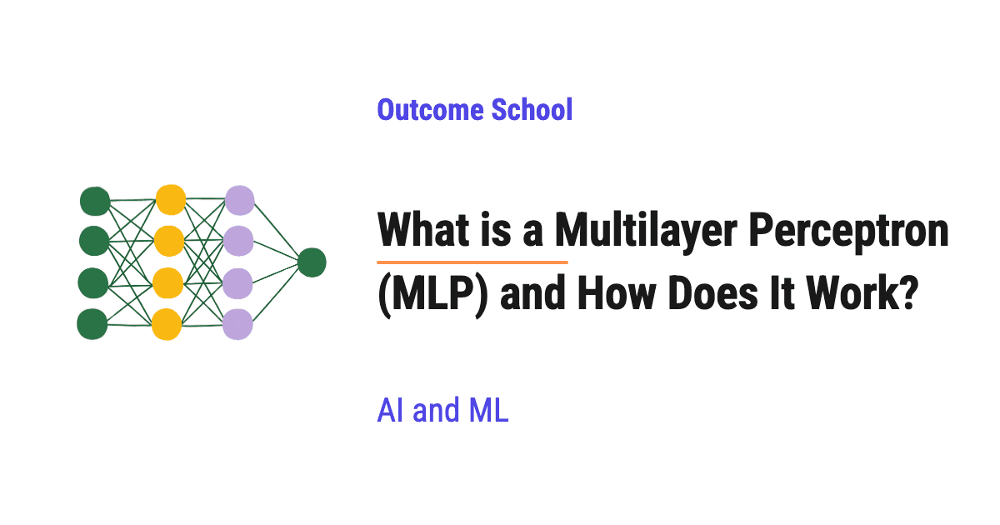

# What is a Multilayer Perceptron (MLP) and How Does It Work?

> Archived from <https://outcomeschool.com/blog/multilayer-perceptron-mlp> on 2026-11-25.

A Multilayer Perceptron (MLP) is a neural network made of layers of simple units called perceptrons, where every unit in one layer is connected to every unit in the next layer. It works by passing numbers forward through these layers, where each unit multiplies, adds, and applies a simple rule, until the last layer gives the answer.

In this blog, we will learn about what a Multilayer Perceptron (MLP) is and how it works. We will also see what a single perceptron is and the XOR problem it cannot solve, how stacking layers fixes that problem, how numbers flow through an MLP with a worked example, why we need a non-linear activation, how an MLP learns its weights, and where MLPs are used today.

We will cover the following:
<ul><li>What is a Perceptron?</li><li>The Limit of a Single Perceptron: The XOR Problem</li><li>What is a Multilayer Perceptron (MLP)?</li><li>Forward Pass: Solving XOR with an MLP</li><li>Why Do We Need a Non-Linear Activation?</li><li>How Does an MLP Learn?</li><li>Where are MLPs Used Today?</li></ul>
I am <strong>Amit Shekhar</strong>, Founder @ <a target="_blank" rel="noopener noreferrer" href="https://outcomeschool.com">Outcome School</a>, I have taught and mentored many developers, and their efforts landed them high-paying tech jobs, helped many tech companies in solving their unique problems, and created many open-source libraries being used by top companies. I am passionate about sharing knowledge through open-source, blogs, and videos.

I teach <a target="_blank" rel="noopener noreferrer" href="https://outcomeschool.com/program/ai-and-machine-learning">AI and Machine Learning</a> at Outcome School.

Let&#x27;s get started.
<h2 id="what-is-a-perceptron">What is a Perceptron?</h2>
<strong>A perceptron is the simplest unit of a <a target="_blank" rel="noopener noreferrer" href="neural-network.md">neural network</a>. It takes some numbers as input, multiplies each one by a weight, adds them up with a <a target="_blank" rel="noopener noreferrer" href="bias-in-artificial-neural-network.md">bias</a>, and then applies a simple rule to decide the output.</strong>

Let&#x27;s understand each part:
<ul><li><strong>Inputs:</strong> the numbers we give to it, for example <code>x1</code> and <code>x2</code>.</li><li><strong>Weights:</strong> one number for each input. A weight tells how important that input is.</li><li><strong>Bias:</strong> one extra number that is added at the end. It shifts the result up or down.</li><li><strong>Activation function:</strong> the rule that turns the sum into the output.</li></ul>
The perceptron was introduced by Frank Rosenblatt in 1958. The original perceptron uses the simplest <a target="_blank" rel="noopener noreferrer" href="activation-functions.md">activation function</a>, called the <strong>step function</strong>. If the sum is greater than 0, the output is 1. Otherwise, the output is 0.

The formula is:

<strong>output = step(w1 * x1 + w2 * x2 + b)</strong>

Let&#x27;s take a perceptron with <code>w1 = 1</code>, <code>w2 = 1</code>, and <code>b = -1.5</code>, and give it the inputs <code>x1 = 1</code> and <code>x2 = 1</code>. Let&#x27;s see this as a diagram:

<pre><code class="language-text code-highlight">         x1 = 1, x2 = 1
                ↓
┌───────────────────────────────┐
│ Multiply by weights, add bias │
│ sum = 1*1 + 1*1 + (-1.5)      │
│     = 0.5                     │
└───────────────────────────────┘
                ↓
┌───────────────────────────────┐
│ Step function                 │
│ 0.5 &gt; 0, so step(0.5) = 1     │
└───────────────────────────────┘
                ↓
           output = 1
</code></pre>

Here, we can see that the two inputs are multiplied by their weights, added together with the bias <code>b = -1.5</code>, and then the step function gives the final output.

This perceptron behaves like the <strong>AND</strong> rule. It gives 1 only when both inputs are 1. Let&#x27;s check all four cases:
<table><thead><tr><th>x1</th><th>x2</th><th>sum</th><th>output</th></tr></thead><tbody><tr><td>0</td><td>0</td><td>0 + 0 - 1.5 = -1.5</td><td>0</td></tr><tr><td>0</td><td>1</td><td>0 + 1 - 1.5 = -0.5</td><td>0</td></tr><tr><td>1</td><td>0</td><td>1 + 0 - 1.5 = -0.5</td><td>0</td></tr><tr><td>1</td><td>1</td><td>1 + 1 - 1.5 = 0.5</td><td>1</td></tr></tbody></table>
If we change only the bias to <code>b = -0.5</code>, the same perceptron behaves like the <strong>OR</strong> rule. It gives 1 when at least one input is 1.

So, by choosing the weights and the bias, one perceptron can follow simple rules like AND and OR.
<h2 id="the-limit-of-a-single-perceptron-the-xor-problem">The Limit of a Single Perceptron: The XOR Problem</h2>
Now, let&#x27;s take a rule called <strong>XOR</strong> (exclusive OR). XOR gives 1 when exactly one of the two inputs is 1. It gives 0 when both are the same.
<table><thead><tr><th>x1</th><th>x2</th><th>XOR</th></tr></thead><tbody><tr><td>0</td><td>0</td><td>0</td></tr><tr><td>0</td><td>1</td><td>1</td></tr><tr><td>1</td><td>0</td><td>1</td></tr><tr><td>1</td><td>1</td><td>0</td></tr></tbody></table>
Let&#x27;s place these four cases on a grid as a diagram:

<pre><code class="language-text code-highlight">  x2
   │
 1 │   (0,1)        (1,1)
   │   XOR = 1      XOR = 0
   │
 0 │   (0,0)        (1,0)
   │   XOR = 0      XOR = 1
   │
   └──────────────────────────── x1
         0            1
</code></pre>

Here, we can see that the two 1s sit on one diagonal, and the two 0s sit on the other diagonal.

Now, the question is: why does this matter for a perceptron?

A single perceptron computes <code>w1 * x1 + w2 * x2 + b</code> and checks if it is greater than 0. The points where this sum is exactly 0 form a <strong>straight line</strong> on the grid. Everything on one side of the line gives 1, and everything on the other side gives 0. Means, a single perceptron can only split the grid into two parts with one straight line.

Let&#x27;s see the AND rule with the line of our AND perceptron (<code>x1 + x2 - 1.5 = 0</code>) as a diagram:

<pre><code class="language-text code-highlight">  x2
   │         ╲
 1 │   0      ╲  1
   │           ╲
   │            ╲
   │             ╲
 0 │   0         0╲
   │               ╲
   └──────────────────── x1
       0         1
</code></pre>

Here, we can see that the line keeps the single 1 at (1,1) on one side and the three 0s on the other side. So, for AND, one straight line is enough. Similarly, for OR, one straight line can cut off the corner (0,0) from the other three points.

But for XOR, we need the two 1s on one side and the two 0s on the other side. No single straight line can do this, because the 1s and the 0s sit on crossing diagonals. Any line that puts (0,1) and (1,0) on one side also puts at least one of (0,0) or (1,1) on that same side.

<strong>Hence, a single perceptron cannot solve XOR, no matter which weights and bias we choose.</strong>

This limit was pointed out in 1969 in the book &quot;Perceptrons&quot; by Marvin Minsky and Seymour Papert, and it is often linked to a slowdown in neural network research in the 1970s. We needed a solution for that, and stacking perceptrons in layers was the answer.

<strong>Planning your move into AI?</strong>

No matter which tech domain you work in today, with your effort, you can transition to these roles:
<ul><li>AI Engineer</li><li>Forward Deployed Engineer</li><li>AI Agent Engineer</li><li>Harness Engineer</li><li>Voice AI Engineer</li><li>AI Architect</li><li>LLM Engineer</li><li>LLM Inference Engineer</li><li>Gen AI Engineer</li><li>MLOps Engineer</li><li>ML Engineer</li><li>Deep Learning Engineer</li></ul>
Our <a target="_blank" rel="noopener noreferrer" href="https://outcomeschool.com/program/ai-and-machine-learning">AI and Machine Learning Program</a> at Outcome School takes you there.
<h2 id="what-is-a-multilayer-perceptron-mlp">What is a Multilayer Perceptron (MLP)?</h2>
<strong>A Multilayer Perceptron (MLP) is a neural network in which perceptrons are arranged in layers, and the output of one layer becomes the input of the next layer.</strong>

An MLP has three kinds of layers:
<ul><li><strong>Input layer:</strong> it holds the input numbers. It does no calculation.</li><li><strong>Hidden layers:</strong> one or more layers in the middle. They are called hidden because we never see their outputs directly. We only see the final answer.</li><li><strong>Output layer:</strong> the last layer. It gives the final answer.</li></ul>
Each perceptron in these layers is also called a <strong>neuron</strong>.

In an MLP, every neuron in one layer is connected to every neuron in the next layer. Such a layer is called a <strong>fully connected layer</strong> (also called a <strong>dense layer</strong>). Each connection has its own weight, and each neuron has its own bias.

Let&#x27;s see an MLP with 2 inputs, 2 hidden neurons, and 1 output as a diagram:

<pre><code class="language-text code-highlight">       Input layer (2 inputs)
   ┌──────────┐      ┌──────────┐
   │    x1    │      │    x2    │
   └──────────┘      └──────────┘
                 ↓
   4 weights: x1-&gt;h1, x1-&gt;h2,
              x2-&gt;h1, x2-&gt;h2
                 ↓
       Hidden layer (2 neurons)
   ┌──────────┐      ┌──────────┐
   │    h1    │      │    h2    │
   │  + bias  │      │  + bias  │
   └──────────┘      └──────────┘
                 ↓
   2 weights: h1-&gt;y, h2-&gt;y
                 ↓
       Output layer (1 neuron)
            ┌──────────┐
            │    y     │
            │  + bias  │
            └──────────┘
</code></pre>

Here, we can see that <code>x1</code> connects to both <code>h1</code> and <code>h2</code>, and <code>x2</code> also connects to both <code>h1</code> and <code>h2</code>. Then, both <code>h1</code> and <code>h2</code> connect to <code>y</code>. Every neuron connects to every neuron in the next layer, and the numbers flow from top to bottom. Because the numbers only move forward, from the input to the output, an MLP is a type of <strong>feed-forward neural network</strong>.

Let&#x27;s count the numbers that this small MLP needs to learn:
<ul><li>Input to hidden: 2 inputs * 2 hidden neurons = 4 weights, plus 2 biases = 6 numbers.</li><li>Hidden to output: 2 hidden neurons * 1 output = 2 weights, plus 1 bias = 3 numbers.</li><li>Total: 9 numbers.</li></ul>
These weights and biases are called the <strong>parameters</strong> of the MLP.

In practice, a fully connected layer is computed in one go with <a target="_blank" rel="noopener noreferrer" href="matrix-multiplication-in-neural-networks.md">matrix multiplication</a>. We put all the inputs in a list (a vector), all the weights of the layer in a table (a matrix), multiply them, add the biases, and apply the activation to every value. Here, <code>.</code> means matrix multiplication.

<strong>hidden = activation(x . W1 + b1)</strong>

<strong>y = activation(hidden . W2 + b2)</strong>

Real MLPs can have many hidden layers and thousands of neurons in each layer, but the idea stays the same.

<strong>A quick note for you</strong>

No matter which tech domain you work in, get familiar with these topics:
<ul><li>LLM</li><li>RAG</li><li>MCP</li><li>Agent</li><li>Fine-tuning</li><li>Quantization</li></ul>
We put it all together in one video:

<a target="_blank" rel="noopener noreferrer" href="https://www.youtube.com/watch?v=lnfWvX66FUk">AI Engineering Explained: LLM, RAG, MCP, Agent, Fine-Tuning, and Quantization</a>

No need to stop reading - bookmark it and watch later when you get time. Future you will thank you.

Now, let&#x27;s get back to the topic.
<h2 id="forward-pass-solving-xor-with-an-mlp">Forward Pass: Solving XOR with an MLP</h2>
Now, let&#x27;s build an MLP that solves XOR. The process of passing the input forward through the layers to get the output is called the <strong>forward pass</strong>.

We will use the MLP from above (2 inputs, 2 hidden neurons, 1 output), with the step function as the activation, and we will pick the weights by hand.

Here, we must notice that XOR is 1 when &quot;at least one input is 1&quot; (OR) but &quot;not both inputs are 1&quot; (not AND). So, we can build it as below:
<ul><li>Hidden neuron <code>h1</code> will compute OR: <code>h1 = step(x1 + x2 - 0.5)</code></li><li>Hidden neuron <code>h2</code> will compute AND: <code>h2 = step(x1 + x2 - 1.5)</code></li><li>Output neuron <code>y</code> will compute &quot;h1 and not h2&quot;: <code>y = step(h1 - h2 - 0.5)</code></li></ul>
Let&#x27;s see the forward pass for the input <code>x1 = 1</code>, <code>x2 = 1</code> as a diagram:

<pre><code class="language-text code-highlight">       x1 = 1, x2 = 1
              ↓
┌───────────────────────────┐
│ h1 = step(1 + 1 - 0.5)    │
│    = step(1.5) = 1        │
│ h2 = step(1 + 1 - 1.5)    │
│    = step(0.5) = 1        │
└───────────────────────────┘
              ↓
┌───────────────────────────┐
│ y = step(1 - 1 - 0.5)     │
│   = step(-0.5) = 0        │
└───────────────────────────┘
              ↓
          output = 0
</code></pre>

Here, we can see that both hidden neurons fire, the AND neuron cancels the OR neuron, and the output is 0, which is the correct XOR answer for (1, 1).

Let me tabulate all four cases:
<table><thead><tr><th>x1</th><th>x2</th><th>h1 (OR)</th><th>h2 (AND)</th><th>y = step(h1 - h2 - 0.5)</th><th>XOR</th></tr></thead><tbody><tr><td>0</td><td>0</td><td>0</td><td>0</td><td>step(-0.5) = 0</td><td>0</td></tr><tr><td>0</td><td>1</td><td>1</td><td>0</td><td>step(0.5) = 1</td><td>1</td></tr><tr><td>1</td><td>0</td><td>1</td><td>0</td><td>step(0.5) = 1</td><td>1</td></tr><tr><td>1</td><td>1</td><td>1</td><td>1</td><td>step(-0.5) = 0</td><td>0</td></tr></tbody></table>
All four outputs match XOR. Two layers solved the problem that one perceptron could not solve.

Here, the hidden layer changed the two inputs into two new features: &quot;is at least one input 1?&quot; and &quot;are both inputs 1?&quot;. With these features, one straight line in the output neuron is enough.

Let&#x27;s see the same forward pass in Python as below:

<pre><code class="code-highlight language-python">import numpy as np

def step(z):
    return (z &gt; 0).astype(int)

W1 = np.array([[1, 1],
               [1, 1]])
b1 = np.array([-0.5, -1.5])
W2 = np.array([1, -1])
b2 = -0.5

for x in [[0, 0], [0, 1], [1, 0], [1, 1]]:
    h = step(np.array(x) @ W1 + b1)
    y = step(h @ W2 + b2)
    print(x, &quot;-&gt;&quot;, h, &quot;-&gt;&quot;, y)
</code></pre>

Here, we have:
<ul><li><code>step</code> returns 1 where the value is greater than 0, and 0 otherwise.</li><li><code>W1</code> holds the 4 weights from the inputs to the hidden layer, and <code>b1</code> holds the 2 hidden biases.</li><li><code>W2</code> holds the 2 weights from the hidden layer to the output, and <code>b2</code> is the output bias.</li><li><code>np.array(x) @ W1 + b1</code> is the fully connected layer: multiply by the weights and add the bias.</li></ul>
This will print the following:

<pre><code class="language-text code-highlight">[0, 0] -&gt; [0 0] -&gt; 0
[0, 1] -&gt; [1 0] -&gt; 1
[1, 0] -&gt; [1 0] -&gt; 1
[1, 1] -&gt; [1 1] -&gt; 0
</code></pre>

It works perfectly.
<h2 id="why-do-we-need-a-non-linear-activation">Why Do We Need a Non-Linear Activation?</h2>
As we have seen, an <strong>activation function</strong> is the rule each neuron applies to its sum. The step function is one example. It is called <strong>non-linear</strong> because its output is not just the input multiplied by a number and shifted. It bends the result.

Now, the question is: what if we remove the step function from our XOR MLP and just pass the plain sum forward?

Then, our hidden neurons compute:
<ul><li><code>h1 = x1 + x2 - 0.5</code></li><li><code>h2 = x1 + x2 - 1.5</code></li></ul>
And the output computes:
<ul><li><code>y = h1 - h2 - 0.5</code></li></ul>
Let&#x27;s put <code>h1</code> and <code>h2</code> inside <code>y</code>:

<code>y = (x1 + x2 - 0.5) - (x1 + x2 - 1.5) - 0.5 = 0.5</code>

The <code>x1</code> and <code>x2</code> cancel out, and <code>y</code> is always 0.5, for every input. This is a straight-line rule again (here, a flat one), and it cannot be XOR.

This is true in general. Every layer without an activation does &quot;multiply by weights and add a bias&quot;. For example, if the first layer does <code>h = 2 * x + 1</code> and the second layer does <code>y = 3 * h + 4</code>, then together they do <code>y = 3 * (2 * x + 1) + 4 = 6 * x + 7</code>. This is again just one &quot;multiply and add&quot;, which one layer can do alone. <strong>So, without a non-linear activation, any number of layers collapses into a single layer</strong>, and we are back to one straight line.

The non-linear activation lets each extra layer bend and combine the straight lines from the previous layer into a new shape. In our XOR MLP, the step function turned the two lines of <code>h1</code> and <code>h2</code> into the 0 or 1 features &quot;is at least one input 1?&quot; and &quot;are both inputs 1?&quot;, and that is what made XOR possible.

<strong>Stay updated:</strong> Subscribe to our <a target="_blank" rel="noopener noreferrer" href="https://outcomeschool.substack.com/subscribe">newsletter</a> to get our latest AI and Machine Learning blogs straight to your inbox.
<h2 id="how-does-an-mlp-learn">How Does an MLP Learn?</h2>
In our XOR example, we picked the weights by hand. But a real MLP has thousands or even billions of weights, so the MLP learns them from examples. This is called <strong>training</strong>.

Let&#x27;s see the training loop as a diagram:

<pre><code class="language-text code-highlight">┌──────────────────────────────────┐
│ 1. Start with random weights     │
└──────────────────────────────────┘
                 ↓
┌──────────────────────────────────┐
│ 2. Forward pass: input -&gt; output │
└──────────────────────────────────┘
                 ↓
┌──────────────────────────────────┐
│ 3. Loss: how far is the output   │
│    from the correct answer?      │
└──────────────────────────────────┘
                 ↓
┌──────────────────────────────────┐
│ 4. Backpropagation: find how     │
│    each weight affected the loss │
└──────────────────────────────────┘
                 ↓
┌──────────────────────────────────┐
│ 5. Nudge each weight a little    │
│    to make the loss smaller      │
└──────────────────────────────────┘
                 ↓
        repeat from step 2
</code></pre>

Here, the <strong>loss</strong> is a single number that tells how wrong the output is. <strong><a target="_blank" rel="noopener noreferrer" href="math-behind-backpropagation.md">Backpropagation</a></strong> goes backward from the output to the input and finds, for every weight, whether increasing it would make the loss go up or down. Then, we change each weight a little in the direction that lowers the loss. This is called <strong><a target="_blank" rel="noopener noreferrer" href="math-behind-gradient-descent.md">gradient descent</a></strong>.

We repeat this loop many times over many examples, and slowly the weights settle on values that give correct answers.

We have a detailed blog on <a target="_blank" rel="noopener noreferrer" href="l1-and-l2-loss-functions.md">L1 and L2 Loss Functions</a> that explains how the loss is calculated in depth.

One more thing to notice: the step function jumps suddenly from 0 to 1, so a tiny change in a weight usually does not change the output at all. Backpropagation cannot learn from that. That is why real MLPs use smooth non-linear activations, such as <strong>ReLU</strong> (which keeps positive numbers and turns negative numbers into 0) or <strong>sigmoid</strong> (which squeezes any number into the range 0 to 1). They still bend the result, and a small change in a weight gives a small change in the output.

If we train an MLP on the four XOR examples, it usually finds weights that solve XOR on its own. They will not be our hand-picked numbers, but they will do the same job.

To learn Backpropagation, Gradient Descent, and Activation Functions, and to build a Neural Network from scratch, check out our <a target="_blank" rel="noopener noreferrer" href="https://outcomeschool.com/program/ai-and-machine-learning">AI and Machine Learning Program</a> at Outcome School.
<h2 id="where-are-mlps-used-today">Where are MLPs Used Today?</h2>
MLPs are one of the most widely used building blocks in AI. Few important places where they are used:
<ul><li><strong>Tabular data:</strong> predicting a house price from size, rooms, and location, or predicting whether a customer will leave.</li><li><strong>Final classification layers:</strong> many image and text models end with an MLP that turns the learned features into the final answer, for example &quot;cat&quot; or &quot;dog&quot;.</li><li><strong><a target="_blank" rel="noopener noreferrer" href="recommendation-system.md">Recommendation systems</a>:</strong> combining user features and item features to predict what a user will like.</li><li><strong>Inside Transformers:</strong> every <a target="_blank" rel="noopener noreferrer" href="decoding-transformer-architecture.md">Transformer</a> block, the building block of LLMs (Large Language Models), has a <strong><a target="_blank" rel="noopener noreferrer" href="feed-forward-networks-in-llms.md">feed-forward network</a></strong>, which is an MLP with one hidden layer. After <a target="_blank" rel="noopener noreferrer" href="self-attention-in-transformers.md">Self Attention</a> mixes information between tokens, this MLP processes each token on its own. Its hidden layer is usually about 4 times wider than the token&#x27;s vector, so it expands the vector, applies a non-linear activation, and then shrinks it back to the original size. A large share of an LLM&#x27;s parameters live in these MLP blocks.</li></ul>
Now we must have understood what a Multilayer Perceptron (MLP) is, how it works, and where it is used.
<h2 id="frequently-asked-questions">Frequently Asked Questions</h2><h3 id="what-is-the-difference-between-a-perceptron-and-a-multilayer-perceptron">What is the difference between a perceptron and a Multilayer Perceptron?</h3>
A perceptron is a single unit that multiplies its inputs by weights, adds a bias, and applies an activation function. A Multilayer Perceptron arranges many perceptrons in layers, where the output of one layer becomes the input of the next. A single perceptron can only split the data with one straight line, while an MLP can solve problems like XOR.
<h3 id="is-an-mlp-a-feed-forward-neural-network">Is an MLP a feed-forward neural network?</h3>
Yes. An MLP is a type of feed-forward neural network, because the numbers only move forward, from the input layer through the hidden layers to the output layer. Every neuron in one layer is connected to every neuron in the next layer, and such a layer is called a fully connected layer or a dense layer.
<h3 id="why-dont-real-mlps-use-the-step-function">Why don&#x27;t real MLPs use the step function?</h3>
The step function jumps suddenly from 0 to 1, so a tiny change in a weight usually does not change the output at all, and backpropagation cannot learn from that. That is why real MLPs use smooth non-linear activations such as ReLU or sigmoid. They still bend the result, and a small change in a weight gives a small change in the output.
<h3 id="how-many-parameters-does-an-mlp-have">How many parameters does an MLP have?</h3>
An MLP has one weight for every connection and one bias for every neuron, and together these are its parameters. For example, an MLP with 2 inputs, 2 hidden neurons, and 1 output has 4 weights and 2 biases in the hidden layer, plus 2 weights and 1 bias in the output layer, which gives 9 parameters in total.

That&#x27;s it for now.

Thanks

<strong>Amit Shekhar</strong> Founder @ <a target="_blank" rel="noopener noreferrer" href="https://outcomeschool.com">Outcome School</a>

You can connect with me on:
<ul><li><a target="_blank" rel="noopener noreferrer" href="https://x.com/amitiitbhu">X</a></li><li><a target="_blank" rel="noopener noreferrer" href="https://www.linkedin.com/in/amit-shekhar-iitbhu">LinkedIn</a></li><li><a target="_blank" rel="noopener noreferrer" href="https://github.com/amitshekhariitbhu">GitHub</a></li></ul>
Follow Outcome School on:
<ul><li><a target="_blank" rel="noopener noreferrer" href="https://x.com/outcome_school">X</a></li><li><a target="_blank" rel="noopener noreferrer" href="https://youtube.com/@OutcomeSchool">YouTube</a></li><li><a target="_blank" rel="noopener noreferrer" href="https://www.linkedin.com/company/outcomeschool">LinkedIn</a></li><li><a target="_blank" rel="noopener noreferrer" href="http://github.com/OutcomeSchool">GitHub</a></li></ul>
<a target="_blank" rel="noopener noreferrer" href="https://outcomeschool.com/blog"><strong>Read all of our high-quality blogs here.</strong></a>

