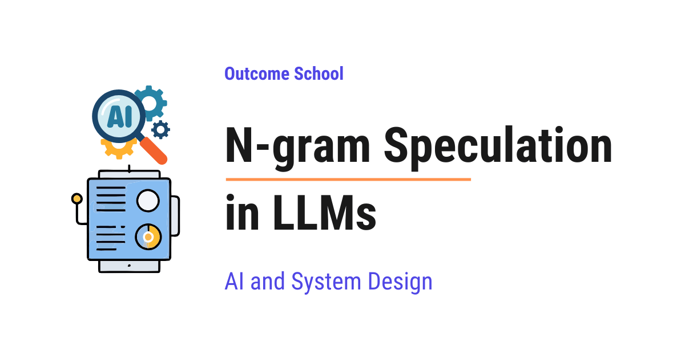

# What is N-gram Speculation in LLMs and How Does It Speed Up Generation?

> Archived from <https://outcomeschool.com/blog/n-gram-speculation-in-llms> on 2026-11-25.

N-gram Speculation is a simple trick that makes an LLM write its answer faster. It guesses the next few tokens by finding the same words earlier in the text, and then the model verifies all those guesses in one single run.

In this blog, we will learn about N-gram Speculation in LLMs, a simple trick that makes a language model write its answer faster by guessing the next few words from the text it has already seen. We will also see how an LLM writes one token at a time, why that is slow, what Speculative Decoding is, what an n-gram is, how N-gram Speculation guesses the next tokens by looking up the prompt, how the model verifies those guesses without changing the final answer, and where it works well and where it fails.

We will cover the following:
<ul><li>How an LLM generates text</li><li>Why generating text is slow</li><li>What is Speculative Decoding?</li><li>The cost of a draft model</li><li>What is an N-gram?</li><li>What is N-gram Speculation?</li><li>N-gram Speculation step by step</li><li>Why the output stays exactly the same</li><li>Where it works well and where it fails</li><li>N-gram Speculation vs Draft Model Speculative Decoding</li></ul>
I am <strong>Amit Shekhar</strong>, Founder @ <a target="_blank" rel="noopener noreferrer" href="https://outcomeschool.com">Outcome School</a>, I have taught and mentored many developers, and their efforts landed them high-paying tech jobs, helped many tech companies in solving their unique problems, and created many open-source libraries being used by top companies. I am passionate about sharing knowledge through open-source, blogs, and videos.

I teach <a target="_blank" rel="noopener noreferrer" href="https://outcomeschool.com/program/ai-and-machine-learning">AI and Machine Learning</a> at Outcome School.

Let&#x27;s get started.
<h2 id="how-an-llm-generates-text">How an LLM generates text</h2>
An LLM is a Large Language Model. It is an AI model that reads text and writes text. When we ask a chatbot a question, an LLM is writing the answer.

Before jumping into N-gram Speculation, we must know one thing about how an LLM writes.

<strong>An LLM writes its answer one token at a time.</strong>

A <a target="_blank" rel="noopener noreferrer" href="tokenization-in-llms.md"><strong>token</strong></a> is a small piece of text. For the sake of understanding, we can think of a token as a word. So, the sentence &quot;The cat sat on the mat&quot; has six tokens. Punctuation marks like &quot;.&quot; are also tokens.

The text we give to the model is called the <strong>prompt</strong>. It can be a question, a document, a piece of code, or anything else.

Let&#x27;s say our prompt asks the model to write a sentence about a cat. The model works like below:
<ul><li>It reads everything written so far, which is the prompt, and predicts one token: &quot;The&quot;</li><li>It adds &quot;The&quot; to the text, reads everything again, and predicts the next token: &quot;cat&quot;</li><li>It adds &quot;cat&quot;, reads everything again, and predicts: &quot;sat&quot;</li><li>And so on, till the answer is complete.</li></ul>
So, to write 100 tokens, the model runs 100 times. Each run is called a <strong>decoding step</strong>.

And, every new token depends on all the tokens before it. So, the model cannot write the 10th token before it has written the 9th token. It has to go one by one.

We have a detailed blog on <a target="_blank" rel="noopener noreferrer" href="autoregressive-models.md">Autoregressive Models</a> that explains this one-token-at-a-time generation in depth.
<h2 id="why-generating-text-is-slow">Why generating text is slow</h2>
Now, the question is, why is this slow?

An LLM has billions of numbers inside it, called <strong>weights</strong>. The model runs on a special chip called the <a target="_blank" rel="noopener noreferrer" href="how-does-a-gpu-work-for-deep-learning.md"><strong>GPU</strong></a>. To predict even one token, the GPU has to load all these billions of weights from memory and do the math.

But, here is the catch. Loading the weights from memory takes much more time than doing the math. The GPU is very fast at math. But, it has to wait for the weights to arrive from memory. Most of the time, the GPU is just waiting.

Let&#x27;s take an analogy. Assume that we have a chef who can cook ten dishes at once. But, the helper brings the ingredients from the store room for only one dish at a time. The chef cooks that one dish in a second and then waits for the helper again. The chef is fast, but the kitchen is slow because of the trips to the store room.

The GPU is the chef. The memory is the store room. Loading weights is the trip. Predicting one token is one dish.

The number of trips decides the speed, not the cooking. This is called being <strong>memory-bound</strong>. The speed is limited by memory, not by the math.

We have a detailed blog on <a target="_blank" rel="noopener noreferrer" href="prefill-vs-decode-llm-inference-optimization.md">Prefill vs Decode</a> that explains why this decode phase of an LLM is memory-bound.

Now, one more important thing. Suppose the helper carries the ingredients for ten dishes in a single trip. The trip takes the same time as before. And, the chef cooks all ten dishes at once. So, we get ten dishes in the time we earlier got one.

Similarly, once the weights are loaded, the GPU can process many tokens at once for almost the same cost as one token.

But, there is a problem. The model cannot produce ten new tokens at once, because the second token depends on the first, the third depends on the second, and so on. It has to go one by one.

What it can do is check ten tokens at once, if someone gives it those ten tokens already. Checking means, for each position, the model tells us what it would have predicted there, and we see whether it agrees with the token we gave.

So, here comes the idea: if we can somehow guess the next few tokens cheaply, and then give all of them to the model to check in one run, we can save a lot of trips.

Here comes the <a target="_blank" rel="noopener noreferrer" href="speculative-decoding.md">Speculative Decoding</a> into the picture.
<h2 id="what-is-speculative-decoding">What is Speculative Decoding?</h2>
<strong>Speculative Decoding is a technique where we first guess the next few tokens quickly, and then ask the big model to verify all those guesses in one single run.</strong>

Here, the big model means our actual LLM, the one whose answer we want.

Speculate means to guess. So, Speculative Decoding = Guess first + Verify later.

It has two parts:
<ul><li><strong>Draft</strong>: Something cheap and fast guesses the next few tokens. Let&#x27;s say it guesses 5 tokens.</li><li><strong>Verify</strong>: The big model takes all 5 guessed tokens together and checks them in one run. It accepts the guesses it agrees with and throws away the rest.</li></ul>
If the big model agrees with all 5 guesses, we get 5 tokens in the time of 1 run. If it agrees with only 2, we get 2 tokens plus one more correct token from the big model itself. Either way, we never get less than 1 token per run. So, we never lose.

Now, the next big question is: who does the guessing?

In the original Speculative Decoding, the guessing is done by a small LLM called the <strong>draft model</strong>. It is a smaller version of the big model, so it is fast, and it guesses reasonably well.

To learn Speculative Decoding, LLM Internals, and LLM Inference Bottleneck Analysis, and to build a Large Language Model (LLM) from scratch, check out our <a target="_blank" rel="noopener noreferrer" href="https://outcomeschool.com/program/ai-and-machine-learning">AI and Machine Learning Program</a> at Outcome School.
<h2 id="the-cost-of-a-draft-model">The cost of a draft model</h2>
The draft model works, but it has its own problems.
<ul><li>We need a second model. It has to be trained or found, and it must use the same vocabulary as the big model. Vocabulary means the list of tokens that the model knows. If the two models break text into different tokens, the guesses cannot be compared.</li><li>It takes extra memory on the GPU. Memory is what we are short of.</li><li>It takes time to run. Even if it is small, it still runs once for every guessed token.</li><li>When the big model is updated, the draft model also needs to be updated to match it.</li></ul>
So, the question is, can we guess the next tokens without any extra model at all?

The answer is yes. We just look at the text we already have.

So, here comes the N-gram Speculation to the rescue.
<h2 id="what-is-an-n-gram">What is an N-gram?</h2>
Before jumping into N-gram Speculation, we must know what an n-gram is.

N-gram = N + gram
<ul><li><strong>gram</strong> means a piece or a unit. Here, one unit is one token.</li><li><strong>N</strong> is a number. It tells how many units are together.</li></ul>
In simple words, an n-gram is just N tokens standing next to each other in the text.

Let&#x27;s take the sentence: &quot;the cat sat on the mat&quot;
<ul><li>1-grams: &quot;the&quot;, &quot;cat&quot;, &quot;sat&quot;, &quot;on&quot;, &quot;the&quot;, &quot;mat&quot;</li><li>2-grams: &quot;the cat&quot;, &quot;cat sat&quot;, &quot;sat on&quot;, &quot;on the&quot;, &quot;the mat&quot;</li><li>3-grams: &quot;the cat sat&quot;, &quot;cat sat on&quot;, &quot;sat on the&quot;, &quot;on the mat&quot;</li></ul>
That&#x27;s it. An n-gram is just a small window of N tokens sliding over the text.

Now, one interesting observation. Text repeats a lot. If we see &quot;sat on the&quot; once, and later we see &quot;sat on&quot; again, there is a good chance the next token is &quot;the&quot; again. N-gram Speculation uses exactly this observation.

<strong>Planning your move into AI?</strong>

No matter which tech domain you work in today, with your effort, you can transition to these roles:
<ul><li>AI Engineer</li><li>Forward Deployed Engineer</li><li>AI Agent Engineer</li><li>Harness Engineer</li><li>Voice AI Engineer</li><li>AI Architect</li><li>LLM Engineer</li><li>LLM Inference Engineer</li><li>Gen AI Engineer</li><li>MLOps Engineer</li><li>ML Engineer</li><li>Deep Learning Engineer</li></ul>
Our <a target="_blank" rel="noopener noreferrer" href="https://outcomeschool.com/program/ai-and-machine-learning">AI and Machine Learning Program</a> at Outcome School takes you there.

Now that we have learned about n-grams, it&#x27;s time to learn about N-gram Speculation.
<h2 id="what-is-n-gram-speculation">What is N-gram Speculation?</h2>
<strong>N-gram Speculation is a form of Speculative Decoding where the guesses come from matching n-grams in the text we already have, instead of from a draft model.</strong>

The text we already have means the prompt plus the tokens generated so far.

In simple words, we take the last few tokens we have written. We search for the same few tokens earlier in the text. If found, we copy the tokens that came after that earlier match and use them as the guess.

There is no draft model here. The draft comes from the text itself.

This is also called <strong>Prompt Lookup Decoding</strong>, because we look up the prompt to make the guess.

Let&#x27;s understand with an analogy.

Suppose we are copying a long paragraph from a book by hand. We have written &quot;the quick brown&quot;. We do not need to think hard about what comes next. We just look at the book, find &quot;the quick brown&quot;, and see that &quot;fox jumps over&quot; comes after it. We copy those words quickly. Then we double check that we copied correctly.

The book is our prompt. Looking at the book is the lookup. Copying &quot;fox jumps over&quot; is the draft. Double checking is the verification by the big model.

Why does this work? Because in many real tasks, the answer repeats big chunks of the input. For example, when we ask the model to summarize a document, fix a bug in a code file, or answer from a given passage, the model copies many phrases from the input word by word.

<strong>A quick note for you</strong>

No matter which tech domain you work in, get familiar with these topics:
<ul><li>LLM</li><li>RAG</li><li>MCP</li><li>Agent</li><li>Fine-tuning</li><li>Quantization</li></ul>
We put it all together in one video:

<a target="_blank" rel="noopener noreferrer" href="https://www.youtube.com/watch?v=lnfWvX66FUk">AI Engineering Explained: LLM, RAG, MCP, Agent, Fine-Tuning, and Quantization</a>

No need to stop reading - bookmark it and watch later when you get time. Future you will thank you.

Now, let&#x27;s get back to the topic.
<h2 id="n-gram-speculation-step-by-step">N-gram Speculation step by step</h2>
The best way to learn this is by taking an example.

Let&#x27;s say the prompt given to the model is:

&quot;The cat sat on the mat. The dog sat on the rug. Now, repeat the first sentence:&quot;

And the model has started writing the answer. Till now, it has written:

&quot;The cat sat&quot;

So, the full text is the prompt plus &quot;The cat sat&quot;. We will use the last 2 tokens as the search key, so n = 2. And, we will draft up to 3 tokens, so k = 3.

<strong>Step 1: Take the last n-gram.</strong>

The last 2 tokens written are: &quot;cat sat&quot;. This is our search key.

<strong>Step 2: Look up.</strong>

We search the full text for &quot;cat sat&quot;. We skip the last 2 tokens themselves, because that is the key. We find a match in the prompt: &quot;The <strong>cat sat</strong> on the mat.&quot;

<strong>Step 3: Draft.</strong>

We copy the tokens that came right after the match: &quot;on the mat&quot;. These 3 tokens are our guess.

Draft = &quot;on&quot;, &quot;the&quot;, &quot;mat&quot;

<strong>Step 4: Verify.</strong>

Now, we give the big model the text &quot;The cat sat on the mat&quot; in one single run. The model reads all these tokens together and gives us a prediction at every position at the same time. This is the checking that we talked about earlier.
<ul><li>After &quot;The cat sat&quot;, the model predicts &quot;on&quot;. Draft says &quot;on&quot;. Match. Accept.</li><li>After &quot;The cat sat on&quot;, the model predicts &quot;the&quot;. Draft says &quot;the&quot;. Match. Accept.</li><li>After &quot;The cat sat on the&quot;, the model predicts &quot;mat&quot;. Draft says &quot;mat&quot;. Match. Accept.</li><li>After &quot;The cat sat on the mat&quot;, the model predicts &quot;.&quot;. This is a bonus token that we get for free from the same run. We take it too.</li></ul>
So, in one run of the big model, we got 4 tokens: &quot;on&quot;, &quot;the&quot;, &quot;mat&quot;, &quot;.&quot;. Without speculation, we would have got only 1 token in that one run.

Now, let&#x27;s see a case where the guess is wrong.

Suppose the prompt was &quot;The cat sat on the mat. The cat sat on the sofa. Now, repeat the second sentence:&quot; and the model has written &quot;The cat sat&quot;.

Search key: &quot;cat sat&quot;. We search from the start and find the first match: &quot;The <strong>cat sat</strong> on the mat&quot;. Draft = &quot;on&quot;, &quot;the&quot;, &quot;mat&quot;.

Verify:
<ul><li>After &quot;The cat sat&quot;, the model predicts &quot;on&quot;. Match. Accept.</li><li>After &quot;The cat sat on&quot;, the model predicts &quot;the&quot;. Match. Accept.</li><li>After &quot;The cat sat on the&quot;, the model predicts &quot;sofa&quot;. Draft says &quot;mat&quot;. Mismatch. Reject.</li></ul>
We keep &quot;on&quot; and &quot;the&quot;, and we take the model&#x27;s own token &quot;sofa&quot; in place of the rejected one. Everything after the first rejected token is thrown away, because those guesses were built on top of a wrong token.

So, in this run, we got 3 tokens: &quot;on&quot;, &quot;the&quot;, &quot;sofa&quot;. Still better than 1.

<strong>Step 5: Repeat.</strong>

Now, the text is longer. We take the last 2 tokens again, look up again, draft again, verify again. This continues till the answer is complete.

What if the lookup finds nothing? Then, there is no draft. The big model simply predicts one token as usual. We lose nothing.

Let&#x27;s see the code for the lookup as below:

<pre><code class="language-python code-highlight">def ngram_draft(tokens, n, k):
    key = tokens[-n:]
    for i in range(len(tokens) - n):
        if tokens[i:i + n] == key:
            return tokens[i + n : i + n + k]
    return []
</code></pre>

Here, we have:
<ul><li><code>tokens</code> is the full text so far, the prompt plus everything generated.</li><li><code>n</code> is the size of the n-gram that we use as the search key.</li><li><code>k</code> is the maximum number of tokens we want to guess.</li><li>We take the last <code>n</code> tokens as the <code>key</code>.</li><li>We slide over the text and find where the same <code>n</code> tokens appear earlier.</li><li>When we find a match, we return the <code>k</code> tokens that come after it as the draft.</li><li>If nothing matches, we return an empty list, which means no guess.</li></ul>
Now, let&#x27;s see how the main loop uses it as below:

<pre><code class="language-python code-highlight">while not done:
    draft = ngram_draft(tokens, n=2, k=3)
    accepted, next_token = big_model.verify(tokens, draft)
    tokens = tokens + accepted + [next_token]
</code></pre>

Here, we have:
<ul><li>We get a draft by looking up the text.</li><li>The big model verifies all the draft tokens in one single run and returns the accepted ones and one extra token of its own.</li><li>We add the accepted tokens and the extra token to our text.</li><li>We repeat till the answer is done.</li></ul>
<strong>Note:</strong> Real implementations try multiple sizes of n, like 3, then 2, then 1, and search from the end of the text first, because recent text is more likely to repeat. In our second example, searching from the end would have found &quot;cat sat on the sofa&quot; first and the guess would have been correct. But the core idea is the same.

This was all about how N-gram Speculation works step by step. Now, let&#x27;s understand why the final answer does not change.

If we want to go deep into LLM Inference Engineering and how to design an LLM Inference Platform (vLLM-as-a-Service), we have a complete program on this - check out our <a target="_blank" rel="noopener noreferrer" href="https://outcomeschool.com/program/ai-and-machine-learning">AI and Machine Learning Program</a> at Outcome School.
<h2 id="why-the-output-stays-exactly-the-same">Why the output stays exactly the same</h2>
This is the most important thing to understand.

<strong>N-gram Speculation does not change what the model writes. It only changes how fast the model writes it.</strong>

The reason is verification. The draft is just a suggestion. The big model has the final say at every single position.

Let&#x27;s think about it. At every position, we compare the draft token with what the big model itself predicts. If they match, we keep it. But, that is exactly the token the big model would have produced anyway. If they do not match, we throw the draft away and use the big model&#x27;s own token.

So, in every case, every token in the final answer is a token that the big model chose. The draft only helped us skip some runs. The answer is the same as if we had never used speculation.

<strong>Note:</strong> This is exactly true when the model picks the single most likely token every time, which is called <strong><a target="_blank" rel="noopener noreferrer" href="greedy-decoding-vs-beam-search.md">greedy decoding</a></strong>. When the model picks tokens randomly based on their probabilities, which is called <strong><a target="_blank" rel="noopener noreferrer" href="how-does-temperature-control-llm-output.md">sampling</a></strong>, a slightly smarter verification rule is used so that the answers still come out with the same probabilities as before. For the sake of understanding, we can say the final output quality is the same.

Now, let&#x27;s see where we must use it and where we must not.
<h2 id="where-it-works-well-and-where-it-fails">Where it works well and where it fails</h2>
N-gram Speculation works well when the output repeats the input.
<ul><li><strong>Summarization</strong>: The summary reuses many phrases from the document.</li><li><strong>Code editing</strong>: When we ask the model to fix a small bug, most of the returned code is the same as the input code.</li><li><a target="_blank" rel="noopener noreferrer" href="retrieval-augmented-generation-rag.md"><strong>RAG (Retrieval Augmented Generation)</strong></a>: Here, we first search for related passages and put them in the prompt. The model then answers from those passages, so it copies facts and sentences from them.</li><li><strong>Repetitive text</strong>: JSON, tables, lists, where the same structure repeats again and again.</li></ul>
In these cases, the draft is often correct, and we can get 2 to 4 times faster generation for free, without any extra model.

N-gram Speculation fails when the output is new text that is not in the prompt.
<ul><li><strong>Creative writing</strong>: A poem or a story from a short prompt. There is nothing to look up.</li><li><strong>Open-ended chat</strong>: &quot;Tell me about black holes.&quot; The prompt is short, the answer is long and new.</li><li><strong>Translation</strong>: The output is in a different language, so the words do not match the input.</li></ul>
In these cases, the lookup finds nothing or finds wrong guesses. We do not get slower in any big way, because a failed lookup is very cheap, but we also do not get faster.

So, based on our use case, we must decide. If the task copies from the input, N-gram Speculation is a free win.

Now that we have learned about N-gram Speculation, let&#x27;s compare it with the draft model approach.

To master RAG, LLM Inference Performance Metrics, and Model Deployment and Serving, check out our <a target="_blank" rel="noopener noreferrer" href="https://outcomeschool.com/program/ai-and-machine-learning">AI and Machine Learning Program</a> at Outcome School.
<h2 id="n-gram-speculation-vs-draft-model-speculative-decoding">N-gram Speculation vs Draft Model Speculative Decoding</h2>
Let me tabulate the differences between N-gram Speculation and Draft Model Speculative Decoding for your better understanding so that you can decide which one to use based on your use case.
<table><thead><tr><th></th><th>N-gram Speculation</th><th>Draft Model Speculative Decoding</th></tr></thead><tbody><tr><td>Who makes the guess</td><td>A simple lookup in the existing text</td><td>A small neural network model</td></tr><tr><td>Extra model needed</td><td>No</td><td>Yes</td></tr><tr><td>Extra GPU memory</td><td>Almost none</td><td>Yes, for the draft model</td></tr><tr><td>Cost of making a guess</td><td>Very less, just a text search</td><td>Small, but it is a model run for every guessed token</td></tr><tr><td>Works best for</td><td>Tasks that copy from the input: summarization, code editing, RAG</td><td>Any task, including creative and open-ended text</td></tr><tr><td>Quality of guess on new text</td><td>Poor, nothing to look up</td><td>Good, the draft model can think</td></tr><tr><td>Setup effort</td><td>Very less, works with any model</td><td>Needs a matching draft model with the same vocabulary</td></tr><tr><td>Final output</td><td>Exactly the same as the big model</td><td>Exactly the same as the big model</td></tr></tbody></table>
If our workload is mostly summarization, editing, or RAG, N-gram Speculation gives a good speed-up with zero extra cost. If our workload is open-ended, a draft model is the better choice. Many production systems use both together: try the n-gram lookup first, and fall back to the draft model when the lookup finds nothing.

There are also methods that drop the separate draft model in a different way, by training small extra heads on the big model so that it can draft for itself. We have detailed blogs on <a target="_blank" rel="noopener noreferrer" href="decoding-medusa.md">Medusa</a> and <a target="_blank" rel="noopener noreferrer" href="decoding-eagle.md">EAGLE</a> that explain how these work.

Let&#x27;s summarize what we have learned.

An LLM writes one token at a time, and each step is slow because the GPU spends most of its time loading weights from memory. Speculative Decoding guesses a few tokens first and verifies them all in one run. A draft model can make the guesses, but it costs memory and time. N-gram Speculation makes the guesses by simply looking up the last few tokens in the text we already have and copying what came after them. The big model verifies every guess, so the final answer is exactly the same, just faster. It works very well when the answer repeats the input, and does nothing harmful when it does not.

This is how N-gram Speculation makes an LLM faster without any extra model.

<strong>Stay updated:</strong> Subscribe to our <a target="_blank" rel="noopener noreferrer" href="https://outcomeschool.substack.com/subscribe">newsletter</a> to get our latest AI and Machine Learning blogs straight to your inbox.
<h2 id="frequently-asked-questions">Frequently Asked Questions</h2><h3 id="is-prompt-lookup-decoding-the-same-as-n-gram-speculation">Is Prompt Lookup Decoding the same as N-gram Speculation?</h3>
Yes. N-gram Speculation is also called Prompt Lookup Decoding, because we look up the prompt to make the guess. We take the last few tokens, find the same tokens earlier in the text, and copy what came after them as the draft.
<h3 id="can-n-gram-speculation-make-generation-slower">Can N-gram Speculation make generation slower?</h3>
Not in any big way. When the lookup finds nothing, there is no draft and the big model simply predicts one token as usual. A failed lookup is very cheap, so we do not lose much, but we also do not get faster on such tasks.
<h3 id="how-much-faster-can-n-gram-speculation-make-an-llm">How much faster can N-gram Speculation make an LLM?</h3>
When the output repeats the input, like in summarization, code editing, or RAG, the draft is often correct and we can get 2 to 4 times faster generation. This speed-up comes for free, without any extra model.
<h3 id="can-we-use-n-gram-speculation-and-a-draft-model-together">Can we use N-gram Speculation and a draft model together?</h3>
Yes. Many production systems use both together. They try the n-gram lookup first and fall back to the draft model when the lookup finds nothing. This way, copy-heavy tasks get a free speed-up, and open-ended tasks still get good guesses from the draft model.
<h3 id="does-n-gram-speculation-help-with-translation">Does N-gram Speculation help with translation?</h3>
No. In translation, the output is in a different language, so the words do not match the input. The lookup finds nothing or finds wrong guesses. The same is true for creative writing and open-ended chat, where the answer is new text that is not in the prompt.

That&#x27;s it for now.

Thanks

<strong>Amit Shekhar</strong> Founder @ <a target="_blank" rel="noopener noreferrer" href="https://outcomeschool.com">Outcome School</a>

You can connect with me on:
<ul><li><a target="_blank" rel="noopener noreferrer" href="https://x.com/amitiitbhu">X</a></li><li><a target="_blank" rel="noopener noreferrer" href="https://www.linkedin.com/in/amit-shekhar-iitbhu">LinkedIn</a></li><li><a target="_blank" rel="noopener noreferrer" href="https://github.com/amitshekhariitbhu">GitHub</a></li></ul>
Follow Outcome School on:
<ul><li><a target="_blank" rel="noopener noreferrer" href="https://x.com/outcome_school">X</a></li><li><a target="_blank" rel="noopener noreferrer" href="https://youtube.com/@OutcomeSchool">YouTube</a></li><li><a target="_blank" rel="noopener noreferrer" href="https://www.linkedin.com/company/outcomeschool">LinkedIn</a></li><li><a target="_blank" rel="noopener noreferrer" href="http://github.com/OutcomeSchool">GitHub</a></li></ul>
<a target="_blank" rel="noopener noreferrer" href="https://outcomeschool.com/blog"><strong>Read all of our high-quality blogs here.</strong></a>

