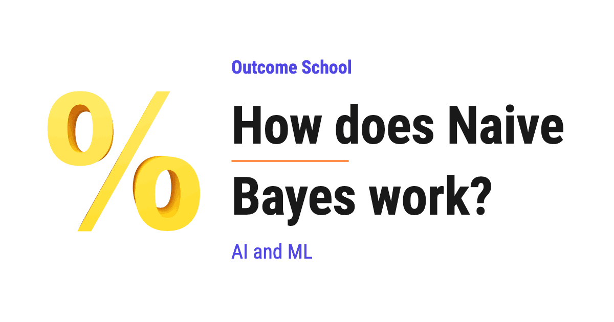

# How does Naive Bayes work?

> Archived from <https://outcomeschool.com/blog/naive-bayes> on 2026-11-25.

Naive Bayes is a method that sorts things into groups using Bayes&#x27; theorem, a rule about chance, while naively assuming each clue is independent of the others.

In this blog, we will learn about how Naive Bayes works. We will also see Bayes&#x27; theorem behind it, why it is called &quot;naive&quot;, how it is trained and how it makes a prediction using a spam filter example, how Laplace smoothing fixes the zero problem, its three types, and where it works well and where it fails.

We will cover the following:
<ul><li>What is Naive Bayes?</li><li>Bayes&#x27; theorem in plain words</li><li>Why it is called &quot;Naive&quot;</li><li>A real example: the spam filter</li><li>Step by step: training the model</li><li>Step by step: making a prediction</li><li>The problem of the zero, and Laplace smoothing</li><li>The three types of Naive Bayes</li><li>Why Naive Bayes is so popular</li><li>Limitations of Naive Bayes</li><li>Where Naive Bayes is used today</li></ul>
I am <strong>Amit Shekhar</strong>, Founder @ <a target="_blank" rel="noopener noreferrer" href="https://outcomeschool.com">Outcome School</a>, I have taught and mentored many developers, and their efforts landed them high-paying tech jobs, helped many tech companies in solving their unique problems, and created many open-source libraries being used by top companies. I am passionate about sharing knowledge through open-source, blogs, and videos.

I teach <a target="_blank" rel="noopener noreferrer" href="https://outcomeschool.com/program/ai-and-machine-learning">AI and Machine Learning</a> at Outcome School.

Let&#x27;s get started.
<h3 id="what-is-naive-bayes">What is Naive Bayes?</h3>
<strong>Naive Bayes</strong> is a method that a computer uses to sort things into groups. Putting things into groups is called <a target="_blank" rel="noopener noreferrer" href="supervised-vs-unsupervised-learning.md"><strong>classification</strong></a>.

Naive Bayes looks at something, weighs the clues, and guesses which group it most likely belongs to.

Suppose we give it an email. It can guess whether the email is &quot;spam&quot; or &quot;not spam&quot;. Suppose we give it a message. It can guess whether the message is &quot;happy&quot; or &quot;angry&quot;.

The &quot;Bayes&quot; part of the name comes from <a target="_blank" rel="noopener noreferrer" href="bayes-theorem.md"><strong>Bayes&#x27; theorem</strong></a>, a rule about chance that we will learn soon. The &quot;Naive&quot; part comes from one simple assumption it makes, which we will also learn.
<h3 id="bayes-theorem-in-plain-words">Bayes&#x27; theorem in plain words</h3>
<strong>Bayes&#x27; theorem</strong> is a rule that helps us update our guess when we see new evidence.

It tells us this: start with what we already believe, then adjust that belief based on the new clue we just saw.

Let&#x27;s say we hear someone coughing. Before hearing the cough, we believe most people are healthy. After hearing the cough, we slightly raise our belief that the person may have a cold. We did not become certain. We just updated our guess using the new clue.

That is exactly what Bayes&#x27; theorem does, but with numbers instead of feelings.

The rule can be written like below:

<strong>P(spam | clue) = (P(clue | spam) x P(spam)) / P(clue)</strong>

Here, we can see the symbol <code>P(spam | clue)</code>. We read it as &quot;the probability of spam, given the clue&quot;. The straight bar <code>|</code> means &quot;given that we already saw&quot;. So the whole left side asks: now that we have seen this clue, how likely is spam?

On the right side, <code>P(clue | spam)</code> asks how often this clue shows up inside spam. <code>P(spam)</code> asks how common spam is in general. We multiply them together. The bottom part, <code>P(clue)</code>, is how likely the clue is overall, and it just scales the answer so it stays a proper probability.

For sorting into groups, the bottom part is the same for every group, so we mainly care which group gets the bigger top value. The biggest one wins.
<h3 id="why-it-is-called-naive">Why it is called &quot;Naive&quot;</h3>
A real email has many clues, which means many words. Words can be linked. For example, the words &quot;free&quot; and &quot;money&quot; often appear together in spam.

Tracking how every word affects every other word would be very hard and very slow.

So, Naive Bayes makes one simplifying assumption. It pretends that every clue is <strong>independent</strong>, which means each clue acts on its own and does not depend on the others.

This is the <strong>naive</strong> part. In real life, words are not fully independent. The method knows this is not perfectly true, but it pretends anyway.

Let&#x27;s see the idea like below:

<pre><code class="language-text code-highlight">   REALITY (hard)                    NAIVE BAYES (easy)
   words are linked                  each word stands alone
   +-------------------------+      +-------------------------+
   |  &quot;free&quot; &lt;---&gt; &quot;money&quot;   |      |  &quot;free&quot;   (alone)       |
   |    ^             ^      |      |  &quot;money&quot;  (alone)       |
   |    |             |      |      |  &quot;now&quot;    (alone)       |
   |  &quot;now&quot; &lt;---------+      |      +-------------------------+
   +-------------------------+                   |
                |                                ↓
                ↓                     multiply each word&#x27;s
      too many links to track         chance together
</code></pre>

Here, we can see the shortcut. On the left, the real world links words together, which is hard to track. On the right, Naive Bayes cuts every link and looks at each word alone, so it can multiply the chances one by one.

Why pretend? Because this shortcut makes the math very simple and very fast. We can just look at each word on its own and multiply the results together.

Even though the assumption is not fully correct, Naive Bayes still works well in practice for many tasks.

<strong>Planning your move into AI?</strong>

No matter which tech domain you work in today, with your effort, you can transition to these roles:
<ul><li>AI Engineer</li><li>Forward Deployed Engineer</li><li>AI Agent Engineer</li><li>Harness Engineer</li><li>Voice AI Engineer</li><li>AI Architect</li><li>LLM Engineer</li><li>LLM Inference Engineer</li><li>Gen AI Engineer</li><li>MLOps Engineer</li><li>ML Engineer</li><li>Deep Learning Engineer</li></ul>
Our <a target="_blank" rel="noopener noreferrer" href="https://outcomeschool.com/program/ai-and-machine-learning">AI and Machine Learning Program</a> at Outcome School takes you there.
<h3 id="a-real-example-the-spam-filter">A real example: the spam filter</h3>
The best way to learn this is by taking an example. Let&#x27;s build a tiny spam filter in our head.

A <strong>spam filter</strong> is a tool that reads an email and decides if it is spam, which means unwanted junk mail, or not spam, which means a normal, wanted email.

Naive Bayes treats this as a simple question for each email: which is bigger, the score for &quot;spam&quot; or the score for &quot;not spam&quot;? The bigger score wins, and the email goes into that group.

To answer this, the method needs two things. First, it needs to learn from old emails. This is called <strong>training</strong>. Second, it needs to score a new email. This is called <strong>prediction</strong>. Let&#x27;s look at each.
<h3 id="step-by-step-training-the-model">Step by step: training the model</h3>
<strong>Training</strong> means showing the method many old examples so it can learn the patterns.

We give it a pile of old emails that humans have already labeled as &quot;spam&quot; or &quot;not spam&quot;. The method then counts.

It counts how many emails are spam, and how many are not. This gives the <strong>prior</strong>, which is our starting belief before reading any words.

Then, for each word, it counts how often that word appears in spam emails, and how often it appears in normal emails.

Let&#x27;s see the flow like below:

<pre><code class="language-text code-highlight">   Old labeled emails
   +-------------------------------------+
   |  &quot;win free money now&quot;  -&gt; SPAM      |
   |  &quot;team lunch at noon&quot;  -&gt; NOT SPAM  |
   |  &quot;free prize click&quot;    -&gt; SPAM      |
   |  &quot;project meeting&quot;     -&gt; NOT SPAM  |
   +-------------------------------------+
                 |
                 ↓
          Count everything
                 |
                 ↓
   +-------------------------------------+
   |  Prior: spam = 2/4, not spam = 2/4  |
   |  Word &quot;free&quot; in spam     -&gt; 2 times |
   |  Word &quot;free&quot; in not spam -&gt; 0 times |
   |  Word &quot;meeting&quot; in spam  -&gt; 0 times |
   |  ... and so on for every word ...   |
   +-------------------------------------+
</code></pre>

Here, we can see that training is just careful counting. We count how common each group is, and we count how often each word shows up inside each group. The method stores all these counts. That stored table of counts is the trained model.

To learn Supervised and Unsupervised Learning, Model Development and Training, and the rest of the Machine Learning fundamentals from the ground up, check out our <a target="_blank" rel="noopener noreferrer" href="https://outcomeschool.com/program/ai-and-machine-learning">AI and Machine Learning Program</a> at Outcome School.
<h3 id="step-by-step-making-a-prediction">Step by step: making a prediction</h3>
Now a new email arrives, and we must guess its group.

Let&#x27;s say the new email says &quot;free money&quot;.

The method now does this for each group, &quot;spam&quot; and &quot;not spam&quot;.

<strong>Step 1:</strong> Start with the prior, our starting belief for that group.

<strong>Step 2:</strong> For each word in the email, look up how likely that word is inside this group.

<strong>Step 3:</strong> Multiply all of these together. Because of the naive assumption, we can multiply each word&#x27;s chance, one after another.

<strong>Step 4:</strong> Do this for both groups, and compare the two scores.

Let&#x27;s see it as below:

<pre><code class="language-text code-highlight">   New email: &quot;free money&quot;

   SPAM score      = P(spam)     x P(&quot;free&quot;|spam)     x P(&quot;money&quot;|spam)
   NOT SPAM score  = P(not spam) x P(&quot;free&quot;|not spam) x P(&quot;money&quot;|not spam)

                 |
                 ↓
        Compare the two scores
                 |
                 ↓
        Bigger score wins  -&gt;  the email&#x27;s group
</code></pre>

Here, we can see the full prediction. We build one score per group by multiplying the starting belief with each word&#x27;s chance. Then we pick the group with the bigger score. If the spam score is bigger, the email is marked as spam.

This is how Naive Bayes turns a pile of words into a single decision.

Once the filter starts making these decisions, we also need a way to check how often it is right. We have a detailed blog on <a target="_blank" rel="noopener noreferrer" href="confusion-matrix.md">how a confusion matrix works</a> that explains this step by step.

<strong>A quick note for you</strong>

No matter which tech domain you work in, get familiar with these topics:
<ul><li>LLM</li><li>RAG</li><li>MCP</li><li>Agent</li><li>Fine-tuning</li><li>Quantization</li></ul>
We put it all together in one video:

<a target="_blank" rel="noopener noreferrer" href="https://www.youtube.com/watch?v=lnfWvX66FUk">AI Engineering Explained: LLM, RAG, MCP, Agent, Fine-Tuning, and Quantization</a>

No need to stop reading - bookmark it and watch later when you get time. Future you will thank you.

Now, let&#x27;s get back to the topic.
<h3 id="the-problem-of-the-zero-and-laplace-smoothing">The problem of the zero, and Laplace smoothing</h3>
What if a word in the new email never appeared in the spam training emails? Then its count is 0, so its probability is 0.

But we are multiplying all the word chances together. And anything multiplied by 0 becomes 0. So one single unseen word would crush the whole score down to zero, even if every other word clearly pointed to spam.

One missing word should not cancel all the other clues.

So, here comes <strong>Laplace smoothing</strong> to the rescue.

<strong>Laplace smoothing</strong> adds a small number, usually 1, to every word count. So a count of 0 becomes 1, a count of 5 becomes 6, and so on. The total count is also adjusted, so that the probabilities still add up to 1.

Let&#x27;s see the fix like below:

<pre><code class="language-text code-highlight">   WITHOUT smoothing                  WITH smoothing (add 1)
   +---------------------------+      +-----------------------------+
   |  &quot;free&quot;  count = 2        |      |  &quot;free&quot;  count = 2 + 1 = 3  |
   |  &quot;money&quot; count = 1        |      |  &quot;money&quot; count = 1 + 1 = 2  |
   |  &quot;lunch&quot; count = 0  -&gt; 0  |      |  &quot;lunch&quot; count = 0 + 1 = 1  |
   +---------------------------+      +-----------------------------+
                 |                                   |
                 ↓                                   ↓
     one zero makes the whole            every word keeps a small,
     score 0                             non-zero say in the score
</code></pre>

Here, we can see the difference smoothing makes. On the left, the unseen word &quot;lunch&quot; has a count of 0, and that single zero drags the whole multiplied score down to 0. On the right, we add 1 to every count, so even &quot;lunch&quot; now has a tiny value, and the score stays alive.

This trick makes sure no probability is ever exactly zero. Now an unseen word makes the score small, but not dead. The other clues still get their say.

<strong>Stay updated:</strong> Subscribe to our <a target="_blank" rel="noopener noreferrer" href="https://outcomeschool.substack.com/subscribe">newsletter</a> to get our latest AI and Machine Learning blogs straight to your inbox.
<h3 id="the-three-types-of-naive-bayes">The three types of Naive Bayes</h3>
Naive Bayes comes in three common types. Each one fits a different kind of clue. The <code>scikit-learn</code> library provides all three.
<ul><li>
<strong>Multinomial Naive Bayes:</strong> This type cares about counts, like how many times each word appears. It is the most common choice for text, such as spam filters and news sorting.
</li><li>
<strong>Bernoulli Naive Bayes:</strong> This type cares only about presence, which means whether a word appears at all, yes or no. It does not care how many times. This works well for short texts.
</li><li>
<strong>Gaussian Naive Bayes:</strong> This type is for clues that are smooth numbers, like height, weight, or temperature, instead of word counts. It assumes these numbers follow a bell-shaped pattern.
</li></ul>
Let&#x27;s see how to pick one like below:

<pre><code class="language-text code-highlight">                What kind of clue do we have?
                            |
        +-------------------+-------------------+
        |                   |                   |
        ↓                   ↓                   ↓
   word counts        yes / no presence    measured numbers
   (how many times)   (does it appear?)    (height, weight)
        |                   |                   |
        ↓                   ↓                   ↓
   Multinomial          Bernoulli            Gaussian
   Naive Bayes          Naive Bayes          Naive Bayes
</code></pre>

Here, we can see that the choice comes down to one question: what kind of clue do we have? Word counts point us to Multinomial, simple yes or no clues point us to Bernoulli, and smooth measured numbers point us to Gaussian.
<h3 id="why-naive-bayes-is-so-popular">Why Naive Bayes is so popular</h3>
<strong>Reason 1: It is very fast.</strong> Training is just counting, and prediction is just a few multiplications. It can train and predict very quickly.

<strong>Reason 2: It needs little data.</strong> It can learn useful patterns even from a small number of examples.

<strong>Reason 3: It is simple to build and easy to understand.</strong> There are very few moving parts, so it is a great first method to learn.

<strong>Reason 4: It handles many clues well.</strong> Even with thousands of words as clues, it stays fast, because it treats each clue on its own.
<h3 id="limitations-of-naive-bayes">Limitations of Naive Bayes</h3>
Naive Bayes is useful, but it is not the right tool for every job.

Its biggest weakness is the naive assumption itself. Because it treats each word on its own, it cannot learn that &quot;free money&quot; together is more likely spam than &quot;free&quot; and &quot;money&quot; seen apart. It misses the relationships between clues.

Also, its final probability numbers are often not very precise. The ranking is usually good, which means it picks the right group, but the exact confidence value may be off.

For tasks that need a deep understanding of meaning and word order, modern <a target="_blank" rel="noopener noreferrer" href="decoding-transformer-architecture.md"><strong>Transformer</strong></a> models, such as BERT, do much better.

Here, we can see the simple trade-off. Naive Bayes gives up deep understanding and, in return, gives us speed, simplicity, and low cost.
<h3 id="where-naive-bayes-is-used-today">Where Naive Bayes is used today</h3>
Let&#x27;s see where Naive Bayes is used.
<ul><li><strong>Spam filtering</strong> in email, which was its most famous early use.</li><li><strong>Sentiment analysis</strong>, which means deciding if a review or message is positive or negative.</li><li><strong>News and document sorting</strong>, which means putting articles into topics like sports, business, or health.</li><li><strong>Quick first-pass filters</strong> inside bigger systems, where speed matters and a fast, cheap guess is enough.</li></ul>
Even though heavier models now win on the hardest language tasks, Naive Bayes remains a low-cost option. It is fast, it is light, and it often serves as the baseline that newer methods are measured against.
<h2 id="frequently-asked-questions">Frequently Asked Questions</h2><h3 id="why-does-naive-bayes-still-work-if-its-assumption-is-wrong">Why does Naive Bayes still work if its assumption is wrong?</h3>
Naive Bayes only needs to pick the right group, not give exact probabilities. Its ranking is usually good, so it picks the right group, even though the exact confidence value may be off. Words are not fully independent in real life, but the shortcut still works well in practice for many tasks, such as spam filtering.
<h3 id="what-is-the-prior-in-naive-bayes">What is the prior in Naive Bayes?</h3>
The prior is our starting belief about each group before reading any words. During training, Naive Bayes gets it by counting how many of the labeled examples are in each group. For example, if 2 out of 4 old emails are spam, the prior for spam is 2/4.
<h3 id="which-naive-bayes-type-should-we-use-for-text">Which Naive Bayes type should we use for text?</h3>
Multinomial Naive Bayes is the most common choice for text, such as spam filters and news sorting, because it cares about how many times each word appears. Bernoulli Naive Bayes only checks whether a word appears at all, and works well for short texts. Gaussian Naive Bayes is for smooth numbers, not word counts.
<h3 id="is-naive-bayes-better-than-transformer-models-like-bert">Is Naive Bayes better than Transformer models like BERT?</h3>
No. For tasks that need a deep understanding of meaning and word order, Transformer models such as BERT do much better. Naive Bayes trades that deep understanding for speed, simplicity, and low cost, and it often serves as the baseline that newer methods are measured against.

That&#x27;s it for now.

Thanks

<strong>Amit Shekhar</strong> Founder @ <a target="_blank" rel="noopener noreferrer" href="https://outcomeschool.com">Outcome School</a>

You can connect with me on:
<ul><li><a target="_blank" rel="noopener noreferrer" href="https://x.com/amitiitbhu">X</a></li><li><a target="_blank" rel="noopener noreferrer" href="https://www.linkedin.com/in/amit-shekhar-iitbhu">LinkedIn</a></li><li><a target="_blank" rel="noopener noreferrer" href="https://github.com/amitshekhariitbhu">GitHub</a></li></ul>
Follow Outcome School on:
<ul><li><a target="_blank" rel="noopener noreferrer" href="https://x.com/outcome_school">X</a></li><li><a target="_blank" rel="noopener noreferrer" href="https://youtube.com/@OutcomeSchool">YouTube</a></li><li><a target="_blank" rel="noopener noreferrer" href="https://www.linkedin.com/company/outcomeschool">LinkedIn</a></li><li><a target="_blank" rel="noopener noreferrer" href="http://github.com/OutcomeSchool">GitHub</a></li></ul>
<a target="_blank" rel="noopener noreferrer" href="https://outcomeschool.com/blog"><strong>Read all of our high-quality blogs here.</strong></a>

