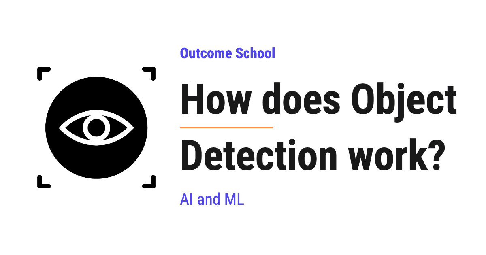

# How does Object Detection work?

> Archived from <https://outcomeschool.com/blog/object-detection> on 2026-11-25.

Object Detection is the task of finding objects in an image, drawing a box around each one, and naming each object, so it answers both what and where.

In this blog, we will learn about how Object Detection works. We will also see why the naive approach fails, how modern detection uses bounding boxes, anchor boxes, and confidence scores, how Non-Maximum Suppression and IoU clean up the extra boxes, how the model learns through training, and where object detection is used in the real world.

We will cover the following:
<ul><li>What is Object Detection?</li><li>Image Classification vs Object Detection</li><li>What is a bounding box?</li><li>The naive approach and why it fails</li><li>How modern Object Detection works</li><li>Anchor boxes and the grid</li><li>Confidence score and class score</li><li>The problem of many boxes</li><li>Non-Maximum Suppression to the rescue</li><li>IoU: measuring how much two boxes match</li><li>How the model learns: training</li><li>A simple worked example</li><li>Where Object Detection is used</li></ul>
I am <strong>Amit Shekhar</strong>, Founder @ <a target="_blank" rel="noopener noreferrer" href="https://outcomeschool.com">Outcome School</a>, I have taught and mentored many developers, and their efforts landed them high-paying tech jobs, helped many tech companies in solving their unique problems, and created many open-source libraries being used by top companies. I am passionate about sharing knowledge through open-source, blogs, and videos.

I teach <a target="_blank" rel="noopener noreferrer" href="https://outcomeschool.com/program/ai-and-machine-learning">AI and Machine Learning</a> at Outcome School.

Let&#x27;s get started.
<h3 id="what-is-object-detection">What is Object Detection?</h3>
<strong>Object Detection is the task of finding objects in an image and drawing a box around each one while also naming each object.</strong>

Object Detection answers two questions at the same time:
<ul><li>What objects are in the image?</li><li>Where exactly is each object?</li></ul>
Let&#x27;s say we give the computer a photo of a street. The computer should tell us, &quot;There is a car here, a person there, and a traffic light over there.&quot; And for each one, it should point to the exact location.

Consider a self-driving car. Knowing only &quot;there is a pedestrian somewhere&quot; is not enough. The car needs the exact location to drive safely.

This is why Object Detection always gives us two things together, the name and the location.
<h3 id="image-classification-vs-object-detection">Image Classification vs Object Detection</h3>
Before we go deeper, we must clear one common confusion.

<strong>Image Classification</strong> tells us only what is in the image, as a whole. It gives one label for the entire picture. For example, &quot;This is a photo of a cat.&quot;

But Image Classification does not tell us where the cat is. And it cannot handle many objects. If there are three cats and one dog, one label cannot describe all of them.

<strong>Object Detection</strong> is the bigger task. It finds every object, names each one, and gives the location of each one.

Let me tabulate the differences between Image Classification and Object Detection for your better understanding.
<table><thead><tr><th>Image Classification</th><th>Object Detection</th></tr></thead><tbody><tr><td>One label for the whole image</td><td>Many labels, one per object</td></tr><tr><td>Tells what, not where</td><td>Tells what and where</td></tr><tr><td>Cannot count objects</td><td>Can find and count many objects</td></tr><tr><td>Gives no box</td><td>Gives a box around each object</td></tr></tbody></table>
When we need the exact shape of each object instead of a box, we use Semantic Segmentation. We have a detailed blog on <a target="_blank" rel="noopener noreferrer" href="semantic-segmentation.md">How does Semantic Segmentation work?</a> that explains how it labels every single pixel.

Object Detection does more, so it needs more work. Let&#x27;s understand how that work is done.
<h3 id="what-is-a-bounding-box">What is a bounding box?</h3>
The location of an object is given using a <strong>bounding box</strong>. A bounding box is a rectangle drawn tightly around an object.

A box is described by four numbers. There are different ways to write these numbers, but a common and simple way is like below:

<pre><code class="code-highlight">x = 120   // distance from the left edge to the box&#x27;s left side
y = 80    // distance from the top edge to the box&#x27;s top side
width = 60   // how wide the box is
height = 90  // how tall the box is
</code></pre>

Here, we can see that with just four numbers, we can describe exactly where an object sits in the image. The computer&#x27;s job is to predict these four numbers correctly for every object.

So, the final output of Object Detection for one object looks like below:

<pre><code class="code-highlight">label = &quot;dog&quot;
confidence = 0.95
box = (x=120, y=80, width=60, height=90)
</code></pre>

Here, we have three things. The <code>label</code> is the name of the object. The <code>confidence</code> is how sure the model is, from 0 to 1. The <code>box</code> is the location.

This is the goal. Now, the question is, how does the computer reach this goal?
<h3 id="the-naive-approach-and-why-it-fails">The naive approach and why it fails</h3>
The best way to learn this is by taking an example.

Let&#x27;s say we already have a model that can look at a small picture and tell us what single object is inside it. This is the Image Classification model we discussed.

Now we want to use it for Object Detection. So, here is a simple idea.

We take a small box, place it in the top-left corner, and ask the classifier, &quot;Is there an object here?&quot; Then we slide the box a little to the right and ask again. We keep sliding it across the whole image. This is called the <strong>sliding window</strong> approach.

Objects come in many sizes. A small box will miss a big car. So, we must also try big boxes, medium boxes, tall boxes, and wide boxes. And we must slide each of them across every position.

The issue with this approach is speed. We end up asking the classifier thousands or even millions of times for a single image. This is far too slow for real use, especially for a video, where we must handle many images every second.

We needed a faster solution for that, and modern Object Detection was introduced to solve this problem.

<strong>Planning your move into AI?</strong>

No matter which tech domain you work in today, with your effort, you can transition to these roles:
<ul><li>AI Engineer</li><li>Forward Deployed Engineer</li><li>AI Agent Engineer</li><li>Harness Engineer</li><li>Voice AI Engineer</li><li>AI Architect</li><li>LLM Engineer</li><li>LLM Inference Engineer</li><li>Gen AI Engineer</li><li>MLOps Engineer</li><li>ML Engineer</li><li>Deep Learning Engineer</li></ul>
Our <a target="_blank" rel="noopener noreferrer" href="https://outcomeschool.com/program/ai-and-machine-learning">AI and Machine Learning Program</a> at Outcome School takes you there.
<h3 id="how-modern-object-detection-works">How modern Object Detection works</h3>
So, here comes the modern Object Detection model to the rescue.

The central idea is that instead of running a classifier millions of times, the model looks at the whole image only once and predicts all the boxes in one go.

The model is a <a target="_blank" rel="noopener noreferrer" href="neural-network.md">neural network</a>, which learns patterns from many photos along with the correct answers. The kind of neural network used for images is a <a target="_blank" rel="noopener noreferrer" href="convolutional-neural-network-cnn.md"><strong>Convolutional Neural Network</strong></a>, often called a <strong>CNN</strong>.

A CNN scans the image in small parts and learns to recognize useful patterns. The early parts of the network find simple things like edges and corners. The later parts combine these into bigger things like eyes, wheels, and faces.

So, the CNN turns the raw pixel numbers of the image into a smaller, meaningful summary. This summary holds clues like &quot;there is something round here&quot; or &quot;there is a furry texture there.&quot;

Now, on top of this summary, the model predicts the boxes and the labels. Let&#x27;s understand exactly how.
<h3 id="anchor-boxes-and-the-grid">Anchor boxes and the grid</h3>
To predict boxes without sliding millions of times, many modern detectors, like the YOLO family, use two ideas, a grid and anchor boxes.

First, the model divides the image into a <strong>grid</strong>. Suppose we split the image into a 13 by 13 grid. That gives us 169 small cells.

Each cell is responsible for detecting objects whose center falls inside that cell. So, every part of the image has a cell looking after it.

Now, each cell faces one problem. An object inside it could be tall like a standing person, or wide like a car. One guess per cell is not enough.

So, here come <strong>anchor boxes</strong> into the picture.

An <strong>anchor box</strong> is a box shape decided in advance that the model uses as a starting guess, like a tall rectangle, a wide rectangle, or a square.

Let&#x27;s say each cell uses 3 anchor boxes. The model does not predict a box from nothing. Instead, it starts from each anchor and predicts a small adjustment, like &quot;make it a bit wider&quot; or &quot;shift it slightly up.&quot;

This is much easier for the model. Adjusting a good starting guess is simpler than guessing from scratch.

Let&#x27;s visualize this as below:

<pre><code class="code-highlight language-text">The image is split into a grid of cells:

  +-----+-----+-----+-----+
  |     |     |     |     |
  +-----+-----+-----+-----+
  |     | dog |     |     |
  +-----+-----+-----+-----+
  |     |     | car |     |
  +-----+-----+-----+-----+

Inside one cell, 3 anchor boxes act as starting guesses:

  +---------+        +----+        +------------+
  |         |        |    |        |            |
  |  square |        |tall|        |    wide    |
  |         |        |    |        +------------+
  +---------+        |    |
                     +----+
</code></pre>

Here, we can see that the image is divided into cells, and the cell that holds an object&#x27;s center, like the dog&#x27;s center, is responsible for it. Inside that cell, the model starts from a few ready-made anchor shapes, a square one, a tall one, and a wide one, and then nudges the closest one to fit the object.
<h3 id="confidence-score-and-class-score">Confidence score and class score</h3>
For every anchor box in every cell, the model predicts a few values together.

First, it predicts the four box numbers, which are the adjusted <code>x</code>, <code>y</code>, <code>width</code>, and <code>height</code>.

Then, it predicts a <strong>confidence score</strong>. This score, from 0 to 1, tells how sure the model is that a real object is present in this box.

After that, it predicts a <strong>class score</strong> for each possible object type. If the model knows 80 object types, it gives 80 scores, one for &quot;dog&quot;, one for &quot;car&quot;, and etc. The highest one becomes the label.

So, for each anchor box, the output looks like below:

<pre><code class="code-highlight">box = (x, y, width, height)   // where the object is
confidence = 0.92             // how sure an object is here
class_scores =                // what the object is, a score per type
  dog: 0.88
  cat: 0.05
  car: 0.01
  // and etc.
</code></pre>

Here, we can see that one anchor box gives us a full guess. It tells where, how sure, and what. The highest class score wins, so this guess is labeled a dog. The model produces all of these for every anchor in every cell, in one single pass over the image.

<strong>A quick note for you</strong>

No matter which tech domain you work in, get familiar with these topics:
<ul><li>LLM</li><li>RAG</li><li>MCP</li><li>Agent</li><li>Fine-tuning</li><li>Quantization</li></ul>
We put it all together in one video:

<a target="_blank" rel="noopener noreferrer" href="https://www.youtube.com/watch?v=lnfWvX66FUk">AI Engineering Explained: LLM, RAG, MCP, Agent, Fine-Tuning, and Quantization</a>

No need to stop reading - bookmark it and watch later when you get time. Future you will thank you.

Now, let&#x27;s get back to the topic.
<h3 id="the-problem-of-many-boxes">The problem of many boxes</h3>
Now we have a new problem.

Let&#x27;s count. We had a 13 by 13 grid, which is 169 cells. Each cell has 3 anchor boxes. So, the model gives 169 times 3, which is 507 boxes.

That is 507 guesses for one image. Most of them are useless. Many will have a very low confidence score, like 0.02, which means there is almost nothing there.

Also, one real object often gets covered by many overlapping boxes. Suppose there is one dog. Five nearby boxes may all claim, &quot;I found the dog.&quot; But we want only one clean box around the dog.

So, we must clean up these boxes. We must do this in two steps.

First, we throw away every box with a low confidence score. Let&#x27;s say we keep only boxes above 0.5. This removes most of the useless guesses.

Then, we still have the problem of many boxes around the same object. We need a smarter step for that.
<h3 id="non-maximum-suppression-to-the-rescue">Non-Maximum Suppression to the rescue</h3>
So, here comes <strong>Non-Maximum Suppression</strong> to the rescue. It is often shortened to <strong>NMS</strong>.

Non-Maximum Suppression keeps the best box for each object and removes the weaker boxes that overlap it.

Let me explain the idea with a step-by-step walkthrough. Suppose we have five boxes left, all around the same dog, with these confidence scores:

<pre><code class="code-highlight">Box A: 0.95
Box B: 0.91
Box C: 0.88
Box D: 0.60
Box E: 0.55
</code></pre>

We follow these steps.

<strong>Step 1:</strong> We pick the box with the highest confidence. That is Box A with 0.95. We keep it as a winner.

<strong>Step 2:</strong> We compare every other box with Box A. If a box overlaps Box A heavily, it is most likely the same dog, so we remove it. Box B, C, D, and E all overlap Box A, so we remove all of them.

<strong>Step 3:</strong> If any boxes were left for a different object somewhere else, we repeat the process for them.

After Non-Maximum Suppression, only Box A remains for the dog. We now have one clean box per object.

But there is one word we used without explaining, &quot;overlap heavily.&quot; How does the model measure overlap? We need a number for that.
<h3 id="iou-measuring-how-much-two-boxes-match">IoU: measuring how much two boxes match</h3>
To measure overlap, we use <strong>Intersection over Union</strong>, often called <strong>IoU</strong>.

IoU tells us how much two boxes match. It is a number from 0 to 1. A value of 1 means the two boxes are exactly the same. A value of 0 means they do not touch at all.

The formula is as below:

<strong>IoU = Area of Overlap / Area of Union</strong>

Here, the <strong>Area of Overlap</strong> is the region where both boxes cover the same part. The <strong>Area of Union</strong> is the total region covered by both boxes together.

We can picture two overlapping boxes as below:

<pre><code class="code-highlight language-text">  +-------------+
  |   Box 1     |
  |        +----+--------+
  |        |####|        |
  |        |####| Box 2  |
  +--------+----+        |
           |             |
           +-------------+

  #### = Area of Overlap (where both boxes share the same part)
  Area of Union = Box 1 + Box 2 minus the shared part
</code></pre>

Here, we can see that the <code>####</code> region is where both boxes cover the same part of the image, which is the <code>Area of Overlap</code>. The <code>Area of Union</code> is everything both boxes cover together, counting the shared part only once. The more the two boxes sit on top of each other, the bigger the overlap, and the closer the <code>IoU</code> gets to 1.

Let&#x27;s take a small numeric example. Suppose two boxes overlap in a region of 30 square units, and together they cover 100 square units.

<strong>IoU = 30 / 100 = 0.3</strong>

Here, we can see that an IoU of 0.3 means the shared part is only 30% of the total area that the two boxes cover. In Non-Maximum Suppression, if the IoU between two boxes is above a chosen value, like 0.5, we treat them as the same object and remove the weaker one.

This is how the model decides that two boxes point to the same object.

<strong>Stay updated:</strong> Subscribe to our <a target="_blank" rel="noopener noreferrer" href="https://outcomeschool.substack.com/subscribe">newsletter</a> to get our latest AI and Machine Learning blogs straight to your inbox.
<h3 id="how-the-model-learns-training">How the model learns: training</h3>
We have talked a lot about the model predicting boxes. But how does it learn to predict them correctly in the first place?

This step is called <strong>training</strong>.

To train, we need a <strong>dataset</strong>. A dataset is a large collection of images where humans have already drawn the correct boxes and written the correct labels. These human-made answers are called the <strong>ground truth</strong>. We have a detailed blog on <a target="_blank" rel="noopener noreferrer" href="supervised-vs-unsupervised-learning.md">Supervised vs Unsupervised Learning</a> that explains learning from labeled data in depth.

Now, the training happens like below.

First, we show the model an image from the dataset. The model makes its guesses, which are boxes, confidence scores, and labels.

Then, we compare the model&#x27;s guesses with the ground truth. We use IoU here too, to check how well a predicted box matches the correct box. We measure the total mistake using a number called the <strong>loss</strong>. The loss is high when the model is wrong and low when the model is right.

After that, the model adjusts its internal values a tiny bit to reduce the loss. This adjustment is done using a method called <a target="_blank" rel="noopener noreferrer" href="math-behind-backpropagation.md"><strong>backpropagation</strong></a>, which is the standard way neural networks learn from their mistakes.

Finally, we repeat this for millions of images, again and again. Slowly, the loss goes down, and the model gets better at putting the right box around the right object.

This is how the model learns. After enough training, it can detect objects in new images it has never seen before.

To master Neural Networks, Loss Functions, and Backpropagation, and to build a Neural Network from scratch, check out our <a target="_blank" rel="noopener noreferrer" href="https://outcomeschool.com/program/ai-and-machine-learning">AI and Machine Learning Program</a> at Outcome School.
<h3 id="a-simple-worked-example">A simple worked example</h3>
Let&#x27;s put the whole flow together with one example so that everything connects.

Suppose we give the trained model a photo of a street with one dog and one car.

<strong>Step 1:</strong> The model sends the image through the CNN. The raw pixels become a meaningful summary of patterns.

<strong>Step 2:</strong> Using the grid and anchor boxes, the model produces 507 guesses. Each guess has a box, a confidence score, and class scores.

<strong>Step 3:</strong> We remove every box with a confidence score below 0.5. Now only a handful of boxes remain.

<strong>Step 4:</strong> We run Non-Maximum Suppression using IoU. The overlapping duplicate boxes are removed.

We can picture the whole flow as below:

<pre><code class="code-highlight language-text">   Raw image (table of pixel numbers)
                ↓
   +--------------------------+
   |           CNN            |
   |  (reads the image once)  |
   +--------------------------+
                ↓
   Grid + anchor boxes
   produce 507 guesses
   (box + confidence + class scores)
                ↓
   Remove boxes with confidence &lt; 0.5
                ↓
   Non-Maximum Suppression using IoU
   (keep one best box per object)
                ↓
   Clean results: dog box + car box
</code></pre>

Here, we can see the full journey from raw pixels to clean answers. The <code>CNN</code> reads the image once, the grid and anchor boxes produce many guesses, the low confidence guesses are dropped, and <code>Non-Maximum Suppression</code> removes the overlapping duplicates so that one clean box is left per object.

Finally, we are left with two clean results as below:

<pre><code class="code-highlight">Result 1:
  label = &quot;dog&quot;
  confidence = 0.96
  box = (x=120, y=200, width=80, height=70)

Result 2:
  label = &quot;car&quot;
  confidence = 0.93
  box = (x=400, y=150, width=220, height=140)
</code></pre>

Here, we can see the final answer. The model found the dog and the car, named each one, and gave the exact location of each. This is exactly the goal we set at the start.
<h3 id="where-object-detection-is-used">Where Object Detection is used</h3>
Now, let&#x27;s see where Object Detection is used in the real world.
<ul><li>Self-driving cars detect pedestrians, vehicles, and traffic signs.</li><li>Phone cameras detect faces to focus the lens correctly.</li><li>Security cameras detect people and unusual movement.</li><li>Shops use it to count products on shelves.</li><li>Doctors use it to find tumors and other problems in medical scans.</li><li>Factories use it to spot defective items on a conveyor belt.</li></ul>
The same idea of first drawing boxes and then looking inside them is also used to read text in images, and we have a detailed blog on <a target="_blank" rel="noopener noreferrer" href="optical-character-recognition-ocr.md">How does OCR with Deep Learning work?</a> that covers this end to end.

Well-known Object Detection models like <strong>YOLO</strong>, which means &quot;You Only Look Once&quot;, follow the core ideas we learned here: looking at the image, predicting many boxes, scoring them, and cleaning them up. Newer models change some parts, for example, many of them predict boxes directly without anchor boxes.

Now, we have understood how Object Detection works.
<h2 id="frequently-asked-questions">Frequently Asked Questions</h2><h3 id="what-does-yolo-stand-for-in-object-detection">What does YOLO stand for in Object Detection?</h3>
YOLO stands for &quot;You Only Look Once&quot;. It is a well-known family of Object Detection models. As the name says, the model looks at the whole image only once and predicts all the boxes in one go, instead of running a classifier thousands or even millions of times like the sliding window approach.
<h3 id="why-do-modern-detectors-use-anchor-boxes">Why do modern detectors use anchor boxes?</h3>
Anchor boxes give the model a good starting guess. An anchor box is a box shape decided in advance, like a tall rectangle, a wide rectangle, or a square. The model does not predict a box from nothing. It predicts a small adjustment to the anchor, which is much easier than guessing from scratch.
<h3 id="what-iou-value-is-used-in-non-maximum-suppression">What IoU value is used in Non-Maximum Suppression?</h3>
A common choice is 0.5. If the IoU between two boxes is above this chosen value, the two boxes are treated as the same object, and the weaker box is removed. This leaves one clean box per object.
<h3 id="do-all-object-detection-models-use-anchor-boxes">Do all Object Detection models use anchor boxes?</h3>
No. Many modern detectors, like the YOLO family, use a grid and anchor boxes. But newer models change some parts, and many of them predict boxes directly without anchor boxes. They still follow the core ideas of looking at the image, predicting many boxes, scoring them, and cleaning them up.

That&#x27;s it for now.

Thanks

<strong>Amit Shekhar</strong> Founder @ <a target="_blank" rel="noopener noreferrer" href="https://outcomeschool.com">Outcome School</a>

You can connect with me on:
<ul><li><a target="_blank" rel="noopener noreferrer" href="https://x.com/amitiitbhu">X</a></li><li><a target="_blank" rel="noopener noreferrer" href="https://www.linkedin.com/in/amit-shekhar-iitbhu">LinkedIn</a></li><li><a target="_blank" rel="noopener noreferrer" href="https://github.com/amitshekhariitbhu">GitHub</a></li></ul>
Follow Outcome School on:
<ul><li><a target="_blank" rel="noopener noreferrer" href="https://x.com/outcome_school">X</a></li><li><a target="_blank" rel="noopener noreferrer" href="https://youtube.com/@OutcomeSchool">YouTube</a></li><li><a target="_blank" rel="noopener noreferrer" href="https://www.linkedin.com/company/outcomeschool">LinkedIn</a></li><li><a target="_blank" rel="noopener noreferrer" href="http://github.com/OutcomeSchool">GitHub</a></li></ul>
<a target="_blank" rel="noopener noreferrer" href="https://outcomeschool.com/blog"><strong>Read all of our high-quality blogs here.</strong></a>

