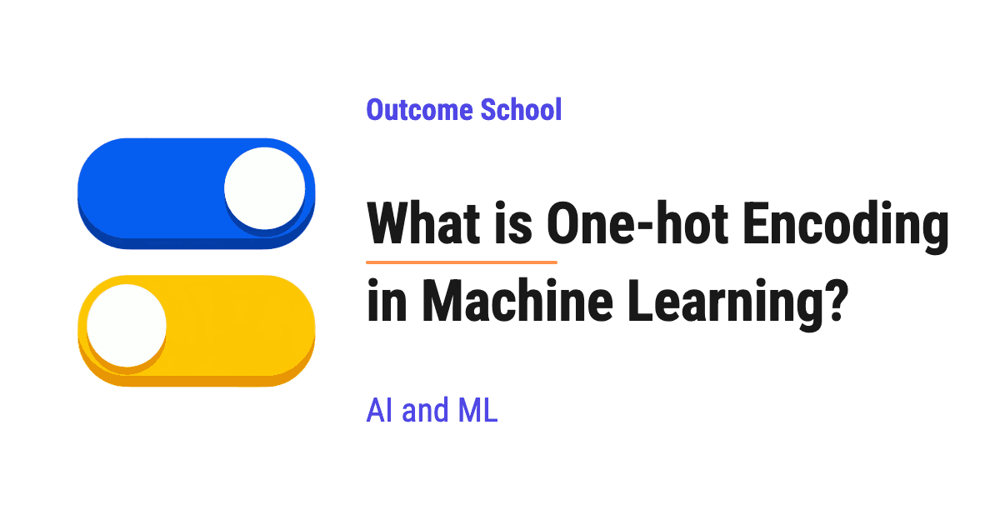

# What is One-hot Encoding in Machine Learning?

> Archived from <https://outcomeschool.com/blog/one-hot-encoding> on 2026-11-25.

One-hot Encoding is a way to turn a category, like a color or a word, into a list of numbers where exactly one position is 1 and all the other positions are 0. The position of the 1 tells the model which category it is.

In this blog, we will learn about One-hot Encoding in Machine Learning. We will also see why a model needs numbers, what goes wrong with simple label encoding, how One-hot Encoding works step by step with Python code, how it is used for the correct answer in classification, how LLMs use it for tokens and why embeddings replace it, and where it works well and where it fails.

We will cover the following:
<ul><li>Why does a model need numbers?</li><li>The problem with label encoding</li><li>What is One-hot Encoding?</li><li>One-hot Encoding step by step</li><li>One-hot Encoding in Python</li><li>One-hot Encoding for the correct answer in classification</li><li>One-hot Encoding of tokens in LLMs</li><li>Why embeddings replace one-hot vectors</li><li>Disadvantages of One-hot Encoding</li></ul>
I am <strong>Amit Shekhar</strong>, Founder @ <a target="_blank" rel="noopener noreferrer" href="https://outcomeschool.com">Outcome School</a>, I have taught and mentored many developers, and their efforts landed them high-paying tech jobs, helped many tech companies in solving their unique problems, and created many open-source libraries being used by top companies. I am passionate about sharing knowledge through open-source, blogs, and videos.

I teach <a target="_blank" rel="noopener noreferrer" href="https://outcomeschool.com/program/ai-and-machine-learning">AI and Machine Learning</a> at Outcome School.

Let&#x27;s get started.
<h2 id="why-does-a-model-need-numbers">Why does a model need numbers?</h2>
A <a target="_blank" rel="noopener noreferrer" href="machine-learning.md">machine learning</a> model only understands numbers. Inside, it multiplies numbers, adds numbers, and compares numbers. It cannot multiply the word &quot;red&quot;.

But, a lot of real data is not numbers. It is categories.
<ul><li>The color of a car: red, green, blue</li><li>The city of a customer: Delhi, Mumbai, Bengaluru</li><li>The type of an animal in a photo: cat, dog, horse</li><li>The next word in a sentence</li></ul>
So, before we give such data to a model, we must convert every category into numbers. The question is how to do it in the right way. We have a detailed blog on <a target="_blank" rel="noopener noreferrer" href="feature-engineering.md">Feature Engineering</a> that explains how we prepare raw data so that a model can learn better.
<h2 id="the-problem-with-label-encoding">The problem with label encoding</h2>
The first idea that comes to our mind is to give each category a number. This is called <strong>label encoding</strong>.

Let&#x27;s say we have three colors. We can write them as below:
<table><thead><tr><th>Color</th><th>Label</th></tr></thead><tbody><tr><td>red</td><td>1</td></tr><tr><td>green</td><td>2</td></tr><tr><td>blue</td><td>3</td></tr></tbody></table>
It looks simple. But, the model does not know that these numbers are just names. It treats them as real numbers.

So, the model now believes the following things:
<ul><li>blue (3) is bigger than red (1)</li><li>green (2) is exactly in the middle of red and blue</li><li>red + green = 1 + 2 = 3 = blue</li></ul>
None of this is true. Colors have no order. Blue is not bigger than red. Red plus green is not blue.

We have added a <strong>fake order</strong> to our data. The model will try to learn from this fake order, and it will learn wrong patterns.

<strong>Note:</strong> Label encoding is fine when the categories really have an order, for example small, medium, large. The problem comes only when there is no natural order.

So, we need a way to convert categories into numbers without any fake order. Here comes the One-hot Encoding into the picture.
<h2 id="what-is-one-hot-encoding">What is One-hot Encoding?</h2>
<strong>One-hot Encoding converts each category into a list of 0s and 1s, where only one position is 1 and all other positions are 0.</strong>

This list of numbers is called a <strong>vector</strong>. The length of the vector is equal to the number of categories.

The name tells the idea. Only one position is &quot;hot&quot;, which means it is 1. All the other positions are &quot;cold&quot;, which means they are 0.

For our three colors, we get the following:
<table><thead><tr><th>Color</th><th>red</th><th>green</th><th>blue</th></tr></thead><tbody><tr><td>red</td><td>1</td><td>0</td><td>0</td></tr><tr><td>green</td><td>0</td><td>1</td><td>0</td></tr><tr><td>blue</td><td>0</td><td>0</td><td>1</td></tr></tbody></table>
Let&#x27;s see this as a diagram:

<pre><code class="language-text code-highlight">┌─────────────┐
│   &quot;green&quot;   │
└──────┬──────┘
       │
       ↓
    look up its position
    red = 0, green = 1, blue = 2
       │
       ↓
┌─────────────┐
│  [0, 1, 0]  │
└─────────────┘
</code></pre>

Here, we can see that &quot;green&quot; sits at position 1 in our list of colors. We start counting positions from 0, as most programming languages do. So, its vector has a 1 at position 1 and 0 everywhere else.

Now, there is no fake order. No color is bigger than another, and no color sits in the middle of two others. If we compare any two colors, their vectors differ in exactly two positions. So, every color is equally different from every other color. Each color gets its own column.

<strong>Planning your move into AI?</strong>

No matter which tech domain you work in today, with your effort, you can transition to these roles:
<ul><li>AI Engineer</li><li>Forward Deployed Engineer</li><li>AI Agent Engineer</li><li>Harness Engineer</li><li>Voice AI Engineer</li><li>AI Architect</li><li>LLM Engineer</li><li>LLM Inference Engineer</li><li>Gen AI Engineer</li><li>MLOps Engineer</li><li>ML Engineer</li><li>Deep Learning Engineer</li></ul>
Our <a target="_blank" rel="noopener noreferrer" href="https://outcomeschool.com/program/ai-and-machine-learning">AI and Machine Learning Program</a> at Outcome School takes you there.
<h2 id="one-hot-encoding-step-by-step">One-hot Encoding step by step</h2>
The best way to learn this is by taking an example.

Suppose we have this data about cars:
<table><thead><tr><th>Car</th><th>Color</th></tr></thead><tbody><tr><td>A</td><td>green</td></tr><tr><td>B</td><td>red</td></tr><tr><td>C</td><td>blue</td></tr><tr><td>D</td><td>green</td></tr></tbody></table>
<strong>Step 1:</strong> We find all the unique categories. Here, they are red, green, and blue. So, we have 3 categories.

<strong>Step 2:</strong> We give each category a fixed position. The color red is at position 0, green is at position 1, and blue is at position 2.

<strong>Step 3:</strong> For each row, we create a vector of 3 zeros. Then, we put a 1 at the position of its category.

<strong>Step 4:</strong> We replace the single &quot;Color&quot; column with the 3 new columns.

Our data now looks like below:
<table><thead><tr><th>Car</th><th>red</th><th>green</th><th>blue</th></tr></thead><tbody><tr><td>A</td><td>0</td><td>1</td><td>0</td></tr><tr><td>B</td><td>1</td><td>0</td><td>0</td></tr><tr><td>C</td><td>0</td><td>0</td><td>1</td></tr><tr><td>D</td><td>0</td><td>1</td><td>0</td></tr></tbody></table>
Here, we can notice two things:
<ul><li>Every row has exactly one 1.</li><li>Car A and Car D have the same color, so they have the same vector.</li></ul>
This is how one column of words becomes three columns of numbers that the model can use.
<h2 id="one-hot-encoding-in-python">One-hot Encoding in Python</h2>
Let&#x27;s see the code for One-hot Encoding in plain Python:

<pre><code class="code-highlight language-python">colors = [&quot;red&quot;, &quot;green&quot;, &quot;blue&quot;]

def one_hot(color):
    vector = [0] * len(colors)
    index = colors.index(color)
    vector[index] = 1
    return vector

for color in [&quot;green&quot;, &quot;red&quot;, &quot;blue&quot;, &quot;green&quot;]:
    print(color, one_hot(color))
</code></pre>

Here, we have:
<ul><li><code>colors</code> is the list of all unique categories. Its order fixes the position of each color.</li><li><code>[0] * len(colors)</code> creates a vector of 3 zeros.</li><li><code>colors.index(color)</code> finds the position of the color.</li><li><code>vector[index] = 1</code> makes that one position hot.</li></ul>
This will print the following:

<pre><code class="language-text code-highlight">green [0, 1, 0]
red [1, 0, 0]
blue [0, 0, 1]
green [0, 1, 0]
</code></pre>

It matches the table that we built by hand.

<strong>Note:</strong> In real projects, we do not write this by hand. Libraries do it for us, for example <code>pd.get_dummies</code> in pandas and <code>OneHotEncoder</code> in scikit-learn. They follow the same idea.

<strong>A quick note for you</strong>

No matter which tech domain you work in, get familiar with these topics:
<ul><li>LLM</li><li>RAG</li><li>MCP</li><li>Agent</li><li>Fine-tuning</li><li>Quantization</li></ul>
We put it all together in one video:

<a target="_blank" rel="noopener noreferrer" href="https://www.youtube.com/watch?v=lnfWvX66FUk">AI Engineering Explained: LLM, RAG, MCP, Agent, Fine-Tuning, and Quantization</a>

No need to stop reading - bookmark it and watch later when you get time. Future you will thank you.

Now, let&#x27;s get back to the topic.
<h2 id="one-hot-encoding-for-the-correct-answer-in-classification">One-hot Encoding for the correct answer in classification</h2>
So far, we have used One-hot Encoding for the input. It is also used for the correct answer, which is called the <strong>target</strong>.

Let&#x27;s say we are building a model that looks at a photo and tells whether it is a cat, a dog, or a horse. This is called <strong>classification</strong>.

The model does not give one answer. It gives a probability for each class. For example, the model says: cat 0.7, dog 0.2, horse 0.1. These numbers add up to 1. The <a target="_blank" rel="noopener noreferrer" href="softmax-function.md">softmax function</a> at the end of the model produces them.

Now, suppose the photo is really a cat. We do not write the correct answer as cat = 1, dog = 2, horse = 3, because that again adds a fake order. Instead, we write it as a one-hot vector as below:
<table><thead><tr><th>Class</th><th>Correct answer (one-hot)</th><th>Model&#x27;s prediction</th></tr></thead><tbody><tr><td>cat</td><td>1</td><td>0.7</td></tr><tr><td>dog</td><td>0</td><td>0.2</td></tr><tr><td>horse</td><td>0</td><td>0.1</td></tr></tbody></table>
Now, both the correct answer and the prediction are vectors of the same length. So, we can compare them position by position.

The most common way to compare them is <a target="_blank" rel="noopener noreferrer" href="math-behind-cross-entropy-loss.md"><strong>cross-entropy loss</strong></a>. The loss is a number that tells how wrong the model is. Lower is better.

<strong>Cross-entropy loss = -(sum over all classes of target_i * log(prediction_i))</strong>

Here, target_i is the value of the correct answer at position i, prediction_i is the probability that the model gives at position i, and log is the natural log.

Now, the one-hot target makes this very simple. The target is 0 for dog and horse, so those terms become 0. Only the cat term is left, because its target is 1.

<strong>Cross-entropy loss = -log(prediction for the correct class)</strong>

Let&#x27;s see this as a diagram:

<pre><code class="language-text code-highlight">┌──────────────────────────────┐
│ correct answer: [1, 0, 0]    │
│ prediction: [0.7, 0.2, 0.1]  │
└──────────────┬───────────────┘
               │
               ↓
     the 1 is at position 0,
     so keep only 0.7
               │
               ↓
┌──────────────────────────────┐
│ loss = -log(0.7) = 0.36      │
└──────────────────────────────┘
</code></pre>

Here, we can see that the one-hot target picks the probability of the correct class, and the loss is computed only from that one number.

Now, let&#x27;s compare two cases:
<ul><li>If the model says cat = 0.7, the loss is -log(0.7) = 0.36.</li><li>If the model says cat = 0.2, the loss is -log(0.2) = 1.61.</li></ul>
Here, we can see that when the model gives a low probability to the correct class, the loss is high. During training, the model updates its parameters to push this loss down. Means, it learns to give a higher probability to the correct class.

To learn Loss Functions, Logits, Cross-Entropy, and Embeddings in depth, check out our <a target="_blank" rel="noopener noreferrer" href="https://outcomeschool.com/program/ai-and-machine-learning">AI and Machine Learning Program</a> at Outcome School.
<h2 id="one-hot-encoding-of-tokens-in-llms">One-hot Encoding of tokens in LLMs</h2>
Now, let&#x27;s move to <a target="_blank" rel="noopener noreferrer" href="large-language-model-llm.md">LLMs (Large Language Models)</a>.

An LLM reads text as <a target="_blank" rel="noopener noreferrer" href="tokenization-in-llms.md"><strong>tokens</strong></a>. A token is a word or a piece of a word. The LLM has a fixed list of all the tokens it knows. This list is called the <strong>vocabulary</strong>.

Let&#x27;s say, for the sake of understanding, our vocabulary has only 4 tokens:
<table><thead><tr><th>Position</th><th>Token</th></tr></thead><tbody><tr><td>0</td><td>I</td></tr><tr><td>1</td><td>love</td></tr><tr><td>2</td><td>AI</td></tr><tr><td>3</td><td>books</td></tr></tbody></table>
Then, each token can be written as a one-hot vector of length 4:
<ul><li>&quot;I&quot; becomes [1, 0, 0, 0]</li><li>&quot;love&quot; becomes [0, 1, 0, 0]</li><li>&quot;AI&quot; becomes [0, 0, 1, 0]</li><li>&quot;books&quot; becomes [0, 0, 0, 1]</li></ul>
The same idea is used on the output side. When the LLM is trained to predict the next token, the correct next token is a one-hot target over the whole vocabulary, and we use the same cross-entropy loss that we just learned.

But, a real vocabulary is not 4 tokens. It is often 50,000 to more than 100,000 tokens. Let&#x27;s see what happens then.
<h2 id="why-embeddings-replace-one-hot-vectors">Why embeddings replace one-hot vectors</h2>
Let&#x27;s say the vocabulary has 50,000 tokens. Then, every token becomes a vector of 50,000 numbers, where 49,999 of them are 0 and only one of them is 1.

This creates two big problems:
<ul><li><strong>Too big:</strong> Each token needs 50,000 numbers, and almost all of them are 0. This is a huge waste of memory and computation.</li><li><strong>No meaning:</strong> Every one-hot vector is equally different from every other one-hot vector. So, &quot;cat&quot; is as different from &quot;kitten&quot; as it is from &quot;car&quot;. The vector tells us nothing about meaning.</li></ul>
So, here comes the <a target="_blank" rel="noopener noreferrer" href="what-are-embeddings.md"><strong>embedding</strong></a> to the rescue.

An <strong>embedding</strong> is a short list of numbers that represents a token, for example 768 numbers instead of 50,000 numbers. These numbers are learned during training, so tokens with similar meanings end up with similar embeddings. We have a detailed blog on <a target="_blank" rel="noopener noreferrer" href="word2vec.md">Word2Vec</a> that explains how such meaningful word vectors are learned from text.

All the embeddings are stored together in a table called the <strong>embedding matrix</strong>. It has one row for each token in the vocabulary.

If we multiply a one-hot vector with the embedding matrix, we get exactly one row of the matrix. The 1 picks its row, and all the 0s remove the other rows.

Let&#x27;s see this as a diagram:

<pre><code class="language-text code-highlight">┌──────────────────────────────┐
│   one-hot vector for &quot;AI&quot;    │
│         [0, 0, 1, 0]         │
└──────────────┬───────────────┘
               │
               ↓
     multiply with
               │
               ↓
┌──────────────────────────────┐
│       embedding matrix       │
│    (4 tokens x 3 numbers)    │
│                              │
│ row 0: I       0.1  0.2  0.3 │
│ row 1: love    0.4  0.5  0.6 │
│ row 2: AI      0.7  0.8  0.9 │
│ row 3: books   1.0  1.1  1.2 │
└──────────────┬───────────────┘
               │
               ↓
     the 1 at position 2
     picks row 2
               │
               ↓
┌──────────────────────────────┐
│      embedding of &quot;AI&quot;       │
│       [0.7, 0.8, 0.9]        │
└──────────────────────────────┘
</code></pre>

Here, we can see that the 1 at position 2 selects row 2 of the matrix. The result is the embedding of &quot;AI&quot;.

We can write the code for this as below:

<pre><code class="code-highlight language-python">import numpy as np

one_hot = np.array([0, 0, 1, 0])

embedding_matrix = np.array([
    [0.1, 0.2, 0.3],
    [0.4, 0.5, 0.6],
    [0.7, 0.8, 0.9],
    [1.0, 1.1, 1.2],
])

print(one_hot @ embedding_matrix)
print(embedding_matrix[2])
</code></pre>

Here, <code>@</code> is <a target="_blank" rel="noopener noreferrer" href="matrix-multiplication-in-neural-networks.md">matrix multiplication</a>. The first line multiplies the one-hot vector with the matrix. The second line picks row 2 directly.

This will print the following:

<pre><code class="language-text code-highlight">[0.7 0.8 0.9]
[0.7 0.8 0.9]
</code></pre>

Both give the same answer. But, the second way is much faster, because it does not multiply thousands of zeros.

This is exactly what an LLM does. It never builds the giant one-hot vector. It takes the position of the token, which is called the <strong>token ID</strong>, and directly picks that row from the embedding matrix. This is called an <strong>embedding lookup</strong>.

So, the one-hot idea is still there in the background, but the embedding replaces the giant one-hot vector with a short, meaningful vector.

<strong>Stay updated:</strong> Subscribe to our <a target="_blank" rel="noopener noreferrer" href="https://outcomeschool.substack.com/subscribe">newsletter</a> to get our latest AI and Machine Learning blogs straight to your inbox.
<h2 id="disadvantages-of-one-hot-encoding">Disadvantages of One-hot Encoding</h2>
One-hot Encoding works well when the number of categories is small, like colors, days of the week, or a few product types. But, it has some disadvantages:
<ul><li><strong>Very wide:</strong> Each category adds one new column. A column with 10,000 different cities becomes 10,000 columns.</li><li><strong>Sparse:</strong> Almost every value is 0. Data where most values are 0 is called <strong>sparse</strong> data. Storing and processing so many zeros wastes memory and time.</li><li><strong>Hard to learn with many categories:</strong> When there are thousands of categories, many columns have very few 1s. So, the model sees many categories only a few times, and it needs much more data to learn something useful about each of them.</li><li><strong>No similarity:</strong> Every category is equally different from every other category. The encoding cannot show that &quot;Mumbai&quot; is closer to &quot;Pune&quot; than to &quot;London&quot;.</li><li><strong>New categories:</strong> If a new category appears after training, for example a new color &quot;yellow&quot;, there is no column for it.</li></ul>
For a small number of categories without any order, One-hot Encoding is the right choice. For a very large number of categories, like the tokens of an LLM, embeddings are the better choice.

Now we must have understood what One-hot Encoding is, how it works, and where it is used in machine learning.
<h2 id="frequently-asked-questions">Frequently Asked Questions</h2><h3 id="when-should-we-use-label-encoding-instead-of-one-hot-encoding">When should we use label encoding instead of One-hot Encoding?</h3>
We should use label encoding when the categories really have an order, for example small, medium, large. When the categories have no natural order, like colors or cities, label encoding adds a fake order that the model learns wrong patterns from, so One-hot Encoding is the right choice there.
<h3 id="how-do-we-do-one-hot-encoding-in-pandas-or-scikit-learn">How do we do One-hot Encoding in pandas or scikit-learn?</h3>
In real projects, we do not write One-hot Encoding by hand. We use libraries like <code>pd.get_dummies</code> in pandas and <code>OneHotEncoder</code> in scikit-learn. They follow the same idea: find the unique categories, give each one a fixed position, and put a 1 at that position for each row.
<h3 id="do-llms-actually-build-one-hot-vectors-for-tokens">Do LLMs actually build one-hot vectors for tokens?</h3>
No. An LLM never builds the giant one-hot vector. It takes the token ID and directly picks that row from the embedding matrix, which is called an embedding lookup. This gives exactly the same result as multiplying a one-hot vector with the embedding matrix, but it is much faster.
<h3 id="why-does-one-hot-encoding-not-work-well-for-a-very-large-number-of-categories">Why does One-hot Encoding not work well for a very large number of categories?</h3>
Because each category adds one new column, so the data becomes very wide and sparse, with almost every value being 0. With thousands of categories, the model also sees many of them only a few times. For a very large number of categories, like the tokens of an LLM, embeddings are the better choice.

That&#x27;s it for now.

Thanks

<strong>Amit Shekhar</strong> Founder @ <a target="_blank" rel="noopener noreferrer" href="https://outcomeschool.com">Outcome School</a>

You can connect with me on:
<ul><li><a target="_blank" rel="noopener noreferrer" href="https://x.com/amitiitbhu">X</a></li><li><a target="_blank" rel="noopener noreferrer" href="https://www.linkedin.com/in/amit-shekhar-iitbhu">LinkedIn</a></li><li><a target="_blank" rel="noopener noreferrer" href="https://github.com/amitshekhariitbhu">GitHub</a></li></ul>
Follow Outcome School on:
<ul><li><a target="_blank" rel="noopener noreferrer" href="https://x.com/outcome_school">X</a></li><li><a target="_blank" rel="noopener noreferrer" href="https://youtube.com/@OutcomeSchool">YouTube</a></li><li><a target="_blank" rel="noopener noreferrer" href="https://www.linkedin.com/company/outcomeschool">LinkedIn</a></li><li><a target="_blank" rel="noopener noreferrer" href="http://github.com/OutcomeSchool">GitHub</a></li></ul>
<a target="_blank" rel="noopener noreferrer" href="https://outcomeschool.com/blog"><strong>Read all of our high-quality blogs here.</strong></a>

