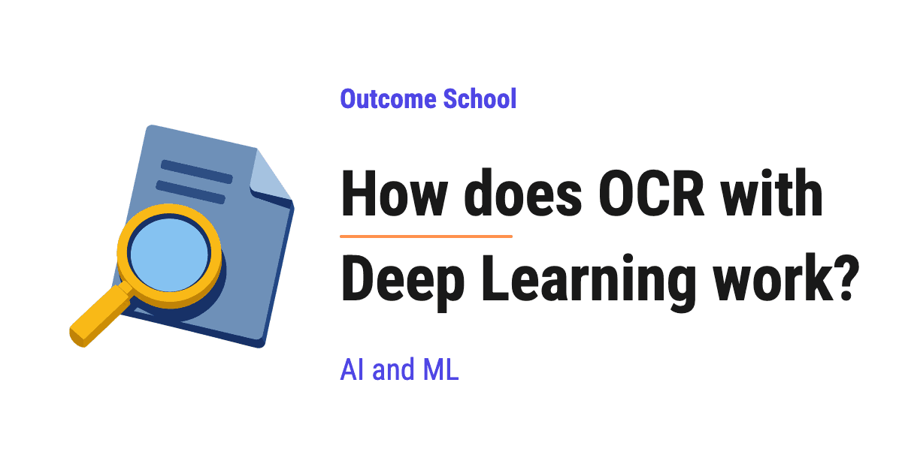

# How does OCR with Deep Learning work?

> Archived from <https://outcomeschool.com/blog/optical-character-recognition-ocr> on 2026-11-25.

OCR with Deep Learning reads text in an image by first finding where the text is and then recognizing it, using a model that learns from examples, not hand rules.

In this blog, we will learn about how OCR with Deep Learning works. We will also see why we need it, why the old way failed, how the full pipeline detects and recognizes text one character at a time, how the model is trained, and where OCR is used in the real world.

We will cover the following:
<ul><li>What is OCR?</li><li>Why do we need OCR?</li><li>The old way of doing OCR and why it failed</li><li>The full pipeline of OCR with Deep Learning</li><li>Step 1: Detecting the text in the image</li><li>Step 2: Recognizing the text</li><li>How the model reads characters one by one</li><li>Training the model</li><li>A simple code example</li><li>Where OCR is used in the real world</li></ul>
I am <strong>Amit Shekhar</strong>, Founder @ <a target="_blank" rel="noopener noreferrer" href="https://outcomeschool.com">Outcome School</a>, I have taught and mentored many developers, and their efforts landed them high-paying tech jobs, helped many tech companies in solving their unique problems, and created many open-source libraries being used by top companies. I am passionate about sharing knowledge through open-source, blogs, and videos.

I teach <a target="_blank" rel="noopener noreferrer" href="https://outcomeschool.com/program/ai-and-machine-learning">AI and Machine Learning</a> at Outcome School.

Let&#x27;s get started.
<h3 id="what-is-ocr">What is OCR?</h3>
<strong>OCR stands for Optical Character Recognition.</strong> It is a way for a computer to read the text inside an image and turn it into actual text that we can copy, search, and edit.

Let&#x27;s decompose the term to make it simple.

<strong>OCR = Optical + Character + Recognition.</strong>

&quot;Optical&quot; means something related to seeing, &quot;Character&quot; means a single letter or number, and &quot;Recognition&quot; means identifying what something is. So, OCR means a computer looking at an image and identifying the letters and numbers inside it.

Let&#x27;s say we click a photo of a book page. To us, that photo shows words. But to a computer, that photo is just a grid of tiny colored dots. The computer does not know that those dots form the word &quot;hello&quot;. OCR is the technology that helps the computer understand that those dots actually mean &quot;hello&quot;.
<h3 id="why-do-we-need-ocr">Why do we need OCR?</h3>
Consider a photo of a printed bill. We can read it with our eyes, but the computer cannot search inside it, because for the computer it is just a picture.

Now, suppose we have ten thousand such bills. Reading and typing each one by hand would take days. This is slow, boring, and full of mistakes.

So, here comes OCR to the rescue. OCR reads all those bills automatically and gives us clean, editable text in seconds.

A few real places where we need OCR:
<ul><li>Reading the amount and date from a scanned invoice.</li><li>Reading the number plate of a car at a toll gate.</li><li>Reading the text from a photo of a document on our phone.</li><li>Turning old printed books into digital text.</li></ul>
Now, let&#x27;s understand how it used to work before Deep Learning.
<h3 id="the-old-way-of-doing-ocr-and-why-it-failed">The old way of doing OCR and why it failed</h3>
Before Deep Learning, OCR was done using fixed, hand-written rules.

The idea was simple. Engineers studied the exact shape of each letter. For the letter &quot;A&quot;, they wrote rules like &quot;there are two slanted lines meeting at the top with a small line in the middle&quot;. Then the computer matched every shape in the image against these rules.

This is called a <strong>rule-based approach</strong>, which means humans write down every rule by hand and the computer just follows them.

This worked fine for clean, printed text in one single font.

The real world is messy. People write in different fonts. Photos are blurry. The lighting is bad. Some letters are tilted. Some are handwritten.

The moment the text looked even slightly different from the rules, the old OCR failed badly.

The issue with this approach is that we cannot write a rule for every possible shape of every possible letter in the world. There are simply too many variations. Let&#x27;s see how the next approach solves this issue.
<h3 id="the-full-pipeline-of-ocr-with-deep-learning">The full pipeline of OCR with Deep Learning</h3>
<strong>Deep Learning is a type of <a target="_blank" rel="noopener noreferrer" href="machine-learning.md">machine learning</a> where a computer learns patterns directly from examples, instead of being told the rules by hand.</strong> The tool that does this learning is called a <strong><a target="_blank" rel="noopener noreferrer" href="neural-network.md">neural network</a></strong>. We show the neural network thousands of images of each letter, and it learns to recognize them.

OCR with Deep Learning is not one single step. It is a pipeline of two main steps.

<strong>OCR = Text Detection + Text Recognition</strong>

First, the computer finds where the text is in the image, and then it reads what that text says.

We can see the flow in a diagram like below:

<pre><code class="code-highlight language-text">+--------------------------+
|       Input image        |
|  (grid of colored dots)  |
+--------------------------+
             ↓
+--------------------------+
|  Step 1: Text Detection  |
|  Find WHERE the text is  |
|  (draw bounding boxes)   |
+--------------------------+
             ↓
+--------------------------+
| Step 2: Text Recognition |
|  Read WHAT the text says |
|    (letter by letter)    |
+--------------------------+
             ↓
+--------------------------+
|      Editable text       |
|          &quot;CAT&quot;           |
+--------------------------+
</code></pre>

Here, we can see that the image first goes through <code>Text Detection</code>, which finds where the text is, and then through <code>Text Recognition</code>, which reads what the text says, and finally we get clean editable text out the other end.

<strong>Planning your move into AI?</strong>

No matter which tech domain you work in today, with your effort, you can transition to these roles:
<ul><li>AI Engineer</li><li>Forward Deployed Engineer</li><li>AI Agent Engineer</li><li>Harness Engineer</li><li>Voice AI Engineer</li><li>AI Architect</li><li>LLM Engineer</li><li>LLM Inference Engineer</li><li>Gen AI Engineer</li><li>MLOps Engineer</li><li>ML Engineer</li><li>Deep Learning Engineer</li></ul>
Our <a target="_blank" rel="noopener noreferrer" href="https://outcomeschool.com/program/ai-and-machine-learning">AI and Machine Learning Program</a> at Outcome School takes you there.

Now, let&#x27;s move to the first step.
<h3 id="step-1-detecting-the-text-in-the-image">Step 1: Detecting the text in the image</h3>
The first step is called <strong>Text Detection</strong>. This is the part where the model finds where the text is located inside the image.

Let&#x27;s say we have a photo of a street with many shops, signboards, and people. There is text on the signboards, but there is also a lot of other stuff like the sky, roads, and cars.

The detection model looks at the whole image and draws boxes around the regions that contain text. These boxes are called <strong>bounding boxes</strong>. A bounding box is simply a rectangle that surrounds a piece of text.

So, how does the model know where the text is? The answer is a special neural network called a <strong><a target="_blank" rel="noopener noreferrer" href="convolutional-neural-network-cnn.md">Convolutional Neural Network</a></strong>, also written as <strong>CNN</strong>.

A CNN is a type of neural network that is very good at understanding images. It scans the image in small pieces and learns visual patterns like edges, curves, and shapes. Text has very specific patterns, like sharp edges packed close together, so the CNN learns to spot those patterns.

After this step, the model gives us a set of bounding boxes. Each box says &quot;there is text here&quot;. We have a detailed blog on <a target="_blank" rel="noopener noreferrer" href="object-detection.md">How does Object Detection work?</a> that explains how a model finds objects and draws boxes around them step by step.

We can see it in a diagram like below:

<pre><code class="code-highlight language-text">+-------------------------------------------+
|  sky         +---------+                  |
|              | OUTCOME |       cloud      |
|              +---------+                  |
|    +--------+                             |
|    | SCHOOL |          car                |
|    +--------+                             |
|       road               people           |
+-------------------------------------------+

+---------+ = bounding box around text
</code></pre>

Here, we can see that the detection model has drawn a <code>bounding box</code> around each piece of text, like &quot;OUTCOME&quot; and &quot;SCHOOL&quot;, and has left the rest of the image such as the sky, road, car, and people untouched.

Now, our detection step is ready. We know where the text is. But we still do not know what the text says. Let&#x27;s move to the next step.
<h3 id="step-2-recognizing-the-text">Step 2: Recognizing the text</h3>
The second step is called <strong>Text Recognition</strong>. This is the part where the model reads the text inside each bounding box.

The best way to learn this is by taking an example. Suppose the detection step found a box around the word &quot;CAT&quot;. The recognition model now takes only that small box and tries to read the letters inside it.

First, the recognition model passes this small image through a CNN again, to understand the visual features of the letters.

Then, here comes a problem. A word is a sequence of letters in a specific order. &quot;CAT&quot; and &quot;ACT&quot; use the same letters, but the order changes the meaning. So, the model must read the letters in the correct left-to-right order.

So, here comes a special tool to the rescue, called a <strong><a target="_blank" rel="noopener noreferrer" href="recurrent-neural-network.md">Recurrent Neural Network</a></strong>, also written as <strong>RNN</strong>.

An RNN is a type of neural network that is good at handling sequences, which means data that comes in a specific order. It reads the image from left to right, a little slice at a time, and remembers what it has seen so far. This memory helps it understand the order of the letters.

This is how the model reads letters in the correct order to form a full word.

We have a detailed blog on <a target="_blank" rel="noopener noreferrer" href="lstm-and-gru.md">How do LSTM and GRU work?</a> that explains how these improved RNNs remember what they have seen over long sequences.

<strong>A quick note for you</strong>

No matter which tech domain you work in, get familiar with these topics:
<ul><li>LLM</li><li>RAG</li><li>MCP</li><li>Agent</li><li>Fine-tuning</li><li>Quantization</li></ul>
We put it all together in one video:

<a target="_blank" rel="noopener noreferrer" href="https://www.youtube.com/watch?v=lnfWvX66FUk">AI Engineering Explained: LLM, RAG, MCP, Agent, Fine-Tuning, and Quantization</a>

No need to stop reading - bookmark it and watch later when you get time. Future you will thank you.

Now, let&#x27;s get back to the topic.
<h3 id="how-the-model-reads-characters-one-by-one">How the model reads characters one by one</h3>
Now, let&#x27;s understand the reading part with a simple step-by-step walkthrough, just for the sake of understanding.

Suppose the model is reading the word &quot;CAT&quot; from left to right. It looks at thin vertical slices of the image, one slice at a time.

<strong>Step 1:</strong> It looks at the first slices and predicts the letter <code>C</code>.

<strong>Step 2:</strong> It moves a little right and predicts the letter <code>A</code>.

<strong>Step 3:</strong> It moves further right and predicts the letter <code>T</code>.

So, the raw predictions, slice by slice, can come out like below:

<pre><code class="code-highlight">C C C A A T T
</code></pre>

Here, we can notice a problem. The same letter got repeated because the model looked at many slices that all belonged to the same letter. We do not want &quot;CCCAATT&quot;. We want &quot;CAT&quot;.

So, here comes a technique to the rescue, called <strong>CTC</strong>, which stands for <strong>Connectionist Temporal Classification</strong>.

CTC is a method that cleans up these repeated predictions and merges them into the correct final word. It removes the extra repeats and joins the slices into real letters. CTC also uses a special blank symbol between slices, so that real double letters like the &quot;LL&quot; in &quot;HELLO&quot; are not merged by mistake.

Let&#x27;s see this in a diagram like below:

<pre><code class="code-highlight language-text">image slices:  C  C  C  A  A  T  T
                  ↓     ↓     ↓
merge repeats:    C     A     T
                  ↓     ↓     ↓
final word:          C A T
</code></pre>

Here, we can see that the model first predicts a letter for every thin slice, which gives us many repeated letters, and then <code>CTC</code> merges the repeats together so that &quot;C C C A A T T&quot; becomes the final word &quot;CAT&quot;.

This is how the model reads a word correctly even when it does not know in advance how wide each letter is.
<h3 id="training-the-model">Training the model</h3>
Now, the next big question is: how does the model learn all of this in the first place?

The answer is <strong>training</strong>. Training is the process of showing the model thousands of examples so that it can learn the patterns.

Let&#x27;s say we have ten thousand small images. Each image has a word in it, and we also know the correct answer for each one. For example, one image shows &quot;CAT&quot; and we tell the model the answer is &quot;CAT&quot;.

Here is how training works.

First, we show the model an image. The model makes a guess. In the beginning, the guess is mostly wrong, because the model has not learned anything yet.

Then, we compare the model&#x27;s guess with the correct answer. The gap between the guess and the correct answer is called the <strong>loss</strong>. The loss is simply a number that tells us how wrong the model is. A big loss means a very wrong guess. A small loss means a good guess.

After that, the parameters of the model <a target="_blank" rel="noopener noreferrer" href="math-behind-gradient-descent.md">get updated a tiny bit</a>, so that next time the guess is closer to the correct answer. This tiny updation is the actual learning.

Finally, we repeat this process millions of times with millions of examples. Slowly, the loss becomes smaller and smaller, and the model becomes very good at reading text.

This is how the model learns to read text from messy, real-world images without us writing a single rule by hand.

To learn Deep Learning, Neural Networks, Loss Functions, Backpropagation, and Gradient Descent, and to build a Neural Network from scratch, check out our <a target="_blank" rel="noopener noreferrer" href="https://outcomeschool.com/program/ai-and-machine-learning">AI and Machine Learning Program</a> at Outcome School.
<h3 id="a-simple-code-example">A simple code example</h3>
Let&#x27;s see how to use OCR with a ready-made library. We will use a popular Python tool called <code>easyocr</code>. We do not need to build the neural network ourselves, because the library already has a trained model inside it.

We can write the code as below:

<pre><code class="code-highlight language-python">import easyocr

# Create a reader that can read English text
reader = easyocr.Reader([&#x27;en&#x27;])

# Read the text from an image file
result = reader.readtext(&#x27;my_image.png&#x27;)

# Print each piece of text the model found
for box, text, confidence in result:
    print(text)
</code></pre>

Here, we have done a few things. First, we imported the <code>easyocr</code> library, which already contains a trained Deep Learning model. Then, we created a <code>reader</code> and told it that we want to read English by passing <code>[&#x27;en&#x27;]</code>. After that, we called <code>readtext</code> and gave it our image file named <code>my_image.png</code>. Finally, we looped over the <code>result</code> and printed each piece of <code>text</code> that the model found in the image.

Here, the <code>box</code> is the bounding box location we learned about, the <code>text</code> is the actual word the model read, and the <code>confidence</code> is how sure the model is about its answer.

Suppose our image contains the words &quot;Outcome School&quot;. This will print the following:

<pre><code class="code-highlight">Outcome
School
</code></pre>

It works perfectly. With just a few lines, we used both detection and recognition without writing any rules ourselves.

<strong>Note:</strong> Behind the scenes, this small piece of code is doing everything we learned, which means it is detecting the text boxes with a CNN and then reading them with an RNN and CTC.

<strong>Stay updated:</strong> Subscribe to our <a target="_blank" rel="noopener noreferrer" href="https://outcomeschool.substack.com/subscribe">newsletter</a> to get our latest AI and Machine Learning blogs straight to your inbox.
<h3 id="where-ocr-is-used-in-the-real-world">Where OCR is used in the real world</h3>
Now that we have understood how OCR with Deep Learning works, let&#x27;s see where it is used in the real world.
<ul><li><strong>Banking:</strong> Reading the amount, account number, and date from cheques and invoices automatically.</li><li><strong>Toll gates and parking:</strong> Reading the number plate of a vehicle as it passes.</li><li><strong>Phone apps:</strong> Letting us point our camera at a document and copy the text from it.</li><li><strong>Translation apps:</strong> Reading text in one language from an image and translating it.</li><li><strong>Digitizing books:</strong> Turning scanned pages of old books and newspapers into searchable text.</li><li><strong>Identity verification:</strong> Reading the details from documents like passports and ID cards.</li></ul>
Now we must have understood how OCR with Deep Learning works and where it is used.
<h2 id="frequently-asked-questions">Frequently Asked Questions</h2><h3 id="why-does-ocr-use-both-a-cnn-and-an-rnn">Why does OCR use both a CNN and an RNN?</h3>
OCR uses both because each one solves a different part of the problem. The CNN is good at understanding images, so it learns the visual features of the letters, like edges, curves, and shapes. The RNN is good at handling sequences, so it reads the image from left to right and keeps the letters in the correct order.
<h3 id="what-does-ctc-do-in-ocr">What does CTC do in OCR?</h3>
CTC, which stands for Connectionist Temporal Classification, cleans up the raw predictions of the recognition model. The model predicts a letter for every thin slice of the image, so the same letter gets repeated, like &quot;CCCAATT&quot;. CTC merges these repeats into the final word &quot;CAT&quot;, and it uses a special blank symbol so that real double letters like the &quot;LL&quot; in &quot;HELLO&quot; are not merged by mistake.
<h3 id="what-is-a-bounding-box-in-ocr">What is a bounding box in OCR?</h3>
A bounding box is simply a rectangle that surrounds a piece of text in the image. The text detection model draws these boxes around the regions that contain text, and each box says &quot;there is text here&quot;. The recognition model then takes only the small image inside each box and reads the letters in it.
<h3 id="do-we-need-to-train-our-own-ocr-model">Do we need to train our own OCR model?</h3>
No. For many tasks, we can use a ready-made library like easyocr, which already has a trained Deep Learning model inside it. With just a few lines of code, it detects the text boxes and reads the text in an image, and it also gives a confidence score that tells how sure the model is about each answer.

That&#x27;s it for now.

Thanks

<strong>Amit Shekhar</strong> Founder @ <a target="_blank" rel="noopener noreferrer" href="https://outcomeschool.com">Outcome School</a>

You can connect with me on:
<ul><li><a target="_blank" rel="noopener noreferrer" href="https://x.com/amitiitbhu">X</a></li><li><a target="_blank" rel="noopener noreferrer" href="https://www.linkedin.com/in/amit-shekhar-iitbhu">LinkedIn</a></li><li><a target="_blank" rel="noopener noreferrer" href="https://github.com/amitshekhariitbhu">GitHub</a></li></ul>
Follow Outcome School on:
<ul><li><a target="_blank" rel="noopener noreferrer" href="https://x.com/outcome_school">X</a></li><li><a target="_blank" rel="noopener noreferrer" href="https://youtube.com/@OutcomeSchool">YouTube</a></li><li><a target="_blank" rel="noopener noreferrer" href="https://www.linkedin.com/company/outcomeschool">LinkedIn</a></li><li><a target="_blank" rel="noopener noreferrer" href="http://github.com/OutcomeSchool">GitHub</a></li></ul>
<a target="_blank" rel="noopener noreferrer" href="https://outcomeschool.com/blog"><strong>Read all of our high-quality blogs here.</strong></a>

