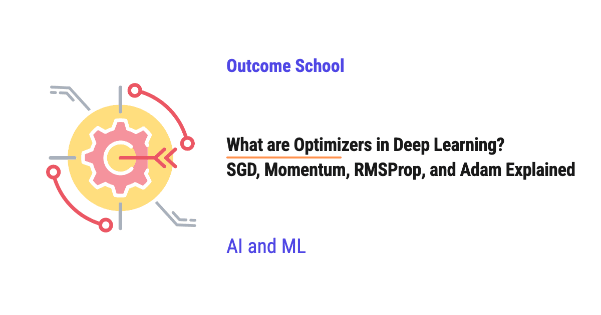

# What are Optimizers in Deep Learning? SGD, Momentum, RMSProp, and Adam Explained

> Archived from <https://outcomeschool.com/blog/optimizers-in-deep-learning> on 2026-11-25.

An optimizer is the part of deep learning training that decides how to change the weights of a neural network after every training step, so that the network makes fewer mistakes. SGD, Momentum, RMSProp, and Adam are four popular optimizers, and each one improves on the one before it.

In this blog, we will learn about optimizers in deep learning. We will also see what a gradient and a learning rate are, how SGD updates the weights and where it struggles, how Momentum and RMSProp fix its problems one by one, how Adam combines both ideas, what AdamW changes, and which optimizer to use when.

We will cover the following:
<ul><li>What is an Optimizer?</li><li>Gradient and Learning Rate</li><li>SGD (Stochastic Gradient Descent)</li><li>Momentum</li><li>RMSProp</li><li>Adam</li><li>Adam in Code</li><li>AdamW</li><li>Comparison of SGD, Momentum, RMSProp, and Adam</li></ul>
I am <strong>Amit Shekhar</strong>, Founder @ <a target="_blank" rel="noopener noreferrer" href="https://outcomeschool.com">Outcome School</a>, I have taught and mentored many developers, and their efforts landed them high-paying tech jobs, helped many tech companies in solving their unique problems, and created many open-source libraries being used by top companies. I am passionate about sharing knowledge through open-source, blogs, and videos.

I teach <a target="_blank" rel="noopener noreferrer" href="https://outcomeschool.com/program/ai-and-machine-learning">AI and Machine Learning</a> at Outcome School.

Let&#x27;s get started.
<h2 id="what-is-an-optimizer">What is an Optimizer?</h2>
A <a target="_blank" rel="noopener noreferrer" href="neural-network.md">neural network</a> is made of many numbers called <strong>weights</strong>. The weights decide what the network outputs for a given input. At the start of training, the <a target="_blank" rel="noopener noreferrer" href="random-weight-initialization.md">weights are random</a>, so the outputs are wrong.

During training, we measure how wrong the network is with a single number called the <strong>loss</strong>. A big loss means many mistakes. A small loss means few mistakes. Our goal is to make the loss as small as possible.

<strong>An optimizer is the algorithm that uses the slope of the loss, called the gradient, to update the weights step by step, so that the loss keeps going down.</strong>

The best way to learn this is by taking an example.

Let&#x27;s say we are standing on a hill in thick fog, and we want to reach the lowest point of the valley. We cannot see the valley. We can only feel the slope of the ground under our feet. So, we take a small step in the downhill direction, feel the slope again, and take another step. We keep doing this until the ground becomes flat.

Here, our position on the hill is the weights, the height is the loss, and the rule we follow to take each step is the optimizer.

Let&#x27;s see where the optimizer sits in the training loop as a diagram:

<pre><code class="language-text code-highlight">┌────────────────────────────────────┐
│ Batch of 32 training examples      │
└────────────────────────────────────┘
                   ↓
┌────────────────────────────────────┐
│ Forward pass                       │
│ Network makes 32 predictions       │
└────────────────────────────────────┘
                   ↓
┌────────────────────────────────────┐
│ Loss                               │
│ One number: how wrong it is        │
└────────────────────────────────────┘
                   ↓
┌────────────────────────────────────┐
│ Backward pass                      │
│ One gradient for every weight      │
└────────────────────────────────────┘
                   ↓
┌────────────────────────────────────┐
│ Optimizer                          │
│ Uses the gradients to update       │
│ every weight                       │
└────────────────────────────────────┘
                   ↓
┌────────────────────────────────────┐
│ Updated weights                    │
│ Used for the next batch            │
└────────────────────────────────────┘
</code></pre>

Here, we can see that the optimizer is the last stage of every training step. It does not compute the loss and it does not compute the gradient. It takes the gradient and decides how much to change each weight. Then the loop repeats with the updated weights.

We have a detailed blog on <a target="_blank" rel="noopener noreferrer" href="math-behind-backpropagation.md">backpropagation</a> that explains how the backward pass computes these gradients step by step.
<h2 id="gradient-and-learning-rate">Gradient and Learning Rate</h2>
Before jumping into the optimizers, we must know two terms: gradient and learning rate.

The <strong>gradient</strong> of a weight tells us two things:
<ul><li><strong>Direction:</strong> If we increase this weight a little, does the loss go up or down?</li><li><strong>Size:</strong> How strongly does the loss change when we change this weight?</li></ul>
If the gradient is positive, increasing the weight increases the loss. So, we must decrease the weight. If the gradient is negative, we must increase the weight. This is why every optimizer moves the weight in the <a target="_blank" rel="noopener noreferrer" href="math-behind-gradient-descent.md">opposite direction of the gradient</a>.

The <strong>learning rate</strong> is a small number, like 0.1 or 0.001, that controls how big each step is. We choose it before training starts.
<ul><li>If the learning rate is too big, we jump over the valley and the loss bounces around.</li><li>If the learning rate is too small, we move so slowly that training takes a very long time.</li></ul>
We have a detailed blog on <a target="_blank" rel="noopener noreferrer" href="learning-rate-schedules-and-warmup.md">learning rate schedules and warmup</a> that explains how the learning rate can change during training.

For all the examples in this blog, we will use one simple loss for the sake of understanding:

<strong>loss = w^2</strong>

The lowest loss is at <code>w = 0</code>. The gradient of this loss is <code>2 * w</code>. We will start at <code>w = 2</code> and use a learning rate of <code>0.1</code>.

<strong>Planning your move into AI?</strong>

No matter which tech domain you work in today, with your effort, you can transition to these roles:
<ul><li>AI Engineer</li><li>Forward Deployed Engineer</li><li>AI Agent Engineer</li><li>Harness Engineer</li><li>Voice AI Engineer</li><li>AI Architect</li><li>LLM Engineer</li><li>LLM Inference Engineer</li><li>Gen AI Engineer</li><li>MLOps Engineer</li><li>ML Engineer</li><li>Deep Learning Engineer</li></ul>
Our <a target="_blank" rel="noopener noreferrer" href="https://outcomeschool.com/program/ai-and-machine-learning">AI and Machine Learning Program</a> at Outcome School takes you there.
<h2 id="sgd-stochastic-gradient-descent">SGD (Stochastic Gradient Descent)</h2>
SGD is the simplest optimizer. It takes a step in the opposite direction of the gradient, scaled by the learning rate.

<strong>w_new = w - learning_rate * gradient</strong>

The word <strong>Stochastic</strong> means random. In SGD, we do not compute the gradient on the whole dataset at once. We compute it on a small random <a target="_blank" rel="noopener noreferrer" href="epoch-batch-and-iteration.md">batch</a> of examples, which is much faster. Hence, the name Stochastic Gradient Descent.

Let&#x27;s do two steps with numbers.

<strong>Step 1:</strong> At <code>w = 2</code>, the gradient is <code>2 * 2 = 4</code>. So, <code>w_new = 2 - 0.1 * 4 = 1.6</code>.

<strong>Step 2:</strong> At <code>w = 1.6</code>, the gradient is <code>2 * 1.6 = 3.2</code>. So, <code>w_new = 1.6 - 0.1 * 3.2 = 1.28</code>.

The weight is moving toward 0, and the loss is going down.

But the following issues arise in real networks:
<ul><li><strong>Zig-zag:</strong> Real loss surfaces are often shaped like a long narrow valley. The slope across the valley is steep, and the slope along the valley is gentle. SGD keeps jumping from one wall of the valley to the other, and makes very little progress along the valley floor.</li><li><strong>Slow in flat areas:</strong> When the ground is almost flat, the gradient is tiny. So, the step is tiny, and SGD moves very slowly.</li></ul>
The issue with this approach is that every step only looks at the current gradient and forgets everything before it. Let&#x27;s see how the next approach solve this issue.
<h2 id="momentum">Momentum</h2>
Momentum adds memory to SGD. Instead of stepping using only the current gradient, it keeps a running value called the <strong>velocity</strong>, which collects the gradients from the past steps.

Think of a ball rolling down the hill. The ball does not stop and restart at every step. It builds up speed in the direction it keeps going.

The update rule is as below:

<strong>velocity = beta * velocity + gradient</strong>

<strong>w_new = w - learning_rate * velocity</strong>

Here, <code>beta</code> is a number like <code>0.9</code>. It decides how much of the old velocity we keep. With <code>beta = 0.9</code>, we keep 90 percent of the old velocity and add the new gradient on top.

Let&#x27;s do the same two steps with numbers. The velocity starts at 0.

<strong>Step 1:</strong> The gradient is <code>4</code>. So, <code>velocity = 0.9 * 0 + 4 = 4</code> and <code>w_new = 2 - 0.1 * 4 = 1.6</code>.

<strong>Step 2:</strong> The gradient is <code>3.2</code>. So, <code>velocity = 0.9 * 4 + 3.2 = 6.8</code> and <code>w_new = 1.6 - 0.1 * 6.8 = 0.92</code>.

Here, we can notice that after two steps, SGD reached <code>1.28</code>, but Momentum reached <code>0.92</code>. Momentum is closer to the lowest point at <code>0</code>, because the velocity has built up speed.

This fixes both SGD problems:
<ul><li><strong>Zig-zag:</strong> The side-to-side gradients point in opposite directions in alternate steps, so they mostly cancel out inside the velocity. The gradients along the valley point the same way every step, so they add up.</li><li><strong>Flat areas:</strong> Even when the current gradient is tiny, the velocity still carries speed from the earlier steps.</li></ul>
But the following issue arises. A network has millions of weights. Some weights always get large gradients, and some always get tiny gradients. SGD and Momentum use the same learning rate for all of them. A learning rate that is safe for the weights with large gradients is far too small for the weights with tiny gradients, so those weights barely learn.

The issue with this approach is that every weight gets the same step size. Let&#x27;s see how the next approach solve this issue.
<h2 id="rmsprop">RMSProp</h2>
RMSProp gives every weight its own step size. It divides each gradient by the typical size of that weight&#x27;s recent gradients.

To know the typical size, RMSProp keeps a running average of the <strong>squared</strong> gradient for each weight. We square the gradient so that we measure only its size, and negative and positive values do not cancel out.

The update rule is as below:

<strong>s = beta * s + (1 - beta) * gradient^2</strong>

<strong>w_new = w - learning_rate * gradient / (sqrt(s) + epsilon)</strong>

Here:
<ul><li><code>s</code> is the running average of the squared gradients for this weight. It starts at 0.</li><li><code>beta</code> is usually <code>0.9</code>.</li><li><code>sqrt(s)</code> is the typical size of the gradient for this weight.</li><li><code>epsilon</code> is a tiny number like <code>0.00000001</code>, added only to avoid dividing by zero.</li></ul>
RMSProp stands for <strong>Root Mean Square Propagation</strong>, because <code>sqrt(s)</code> is the root of the mean of the squares.

Let&#x27;s take two weights, A and B, with very different gradients. Weight A has a gradient of <code>4</code>, and weight B has a gradient of <code>0.04</code>. We use a learning rate of <code>0.1</code>.

<strong>Weight A:</strong> <code>s = 0.9 * 0 + 0.1 * 16 = 1.6</code> and <code>sqrt(1.6) = 1.2649</code>. So, the step is <code>0.1 * 4 / 1.2649 = 0.3162</code>.

<strong>Weight B:</strong> <code>s = 0.9 * 0 + 0.1 * 0.0016 = 0.00016</code> and <code>sqrt(0.00016) = 0.012649</code>. So, the step is <code>0.1 * 0.04 / 0.012649 = 0.3162</code>.

Here, we can see that both weights take the same step of <code>0.3162</code>, even though their gradients differ by 100 times. With plain SGD, weight A would move by <code>0.4</code> and weight B would move by only <code>0.004</code>.

Means, a weight with large gradients gets its steps shrunk, and a weight with tiny gradients gets its steps boosted.

But RMSProp has no velocity. It does not remember the direction of the past gradients, so it loses the benefits of Momentum.

<strong>A quick note for you</strong>

No matter which tech domain you work in, get familiar with these topics:
<ul><li>LLM</li><li>RAG</li><li>MCP</li><li>Agent</li><li>Fine-tuning</li><li>Quantization</li></ul>
We put it all together in one video:

<a target="_blank" rel="noopener noreferrer" href="https://www.youtube.com/watch?v=lnfWvX66FUk">AI Engineering Explained: LLM, RAG, MCP, Agent, Fine-Tuning, and Quantization</a>

No need to stop reading - bookmark it and watch later when you get time. Future you will thank you.

Now, let&#x27;s get back to the topic.
<h2 id="adam">Adam</h2>
So, here comes Adam to the rescue. Adam stands for <strong>Adaptive Moment Estimation</strong>. It combines the two ideas we just learned:
<ul><li>From Momentum, it takes a running average of the gradients. This gives the direction and the speed.</li><li>From RMSProp, it takes a running average of the squared gradients. This gives a separate step size for each weight.</li></ul>
The update rule is as below:

<strong>m = beta1 * m + (1 - beta1) * gradient</strong>

<strong>v = beta2 * v + (1 - beta2) * gradient^2</strong>

<strong>m_hat = m / (1 - beta1^t)</strong>

<strong>v_hat = v / (1 - beta2^t)</strong>

<strong>w_new = w - learning_rate * m_hat / (sqrt(v_hat) + epsilon)</strong>

Here:
<ul><li><code>m</code> is the Momentum part. <code>beta1</code> is usually <code>0.9</code>.</li><li><code>v</code> is the RMSProp part. <code>beta2</code> is usually <code>0.999</code>.</li><li><code>t</code> is the step number: 1, 2, 3, and so on.</li><li><code>m_hat</code> and <code>v_hat</code> are the <strong>bias-corrected</strong> versions of <code>m</code> and <code>v</code>.</li></ul>
Now, the question is: why do we need <code>m_hat</code> and <code>v_hat</code>?

The answer is that <code>m</code> and <code>v</code> start at 0. In the first few steps, they are pulled toward 0 and are much smaller than the real gradients. Dividing by <code>(1 - beta1^t)</code> and <code>(1 - beta2^t)</code> fixes this. In the first step, these divisions make a big correction. As <code>t</code> grows, <code>beta1^t</code> and <code>beta2^t</code> go close to 0, so the division stops changing anything.

Let&#x27;s do one step with numbers. The gradient is <code>4</code>, <code>t = 1</code>, and the learning rate is <code>0.1</code>.

<strong>Momentum part:</strong> <code>m = 0.9 * 0 + 0.1 * 4 = 0.4</code>.

<strong>RMSProp part:</strong> <code>v = 0.999 * 0 + 0.001 * 16 = 0.016</code>.

<strong>Bias correction:</strong> <code>m_hat = 0.4 / (1 - 0.9) = 4</code> and <code>v_hat = 0.016 / (1 - 0.999) = 16</code>.

<strong>Update:</strong> <code>w_new = 2 - 0.1 * 4 / sqrt(16) = 2 - 0.1 * 4 / 4 = 1.9</code>.

Here, we can notice that without bias correction, <code>m</code> would be only <code>0.4</code> instead of the real gradient <code>4</code>. Bias correction brings it back to <code>4</code>.

Let&#x27;s see how Adam combines the two ideas in this step as a diagram:

<pre><code class="language-text code-highlight">┌────────────────────────────────────────┐
│ gradient = 4 (goes to both parts)      │
└────────────────────────────────────────┘
          ↓                     ↓
┌──────────────────┐  ┌──────────────────┐
│ Momentum part    │  │ RMSProp part     │
│ m_hat = 4        │  │ v_hat = 16       │
│ gives direction  │  │ gives scale      │
└──────────────────┘  └──────────────────┘
          ↓                     ↓
┌────────────────────────────────────────┐
│ step = 0.1 * 4 / sqrt(16) = 0.1        │
│ w_new = 2 - 0.1 = 1.9                  │
└────────────────────────────────────────┘
</code></pre>

Here, we can see that the same gradient feeds two running averages. The Momentum part gives the direction, and the RMSProp part gives the scale. Adam divides the first by the square root of the second to get the final step for this weight.

To master Optimizers and Gradient Descent, and build a Neural Network from scratch, we have a complete program - check out our <a target="_blank" rel="noopener noreferrer" href="https://outcomeschool.com/program/ai-and-machine-learning">AI and Machine Learning Program</a> at Outcome School.
<h2 id="adam-in-code">Adam in Code</h2>
Let&#x27;s see the code for Adam with two weights. One weight gets a big gradient, and the other gets a gradient that is 100 times smaller.

<pre><code class="code-highlight language-python">import numpy as np

w = np.array([2.0, 2.0])          # two weights
m = np.zeros(2)                   # running average of gradients
v = np.zeros(2)                   # running average of squared gradients
lr, beta1, beta2, eps = 0.1, 0.9, 0.999, 1e-8

for t in range(1, 4):
    g = np.array([2.0, 0.02]) * w  # gradients: one big, one tiny
    m = beta1 * m + (1 - beta1) * g
    v = beta2 * v + (1 - beta2) * g * g
    m_hat = m / (1 - beta1 ** t)
    v_hat = v / (1 - beta2 ** t)
    w = w - lr * m_hat / (np.sqrt(v_hat) + eps)
    print(t, np.round(w, 4))
</code></pre>

Here, both weights start at <code>2.0</code>, but the gradient of the first weight is 100 times bigger than the gradient of the second weight. The five lines inside the loop are the five lines of the Adam update rule.

This will print the following:

<pre><code class="language-text code-highlight">1 [1.9 1.9]
2 [1.8002 1.8002]
3 [1.7006 1.7006]
</code></pre>

Here, we can see that both weights move by almost the same amount at every step, even though their gradients are very different. This is the RMSProp part of Adam at work. With plain SGD, the second weight would have moved 100 times slower.

<strong>Note:</strong> We used a learning rate of <code>0.1</code> to keep the numbers easy to read. In real training, Adam often uses a much smaller learning rate, like <code>0.001</code> or <code>0.0003</code>.

<strong>Stay updated:</strong> Subscribe to our <a target="_blank" rel="noopener noreferrer" href="https://outcomeschool.substack.com/subscribe">newsletter</a> to get our latest AI and Machine Learning blogs straight to your inbox.
<h2 id="adamw">AdamW</h2>
<strong>AdamW</strong> is a small change to Adam, and it is a common choice for training <a target="_blank" rel="noopener noreferrer" href="large-language-model-llm.md">LLMs (Large Language Models)</a>.

To stop the weights from growing too large, we often shrink every weight a little at each step. This is called <a target="_blank" rel="noopener noreferrer" href="regularization-in-machine-learning.md"><strong>weight decay</strong></a>. In plain Adam, weight decay is usually added to the gradient, so it also gets divided by <code>sqrt(v_hat)</code>, and the shrinking becomes uneven across weights.

AdamW keeps the weight decay separate from the gradient. It does the normal Adam step, and then shrinks every weight directly:

<strong>w_new = w - learning_rate * m_hat / (sqrt(v_hat) + epsilon) - learning_rate * weight_decay * w</strong>

Here, the last part shrinks the weight by the same fraction for every weight, no matter how big its gradients are. This change makes the weight decay work as intended, and the models often generalize better.
<h2 id="comparison-of-sgd-momentum-rmsprop-and-adam">Comparison of SGD, Momentum, RMSProp, and Adam</h2>
Let me tabulate the differences between SGD, Momentum, RMSProp, and Adam for your better understanding.
<table><thead><tr><th>Optimizer</th><th>Remembers past direction</th><th>Own step size per weight</th><th>Bias correction</th><th>Common use</th></tr></thead><tbody><tr><td>SGD</td><td>No</td><td>No</td><td>No</td><td>Simple problems, baseline</td></tr><tr><td>Momentum</td><td>Yes</td><td>No</td><td>No</td><td>Image models, with careful tuning</td></tr><tr><td>RMSProp</td><td>No</td><td>Yes</td><td>No</td><td>Some reinforcement learning setups</td></tr><tr><td>Adam</td><td>Yes</td><td>Yes</td><td>Yes</td><td>Default for most deep learning</td></tr><tr><td>AdamW</td><td>Yes</td><td>Yes</td><td>Yes</td><td>Training LLMs</td></tr></tbody></table>
For most deep learning projects today, Adam or AdamW is the default starting point. SGD with Momentum is still used for some image models, where it often generalizes well when the learning rate is tuned carefully.

Now we must have understood what optimizers are, how SGD, Momentum, RMSProp, and Adam update the weights, and when to use which one.
<h2 id="frequently-asked-questions">Frequently Asked Questions</h2><h3 id="does-the-optimizer-compute-the-gradient">Does the optimizer compute the gradient?</h3>
No. The optimizer does not compute the loss or the gradient. The backward pass computes one gradient for every weight, and the optimizer takes those gradients and decides how much to change each weight. It is the last stage of every training step, and then the loop repeats with the updated weights.
<h3 id="which-optimizer-should-we-use-for-deep-learning">Which optimizer should we use for deep learning?</h3>
For most deep learning projects today, Adam or AdamW is the default starting point. AdamW is a common choice for training LLMs. SGD with Momentum is still used for some image models, where it often generalizes well when the learning rate is tuned carefully.
<h3 id="why-does-adam-need-bias-correction">Why does Adam need bias correction?</h3>
Adam needs bias correction because its running averages <code>m</code> and <code>v</code> start at 0. In the first few steps, they are pulled toward 0 and are much smaller than the real gradients. Dividing by <code>(1 - beta1^t)</code> and <code>(1 - beta2^t)</code> fixes this, and as the step number grows, the correction stops changing anything.
<h3 id="what-learning-rate-does-adam-use-in-real-training">What learning rate does Adam use in real training?</h3>
In real training, Adam often uses a small learning rate, like <code>0.001</code> or <code>0.0003</code>. The learning rate is chosen before training starts. If it is too big, the loss bounces around, and if it is too small, training takes a very long time.

That&#x27;s it for now.

Thanks

<strong>Amit Shekhar</strong> Founder @ <a target="_blank" rel="noopener noreferrer" href="https://outcomeschool.com">Outcome School</a>

You can connect with me on:
<ul><li><a target="_blank" rel="noopener noreferrer" href="https://x.com/amitiitbhu">X</a></li><li><a target="_blank" rel="noopener noreferrer" href="https://www.linkedin.com/in/amit-shekhar-iitbhu">LinkedIn</a></li><li><a target="_blank" rel="noopener noreferrer" href="https://github.com/amitshekhariitbhu">GitHub</a></li></ul>
Follow Outcome School on:
<ul><li><a target="_blank" rel="noopener noreferrer" href="https://x.com/outcome_school">X</a></li><li><a target="_blank" rel="noopener noreferrer" href="https://youtube.com/@OutcomeSchool">YouTube</a></li><li><a target="_blank" rel="noopener noreferrer" href="https://www.linkedin.com/company/outcomeschool">LinkedIn</a></li><li><a target="_blank" rel="noopener noreferrer" href="http://github.com/OutcomeSchool">GitHub</a></li></ul>
<a target="_blank" rel="noopener noreferrer" href="https://outcomeschool.com/blog"><strong>Read all of our high-quality blogs here.</strong></a>

