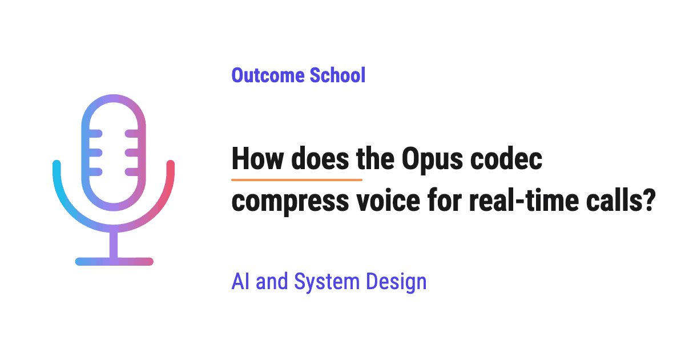

# How does the Opus codec compress voice for real-time calls?

> Archived from <https://outcomeschool.com/blog/opus-codec> on 2026-11-25.

The Opus codec compresses voice by cutting the sound into tiny slices, usually 20 milliseconds long, keeping only the parts of each slice that our ears can actually hear, and describing those parts with a small set of numbers instead of the raw sound wave. This makes the voice around 30 times smaller, so it can travel over the internet fast enough for a live call.

In this blog, we will learn about how the Opus codec compresses voice for real-time calls. We will also see why raw voice is too big to send, what a codec does, how Opus cuts the voice into small frames, how its two engines SILK and CELT shrink the sound, how it handles silence and lost packets, and why it is used in WebRTC and voice AI agents.

We will cover the following:
<ul><li>Why raw voice is too big for a call</li><li>What is a codec?</li><li>What is the Opus codec?</li><li>Step 1: Cutting the voice into small frames</li><li>Step 2: Keeping only what our ears can hear</li><li>Step 3: SILK, the speech engine</li><li>Step 4: CELT, the music engine</li><li>Step 5: Hybrid mode, using both engines together</li><li>How Opus saves data during silence</li><li>How Opus handles lost packets</li><li>Why Opus is used for real-time calls and voice agents</li></ul>
I am <strong>Amit Shekhar</strong>, Founder @ <a target="_blank" rel="noopener noreferrer" href="https://outcomeschool.com">Outcome School</a>, I have taught and mentored many developers, and their efforts landed them high-paying tech jobs, helped many tech companies in solving their unique problems, and created many open-source libraries being used by top companies. I am passionate about sharing knowledge through open-source, blogs, and videos.

I teach <a target="_blank" rel="noopener noreferrer" href="https://outcomeschool.com/program/ai-and-machine-learning">AI and Machine Learning</a> at Outcome School.

Let&#x27;s get started.
<h2 id="why-raw-voice-is-too-big-for-a-call">Why raw voice is too big for a call</h2>
When we speak into a microphone, our voice is a continuous wave of air pressure. A computer cannot store a continuous wave. So, it measures the height of the wave many times every second. Each measurement is called a <strong>sample</strong>.

For high-quality audio, the computer takes <a target="_blank" rel="noopener noreferrer" href="sample-rates-for-voice-agents.md">48,000 samples every second</a>, and it stores each sample as a 16-bit number.

Let&#x27;s do the math for one second of voice:

<strong>48,000 samples * 16 bits = 768,000 bits per second = 768 kbps</strong>

Means, a single person talking needs around 768 kilobits every second (kbps). That is just for one direction of the call.

Now, the question is: what is the problem with this?

The problem is that many people are on slow mobile networks. On top of that, the network is shared with videos, downloads, and other apps. Sending 768 kbps for every speaker, every second, is too heavy. The voice will arrive late, break up, or not arrive at all.

So, we need a way to make the voice much smaller before sending it, and that too without making it sound bad. Here comes the codec into the picture.
<h2 id="what-is-a-codec">What is a codec?</h2>
<strong>A codec is a tool that compresses audio on the sender&#x27;s side and decompresses it back on the receiver&#x27;s side.</strong>

The word itself tells us what it does:

<strong>Codec = Coder + Decoder</strong>
<ul><li>The <strong>coder</strong> (also called the encoder) takes the raw voice and turns it into a small packet of data.</li><li>The <strong>decoder</strong> takes that small packet and rebuilds the voice so that we can hear it.</li></ul>
The flow looks like below:

<pre><code class="code-highlight">+---------------------+
|  Speaker&#x27;s voice    |
|  (768 kbps raw)     |
+---------------------+
           ↓
+---------------------+
|  Encoder            |
+---------------------+
           ↓
+---------------------+
|  Small packets      |
|  (around 24 kbps)   |
+---------------------+
           ↓
       Internet
           ↓
+---------------------+
|  Decoder            |
+---------------------+
           ↓
+---------------------+
|  Listener hears     |
|  the voice          |
+---------------------+
</code></pre>

Here, we can see that the raw voice goes in at 768 kbps, and with a voice codec like Opus, only around 24 kbps travels over the internet. That is around 32 times smaller.

<strong>Note:</strong> Most voice codecs, including Opus, are <strong>lossy</strong>. Means, the rebuilt voice is not exactly the same as the original. The codec throws away the details that our ears will not notice. This is how it gets so small.

<strong>Planning your move into AI?</strong>

No matter which tech domain you work in today, with your effort, you can transition to these roles:
<ul><li>AI Engineer</li><li>Forward Deployed Engineer</li><li>AI Agent Engineer</li><li>Harness Engineer</li><li>Voice AI Engineer</li><li>AI Architect</li><li>LLM Engineer</li><li>LLM Inference Engineer</li><li>Gen AI Engineer</li><li>MLOps Engineer</li><li>ML Engineer</li><li>Deep Learning Engineer</li></ul>
Our <a target="_blank" rel="noopener noreferrer" href="https://outcomeschool.com/program/ai-and-machine-learning">AI and Machine Learning Program</a> at Outcome School takes you there.
<h2 id="what-is-the-opus-codec">What is the Opus codec?</h2>
<strong>Opus is an open, royalty-free audio codec designed for real-time communication over the internet. It was standardized in 2012 by the IETF (Internet Engineering Task Force), the group that creates internet standards, as RFC 6716.</strong>

Opus was built by combining two older codecs:
<ul><li><strong>SILK</strong>, which came from Skype and is very good at human speech.</li><li><strong>CELT</strong>, which came from the Xiph.Org Foundation and is very good at music and high-quality sound with very low delay.</li></ul>
The <strong>bitrate</strong> is the number of bits a codec sends every second. Opus can work at any bitrate from 6 kbps up to 510 kbps. At the low end, it can carry a clear phone-quality voice. At the high end, it can carry studio-quality music.

It also supports different audio bandwidths, which means how much of the sound range it keeps:
<table><thead><tr><th>Name</th><th>Sound range kept</th><th>Sampling rate</th></tr></thead><tbody><tr><td>Narrowband</td><td>up to 4 kHz</td><td>8 kHz</td></tr><tr><td>Mediumband</td><td>up to 6 kHz</td><td>12 kHz</td></tr><tr><td>Wideband</td><td>up to 8 kHz</td><td>16 kHz</td></tr><tr><td>Super-wideband</td><td>up to 12 kHz</td><td>24 kHz</td></tr><tr><td>Fullband</td><td>up to 20 kHz</td><td>48 kHz</td></tr></tbody></table>
Here, a higher range sounds more natural, but it needs more data. An old phone call is close to narrowband. A good Opus call is usually wideband or fullband. For speech, RFC 7587, the standard for sending Opus in live calls, lists around 16 to 20 kbps as the best range for wideband voice, and around 28 to 40 kbps for fullband voice.

Now, let&#x27;s understand how Opus actually compresses the voice, step by step.
<h2 id="step-1-cutting-the-voice-into-small-frames">Step 1: Cutting the voice into small frames</h2>
Opus does not wait for the full sentence. It cuts the voice into small slices of time called <a target="_blank" rel="noopener noreferrer" href="audio-frames-and-chunk-sizes.md"><strong>frames</strong></a>.

A frame can be 2.5, 5, 10, 20, 40, or 60 milliseconds long. For calls, the most common choice is <strong>20 milliseconds</strong>.

Let&#x27;s say a person says &quot;Hello, how are you?&quot; and it takes 1 second. Opus cuts this into 50 frames of 20 ms each, and it compresses and sends each frame as soon as it is ready.

Let&#x27;s do the math for one 20 ms frame at 48 kHz:
<ul><li>Samples in one frame: 48,000 * 0.020 = 960 samples</li><li>Raw size: 960 * 16 bits = 15,360 bits</li><li>Opus size at 24 kbps: 24,000 * 0.020 = 480 bits = 60 bytes</li></ul>
Here, we can notice that 15,360 bits become just 480 bits. Each 20 ms frame becomes one small packet of 60 bytes.

<strong>Why small frames?</strong> Because the encoder cannot compress a frame until the full frame is recorded. So, the frame size sets the minimum delay. The total delay added by Opus with 20 ms frames is around 26.5 ms, which is the 20 ms frame plus a 6.5 ms look-ahead. This is small enough for a natural conversation.

<strong>The trade-off:</strong> Smaller frames mean lower delay, but every packet also carries around 40 bytes of network headers, so very small frames waste more data on headers than on voice. Larger frames save data, but add delay. 20 ms is the balance point for most calls.

<strong>A quick note for you</strong>

No matter which tech domain you work in, get familiar with these topics:
<ul><li>LLM</li><li>RAG</li><li>MCP</li><li>Agent</li><li>Fine-tuning</li><li>Quantization</li></ul>
We put it all together in one video:

<a target="_blank" rel="noopener noreferrer" href="https://www.youtube.com/watch?v=lnfWvX66FUk">AI Engineering Explained: LLM, RAG, MCP, Agent, Fine-Tuning, and Quantization</a>

No need to stop reading - bookmark it and watch later when you get time. Future you will thank you.

Now, let&#x27;s get back to the topic.
<h2 id="step-2-keeping-only-what-our-ears-can-hear">Step 2: Keeping only what our ears can hear</h2>
Opus uses the fact that our ears are not perfect.

Our ears have a few limits:
<ul><li>We hear some frequencies much better than others. We are most sensitive to the middle range, where most of human speech is.</li><li>A loud sound hides a quieter sound that is close to it in pitch. This is called <strong>masking</strong>.</li><li>Very fine details in very high frequencies are hard for us to notice.</li></ul>
Opus uses these limits to decide where to spend its bits. It spends more bits on the parts we clearly hear, and fewer bits, or zero bits, on the parts that are hidden or that we barely notice.

Let&#x27;s say there is a loud vowel sound and a very soft hiss at a nearby pitch. Our ears will not hear the hiss anyway. So, Opus does not waste bits on it.

This idea of compressing based on how humans hear is called <strong>psychoacoustics</strong>. Both engines inside Opus use it to decide where the small errors of compression are least noticed.

Now, let&#x27;s see the two engines.
<h2 id="step-3-silk-the-speech-engine">Step 3: SILK, the speech engine</h2>
SILK is the engine that Opus uses for speech at low bitrates. It works on the idea that human speech is very predictable.

Let&#x27;s understand how our voice is produced. Air comes from our lungs. Our vocal cords vibrate to create a buzz. Then, our throat, mouth, tongue, and lips shape that buzz into different sounds like &quot;aa&quot;, &quot;ee&quot;, or &quot;ss&quot;.

SILK copies this idea. Instead of sending the sound wave itself, it sends a description of how the voice was made. This method is called <strong>Linear Prediction</strong>.

It works in three parts:
<ul><li><strong>Predicting the next sample:</strong> Speech changes smoothly. So, each sample can be guessed well from the few samples just before it. SILK finds a small set of numbers, called filter coefficients, that describe the shape of the mouth and throat for that frame. With these numbers, the decoder can guess most of the wave by itself.</li><li><strong>Pitch prediction:</strong> When we speak a vowel, the buzz from our vocal cords repeats again and again at a steady rate. That rate is the pitch. SILK sends the pitch, so the decoder can repeat the pattern instead of receiving it again and again.</li><li><strong>The leftover error:</strong> The guess is never perfect. The small difference between the guess and the real wave is called the <strong>residual</strong>. Along with the filter numbers and the pitch, SILK sends this residual, and that too with very few bits.</li></ul>
Let&#x27;s take a simple example for the sake of understanding. Suppose the samples are 10, 12, 14, 16. If the rule is &quot;add 2 to the last sample&quot;, then the next guess is 18. If the real sample is 19, SILK needs to send the rule once and the small error of 1, not the full value 19. The decoder knows the same rule, so it makes the same guess of 18 and adds the error of 1 to get back 19. Small numbers need far fewer bits than big numbers.

This is how SILK can carry clear speech at low bitrates like 8 to 16 kbps.

SILK works only up to wideband, which means sounds up to 8 kHz. The issue with this engine is that it is not good for music or full-range audio. Let&#x27;s see how the next engine solve this issue.
<h2 id="step-4-celt-the-music-engine">Step 4: CELT, the music engine</h2>
CELT is the engine that Opus uses for music, full-range sound, and very low delay. It works in a different way from SILK.

Instead of describing how the sound was made, CELT looks at which frequencies are present in each frame. It uses a math tool called the <strong>MDCT</strong> (Modified Discrete Cosine Transform) to convert the frame from a wave over time into a list of frequencies and their strengths.

Then, it groups these frequencies into <strong>bands</strong>. The bands are narrow at low frequencies and wide at high frequencies, because our ears separate low pitches finely and high pitches roughly.

For each band, CELT sends two things, which means it splits every band into a loudness part and a detail part:
<ul><li><strong>The energy:</strong> how loud that band is. This is the most important part, so CELT always keeps it accurate.</li><li><strong>The shape:</strong> the fine detail inside the band. CELT spends more bits on the shape of important bands and fewer bits on bands our ears care less about.</li></ul>
Since CELT always keeps the energy of every band correct, the overall sound stays balanced even when the fine detail is rough. This is why CELT sounds natural even at lower bitrates. In fact, CELT stands for Constrained Energy Lapped Transform, and the &quot;constrained energy&quot; part refers to this idea of keeping the energy of every band fixed.

CELT also works with very short frames, down to 2.5 ms, which makes it well suited for very low delay.

Now that we have learned about SILK and CELT, it&#x27;s time to learn about how Opus uses both of them together.
<h2 id="step-5-hybrid-mode-using-both-engines-together">Step 5: Hybrid mode, using both engines together</h2>
Now, the next big question is: which engine does Opus pick?

The answer is that Opus can use SILK, CELT, or both at the same time. It has three modes:
<table><thead><tr><th>Mode</th><th>Engine used</th><th>Best for</th></tr></thead><tbody><tr><td>SILK-only</td><td>SILK</td><td>Speech at low bitrates</td></tr><tr><td>Hybrid</td><td>SILK + CELT</td><td>High-quality speech at medium bitrates</td></tr><tr><td>CELT-only</td><td>CELT</td><td>Music, full-range sound, very low delay</td></tr></tbody></table>
In the hybrid mode:
<ul><li>SILK handles the low frequencies, up to 8 kHz, where most of the meaning of speech is.</li><li>CELT handles the high frequencies, above 8 kHz, which make the voice sound clear and natural.</li></ul>
Then, the decoder adds both parts together to rebuild the full voice. Hybrid mode works with 10 ms and 20 ms frames.

Let&#x27;s see the flow of hybrid mode as below:

<pre><code class="code-highlight">+---------------------------+
|  One 20 ms voice frame    |
+---------------------------+
              ↓
     Split by frequency
              ↓
+-------------+-------------+
|  0 to 8 kHz | 8 to 20 kHz |
|  SILK       | CELT        |
+-------------+-------------+
              ↓
+---------------------------+
|  One Opus packet          |
+---------------------------+
</code></pre>

The encoder switches between these modes automatically, frame by frame, based on the bitrate and the type of sound. If the network gets slow, it can move to a lower bitrate and a narrower bandwidth in the middle of the call, without dropping the call.

<strong>Stay updated:</strong> Subscribe to our <a target="_blank" rel="noopener noreferrer" href="https://outcomeschool.substack.com/subscribe">newsletter</a> to get our latest AI and Machine Learning blogs straight to your inbox.

Now, let&#x27;s see how Opus saves data when nobody is speaking.
<h2 id="how-opus-saves-data-during-silence">How Opus saves data during silence</h2>
In a normal conversation, each person is silent for a large part of the time, because they are listening to the other person.

Sending full packets for silence is a waste. So, Opus has a feature called <strong>DTX</strong> (Discontinuous Transmission).

When DTX is on and the speaker is silent, Opus stops sending normal packets. It only sends one tiny packet around every 400 ms. The receiver fills the gap with soft background noise, called <strong>comfort noise</strong>, so that the listener does not think the call has dropped.

This saves a lot of data in a two-way call.

Now, let&#x27;s move to the next problem, which is lost packets.
<h2 id="how-opus-handles-lost-packets">How Opus handles lost packets</h2>
On the internet, some packets get lost or <a target="_blank" rel="noopener noreferrer" href="jitter-buffer.md">arrive too late</a>. For a live call, we cannot wait for a lost packet to be sent again, because that will add delay. So, Opus has its own ways to deal with loss.
<ul><li><strong><a target="_blank" rel="noopener noreferrer" href="packet-loss-concealment.md">Packet Loss Concealment (PLC)</a>:</strong> When a packet is missing, the decoder makes a guess of the missing 20 ms from the frames that came just before it. For short losses, the listener usually does not notice.</li><li><strong>Forward Error Correction (FEC):</strong> In SILK and hybrid modes, Opus can put a lower-quality copy of the previous frame inside the current packet. If the previous packet is lost, the decoder uses this copy instead.</li><li><strong>Deep learning tools:</strong> Newer versions of Opus, starting with Opus 1.5 in 2024, added small neural networks to improve the guessing during packet loss, and a feature called <strong>DRED</strong> (Deep Redundancy) that can recover up to one second of lost voice.</li></ul>
If we want to go deep into AI and ML System Design and how to Design a Real-Time Voice AI Agent, our <a target="_blank" rel="noopener noreferrer" href="https://outcomeschool.com/program/ai-and-machine-learning">AI and Machine Learning Program</a> at Outcome School covers them in depth.
<h2 id="why-opus-is-used-for-real-time-calls-and-voice-agents">Why Opus is used for real-time calls and voice agents</h2>
Opus is one of the mandatory audio codecs in <a target="_blank" rel="noopener noreferrer" href="webrtc-vs-websocket-for-voice-ai.md"><strong>WebRTC</strong></a>, the technology that browsers use for <a target="_blank" rel="noopener noreferrer" href="voice-and-video-call.md">live audio and video calls</a>. So, most browser-based calls use Opus.

For <a target="_blank" rel="noopener noreferrer" href="design-a-real-time-voice-ai-agent.md">voice AI agents</a>, Opus matters a lot:
<ul><li><strong>Low delay:</strong> A voice agent must reply fast, so <a target="_blank" rel="noopener noreferrer" href="voice-agent-latency-budget.md">every extra delay hurts</a>. Opus adds only around 26.5 ms with 20 ms frames, and even less with smaller frames.</li><li><strong>Small size:</strong> The user&#x27;s voice reaches the server quickly, even on a mobile network.</li><li><strong>Good quality:</strong> Clear audio helps the speech-to-text model understand the words correctly.</li><li><strong>Handles loss:</strong> PLC and FEC keep the audio usable on weak networks.</li></ul>
<strong>Note:</strong> Speech-to-text models usually need raw audio samples, often at 16 kHz. So, the server decodes the Opus packets back into raw audio before passing them to the model. In the same way, the voice made by the text-to-speech model is encoded into Opus before it is sent to the user.

Now we must have understood how the Opus codec compresses voice, how SILK and CELT work together, and why it is used for real-time calls and voice agents.
<h2 id="frequently-asked-questions">Frequently Asked Questions</h2><h3 id="is-opus-a-lossy-codec">Is Opus a lossy codec?</h3>
Yes. Opus is a lossy codec, which means the rebuilt voice is not exactly the same as the original. It throws away the details that our ears will not notice, such as a quiet sound hidden by a louder one at a nearby pitch. This is how it makes the voice small enough for a live call.
<h3 id="how-much-delay-does-opus-add-to-a-call">How much delay does Opus add to a call?</h3>
With the common 20 ms frames, Opus adds around 26.5 ms of delay. This is the 20 ms frame plus a 6.5 ms look-ahead, because the encoder cannot compress a frame until the full frame is recorded. Smaller frames, down to 2.5 ms, add even less delay, but they waste more data on network headers.
<h3 id="what-bitrate-should-we-use-for-opus-voice">What bitrate should we use for Opus voice?</h3>
For speech, around 16 to 20 kbps is the best range for wideband voice, and around 28 to 40 kbps for fullband voice, as listed in RFC 7587. Opus can work at any bitrate from 6 kbps up to 510 kbps. At the low end it carries phone-quality voice, and at the high end studio-quality music.
<h3 id="is-opus-free-to-use">Is Opus free to use?</h3>
Yes. Opus is an open, royalty-free audio codec. It was standardized in 2012 by the IETF (Internet Engineering Task Force) as RFC 6716. It is also one of the mandatory audio codecs in WebRTC, so most browser-based calls already use it.
<h3 id="do-speech-to-text-models-take-opus-audio-directly">Do speech-to-text models take Opus audio directly?</h3>
No. Speech-to-text models usually need raw audio samples, often at 16 kHz. So, the server decodes the Opus packets back into raw audio before passing them to the model. In the same way, the voice made by the text-to-speech model is encoded into Opus before it is sent to the user.

That&#x27;s it for now.

Thanks

<strong>Amit Shekhar</strong> Founder @ <a target="_blank" rel="noopener noreferrer" href="https://outcomeschool.com">Outcome School</a>

You can connect with me on:
<ul><li><a target="_blank" rel="noopener noreferrer" href="https://x.com/amitiitbhu">X</a></li><li><a target="_blank" rel="noopener noreferrer" href="https://www.linkedin.com/in/amit-shekhar-iitbhu">LinkedIn</a></li><li><a target="_blank" rel="noopener noreferrer" href="https://github.com/amitshekhariitbhu">GitHub</a></li></ul>
Follow Outcome School on:
<ul><li><a target="_blank" rel="noopener noreferrer" href="https://x.com/outcome_school">X</a></li><li><a target="_blank" rel="noopener noreferrer" href="https://youtube.com/@OutcomeSchool">YouTube</a></li><li><a target="_blank" rel="noopener noreferrer" href="https://www.linkedin.com/company/outcomeschool">LinkedIn</a></li><li><a target="_blank" rel="noopener noreferrer" href="http://github.com/OutcomeSchool">GitHub</a></li></ul>
<a target="_blank" rel="noopener noreferrer" href="https://outcomeschool.com/blog"><strong>Read all of our high-quality blogs here.</strong></a>

